# Project Rebaseline Plan

## 2026-10-12 当前任务 DAG：H1 P2-1 保持 OPEN；ZCode 证据追溯已完成但阻塞

当前阻塞中的 H1 Task=`P02PRE-R1H-R6-ZCODE-H1`，状态=`in_review / DSH_REVIEW_CHANGES_REQUESTED`；Owner/Coordinator=Codex /root；final pre-run author=`agent_25b6e51e-a4ed-4bf0-be14-372029dfc4c0`；独立 Reviewer=DeepSeek Harness，session=`session-2e6e238c-1814-40b9-b0c6-b253f102296a`，verdict=`CHANGES_REQUESTED`（P0/P1/P2/P3=`0/0/1/6`）；非作者 Integrator/Adjudicator=Codex /root。ZCode 的 P2-1 evidence closure Task=`P02PRE-R1H-P2-1-EVIDENCE-CLOSURE` 已执行并标记 `blocked / EXECUTED_20261012 / BLOCKED_P2_1_OPEN`；ZCode CLI session=`sess_c297a288-813f-4dfa-92f1-bae7d37d05b8`，内置 Agent session=`agent_8886fd38-6ba0-41d4-a084-6ee8cf40dc8d`。H1 acceptance 与 X6 eligibility 仍 blocked。

P2-1 结论=`BLOCKED / P2-1 OPEN`：15 项中 2 项 status spans（`e-root-status`、`e-agy-status`）已由 Codex 逐 pin 核对并 byte-exact 重建；13 项没有可接受的 item-level raw source。报告=`C:\Users\49745\.codex\worktrees\p2-p2-1-zcode\New Manga\verification\P02\zcode-p02pre-r1h-p2-1-evidence-closure-report-20261012.md`（27065 / `DA3C419658AE6FD8FB42A93488666A622FF80DAAD5A565A5E92E0B2615C6AE43`）；Handoff 同目录，5733 / `456CD1E8B33B4DF1E3ECADB5BECF9D23AF613E83AB0A7B780514B3610ECA98DF`。13 项缺口使 DSH focused Review 条件不满足；两项 span 只作为部分候选，不关闭 P2-1。当前没有 READY 子 Task；如需继续查找 attempt1 stderr 提及的仓库外 CLI harness forensic 输出，须先由用户授权扩大只读范围。ZCode worktree 交付保持未集成、未提交。

H1 恢复点=`verification/P02/codex-checkpoint-p02pre-r1h-round6-attempt6-zcode-handoff-20261012.md`。

Live Root=`G:\CODEX\New Manga`，`main@343895fb5f0329c0c07a7104ec321b698f967607` / tree=`e12bd627c307d4bf3c851dc09d0b82f97c86ec63`，`.git/index` SHA-256=`C5CA88842173A8FE4B9C6B6B675528347EECBDC73F85600ABA06F11E3A692B68`。固定 Git=`C:\Program Files\Git\cmd\git.exe` (`2.52.0.windows.1`)；受控 `--no-optional-locks status --porcelain=v1 -z --untracked-files=all -- . :(exclude).tmp.driveupload` 于 `2026-10-12T13:31:59Z` exit=0 / 1237 NUL / 85373 bytes / SHA-256 `D3042D8DE60C33C23B950ABB8B8FD26E6CF8F2A5AAFBF76E0EE12B0793026100` / stderr=0；末尾排除 path 未访问。相较上一份 Codex 快照 `1227 / 84670 / EC915022…`，新增 10 个 ZCode CLI probe/task dispatch 日志文件；更早历史 status 无逐路径基线，仍 `UNKNOWN / NOT_VERIFIED`，不归因给执行 Agent。PowerShell=`7.6.6`；Git 实测 `2.52.0.windows.1`，与 A6 Handoff 声称的 `2.48.1` 记录为版本差异，不宣称一致。

attempt1=`PRE_RUN_BLOCKED`，保留其四份原始证据；v2 四文件稳定两次读取，`PRE_RUN_PASS`，24 checks=`23 PASS / 0 FAIL / 1 NOT_VERIFIED`（`.tmp.driveupload` scope 按设计保持 `NOT_VERIFIED`），四个 attempt1 引用 pins 均逐项匹配实测。受保护文件前后均为 `57648 / 977C99434C2ED10AD5EAEDF34271781DA330AF495AD78D2F9DD593BD88DBD6EA`。dynamic process closure=`REQUIRES_ACTIVE_TEST / NOT_RUN`。Agy worktree 的 protocol/executor/Handoff pins 与给定值一致；Root 中三路径仍不存在，executor 未运行。

DSH=`0.2.0-rc.2`；无附件连通性探测回答“收到”、exit=0。正式 Review session 已完成，shell exit=0；response/stdout=`14078 / 6AAD7750AFABCCD5B159C69F40EF49149E3D3EBB1CA6613CD0FD91FDCB960C19`；Codex pre/post verification=`13/13 pins match`；Codex adjudication 接受 P2-1 为有效且未闭合，P3-1/P3-5 部分接受，其余 P3 findings 接受。ZCode P2-1 closure 报告与 Codex 非作者核验已完成；13 项 source 缺失，整体 P2-1 维持 OPEN，DSH focused Review 与 X6 均不派发。当前没有 READY 子 Task；若继续查找仓库外 CLI harness forensic 输出，须先获用户授权扩大只读范围。既有 Review 证据见 `verification/P02/dsh-p02pre-r1h-attempt6-zcode-h1-final-pre-run-review-20261012.response.md`、`verification/P02/codex-p02pre-r1h-attempt6-zcode-h1-review-input-verification-20261012.json` 与 `verification/P02/codex-p02pre-r1h-attempt6-zcode-h1-review-adjudication-20261012.md`。X6 仍 `BLOCKED / NOT_RUN`。

Gate 原值不变：`private_registry_absence=UNPROVABLE`；Technical Gate=`NOT_SATISFIED`；Owner Risk Acceptance=`APPROVED`；Gate Disposition=`WAIVED_BY_OWNER`；Build Authorization=`AUTHORIZED_WITH_EXCEPTION`；`technical condition unmet; user explicitly accepted residual risk`。Build Gate=`BLOCKED`；Hard Build Barrier=`EFFECTIVE`；Build/Cargo=`NOT_RUN`；AC1–AC7=`BLOCKED / NOT_RUN`。

~~~mermaid
flowchart TD
  AUTH["Owner risk acceptance / waiver · recorded; not a technical PASS"]
  A4["A4 integration + Parser/selfcheck · DONE"]
  A5["A5 final pre-run · PRE_RUN_BLOCKED; executor NOT_RUN"]
  A6["A6 delivery · DONE_WITH_LIMITATIONS"]
  R6["DSH R2 Review + Codex adjudication · accepted with limitations"]
  V6["Codex Parser/selfcheck · PASS_WITH_EVIDENCE"]
  H1["H1 v2 final pre-run · PRE_RUN_PASS"]
  RV["H1 independent DSH Review · CHANGES_REQUESTED; P2-1 open"]
  ADJ["Codex input verification PASS; adjudication complete; H1 acceptance blocked"]
  PC["P2-1 evidence provenance · BLOCKED / 2 spans verified, 13 sources missing"]
  FR["Focused independent Review + Codex adjudication · NOT DISPATCHED; requires 15/15 closure candidate"]
  X6["One-shot executor + dynamic closure · BLOCKED / NOT_RUN; separate Task required"]
  POST["Post-run Review/adjudication · BLOCKED"]
  BG["Build Gate · BLOCKED"]
  BUILD["Build/Cargo · BLOCKED / NOT_RUN"]
  AC["AC1–AC7 · BLOCKED / NOT_RUN"]
  AUTH --> A4 --> A5 --> A6 --> R6 --> V6 --> H1 --> RV --> ADJ --> PC --> FR --> X6 --> POST --> BG --> BUILD --> AC
~~~

### 历史 DAG 快照：ZCode handoff 前 H1 final pre-run READY（已由上方取代）

当前恢复点=verification/P02/codex-checkpoint-p02pre-r1h-round6-attempt6-zcode-handoff-20261012.md；ZCode handoff=verification/P02/zcode-p02pre-r1h-round6-attempt6-handoff-20261012.md；可直接粘贴的对话提示=verification/P02/zcode-p02pre-r1h-round6-attempt6-resume-prompt-20261012.md。与上一有效 checkpoint codex-checkpoint-p02pre-r1h-round6-attempt6-parser-pass-20261012.md 相比：用户将 A6 final pre-run 后续从 Agy/Codex 流程改为 ZCode 对话统筹、通过内置 Agent dispatch 调用 Codex；静态 Review、adjudication 与 Parser/selfcheck 证据不变；四个 final-pre-run、五个 DSH Review、两个 Codex Review targets 在本轮均 absent/unignored；没有 PRE_RUN_PASS、one-shot、Build/Cargo 或 AC 结果。上次 checkpoint 所记 status=1128 NUL / 78614 bytes，本轮交接前为 1129 / 78702；逐路径基线不足，差异归属 UNKNOWN / NOT_VERIFIED。

Root=G:\CODEX\New Manga，main@343895fb5f0329c0c07a7104ec321b698f967607 / tree=e12bd627c307d4bf3c851dc09d0b82f97c86ec63，index SHA-256=C5CA88842173A8FE4B9C6B6B675528347EECBDC73F85600ABA06F11E3A692B68。handoff 文档写入前 controlled status=1129 NUL / 78702 bytes / E92FA3A4C1E161F0AB87D141E2848DA903E3346BEC262E57981C53E59681FC5B；交接包与当前状态文档写完后复核为 1133 NUL / 78983 bytes / D06C76A33DA159D6A03539F432AED35A1D2383C004463C799BC3DC6FCE0F9550。既有用户 dirty/untracked 文件均保留。A6 Antigravity delivery 有三条 allowlist 文件；旧 ZCode A6 worktree 有十条 Codex smoke evidence，均不清理、不复用。上游 $Owner candidate worktree C:\Users\49745\.codex\worktrees\p02pre-r1h-codex @c1cc26811ea0c7e0690b49e6b8f2edbf4c55987d controlled status clean。

DSH R2=APPROVED_STATIC_CONTENT（0/0/0/8）；Codex adjudication=ACCEPTED_STATIC_CONTENT_WITH_LIMITATIONS，无未解决 P0/P1/P2；pre/post review pins=36/36，DSH hashes=NOT_VERIFIED、读取 33/36 unique paths、无未列路径。Codex PS7.6.6 Parser/selfcheck=PASS_WITH_EVIDENCE（0 Parser errors、73 assertions、child exit=0/stderr=0），证据=verification/P02/codex-p02pre-r1h-attempt6-integration-verify-20261012.json（19023 bytes / SHA-256 9415331B250F9C9CC5053ED9276E62E2929D854FB4EEB930DDAEADCB0A5EA638）。上一轮 inline pre-run 输出被截断，目前无可 Review 的最终证据；状态为 PRE_RUN_NOT_VERIFIED，不推断通过或失败。此轮没有调用 ZCode CLI、没有创建 ZCode session、没有派发 Agent。

~~~mermaid
flowchart TD
  AUTH["用户持续授权与 owner waiver · DONE（只接受特定残余风险，不是 Gate PASS）"]
  A4["A4 受控集成与 Parser/Selfcheck · DONE（main@343895f）"]
  A5["A5 final pre-run · BLOCKED：Owner Handoff pin mismatch；executor NOT_RUN"]
  R5["A5 fail-stop Review 与 Codex adjudication · DONE_WITH_LIMITATIONS"]
  A6["A6 Antigravity 三文件交付 · DONE_WITH_LIMITATIONS；依赖 A5 fail-stop"]
  R6["DSH R2 静态 Review + Codex adjudication · DONE_WITH_LIMITATIONS；8 个非阻塞 P3"]
  V6["Codex PS7.6.6 Parser/纯内存 selfcheck · DONE；依赖 R6"]
  H1["ZCode 对话接手 final pre-run · READY / AWAITING_ZCODE_CONVERSATION；依赖 V6"]
  X6["attempt6 one-shot 与动态进程闭包 · BLOCKED / NOT_RUN；依赖 H1 PRE_RUN_PASS + 独立 Review/adjudication + 单独 Task"]
  POST["执行后独立 Review 与 Codex adjudication · BLOCKED；依赖 X6"]
  CAP["R1H capture / P02PRE-R2 动态闭包 · BLOCKED；依赖 POST"]
  BG["Build Gate adjudication · BLOCKED；依赖动态隔离证据"]
  BUILD["Build/Cargo · BLOCKED / NOT_RUN；依赖 BG PASS"]
  AC["系统 AC1–AC7 · BLOCKED / NOT_RUN；依赖 Build 与逐项前置"]
  CLOSE["最终独立 Review、集成与验证 · BLOCKED；依赖 AC"]
  AUTH --> A4 --> A5 --> R5 --> A6 --> R6 --> V6 --> H1 --> X6 --> POST --> CAP --> BG --> BUILD --> AC --> CLOSE
~~~

唯一 READY Task=P02PRE-R1H-R6-ZCODE-H1，Owner/Coordinator=ZCode 对话，final pre-run author=ZCode 派发的 Codex Agent，Reviewer=DeepSeek Harness，Integrator/Adjudicator=不同于作者的 Codex Agent；当前仅准备了 Task 与提示词，未实际派发。Task=doc/tasks/P02PRE-R1H-R6-ZCODE-H1.md。A6 原 Task 是不可变 Review 输入，不修改；它的三个 Antigravity 交付文件与既有 Review/Parser 结果保留为上游证据。

Gate 保持原值：private_registry_absence=UNPROVABLE；Technical Gate=NOT_SATISFIED；Owner Risk Acceptance=APPROVED；Gate Disposition=WAIVED_BY_OWNER；Build Authorization=AUTHORIZED_WITH_EXCEPTION；technical condition unmet; user explicitly accepted residual risk。Build Gate=BLOCKED；Hard Build Barrier=EFFECTIVE；Build/Cargo=NOT_RUN；AC1–AC7=BLOCKED / NOT_RUN。Windows Sandbox 不查询、安装、启用或启动；不关机。

### 历史 DAG 快照：A6 Parser/selfcheck 完成；final pre-run ACTIVE（已由上方取代）

当前恢复点=`verification/P02/codex-checkpoint-p02pre-r1h-round6-attempt6-parser-pass-20261012.md`。与上一有效 checkpoint `codex-checkpoint-p02pre-r1h-round6-attempt6-r2-review-adjudicated-20261012.md` 对比：DSH R2 review/adjudication 已完成（上一 checkpoint 已记录）；Codex PS7.6.6 Parser/selfcheck 从 ACTIVE/NOT_RUN 转为 `PASS_WITH_EVIDENCE`（0 Parser errors、73 assertions、child exit=0/stderr=0）；A6 进入 `CODEX_FINAL_PRE_RUN_ACTIVE`。上一快照无逐路径 inventory，本轮状态条目变化的逐项归属=`UNKNOWN / NOT_VERIFIED`。没有新 Gate 豁免或 Build/AC 结果。

DSH R2=`APPROVED_STATIC_CONTENT`（P0/P1/P2/P3=`0/0/0/8`），Codex adjudication=`ACCEPTED_STATIC_CONTENT_WITH_LIMITATIONS`，无未解决 P0/P1/P2；36/36 review pins pre/post 匹配，DSH hashes=`NOT_VERIFIED`，只读打开 33/36 unique paths、无未列路径。Codex integration verification=`verification/P02/codex-p02pre-r1h-attempt6-integration-verify-20261012.json`（19023 bytes / SHA-256 `9415331B250F9C9CC5053ED9276E62E2929D854FB4EEB930DDAEADCB0A5EA638`）。A6 Owner=Antigravity；Reviewer=DeepSeek Harness；Integrator/Adjudicator=Codex `/root`。Agy delivery worktree=`C:\Users\49745\.codex\worktrees\p02pre-r1h-r6-exec-a6-antigravity\New Manga`，branch=`agent/antigravity/P02PRE-R1H-R6-EXEC-A6`，HEAD/base=`343895fb5f0329c0c07a7104ec321b698f967607`；三条 allowlist 文件尚未提交。执行器 `$Owner` 实际指向上游 Codex R1H 集成目标 `C:\Users\49745\.codex\worktrees\p02pre-r1h-codex`，branch=`agent/codex/P02PRE-R1H`，HEAD=`c1cc26811ea0c7e0690b49e6b8f2edbf4c55987d`，tree=`96e7273ddd5fd27bee567bba27f19453cabe0842`，controlled status clean。

Live root=`G:\CODEX\New Manga`，`main@343895fb5f0329c0c07a7104ec321b698f967607` / tree=`e12bd627c307d4bf3c851dc09d0b82f97c86ec63`，index SHA-256=`C5CA88842173A8FE4B9C6B6B675528347EECBDC73F85600ABA06F11E3A692B68`。本轮文档刷新前受控 status=`1128 NUL fields / 78614 bytes / EC52D05FC39CB88FF6E657BF11B94F54ED53E3EC4CBFB9DDAF63DCAAF7008462`，exit=0/stderr=0，精确 status argv 使用独立最终 pathspec `:(exclude).tmp.driveupload`。Root 既有未提交内容保留；未 reset、clean、stash、stage、commit、覆盖或删除。

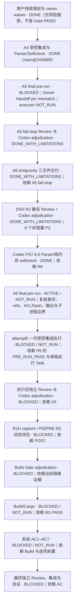

Gate 保持原值：`private_registry_absence=UNPROVABLE`；Technical Gate=`NOT_SATISFIED`；Owner Risk Acceptance=`APPROVED`；Gate Disposition=`WAIVED_BY_OWNER`；Build Authorization=`AUTHORIZED_WITH_EXCEPTION`；`technical condition unmet; user explicitly accepted residual risk`。Build Gate=`BLOCKED`；Hard Build Barrier=`EFFECTIVE`；Build/Cargo=`NOT_RUN`；AC1–AC7=`BLOCKED / NOT_RUN`。Windows Sandbox 不查询、安装、启用或启动；不关机。

最终 pre-run 的四个 frozen Codex 输出目标在 A6 Task 中列出；必须先核实 absent/unignored。Handoff 的 Git 2.48.1 与当前主机查询 2.52.0.windows.1 不一致，需在 final pre-run 以固定 Git executable 重新测量。A6 Task 禁止本 Task 调用 attempt6 executor；若 pre-run 通过，X6 需由 Codex 依据冻结 protocol 单独登记并启动。A6 Task=`doc/tasks/P02PRE-R1H-R6-EXEC-A6.md`；唯一运行状态=`doc/STATUS.md`。

### 历史 DAG 快照：attempt5 final pre-run ACTIVE（已由上方取代）

本文件是唯一规划事实源。用户已取消任务完成后关闭计算机；持续授权覆盖安全范围内的 P02PRE、隔离验证、Build/Cargo、AC1–AC7、修复、Review、重测与集成，但授权不等于任何 Gate/测试 PASS。Windows Sandbox 不查询、安装、启用或启动；Qoder 已退出。

Live root=`G:\CODEX\New Manga`，branch=`main`，HEAD=`343895fb5f0329c0c07a7104ec321b698f967607` / tree=`e12bd627c307d4bf3c851dc09d0b82f97c86ec63`，index SHA-256=`C5CA88842173A8FE4B9C6B6B675528347EECBDC73F85600ABA06F11E3A692B68`，index tree=HEAD tree。最新 checkpoint 在 `verification/P02/codex-checkpoint-p02pre-r1h-round6-attempt5-parser-pass-20261012.md`；其中记录 PS7.6.6、`--no-optional-locks`、NUL status、独立 `:(exclude).tmp.driveupload` pathspec 及 index 前后稳定。所有既存 dirty/untracked 项归原作者并保留；未 reset、clean、stash、stage、commit 或删除。

A4 精确集成与 Parser/73 assertions 已通过；旧 `EXEC-A4` 因冻结 main/index stale 在 invocation 前 `BLOCKED / NOT_RUN`。当前 Active Task=`P02PRE-R1H-R6-EXEC-A5`，Owner/Integrator/Adjudicator=`Codex /root`，非作者 Reviewer=`DeepSeek Harness`。初轮 raw DSH verdict 虽为 `APPROVED_STATIC_CONTENT (0/0/2/3)`，Codex 按冻结协议将其置为 `CHANGES_REQUESTED / NOT_GATE_APPROVED`；follow-up #1=`CHANGES_REQUESTED (0/0/3/2)`；follow-up #2=`APPROVED_STATIC_CONTENT (0/0/0/4)`，Codex 已逐项 adjudicate。DSH hashes=`NOT_VERIFIED`；Codex pins 为 review 时 `22/22`，审后 `21/22`，唯一差异为 Codex 随后追加到 Task 的记录元数据，不是 executor/protocol/Handoff 漂移。审查限制/方法偏差见 `verification/P02/p02pre-r1h-attempt5-exec-review-adjudication-20261012.md`。

PowerShell 7.6.6/Core/FullLanguage 对 attempt5 executor 和继承 selfcheck Parser 均为 0 errors；纯内存 assertions=`73 PASS`，child exit=0/stderr=0，源文件与 `.git/index` pre/post 稳定。两次 harness-context 尝试在路径断言处停止，第三次通过精确内存绑定后通过；没有 dot-source/invoke executor、File.Replace、OS/API、子进程检查、Build/Cargo 或 system AC。完整证据=`verification/P02/codex-p02pre-r1h-attempt5-integration-verify-20261012.json`。

当前只推进 AC5 final pre-run，输出名已在 Task 冻结；必须逐项保存身份/token、profile/moniker/registry 状态、相关 ACL、TEMP/cache/scratch、主/Owner refs/status/index、受保护文件、child image/argv/CWD 和输出目标证据。任何未知或不一致均停止，不能调用 executor。AC6 单次 executor 运行仍 `BLOCKED / NOT_RUN`，依赖最终 `PRE_RUN_PASS`。

以下中文 Mermaid 为当前唯一 DAG；每个节点含目的、状态及主要依赖：

```mermaid
flowchart TD
  AUTH["Owner 风险接受与持续授权 · DONE（不是技术 PASS）"]
  R0["P02PRE-R0 只读取证 · DONE（历史阶段）"]
  R1["R1F/R1G 采集 · DONE_WITH_LIMITATIONS；依赖 R0"]
  R1H5["R1H Round5 集成/自检 · DONE_WITH_LIMITATIONS；AC2 历史 FAILED；依赖 R1"]
  FIX6["Round6 selfcheck 修复 · DONE；依赖 R1H5"]
  A3["attempt3 执行器/协议 Review · CHANGES_REQUESTED（已 adjudicate）；依赖 FIX6"]
  A4["attempt4 Owner 修复 · DONE；依赖 A3 adjudication"]
  REV4["attempt4 非作者 Review · APPROVED_STATIC_CONTENT；依赖 A4"]
  ADJ4["attempt4 Codex pins/adjudication · DONE_WITH_RECORDED_DEVIATION；依赖 REV4"]
  INT4["四文件精确集成 · DONE，main@343895f；依赖 ADJ4"]
  VERIFY4["PS7.6.6 Parser + 73 assertions + source pins · PASS_WITH_EVIDENCE；依赖 INT4"]
  EXA4["attempt4 最终 pre-run · BLOCKED：冻结 main/index 已 stale；依赖 VERIFY4"]
  REVADJ5["attempt5 DSH 静态 Review + Codex adjudication · DONE_WITH_RECORDED_LIMITATIONS；依赖 EXA4 blocker"]
  VERIFY5["PS7.6.6 Parser + 73 纯内存断言 · PASS_WITH_EVIDENCE；依赖 REVADJ5"]
  PRE5["attempt5 AC5 最终只读取证 · ACTIVE；依赖 VERIFY5"]
  RUN["R1H Round6 attempt5 executor 单次运行 · BLOCKED / NOT_RUN；只在 PRE_RUN_PASS 后"]
  POST["执行证据独立 Review/Codex 裁决 · BLOCKED；依赖 RUN"]
  R1HC["R1H capture 最终 pre-run 与 one-shot · BLOCKED；依赖 POST 与父 AC5"]
  R2["P02PRE-R2 动态隔离/写入闭包 · BLOCKED；依赖 R1HC"]
  BG["Build Gate adjudication · BLOCKED；依赖 R2 证据"]
  BUILD["Build/Cargo · BLOCKED / NOT_RUN；依赖 BG"]
  AC["系统 AC1–AC7 · BLOCKED / NOT_RUN；依赖 Build 与 AC 前置"]
  CLOSE["独立最终 Review、集成与 Verify · BLOCKED；依赖 AC"]
  AUTH --> R0 --> R1 --> R1H5 --> FIX6 --> A3 --> A4 --> REV4 --> ADJ4 --> INT4 --> VERIFY4 --> EXA4 --> REVADJ5 --> VERIFY5 --> PRE5 --> RUN --> POST --> R1HC --> R2 --> BG --> BUILD --> AC --> CLOSE
```

Gate 原值：`private_registry_absence=UNPROVABLE`；Technical Gate=`NOT_SATISFIED`；Owner Risk Acceptance=`APPROVED`；Gate Disposition=`WAIVED_BY_OWNER`；Build Authorization=`AUTHORIZED_WITH_EXCEPTION`；固定原文 `technical condition unmet; user explicitly accepted residual risk`。Build Gate=`BLOCKED`；Hard Build Barrier=`EFFECTIVE`；Build/Cargo=`NOT_RUN`；系统 AC1–AC7=`BLOCKED / NOT_RUN`。Round5 AC2 的历史 `FAILED` 单独保留。

恢复点=`verification/P02/codex-checkpoint-p02pre-r1h-round6-attempt5-parser-pass-20261012.md`；当前 Task=`doc/tasks/P02PRE-R1H-R6-EXEC-A5.md`。

### 历史任务图快照：attempt4 Review 已裁决、精确集成尚 ACTIVE（已由上方取代）

本文件是唯一规划事实源。用户撤销了任务完成后关闭计算机；本任务收尾不关机。用户此前持续授权仍覆盖 P02PRE、宿主动态隔离、Build/Cargo、AC1–AC7、修复/Review/重测/集成和 Gate adjudication，但授权不是结果，也不自动放行 Build Gate。Windows Sandbox 不查询、安装、启用或启动。Qoder 已退出，不参与。

本轮相较最近有效 checkpoint `verification/P02/codex-checkpoint-p02pre-r1h-round6-integration-protocol-review-attempt3-active-20261012.md`：此前 main controlled status=`1021 NUL / 68807 bytes / SHA-256 271930A1AC97316B26CFF16B4845BD3259CF69739C0DFED70AFB1E7E54D628BB`；dispatch 前快照=`1034 NUL / 69909 bytes / SHA-256 FC42D14F3DD61B4593F9191ECC9CB12990AB15C6B53EA23067D2A1F8ADF6F8C9`。此后新增 attempt4 Owner follow-up、冻结 pins、DeepSeek Review 原始输出/报告、post-pins 与 Codex adjudication；旧基线无逐路径清单，不能将所有新增归属到作者，故差异仍包含 `UNKNOWN / NOT_VERIFIED`，原作者 dirty/untracked 内容均保留。当前集成前精确 status 将写入 rolling checkpoint。

Live root=`G:\CODEX\New Manga`，branch=`main`，HEAD=`cddff58469b56e181019a8ddfeade80684bc7eb9` / tree=`c25d051a4b9a0bd9773b50170e100f575ea19f2b`；index SHA-256=`214767403C469B15D2BDEE786080E58B4D78BF12C541B9FFB7E8A7FA08F3B89C`。每次 status 命令均将 `:(exclude).tmp.driveupload` 作为独立 argv pathspec；未访问被排除路径。root 有大量既存 dirty/untracked 文件；未 reset、clean、stash、覆盖或删除。

Round6 attempt3 非作者 Review=`CHANGES_REQUESTED`（DSH P0/P1/P2/P3=`0/1/1/7`）。Codex adjudication `8EADB35CE481D34D88191272360FD89F09312E7FC2AD867AA5A0EDFDB25A6FC4` 将数组形状 blocker 由 P2 升至 P1；合并 adjudicated P0/P1/P2/P3=`0/2/0/7`。40/40 frozen source pins 在 Codex dispatch 前、Review 后及报告保存后都匹配。Reviewer shell 初始化失败（`SetNamedSecurityInfoW Win32 5`），Reviewer 自己 raw-byte hashes=`0/40`；故 Codex 证明输入稳定，但不声称 Reviewer 独立 hash attestation。Attempt3 executor 未运行。

当前唯一 Active 产品 Task=`P02`；Active 子 Task=`P02PRE-R1H`；本轮子 Task=`P02PRE-R1H-R6-A4`，Owner 交付、Review 与 Codex adjudication 已完成，Task 状态=`approved`，阶段=`R6_ATTEMPT4_INTEGRATION / ACTIVE`。Owner=`Antigravity`；非作者 Reviewer=`DeepSeek Harness`；Integrator/Adjudicator=`Codex /root`。Task=`doc/tasks/P02PRE-R1H-R6-A4.md`。Owner worktree=`C:/Users/49745/.codex/worktrees/p02pre-r1h-r6-attempt4-antigravity`，branch=`agent/antigravity/P02PRE-R1H-R6-A4`，base=`cddff58469b56e181019a8ddfeade80684bc7eb9`，final HEAD=`c7c7879e8ae90ad23b29d9d8cc6ea97e3eff5427` / tree=`e12bd627c307d4bf3c851dc09d0b82f97c86ec63`，controlled status=0 bytes。Final 16 input pins pre/post=`16/16 MATCH`；DSH verdict=`APPROVED_STATIC_CONTENT`（P0/P1/P2/P3=`0/0/0/4`），Codex adjudication=`ACCEPTED_WITH_RECORDED_PROCEDURE_DEVIATION`，见 `verification/P02/p02pre-r1h-attempt4-review-adjudication-20261012.md`。Review 报告 SHA-256=`8F124B4C5A404AEED295CE3FE599738A14C4386780466A963F021B88E68274A3`；DSH session=`session-688301c1-b706-43d1-9ac7-fc216617474f`，model 未报告。Antigravity 两次实际交付调用均 exit 0（latest conversation=`f25ff5b8-ea03-4d1c-a844-330549336299`，model 未报告）。

Attempt4 Owner 的四个新文件与允许范围由 Task 和 pins manifest 固定。Owner 未运行 executor、Replace、OS/API、Build/Cargo 或 system AC。Codex 只在完成此处集成和 PS7.6.6 parser/selfcheck 后进入 frozen protocol 的 P02PRE 运行步骤。

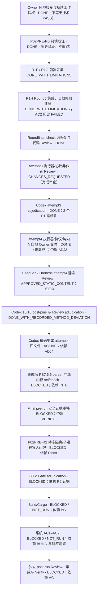

Gate 原值：`private_registry_absence=UNPROVABLE`；Technical Gate=`NOT_SATISFIED`；Owner Risk Acceptance=`APPROVED`；Gate Disposition=`WAIVED_BY_OWNER`；Build Authorization=`AUTHORIZED_WITH_EXCEPTION`；保留原文 `technical condition unmet; user explicitly accepted residual risk`。Build Gate=`BLOCKED`；Hard Build Barrier=`EFFECTIVE`；Build/Cargo=`NOT_RUN`；系统 AC1–AC7=`BLOCKED / NOT_RUN`（未运行，不是测试失败）。Round5 AC2 的 `FAILED` 是独立历史事实，不能被系统 AC 的 NOT_RUN 覆盖。

恢复点=`verification/P02/codex-checkpoint-p02pre-r1h-round6-attempt4-owner-active-20261012.md`（待写入本轮边界证据）。
### 历史任务图快照：Round6执行器修正与受审重试包 ACTIVE（已由上方取代）

Round6 Owner delivery=c1cc26811ea0c7e0690b49e6b8f2edbf4c55987d，代码Review attempt2与Codex adjudication已完成。协议Review attempt2=APPROVED_STATIC_PROTOCOL（0/0/0/0，29/29 pins），Codex adjudication接受协议文本。执行尚未开始：首次只读helper因参数名$args冲突启动20个无argv Git进程；修正后又运行了不属于协议S0的execution-evidence前status。两项均未写集成文件、未替换目标、未运行测试；过程偏离保留为失败证据，不伪记PASS。

Live main=main@cddff58469b56e181019a8ddfeade80684bc7eb9 / tree=c25d051a4b9a0bd9773b50170e100f575ea19f2b / common-dir=G:/CODEX/New Manga/.git；当前controlled status=1015 NUL records / 68343 bytes / SHA-256 DE4024E0416309B120502EE9712268E2652D2E4062E90C8453629DA5E4085F48；index SHA-256=214767403C469B15D2BDEE786080E58B4D78BF12C541B9FFB7E8A7FA08F3B89C。Owner worktree仍为agent/codex/P02PRE-R1H@c1cc26811ea0c7e0690b49e6b8f2edbf4c55987d，controlled status为空。当前root状态相对协议attempt2冻结基线增加Review report与Codex adjudication两个status记录；既有未知dirty/untracked内容未清理。

唯一Active产品Task=P02；Active子Task=P02PRE-R1H；阶段=R6_EXECUTOR_REMEDIATION / ACTIVE。修正包交付物为固定PowerShell 7 executor与新的Round6 integration protocol attempt3；非作者Reviewer=/root/p02_r1h_remediation_review，Integrator/Adjudicator=/root。完成独立Review及Codex裁决后再执行。

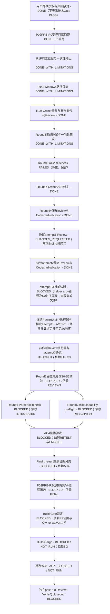

本轮相较有效Round6 attempt2 freeze：协议静态Review新增完成且29/29 pins稳定，Codex adjudication已记录；执行前诊断发现两项Codex编排问题，未开始集成或改动目标。执行器/新协议Review为新增阻塞；历史Round5 AC2失败与用户风险裁决保持原状。排除目录未访问。

### 历史任务图快照：Round6 Review pins重建 ACTIVE（已由上方取代）

## 2026-10-12 历史状态：Round5 已集成；Round6 Review pins 重建 ACTIVE

Round5执行证据边界S3=`989 / 66127 / 0E34A1B0A609F2771EE25CA74A3B88287F2C4410F816F4F17DB691053B02378A`；单次Replace集成=`PASS_WITH_EVIDENCE`，PS7 parser通过，selfcheck真实失败，engine preflight通过。Round6 Owner delivery固定于`c1cc26811ea0c7e0690b49e6b8f2edbf4c55987d`。Review attempt1因root派发后更新Task导致pin漂移，报告=`BLOCKED_BY_MISSING_EVIDENCE`。Attempt2尚未派发：初次pins生成文件错误为JSON `null`，已保留且未用于Review。当前重整Task/Plan/STATUS/Index/checkpoint并准备attempt2的新pins r3；精确状态见最新checkpoint。

Live main=`main@cddff58469b56e181019a8ddfeade80684bc7eb9` / tree=`c25d051a4b9a0bd9773b50170e100f575ea19f2b` / common-dir=`G:/CODEX/New Manga/.git`；`.git/index` SHA-256=`214767403C469B15D2BDEE786080E58B4D78BF12C541B9FFB7E8A7FA08F3B89C`。Owner worktree branch=`agent/codex/P02PRE-R1H`，delivery HEAD=`c1cc26811ea0c7e0690b49e6b8f2edbf4c55987d`，parent=`dd5d2e3bc8e0702da9d059131f6364a997897661`，tree=`96e7273ddd5fd27bee567bba27f19453cabe0842`，controlled status=0 bytes；与主仓共用同一Git common-dir。

Round5执行证据边界为S3；本轮后续治理文档与Review dispatch状态在rolling checkpoint中另记。所有Git porcelain-v2状态命令均使用`-z`并将`:(exclude).tmp.driveupload`作为独立argv，exit=0/stderr=0；排除路径未访问。未知来源dirty/untracked记录未擅自归属或清理。

唯一Active产品Task=P02；Active子Task=`P02PRE-R1H`；阶段=`R6_REBUILD_REVIEW_PINS / ACTIVE`。Task=`doc/tasks/P02PRE-R1H.md`；manifest=`verification/P02/p02pre-r1h-manifest-20261012.md`；Round5 failure evidence=`verification/P02/p02pre-r1h-selfcheck-round5-20261012.json`；Round6 delivery=`agent/codex/P02PRE-R1H@c1cc26811ea0c7e0690b49e6b8f2edbf4c55987d`；attempt1 report=`verification/P02/codex-subagent-p02pre-r1h-static-review-round6-20261012.md`; malformed unsent attempt2 pin/prompt=`...review-pins-r2...json` / `...review-dispatch-r2...prompt.md`; valid attempt2 r3 pins/prompt pending; latest checkpoint=`verification/P02/codex-checkpoint-p02pre-r1h-round6-review-r3-freeze-active-20261012.md`。

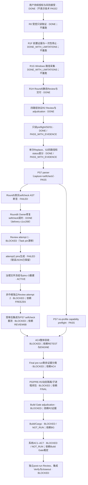

证据：integration execution JSON=`verification/P02/p02pre-r1h-integration-execution-20261012.json`。Single Replace call=`1`且正常返回；Codex独立复核 destination=`57648 / 977C99434C2ED10AD5EAEDF34271781DA330AF495AD78D2F9DD593BD88DBD6EA`，stage absent，recovery/API backup均为Round4旧bytes=`57623 / EEFB41141EBE162503047C20CAF4F41D5E8E01EEF2FCEE0C90DA7185A8164CF1`；S0/S1/S2差分与index通过。执行器postcheck原始false-negative因backup预期错误而保留，Root adjudication=`INTEGRATION_STATE_PASS_WITH_EVIDENCE`。Round5 direct parser errors=0；selfcheck PID 48356 exit=1，失败`Test-RepositorySkipAstContract`，证据=`verification/P02/p02pre-r1h-selfcheck-round5-20261012.json`；engine preflight PID 45772 exit=0 / `PASS`，证据=`verification/P02/p02pre-r1h-engine-preflight-round5-20261012.json`。AC2=`FAILED`；AC4=`BLOCKED_BY_AC2`。AC1 frozen main/scratch status/index baseline=`UNPROVABLE`；capture、Build/Cargo与系统AC1–AC7未运行。

Round6 Owner交付commit=`c1cc26811ea0c7e0690b49e6b8f2edbf4c55987d`，仅改selfcheck并新增Handoff；Owner/root `git diff --check`均exit=0。修正将索引AST限定为`$indexModes[$relative]`和`$parts[$partIndex]`各一次；未运行parser/selfcheck。Review attempt1=`BLOCKED_BY_MISSING_EVIDENCE`（root派发后更新Task造成pin drift），报告保留且未集成。另一次未派发的pins生成失败，JSON `null` 文件及prompt保留；当前刷新文档并生成有效pins r3，之后再派同一非作者Reviewer。Review通过后仍需Codex adjudication与独立Round6集成协议；capture、manifest、共享契约和用户文件不在Owner范围。

Gate原值：`private_registry_absence=UNPROVABLE`；Technical Gate=`NOT_SATISFIED`；Owner Risk Acceptance=`APPROVED`；Gate Disposition=`WAIVED_BY_OWNER`；Build Authorization=`AUTHORIZED_WITH_EXCEPTION`；`technical condition unmet; user explicitly accepted residual risk`；Build Gate=`BLOCKED`；Hard Build Barrier=`EFFECTIVE`；Build/Cargo=`NOT_RUN`；系统AC1–AC7=`BLOCKED / NOT_RUN`。Windows Sandbox不触碰。关机仅在已授权任务链完成且证据/恢复点安全收口后执行。

### 2026-10-12 历史规划快照：R1G capture ACTIVE（已由上方取代）

本文件是唯一任务 DAG。上一有效 checkpoint=Owner remediation ACTIVE，delivery HEAD=4a02811d6edf9ab423d299a36c51f103e62dd5f3；本轮新增 Owner round-two delivery HEAD=92c90a9ba20f7a1b4ab090837f99c191745524f6，并开始独立 Review。主仓 status 与本轮 checkpoint 数据待本次新增 Review artifacts 落盘后刷新。未归属 dirty/untracked 文件仍保留且不猜测。

Live Git=main@cddff58469b56e181019a8ddfeade80684bc7eb9 / tree=c25d051a4b9a0bd9773b50170e100f575ea19f2b；index SHA-256=214767403C469B15D2BDEE786080E58B4D78BF12C541B9FFB7E8A7FA08F3B89C。唯一 Active 产品 Task=P02；Active 子 Task=P02PRE-R1G，状态=in_progress / CAPTURE_AUTHORIZED_ONE_SHOT。Candidate worktree=C:/Users/49745/.codex/worktrees/p02pre-r1g/New Manga；branch=agent/antigravity/P02PRE-R1G；base=cddff58469b56e181019a8ddfeade80684bc7eb9；HEAD=946938bd0696dfddd01f87d61fe6723c63ecdc86；tree=09c8241cb0f4af509004eed070a10bb292d933c7；base→HEAD 仅三项授权文件。主仓三文件已从该 reviewed HEAD 以 CreateNew 集成并与 pins 匹配；证据=verification/P02/p02pre-r1g-integration-followup3-20261012.json。

Antigravity follow-up dispatch status=SUCCESS / CLI exit=0 / conversation=4cd35c4c-6a12-4953-bb4f-3bde5d687b6e；原始 stdout=verification/P02/antigravity-p02pre-r1g-review-fixes3-20261012.stdout.json（13503 / 16B51CD430BD84AB0FF49C5B951C658104B5EDD07C91800E6909BC21F01C00E8），stderr=0 / E3B0C44298FC1C149AFBF4C8996FB92427AE41E4649B934CA495991B7852B855，exit=3 / 13BF7B3039C63BF5A50491FA3CFD8EB4E699D1BA1436315AEF9CBE5711530354。Codex delivery adjudication=verification/P02/p02pre-r1g-r009-r010-delivery-adjudication-20261012.md（3832 / 8F020377B5BDA73DF12A0123600CD3D52F6A9A23FDB0D3A3E2F9F125E1EEDAE7；需由 hash 再核验）。Codex 接受 delivery 进入独立 Review，不表示 Review approval、AC4 release、集成或 runtime PASS。AGY 表示没有读主仓/Task/manifest，但完整工具调用轨迹未提供，故其自述不作为独立路径访问证据；以前的 WORKTREE_RELATIVE_EXCLUDED_PATH_ACCESS=NOT_VERIFIED 保持。

Review follow-up 3 已由非作者 Reviewer `/root/p02_r1g_review_followup3`（Codex Reviewer，gpt-6.1-sol / medium）完成，verdict=`APPROVED_STATIC_CONTENT`，findings=0/0/0/0；root pre/post pin 均 11/11 MATCH。Codex 已将 reviewed 三文件从 branch `agent/antigravity/P02PRE-R1G` @ `946938bd0696dfddd01f87d61fe6723c63ecdc86` 以 `CreateNew` 精确集成到 main；大小与 SHA-256 均匹配 pins，main HEAD 未变，详见 `verification/P02/p02pre-r1g-integration-followup3-20261012.json`。后续 parser/self-check、PS7 no-profile engine capability preflight 与 final pre-run 均已实际 PASS；当前 Active 步骤为按冻结 manifest 执行一次 R1G capture（已授权，尚未运行）。

非作者 Reviewer 的静态 Review、补充文档/证据一致性 Review（`APPROVED`，0/0/0/0）、Codex adjudication、精确集成、parser/self-check 与 PS7 no-profile engine preflight 均已完成。final pre-run=`PRE_RUN_PASS`：46/46 检查通过；身份/SID/token、main/scratch refs/status/index、96 个受保护路径的 hashes 与 Git inventory membership、14 项固定/补充 pins、capture targets absent 均匹配。证据与 96 项明细写入 `verification/P02/codex-checkpoint-p02pre-r1g-20261012.md`。以下 Mermaid 是当前唯一任务 DAG：
```mermaid
flowchart TD
  AUTH["持续授权与风险例外记录 · DONE（不等于 Gate PASS）"]
  R0["R0 静态与只读取证阶段 · DONE（不重跑）"]
  R1["R1 / R1F 前置证据及已消耗 one-shot 裁定 · DONE_WITH_LIMITATIONS"]
  DSH["R1G DSH Review 程序偏差与无效 follow-up adjudication · DONE_WITH_FINDINGS"]
  FIX1["R1G ArgumentList 最小修复与 delivery 核验 · DONE"]
  RV2["Codex 非作者 Review follow-up 2 与 adjudication · DONE_WITH_FINDINGS（R-009/R-010）"]
  FIX2["Antigravity R-009/R-010 最小返修及 Codex delivery acceptance · DONE_FOR_REVIEW"]
  RV3["冻结 follow-up 3 pins、独立 Review、root adjudication · DONE / APPROVED_STATIC_CONTENT"]
  INT["审查后候选三文件精确 CreateNew 集成 · DONE"]
  PARSE[PowerShell 7 parser 与纯函数自检 · DONE]
  PREFLIGHT[PowerShell 7 no-profile 能力预检 · DONE]
  DOCREVIEW[Task、manifest 与已生成证据一致性 Review · DONE / APPROVED]
  PRERUN[身份、refs/status/index、96 hashes 与 pins 最终复核 · DONE / PRE_RUN_PASS]
  CAPTURE[R1G 单次只读取证 capture · ACTIVE / ONE_SHOT_AUTHORIZED（尚未运行）]
  R2["P02PRE-R2 动态隔离与子进程写入闭包 · BLOCKED"]
  BG["剩余安全证据与 Build Gate 裁定 · BLOCKED"]
  BUILD["授权范围 Build/Cargo · BLOCKED / NOT_RUN"]
  AC["P02 AC1–AC7 实际验收 · BLOCKED / NOT_RUN"]
  CLOSE["独立 Review、集成、Verify 与 P02 closeout · BLOCKED"]
  AUTH --> R0 --> R1 --> DSH --> FIX1 --> RV2 --> FIX2 --> RV3 --> INT --> PARSE --> PREFLIGHT --> DOCREVIEW --> PRERUN --> CAPTURE --> R2 --> BG --> BUILD --> AC --> CLOSE
```

Gate 原值不变：private_registry_absence=UNPROVABLE；Technical Gate=NOT_SATISFIED；Owner Risk Acceptance=APPROVED；Gate Disposition=WAIVED_BY_OWNER；Build Authorization=AUTHORIZED_WITH_EXCEPTION；精确原文 technical condition unmet; user explicitly accepted residual risk。Build Gate=BLOCKED；Hard Build Barrier=EFFECTIVE；Build/Cargo=NOT_RUN；AC1–AC7=BLOCKED / NOT_RUN（未运行，不是失败）。不查询、安装、启用或启动 Windows Sandbox。用户要求全部授权任务安全收口和证据归档后正常关机；当前仅 R1G capture 获得一次性放行，任务链未完成，不关机。


### 2026-10-11 派发前历史规划：R1F capture fail-stop；follow-up #4 ACTIVE（已由上方取代）

本文件仍是唯一任务 DAG。前一有效 checkpoint=`verification/P02/codex-checkpoint-p02pre-r1f-20261011.md`，受控状态=`719 NUL / 47279 bytes / SHA-256 5CB2B903F79F85E5A0203B527E69D63D43C43456E6BA52116DD50AC44C5932A8`。随后快照依次为 `805 / 52141 / 079E474F5EFB44D678A6C9382A2BAE06A1C645DC49386CC902BCD7B0F0DCC077`、`813 / 52669 / 6F596D50CB7E04E016D9E9649CAE3366478EA0ED235FA2BF804AA5E48D9834E4`、`818 / 53087 / 80977CC7DC1E61CEB5C20C5F7AD6FAAFCDB694DEBE9B8E1FAAEE1FDC713E78DD`；当前快照=`820 NUL / 53254 bytes / SHA-256 436EE5F37E78A514309CEFBD33FF7CAD244A8A3C884E79C9C39919CCF6FE537F`，较前一有效 checkpoint `+101 records / +5975 bytes`，较 818 快照 `+2 / +167`。818→820 新增的是 follow-up #3 dispatch-failure record 和 #4 prompt placeholder；813→818 的五条为 follow-up #2 stdout/stderr/exit、Codex adjudication 与 #3 prompt。更早快照文件级归因仍=`UNKNOWN / NOT_VERIFIED`。本次 raw status 命令 exit=0、stderr=0、输出不含 `.tmp.driveupload`；其内容和元数据未读取/哈希，其他 dirty/untracked 内容保留。

R1F one-shot 已真实执行并在 main `.git/index` prehash 因 Windows PowerShell 5.1 `Get-FileHash` `CommandNotFoundException` fail-stop，exit=1；这不是 AC 失败。host identity=`PASS_WITH_EVIDENCE`，其余未到达项按 post-run adjudication 保持未证明。非作者 DeepSeek Harness post-run Review=`CHANGES_REQUESTED (0/0/2/2)`；Codex 接受 F1 文档修复并将 F2–F4 转交 successor，逐项见 `verification/P02/p02pre-r1f-postrun-adjudication-20261011.md`。其文档 follow-up #2=`CHANGES_REQUESTED (0/0/0/1)`，唯一 P3 `R1F-DOC2-01` 指出 R1G manifest 把两个历史 R1F pins 标成当前值；Codex 已接受并将其改为“R1G 初始冻结时的 superseded 历史版本”，Codex adjudication=`verification/P02/p02pre-r1f-postrun-review-followup2-docs-adjudication-20261011.md`。follow-up #3 因 DSH 调用输出通道故障超时，分类=`DISPATCH_TIMEOUT / NOT_A_REVIEW`，没有 verdict；其异常诊断请求导致旧 session 状态不明，故 follow-up #4 改用新 session。失败证据=`verification/P02/p02pre-r1f-postrun-docs-followup3-dispatch-failure-20261011.md`。当前 Active Task=`P02PRE-R1F`，步骤=`R1G manifest pin 文案修复的独立窄复审 follow-up #4`；原 verdict 保留，R1F one-shot 不重跑。`P02PRE-R1G`=`READY`，Owner=Antigravity、Reviewer=DeepSeek Harness，依赖 R1F 收口；后继执行器固定为 PowerShell 7.6.6，但其 no-profile child capability 仍待 preflight，未宣称兼容已验证。

用户授权持续有效。技术和产品门值严格保持：`private_registry_absence=UNPROVABLE`；Technical Gate=`NOT_SATISFIED`；Owner Risk Acceptance=`APPROVED`；Gate Disposition=`WAIVED_BY_OWNER`；Build Authorization=`AUTHORIZED_WITH_EXCEPTION`；`technical condition unmet; user explicitly accepted residual risk`。Build Gate=`BLOCKED`；Hard Build Barrier=`EFFECTIVE`；Build/Cargo=`NOT_RUN`；AC1–AC7=`BLOCKED / NOT_RUN`。Windows Sandbox 不查询、安装、启用或启动。

Live Git=`G:/CODEX/New Manga`，`main@cddff58469b56e181019a8ddfeade80684bc7eb9` / tree=`c25d051a4b9a0bd9773b50170e100f575ea19f2b`。main `.git/index` SHA-256=`214767403C469B15D2BDEE786080E58B4D78BF12C541B9FFB7E8A7FA08F3B89C`。scratch=`G:/CODEX/P02-scratch-build-source`，detached HEAD=`7ce3c40cd308e7093929bd5f53abc4f8a6c4ef7a` / tree=`ce8056b8ef4d2ebd11bb4754b206adf921a39e41`，此前核验 clean；本轮无 scratch 写入。R1G linked worktree=`C:/Users/49745/.codex/worktrees/p02pre-r1g/New Manga`，branch=`agent/antigravity/P02PRE-R1G`，base=`cddff58469b56e181019a8ddfeade80684bc7eb9`；它不含 main 的未提交 Task/manifest 文件。

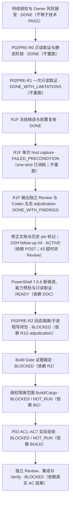

当前执行顺序：Codex 已修正 R1G manifest 的两处历史 pin 标签；follow-up #3 没有 Review 结果，已记录为超时。DeepSeek Harness 将在新 session 中只读确认该 P3 修复与同步状态事实。Codex adjudicate 后才关闭 R1F 并激活 R1G；随后 Antigravity 按冻结三文件范围实现，DeepSeek Harness Review，Codex 集成/解析自检/能力预检。未经 R1G 候选 Review、独立 engine preflight 和新的 final pre-run PASS，不运行 R1G capture。Build Gate 与 Hard Barrier 不因授权、Review、parse 或 preflight 自动改变。

### 2026-10-11 历史规划快照：cohort #11 Review 与 adjudication 完成；final pre-run ACTIVE（已由上方取代）

本文件是唯一任务 DAG。上个有效 #10 checkpoint=`714 NUL / 46886 bytes / SHA-256 6E58E901E923AE9D2A65F1B4FB088C3C5996C9D417C26B66C98560822AE9FDDA`；cohort #11 prompt 与三路 DSH 结果生成后、Codex adjudication 和文档集成前=`718 NUL / 47198 bytes / SHA-256 97F21540BEB9DBA6D96DD058F28343D8DF0E5BF05E77B6BEB9C3DA0BB8245F81`；本轮 adjudication/文档更新后当前=`719 NUL / 47279 bytes / SHA-256 5CB2B903F79F85E5A0203B527E69D63D43C43456E6BA52116DD50AC44C5932A8`（相对 #10 checkpoint +5 records/+393 bytes）。更早 checkpoint 的 760/48780 与 688/44882 差异仍因旧 raw stdout 未留存而=`UNKNOWN / NOT_VERIFIED`，不得推断文件删除或变化。所有快照使用固定 pathspec 排除 `.tmp.driveupload`，staging 内容未读取/哈希；既有 dirty/untracked 内容保留。

本轮新增完成：cohort #11/fixreview10 由非作者 DeepSeek Harness（session=`session-2bb2d17a-1811-4605-8731-f6b0e51b2e8e`）独立 Review=`APPROVED (0/0/0/0)`，CLI exit=0；Codex adjudication 接受 verdict，独立复算冻结输入 pins=`15/15 MATCH`。Reviewer 因 sandbox `SetNamedSecurityInfoW Win32 5` 未能独立运行命令/Git/hash；该证据限制已记录。Codex 修正 checkpoint 将“5 个目标都不存在”改为逐项检查：prompt 是预先冻结的输入，派发前需确认 stdout/stderr/exit 与独立 adjudication 目标不存在。#10 原 verdict 与 F9-1 修复记录保持不变；#9 原 verdict 与 F8-1–F8-4 adjudication 保持不变；#8 继续 `NOT_DISPATCHED / NOT_REVIEWED`。Build Gate 未放行；Capture=`BLOCKED / NOT_RUN`。状态从“#11 READY”转为“治理 Review 已 adjudicate；final pre-run ACTIVE”。

用户持续授权涵盖 host getter、AppContainer/profile/registry/ACL 验证、动态隔离、子进程与写入闭包、P02PRE、Build/Cargo、AC1–AC7、自动修复/Review/重测/集成。授权不是 Gate PASS。只有重大用户数据风险、超出 manifest 的大范围系统修改、身份/目标明显错误、永久削弱 Windows 核心安全机制或真正不可逆且无法自动判断的风险才升级用户。R0 静态 runner/source-contract 研究已结束，不重复；Windows Sandbox 不查询、安装、启用或启动。

Live Git=`G:/CODEX/New Manga`，branch=`main`，HEAD=`cddff58469b56e181019a8ddfeade80684bc7eb9`，tree=`c25d051a4b9a0bd9773b50170e100f575ea19f2b`，common-dir=`G:/CODEX/New Manga/.git`。当前受控 status=`git status --porcelain=v1 -z -- . :(exclude).tmp.driveupload`，exit=`0`、stderr=`0`、719 NUL records / 47279 bytes / SHA-256 `5CB2B903F79F85E5A0203B527E69D63D43C43456E6BA52116DD50AC44C5932A8`；输出不含 staging path。main index SHA-256=`214767403C469B15D2BDEE786080E58B4D78BF12C541B9FFB7E8A7FA08F3B89C`。scratch=`G:/CODEX/P02-scratch-build-source`，common-dir=`G:/CODEX/P02-scratch-build-source/.git`，detached HEAD=`7ce3c40cd308e7093929bd5f53abc4f8a6c4ef7a` / tree=`ce8056b8ef4d2ebd11bb4754b206adf921a39e41`，status clean / 0 bytes，index SHA-256=`6B03C0524E8D49A927CF379DDF300B7A52F1A6B1A0FB02E829DD84CFC07D54A9`；`symbolic-ref --short HEAD` 返回预期 detached 响应。worktrees=`361`。`.tmp.driveupload` 内容未读/哈希；没有 reset/clean/stash/覆盖/删除/提交。

Task=`doc/tasks/P02PRE-R1F.md`，`30565 / C39E9CB2730A2C6EE37153A945093D276FD2BD8F951E302C764EF776D2F5EAE7`；manifest=`verification/P02/p02pre-r1f-manifest-20261011.md`，`44417 / 7F251BD0C2283192DFC53ACB0338E171AC369D24C1CDB859684809DD5A33FA73`。R1F script/R8 source unchanged；cohort #5–#11 Review/dispatch evidence pins 在 manifest。cohort #11 已 adjudicate；当前 Active step 为 final pre-run，只读核验全部满足后才决定是否释放一次 capture。

R8=`verification/P02/p02pre-r1f-parser-windows-powershell-5.1-r8-20261011.json`，`2595 bytes / SHA-256 2C3BA665FF16D5CD8F9749CEE4BB2BCDCB4102661ACAFDF67A889FEA8F66A696`。输入=`67582 / 5A3FE118A8758CCDF0BEDBE170D31B34DA6C338101096EAA825DE80DF70E8316`；child=`C:\Windows\System32\WindowsPowerShell\v1.0\powershell.exe`、`5.1.26100.9549`、PSEdition=`Desktop`；parse=`PARSE_OK`、errors=`0`、exit=`0`、stderr bytes=`0`、`captureScriptInvoked=false`、sourceMatchesReview=`true`。

风险状态保持：`private_registry_absence=UNPROVABLE`；Technical Gate=`NOT_SATISFIED`；Owner Risk Acceptance=`APPROVED`；Gate Disposition=`WAIVED_BY_OWNER`；Build Authorization=`AUTHORIZED_WITH_EXCEPTION`；精确记录 `technical condition unmet; user explicitly accepted residual risk`。Build Gate=`BLOCKED`；Hard Build Barrier=`EFFECTIVE`；Build/Cargo=`NOT_RUN`；AC1–AC7=`BLOCKED / NOT_RUN`。

编排 PowerShell=`7.6.6`；冻结 capture executor/parser target=`C:\Windows\System32\WindowsPowerShell\v1.0\powershell.exe` / Windows PowerShell `5.1.26100.9549`。PowerShell 7.6.6 对同一脚本做过独立 `Parser::ParseFile` 只读解析，errors=`0`；此项不证明运行期兼容，也不改变已审查的 5.1 执行契约。项目未声称 PowerShell 7 不兼容。Codex runtime=`gpt-6-luna / max`；首选 `gpt-6.1-sol / high` 当前不可用；Qoder 未参与。

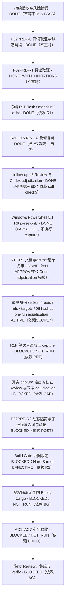

下一步：Codex 按 `doc/tasks/P02PRE-R1G.md` 与冻结 manifest 启动一次 PowerShell 7.6.6 capture；精确 runner argv、CWD、stdout/stderr/exit、source pre/post pins 全部留证，所有输出用 `CreateNew`。若出现身份/目标不符、未知 child、输出冲突或证据异常，停止并保留已产生证据，不重试。capture 后派发非作者 Review 并由 Codex adjudication；此 capture 放行不解除 Build Gate。

### 2026-10-11 历史规划快照：P02PRE-R1F R5 独立 Review 执行中（已由上方取代）

本文件是唯一任务 DAG。与上一有效 checkpoint 的基线 `694 NUL records / 43991 bytes / SHA-256 9C2761D2556DD46CBC9C44D905D0B6306F2E858121FFF630FC12DB07048E5A3B` 相比，当前受控快照为 `698 / 44255 / 87876DE2D68A29FC937FCEBED4C48419E6858970B93A08BD3A88591940CE13B5`（+4 records / +264 bytes）。新增完成：R7 对旧候选 `PARSE_OK`；R5 修复候选 PS 5.1 隔离自检=`PASS_WITH_EVIDENCE`（四函数、0 输出、未调用 capture/getter）；首次 wrapper 因 Codex helper 使用 PS 5.1 不支持的 SHA API 在 parse 前退出，该 harness failure 已保留，不归类为脚本失败。执行前检查发现旧候选会 hash `.tmp.driveupload` 用户暂存文件，且不能接受 scratch detached HEAD 的精确 `symbolic-ref` 结果；capture 未运行。状态从 R7 parse 转为 R5 安全候选独立 Review；无 HUMAN_REQUIRED。

用户持续授权已扩展到 host getter、AppContainer/profile/registry/ACL 验证、动态隔离、子进程与写入闭包、P02PRE、Build/Cargo、AC1–AC7、修复/Review/重测/集成；不得因已获授权而伪记技术 Gate PASS。只有重大用户数据风险、超出 manifest 的大范围系统修改、身份/目标错误、永久削弱核心安全机制或无法自动判断的不可逆风险才升级用户。R0 静态阶段关闭，不重复 runner/source-contract 静态研究。

Live Git=`G:/CODEX/New Manga`，branch=`main`，HEAD=`cddff58469b56e181019a8ddfeade80684bc7eb9`，tree=`c25d051a4b9a0bd9773b50170e100f575ea19f2b`，common-dir=`G:/CODEX/New Manga/.git`。受控 NUL status=`exit 0 / 698 records / 44255 bytes / SHA-256 87876DE2D68A29FC937FCEBED4C48419E6858970B93A08BD3A88591940CE13B5 / stderr 0 bytes`；`.git/index` 前后 SHA-256 均=`214767403C469B15D2BDEE786080E58B4D78BF12C541B9FFB7E8A7FA08F3B89C`；worktrees=`361`、当前 repo 恰一项。工作区 dirty；既有未提交内容作者未知并保留，未 reset/clean/stash/覆盖/删除。与上一 checkpoint 相比新增的 4 个 status 记录是 R7 parser artifact、R5 首次 helper failure、自检 retry JSON 与 R5 Review prompt。

唯一 Active 产品 Task=P02；Active 子 Task=P02PRE-R1F，依赖 P02PRE-R1。Owner/Author/Integrator/Adjudicator=Codex /root，非作者 Reviewer=DeepSeek Harness。当前 Task=21428 / 81D4EB50480475B41BCA366C37078B93370E85B1AB8AB6CFAC73F89649765E73；manifest=20571 / 06B724979F8F4065372DACDE0BBE713013864FE4431BD5BE1ACE871DEAE5F946；script=65533 / 6B7556C784607B9CA52EC0879895676C13FE1AD67E0639A0C64269C700240CD1；self-check=2308 / 1696B781A65D87D210F4CA909891FAF7ACCD088167091DF1EEB381E41A2CF1E2；follow-up #1 adjudication=6330 / ED8A9D950A75E4BF8778E5F737D40BB73C008A134956C74573C51FAC830B779C。首轮 Review、follow-up #1 Review 与两轮 Codex adjudication 分别独立归档。

R4 follow-up=`APPROVED (0/0/0/0)`；R7=`PARSE_OK` 只绑定修复前脚本，为历史 parser。当前 Active step=DSH Round 5 只读 Review，session=`session-c42e3dff-f2db-4333-a39e-9c970a261772`，prompt=`4024 bytes / 5FF83A1B8ADBD578A7ACC7A08C173F0339ED792FA4798E2E607BBBA5711AC682`；stdout/stderr/exit 尚未返回。通过后才做 Codex adjudication、R8 当前脚本 PS 5.1 parse-only，再独立 pre-run adjudication。R1F capture=`BLOCKED / NOT_RUN`；evidence target 当前 absent。

风险裁决保持：`private_registry_absence=UNPROVABLE`；Technical Gate=`NOT_SATISFIED`；Owner Risk Acceptance=`APPROVED`；Gate Disposition=`WAIVED_BY_OWNER`；Build Authorization=`AUTHORIZED_WITH_EXCEPTION`；`technical condition unmet; user explicitly accepted residual risk`。本 Task 仅采集只读证据；Build Gate=`BLOCKED`；Hard Build Barrier=`EFFECTIVE`；Build/Cargo=`NOT_RUN`；AC1–AC7=`BLOCKED / NOT_RUN`。Windows Sandbox 不查询、安装、启用或启动。

```mermaid
flowchart TD
  AUTH["持续授权与 Owner 风险接受 · DONE（不等于技术 PASS）"]
  R1["P02PRE-R1 一次只读取证 · DONE_WITH_LIMITATIONS（reparse safe-stop；不重跑）"]
  R1F["R1F 修复与冻结 Task/manifest/script · DONE"]
  REV2["Round 2 Review 与三项 P3 修复/self-check · DONE"]
  REV3["Round 3 非作者 Review 与 adjudication · DONE"]
  R4["R4 follow-up 独立 Review · DONE（APPROVED；F1 false positive、F3 修复）"]
  R7["R7 旧候选 PS 5.1 parse-only · DONE（历史证据；仅解析）"]
  ISSUE["执行前发现用户暂存 no-read 与 detached-ref 缺口 · DONE（capture 未运行）"]
  FIX["修复并冻结 R5 Task/manifest/script · DONE"]
  SELF["PS 5.1 四函数隔离自检 · PASS_WITH_EVIDENCE"]
  REV5["DeepSeek Harness 独立只读 Review · ACTIVE / DISPATCHED"]
  R8["Windows PowerShell 5.1 parser R8 纯解析 · READY_AFTER_FOLLOWUP5_APPROVED"]
  PRE["Codex pre-run 身份、路径、pins、status、目标与 protected hash 核验 · READY_AFTER_R8"]
  CAP["R1F 单次 host getter/hash/ACL 取证 · BLOCKED / NOT_RUN（依赖 pre-run adjudication）"]
  POST["R1F 输出独立 Review 与五态 adjudication · BLOCKED（依赖真实 JSON）"]
  R2["P02PRE-R2 动态隔离/controller 验证 · BLOCKED（依赖 R1F adjudication）"]
  BG["Build Gate / Hard Barrier adjudication · BLOCKED / EFFECTIVE（依赖动态证据）"]
  BUILD["隔离产品 Build/Cargo · BLOCKED / NOT_RUN（依赖 Build Gate）"]
  AC["真实执行 AC1–AC7 · BLOCKED / NOT_RUN（依赖 Build 与动态闭包）"]
  CLOSE["独立 Review、集成、验证与 DAG 刷新 · BLOCKED（依赖 AC 真实结果）"]
  AUTH --> R1 --> R1F --> REV2 --> REV3 --> R4 --> R7 --> ISSUE --> REV5 --> FIX --> SELF --> REV5F2 --> REV5F3 --> REV5F4 --> FIX4 --> SELF4 --> REV5F5 --> R8 --> PRE --> CAP --> POST --> R2 --> BG --> BUILD --> AC --> CLOSE
```

任何未采集条件继续标 `UNPROVABLE`/`REQUIRES_ACTIVE_TEST`；风险接受、Review 与 parse 都不是 Gate PASS。R0 到此结束；不重复 runner/source-contract 静态研究。

### 2026-10-11 历史规划快照：P02PRE-R1 pre-run capture 就绪（已由上方取代）

本文件仍是唯一 DAG。对比最近有效 checkpoint `verification/P02/codex-checkpoint-p02pre-r1-20261011.md`（R4 pin follow-up #2 待结果）：该基线记录 status=`641 NUL records / 40544 bytes / SHA-256 1CD3EA561319E4C9BF3FC0730C0F61C1C94EC38605B7D42830CE7349FF225550`。本轮文档刷新前的同参快照为 `651 / 41249 / ECFEBBC7D617B06FCFFFDAE9041103785C6D04E48B40C10F1F38E372D3F29D02`（+10 条、+705 bytes）；这是刷新前的比较时点，不代表 capture 时最终 status。新增变化：R4 follow-up #2 `APPROVED` 并关闭 P3-PIN-1；核对发现 manifest 两句仍待办，Codex 修订后由原非作者 Reviewer follow-up #3 `APPROVED`；Codex pre-run adjudication 已释放唯一一次 R1 read-only capture。无用户决策阻塞。Live Git 仍为 `main@cddff58469b56e181019a8ddfeade80684bc7eb9` / tree=`c25d051a4b9a0bd9773b50170e100f575ea19f2b`，工作区 dirty，既有未知作者变更均保留。

唯一 Active 产品 Task=P02；当前 Active 子 Task=`P02PRE-R1`，Owner/Author/Integrator/Adjudicator=`Codex /root`，非作者 Reviewer=`DeepSeek Harness`（session=`session-a98bffe4-310e-4726-8125-830ca5d0f02c`）。最终 manifest=`verification/P02/p02pre-r1-manifest-20261011.md`（`12615 bytes / A5510774B47C17EB29C5BF5D73FE7B755C72E2726FC5280E7EF11A91A23C67A`）；capture=`verification/P02/p02pre-r1-capture.ps1`（`38729 bytes / 97400A9EF16E47242DA3C4E53C8265F16BA9A70853B26D3905748B9CA69884AB`）；parser=`verification/P02/p02pre-r1-windows-powershell-parse-r4-20261011.json`（`2086 bytes / 1AE3462C5EB16E85B47A03E90CBC53DA33F5EAD74FCB1992BADC5F6A805841`）；adjudication=`verification/P02/p02pre-r1-adjudication-20261011.md`。DSH R1/2/3=`CHANGES_REQUESTED`（`0/2/6/3`、`0/0/3/2`、`0/0/1/2`，累计 19 项均 closed）；R4 full=`CHANGES_REQUESTED`（`0/0/0/1`，P3-DOC-1 后修）；follow-up #1=`CHANGES_REQUESTED`（`0/0/0/1`，P3-PIN-1 为 Reviewer 转录错误）；follow-up #2/#3=`APPROVED`（各 `0/0/0/0`）。DSH 未独立复算 hash（sandbox Win32 5）；Codex 对 manifest/script 三方法复算一致并记录限制。P3-PIN-1 是文字转录错误，不是技术证据差异。

当前状态：R1 capture=`ACTIVE`（尚未运行；pre-run adjudication 仅释放一次）；证据 review 与 post-run adjudication=`BLOCKED`（依赖真实 JSON）；P02PRE-R2 动态 isolation/controller Task=`BLOCKED`（依赖 R1 evidence review/adjudication）；Build Gate=`BLOCKED`、Hard Build Barrier=`EFFECTIVE`、Build/Cargo=`NOT_RUN`、AC1–AC7=`BLOCKED / NOT_RUN`。`private_registry_absence=UNPROVABLE`；Technical Gate=`NOT_SATISFIED`；Owner Risk Acceptance=`APPROVED`；Gate Disposition=`WAIVED_BY_OWNER`；Build Authorization=`AUTHORIZED_WITH_EXCEPTION`；原文必须保留 `technical condition unmet; user explicitly accepted residual risk`。R1 未证明的 `tempCache`、有效 WER policy、完整路径访问/子进程/写入闭包和缺失对象 ACL 继续分类为实际五态之一，不作 PASS。Windows Sandbox 不查询、安装、启用或启动。

协作：R1 Owner=Codex、Reviewer=DeepSeek Harness、验收=精确冻结 manifest 下的唯一 capture + 独立证据 Review + Codex adjudication。下一 Task 先由 Codex 建立/冻结 `P02PRE-R2` manifest 与范围；拟用 Antigravity 承担 native controller/probe 实现，DeepSeek Harness 独立 Review，Codex 集成与 Gate adjudication；R1 完成前 R2 仍 `BLOCKED / NOT_RELEASED`，Task 路径/HEAD/allowed paths 未定，不派发。Codex runtime=`gpt-6-luna / max`；优先 `gpt-6.1-sol / high` 当前不可用；本轮没有调用 Codex subagent。

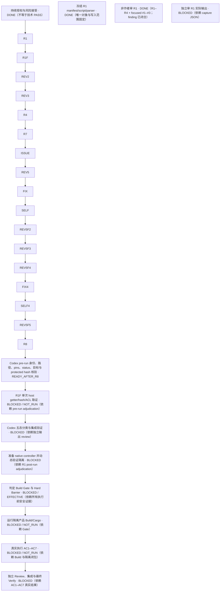

### 2026-10-11 旧规划快照：R4 pin finding 窄复核进行中（已由上方取代）

本文件仍是唯一 DAG。相较最近有效 checkpoint `verification/P02/codex-checkpoint-p02pre-r1-20261011.md`（Round 2 Review 待结果）：Round 3=`CHANGES_REQUESTED`（`0/0/1/2`），确认 Round 1 的 11 项和 Round 2 的 5 项均关闭；Round 4 全量 Review=`CHANGES_REQUESTED`（`0/0/0/1`），确认 19 项历史 finding 全部关闭、唯一文档 finding 已修；第一次窄复核仍=`CHANGES_REQUESTED`（`0/0/0/1`），其唯一 pin finding 与 Codex 本机 .NET、`Get-FileHash`、`certutil` 三种计算及 parser JSON 三个 hash 字段不符，实际证据均为同一 SHA `97400A9E…84AB`，显示是 Reviewer 将 `4` 转录成 `D`。Codex 已将该字面差异交原 Reviewer 做第二次极窄确认。新增完成：R3/R4 全量 Review、manifest 修订和 hash-bound parser；当前 Active 为 pin finding 确认；R1 capture 继续等待非作者确认与 Codex adjudication，无用户决策阻塞。

用户持续授权允许 host getters、动态隔离、P02PRE、Build/Cargo、AC1–AC7、修复/Review/重测/集成；R0 结束，不重复静态 runner/source-contract 研究。风险裁决保持 `private_registry_absence=UNPROVABLE`；Technical Gate=`NOT_SATISFIED`；Owner Risk Acceptance=`APPROVED`；Gate Disposition=`WAIVED_BY_OWNER`；Build Authorization=`AUTHORIZED_WITH_EXCEPTION`；逐字保留 `technical condition unmet; user explicitly accepted residual risk`。该授权与 waiver 不等于技术 PASS，也不豁免其它安全条件。Build Gate=`BLOCKED`；Hard Build Barrier=`EFFECTIVE`；Build/Cargo=`NOT_RUN`；AC1–AC7=`BLOCKED / NOT_RUN`。Windows Sandbox 不查询、安装、启用或启动。

Live baseline=`G:/CODEX/New Manga`；branch=`main`；HEAD=`cddff58469b56e181019a8ddfeade80684bc7eb9`；tree=`c25d051a4b9a0bd9773b50170e100f575ea19f2b`；common-dir=`G:/CODEX/New Manga/.git`。与上次 checkpoint 相同选项的 status 从 `613 NUL records / 38669 bytes` 变为 `641 / 40544`，SHA-256=`1CD3EA561319E4C9BF3FC0730C0F61C1C94EC38605B7D42830CE7349FF225550`；`.git/index` SHA 前后相同=`214767403C469B15D2BDEE786080E58B4D78BF12C541B9FFB7E8A7FA08F3B89C`；worktrees=`361`、当前路径 1 个。工作区仍 dirty；所有既有未提交文件保留、未知作者归属不推断。状态摘要与原始 NUL bytes 配对见当前 checkpoint。

R1 Task=`doc/tasks/P02PRE-R1.md` (`17501 bytes / SHA-256 6C4EBFD8888275A050127C5081BE892081FA9625E5BB987B8AE1C8532D9E2BAD`)；manifest=`verification/P02/p02pre-r1-manifest-20261011.md` (`12598 bytes / SHA-256 41D4EBFD36135AA3AACFCE62DE0D6A4BF23C98D2B8F69103B422F2CDE4A1F144`)；capture=`verification/P02/p02pre-r1-capture.ps1` (`38729 bytes / SHA-256 97400A9EF16E47242DA3C4E53C8265F16BA9A70853B26D3905748B9CA69884AB`)；parser evidence=`verification/P02/p02pre-r1-windows-powershell-parse-r4-20261011.json` (`2086 bytes / SHA-256 1AE3462C5EB16E85B47A03E90CBC53DA33F5EAD74BFCFB1992BADC5F6A805841`)。当前 pin confirmation prompt=`verification/P02/dsh-p02pre-r1-review-r4-followup-2-20261011.prompt.md`。

当前唯一 Active 子 Task=`P02PRE-R1`；Owner/Author/Integrator/Adjudicator=`Codex /root`；非作者 Reviewer=`DeepSeek Harness`。R1 capture 尚未运行，唯一 evidence 目标不存在。`NOT_SAFE_FOR_R0` 只保留为 R0S6 历史分类，不阻塞 R1。R4 pin finding 窄复核及 Codex adjudication 后才执行一次只读取证；未证明的 `tempCache`、有效 WER policy、访问/子进程/写入闭包与缺失对象 ACL 继续如实分类。P02PRE-R2 依赖 R1 adjudication；Build Gate 与 Hard Barrier 当前保持阻塞/有效。

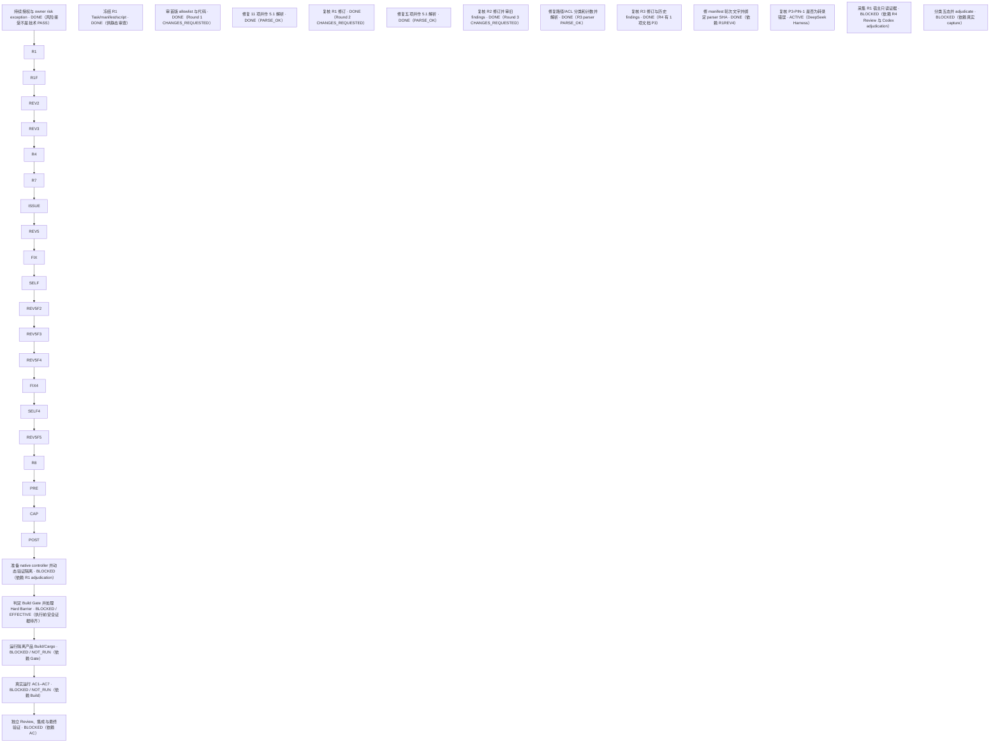

### 2026-10-11 14:01 Asia/Shanghai 当前规划：P02PRE-R1 宿主取证启动

本文件仍是唯一项目 DAG。相较最近有效 Checkpoint `verification/P02/p02pre-r0s6-checkpoint-20261011.md`（2026-10-11 11:27）：用户新增持续授权，允许 runner/source-contract 与 host getter 预证明风险纳入 Owner Risk Acceptance，并允许继续动态隔离、P02PRE、Build/Cargo、AC1–AC7、修复、Review、重测与集成；R0 阶段结束，不重复 runner/source 静态研究。此授权不是技术 PASS，不把任何未执行项改成通过。

保留既有裁决：`private_registry_absence=UNPROVABLE`；Technical Gate=`NOT_SATISFIED`；Owner Risk Acceptance=`APPROVED`；Gate Disposition=`WAIVED_BY_OWNER`；Build Authorization=`AUTHORIZED_WITH_EXCEPTION`；原文=`technical condition unmet; user explicitly accepted residual risk`。新增风险接受只覆盖 runner/source-contract 与 host getters 的绝对无副作用预证明风险，不豁免 identity、精确路径/ACL、TEMP/cache、protected state/hash、子进程/写入闭包、停机/恢复和 AC 的真实证据要求。Windows Sandbox 继续不查询、不安装、不启用、不启动。

Live Git：仓库=`G:/CODEX/New Manga`；branch=`main`；HEAD=`cddff58469b56e181019a8ddfeade80684bc7eb9`；tree=`c25d051a4b9a0bd9773b50170e100f575ea19f2b`；common-dir=`G:/CODEX/New Manga/.git`。工作区 dirty；开始快照 `git status --short` 有 524 行，既有变更作者归属未知的全部保留。当前 `.git/index` SHA-256=`214767403C469B15D2BDEE786080E58B4D78BF12C541B9FFB7E8A7FA08F3B89C`；本轮没有 status 前后 index 配对，index side effect=`NOT_VERIFIED`。实际 runtime=`gpt-6-luna / max`；优先 `gpt-6.1-sol / high` 当前不可用。R1 host query 尚未执行。

当前任务：唯一 Active 产品 Task=P02；当前 Active 子任务=`P02PRE-R1`，Owner/Author/Integrator/Adjudicator=`Codex /root`，非作者 Reviewer=`DeepSeek Harness`。Task=`doc/tasks/P02PRE-R1.md`，`6050 bytes / SHA-256 1D8B0639A7B24D3331F2172BC6FADD78A1AEC20B7BF41B89DCE487E70EE6C64A`；冻结 manifest=`verification/P02/p02pre-r1-manifest-20261011.md`，`9085 bytes / SHA-256 36BDD2BE4129DA5F5392AE6F2C1523A47020DDABCBAE5567300B5DF468E86921`；精确脚本=`verification/P02/p02pre-r1-capture.ps1`，`19113 bytes / SHA-256 01D70CD7A049231AE187379F5D5B1963E9775C078AC437D9FDF65BB7F7EB646A`；唯一结果目标=`verification/P02/p02pre-r1-evidence-20261011.json`。Task/manifest/script 已最终 pin 且 parser 通过；当前等待 DSH 对这些 bytes 独立 Review，Review 前不运行 capture。R0S6 保留历史状态 `BLOCKED / NOT_SAFE_FOR_R0`，不再阻塞 R1。

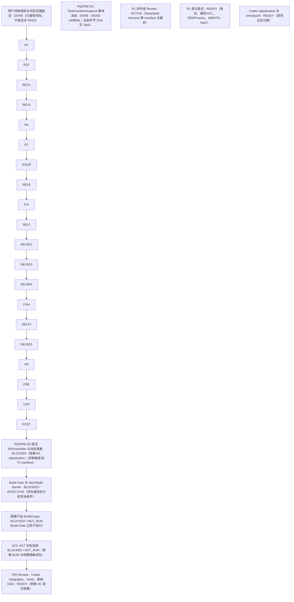

任何 `UNPROVABLE` 都保持原状；R1 `PASS_WITH_EVIDENCE` 仅适用于实际采集到的字段。之后只有在精确 execution manifest、独立 Review、动态身份/ACL/path/TEMP/hash/WER/T0/child/write evidence 和 Codex adjudication 齐备后，才可按实际证据解除适用 Gate。P02PRE-R2 的 helper/build 不等于产品 Build Gate。当前 Build/Cargo=`NOT_RUN`，AC1–AC7=`BLOCKED / NOT_RUN`。

### 2026-10-11 11:27 Asia/Shanghai 当前规划：R0S6 静态审结；host capture 阻塞

本计划仍是唯一规划事实源。用户只批准 P02PRE-R0 受控只读取证；不授权新风险豁免、Gate PASS、Build Barrier 解除、runner/source-contract 后续审查、主动测试或写操作。风险原值保持 `private_registry_absence=UNPROVABLE`、Technical Gate=`NOT_SATISFIED`、Owner Risk Acceptance=`APPROVED`、Gate Disposition=`WAIVED_BY_OWNER`、Build Authorization=`AUTHORIZED_WITH_EXCEPTION`，原文=`technical condition unmet; user explicitly accepted residual risk`。

最后核实的 Live 根=`G:/CODEX/New Manga`，branch=`main`，HEAD=`cddff58469b56e181019a8ddfeade80684bc7eb9`，tree=`c25d051a4b9a0bd9773b50170e100f575ea19f2b`，记录的 `.git/index` SHA-256=`214767403C469B15D2BDEE786080E58B4D78BF12C541B9FFB7E8A7FA08F3B89C`。此前 `git status --short --branch` 为 `main...origin/main [ahead 1365]` 且工作区 dirty；该 status 未紧邻 pre-hash，index side effect=`NOT_VERIFIED`。本次文档收尾没有新 Git 状态核验；不推断未知文件作者归属，保留所有既有未提交内容。

R0S6 Owner/Author/Integrator/Adjudicator=`Codex /root`，非作者 Reviewer=`DeepSeek Harness`。Task=`doc/tasks/P02PRE-R0S6.md`，manifest=`verification/P02/p02pre-r0s6-manifest-20261011.md`，最终=`blocked / NOT_SAFE_FOR_R0`。R1=`CHANGES_REQUESTED`（P0/P1/P2/P3=`0/0/4/6`）；Codex 修订后 R2=`APPROVED`（`0/0/0/0`）；Codex adjudication 仅接受 R2 的静态文档审查范围。R2 确认当前无可释放 host getter。R6 manifest pin=`626E000A94C8C3561DBB13BFA4C5BC66DA315001B9F50B5AC1669339407009DE`。交付、adjudication、integration verification 与 checkpoint 见 R0S6 Task。

前次有效 Checkpoint=`codex-checkpoint-p02pre-r0s5-20261011.md`（10:57）。相较该基线，本轮新增 R0S6 Task/manifest/delivery、R1 修订与 R2 批准、Codex adjudication、五态分类及文档集成核验；没有新增可采纳主机证据，技术 Gate 和 P02 状态不变。manifest freeze 前一次 scratch metadata 预观察被明确排除，不重跑。

最终五态：历史 R0 原对象与捕获时点局部证据=`PASS_WITH_EVIDENCE`；R0S6 host `FAILED=∅`（未执行，不是失败）；当前 identity/token、profile/target paths、ACL、TEMP/cache/scratch、protected hashes、WER/T0、private registry=`UNPROVABLE`；LPAC/canary/child/write closure/stop-cleanup=`REQUIRES_ACTIVE_TEST`；当前 runner 与依赖 getter=`NOT_SAFE_FOR_R0`。R1 report/stderr/exit 的 pre-write state=`NOT_VERIFIED`，旧内容是否覆盖=`UNKNOWN`；当前文件保留，不声称恢复或无数据损失。

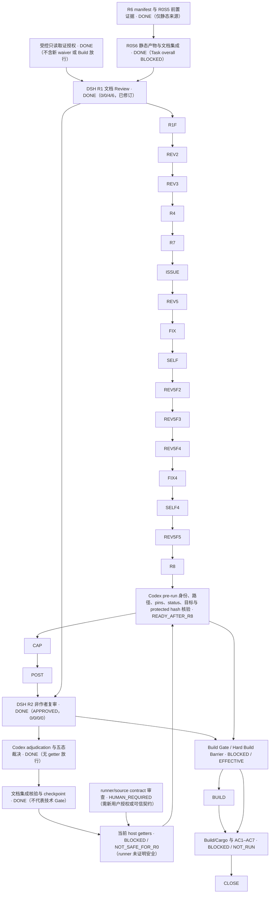

当前没有 READY host query。最小剩余阻塞为 runner invocation contract：executable identity/hash、精确 argv、startup/profile/history/cache/temp/log、子进程闭包和逐 getter 依赖。下一步需用户决定是否授权独立、静态、只读 source/contract 审查，或提供可信 runner contract；该后续不属于现有授权。P02PRE 与 Build Gate=`BLOCKED`；Hard Build Barrier=`EFFECTIVE`；build/Cargo=`NOT_RUN`；AC1–AC7=`BLOCKED / NOT_RUN`。Windows Sandbox 不查询、安装、启用或启动。

### 2026-10-11 10:57 Asia/Shanghai 当前规划：R0S5 静态文档审结，host capture 阻塞

唯一 Active 产品 Task=P02。用户本次新增授权允许建立独立 `P02PRE-R0S5`，仅执行逐项证明无副作用、并经独立 Review + Codex adjudication 清除的 r6 精确对象 getter/query；没有候选通过该条件。本 Task 已完成静态文档审查与五类分类，但整体=`blocked / NOT_SAFE_FOR_R0`，因为当前 runner 和 getter 无法证明无副作用。这不是新风险 waiver、Gate PASS 或 Build Barrier 放行。`private_registry_absence=UNPROVABLE`、Owner Risk Acceptance=`APPROVED`、Gate Disposition=`WAIVED_BY_OWNER` 原样保持。

R0S5 Owner/Author/Integrator/Adjudicator=`Codex /root`；非作者 Reviewer=`DeepSeek Harness`。Round 1=`changes_requested`（P0/P1/P2/P3=`0/0/2/4`），Round 2=`changes_requested`（`0/0/1/4`），Round 3=`approved`（`0/0/0/1`，唯一 P3 非阻断且已做措辞修正）。Round 3 报告=`verification/P02/dsh-p02pre-r0s5-review-r3-20261011.md`，session=`session-f78b23bc-9619-47b8-83b8-84507d9b74ef`；Codex adjudication 与集成验证已完成。目标机 host/OS/registry/WER/profile/token/ACL/path/environment/hash query 均未运行。当前 runner 缺少 executable/version、argv、startup/profile/cache/history/wrapper/temp/log 与子进程无副作用证据；不得换 shell或绕过 runner gate。

相较最新有效 checkpoint（R0S4，2026-10-11 10:09）：新增用户受控只读预检授权、R0S5 Task/manifest/delivery、三轮 Review、final adjudication 与集成核验；Round 1/2 精确对象、身份/hash 引用、canary scratch 路径与文案 findings 均已关闭。没有新增 host evidence，runner blocker 与 P02/Build Gate 状态未变化。同参数 status 从 R0S4 的 569 records 变为 588（+19 records）；此聚合差值不推断每个路径的作者归属。当前 NUL `git status`=`exit 0 / 588 records / 37250 bytes / stderr empty / SHA-256 0E20722F5A97717F05356548AF29662A34403221F2A213421E40FE722708A98E`；`.git/index` 前后 SHA-256=`214767403C469B15D2BDEE786080E58B4D78BF12C541B9FFB7E8A7FA08F3B89C`；worktrees=`361`。本轮所有既有未提交内容均保留；不能确认的原作者归属不推断。

R0S5 当前子图（finding 整改状态）：

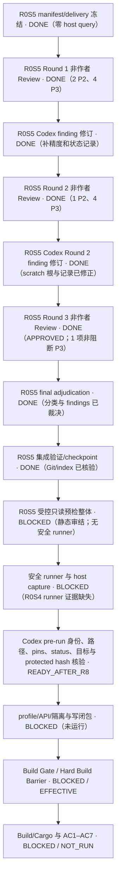

R0S5 三轮静态文档 Review、adjudication 与集成核验已完成；没有安全候选可运行，因此整体 Task=`blocked / NOT_SAFE_FOR_R0`。当前值分类：历史 R0 有限证据=`PASS_WITH_EVIDENCE`；本轮失败项=`∅`；当前身份/path/ACL/TEMP/cache/scratch/protected hash/WER/T0/private registry=`UNPROVABLE`；LPAC/canary/子进程/write closure/stop-cleanup=`REQUIRES_ACTIVE_TEST`；当前 runner 与未审 getter=`NOT_SAFE_FOR_R0`。不执行 host query、权限 canary、profile/API、registry/ACL/file 写入、Windows feature/Sandbox、Build/Cargo 或 AC1–AC7。只有取得精确 runner/method 无副作用证据并经独立 Review + Codex adjudication 后，才可恢复 host capture。Hard Build Barrier 保持 effective。详细 Task=`doc/tasks/P02PRE-R0S5.md`；manifest/delivery/reviews/adjudication/verification/checkpoint 由 Task 链接。

### 2026-10-11 10:09 Asia/Shanghai 当前规划：R0S4 已审结文档；capture 仍阻塞

Live metadata=G:/CODEX/New Manga、branch=main、HEAD=cddff58469b56e181019a8ddfeade80684bc7eb9、tree=c25d051a4b9a0bd9773b50170e100f575ea19f2b、common-dir=G:/CODEX/New Manga/.git；分开的 rev-parse 检查均 exit 0。当前新的受控 NUL status=`exit 0 / 569 records / 36542 bytes / stderr empty / SHA-256 0E52E6B4ADACC0AC9C4F29A8FAD402DDAF9A7FB51B21A789FBE57EDE82681E8C`；`.git/index` 前后 SHA-256 均=`214767403C469B15D2BDEE786080E58B4D78BF12C541B9FFB7E8A7FA08F3B89C`；`git worktree list --porcelain`=`361`，当前 worktree=`G:/CODEX/New Manga`，未 prune。更早组合 status 曾把 `--ignore-submodules=all` 管道接到 `Measure-Object -Character`，只留下字符计数 35961，且未引用 `HEAD^{tree}` 产生 Git fatal；它无原始 NUL bytes、独立 streams/exit 或紧邻 index pre-hash，历史 `index_side_effect=NOT_VERIFIED` 保持，不由这次新快照补证。保留所有既有未提交内容。

P02 仍是唯一 Active 产品 Task。独立子任务 `P02PRE-R0S4` 的文档分类、DeepSeek Harness 两轮 Review、Codex adjudication 与治理文档集成验证完成；Task 最终=`blocked / NOT_SAFE_FOR_R0`，因为没有可证明无副作用的精确 runner，目标机只读取证未执行。Round 1=`CHANGES_REQUESTED`（P0/P1/P2/P3=0/1/5/6）；Round 2=`APPROVED`（0/0/0/3，均为非阻断 P3）。Task、manifest、delivery、两轮 Review/prompt、adjudication、verification 和 checkpoint 均链接于 `doc/tasks/P02PRE-R0S4.md` 与当前 STATUS。

P02PRE 五类裁决：历史 R0 固定时点局部对象=`PASS_WITH_EVIDENCE`（不外推）；`FAILED=∅`；当前身份/SID/token、r6 路径/ACL/TEMP/cache/scratch/current protected-file hash、WER 状态与 private registry absence=`UNPROVABLE`；当前 shell/exec runner、profile/registry getters、未审方法=`NOT_SAFE_FOR_R0`；LPAC/canary、未来子进程与写入闭包、stop/cleanup=`REQUIRES_ACTIVE_TEST`。具体按对象和方法拆分见 `verification/P02/codex-p02pre-r0s4-adjudication-20261011.md`。没有一项新增查询通过 runner 安全门；未执行不记 `FAILED`。

R0S4-R2-P3-01/02 已作为非阻断局限接受：先前 status 参数比 r6 窄、字符计数不是 status bytes/记录数；R2-P3-03 已随本次治理文件集成关闭。Reviewer 不验证本地 hashes、head 或“零 P02PRE host query”自我报告，相关证据由 Codex 固定并在 checkpoint 说明范围。

风险与 Gate 原值保持：`private_registry_absence=UNPROVABLE`；Technical Gate=`NOT_SATISFIED`；Owner Risk Acceptance=`APPROVED`；Gate Disposition=`WAIVED_BY_OWNER`；Build Authorization=`AUTHORIZED_WITH_EXCEPTION`；`technical condition unmet; user explicitly accepted residual risk`。本次只读取证授权不是 waiver 或 Gate PASS。P02PRE=`BLOCKED`；profile=`NOT_CREATED`；ACL/registry=`NOT_MODIFIED`；Build Gate=`BLOCKED`；Hard Build Barrier=`EFFECTIVE`；build/Cargo=`NOT_RUN`；AC1–AC7=`BLOCKED / NOT_RUN`。未查询、安装、启用或启动 Windows Sandbox。

相较最新有效 checkpoint（P02PRE-R0S3，2026-10-11 09:21）：新增 R0S4 Task、精确 manifest、Owner delivery、两轮非作者 Review、adjudication、集成验证与 rolling checkpoint；R0S4 从新建/审查中转为 `blocked / NOT_SAFE_FOR_R0`。Round 2 三项 P3 均已处置；未获得新目标机证据，未改变 P02PRE、风险、Build Gate、Hard Build Barrier 或 AC1–AC7。branch/HEAD/tree/index/worktree count 未变；当前完整 status snapshot 已固定，历史未提交内容的逐项作者归属仍不推断。

当前无其他 READY Task。下一候选须先取得一个精确绑定实现/version、executable/argv、startup/profile/cache/history/wrapper/temp/log 均有无副作用证据的 runner，再经非作者 Review 与 Codex adjudication；目前没有该 runner 证据，也不另建空 Task。最新 rolling checkpoint=`verification/P02/codex-checkpoint-p02pre-r0s4-20261011.md`。

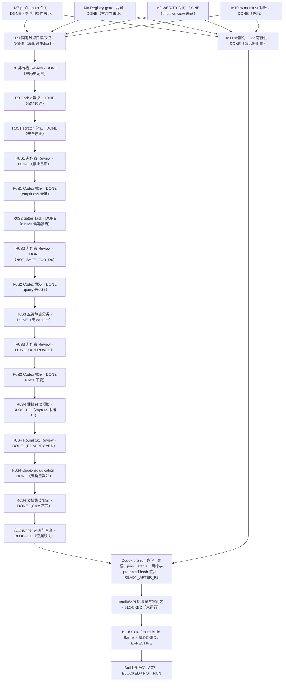

### 历史规划：2026-10-11 08:47 Asia/Shanghai（已由上方取代）

Live baseline=`G:/CODEX/New Manga`、branch=`main`、HEAD=`cddff58469b56e181019a8ddfeade80684bc7eb9`、tree=`c25d051a4b9a0bd9773b50170e100f575ea19f2b`、common-dir=`G:/CODEX/New Manga/.git`。最近安全 NUL status=`exit 0 / 536 records / stderr empty`；该 status 前后 `.git/index` SHA-256=`214767403C469B15D2BDEE786080E58B4D78BF12C541B9FFB7E8A7FA08F3B89C`；worktrees=`361`，未 prune。文档更新后将重新核验 status/index。原作者未提交内容保留；未 reset、clean、stash、覆盖、删除或提交。

当前唯一 Active 子任务=`P02PRE-R0S2`，Owner/Author/Integrator=`Codex /root`、非作者 Reviewer=`DeepSeek Harness`。R0S2 Task/manifest 已冻结，status=`in_review`；DSH manifest Review 已 dispatch，目标查询尚未运行。唯一候选是对精确 HKLM LocalDumps key 分别请求 Registry32/Registry64，并只调用 `OpenSubKey(..., false)`。Review 必须判断 shell startup/profile 是否可证明无副作用；若不能，标 `NOT_SAFE_FOR_R0` 且不得执行。Task=`doc/tasks/P02PRE-R0S2.md` SHA-256=`2DD4DDCBCC34479C49D3B54CF0AAA32D342682732F53AE20CABE67AB9799E9BB`；manifest=`verification/P02/p02-readonly-preflight-r0s2-manifest-20261011.md` SHA-256=`589DCD21C0C98128468A8758D433D630D6F3318409025B4F9FE26C548DB2F2FD`。

R0=`DONE / ACCEPTED_AS_READ_ONLY_EVIDENCE_DELIVERY_ONLY_WITH_LIMITS`；R0S1=`DONE / ACCEPTED_AS_LIMITED_READ_ONLY_STOP_EVIDENCE`。R0S1 runner PID=`44916` 在任何 G: path query 前以 `STOP_UNTRUSTED_OR_UNAVAILABLE_BUILTIN_MODULE` 安全返回；exec shell exit=`0` 不代表 query 成功。两个 scratch leaf emptiness=`UNPROVABLE`；冻结的 `Get-ChildItem` direct-child inventory 方法=`NOT_SAFE_FOR_R0`。非作者 DSH Review=`APPROVED_AS_READ_ONLY_EVIDENCE_DELIVERY_ONLY`，P0/P1/P2/P3=`0/0/2/5`，report SHA-256=`2F27B72FB40D43F7B4DD40925E75283A151EC7E72327D1FD2542F6135DC0E7A0`；Codex adjudication=`ACCEPTED_AS_LIMITED_READ_ONLY_STOP_EVIDENCE`，见 `verification/P02/codex-p02pre-r0s1-adjudication-20261011.md`。R0S1 的原 capture evidence SHA-256=`05C2DD247D3B0238809DCB90E62B633AAD6B4E777186E4025CD371B371F3FCBD`。静态顾问 `/root/r0s1_manifest_advisor` 提出的 R0S2 候选不是 Review 或运行许可。

P02M11=`BLOCKED / NOT_VERIFIED`：已有静态报告但 Agent 因额度中断、没有可核验 handoff/model，未 Review/adjudicate；它不阻塞本只读子任务。唯一风险状态保持 `private_registry_absence=UNPROVABLE`、Technical Gate=`NOT_SATISFIED`、Owner Risk Acceptance=`APPROVED`、Gate Disposition=`WAIVED_BY_OWNER`、Build Authorization=`AUTHORIZED_WITH_EXCEPTION` 与原文 `technical condition unmet; user explicitly accepted residual risk`。例外仅覆盖创建前证明目标 private registry storage 不存在。

P02PRE=`BLOCKED`。分类保留：R0 已固定的当前身份、exact metadata/ACL descriptor、WER 候选快照和 13 项 hash=`PASS_WITH_EVIDENCE`（仅对应对象/时点）；scratch emptiness、private registry absence、profile-path existence、WER policy/effective view/destination/T0、完整保护集/path identity=`UNPROVABLE`；profile getter、R0S1 模块门与 child-name inventory 方法=`NOT_SAFE_FOR_R0`；effective LPAC/canary 与 future child/cache/TEMP/write closure=`REQUIRES_ACTIVE_TEST`。R0S2 若安全并执行，其两个精确 API 返回最多只能是 `PASS_WITH_EVIDENCE`，不会证明 WER 实际配置或 Gate。

profile=`NOT_CREATED`；ACL/registry=`NOT_MODIFIED`；Build Gate=`BLOCKED`；Hard Build Barrier=`EFFECTIVE`；build/Cargo=`NOT_RUN`；AC1–AC7=`BLOCKED / NOT_RUN`（未运行，不是失败）。不查询、安装、启用或启动 Windows Sandbox。

相较最近有效 Checkpoint（R0S1 pre-query，2026-10-11 08:24）：capture 已启动并在安全前置处停止；DSH 独立 Review 与 Codex adjudication 已完成；静态顾问提出一个有界 R0S2 候选；R0S2 Task/manifest 已冻结且 Review 在途。HEAD/tree/index/worktree未变化；治理文档仍待本轮最终核验。没有技术 Gate、Build Barrier 或 AC1–AC7 状态提升。

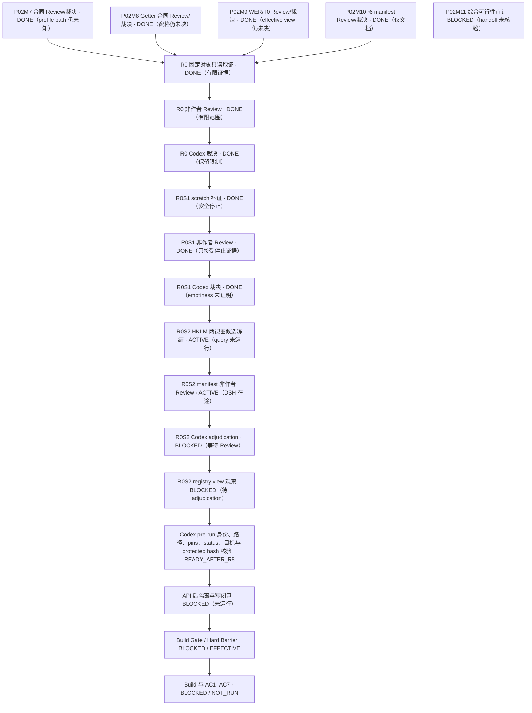

### 历史规划：2026-10-11 08:26 Asia/Shanghai（已由上方取代）

Live baseline=`G:/CODEX/New Manga`、branch=`main`、HEAD=`cddff58469b56e181019a8ddfeade80684bc7eb9`、tree=`c25d051a4b9a0bd9773b50170e100f575ea19f2b`、common-dir=`G:/CODEX/New Manga/.git`。本轮恢复后安全 NUL status=`exit 0 / 522 records / stderr empty`；命令前后 `.git/index` SHA-256=`214767403C469B15D2BDEE786080E58B4D78BF12C541B9FFB7E8A7FA08F3B89C`；worktrees=`361`，未 prune。原作者未提交内容保留。本轮没有 reset、clean、stash、覆盖、删除或提交。

当前 Active 子任务=`P02PRE-R0S1`；Owner/Author=`Codex /root`；非作者 Reviewer=`DeepSeek Harness`；Integrator/Adjudicator=`Codex /root`。R0 Owner evidence=`99592 bytes / SHA-256 AE16A27C5843C71C9EC9414C54C2FF23EBE5A612F75DA0CB5EA3A49B154879F3`；DSH Review=`APPROVED_AS_READ_ONLY_EVIDENCE_DELIVERY_ONLY`、findings=`0/0/5/6`、report SHA=`427F582D87A54E8C5B7CB65FB72F1B067BD226B8E6DFA66873FDC996E6B5C554`；Codex adjudication=`ACCEPTED_AS_READ_ONLY_EVIDENCE_DELIVERY_ONLY_WITH_LIMITS`。R0 Task=`DONE`，仅关闭只读 evidence delivery slice。

R0S1 Task=`doc/tasks/P02PRE-R0S1.md`、manifest=`verification/P02/p02-readonly-preflight-r0s1-manifest-20261011.md`；范围仅为两个 scratch leaf 的精确祖先 metadata 与直接子项计数。静态顾问 `/root/r0s1_manifest_advisor`（`gpt-6.1-sol / high`）三轮评估后给出 `SAFE_TO_CAPTURE`，第四次确认 runner 文字与 manifest 一致。该结论只准许固定 body 进入只读 capture，不是结果 PASS 或 Gate 放行。查询前 checkpoint=`verification/P02/codex-checkpoint-p02-readonly-preflight-r0s1-20261011.md` 已固定 Task `8303 bytes / BD73A543B2DBA2A28A38493769B64770C88DB14188D6BBD97189EA903082E2AD` 和 manifest `22925 bytes / CA293C34473D25E406E72B7DB05AC9364A69544D41214B93857ABAD11FEC6DE3`。safe NUL status=`523 records`、exit=`0`、index 前后 hash 一致；当前未运行 parser/OS query，下一步仅执行 checkpoint 中固定 runner。顾问未验证 profile 启动行为或实时 OS module/provider/path 状态；manifest 在路径查询前核验可观察 module/provider/root 条件。P02M11=`BLOCKED / NOT_VERIFIED`，Owner 额度耗尽且最终 handoff 未核验；它不阻塞 R0S1。

P02M11 Owner `/root/p02_gate_feasibility` 的最终 turn 因额度耗尽失败；报告文件已出现并固定为 `27825 bytes / SHA-256 15736303C3241E0C14106EFCAFB8583DF719A566D1879B7A7144B6D079A04A1F`，但未收到可核验最终 handoff/runtime model，故 `P02M11=BLOCKED / NOT_VERIFIED`，不作为 R0 的前置 Gate，也不视为 Review/adjudication 完成。此 Agent 首次批次运行普通 `git status --short` 且无紧邻 index pre-hash；`index_side_effect=NOT_VERIFIED`。本轮当前 index hash 与此前快照相同不能补回缺失 pre-hash；未尝试恢复或覆盖 index。

用户只读预检授权不改变风险裁决：`private_registry_absence=UNPROVABLE`；Technical Gate=`NOT_SATISFIED`；Owner Risk Acceptance=`APPROVED`；Gate Disposition=`WAIVED_BY_OWNER`；Build Authorization=`AUTHORIZED_WITH_EXCEPTION`；固定原文=`technical condition unmet; user explicitly accepted residual risk`。waiver 仍只覆盖 private-registry 创建前无副作用缺失证明；本次授权不是新的 waiver 或 Gate PASS。

用户授权的只读阶段不是新风险豁免，也不是 Gate PASS。风险裁决保持：`private_registry_absence=UNPROVABLE`；Technical Gate=`NOT_SATISFIED`；Owner Risk Acceptance=`APPROVED`；Gate Disposition=`WAIVED_BY_OWNER`；Build Authorization=`AUTHORIZED_WITH_EXCEPTION`；固定原文=`technical condition unmet; user explicitly accepted residual risk`。该 waiver 只覆盖创建前证明目标 private registry storage 不存在。

`P02PRE-R0=DONE / ACCEPTED_AS_READ_ONLY_EVIDENCE_DELIVERY_ONLY_WITH_LIMITS`；`P02PRE-R0S1=ACTIVE / STATIC_SAFE_TO_CAPTURE / PRE-QUERY-PINNED / CAPTURE_NOT_RUN`；总体 P02PRE=`BLOCKED`；profile=`NOT_CREATED`；ACL/registry=`NOT_MODIFIED`；Build Gate=`BLOCKED`；Hard Build Barrier=`EFFECTIVE`；build/Cargo=`NOT_RUN`；AC1–AC7=`BLOCKED / NOT_RUN`（尚未执行，不是失败）。当前 R0 局部证据不证明 profile-folder no-side-effect、private-registry absence、effective token access/canary behavior、未来 child/cache/TEMP/write closure、WER policy/view/destination/T0 或完整 protected-invariants ancestry/hash。R0S1 仅补 scratch ancestor 与当时点 direct-child count。

相较最近有效 checkpoint（R0 pre-Review，2026-10-11 07:34 Asia/Shanghai）：R0 已完成 DSH Review 与 Codex adjudication；R0S1 从待派发转为 Active，Task/manifest 经三轮静态顾问迭代，当前 body 获 `SAFE_TO_CAPTURE`。相较 07:56 状态，HEAD/tree/index/worktree 未变，NUL status 从 520 增至 522 条；当前治理文件/Task/manifest 有本轮 Codex 未提交修改，pre-query checkpoint/query 仍未开始。没有任何技术 Gate、Build Barrier 或 AC1–AC7 放行。

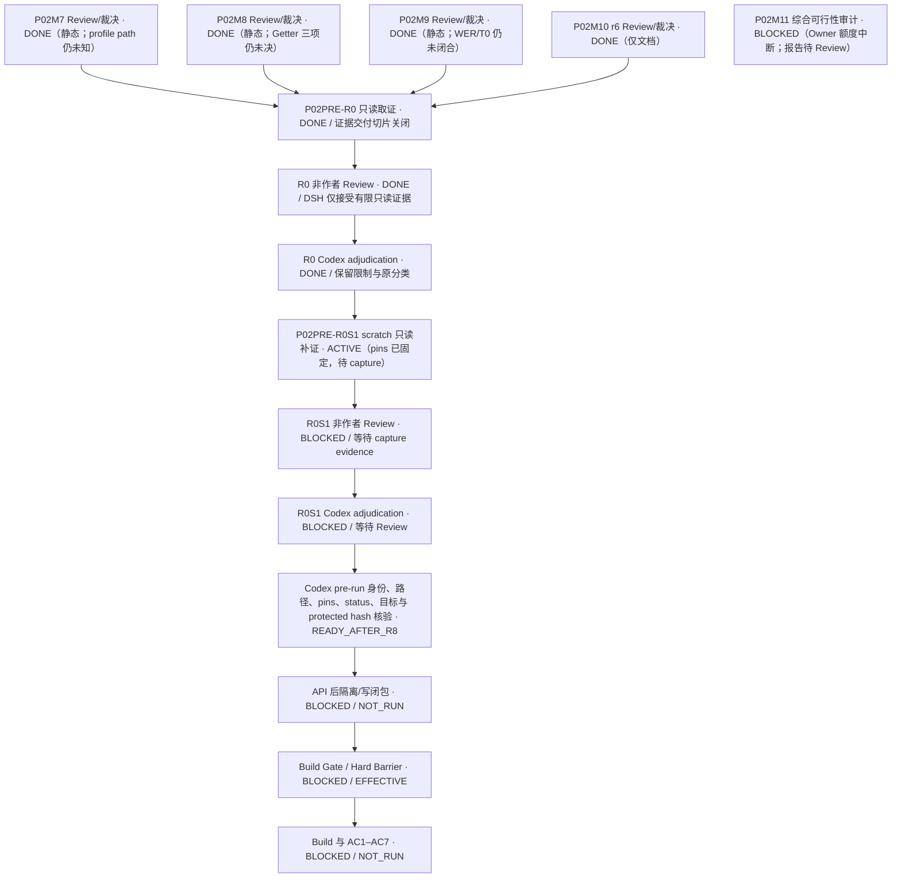

### 历史状态：2026-10-10 16:56 UTC（已由上方当前规划取代）

Live baseline=`G:\CODEX\New Manga`、branch=`main`、HEAD=`cddff58469b56e181019a8ddfeade80684bc7eb9`、tree=`c25d051a4b9a0bd9773b50170e100f575ea19f2b`、`main...origin/main [ahead 1365]`、Git common-dir=`G:/CODEX/New Manga/.git`、登记 worktree=`363`。本轮安全 NUL status exit=`0`、508 records、stderr 空；命令前后 `.git/index` 均为 `972663 bytes / SHA-256 214767403C469B15D2BDEE786080E58B4D78BF12C541B9FFB7E8A7FA08F3B89C`，mtime=`2026-10-10T03:18:18.4750975Z`。原作者未提交内容保留；未 reset、clean、stash、覆盖、删除或 commit。

用户正式裁决：`private_registry_absence=UNPROVABLE`；Technical Gate=`NOT_SATISFIED`；Owner Risk Acceptance=`APPROVED`；Gate Disposition=`WAIVED_BY_OWNER`；Build Authorization=`AUTHORIZED_WITH_EXCEPTION`；固定原文=`technical condition unmet; user explicitly accepted residual risk`。该 waiver 仅覆盖创建前无副作用证明目标 private registry storage 不存在，不豁免 profile-folder、identity/SID、ACL、TEMP/cache、scratch/input/output、子进程/写入闭包、protected-file/hash、WER/T0 或 AC1–AC7。不得记技术 PASS。

P02M7=`DONE / ACCEPTED_AS_STATIC_RESEARCH_ONLY`；profile-folder no-side-effect 仍 `UNPROVABLE / BLOCKED`。P02M8 Owner/非作者 Review/Codex adjudication 已完成，`ACCEPTED_AS_STATIC_RESEARCH_ONLY`；zero-capability Getter eligibility/effective write boundary/success-failure no-write 仍 `NOT_RESOLVED / BLOCKED`。P02M9 Owner/非作者 Review/Codex adjudication 已完成，`ACCEPTED_AS_STATIC_RESEARCH_ONLY`；WER view/destination 与安全 T0 bootstrap 仍 `NOT_RESOLVED / BLOCKED`。M8/M9 对象 pin 与裁决分别见 [M8 adjudication](../verification/P02/codex-p02-zero-capability-registry-getter-adjudication-20261010.md) 与 [M9 adjudication](../verification/P02/codex-p02-wer-per-image-bootstrap-adjudication-20261010.md)。

P02M10=`DONE / ACCEPTED_AS_STATIC_DOCUMENT_ONLY`，Owner=`/root/orchestration_docs_review`；r6=`verification/P02/p02-owner-risk-waiver-execution-manifest-r6-20261011.md`，`44307 bytes / SHA-256 626E000A94C8C3561DBB13BFA4C5BC66DA315001B9F50B5AC1669339407009DE`。非作者 Reviewer=`/root/p02_isolation_advisor`；P02M10R=`DONE / APPROVED_AS_STATIC_DOCUMENT_ONLY`，新增 findings=`0/0/0/0`；Review=`verification/P02/p02-owner-risk-waiver-execution-manifest-r6-review-20261011.md`，`23380 bytes / SHA-256 A8C0C124C5EEF391CDBB44CA20B1169CFABC99E94C92E0C1AC798450E7DAF9A8`。Codex adjudication=`verification/P02/codex-p02-owner-risk-waiver-manifest-r6-adjudication-20261011.md`，`5560 bytes / SHA-256 01E556448BA2A5CF1E68F28A0C91D1FDD71EE28EB2CB5ED583983348BFFE9159`；仅接受静态文档，不释放执行。

P02M11=`ACTIVE`：对 M7–M10 已裁决证据做一次整合可行性审计，查明当前架构与唯一 registry waiver 下，是否存在满足其余 profile-folder、Getter、WER/T0、身份、路径、ACL、TEMP/cache、进程/写入闭包要求的具体可证路线。Owner=`/root/p02_gate_feasibility`（新 ExpertAdvisor）；Reviewer=`Codex /root`（非作者）；Integrator=`Codex /root`。base=`main@cddff58469b56e181019a8ddfeade80684bc7eb9`；唯一 Owner 写入=`verification/P02/codex-p02-unwaived-gate-feasibility-20261011.md`。只作静态分析/官方合同核对，不运行 OS/API、profile、registry、WER、token、path、environment、ACL、preflight、Create/Delete、Sandbox、build/Cargo/AC，不扩大产品或 waiver 范围。P02M11R 使用独立 Review 文件 `verification/P02/codex-p02-unwaived-gate-feasibility-review-20261011.md`；由 Codex 在 Owner 固定交付后执行非作者 Review，再单独 adjudicate。M11 通过不自动解除任何 Gate。

P02PRE、P02 Build Gate 与 AC1–AC7 仍 `BLOCKED`；profile=`NOT_CREATED`，ACL/registry=`NOT_MODIFIED`，OS preflight=`NOT_RUN`，Hard Build Barrier=`EFFECTIVE`，build/Cargo=`NOT_RUN`，AC1–AC7=`BLOCKED / NOT_RUN`（尚未运行，不是失败）。M11 只检查是否有未覆盖的合规技术路线；不把静态审计当作运行证据。剩余技术条件仍包括 profile-folder pre-create no-side-effect/absence、M8 Getter 三项、M9 WER/T0、实际 identity/path/ACL/TEMP/cache/hash、controller/probe 与 child/broker/write closure。任何新 waiver 或隔离架构变更需另有明确用户裁决。不查询、安装、启用或启动 Windows Sandbox。

与最近有效 Checkpoint（2026-10-10 16:52 UTC）相比：新建 P02M11 并派发静态可行性审计；M10 保持静态 DONE。P02PRE、所有技术 Gate、OS/Create/Build/Cargo/AC 状态未变化。

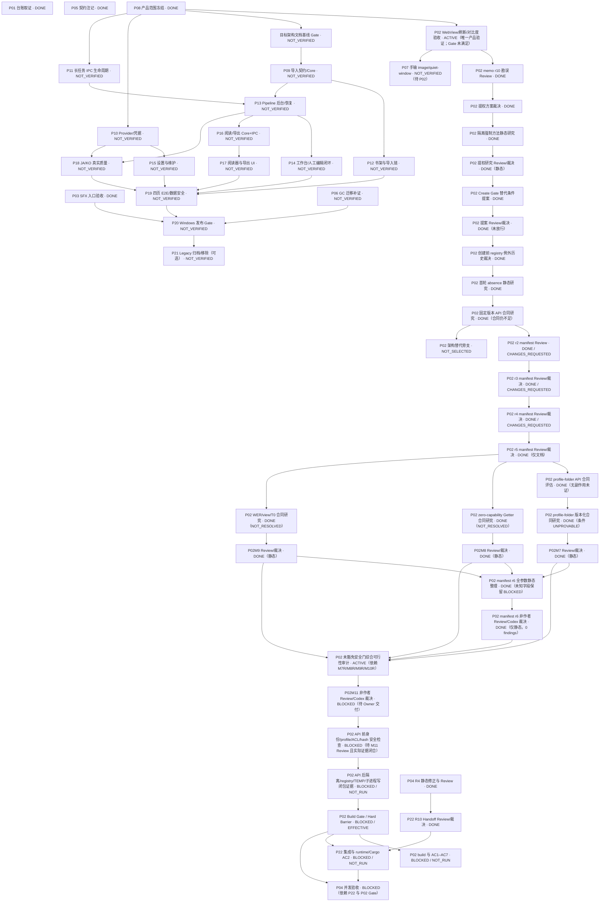

### 历史快照：2026-10-10 16:27 UTC（已由上方状态取代）

实时基线=`G:\CODEX\New Manga`、branch=`main`、HEAD=`cddff58469b56e181019a8ddfeade80684bc7eb9`、tree=`c25d051a4b9a0bd9773b50170e100f575ea19f2b`、`main...origin/main [ahead 1365]`；Git common-dir=`G:/CODEX/New Manga/.git`，已登记 worktree=`363`。原作者未提交/未跟踪文件继续保留；本轮仅在 P02 Task、STATUS、Plan、Index、verification/P02 新增或修订文档，无 reset、clean、stash、覆盖、删除或 commit。

用户裁决原值：`private_registry_absence=UNPROVABLE`；Technical Gate=`NOT_SATISFIED`；Owner Risk Acceptance=`APPROVED`；Gate Disposition=`WAIVED_BY_OWNER`；Build Authorization=`AUTHORIZED_WITH_EXCEPTION`；必须保留 `technical condition unmet; user explicitly accepted residual risk`。只豁免创建前无副作用证明目标 private-registry storage 不存在；不豁免其它安全条件或 AC1–AC7。

P02M3 r3 Review=`CHANGES_REQUESTED`，P0/P1/P2/P3=`0/0/1/0`；报告=`verification/P02/p02-owner-risk-waiver-execution-manifest-r3-review-20261010.md`，`11724 bytes / SHA-256 12CEEB109EBCE4AC707F749BBBE10BF71B50391C13AC05A2C6655E6A2BF918FB`。Codex adjudication=`verification/P02/codex-p02-owner-risk-waiver-manifest-r3-adjudication-20261010.md`，`5393 bytes / SHA-256 01B68088DC0F7A62620D3F9ED7444636F210CCEC82CA1DD9E645B5DF577EB6CD`：MR2-02 文档层修复；MR3-01/P2 确认为 raw status invariant 与 canary 冲突。

P02M4 r4 Review=`CHANGES_REQUESTED`（P0/P1/P2/P3=`0/0/1/0`），MR4-01 已由 r5 修正。P02M5 r5 精确 Review=`APPROVED`（0/0/0/0），报告=`verification/P02/p02-owner-risk-waiver-execution-manifest-r5-review-20261010.md`，`12410 bytes / SHA-256 69D5B01F3DE015C6476C57AB03D46CF58166750CB9ECCDD553172EC4CB3D7F8E`；Codex adjudication=`verification/P02/codex-p02-owner-risk-waiver-manifest-r5-adjudication-20261010.md`。结论只批准静态文档，不批准执行。

P02M6=`DONE / APPROVED_AS_STATIC_ASSESSMENT_ONLY`；Codex adjudication=`../verification/P02/codex-p02-profile-folder-noncreating-contract-adjudication-20261010.md`。结论=`profile_folder_no_side_effect=UNPROVABLE / BLOCKED`，未运行 OS/API。

当前 Active 子任务=`{P02M8R, P02M9R}`；P02M7 已完成静态 Review/adjudication，但 profile-folder 技术 blocker 保持。M8R 与 M9R 分别由 `/root/p02_manifest_reviewer`、`/root/p02_isolation_advisor` 独立执行，Integrator=`Codex /root`。

P02M7 Owner、非作者 Review 与 Codex adjudication 已收口：Owner=`/root/p02_isolation_advisor`；Owner report=`verification/P02/codex-p02-profile-folder-versioned-contract-research-20261010.md`，`23075 bytes / SHA-256 BB6A7676B6C48EB84D0D846E26F0E8F817684BDB27D67BD45813DA2D8508FD8A`；Review=`verification/P02/codex-p02-profile-folder-versioned-contract-research-review-20261010.md`，`10860 bytes / SHA-256 D54339A8A7B85049023D5BAB4C96E4071D2C4DC6AB01E26CF0E4210CB1458E0D`，`APPROVED_AS_STATIC_RESEARCH_ONLY`，findings=`0/0/0/0`；Codex adjudication=`verification/P02/codex-p02-profile-folder-versioned-contract-adjudication-20261010.md`。结论仍=`profile_folder_no_side_effect=UNPROVABLE / BLOCKED`；M7 DONE 不解除此 blocker。

P02M8 Owner Delivery 已完成：`verification/P02/codex-p02-zero-capability-registry-getter-contract-research-20261010.md`，`15483 bytes / SHA-256 8F9F3E60009F2DD3767DA5A2B45C4582A56ED7EE5E86957705778BE80D295DF6`；作者报告结论=`NOT_RESOLVED / BLOCKED`，未证明 zero-capability LPAC Getter 资格、有效访问边界或成功/失败分支无写入。非作者 Review=`/root/p02_manifest_reviewer`，唯一输出=`verification/P02/codex-p02-zero-capability-registry-getter-contract-research-review-20261010.md`；M8R 已从 M9 安全接续并在审查中。Integrator=`Codex /root`；Review 和 Codex adjudication 未完成前，M8 整体不算 DONE。只查正式合同，不调用 OS/API、不读 registry/token/capabilities、本机对象或邻近 key；registry absence waiver 不豁免此 blocker。

P02M9 Owner Delivery 已完成：`verification/P02/codex-p02-wer-per-image-bootstrap-contract-research-20261010.md`，`17105 bytes / SHA-256 6207483ED6CE62650C346D18D42FC81CD5102C44A028BAF0DE4F131AF60411F3`；结论=`wer_per_image_rules=PARTIALLY_DOCUMENTED`、`wer_view_destination_binding=NOT_RESOLVED / BLOCKED`、`t0_bootstrap_safe_order=NOT_RESOLVED / BLOCKED`。非作者 Reviewer=`/root/p02_isolation_advisor`，唯一输出=`verification/P02/codex-p02-wer-per-image-bootstrap-contract-research-review-20261010.md`；M9R 已派发并在途。未读本机 WER/registry/environment。Review 与 Codex adjudication 未完成前，M9 不算 DONE。

Codex 更早运行的一次普通 status 命令 stdout 被丢弃，执行前 index hash 未保存；因此不能证明那次命令前后字节一致，也未恢复或覆盖 index。最新 safe NUL porcelain status（16:24 UTC）使用 `GIT_OPTIONAL_LOCKS=0`、`--no-optional-locks`、`-c core.fsmonitor=false`，exit=`0`、498 records、stderr 为空；命令前后 `.git/index` 均为 `972663 bytes / SHA-256 214767403C469B15D2BDEE786080E58B4D78BF12C541B9FFB7E8A7FA08F3B89C`，mtime=`2026-10-10T03:18:18.4750975Z`。该采集不回溯证明较早命令未写 index。

P02PRE/P02G=`BLOCKED`；profile=`NOT_CREATED`；ACL/registry=`NOT_MODIFIED`；OS preflight=`NOT_RUN`；Build Gate=`BLOCKED`；Hard Build Barrier=`EFFECTIVE`；build/Cargo=`NOT_RUN`；AC1–AC7=`BLOCKED / NOT_RUN`（未执行，不是失败）。未解决条件仍有 profile-folder pre-create check、zero-capability LPAC Getter eligibility/副作用、WER images/views/destination/bootstrap、native controller/probe、child/broker/write closure、路径/ACL/TEMP/cache 与保护 hash 真实证据。P22=`in_review`、未集成；P04=`BLOCKED`、`blocked_by:[P22]`。

与上一个有效 checkpoint（2026-10-10 16:24 UTC）相比：M7 的独立 Review 已 `APPROVED_AS_STATIC_RESEARCH_ONLY`，Codex adjudication 完成；profile-folder blocker 仍未解决。M9 Owner 已交付、M9R 已派发；M8R 已开始审查。三项静态研究均未解除技术 blocker，所有 Gate 与 OS/Create/Build/Cargo/AC 状态保持原值。最新恢复点=`../verification/P02/codex-checkpoint-p02-m7-m8-review-m9-20261010.md`。不查询/安装/启用/启动 Windows Sandbox。

### 历史检查点：2026-10-10 15:52 UTC（已被上方状态取代）

实时基线为 `G:\CODEX\New Manga`、branch=`main`、HEAD=`cddff58469b56e181019a8ddfeade80684bc7eb9`、tree=`c25d051a4b9a0bd9773b50170e100f575ea19f2b`，`main...origin/main [ahead 1365]`；Git common-dir=`G:/CODEX/New Manga/.git`，已登记 worktree=`363`。工作区含原作者既有未提交/未跟踪文件和本轮授权文档更改；未 reset、clean、stash、覆盖、删除或 commit。

用户最新裁决必须按原值执行：`private_registry_absence=UNPROVABLE`，Technical Gate=`NOT_SATISFIED`，Owner Risk Acceptance=`APPROVED`，Gate Disposition=`WAIVED_BY_OWNER`，Build Authorization=`AUTHORIZED_WITH_EXCEPTION`；固定说明=`technical condition unmet; user explicitly accepted residual risk`。豁免范围仅为创建前无副作用证明目标 private-registry storage 不存在，不能写作技术 PASS，也不替代其他安全 Gate 或 AC1–AC7。

P02=`in_progress / ACTIVE`，唯一 Active 子任务=`P02M3`（Codex 处置 r2 Review findings、冻结 r3 并派非作者 Reviewer）。r2 Review=`CHANGES_REQUESTED`，P0/P1/P2/P3=`0/0/2/0`，精确报告=`verification/P02/p02-owner-risk-waiver-execution-manifest-r2-review-20261010.md`，`12779 bytes / SHA-256 C017C46402951353D534E8B419B681D857CABCFD1E8C9AA71159D9B6480C4644`。MR2-01 要求分离 protected invariant 与授权 output inventory、冻结精确 canary；MR2-02 要求安全停止后可保存 BLOCKED incident/真实 partial evidence。Codex 冻结 r3=`verification/P02/p02-owner-risk-waiver-execution-manifest-r3-20261010.md`，`26594 bytes / SHA-256 322524C3E1FDC894B0E09639A61E55D56422B03AC561484D0AE5994FAF3CD03F`；新增十个固定 evidence filenames、唯一 canary 文件名和两条证据落盘分支。非作者 Reviewer=`/root/p02_manifest_reviewer`，唯一写入=`verification/P02/p02-owner-risk-waiver-execution-manifest-r3-review-20261010.md`；其结果与 Codex adjudication 尚未完成。

当前仍 `profile=NOT_CREATED`、`ACL/registry=NOT_MODIFIED`、OS execution preflight=`NOT_RUN`、P02PRE=`BLOCKED`、Build Gate=`BLOCKED`、Hard Build Barrier=`EFFECTIVE`、build/Cargo=`NOT_RUN`、AC1–AC7=`BLOCKED / NOT_RUN`。未解决项包括 profile-folder pre-create 检查、zero-capability LPAC Registry Getter 资格/副作用、WER images/views/destination/bootstrap、native controller/probe、完整 descendants/broker/write closure 与 scratch 既有 ACL；r3 Review 本身不放行任何 OS/API/Create/Build/AC。P22=`in_review`、未集成；P04=`BLOCKED`、`blocked_by:[P22]`，两者无变化。

r3 Reviewer interim 已确认对象 pin 匹配，MR2-02 失败证据分支在文档层看似闭合；仍指出 MR2-01 residual：两仓 raw `git status` 被列为严格 invariant，合法 canary 会改变它，需冻结 protected status projection 与 authorized delta。最终报告未交付；不得提前关闭 finding 或释放下游任务。

与最近实际存在的有效 Checkpoint（15:34 UTC，r1 Review 在途）相比：r1 Review 交付并处理 3 findings、纠正 SID 转录并保存既有 stdout 证据、冻结 r2；r2 Review 新增 2 个 P2；Codex 冻结 r3 并进入独立复审。未产生任何 Gate/OS/Create/Build/Cargo/AC 变化。STATUS 曾引用但尚不存在的 r2 checkpoint；当前唯一恢复指针为 [P02 r3 rolling checkpoint](../verification/P02/codex-checkpoint-p02-owner-risk-waiver-manifest-review-r3-20261010.md)。Windows Sandbox 仍不查询、不安装、不启用、不启动。

### 历史检查点：2026-10-10 15:31 UTC（已被上方状态取代）

最新用户裁决已覆盖历史 B：`private_registry_absence=UNPROVABLE` 保持技术事实；Technical Gate=`NOT_SATISFIED`；Owner Risk Acceptance=`APPROVED`；Gate Disposition=`WAIVED_BY_OWNER`；Build Authorization=`AUTHORIZED_WITH_EXCEPTION`。用户原文要求登记：`technical condition unmet; user explicitly accepted residual risk`。豁免仅涉及创建前无副作用证明 private-registry storage 不存在；其他安全条件仍有效。Hard Build Barrier 当前仍 `EFFECTIVE`，须待完整 manifest 经独立 Review，且执行前安全检查证据通过后才可由 Codex解除。不得将风险接受写成技术 PASS。

**Live baseline：**`G:\CODEX\New Manga`，`main@cddff58469b56e181019a8ddfeade80684bc7eb9` / tree=`c25d051a4b9a0bd9773b50170e100f575ea19f2b`，`main...origin/main [ahead 1365]`；开始本轮前 `git status --porcelain` 为 393 项。原作者未提交内容保留；未 reset、clean、stash、覆盖、删除或 commit。P02 仍为唯一 Active 产品验证 Task；P22=`in_review`，未集成；P04=`BLOCKED`、`blocked_by:[P22]`。

**相对上一有效 Checkpoint（14:18 UTC）的变化：**新增用户明确 Owner 风险接受；P02 从“等待用户决定”转为 `AUTHORIZED_WITH_EXCEPTION`，但 execution manifest 与 OS safety preflight 尚未通过。架构替代旁支 P02AR 的静态报告已交付但未独立 Review；本次 waiver 已使该候选不再是当前路线，故 P02AR=`NOT_VERIFIED / NOT_SELECTED`，报告保留作未审历史材料。没有 profile/registry/ACL 写入、构建或 AC 结果变化。

技术顾问 `/root/p02_isolation_advisor` 已交付只读报告=`verification/P02/codex-p02-execution-manifest-design-advice-20261010.md`，`26212 bytes / SHA-256 7A6B6D72C8484611B05DF6AC666A5A9D69A7F582EC21D2EC455D064938CB3C45`；model/effort 未暴露。其指出 zero-cap LPAC registry Getter、profile-folder 创建前检查、WER 映像/解析顺序、native controller、短命 child/broker/write closure 尚未解决。

Codex 已冻结 `verification/P02/p02-owner-risk-waiver-execution-manifest-r1-20261010.md`，`19626 bytes / SHA-256 8DB5B79DD1F4F166455E4769C4B06D0EB0DDE1CEE80822DE7F3137E4B15DD720`；状态=`FROZEN_FOR_INDEPENDENT_REVIEW / OS_EXECUTION_BLOCKED`。Reviewer=`/root/p02_manifest_reviewer`，只写对应 `...-review-20261010.md`；Reviewer role 实际固定配置=`gpt-6.1-sol / medium`（该角色不提供 high effort），fork 不带父历史。由 Codex 负责 Review adjudication。P02 产品 Reviewer 仍为 DeepSeek Harness，不变。当前 profile=`NOT_CREATED`；ACL/registry=`NOT_MODIFIED`；Build Gate=`BLOCKED`；Hard Build Barrier=`EFFECTIVE`；build=`NOT_RUN`；AC1–AC7=`BLOCKED / NOT_RUN`（未执行，不是失败）。Windows Sandbox 不查询、不安装、不启用、不启动。

### 历史追加（2026-10-10 15:10 UTC）：P02 隔离架构替代静态评估（已被 15:21 裁决取代）

用户本轮询问架构替代可行性；在 P02 范围内释放 P02AR 静态评估，Owner/Integrator=Codex，非作者 Reviewer=/root/orchestration_docs_review，写入与禁止项见 P02 Task。P02AR=ACTIVE；仅评估独立 Windows VM 能否移除自建 AppContainer 的技术依赖，候选执行=NOT_RELEASED。用户 B、当前本机验证要求、所有产品 AC 和 Hard Build Barrier 均沿用下方有效检查点；没有 READY 产品或 OS Task。

## 历史检查点：2026-10-10 14:18 UTC（已由上方 15:21 检查点取代）

**Live baseline：**主仓 `main@cddff58469b56e181019a8ddfeade80684bc7eb9` / tree=`c25d051a4b9a0bd9773b50170e100f575ea19f2b`，14:18 刷新时 dirty/untracked=`392`；所有原作者内容保留，未 reset、clean、stash、覆盖、删除或提交。P02 是唯一 Active 产品验证 Task，当前 `in_progress / ACTIVE`：用户已选择维持“创建前无副作用证明 private-registry 缺失”的原准入条件。首轮及固定版本 Microsoft SDK/API-contract 静态调查均已通过非作者 Review 和 Codex adjudication；结论仍为 `UNPROVABLE / BLOCKED`。P02 Phase A 与 Build Gate 仍阻塞。P22 Task=`in_review`、未集成；P04=`BLOCKED`、`blocked_by:[P22]`。当前没有 READY 产品实现或 OS Task。

**相对上一有效 Checkpoint（13:50 UTC）的变化：**首轮静态研究以及固定版本补证均已完成非作者 Review/Codex adjudication，P02NS、P02N2 从 `ACTIVE` 转为 `DONE`。固定版本来源仍缺少完整支持合同，继续阻塞 `P02A`。用户 B、所有 Gate、P22 与 P04 状态均未变化；目前没有新的 READY Task。

**P02：**Task=`in_progress / ACTIVE`；产品 Owner=Antigravity，产品 Reviewer=DeepSeek Harness（非作者），Integrator=Codex；branch/worktree=`agent/antigravity/P02-real-webview-harness` / `G:/CODEX/New Manga.worktrees/P02-real-webview-harness-antigravity`，integrated HEAD=`89413f45a601966eb40d7af7abea65cbdfc754b3`。AC1–AC7 与允许范围以 [P02 Task](tasks/P02.md) 为准。用户已裁决维持原创建前无副作用 absence 条件。首轮静态研究=`DONE`，报告 SHA=`8F8CFEA95924DD6EF6E8663AEC49374986AE8C55C22F1FED62C203B4C6F8D3B4`；非作者 Review=`APPROVED`（0/0/0/0）；Codex adjudication 已记录。当前只读后续任务查找固定版本 Microsoft SDK/API-contract 支持证据；不调用 OS/API。r8/r9/r10 memo 的 DSH 文档 Review 与 Codex adjudication 已完成；r10 attempt 2=`APPROVED_WITH_CONDITIONS`（仅文本/引用层，新增 finding 0/0/0/0，formal `object_binding=NOT_VERIFIED`，CLI exit=0，session=`session-98ba3151-581b-4558-b6ee-97e8b953ba16`，精确 mount=0）。提权评估 r2=`APPROVED`（0/0/0/0），Codex=`ACCEPTED_AS_STATIC_DOCUMENT_ONLY`；准入替代草案=`../verification/P02/codex-appcontainer-create-gate-alternative-20261010.md`、SHA=`DC4186511DF30CE1AC20B8B53B5C0D9714B6B50947043CEDA31495D8FE1016B9`，非作者 Review=`APPROVED`（0/0/0/0），Codex adjudication=`APPROVED_AS_STATIC_PROPOSAL_ONLY`；用户明确不接受替代条件，见 [决策记录](../verification/P02/codex-p02-human-required-decision-20261010.md)。`private_registry_absence=UNPROVABLE / BLOCKED`、`hook/cache/child-process closure=BLOCKED / NOT_VERIFIED`；Phase A=`BLOCKED / NOT_RUN`；profile=`NOT_CREATED`；ACL/registry=`NOT_MODIFIED`；scratch ACL/label=`AUTHORIZATION_PATH_DEFINED / NOT_APPROVED`；OS preflight=`NOT_RUN`；Build Gate=`BLOCKED`；build=`NOT_AUTHORIZED / NOT_RUN`；Hard Build Barrier=`EFFECTIVE`；AC1–AC7=`BLOCKED / NOT_RUN`（未运行，不是失败）。

**P22/P04：**P22 Owner=Antigravity、Reviewer=DeepSeek Harness、Integrator=Codex；依赖 `M2-PAGE-NAV-PROJECTION-1` 已完成。P22=`in_review`、`integration_commit=null`；AC1–AC4 与验收细节见 [P22 Task](tasks/P22.md)。Owner branch=`agent/antigravity/P22-roundtrip-serialization`，R10 Handoff HEAD/tree/parent=`4a707db80499f11e93cee163a9a10bf6392b1a92` / `c6d58a41589c61501fa2c520626ee2b0f263d1a2` / R9 `791f1c9bb85a43ff38f3e518c831df81450c3148`；R9..R10 唯一改 Handoff，`git diff --check=EXIT 0`、tracked clean，57 个既有 untracked 保留。DSH R10 Review=`APPROVED_WITH_CONDITIONS`（0/0/0/1，formal `object_binding=NOT_VERIFIED`，report SHA=`0ED64E643D5227E0AF3D05E4D5D70DE22614476EBDB57672AC145E0C37232BFA`）；此 Review 仅 Handoff 文本，不批准代码集成；Codex adjudication 接受 F10-1 为非阻断 P3，见 [R10 adjudication](../verification/P22/codex-p22-r10-review-adjudication.md)。P22 集成/Cargo/runtime/AC2 受 P02 Hard Build Barrier 阻塞，仍 `BLOCKED / NOT_RUN`。P04 Owner=Antigravity、Reviewer=DeepSeek Harness、Integrator=Codex；Task AC1–AC4 见 [P04 Task](tasks/P04.md)；Task=`BLOCKED`、`blocked_by:[P22]`，且 P02 Gate 未解除前 Cargo 与集成后验证均 `BLOCKED / NOT_RUN`。P04 worktree HEAD/tree=`faea1a2c9e19f4817fd792290e91324f047529f9` / `eb0cc832531005a40d7a7294daf12cd0baa30a3d`，既有 `doc/tasks/P04.md` 修改与未跟踪证据保留。P02/P04/P22 worktree common directory 均为主仓 `.git`。

**当前有效 P 系列子图：**唯一 Active 子任务=`P02PRE-R0`，Owner 只读取证已交付，现待 DeepSeek Harness 独立 Review；随后由 Codex adjudicate。P02M11 因 Owner 额度中断且 handoff 未核验=`BLOCKED / NOT_VERIFIED`，不作为 R0 依赖。总体 P02PRE、API 后测量、Build Gate 与 AC 仍阻塞。图中每个节点均说明目的、状态和主要依赖；完整 Task 清单见本文件 P01–P22 表。

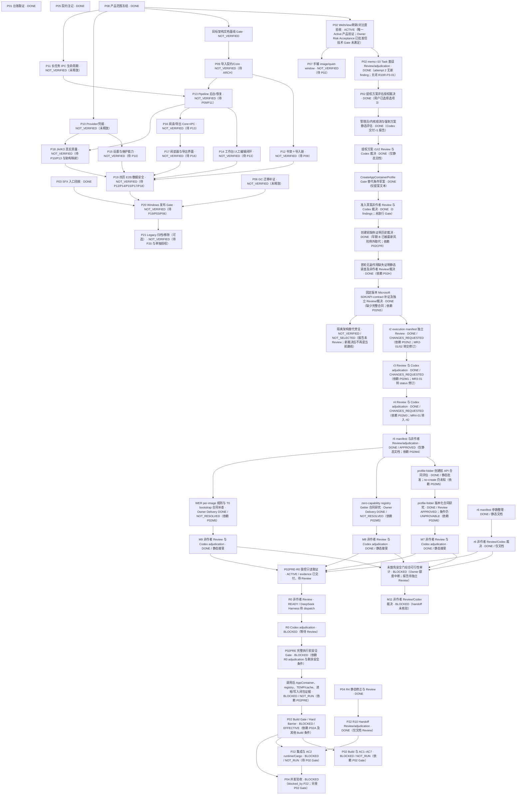

**与前一有效 Checkpoint 对比：**相较于 [2026-10-10 13:16 UTC](../verification/P02/codex-checkpoint-autonomous-orchestration-20261010.md)，用户选择 B，明确维持原准入条件；此前 `HUMAN_REQUIRED` 决定节点转为 `DONE`，新增只读证明路径调查并作为 P02 当前 Active 子任务。P02 Phase A、Build Gate、Hard Build Barrier、AC1–AC7、P22 与 P04 状态均未变化；本次开始状态条目=`386`；没有 READY 产品实现 Task。未运行 OS measurement、profile/ACL/registry 操作、probe、产品测试、Cargo、build、Tauri/runtime 或 Windows Sandbox。
## 前一检查点：2026-10-10 09:46 UTC（已由上方当前状态取代）

**Live baseline：**主仓 `main@cddff58469b56e181019a8ddfeade80684bc7eb9` / tree=`c25d051a4b9a0bd9773b50170e100f575ea19f2b`，`main...origin/main [ahead 1365]`。root 与 linked worktrees 的原作者未提交内容均保留；未 reset/clean/stash/覆盖/删除。P02 是唯一 Active 产品验证 Task；P22 是 P04 AC3 触发并单独释放的修复 Task。P01/P03/P05/P08=`DONE`；P04=`BLOCKED`、`blocked_by:[P22]`；其余未释放候选=`NOT_VERIFIED`。

**P02 授权、Review 与 Gate：**用户完整授权已记录于 [P02 Task](tasks/P02.md)。r7 DSH 内容 Review=`APPROVED`（P0/P1/P2/P3=`0/0/0/5`），DSH-R6A-01..12 全部 CLOSED；报告 SHA=`C1FADDC2D366286F14473DB68AE72D20FCF946E15DE50E4AFA3E2752998EF705`，prompt SHA=`45B74CA24BBCB415D38601C6F415B71C9404E0007C709FDBABE5DA2A6887E1A8`，CLI exit=`0`，session=`session-cda214ab-a0e5-4908-8795-b571f5294c6e`，mount exit=`0`。Codex 对派发时 Task、r7 contract、manifest r3、adjudication、Review 与 prompt 的 SHA 复算相符；见 [r7 adjudication](../verification/P02/codex-appcontainer-contract-r7-adjudication.md)。五项非阻断 P3 均延期。Codex 另发现 EA-01：manifest r3 未冻结 token/security/file-ID 的具体 API、WER `%ProgramData%` 解析、T0 bootstrap 顺序及 no-child/no-write 实现法；Phase A `BLOCKED / NOT_RUN`，未运行 OS measurement，须先冻结新方法和 manifest 并再 Review；method blockers 见 [evidence](../verification/P02/codex-phase-a-method-blockers-20261010.md)；DSH blocker memo Review 在途（exec session=`85517`）。当前 `private_registry_absence=UNPROVABLE / BLOCKED`；`profile=NOT_CREATED`；`ACL/registry=NOT_MODIFIED`；`scratch ACL/label mutation=AUTHORIZATION_PATH_DEFINED / NOT_APPROVED`；`OS isolation preflight=NOT_RUN`；`hook/cache/child-process closure=BLOCKED / NOT_VERIFIED`；`Build Gate=BLOCKED`；`build=NOT_AUTHORIZED / NOT_RUN`；`Hard Build Barrier=EFFECTIVE`；`AC1–AC7=BLOCKED / NOT_RUN`。

**P04/P22：**P04 状态不变。P22 R5 Owner Handoff 已固定：HEAD=`7229ef5b2f6925115b91d28900bffe377513f5cd` / tree=`712da4becaff2b5f3519e88261cb515c80b54a1f`，parent=R4 `0e46ec7e8c23a1fc0ba793745f5101813b388ea3`；R4..R5 仅改 `verification/P22/antigravity-owner-p22.handoff.md`，SHA=`F896FCA815067451C11FE102E818C3A8349A5BFD0895062F1604370F9419182D`。Codex 核对差量和 `git diff --check` EXIT 0，tracked tree clean。Antigravity 原会话=`59764b45-3139-42b3-98e7-3ae79f3746b4`，prompt SHA=`775152FD62B4847737371D1E31E7AE261E80797DF5BA1202B196644D70B61947`，raw JSON SHA=`22FAA3E281C796CB990C1E809C38056D622F3D1285F4359B619E684A6D72FE1E`，CLI exit=`0` / status=`SUCCESS`。DSH R5 内容 Review=APPROVED_WITH_CONDITIONS（P0/P1/P2/P3=0/0/0/4），CLI exit=0，object_binding=NOT_VERIFIED，report SHA=BB2241825A0A2AD306D5DC9887DBA2E5BAA07C8607A577BDF787B86DF199EF68。Codex 核验 HEAD/tree/parent、仅 Handoff 路径与 diff-check EXIT 0；adjudication 见 P22 R5 adjudication evidence。R6 Owner delivery 已固定：HEAD=`a61e2979d7808d1efaa15283a7e17bac038b7748` / tree=`23aa3cfa01c14dcb17ec8d0166d28f96a126fcc7` / parent=R5 `7229ef5b2f6925115b91d28900bffe377513f5cd`；R5..R6 仅改 Handoff，SHA=`768DFE728D7D8D8426F986D0AE97A4F9FFB9A6DA7590905690F3A3B5DB482461`；Codex diff-check EXIT 0、tracked clean。Antigravity conversation=`59764b45-3139-42b3-98e7-3ae79f3746b4`，R6 prompt SHA=`668E4E139403FB509F5DA48B68994D22B1E4B15C8E0C95EEEE5D0F918CF09DFD`，CLI exit=`0`/SUCCESS。DSH R6 content Review=`APPROVED_WITH_CONDITIONS`（P0/P1/P2/P3=`0/0/0/2`），`object_binding=NOT_VERIFIED`；CLI exit=`0`，session=`session-e4cb9f4b-50b9-48ee-b84f-b90e0db41fca`，mount exit=`0`，report SHA=`5B234E4E81C8F0CD26B0DCB3828F051F9608A2252B1FB8271F1A2DED23EA0FE8`。Codex 接受 R6-1/2 两项非阻断 P3（见 [R6 adjudication](../verification/P22/codex-p22-r6-review-adjudication.md)）；R5 P3-1..3 CLOSED。Antigravity 原 Owner R7 Handoff-only 修订 prompt SHA=`D43B10464AF2012DE45A535E6B52D53D9C32087A266EAD3D27515EDE68B0BDF9`，conversation=`59764b45-3139-42b3-98e7-3ae79f3746b4`，exec session=`63652` 在途。P22 未集成，Cargo/runtime=`BLOCKED / NOT_RUN`；P04=`BLOCKED`、`blocked_by:[P22]`。

**对比前一有效 checkpoint：**以 rolling checkpoint 的 2026-10-10 08:17:32 UTC 记录为基线。本轮新增 P02 r6 Review 的 12 项处置、r7 contract/manifest candidate、r7 DSH Review 和 Codex adjudication；Codex 执行就绪核验发现 EA-01，因此未运行 Phase A。P02 已补记 r7 API 类别不匹配与 OS observer 约束，方法评估见 blocker memo；DSH 对该 blocker memo 的非作者 Review 已派发并在途。P22 新增 R5 Review/adjudication 与 R6 Handoff-only delivery；Codex 核对 R6 固定对象、唯一文件差量和 diff-check。DSH R6 内容 Review 已返回并 adjudicate；R7 Handoff-only 修订已派 Antigravity 原 Owner。没有 Gate 状态变化或 Gate PASS；未运行 OS measurement、profile/ACL/registry 操作、probe、build、Cargo、Sandbox 或产品测试。

## 历史检查点：P22 R2 Owner delivery 固定、Review 尚未返回；P02 r4 Review pending

**Live baseline：**主仓 `main@cddff58469b56e181019a8ddfeade80684bc7eb9`，root 与多个 linked worktree 存在原作者未提交文件；未执行 reset/clean/stash，未覆盖或删除其内容。P02 是唯一 Active 产品验证 Task；P22 是依据 P04 R4 Review 通过后释放的并行修复 Task。P01/P03/P05/P08=`DONE`；P04=`BLOCKED`、`blocked_by:[P22]`。P22 r1=`CHANGES_REQUESTED`（P0/P1/P2/P3=`0/1/0/3`）；Antigravity r2 fixed delivery=`92093792ba0bc653f9423dda2486d558226caf86` / tree=`083a08f532afa7019a296ec96c805eeefd8b8805`，Codex 核验父提交、变更路径及 `git diff --check`，DSH R2 独立 Review 已派发并在途。P22 未集成，Cargo=`BLOCKED / NOT_RUN`；P02 r4 DSH Review 也在途。其他未释放候选=`NOT_VERIFIED`。

**本轮授权记录（2026-10-10）：**用户授权 Lead 自主推进、分工及接力，并明确授权 Codex 按最小权限原则选择精确 AppContainer/profile/私有 registry/TEMP/cache/scratch/子进程范围并登记后进行本机隔离预检；不得查询、安装、启用或启动 Windows Sandbox。r2 exact-object DSH Review=`NOT_VERIFIED`（内容等同 `CHANGES_REQUESTED`，2/5/8/7）；Codex 复算 r2/Task SHA 与派发值一致但未升级 DSH 结论。r3 exact-object DSH Review 同样=`NOT_VERIFIED`，内容 finding=`CHANGES_REQUESTED`（0/3/8/8），Codex 已逐项登记处置：[r3 Review report](../verification/P02/dsh-appcontainer-contract-r3-review.stdout.md)、[r3 adjudication](../verification/P02/codex-appcontainer-contract-r3-adjudication.md)。Codex 形成 [r4 contract candidate](../verification/P02/appcontainer-isolation-contract-r4.md)，SHA=`F025A2671FA16EB317C04C457C75BBD6A29D16A753FF146BCAD4AF244A591F49`，待 DSH 非作者 Review。r4 明确私有 registry 创建前状态在当前公开文档下=`UNPROVABLE / BLOCKED`：不猜 key、不调用可能初始化 storage 的 API、不创建 profile。profile=`NOT_CREATED`、ACL/registry=`NOT_MODIFIED`、OS preflight=`NOT_RUN`。P02 Build Gate=`BLOCKED`，hook/cache/child-process closure=`BLOCKED / NOT_VERIFIED`，build=`NOT_AUTHORIZED / NOT_RUN`，Hard Build Barrier=`EFFECTIVE`，AC1–AC7=`BLOCKED / NOT_RUN`。

**P04/P22 事实更新：**DSH R3 对 delivery `ec44a4891d624c88e89abfe2c13d9e7e072b9e5e`=`CHANGES_REQUESTED`（0/0/3/1）；Antigravity R4 fixed commit=`faea1a2c9e19f4817fd792290e91324f047529f9` / tree=`eb0cc832531005a40d7a7294daf12cd0baa30a3d` 的 DSH Review=`APPROVED`（静态范围，0/0/0/4 非阻断 P3），报告 SHA=`91DDB363941D9E9917ACD686956BB451B31FE4A15D8A332E47A3E3964BFD747E`。P22 Owner r1=`680e3830337a4533ea3625ed8108431067cf26d5` / tree=`ab81c2182eef2b8d3be26d75a45c252fe3b882e4` 的 DSH Review=`CHANGES_REQUESTED`（P0/P1/P2/P3=`0/1/0/3`），报告 SHA=`07CD89F065AC63EE26D6E38100FC700AFEB4B377F997DF2AA3FED6C0D6D68853`；DSH 无 shell，object binding=`NOT_VERIFIED`。Antigravity 原会话=`59764b45-3139-42b3-98e7-3ae79f3746b4` 完成 R2 定向返修，固定 HEAD=`92093792ba0bc653f9423dda2486d558226caf86` / tree=`083a08f532afa7019a296ec96c805eeefd8b8805`，parent=`680e3830337a4533ea3625ed8108431067cf26d5`；Codex 核验仅 2 个授权路径改变，`git diff --check 680e3830..HEAD`=`EXIT 0`。DSH R2 Review prompt SHA=`A4BFCD98A3696D96A7650315BE7398409D349B8202AF782F1EC2F109E2B524ED`；首次 CLI quoting error exit=`1`、无 Review report；修正后的调用正在运行，DSH session ID 尚未回收。P22 未集成，Cargo/runtime=`BLOCKED / NOT_RUN`。P04=`BLOCKED / blocked_by:[P22]`，AC1/AC2 与集成后 Cargo=`BLOCKED / NOT_RUN`。

**与前一有效检查点相比：**上个 checkpoint 已记录 P22 r1 Review 的返修要求、Antigravity r2 在途，以及 P02 r4 contract candidate。此后 P22 r2 Owner delivery 已固定并通过 Codex 的对象/路径/空白检查，DSH R2 Review 已派发；P02 r4 DSH Review 仍在途。尚无新的 Gate 通过，未运行 Cargo、profile/ACL/registry 操作或 OS preflight。恢复证据：[P02 r3 Review](../verification/P02/dsh-appcontainer-contract-r3-review.stdout.md)、[P02 r3 adjudication](../verification/P02/codex-appcontainer-contract-r3-adjudication.md)、[P02 r4 contract](../verification/P02/appcontainer-isolation-contract-r4.md)、[P22 r1 DSH Review](../../New%20Manga.worktrees/P22-roundtrip-serialization-antigravity/verification/P22/dsh-p22-review-r1.stdout.md)、[P22 r2 Owner delivery](../../New%20Manga.worktrees/P22-roundtrip-serialization-antigravity/verification/P22/antigravity-owner-p22.handoff.md)、[P22 r2 Review prompt](../../New%20Manga.worktrees/P22-roundtrip-serialization-antigravity/verification/P22/dsh-p22-review-r2.prompt.md) 与 [滚动 checkpoint](../verification/P02/codex-checkpoint-autonomous-orchestration-20261010.md)。

### 当前 P01–P22 任务 DAG（本计划为唯一状态源）

状态词：`DONE` 已通过完成 Gate；`ACTIVE` 正在执行；`READY` 范围/依赖已满足并已释放；`BLOCKED` 有明确阻塞项；`NOT_VERIFIED` 仍是 proposed/未释放或证据不足。P02/P04 子阶段也拆为节点，避免把 Owner delivery 混作 Task 完成。

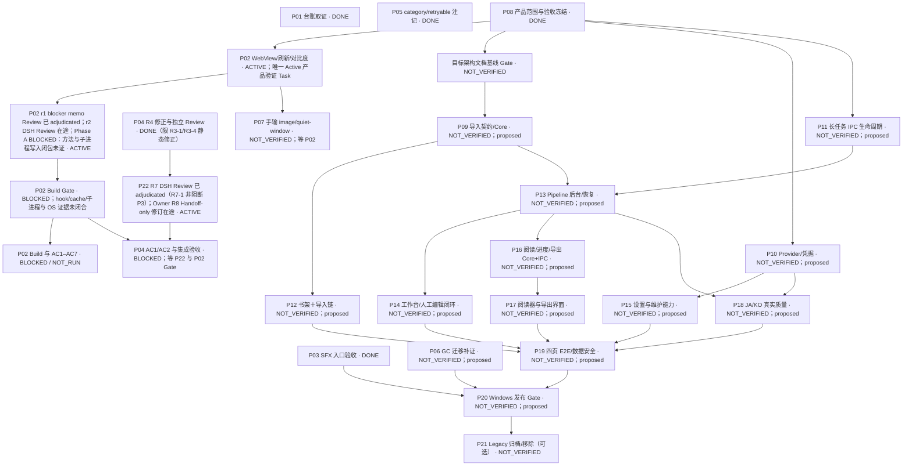

旧 D16、R5/R6 与 Sandbox preflight 数据保留为历史证据，不是本轮准入证据。详细 Task 条件仍由下方候选任务表和单个 Task 冻结；状态不与历史 Mermaid 合并推断。

候选 D16=`999e6adfc229698344c0cbf9bfb6d636fe73fb7c` 已从 `main@4183e7f7cf366c27aa8ad8a0bc7300af48783470` fast-forward 集成；完整差异 182 paths、out-of-scope=0。集成前后受保护的主仓 manifest 均为 203/203 MATCH，digest=`3a54fa978bf228bfae366a4c4de35b90e4fab609447d3370ed81370299da10e2`，candidate dirty overlap=0，staged=0。集成后 route validator=7/7 PASS，R5 package validator=PASS，`git diff HEAD^ HEAD --check`=EXIT 0。

裁决前历史测量：DSH Review 后 fresh immediate preflight 已于 2026-10-10 08:59–09:04 +08:00 完成只读复核：R2 HostFolder compare/recheck=PASS（11/11 mappings、204,419 records、零 mismatch/reparse issue）；12/12 roots、20/20 input hashes、14/14 registered sizes、3/3 source/EOL pins、3/3 Git object hardlinks 均通过；main root protected manifest=203/203 MATCH。Sky=40 apps / 4 windows、Sandbox app/window=0；WSB 0.8.107.0/version/list=PASS、无环境 session；主机资源阈值通过。唯一阻断是非提权 PowerShell 的 Get-WindowsOptionalFeature -Online -FeatureName Containers-DisposableClientVM 返回 EXIT=1 / COMException，Feature state=UNKNOWN（host criteria 10/11 PASS）。因此 fresh preflight=BLOCKED（D21 evidence Review=APPROVED；P3-1..4 文档修正复审待完成），wsb start=NOT_RUN、Smoke=NOT_RUN、Build Gate=BLOCKED、build=NOT_AUTHORIZED / NOT_RUN、hook/cache=BLOCKED / NOT_VERIFIED、AC1–AC7=BLOCKED / NOT_RUN、Hard Build Barrier=EFFECTIVE；当时 P04 保持 proposed；随后已依用户裁决释放为 ready。恢复见 [P02 post-review preflight blocker checkpoint](../verification/P02/codex-checkpoint-p02-post-review-preflight-blocked-r1.md)。

**前次检查点快照（2026-10-09；已由上方 2026-10-10 checkpoint 取代）：**P02 当时为唯一 Active Task（in_progress / ACTIVE），P01=done；scope r1–r4、AC、Owner allowlist 与行为基线保持冻结，不重冻结。Owner Stage A integration_commit=89413f45a601966eb40d7af7abea65cbdfc754b3，tree=f1063c981b8f4164f51248f92b7825fc205dd07d，parent=38959ba99b84f771aba7010b53b9b47ecdc75488。DSH 固定 r8 正式 Review=approved（仅 Stage A），P0/P1/P2/P3=0/0/0/1，open=1：R8-01 为非阻断 P3，Codex 已按 Review 建议登记延期；R7-01 closed，R7-02 deferred (P3)，R6-01..04 closed。Codex r8 exact-head 命令级复核与 Stage A Integration Gate=PASS。隔离 scratch-build 方案与输出边界已独立审查通过，但 Python/Torch/Hugging Face 缓存值、实际 PyInstaller hook/递归导入与子进程写入闭包仍未被证明；Build Gate=`BLOCKED`，build=`NOT_AUTHORIZED / NOT_RUN`，Hard Build Barrier 有效。P02 仍 in_progress，AC1–AC6 保持 BLOCKED。当时下一步只做只读 hook/cache 闭包核验；该项已于 2026-10-09 完成并记录为 BLOCKED / NOT_VERIFIED，后续隔离方案与宿主预检见上方当前 checkpoint。见 [r8 DSH Review](../verification/P02/implementation-stage-a-r8-dsh-review.stdout.md)、[r8 exact-head 复核](../verification/P02/r8-codex-exact-head-review.md)、[Scratch Build Gate](../verification/P02/codex-scratch-build-gate.md) 与 [最新恢复点](../verification/P02/codex-checkpoint-after-scratch-build-gate.md)。本轮未运行产品构建、Vitest、GUI 或真实 WebView。

**上次快照（r6）：P02行为验证基线=`241ff3b70b6fc0490ea238efd486cc707f849031`；Owner转移集成commit=`3f4d16633a18a9ab7aea5b08b67653cd3f6bf8ff`；P08/P03/P01=done、P02=in_progress / ACTIVE；P系列21项：done 3、in_progress 1、proposed 17、ready 0。P01 integration=M0=`13e66ec5bf9a2fc59f4e6c5623feb0bde22884c8`。P02范围r1–r4保持冻结；Owner=Antigravity、Reviewer=DeepSeek Harness、Integrator=Codex。固定Stage A r6=`38672473f93971a4681aef682e5635e64b0bd896` / tree=`2aa967bbf961a0e9e58dd3e1489d74635491e28f` 的DSH正式Review=`approved_with_conditions`（仅Stage A），P0/P1/P2/P3=`0/0/0/4`、open=4；R5-01..06闭合，R6-01..04为P3条件，报告见[`r6 DSH Review`](../verification/P02/implementation-stage-a-r6-dsh-review.md)与[`r6 Codex exact-head Review`](../verification/P02/r6-codex-exact-head-review.md)。r6未集成、`integration_commit: null`；r7已在原Antigravity会话按冻结allowlist修订。当前恢复见[`P02 r6 Review后checkpoint`](../verification/P02/codex-checkpoint-after-r6-dsh-review.md)与[`P02 RESUME`](../verification/P02/RESUME.md)。P03 integration=`552464238a69ad2cea63cff18abe98f412dbae87`；R1/R2/C8历史状态与R2/SYNTH `NOT_VERIFIED`不变。

## 历史检查点：2026-10-09 P02 真实 Workbench WebView 验证 / r6 条件批准

P02真实/Mock边界、AC、Owner allowlist与退出判据由scope r1–r4冻结并释放，不重做。Owner转移已集成于`main` commit `3f4d16633a18a9ab7aea5b08b67653cd3f6bf8ff`。固定Owner Stage A r6=`38672473f93971a4681aef682e5635e64b0bd896` / tree=`2aa967bbf961a0e9e58dd3e1489d74635491e28f`；DSH正式Review=`approved_with_conditions`（仅Stage A），P0/P1/P2/P3=`0/0/0/4`、open=4，R5-01..06闭合，4项新P3条件见[`r6 DSH Review`](../verification/P02/implementation-stage-a-r6-dsh-review.md)。Codex exact replay的TS、ProbeOnly、Full、diff-check均EXIT=0，五项finalized hash全匹配；失败注入也验证 finalizer EXIT=42 与 PowerShell 5.1 异常记录。r6不集成，`integration_commit: null`；r7已在原Antigravity会话按冻结allowlist定向修订R6-01..04：cwd无关的tsc定位、TS machine gate表达真实执行、self-check走生产逻辑、Scenario C如实标为执行/静态。PRE-01..03 exact runner通过不代表运行时AC通过；AC1–AC6保持BLOCKED。Cargo/Tauri/sidecar build、Vitest、真实WebView与产品GUI均未运行。详见[`r6 Review后checkpoint`](../verification/P02/codex-checkpoint-after-r6-dsh-review.md)、[`r6 Codex exact-head复核`](../verification/P02/r6-codex-exact-head-review.md)、[`r6 DSH报告`](../verification/P02/implementation-stage-a-r6-dsh-review.md)及[P02 RESUME](../verification/P02/RESUME.md)。


## 历史检查点：2026-10-09 P02 Owner 转移 / DSH r8 治理 Review 条件批准

DSH r8 固定审查候选 55be5dab7b6d7bebf94c9ad6524f57c023616249，decision=approved_with_conditions，findings P0/P1/P2/P3=0/0/0/2。Codex 已补齐 DSH shell 环境无法执行的 tree、差量、Task digest 与路线 Gate 实测；r8 两个 P3 的精确 head/tree 登记及动态恢复指针已在治理 checkpoint 处置。r7 C-2 对 f18720a 审查版本的首次同步与manifest复核已通过；后续恢复文件更新后须按最新Gate log hash/status再次确认最终版本，快进仍受该条件约束。Live main 快进前 Owner 仍为 ZCode，候选 Task 保持 ready / IDLE。产品实现和产品验收未运行；详见 [P02 RESUME](../verification/P02/RESUME.md) 与 [owner-transfer Gate log](../verification/P02/owner-transfer-r7-gate.log)。

## 历史检查点：2026-10-09 P02 Owner 故障转移 / r6 Review approved；集成于3f4d1663

P02 owner amendment candidate=`codex/P02-owner-amendment@4458b35051dd847ceadad11c332a7e2de3b49512`，base=`4b54f304dc201d129d4ba1c62d0368252e6301b1`。DSH r6 已对该 fixed head 作出有限 `approved`，session=`session-12ea0417-49fa-43ae-9a17-77d60f2bb033`；F-01 要求在 Codex 集成提交同步 Plan/Index 的 Owner 记录，F-02 要求 Codex 复算 Task SHA。报告/prompt/exit/mount 与 Codex 复算正在写入集成证据。Owner=Antigravity、branch=`agent/antigravity/P02-real-webview-harness`、目标 worktree=`G:/CODEX/New Manga.worktrees/P02-real-webview-harness-antigravity`；worktree 尚未创建，Task 仍 `ready / IDLE`，AC1–AC7、构建、Vitest与真实 WebView均 `NOT_RUN`。r2 产品契约及 r4 Codex-only路线校验器治理批准不变。

## 2026-10-09 P01 D3 Review、Codex closeout与main集成完成 / DONE

P01已集成完成：Owner/Integrator=Codex，非作者Reviewer=Antigravity。base=`826bea12a132c5af2ac0cd1244d00e9170093c71`；C9 fixed head=`7645577ab374b581eb7081fd57675c32793249f5`和最终D3=`51bc01fec2652c0e2bc39bb119f8dd7ca3c294cb`均正式approved，D3 tree=`69d9d655cf9aecb1581cf4d3c86c500f265b61ab`、findings=0，report SHA-256=`749c20db44938a5cca9e18995923465e42aba07a960303387483b67ff58fc1ee`。C1=`c28a9e49e684105eebc7f62555086d6cccad75a4` fixed-head Integration Gate通过，D1=`322b757933dce0e7333fc495706cc0d424cccaad`；D5=`cf11183d8185b1b0f78396bd0976b1bbdb42bef0` / tree=`57e275d138e537a62c3f2e9b1ecbef7c1e275e6f`的92-path Codex closeout Gate=`PASS_PRE_FF`。随后M0=`13e66ec5bf9a2fc59f4e6c5623feb0bde22884c8`已fast-forward，D7/root `main@b7ad98b29196e9859cbfbfe187e6822569f79367`的post-FF复核=`PASS`：base..HEAD 92 paths、越界/产品/测试/build路径0；路线validator、base/M0祖先关系、`git diff --check`均通过；root原24项manifest逐项匹配、与差量交集0。C9 P3 `OBS-C9-01`及旧DSH分配文字已处置。C8 `ENV-01`截断事实保留，未补造文本。R2/SYNTH carrier仍`NOT_VERIFIED`，不改来源Task状态或产品裁决；产品测试/build/GUI均`NOT_RUN`（本Task无产品代码差量）。截至该 P01 closeout checkpoint，P02 当时仍为 proposed；后续已在本 Plan 顶部的 P02 release checkpoint 中正式释放。

## 历史检查点：2026-10-09 P01 DSH R2 BLOCKED（由C8 in_review取代）

截至C7历史checkpoint：P01 AC1–AC6与允许的三处来源字段更正已完成，delivery=`9b12493616326af9cdd50a055282426c72516a5a`。DSH R1对`6f24006c21281df485375674d20a1d3b7b48ca63`的`blocked` findings已在P01允许路径修订；C5=`e95ebbf56c9747ad97f2d4e9fa9d1bb10f128364` Codex fixed-head Gate PASS。DSH R2对C6=`3e67d53be6363e0eaabbd1ce038c226b82b8a494`返回`blocked`，报告与C6日志已纳入C7 checkpoint；该状态由C8 `in_review`取代。R1/R2原始报告及DSH `NOT_RUN`事实保留，产品测试仍`NOT_RUN`。

## 历史记录：2026-10-09 P01 正式启动 / IN_PROGRESS

Task=`[P01](tasks/P01.md)`，`status=in_progress`；Owner=Codex，非作者Reviewer=DeepSeek Harness，Integrator=Codex。Task base=`826bea12a132c5af2ac0cd1244d00e9170093c71`；branch=`agent/codex/P01-metadata-audit`；worktree=`G:/CODEX/New Manga.worktrees/P01-metadata-audit-codex`；依赖为空。Reality Check=`RESUME_SAFE`，启动HEAD=`714138de3da06013e3ea35395e0c11b3d15fc371`，P01 worktree clean；root 24项既有dirty/untracked未触碰。当前只核对 GC2/DETECT3 commit 元数据和 R2/SYNTH 独立 Review 载体；只在 Git对象、提交链及交付证据充分时修正来源Task允许的三类frontmatter元数据：GC2集成SHA、DETECT3集成SHA、SYNTH重复integration_commit；禁止改动来源Task状态或产品裁决。R2 challenge 空集/T2 release 保留给用户；缺失的 Review carrier 如实记`NOT_VERIFIED`，不补造批准，不把来源 Task 改`done`。当前恢复指令见[verification/P01/RESUME.md](../verification/P01/RESUME.md)及[下次自动推进提示词](../verification/P01/NEXT-AUTOPROGRESS-PROMPT.md)。

## 2026-10-09 P03 R5/R6 Review 与 Codex 集成关闭 / DONE

P03已完成：Owner=Antigravity、非作者Reviewer=DeepSeek Harness、Integrator=Codex；Task base=`31abde9bf4b73aea2851931dcd48faa0f750b318`，Owner delivery=`85482c5b001d452953c3ed797ce3c4ed64cae4e3`，integration commit=`552464238a69ad2cea63cff18abe98f412dbae87`。DSH R5在fixed head `7677e9c324da2fde618e7cd6fdba2363abeb1f1b`、R6在fixed head `f09100d5b96aea26e4f525fb4c7c10d6d9d9f1cb`均`approved`，未解决P0/P1/P2=0/0/0；Codex非作者复审未发现新P0–P3。集成范围162 paths、零越界、`git diff --check` EXIT=0。16-case snapshot、40/40定向测试和同installer packaged Gate 28/28仍绑定source `d717c049a41544a6d592943a0b0fe1b76a41a050` 与installer SHA `2de124f387bfaf1d0d01b1b0279ad319cd453850d223efa9620b0103ce88a814`；该head至集成commit无产品/runner/test/build差量。报告见[`P03 Codex Integration Gate`](../verification/P03-PACKAGED-SFX-ENTRY/integration/codex-integration-gate.md)。DSH自身shell/Git/tests/Gate为`NOT_RUN`（Win32 5），Web/Desktop visibility=`unverified`；R3-03留作P20风险。

### 历史快照：P03正式释放时状态 / READY

P03「Packaged 第五 SFX 入口验收补齐」已基于live `main@31abde9bf4b73aea2851931dcd48faa0f750b318`建立正式Task并释放 `ready`。Owner=Antigravity，非作者Reviewer=DeepSeek Harness，Integrator=Codex；依赖 `M2-PROD-SFX-PROBE-1@177b356a6453ecc7ae1ec3ae1d5c60f453104007`、`M2-RUNNER-SNAPSHOT-DEBT@73588624b70c337ca4fcb36a4d42e91d3b03f5b0`、`M2-RUNNER-HISTORICAL-RAW-OUTPUT-GUARD@e7d1f7f8528a6186baec6f642ac8422572103527` 均已done。branch=`agent/antigravity/P03-packaged-sfx-entry`；worktree=`G:/CODEX/New Manga.worktrees/P03-packaged-sfx-entry-antigravity`；allowed_paths=`packaging/m2ac5/run_clean_start_e2e.py`、新增 `tests/packaging/test_packaged_fifth_sfx_entry.py`、`verification/P03-PACKAGED-SFX-ENTRY/**`、P03 Task 与其 Handoff。产品 `src/**`、`apps/**`、IPC/contracts、Schema、依赖、spec/build script 均禁止修改。真实K07页面与v2b权重的外部只读输入SHA、所有AC、构建Hash时序、full Gate、交接和恢复条件见[正式Task](tasks/P03.md)及[恢复点](../verification/P03-PACKAGED-SFX-ENTRY/RESUME.md)。release metadata commit 及Owner初始HEAD由后置 RESUME 记录；fresh installer尚未构建（`NOT_SET`），产品/packaged验收未运行，不能视为通过。

## 历史检查点：2026-10-09 P08集成完成 / P03候选未释放

P08 DSH R7已对base=ecb3b520ce68c2ddcc0c5ec94596e2f50a17f369、reviewed_head=fe222464616152e9c95208e06c248565f2fd86a6批准，session=session-bf5b0be5-bd1e-41b8-83cc-152c28227485，报告SHA256=2D8165B95A702B40607840889208C62A1CEC4E89C4A445D0591BE9ED2A719C03。canonical报告与JSONL final正文逐字节一致。Codex在精确R7 worktree复跑两个validator、fixed-range git diff --check、clean/common-dir及protected path检查均通过。R7-01 P3已由P08 Task-local approval/status映射处置，R7-02已由Codex Gate关闭，R7-03历史字面量已清理。Task status=done；integration_commit=fe222464616152e9c95208e06c248565f2fd86a6，交付直接在main。DSH自身命令因Win32 5为NOT_RUN/NOT_VERIFIED；产品验收仍NOT_RUN。P03的PROBE-1/Runner Debt/Guard前置条件在Plan已记录为满足，但P03未创建或释放；下次需在live main重核并冻结hash/paths后建立正式Task。


2026-10-09 P08状态：P08=done（delivery/reviewed_head=fe222464616152e9c95208e06c248565f2fd86a6；DSH R7 approved；Codex integration Gate通过；integration_commit=fe222464616152e9c95208e06c248565f2fd86a6）；其余20项=proposed / 未释放。P03为下一推荐候选，尚未创建或释放。历史原始审计、台账与验证日志保留。

## 2026-10-08 当前人员裁决：Qoder退出项目

用户明确要求移除Qoder；追加治理范围已先登记于[GOV-001](tasks/GOV-001.md)，变更起点=`main@5b8aed4d`。活跃Agent为Codex、ZCode、DeepSeek Harness、Antigravity；Qoder不再承担Owner/Reviewer/设计或接管。下方当前P02/P07/P08/P12/P14/P15/P17及图、恢复指令已将未来UI/UX责任改为ZCode，DSH优先非作者审查，Codex保留契约/协调/集成。故障转移为ZCode→Antigravity，覆盖共享skill的Qoder默认候选。当前无Active/released产品Task，未启动新实现；历史Task/署名/原Review/台账/未提交内容原样保留。

## 2026-10-08 全项目整体路线（PLAN_ONLY，当前规划覆盖层）

用户要求用 GPT-6.1 Sol high 深读代码和文档、整理全部任务与后续路线、绘中文图并保存额度恢复点。本轮三路审计使用该模型/effort；主协调会话配置保持实际值，不冒充已切换。审计输入=`main@e4242ecd419eb0eea098d2f63b40f709aa5caeea`。本段覆盖下方历史“下一步/ready/blocked”快照的排期解释，**不新增 Active、不释放产品实现、不改变已有产品裁决**。

交付：[报告与能力缺口](../verification/PROJECT-ROADMAP-20261008/REPORT.md)、[中文分层路线图](../verification/PROJECT-ROADMAP-20261008/ROADMAP.md)、[完整 Task 台账](../verification/PROJECT-ROADMAP-20261008/task-inventory.csv)、[额度/中断恢复点](../verification/PROJECT-ROADMAP-20261008/RESUME.md)。详细源码取证见同目录 Core/Desktop/Plan 三份审计；这些文件是证据/派生视图，排期仍以本 Plan 为准，运行仍以 STATUS 为准。

截至 2026-10-08 规划审计输入时点：195 个正式 Task 文件＋T1.1.2 历史映射＝196 节点；114 DONE_RECORDED＋48 Legacy VERIFIED_COMPLETE＋5 DOC_ONLY＝167 登记完成/文档交付，另有29个历史 PARTIAL/归档/受限关闭/被取代节点。新架构/治理105节点（其中 M2前缀101）均登记完成，**登记 done 不等于研究质量 PASS、四页全部实现或最终发布通过**。该审计输入时点无 Active/released；这是历史快照，不代表当前 Task 状态。当前以本 Plan 下方 P01–P21 表和 [STATUS](STATUS.md) 为准。GC-2实现已done@cea610ed，设计后继 proposed 已被取代；ICU修复、Runner Debt与Guard均已done。旧素材/endpoint/BJ13 blocker不得复活。

实际产品：React目前是 Console↔Workbench，书目与SFX设置是 Console 中的真实IPC小面板；Workbench已接页导航、图像资源、region改标、修订恢复、重渲染。完整四页导航、导入/整条Pipeline启动控制/任务快照/Reader/导出尚未接通。Core里已有业务API，不重写；真实导入适配、异步生命周期与受控IPC需补齐。见报告代码证据。

### 预先定义的任务依赖树与 Gate

以下 P01–P22 为当前状态表：**P08、P05、P03、P01=done；P02=in_progress / ACTIVE；P04=blocked；P22=in_review；P06、P07、P09–P21=proposed / NOT_VERIFIED**。P02 是唯一 Active 产品验证 Task；P22 是 P04 AC3 触发的独立修复 Task，当前处于 Review 后未集成状态；P01 已完成 main fast-forward 与 post-FF closeout。Gate 与当前恢复点以本 Plan 顶部和 [STATUS](STATUS.md) 为准。

| 候选任务编号 | 状态 | 简单中文描述 | 启动依赖/条件 | 建议责任方；非作者审查 | 完成 Gate / 边界 |
|---|---|---|---|---|---|
| P01 | done | 台账元数据与Review载体取证 | 无Task依赖；固定base=826bea12；最终D3 reviewed head=51bc01fe由Antigravity正式approved（0 findings）；C1 Gate已PASS；integration=`13e66ec5bf9a2fc59f4e6c5623feb0bde22884c8` | Codex；非作者Antigravity | D7 Codex closeout Gate=`PASS`；main=`b7ad98b29196e9859cbfbfe187e6822569f79367`，base..HEAD 92 paths、越界/产品路径0；post-FF manifest 24/24匹配。证据=`verification/P01/integration-gate.md`、`doc/reviews/P01-51bc01fe-antigravity-d3.md`、`verification/P01/closeout-gate.md`与P01 RESUME；R2/SYNTH carrier仍NOT_VERIFIED |
| P02 | in_progress / ACTIVE | 真实 Workbench WebView 行为、300ms 刷新与对比度验证 | P08、M2-RESOLVE-DEBOUNCE-1、M2-REGION-DEBOUNCE-1 已完成；AC 与 Owner allowlist 冻结 | P02 实施=Antigravity；非作者 Review=DeepSeek Harness；集成=Codex | 当前子 Task=`P02PRE-R0S6` (`in_review`)，Owner=Codex；用户只授权已证明无副作用的 R0 只读取证。当前 runner/wrapper 与候选 getter 均未清除，无 host query 获准。`private_registry_absence=UNPROVABLE`、Technical Gate=`NOT_SATISFIED`、Owner Risk Acceptance=`APPROVED`、Gate Disposition=`WAIVED_BY_OWNER`；P02PRE/Build Gate=`BLOCKED`，Hard Build Barrier=`EFFECTIVE`，build/Cargo=`NOT_RUN`，AC1–AC7=`BLOCKED / NOT_RUN`。见 [P02 Task](tasks/P02.md) 与 [R0S6](tasks/P02PRE-R0S6.md)。
| P03 | done | Packaged第五SFX入口验收补齐 | PROBE-1/Runner Debt/Guard已done；DSH R5/R6与Codex集成Gate通过 | Antigravity；DSH | integration=`552464238a69ad2cea63cff18abe98f412dbae87`；Gate evidence绑定source=`d717c049`与固定installer SHA；R3-03留给P20 |
| P04 | blocked | 生产命令族/桥接并发定向验证 | PAGE-NAV 已完成；R4 静态 Review 已通过；P22 R10 Handoff Review/adjudication 完成但 P22 未集成 | Antigravity；DeepSeek Harness | `blocked_by:[P22]`；P22 integration 与 P04 AC1/AC2/Cargo 受 P02 Hard Build Barrier 阻塞；P04 worktree=`faea1a2c9e19f4817fd792290e91324f047529f9`，保留已有 Task 修改和 evidence。见 [P04 Task](tasks/P04.md) 与 [P22 Task](tasks/P22.md)。
| P05 | done | category/retryable 契约注记收敛 | M2-CATEGORY-CLARIFY-1、M2-RC4-DOMAIN-COMMANDS、M2-PAGE-RESOURCE-RESOLVE-1 均 done；Task、Owner branch/worktree 与 allowlist 已冻结 | Codex；Antigravity（DSH fallback） | 仅补操作级现状注记与反向链接；不更改冻结错误语义；Review=APPROVED；integration_commit=`bc2b690bc4f66d286bb8f16764269f6681c70b0d`。见 [integration checkpoint](../verification/P05/integration-checkpoint-bc2b690b.md)、[Review report](../verification/P05/antigravity-review-a2569f38.response.md)、[delivery checkpoint](../verification/P05/delivery-checkpoint-a2569f38.md)、[start checkpoint](../verification/P05/start-checkpoint-d36ee3c5.md) |
| P06 | proposed / 未释放 | GC分发迁移安全补证 | GC2 done；受控旧版本/隔离根可用 | ZCode；DSH | G7旧runtime退出/所有入口参与证据；未知保留、迁移不满足BLOCKED；不重做GC2 |
| P07 | proposed / 未释放 | 手输image读取/quiet-window交互修补 | P02证明剩余缺口；REGION-DEBOUNCE已done | ZCode；DSH | 最小实际缺口与判别用例；不重开已闭debounce |
| P08 | done | [完整产品范围与验收冻结准备](tasks/P08.md) | D1–D7已确认；DSH R7对fe222464正式approved；Codex集成Gate通过；delivery直接在main | Codex；非作者Reviewer=DeepSeek Harness | 产品范围/验收矩阵/数据保护/发布边界已冻结；产品实现验收仍NOT_RUN；不扩一级页面 |
| P09 | proposed / 未释放 | 真实导入契约＋Core适配 | P08；先完成AC-DOC-001..003的Architecture Documentation Rebaseline Gate，再冻结来源能力和实施 | Codex契约→Antigravity/ZCode实现；DSH | opaque受限来源、图片/文件夹/PDF/MOBI、真实尺寸、Managed Copy、损坏/逃逸/部分失败；复用Import API与现有decoder |
| P10 | proposed / 未释放 | Provider配置与凭据安全通道 | P08；secret exchange先冻结 | Codex契约→Antigravity实现；DSH | credential引用/存储/脱敏/启动配置与重启持久；secret不进入普通DTO/事件/日志 |
| P11 | proposed / 未释放 | 长任务IPC生命周期契约 | P08；现有PipelineService语义 | Codex；DSH | StartRun快照/控制/恢复/错误/事件策略/有界工作；冻结接受时点；不造第二调度器 |
| P12 | proposed / 未释放 | 书架＋导入的完整用户链 | P09；P08范围确认后另行释放的ZCode页面设计Task通过非作者Review | ZCode；DSH | 建书/章节/选文件/导入报告/导航；React不得传任意路径或直接写DB |
| P13 | proposed / 未释放 | Pipeline后台执行与恢复接线 | P09＋P11；deterministic provider可先验收 | ZCode；DSH | durable accepted、执行/暂停取消重试/崩溃恢复、Lock/current/pinned保护；复用现有API |
| P14 | proposed / 未释放 | 工作台启动/进度/控制/人工编辑闭环 | P13＋P08范围确认后另行释放的ZCode工作台设计Task通过非作者Review；编辑/Lock/Pin/region写命令先冻结 | Codex契约→ZCode/Antigravity Core→ZCode UI；DSH | 替换静态TaskProgress；真实快照查询与失效恢复；译文/Lock/Pin/区域增删几何修改按parity拆切片；expected revision冲突与人工修改保护 |
| P15 | proposed / 未释放 | 完整设置页及所选维护能力 | P10＋P08范围确认后另行释放的ZCode设置设计Task通过非作者Review；备份恢复需P13停写/排空设计 | Codex维护契约→Antigravity Core→ZCode UI；DSH | 使用冻结配置/凭据能力；模型下载、诊断/回收站/TM等现行P0/P1及全库DB＋Managed Copy备份已由P08选入；恢复先停写/连接回收/reassemble/rollback，不冒充全库备份；保留SFX语义 |
| P16 | proposed / 未释放 | 阅读/进度/导出的Core与IPC | P13＋P08正式审查集成（只读旧结果可另评估并行） | Codex契约→ZCode实现；DSH | ReaderProjection/进度/输出授权/lineage/取消；PNG/ZIP/CBZ/PDF/文本分别定格式Gate，PDFComposer现未注入；不把AC1测试模式当production |
| P17 | proposed / 未释放 | 阅读器＋安全导出界面 | P16＋P08范围确认后另行释放的ZCode Reader设计Task通过非作者Review | ZCode；DSH | 真实结果/进度/页序/导出；缩略图、跨页联动非默认范围 |
| P18 | proposed / 未释放 | JA/KO真实质量资格补齐 | P13＋P10；受控素材/模型/endpoint＋P08质量口径；目标架构AC映射须先由Architecture Documentation Rebaseline Task完成 | DSH；Codex或ZCode非作者 | JA自动对齐、无字页F4、K01 terminal/step历史不一致先核验、翻译相似度、修复/源样式质量；真值/阈值/样本/版本可复现，mock不替代；不得以Legacy stack-specific结果作为新架构证据 |
| P19 | proposed / 未释放 | 四页完整E2E与数据安全验收 | P12＋P14＋P15＋P17＋P18；P08已选择四页完整范围 | DSH；Codex非作者 | 用户正常/失败/恢复链；源hash/人工修改/Lock/current/pinned逐项证据；保持D08全部P0/P1和AC-SMOKE完整主流程 |
| P20 | proposed / 未释放 | 最终Windows发布Gate | P19＋P03＋P06；目标环境可用；Architecture Documentation Rebaseline Task先映射目标架构发布/打包/UI要求 | ZCode；DSH；Codex集成 | 新fixed-head/hash安装包；按RG1净化基线验收；Win10单独验证后声明支持；尊重RG1本机裁决，不外推未测环境，不继承PySide6/QML PASS |
| P21 | proposed / 未释放 | Legacy归档/移除（可选） | P20＋独立移除授权 | Codex；非作者DSH | parity＋数据迁移/回退；不继续修Legacy，不作为当前完整产品必做前提 |
| P22 | in_review | 同通道 `round_trip` 响应归属串行化修复 | M2-PAGE-NAV-PROJECTION-1 已完成；P04 AC3 触发；R2 code source=`92093792ba0bc653f9423dda2486d558226caf86`；R10 Handoff HEAD/tree/parent=`4a707db80499f11e93cee163a9a10bf6392b1a92` / `c6d58a41589c61501fa2c520626ee2b0f263d1a2` / R9 `791f1c9bb85a43ff38f3e518c831df81450c3148` | Antigravity Owner；DeepSeek Harness 非作者 Review；Codex 集成 | DSH R10 Review=`APPROVED_WITH_CONDITIONS`（0/0/0/1，report SHA=`0ED64E643D5227E0AF3D05E4D5D70DE22614476EBDB57672AC145E0C37232BFA`，`object_binding=NOT_VERIFIED`）；Codex adjudication=`verification/P22/codex-p22-r10-review-adjudication.md`，F10-1=`CLOSED_BY_TASK_RECORD`。Handoff-only Review 不批准集成；`integration_commit=null`；P02 Hard Build Barrier 阻塞 AC2 runtime/Cargo。见 [P22 Task](tasks/P22.md)。

历史执行提示（已由2026-10-09 P03关闭与P02 release记录取代）：P03已完成DSH R5/R6和Codex非作者复核；P02已由Codex冻结范围并释放给ZCode，当前状态见本计划顶部、STATUS与P02 RESUME。

保留：Manga109永久取消；BJ13维持0.90、手工改标＋skip，补标/补画不释放；Reader范围：仅跨页联动/页缩略图继续延期；基础Reader已由D1解冻，P16/P17实施仍未释放。LaMa/AOT/BrushNet/FLUX learned inpaint没有production实现，不默认投入；SimpleFill/EdgeBleed已在现有链路，是否足够由P08/P18质量证据决定。GC长会话总磁盘有界没有承诺，不为了漂亮路线图扩大删除能力。

历史步骤（截至C7，已被C8/C9取代）：P01 R1 findings已修订；C5固定范围31 paths Gate PASS。DSH R2对C6=`3e67d53be6363e0eaabbd1ce038c226b82b8a494`返回`blocked`；R2报告、prompt、exit、session metadata及C6 Gate日志进入C7 checkpoint。当时计划寻找可执行的临时Review镜像；C8后实际采用固定差量只读Review。C8 fixed head `91ab1ef8ddaa1d00b0b34880a103937b4831590d` 的正式decision=`changes_requested`，C9修订和复审为当前步骤。R2/SYNTH carrier仍`NOT_VERIFIED`，不改用户裁决或来源Task状态。当前恢复以页首和P01 RESUME最新checkpoint为准。

## 2026-10-08 完成：M2-RUNNER-HISTORICAL-RAW-OUTPUT-GUARD

[M2-RUNNER-HISTORICAL-RAW-OUTPUT-GUARD](tasks/M2-RUNNER-HISTORICAL-RAW-OUTPUT-GUARD.md) 已完成，关闭 Runner DSH r4 deferred R-001。Owner=Antigravity，非作者 Reviewer=DeepSeek Harness，Integrator=Codex；依赖 `M2-RUNNER-SNAPSHOT-DEBT done@73588624`。实现基线=`e9b66455356c56e0fe6720d658b46bdbdbeb53b5`；release/start head=`d12ebc7a0bbd5617e7a376e00f45c9ee114c8c10`；code delivery=`e167e72351d6f725653d1f16b210a54f435e621f`；reviewed head=`8b867e0208246e2e478a2906a2198c60c7d88aa6`。DSH r1 `changes_requested` 已修订；DSH r2 `approved`（0 P0/P1/P2），报告见 [DSH r2 Review](reviews/M2-RUNNER-HISTORICAL-RAW-OUTPUT-GUARD-8b867e02-dsh-r2.md)。Codex integration merge=`e7d1f7f8528a6186baec6f642ac8422572103527`。集成验证：Python 3.14/3.12 各 8 passed；两个 runner 缺省 CLI 均 exit 2；snapshot oracle 16 项 PASS；历史 raw 61/61 SHA-256 一致；Owner 17 路径中 4 个实现/测试路径均在允许范围；证据见 [集成验证记录](../verification/M2-RUNNER-HISTORICAL-RAW-OUTPUT-GUARD/integration-validation.log)。R-06 剩余模块加载复杂度 deferred；完整 Dev/Packaged Gate、Sidecar、NSIS 按 Task 范围 `NOT_RUN`。R-003（第五入口 packaged 覆盖）仍未释放；当前无 Active/released Task。

## 2026-10-08 完成：M2-RUNNER-SNAPSHOT-DEBT @integration `73588624`

ICU 修复 Task 已 done@`65ba30144048a0b8daae22205c01f8049b44b8a7`；fresh Sidecar/NSIS 与 packaged AC1、完整 26/26 Gate 均绑定 source=`4499217d7b2249da16d5dbf27a3219a43876aac7` 和 installer SHA，满足 Runner Debt 原 blocker 的解除条件。集成后未重跑 ICU Gate，production 差量为零。

Task=`[M2-RUNNER-SNAPSHOT-DEBT](tasks/M2-RUNNER-SNAPSHOT-DEBT.md)` 已 `done`；Owner=Codex、非作者 Reviewer=DeepSeek Harness、Integrator=Codex。reviewed head=`5c2d047804eb4a802c04e53b5e8e5e5459570b24`，AC4 实际代码/测试 head=`3d532c1f99e49da703d2076bd67d46b710866637`，integration fast-forward=`73588624b70c337ca4fcb36a4d42e91d3b03f5b0`。Fresh Sidecar/NSIS/Dev/Packaged 与 snapshot oracle 均 PASS；Packaged 26/26，installer SHA=`ef617573ab39c0469079203489f4db4af78ae4e3437f8d97d87a3565bb40fa75`。DSH r4=`approved`、0 P0/P1；集成后核验与 snapshot 16 项 PASS 见 [integration-validation.log](../verification/M2-RUNNER-SNAPSHOT-DEBT/integration-validation.log)。R-001/R-003 为非阻断 deferred，未自动创建后续 Task。

当前无 Active/released Task。R-003（Packaged Gate 覆盖第五入口）仍是未释放候选；下方 ICU/Runner 旧 release、blocked 与 changes_requested 段落仅为历史 checkpoint。

ICU 集成证据：[integration-validation.log](../verification/M2-PACKAGED-AC1-ICU-ISOLATION-FIX/integration-validation.log)；[DSH r2 Review](reviews/M2-PACKAGED-AC1-ICU-ISOLATION-FIX-4499217d-dsh-r2.md)。

## 历史 DSH Review r1：M2-PACKAGED-AC1-ICU-ISOLATION-FIX changes_requested

该历史 checkpoint 的 Active Task 为 changes_requested：Owner=Antigravity，非作者Reviewer=DeepSeek Harness，Integrator=Codex。实现当时尚未集成；其最终完成状态见本 Plan 首段与当前 STATUS。
固定原始实现 head=aa099f2a013408bf53c3466ab8361bc028289743；DSH审查报告=verification/M2-PACKAGED-AC1-ICU-ISOLATION-FIX/review-dsh-r1.md，decision=changes_requested，DSH session=session-4655cd71-226a-4eec-91a7-78dad7e84fab（已挂载到 New Manga workspace；桌面可见性待用户下次启动核对）。
R-001 P1：packaged Gate 实测 installer SHA a17a9708… 与 fingerprint/交付包 f76b91d6… 不同；R-002 P1：构建/Gate 日志 HEAD=df824182，无法证明输入字节等同声明提交 aa099f2a。R-003 P2 缺 PE 扫描原始证据；R-004 P2 spec 按名称整包移除 ICU，违背未知引用保留/禁止全局删除；R-005/R-006/R-007 为断言、报告口径、System32 ICU 运行依赖记录问题。
现有 packaged 26/26 PASS 仅适用于日志记录的 a17a9708… installer，不能记作最终指纹 f76b91d6… 已验收。Dev 10/10+13/13 与 Sidecar/NSIS EXIT 0 也仅是提交内日志，DSH未现场重跑。
Owner恢复点：branch=agent/antigravity/M2-PACKAGED-AC1-ICU-ISOLATION-FIX；worktree=G:/CODEX/New Manga.worktrees/PACKAGED-AC1-ICU-ISOLATION-FIX-antigravity；HEAD=46f50a097d25a1893dd1f43b0a38479952242161，clean、common-dir正确。修订从该实际HEAD继续，Task原始基线仍为 5a72db9e3c5778ce4700b7d404250853e474c5de。
Codex已准备 R1修订指令；生产允许路径仍仅 packaging/m2ac5/**。fresh build、hash绑定、AC-1 artefact及新的非作者DSH复审通过前不集成。M2-RUNNER-SNAPSHOT-DEBT仍blocked。

用户授权“下一步”；Codex串行登记唯一Active Task=[ICU隔离修复](tasks/M2-PACKAGED-AC1-ICU-ISOLATION-FIX.md)，Owner=Antigravity，非作者Reviewer=DSH，Integrator=Codex。
真实agy CLI=1.3.1；探测EXIT0/SUCCESS。实际派发start_head=df824182e813fc6d9045872da51d263f28db87f0，
conversation=d0af5e1f-1da8-4842-a5e6-ededa3b2d651；状态CASCADE_RUN_STATUS_RUNNING，最终EXIT/交付待返回。
[自动派发恢复记录](../verification/M2-PACKAGED-AC1-ICU-ISOLATION-FIX/dispatch.md)；禁止重复派发同worktree写入。
base=5a72db9e3c5778ce4700b7d404250853e474c5de；branch=agent/antigravity/M2-PACKAGED-AC1-ICU-ISOLATION-FIX；
worktree=G:/CODEX/New Manga.worktrees/PACKAGED-AC1-ICU-ISOLATION-FIX-antigravity；生产仅packaging/m2ac5/**，其余范围/Gate按正式Task冻结不变。
Owner开工将Task ready改in_progress；此处是Codex串行认领授权。产品测试目前NOT_RUN。
真实外部Agent实施后必须固定提交/测试/Handoff，再交真实非作者DSH；不提前称修复完成。
原runner debt保持blocked。下方ready / IDLE等均为历史恢复点。

## 2026-10-08 M2-PACKAGED-AC1-ICU-ISOLATION-FIX ready / IDLE

用户单独释放[ICU隔离修复](tasks/M2-PACKAGED-AC1-ICU-ISOLATION-FIX.md)：Owner=Antigravity，非作者Reviewer=DeepSeek Harness，Integrator=Codex。
唯一ready Task；无运行中Task，本轮未派发实施。硬依赖诊断done@44317548与GC-2 done@cea610ed均已集成。
release/synced_head=3d6d8743f662cb850e570e1fa248b96258fee714（Owner clean，未启动）；
base=5a72db9e3c5778ce4700b7d404250853e474c5de；branch=agent/antigravity/M2-PACKAGED-AC1-ICU-ISOLATION-FIX；
worktree=G:/CODEX/New Manga.worktrees/PACKAGED-AC1-ICU-ISOLATION-FIX-antigravity，新分配初始clean，共享唯一Git common-dir。
生产允许仅packaging/m2ac5/**；先核实ICU78消费者；禁止src/apps/tests/Schema/依赖变更或全局删ICU。
完整fresh五入口/NSIS、dev10+probe13、packaged26项Gate及真实DSH审查/集成后验证为done条件；本轮产品测试NOT_RUN。
固定runner来源2af6b71a仅本Task隔离验证复用，原M2-RUNNER-SNAPSHOT-DEBT仍blocked、未集成/关闭。
[释放恢复点与可转发指令](../verification/M2-PACKAGED-AC1-ICU-ISOLATION-FIX/release.md)由Codex追加。
下方旧ready/in_progress或“无ready”均为历史checkpoint，不覆盖本段。

## 2026-10-08 M2-PACKAGED-AC1-DLL-DIAG done @merge 44317548

诊断Task=[M2-PACKAGED-AC1-DLL-DIAG](tasks/M2-PACKAGED-AC1-DLL-DIAG.md) done；Owner=DSH，非作者Reviewer/Integrator=Codex。
DSH固定报告head=229c6c371d34234b65bbdd67fff73f341c60930f；Codex r3 approved；integration_commit=4431754845fc25795058534f21656705ef701cd6。
Codex实际隔离复现：同hash bridge原副本EXIT1/QtGui错误，仅自有副本改名保留icuuc后初始化EXIT0。
包内ICU78无Qt所需20个无后缀符号，同名遮蔽系统ICU；native错误127及系统ICU加载对照支撑因果。
范围仅本固定产物/本机；没有生产修复，完整26项Gate未重跑，其它ICU78依赖需求未核实，禁止全局删除。
集成后独立证据检查EXIT0、syntax/diff PASS、批准报告字节一致，src/apps/tests/packaging零差量。
[REPORT](../verification/M2-PACKAGED-AC1-DLL-DIAG/REPORT.md)；[Review r3](reviews/M2-PACKAGED-AC1-DLL-DIAG-229c6c37-codex-r3.md)；
[集成验证](../verification/M2-PACKAGED-AC1-DLL-DIAG/raw/post-merge-validation.log)。
当前无运行中/ready Task；M2-RUNNER-SNAPSHOT-DEBT保持blocked。下一步候选M2-PACKAGED-AC1-ICU-ISOLATION-FIX，
Owner=Antigravity，非作者Reviewer=DSH，Integrator=Codex；未创建/释放，须单独冻结修复范围与分配工作区。
[下一Task完整释放准备](../verification/M2-PACKAGED-AC1-DLL-DIAG/NEXT_IMPLEMENTATION.md)。
下方in_progress/blocked为历史checkpoint，不覆盖本段。


## 2026-10-08 恢复隔离实测：M2-PACKAGED-AC1-DLL-DIAG in_progress

用户授权“下一步”；Codex串行恢复本Task in_progress / ACTIVE，Owner=DSH，Reviewer/Integrator=Codex。
Codex提供本机独立验证执行支持，冻结允许范围在Task末尾；原probe代码head=d3006691，Owner恢复db65b6cf。
先固定installer/bundle hash、隔离环境/自有lab、stdin EOF和自身进程超时，再实跑DSH探针、回传DSH更新报告。
src/apps/tests/packaging/依赖/Schema仍只读；生产修复未释放，原runner debt保持blocked。
下方blocked是历史checkpoint，根因在取得新证据前继续UNKNOWN。

## 2026-10-08 DSH自动诊断返回：M2-PACKAGED-AC1-DLL-DIAG blocked

当前Task=[M2-PACKAGED-AC1-DLL-DIAG](tasks/M2-PACKAGED-AC1-DLL-DIAG.md)，Owner=DeepSeek Harness，非作者Reviewer/Integrator=Codex。
TaskStatus=blocked，previous=in_progress，ExecutionState=CHECKPOINTED。真实dsh CLI两轮EXIT0；
session=session-7de56368-5e9b-44ed-9e2d-0c288fdc67ff，已精确挂载，桌面下次启动可发现；当前可见性未验证。
Owner分支agent/deepseek/M2-PACKAGED-AC1-DLL-DIAG；worktree=G:/CODEX/New Manga.worktrees/PACKAGED-AC1-DLL-DIAG-dsh。
固定返修head=d30066917759b62133840ac6767c7ef67153be06；原start_head=24e0ec6e5c6d64a35daad006565919818616b317；base=9063c317。
DSH交付报告/矩阵/最小probe，运行被pwsh沙箱Win32 5阻塞，实际加载仍NOT_RUN，具体DLL/符号/错误码UNKNOWN。
Codex r1发现安全/证据问题，已自动回传DSH；r2有界静态核对通过，不能替代动态验证或完成批准。
[REPORT](../verification/M2-PACKAGED-AC1-DLL-DIAG/REPORT.md)；[Codex r2](reviews/M2-PACKAGED-AC1-DLL-DIAG-d3006691-codex-r2.md)。
主线只同步治理/报告/Review，probe留在Owner分支待执行核验；src/apps/tests/packaging零差量。
下一步同Task补可信隔离运行和实际加载证据，再回DSH更新矩阵并由Codex重审；生产修复未释放。
M2-RUNNER-SNAPSHOT-DEBT继续blocked，完整packaged Gate未通过。下方in_progress/ready为历史checkpoint。


## 2026-10-08 自动派发：M2-PACKAGED-AC1-DLL-DIAG in_progress / DSH

唯一Active Task=[M2-PACKAGED-AC1-DLL-DIAG](tasks/M2-PACKAGED-AC1-DLL-DIAG.md)，TaskStatus=in_progress，ExecutionState=ACTIVE。
Owner=DeepSeek Harness，非作者Reviewer=Codex，Integrator=Codex。用户授权自动调用外部Agent；Codex已串行登记认领，只读诊断，真实DSH CLI派发中。
硬依赖M2-DERIVED-GC-2 done@cea610ed；M2-RUNNER-SNAPSHOT-DEBT只是固定失败证据来源，仍blocked、暂停恢复。
base=9063c317937b86bed1f6ff3e2f2c5d224dc10553；branch=agent/deepseek/M2-PACKAGED-AC1-DLL-DIAG；
worktree=G:/CODEX/New Manga.worktrees/PACKAGED-AC1-DLL-DIAG-dsh，已分配clean/common-dir=G:/CODEX/New Manga/.git。
冻结范围：诊断Task、自有verification与Handoff；产品/src/apps/tests/packaging/spec/依赖只读，
不启动Legacy诊断、不绕过purged PATH Gate、不实施修复。原installer SHA已重新实测匹配，诊断测试NOT_RUN。
原构建source_head=cfb5d2eecc4d8ab7a3159cdbb1d5812547bb5cd2；证据head=15cd788f10e83f6a1a215e71538bfa175b435785。
交付失败DLL/闭包/环境证据或UNKNOWN、最小修复范围建议；Codex非作者Review后才集成诊断文档。
[输入参数](../verification/M2-PACKAGED-AC1-DLL-DIAG/input-manifest.json)；正式release/synced HEAD=4330b792479c7d251b6dd2389aefa4b1a1b7fe6f，clean/common-dir复核通过。
[实际恢复点](../verification/M2-PACKAGED-AC1-DLL-DIAG/release.md)；[完整DSH指令](../verification/M2-PACKAGED-AC1-DLL-DIAG/DSH_INSTRUCTION.md)。
下方runner debt的“唯一Active”及未释放诊断描述为历史checkpoint，不覆盖本段；它的FAIL/BLOCKED不变。


## 历史 checkpoint：M2-RUNNER-SNAPSHOT-DEBT blocked（DSH r3后）

唯一Active Task=[M2-RUNNER-SNAPSHOT-DEBT](tasks/M2-RUNNER-SNAPSHOT-DEBT.md)，Owner=Codex，
非作者Reviewer=DeepSeek Harness，Integrator=Codex。TaskStatus=blocked，
previous_status=in_progress，ExecutionState=CHECKPOINTED。两处runner快照修复留在Owner分支，未集成。
固定构建源码head=cfb5d2eecc4d8ab7a3159cdbb1d5812547bb5cd2；
DSH r3 reviewed_code_head=2af6b71aa06979b822e543b221aaf3a2d5f01abe；
evidence_commit=653a00628e484ecb8ae023f2594b80233bce4e9a；
Owner恢复HEAD=15cd788f10e83f6a1a215e71538bfa175b435785，clean；worktree=
G:/CODEX/New Manga.worktrees/RUNNER-SNAPSHOT-DEBT-codex，common-dir=G:/CODEX/New Manga/.git。
最小16用例PASS；dev Gate10/10+probe13/13 PASS；packaged CS-L1 PASS，完整26项为
20 PASS / 1 FAIL / 5 NOT_RUN。AC1 run1 acceptance_bridge.exe报QtGui DLL导入失败，
精确退出时间线UNKNOWN；不把整个runner耗时当单次timeout证据。
DSH r3静态有界代码批准，零重跑，0P0/P1、4个非阻断P2已补证据/指针；
[原始Review](reviews/M2-RUNNER-SNAPSHOT-DEBT-2af6b71a-dsh-r3.md)。AC4=FAIL/BLOCKED，AC6未集成，Task不能done。
主线只同步治理/原始Review/自有verification证据；此处判别脚本作为审计产物，运行须使用Owner工作区，
主线两个runner仍为未集成版本。没有产品/src/apps/tests/依赖/Schema修改，历史FAIL不追认PASS。
[Handoff及完整转发指令](handoffs/M2-RUNNER-SNAPSHOT-DEBT-codex-cfb5d2ee.md)；
[恢复与同步](../verification/M2-RUNNER-SNAPSHOT-DEBT/closeout-recovery.md)。
下一步建议Codex单独冻结并释放M2-PACKAGED-AC1-DLL-DIAG，Owner=DSH，非作者Reviewer=Codex，
仅诊断新架构packaged acceptance构建环境；候选尚未创建/释放，不能自行开始范围外修复。
解除阻塞需新固定head fresh构建完整Gate通过，再经非作者审查与Codex集成验证。
下方ready/in_progress/历史checkpoint不覆盖本段。


## 历史正式释放：M2-RUNNER-SNAPSHOT-DEBT in_progress

唯一 Active Task=[M2-RUNNER-SNAPSHOT-DEBT](tasks/M2-RUNNER-SNAPSHOT-DEBT.md)，
TaskStatus=in_progress，ExecutionState=ACTIVE。用户明确释放，
Owner=Codex，非作者Reviewer=DeepSeek Harness，Integrator=Codex。
依赖M2-DERIVED-GC-2 done@cea610ed；base=968c8f34601b72667831f1fd15bb20cd2c8f3cb7。
branch=codex/M2-RUNNER-SNAPSHOT-DEBT；
worktree=G:/CODEX/New Manga.worktrees/RUNNER-SNAPSHOT-DEBT-codex。
只修m2ac5协议ping快照与M2-RC2生产命令快照及最小判别/证据隔离；
允许路径与Gate冻结在Task，不改生产/wire/Schema/依赖、不弱化验收。
用户已授权Codex认领实施；先修复快照和输出隔离，再执行定向/dev/packaged验收。旧两个FAIL保持到新Gate闭合，当前验收NOT_RUN。
[实际释放恢复点](../verification/M2-RUNNER-SNAPSHOT-DEBT/release.md)。
下方GC-2记录及无Active/未释放debt描述是历史checkpoint，不覆盖本段。


正式 release/synced Owner HEAD=5896db8c64b90b53b015eb9c46c7dab6ab29210b，clean/common-dir已核验；主仓库后续仅追加本恢复证据，Owner 固定留在 release，不需追随最新 main。
## 2026-10-07 GC-2设计集成与后继准备

[M2-DERIVED-GC-2-DESIGN](tasks/M2-DERIVED-GC-2-DESIGN.md) **done** @merge ad75fadc2944983b4322f353176ba70cf0b0b7ae；Codex/真实DSH/Codex。DSH r4固定e4c0967f approve_with_conditions，0P0-P3；设计判据闭合，两个P4写入指令，治理/实际恢复点准备完成。只交设计，生产代码/Schema/依赖/用户数据零写入；实际回收/native Gate全部NOT_RUN。

[M2-DERIVED-GC-2](tasks/M2-DERIVED-GC-2.md) **done @merge `cea610ed`**（2026-10-08 集成收口；用户 /goal 完全授权，ZCode 代行 Integrator）：Owner=ZCode / 非作者 Reviewer=Codex（用户指示变更，原冻结 DSH）/ Integrator=Codex。11 轮非作者 Review 收敛 r11 approve（0 findings）@基准 258ca6fe、Owner 终 tip=0fadc330；AC1-AC6 与 G1-G7 判别测试全入库（G7 分发迁移 Gate 保持阻断条款登记，CS-L1 快照漂移交独立 debt 候选 M2-RUNNER-SNAPSHOT-DEBT 保持 FAIL 记录）。集成后 main@cea610ed 三套件等量全绿：pytest 1941+1sk / cargo 62+1ign / vitest 140。branch/worktree 留存。无 Active、无 released；下方无Active/190节点等数量是固定历史快照，不覆盖本段。

## 2026-10-07 全面 REBASELINE 覆盖层（审计输入 main@32f9b932）

本次全量审计与下一步分配见 [审计报告](../verification/REBASELINE-20261007/REPORT.md)，全部 **189 个 Task 文件 + T1.1.2 Roadmap 映射，共 190 个节点**见 [任务台账与分组流程图](../verification/REBASELINE-20261007/TASK_GRAPH.md)，机器可复核参数与 Git/worktree 证据见 [inventory](../verification/REBASELINE-20261007/inventory.json)。本段为当前规划覆盖层，下面各日期段落保留历史证据。

数量：已登记完成 **161**（108 DONE_RECORDED + 48 历史 VERIFIED_COMPLETE + 5 DOC_ONLY），历史 PARTIAL **9**、Legacy 归档未完成 **13**、closed_with_limitations **1**、被取代 **6**；当前已登记进行中 **0**、已释放 **0**。这些数字不表示本次复跑全部测试或重做 161 次独立 Review。Legacy 不再生成实施队列。

旧待办校正：TA3-B 阶段二已由 B2 / KO-RERUN / B3 后继任务完成，不再等待用户提供翻译 endpoint；Manga109 永久取消；BJ13/0.90 裁决已确认。ANNOTATE-R2 与 SYNTH-BG-AUTO 原页头落后于 main 集成和 Plan 完成记录，原状态保留并在台账标 STATE_CONFLICT；原独立 Review 报告当前 tracked 树未定位，载体核验 NOT_VERIFIED，不追加虚构批准。

**推荐下一 Task：M2-DERIVED-GC-2-DESIGN（建议 ID，PLANNED_PLACEHOLDER，尚未创建/释放）**。Owner 建议 Codex，非作者 Reviewer 建议 DeepSeek Harness；先追踪旧 preview 的 page/current/pinned/grant 引用，冻结安全回收判据，设计 Gate 后由 ZCode 实现、DSH Review、Codex 集成。允许/禁止路径、固定审计 base/head、worktree 待创建说明及可直接转发指令见审计报告。不得直接启动未释放实现；不扩大 Reader/BJ13 产品范围。

Status: **ACTIVE DEVELOPMENT BASELINE — 2026-10-07 refresh @main `0cb15092`；A/B/C、M2-RC4-DOMAIN-COMMANDS、test_catalog 漂移清算、ui_shell 环境敏感处置、M2-PAGE-RESOURCE-RESOLVE-1、M2-PAGE-NAV-PROJECTION-1、M2-DERIVED-GC-1、M2-CATEGORY-CLARIFY-1、M2-RESOLVE-DEBOUNCE-1 与 M2-REGION-DEBOUNCE-1 全闭环；main 全量基线=1886 passed+1 skipped+0 failed（vitest 140）；无 Active、无已释放。当前运行状态见 STATUS，历史快照不具释放效力。**

Audit date: 2026-10-07 (Asia/Shanghai)，[本次证据](../verification/M2-RC4-DOMAIN-COMMANDS/rebaseline-20261007.md)。

Initial rebaseline code audit: `master` @ `ce21ff9ea5738970bbda9a86079b673918c76048`

Legacy closure checkpoint (2026-09-26): T3.2.1 is `closed_with_limitations` / `SUPERSEDED_BY_M2` under the user-confirmed React + TypeScript + Tauri + Python Core target. The prior integration at `6519125` remains valid historical evidence: fixed input `08f9bd8` was not rebuilt; AC3 remains `PASS（本机模拟路线；非干净机覆盖）`; AC6/AC8/AC9 remain `PARTIAL`; clean Windows/no-Python, Windows 10, real docTR-weight success and true cold-start remain `NOT_RUN`. This is not a Legacy Release approval. Detailed AC/Finding disposition: [closure audit](../verification/T3.2.1/legacy-closure-audit-20260926.md); live execution state: [STATUS.md](STATUS.md).

This file is the sole source of truth for sequencing. `doc/STATUS.md` is the
only live execution checkpoint. `doc/tasks/`, `doc/handoffs/`, `doc/reviews/`
and `verification/` are historical evidence unless this file explicitly
releases a task.

## 2026-10-07 当前释放与业务裁决

A/B/C 已全部集成、收口，不重新打开。阈值 0.90 保持；BJ13 用手动改标 + skip，补标/补画扩展暂不释放。**[M2-RC4-DOMAIN-COMMANDS](tasks/M2-RC4-DOMAIN-COMMANDS.md) 已于 2026-10-07 全链闭环 done @merge `0a7e0d5b`**（Owner=Codex Executor / Reviewer=DeepSeek Harness r1+r2 / Integrator=Codex；[契约](contracts/M2-RC4_DOMAIN_COMMANDS.md) rev 1.6；AC1-AC5 全 PASS；详见 STATUS checkpoint）。历史表述中的释放/进行中状态只记录当时状态，不覆盖本段与 STATUS。

RC-4 done 后 Codex 按最新实测缺口选择下一最高优先任务，无需逐步申请授权；候选包括真实 UI 交互覆盖、页导航/资源投影、token 对比度、test_catalog 断言漂移，均须先单独 Task 冻结范围与 Gate。不重新释放已完成研究、Legacy 或无新证据 BJ13 扩展。**[M2-PAGE-RESOURCE-RESOLVE-1](tasks/M2-PAGE-RESOURCE-RESOLVE-1.md) 已于 2026-10-07 全链闭环 done @merge `9e242b0c`**（Owner=Codex Executor / ZCode 代行，Reviewer=DeepSeek Harness r1+r2，Integrator=Codex / ZCode 代行；契约 M2-C1 rev 1.7、协议 minor 5；DSH r1 changes_requested→rework→r2 approve_with_conditions 全条件闭合；详见 STATUS checkpoint）。**[M2-PAGE-NAV-PROJECTION-1](tasks/M2-PAGE-NAV-PROJECTION-1.md) 已于 2026-10-07 全链闭环 done @merge `657af2e3`**（Owner=Codex Executor / ZCode 代行，Reviewer=DeepSeek Harness r1+r2，Integrator=Codex / ZCode 代行；契约 M2-C1 rev 1.8、协议 minor 6；DSH r1 approve_with_conditions→rework `14f4b1e6`→r2 approve→hardening `00538a14`；详见 STATUS checkpoint）。**[M2-DERIVED-GC-1](tasks/M2-DERIVED-GC-1.md) 已于 2026-10-07 全链闭环 done @merge `44859014`**（Owner=Codex Executor / ZCode 代行，Reviewer=DeepSeek Harness r1+r2，Integrator=Codex / ZCode 代行；零 wire/零 schema/零 React+Rust；RC4-12=**PARTIAL mitigation**——orphan/死行子集闭合、轮换增长路径保持 open；DSH r1 approve_with_conditions→rework `4edec70a`→r2 approve→polish `9c9c7e55`；详见 STATUS checkpoint）。**[M2-CATEGORY-CLARIFY-1](tasks/M2-CATEGORY-CLARIFY-1.md) 已于 2026-10-07 全链闭环 done @merge `21865f7d`**（Owner=Codex Executor / ZCode 代行，Reviewer=DeepSeek Harness r1+r2，Integrator=Codex / ZCode 代行；RC4-10 澄清非修订——MISSING_REQUIRED_INPUT envelope category→unavailable，M2-C1 §5 RerenderPage 注记；DSH r1 approve_with_conditions→docs-only 返修 `e0ab0444`→r2 approve；详见 STATUS checkpoint）。**[M2-RESOLVE-DEBOUNCE-1](tasks/M2-RESOLVE-DEBOUNCE-1.md) 已于 2026-10-07 全链闭环 done @merge `65d500e6`**（Owner=Codex Executor / ZCode 代行，Reviewer=DeepSeek Harness r1+r2，Integrator=Codex / ZCode 代行；PAGE-RESOLVE PR-10 闭合——resolve 300ms 逐键 debounce，零 Python/Rust/契约；DSH r1 approve_with_conditions→返修 `acc3a578`→r2 approve；详见 STATUS checkpoint）。**[M2-REGION-DEBOUNCE-1](tasks/M2-REGION-DEBOUNCE-1.md) 已于 2026-10-07 全链闭环 done @merge `0cb15092`**（Owner=Codex Executor / ZCode 代行，Reviewer=DeepSeek Harness r1+r2，Integrator=Codex / ZCode 代行；RESOLVE-DEBOUNCE r1 C-1 残留闭合——region 300ms 逐键 debounce，写后刷新即时；零 Python/Rust/契约；DSH r1 a_w_c→路径 B 返修 `2cfa7e6f`→r2 a_w_c→N-01 按 r2 option 2 收口承载 `80db177d`；详见 STATUS checkpoint）。

## Architecture decision and future migration registration

[AD-001 Target Desktop Architecture](AD-001_TARGET_DESKTOP_ARCHITECTURE.md) records the user's accepted formal target: React + TypeScript presentation, Tauri/Rust desktop shell and IPC, headless Python Core business/persistence authority, and SQLite as persistent source of truth. M2 first wave M2-I1, M2-I2, M2-R1 and M2-UI1 is complete and integrated. The existing PySide6/QML application may remain operational during migration, but its PyInstaller Windows Release Gate is historical and no longer defines future formal product release acceptance.

**New-architecture-only directive（2026-09-28；用户裁决）**：后续 Task、问题诊断、修复与验收只在 React + TypeScript + Tauri + Python Core + SQLite 新架构上登记和执行。PySide6/QML 代码、测试、Task 与 verification 只保留为历史证据，不再释放 Legacy 实现、诊断或修复工作；旧架构问题若仍对应目标产品行为，必须改写为 M2 新架构需求，并在新架构路径复现、解决和验收。此前仅为 planning recommendation 的 `DIAG-LEGACY-QML-IMPORT-ENTRY-001` 已撤销，未曾释放。

### 2026-09-29 用户授权 Task：M2-TA1

[M2-TA1](tasks/M2-TA1.md)「日漫 / 韩漫统一测试素材基础设施」由用户本次请求授权，依赖已完成的 M2-RG1；独立 Review=`approved`，Codex 已于 `1ef8fe7e7e66044869f8c59646d28bfca7692bbe` 集成并通过定向集成验证，Task=`done`。实现交付=`00df8f1dd4d480d4e4432c833981481f2c01dd3e`；范围只含独立 case manifest、素材 CLI、下载数据忽略规则、工具专用测试及文档；生产 Schema/Pipeline/Provider/依赖零改动。用户授权本地测试，已取得固定 10 个 KO smoke case（主仓库 80 files / 884,913,245 bytes）；受版权限制原图不入库；Manga109 仍 gated 且当前无获批归档。L1 扩到 100–150 暂缓，先补真实可运行 JA 资产。

### 2026-09-29 用户授权阶段：M2-TA2A / M2-TA2B / M2-TA3

[M2-TA2A](tasks/M2-TA2A.md)「JA Public Assets Bootstrap」已完成并由 Codex 集成于 `ef13a77bedf8bb06ee222113da186c7bfff09714`（delivery=`f8ef48c4079e03e57a7ed0da1e9b79c05e90979c`）；Owner=Codex Desktop，Reviewer=DeepSeek Harness（非作者），Integrator=Codex Desktop。实际取得 10 张 Pepper&Carrot 日语本地化页面图像与 2 个官方 SVG language-pack ZIP，以及 74 个 COO/Manga109Dialog XML 和 2 个 license 文件；JA inventory 为 88 文件 / 47,024,650 bytes。图像与归档留在本地 ignored 路径。该结果提供 10 个可枚举的 JA Smoke Case，但并非日本原创 Manga；E20P06/P07 仅有部分机器可读日文文字层，Open Ground Truth 仍为 `PARTIAL`。Manga109 图像仍为 0，L1 保持 65 个定义 / `PARTIAL`。

~~原文（2026-09-30 用户裁决永久取消）：[M2-TA2B](tasks/M2-TA2B.md)「Manga109 Authorized Import」保留为 gated follow-up~~。**2026-09-30 用户裁决：Manga109/Manga109-s 前置永久取消**；[M2-TA2B](tasks/M2-TA2B.md)「JA/KO 开放素材池」**`done` @integration `fae0d8f6`**（2026-09-30；densho810 BJ 官方免费 1/3/5 卷避 JASRAC、BJ01-BJ12 + P&C 17 页 + Manga109 取消标注 + OpenMantra 隔离 optional；DSH r1 approved_with_conditions → r2 approved，0×P0/P1/P2；交付链 tip=`98766fdc`；densho810 利用报告邮件已于 2026-09-30 发送至 info@densho810.com（1 个月报告义务履行完毕））。

### 2026-09-29 用户授权 Task：M2-TA2C No-HF JA/KO Asset Migration

[M2-TA2C](tasks/M2-TA2C.md) 在已完成 M2-TA1/TA2A 的同一个 `comic_golden_suite` 上迁移附件来源方案；基线=`d4d3977907bc64177ef85c61da4c95901f135fc6`，Owner=Codex Desktop，非作者 Reviewer=DeepSeek Harness，实现作者交付后由用户指示 ZCode 代行 Codex 集成；**已 `done` @integration `a4cd513d0f7ca6a50e1ae018629b3042612be3bb`**（r2 `approved` @`8cb3a135`，session=`ca1ae6af`）。附件无实物数据，脚本存在自动依赖安装、下载先发布后验哈希、无许可过滤的重打包风险，故不直接运行（静态审计见 `verification/M2-TA2C/attachment-audit.md`）。公开来源按官方访问与许可逐项核定，Manga109 不再是 JA L0/L1 的硬前置。集成后实际覆盖：L0 20/20 READY（JA 10 + KO 10）、L1/L2 68 定义中 23 READY / 8 MISSING / 37 MISSING_GATED_ASSET，inventory 92 文件 / 63,317,229 bytes；KO 新增 Pepper&Carrot E04P02/P03/P07 + language-pack（4 文件 / 16,292,579 bytes，ignored 本地）；应用级 Pipeline 检查仍全部 `NOT_RUN`。**2026-09-30 用户裁决拆阶段**：[M2-TA3-A](tasks/M2-TA3-A.md) **`done` @integration `5dc69d16`**（5 case=BJ02/BJ06/K01/K02/K11 全链 COMPLETED pipeline_failures=0，真 docTR detect+mock OCR/translate+生产 inpaint/render/export，pytest 82 passed，DSH r1→r2 条件全闭；已知 LOCK_CHANGED 缺口真检测下未复现=L-1 候选；TA3-B 维持暂缓）；M2-TA3-B **阶段一已 `done` @merge `97450992`**（集成 `81cf5125`，DSH r1 changes_requested→返修 `cad45622`→r2 `approved` 0×P0/P1/P2，2026-10-01；阈值提案/OCR 冒烟/20-case 选取/阶段二计划四件交付，R6 端到端探针 PASS，运行时清单见 `verification/M2-TA3-B/integration.md`）；**阶段二（正式 run）BLOCKED_ON_USER：翻译 endpoint 二选一**（(a) 用户 OpenAI-compatible endpoint+key / (b) 授权 Sakura 本地部署），用户裁决后另行释放。

### 2026-09-28 任务盘点（当日快照；当前执行状态见 STATUS）

Live Git=`main@f6f22b67`（2026-09-29 REBASELINE 审计基线，未 push）。已登记并闭环的 Task 共 28 个（GOV-001；M2 首波 D1/I1/I2/R1/UI1；契约与资源通道 C1/S1/S2/C2/S3/RC1/RC2；验收 AC1/AC2/AC3/AC4；DIAG-M2-REGIONLESS-LOCK-CHANGED-001、M2-P1、M2-IPC1；Legacy 诊断家族 DIAG-READING-EXPORT-001/FIX-A/FIX-B/FIX-C；FIX-STUB-DECODER、FIX-EXPORT-LINEAGE、FIX-LISTBOOKS-PAGECOUNT-UNKNOWN、FIX-F02-RESOURCE-CHANNEL-FLAKY），全部 `done` 且集成 main；最新集成=`aa2f99b8`（F02 资源通道安全缺口修复）。**GOAL（G1-G5）已于 2026-09-29 03:4x 达成（停止条件 3）**；随后用户批准释放的 [M2-FIX-RESOURCE-CHANNEL-DIGEST-PERF](tasks/M2-FIX-RESOURCE-CHANNEL-DIGEST-PERF.md) 已于 2026-09-29 完整走通 release→implement→review→integrate 链并 `done`（integration=`bc2529f0`，DSH r1 `approved_with_conditions` 0×P0/P1/P2）。验收面终态：m2_acceptance 35 passed 0 xfailed 全绿、tests/core 77 passed、cargo 34 passed、vitest 31 tests；历届 Owner branch/worktree 全保留。未完成仅剩：BLOCKED 待用户资源的 Real docTR、前置未满足的 M2 Release Gate（可测对象已由 M2-AC5 就位），与散落 P3 遗留清单（见下表末列与 STATUS Goal completion checkpoint，新增 DIGEST-PERF P3-5 `SetFilePointer` 2 GiB 既有隐患、M2-AC5 fresh-checkout 构建顺序/beforeBuildCommand 候选）。

| 已完成 Task | Owner | 非作者 Reviewer / Integrator | Integration |
|---|---|---|---|
| GOV-001 | Codex | DeepSeek Harness / Codex | `969f7a5e` |
| M2-D1 | DeepSeek Harness | Codex / Codex | `100abfbb` |
| M2-I1 | ZCode | DeepSeek Harness / Codex | `cff1e0a8` |
| M2-I2 | Antigravity | Codex / Codex | `7e2da6b8` |
| M2-R1 | DeepSeek Harness | Codex / Codex | `5803bd7b` |
| M2-UI1 | Qoder | Antigravity / Codex | `5242f648` |
| M2-C1 | ZCode | Qoder + DeepSeek Harness / Codex | `c1765aa2` |
| M2-S1 | DeepSeek Harness | Codex / Codex | `4103493f` |
| M2-S2 | ZCode | Antigravity / Codex | `bf1d1230` |
| M2-C2 | ZCode | DeepSeek Harness / Codex | `d574ec1e` |
| M2-S3 | ZCode | DeepSeek Harness / Codex | `6799c73a` |
| M2-RC1 | ZCode | DeepSeek Harness / Codex | `3a246840` |
| M2-RC2 | ZCode | DeepSeek Harness / Codex | `88f972fe` |
| M2-AC1 | ZCode | DeepSeek Harness / Codex | `f162193b` |
| M2-RG1 | ZCode | DeepSeek Harness / Codex（ZCode 代行） | `b796bed3` |
| M2-TA1 | Codex | Codex（独立 reviewer subagent）/ Codex | `1ef8fe7e` |
| M2-TA2A | Codex Desktop | DeepSeek Harness / Codex Desktop | `ef13a77b` |
| M2-TA2C | Codex Desktop（续接/集成=ZCode 代行） | DeepSeek Harness / ZCode（代行 Codex） | `a4cd513d` |
| DIAG-M2-REGIONLESS-LOCK-CHANGED-001 | DeepSeek Harness（静态交付，执行由集成方代采） | Antigravity / Codex（代行） | `b5ac097f` |
| M2-P1 | Antigravity | DeepSeek Harness / Codex（代行） | `a174fb9c` |
| M2-IPC1 | Antigravity | DeepSeek Harness / Codex（代行） | `04c1394a` |
| M2-AC2 | ZCode | DeepSeek Harness / Codex（代行） | `9d3c1db5` |
| M2-AC3 | ZCode | DeepSeek Harness / Codex（代行） | `cac37485` |
| M2-AC4 | ZCode | DeepSeek Harness / Codex（代行） | `fc991821` |
| M2-FIX-STUB-DECODER | ZCode | DeepSeek Harness / Codex（代行） | `121a281c` |
| M2-FIX-EXPORT-LINEAGE | ZCode | DeepSeek Harness / Codex（代行） | `d71883ec` |
| M2-FIX-LISTBOOKS-PAGECOUNT-UNKNOWN | ZCode | DeepSeek Harness / Codex（代行） | `69961029` |
| M2-FIX-F02-RESOURCE-CHANNEL-FLAKY | ZCode | DeepSeek Harness / Codex（代行） | `aa2f99b8` |
| M2-FIX-RESOURCE-CHANNEL-DIGEST-PERF | ZCode | DeepSeek Harness / Codex（代行） | `bc2529f0` |
| M2-AC5 | ZCode | DeepSeek Harness / Codex（代行） | `9db08dc7` |
| M2-FIX-DIGEST-SEEK-2GIB | ZCode | DeepSeek Harness / Codex（代行） | `a0ffc4f3` |
| M2-AC5-BUILD-FRESH-CHECKOUT | ZCode | DeepSeek Harness / Codex（代行） | `1a96f536` |
| M2-TA2C-TOOLING-GAPS | ZCode | DeepSeek Harness / Codex（代行） | `04165c76` |
| M2-DOCTR-QUAL-PREFLIGHT | ZCode | DeepSeek Harness / Codex（代行） | `51229d49` |
| M2-DOCTR-QUAL-RUN | ZCode | DeepSeek Harness / Codex（代行） | `e8c9c120`（正式结论 FAIL） |
| M2-TA2B | ZCode | DeepSeek Harness / Codex（代行） | `fae0d8f6` |
| M2-TA3-A | ZCode | DeepSeek Harness / Codex（代行） | `5dc69d16` |
| DIAG-M2-LOCK-CHANGED-REPRO-002 | ZCode | DeepSeek Harness / Codex（代行） | `1faf6c1b`（收口 `56edc335`） |
| DOC-FIX-LOCK-CHANGED-STALE-COMMENTS | ZCode | DeepSeek Harness / Codex（代行） | `1970512d`（集成修正 `e81b4220`） |
| M2-DOCTR-QUAL-C4 | ZCode | DeepSeek Harness / Codex（代行） | `d5b1831d`（**Gate 全 PASS**：Recall 0.9618 / MeanCov 0.9965 / severe 0.0；fine-tune 主线不投入；C1 缩减为抽检） |
| M2-DOCTR-QUAL-C1 | ZCode（判定=用户本人） | DeepSeek Harness / Codex（代行） | `316abf16`（0 真实对白漏检、Precision 方向性下界 25 盲区+4 幻觉、D 层盲区 5/10 全 SFX；Gate PASS=保守下界） |
| M2-PROD-DETECT-1 | ZCode | DeepSeek Harness / Codex（代行） | `056617e4`（manga 域 RT-DETR-v2 生产 provider+backend 选择默认 manga 可切回；CPU 315.6ms/页；DSH r1 条件闭合→r2 approved） |
| M2-PROD-DETECT-2 | ZCode | DeepSeek Harness / Codex（代行） | `9e44fb21`（发布形态 ML 栈进闭包+权重随包，NSIS 438.86MiB；GATE 25/25+探针 6/6；AC5=PARTIAL→「IPC1 命令面扩展+frozen detect」slice 登记；DSH r1 changes_requested→r2 approved） |
| M2-PROD-DETECT-3 | ZCode | DeepSeek Harness / Codex（代行） | `8fe5199c`（core.detect 命令面协议 1.1+frozen 真实 detect 端到端；DETECT-2 AC5 转 RUN；§8 脱敏+§10 契约例外+torchvision 缺口修复；DSH r1 条件→集成方全闭） |
| M2-MANGA-WEIGHTS-SOP | ZCode | DeepSeek Harness / Codex（代行） | `853fc911`（fetch/verify 脚本+SOP；DSH r1 条件→r2 approved；错 pin 反证 PASS） |
| M2-FIX-REGISTRY-READINESS-ENV | ZCode | DeepSeek Harness / Codex（代行） | `52b07438`（环境断言条件化；三套件 0 failed 基线确立） |
| M2-SFX-DETECT-EVAL | ZCode | DeepSeek Harness / Codex（代行） | `cf4e55ec`（SFX 评估：chiqui7 唯一 sfx 类候选；自比修正方向反转 ogkalu 非自比 7/18；DSH r1→r2 approved） |
| M2-SFX-PROD-1 | ZCode | DeepSeek Harness / Codex（代行） | `0a505bab`（SFX 生产集成：chiqui7 ONNX provider+权重随包 NSIS 479.93MiB；conf≥0.50 冻结；DSH r1 条件→集成方全闭+重建绑定） |

| 已闭环 Task（原「未完成 / 下一阶段」表；新行随收口追加） | 状态 | 建议 Owner / Reviewer | 说明 |
|---|---|---|---|
| [M2-P1](tasks/M2-P1.md) Regionless Detection Fan-out and Guard Rebinding | **done**（integration=`a174fb9c`） | Antigravity / DeepSeek Harness（`approved_with_conditions`，P2 已处置） | fixed base=`33826641`、tip=`59acb340`；修复=诊断报告 §5.4 单函数 + R0–R5/N1–N7 全落测；[release evidence](../verification/M2-P1/release-33826641.md)、[集成记录](../verification/M2-P1/integration-record/integration.md)。 |
| [M2-IPC1](tasks/M2-IPC1.md) Production Core Lifecycle + Read-only Library Vertical Slice | **done**（integration=`04c1394a`） | Antigravity / DeepSeek Harness（r1 changes_requested → r2 approved_with_conditions，裁决已实施） | tip=`5556fc8e`；seam 冻结全落地（含方案 B 冻结面保持）；[release evidence](../verification/M2-IPC1/release-a54bb8c9.md)、[集成记录](../verification/M2-IPC1/integration-record/integration.md)。 |
| [M2-AC2](tasks/M2-AC2.md) Data Integrity Acceptance | **done**（integration=`9d3c1db5`） | ZCode / DeepSeek Harness（r1 changes_requested → r2 approved_with_conditions，C1-C3 已闭） | fixed base=`61f9db9b`、tip=`c3ee8dbe`（11 场景）；纯验收（产品代码零改动）：source hash、Managed Copy、人工修改、Lock、current/pinned Revision + 端到端恢复全 PASS；[release evidence](../verification/M2-AC2/release-61f9db9b.md)、[集成记录](../verification/M2-AC2/integration-c3ee8dbe/integration.md)。 |
| [M2-AC3](tasks/M2-AC3.md) Provider Fail-closed Acceptance | **done**（integration=`cac374855b6e6a4310f557ae362d34d0572cd649`；DSH r1 `approved_with_conditions`，C1-C5 已关闭） | ZCode / DeepSeek Harness | fixed base=`319c5e4b`、tip=`a63d3372`（8 场景）；纯验收（产品代码零改动）：Provider 未配置/网络失败/部分失败时命令计划与页面的 fail-closed 语义（不产出半成品、typed 错误可诊断、可恢复、源文件零风险）全 PASS；[release evidence](../verification/M2-AC3/release-319c5e4b.md)、[集成记录](../verification/M2-AC3/integration-a63d3372/integration.md)。 |
| [M2-FIX-STUB-DECODER](tasks/M2-FIX-STUB-DECODER.md) core_service stub decoder signature fix | **done**（integration=`121a281cbf65f62c57b177efc44fa4649b11c9ae`；DSH r1 `approved_with_conditions` 0×P0/P1/P2，C1 tip 复跑、C2 范围复算、P3-4 回滚红证均已闭） | ZCode / DeepSeek Harness | base=`f5d91425`、delivery=`5cacebfa`、终 tip=`69250a39`；`core_service.py` +3/-1 签名修正 + `tests/core/test_stub_decoder.py` 先红后绿；集成 head 复跑 2/76/32 passed 全绿；遗留 P3-2（mime_type 断言）、P3-6（同族 stub：font_catalog/layout_engine/compositor=object()）留 planning；[集成记录](../verification/M2-FIX-STUB-DECODER/integration-69250a39/integration.md)。 |
| [M2-AC4](tasks/M2-AC4.md) Reader Export Lineage + Library Page-count/Unknown Semantics Acceptance | **done**（integration=`fc99182147bccc89d9bd9124dd17d15b1d428e21`；DSH r1 `approved_with_conditions`，P1-1..P1-3 集成方修正、P2 裁决落字；F-1/F-2 缺陷证据 accepted） | ZCode / DeepSeek Harness | fixed base=`a5529181`、tip=`890f0c74`（11 场景 = 9 passed + 2 xfailed，回归 32 passed + 2 xfailed）；纯验收（产品代码零改动）：缺陷 F-1（export history 无 included_stale/missing ids）、F-2（page_count 无 unknown/已知度通道，定性收窄）以 xfail(strict)+探针固化，AC1/AC4 判 FAIL(部分)、AC2 PASS(a,c)/部分不满足(b)、AC3 PASS、AC5 PASS；[release evidence](../verification/M2-AC4/release-a5529181.md)、[集成记录](../verification/M2-AC4/integration-890f0c74/integration.md)。 |
| [M2-FIX-EXPORT-LINEAGE](tasks/M2-FIX-EXPORT-LINEAGE.md) Export history 补 included_stale/missing page ids（F-1 修复） | **done**（integration=`d71883ec9a6c6fccb14b62908c02790bb3beb99c`；DSH r1 `approved_with_conditions` → r2 `approved`，C1-C6 已关闭；F-1 关闭、xfail 移除，套件现 34 passed+1 xfailed 仅剩 F-2） | ZCode / DeepSeek Harness | fixed base=`8b0d9040`、delivery=`297c9655`（r2 amend 自 0ec1f052，最终 tip=`d395ef70`）；方案 A：`scope_snapshot_json` 加 included_stale/missing 两键（数据源=ExportResult 同源），`schema.py`/`reading_export.py` 零改动；legacy 三通道兼容场景新增；P3-7 并发评估采信未修（候选留 planning）；[release evidence](../verification/M2-FIX-EXPORT-LINEAGE/release-8b0d9040.md)、[集成记录](../verification/M2-FIX-EXPORT-LINEAGE/integration-d395ef70/integration.md)。 |
| [M2-FIX-LISTBOOKS-PAGECOUNT-UNKNOWN](tasks/M2-FIX-LISTBOOKS-PAGECOUNT-UNKNOWN.md) ListBooks page_count unknown/已知度通道（F-2 修复候选） | **done**（integration=`699610291f1536a1a1dbda62ba73f2587def1d91`；DSH r1 `approved_with_conditions` → r2 `approved_with_conditions`（C1=通过 C2=通过，C3/C4/C5 集成关闭，双轮报告已归档 doc/reviews/）；F-2 关闭、xfail 移除，m2_acceptance 全绿 **35 passed, 0 xfailed**） | ZCode / DeepSeek Harness | fixed base=`6199df48`、delivery=`852a92ae`（r2 amend 自 `f4f77808`→`c3f8bb3a`→最终 tip=`b6cb1af2`）；None 通道三侧（Python `int \| None`+handler `get(book_id)` SQL 零改动、Rust `Option<u32>`+serde 测试、TS `number \| null`+`LibraryPanel ?? "—"`）；known-0 与 null 三侧对称锁定（含 r2 TS 正向用例+`??`→`||` 变异红证）；契约 rev 1.2（§5 widening+§3.2 授权例外指针）；f02 默认线程三连 1 失败 2 绿+单线程对照绿 → 既有资源通道潜伏 flake 另立 flaky Task 建议（不计本 Task 回归）；[release evidence](../verification/M2-FIX-LISTBOOKS-PAGECOUNT-UNKNOWN/release-6199df48.md)、[集成记录](../verification/M2-FIX-LISTBOOKS-PAGECOUNT-UNKNOWN/integration-b6cb1af2/integration.md)。 |
| [M2-FIX-F02-RESOURCE-CHANNEL-FLAKY](tasks/M2-FIX-F02-RESOURCE-CHANNEL-FLAKY.md) Resource channel 等长重写拒检并发缺口（f02 flaky 诊断+修复） | **done**（integration=`aa2f99b8170de4205ccd0be23acb10c7fa367fc1`；DSH r1 `approved_with_conditions` 0×P0/P1，C1 final-tip 绑定复跑闭合、C2 选(b) 集成落字；f02 重新定性为真实产品安全缺口并修复） | ZCode / DeepSeek Harness | base=`2b81f91c`、delivery=`fd31a7ad`、最终 tip=`3cef4831`（claim=`6a404c19`）；诊断 3/3 捕获（dump 铁证 NTFS mtime 同 tick 碰撞 `mtime_delta_100ns=0` → `verified_mtime` 短路放行等长重写）；修复=移除 mtime 短路每请求 `stream_digest` 全量重验 + `CachedGrant` 状态字段清理 + `f02_equal_size_rewrite_stability_loop` 50 轮（集成红证：回退旧代码 loop FAILED=101 判别力实证）；性能 342µs→18424µs/request（1 MiB warm debug，~50x 冻结接受，release NOT_RUN）；集成复跑全绿（cargo 34 passed×3+loop+单线程+pytest 35/77，postmerge 同）；dead-code（`CachedGrant.grant`）显式接受并登记 follow-up；[DSH r1](reviews/M2-FIX-F02-RESOURCE-CHANNEL-FLAKY-fd31a7ad-dsh-r1.md)、[集成记录](../verification/M2-FIX-F02-RESOURCE-CHANNEL-FLAKY/integration-3cef4831/integration.md)。 |
| [M2-FIX-RESOURCE-CHANNEL-DIGEST-PERF](tasks/M2-FIX-RESOURCE-CHANNEL-DIGEST-PERF.md) Resource channel digest 重验成本优化（单趟 hash+capture / per-chunk digest）与 GrantCache 死结构收敛 | **done**（integration=`bc2529f02dfbd3c378d5e9cd4c9f7ac2ecfe4f15`；DSH r1 `approved_with_conditions` 0×P0/P1/P2，C1-C4 集成方闭合；f02 断言逐字保持、判别力红证保持） | ZCode / DeepSeek Harness | fixed base=`956e6c3a`、delivery=`5d7cff11`、终 tip=`510202ac`；单趟 hash+capture 消除三读+TOCTOU 残留、GrantCache 删净、测试更名、loop 守卫；release perf −14.6%/−24.4%/−17.9%（闭合 F02 P3-9）；per-chunk 不实施（`host_bridge.py` 禁止路径，书面留痕）；集成 head 复跑 cargo 34+loop+pytest 35+vitest 31 全绿；[release evidence](../verification/M2-FIX-RESOURCE-CHANNEL-DIGEST-PERF/release-956e6c3a.md)、[集成记录](../verification/M2-FIX-RESOURCE-CHANNEL-DIGEST-PERF/integration-510202ac/integration.md)。 |
| [M2-AC5](tasks/M2-AC5.md) Windows Packaging & Clean-start Acceptance | **done**（integration=`9db08dc7548b70e8f4ee1d42e70e2e0c15838e63`；DSH r1 `approved_with_conditions` 5×P2 → 返修 → r2 `approved` 0×P0/P1/P2；剩余 P3 集成落字/候选） | ZCode / DeepSeek Harness | fixed base=`6f79c040`、delivery=`e3740b25`、终 tip=`0541b86b`；NSIS + onedir 四入口自包含 sidecar；clean-start GATE PASS 25/25（宿主 %APPDATA% 零触碰）；fail-closed 无 python 回落；cargo 38+1/pytest 35/vitest 31 全绿；fresh checkout 须先 build_sidecar.ps1（根治候选）；[release evidence](../verification/M2-AC5/release-6f79c040.md)、[集成记录](../verification/M2-AC5/integration-0541b86b/integration.md)。 |
| Real docTR qualification | 前置 `done`（`51229d49`，DSH r5 `approved`）；用户口径裁决 2026-09-30（coverage 主判定/生产 pad 正式+抵消附报/Precision 下界不作 Gate）→ 正式 run [M2-DOCTR-QUAL-RUN](tasks/M2-DOCTR-QUAL-RUN.md) **`done` @`e8c9c120`——Formal Result: FAIL**（block_coverage Recall 0.4776 < 0.92；MeanCov 0.7531 / severe 0.0385 PASS；Precision 0.1250=非 Gate 下界；DSH r1 APPROVED_WITH_MINOR_ISSUES）；候选流程 C1-C5 已产出（C1 GT 盲区人工校准 First、C3 DBNet Hold、C4 manga 域检测器为唯一可能逼近 Gate 的候选类），实施须另行释放 | ZCode（Owner）/ DeepSeek Harness（Review） | 正式结论已出；调参/换模型属新 Task。 |
| [M2-FIX-DIGEST-SEEK-2GIB](tasks/M2-FIX-DIGEST-SEEK-2GIB.md) Resource channel read_through 64 位 seek（DIGEST-PERF P3-5 清算，Goal 2026-09-30 T1） | **done**（integration=`a0ffc4f342d50c7b7cf2fb7f682c1717120c1a86`；DSH r1 `approved_with_conditions` → r2 返修 → r2 定点复审（仅余 C4）→ r3 关闭 → 集成放行；post-merge 44 passed EXIT=0；release=`d1a4b406`、delivery=`9fa92475`→`8a1bc1e8`；[集成记录](../verification/M2-FIX-DIGEST-SEEK-2GIB/integration-record/integration.md)） | ZCode / DeepSeek Harness | base=`d1a4b406`（release，parent 915cea99）；SetFilePointerEx 64 位 + fail-closed；256 MiB 内行为零变化（DSH 行级重建证实）。 |
| [M2-AC5-BUILD-FRESH-CHECKOUT](tasks/M2-AC5-BUILD-FRESH-CHECKOUT.md) fresh checkout 构建链根治（build.rs 可诊断 sidecar 缺失 + build_sidecar.ps1 增量短路；Goal 2026-09-30 T2） | **done**（integration=`1a96f536d75d7525d51a3da453be1497ad978d78`；DSH r1 `approved_with_conditions`（AC1-AC5 全 PASS 附证据条件）→ r2 证据返修（热态实验实证确定性触发）→ r2 定点复审（仅余机制句，集成落字改正）；post-merge 44 passed EXIT=0；[集成记录](../verification/M2-AC5-BUILD-FRESH-CHECKOUT/integration-record/integration.md)） | ZCode / DeepSeek Harness | base=`251f7425`；不加 beforeBuildCommand（理由记录 README）；tauri.conf.json 零改动。 |
| [M2-TA2C-TOOLING-GAPS](tasks/M2-TA2C-TOOLING-GAPS.md) comic_golden_suite 工具清算（TA2C P3-6 source_url 白名单与目录命名 + P3-10 checksum_inventory 运行时消费与断言覆盖；Goal 2026-09-30 T3） | **done**（integration=`04165c76fab939e4a106f4a87f5045d674e8dac3`；DSH r1 `approved` 一次通过（0×P0/P1/P2）；post-merge 34 passed EXIT=0；7×P3 登记候选；[集成记录](../verification/M2-TA2C-TOOLING-GAPS/integration-record/integration.md)） | ZCode / DeepSeek Harness | base=`f3d684eb`；素材零改动、目录未重命名（受管快照断言替代）。 |
| [M2-RG1](tasks/M2-RG1.md) M2 Release Gate（Windows 本机口径） | **done**（integration=`b796bed3cb3d79b2d4208b29f3e53c956a018dee`；DSH r1 `approved_with_conditions` 1×P1/3×P2 → gate v2 返修 → r2 `changes_requested` → 纯文字收口；两轮条件全闭） | ZCode / DeepSeek Harness | fixed base=`875eb818`、release=`79510a8b`、delivery=`e752ba39`、终 tip=`8e0100ba`；用户裁决"把本机视为干净widows环境。若本机通过，则视为pass"=干净机基座；**GATE PASS 25/25**：AC2 console policy（PE Subsystem=2 + `CREATE_NO_WINDOW`×4 + CW0 阳性对照真命中）/ AC3 冷启动测录（app 46.9/49.9/160.2 ms 等，无阈值）/ AC4 四入口 stdio 闭环 + warn 审查 + M2-AC5 回归 25/25 / AC5 Win11 已验证、Win10 NOT_RUN；集成复跑 cargo 38+1 / pytest 35 / vitest 31 / diff-check 全绿；[release evidence](../verification/M2-RG1/release-875eb818.md)、[集成记录](../verification/M2-RG1/integration-b796bed3/integration.md)。 |
| [M2-DOCTR-QUAL-PREFLIGHT](tasks/M2-DOCTR-QUAL-PREFLIGHT.md) docTR qualification 三项前置（受控权重 / 隔离环境 / 评测基座） | **done**（integration=`51229d49`；DSH 五轮 r5 `approved` 定点 6/6 closed；确定性复现） | ZCode / DeepSeek Harness | release=`480f12a2`、base=`14720230`；fast_base 生产 pin + db_resnet50 对照权重快照、隔离 GPU 环境 Py3.12+cu128 实测、KO webtoon 10 case 511 regions 评测基座三层判定口径；首跑基线 FAIL 稳健（Recall 0.4776）；[handoff](handoffs/M2-DOCTR-QUAL-PREFLIGHT-baseline.md)。 |
| [M2-TA2B](tasks/M2-TA2B.md) JA/KO 开放素材池（2026-09-30 裁决：Manga109 前置永久取消） | **done**（integration=`fae0d8f6`；DSH r1 `approved_with_conditions` → r2 `approved` 0×P0/P1/P2） | ZCode / DeepSeek Harness | tip=`98766fdc`；densho810 BJ 官方免费 1/3/5 卷（避 JASRAC 乐曲页）+ BJ01-BJ12 case + P&C +17 页 + Manga109 取消标注 + OpenMantra 隔离 optional；pytest 47 passed；**densho810 利用报告义务已履行（2026-09-30 用户经其 Gmail 发送至 info@densho810.com；原「Agent 不代发」约束经用户本人明确指令授权代发解除）**。 |
| [M2-TA3-A](tasks/M2-TA3-A.md) 应用级 E2E Smoke（5 case=BJ02/BJ06/K01/K02/K11） | **done**（integration=`5dc69d16`；DSH r1→r2 条件全闭 approved） | ZCode / DeepSeek Harness | 5 case 全链 COMPLETED pipeline_failures=0（真 docTR detect + mock OCR/translate + 生产 inpaint/render/export）、export 哈希双向复算一致、pytest 82 passed；真 docTR 下 LOCK_CHANGED 未复现=L-1 候选（已由 DIAG-002 核实关闭）；TA3-B 维持暂缓。 |
| [DIAG-M2-LOCK-CHANGED-REPRO-002](tasks/DIAG-M2-LOCK-CHANGED-REPRO-002.md) M2-TA3-A L-1 缺口核实（mock detect 复现） | **done**（integration=`1faf6c1b`、收口 `56edc335`；DSH r1→r2 `approved_with_conditions` 0×P0/P1/P2） | ZCode / DeepSeek Harness | S2 @`d268a170` 复现 LOCK_CHANGED（DIAG-001 §3 四项预测全对齐）→ 终局结论=缺口真实存在过、已由 M2-P1 修复（S1 HEAD 全链绿）、retry 自愈实证；**L-1 不再保留缺陷候选**；Owner worktree 保留 @`2c13530b`。 |
| [DOC-FIX-LOCK-CHANGED-STALE-COMMENTS](tasks/DOC-FIX-LOCK-CHANGED-STALE-COMMENTS.md) 两处过时「known planner gap」注释最小修正 | **done**（integration=`1970512d`、集成修正=`e81b4220`；DSH r1 `approved_with_conditions` → r2 `approved`） | ZCode / DeepSeek Harness | 零指令流（co_code）变化+注释-only diff 证明、test_acceptance_loop 4 passed；L-7 ④⑤ 行号换算登记；M2-TA3-A manifest tip 上 14/15 属预期（字节级 15/15 须在其交付 worktree 复算）；Owner worktree 保留 @`8ab9045b`。 |
| [M2-TA3-B](tasks/M2-TA3-B.md) 20-case 端到端质量验收·阶段一（阈值定义+OCR 冒烟+case 选取+阶段二计划） | **done**（integration=`81cf5125`、merge=`97450992`；DSH r1 `changes_requested` 7×P2 → 返修 `cad45622` R1-R18 全 closed → r2 `approved` 0×P0/P1/P2） | ZCode / DeepSeek Harness | base=`c4039415`、branch_base=`53fdfcc6`、delivery=`b057ec69`、被复核 tip=`cad45622`；阈值提案六阶段（OCR CER 三层 GT/translate SFX≥70% n≥15/对白三维 5 分制/inpaint 无数值 Gate/渲染确定性）、OCR 隔离 venv 双引擎冒烟 OK（paddle 3.x bytes 静默忽略=修复候选）、20 case 确定性选取（SHA256 实算 20/20、TA3-A 超集）、阶段二计划（真实 API 序列）；R6 探针 PASS（生产 adapter+wrapper 单 region conf 0.998）；运行时清单 1-6 全闭；**阶段二 BLOCKED_ON_USER 翻译 endpoint 二选一**；main 490+1skipped 0 failed；[DSH r1](reviews/M2-TA3-B-dsh-r1.md)/[r2](reviews/M2-TA3-B-dsh-r2.md)、[集成记录](../verification/M2-TA3-B/integration.md)。 |
| [M2-TA3-B2](tasks/M2-TA3-B2.md) 20-case 端到端质量验收·阶段二（正式 qualification run，DeepSeek remote） | **done**（integration=`952e8ddb`、merge=`228b70c5`；DSH r1 `changes_requested` 1×P1（R1 确定性根因链，集成方定案 export=Run1 渲染复制）→ Owner 返修 R1-R15 → r2 收敛 N1 → 集成闭合） | ZCode / DeepSeek Harness | base=`521d0bdd`、release=`69137837`、delivery=`3c8801b7`、被复核 tip=`7922a3fc`；**正式结论=诚实 Gate FAIL（pipeline_failures=10）**：ja 10/10 全链 OK、ko 9 case 生产域缺口（F1 ogkalu webtoon 0 候选 ×6 / F2 Qt 256MB ×3）、ko G1 CER 0.0556≤0.20 PASS（directional n=6 下偏）、ja G1 NOT_AUTOMATED（O-3 实证）、确定性语义修正+F5 裁决移交、AC4 工作表 n=26 待用户终审；~100 请求 key 零明文；[quality-report](../verification/M2-TA3-B/quality-report.md)、[集成记录](../verification/M2-TA3-B/integration-phase2.md)、[DSH r1](reviews/M2-TA3-B2-81e5ad81-dsh-r1.md)/[r2](reviews/M2-TA3-B2-7922a3fc-dsh-r2.md)；裁决移交：建议 A/B、F5 重定义、SFX→translate 入口。 |
| [M2-DETECT-WEBTOON-DIAG](tasks/M2-DETECT-WEBTOON-DIAG.md) webtoon 长条漫 ogkalu 0 候选适配器级诊断（建议 A 第一步） | **done**（integration=`e1d939fa`、merge=`29942c30`；DSH r1 `changes_requested` → 返修 R1-R11 含探针 schema v2 重跑 → r2 `approved`） | ZCode / DeepSeek Harness | base=`8996ca55`、被审头=`b311f52f`/返修 tip=`a867ff49`；**根因=整页无 letterbox 各向异性重缩放**（640×640 垂直压缩 ~97×；决定性证据=同页同权重仅改分辨率块级 0→193 合并前文本框，NMS 数据 30/33 重叠带+IoU mean 0.848）；修法 A tiling 推荐（契约零变更）、B 路由 docTR 基线、C 排除；修复 Task 释放口径已定（5 张 webtoon_long_strip/生产 region Gate/K19 归 F4/CPU 预算）；[diagnosis](../verification/M2-DETECT-WEBTOON-DIAG/diagnosis.md)、[DSH r2](reviews/M2-DETECT-WEBTOON-DIAG-a867ff49-dsh-r2.md)。 |
| [M2-IMPORT-ALLOC-LIMIT](tasks/M2-IMPORT-ALLOC-LIMIT.md) 大图导入 QImageReader allocation limit（建议 B） | **done**（integration=`499a3da7`、merge=`f9c15e45`；DSH r1 `approved_with_conditions` → 条件返修 R1-R10 全 closed → r2 `approved` 0×新 P0/P1/P2） | ZCode / DeepSeek Harness | fork=`8996ca55`（授权基线 8e0de8d0）、delivery=`a5c8adf1`、返修 tip=`400046ef`；修复=setAllocationLimit(2047MiB) 每 decode 断言（域实测 345.6MiB ×5.9 余量）+MOBI render 重收紧 256MiB+typed 错误（errorString 300+3 字符）；机制锁定用例（同输入仅限值不同）+红态归档 4F/1P；K07/K09/K10 生产通道真图 PASS+对照组（256 拒/2047 过，native_stderr 原文归档）=**TA3-B2 F2 升级一级证据**；五套件含 import_formats 550+1sk（post-merge main 537+1sk 0 failed）；[集成记录](../verification/M2-IMPORT-ALLOC-LIMIT/integration.md)、[DSH r2](reviews/M2-IMPORT-ALLOC-LIMIT-400046ef-dsh-r2.md)。 |
| [M2-QUAL-DETERM-CALIB](tasks/M2-QUAL-DETERM-CALIB.md) F5 确定性 Gate 重定义校准 | **done**（integration=`7a0286ef`、merge=`20e17d52`；DSH r1 `approved_with_conditions` 4×P2 → R1-R14 全 closed 复跑逐值一致 → r2 `approved`） | ZCode / DeepSeek Harness | 双轨 Gate（remote=相似度 median≥0.95/min≥0.70 normalized+覆盖前置+NO_DATA 豁免；mock=字节逐位；`--determinism-track` fail-closed）；校准=K11/BJ02 复跑对（浮动带 [0.75,0.875]）+合成漂移；[集成记录](../verification/M2-QUAL-DETERM-CALIB/integration.md)、[DSH r2](reviews/M2-QUAL-DETERM-CALIB-8926f49c-dsh-r2.md)。 |
| [M2-DETECT-WEBTOON-TILING](tasks/M2-DETECT-WEBTOON-TILING.md) webtoon 长条漫 tiling 检测修复（建议 A 第二步） | **done**（integration=`e1c040bf`+companion、merge=`061fbb60`；DSH r1 **PASS 零阻塞**，9×P3/P4 登记紧邻 follow-up） | ZCode / DeepSeek Harness | fork=`f99a6c55`、delivery=`29a7f5b5`；tiling+坐标回映落 `detection_manga.py`（触发 h/w>4.0、env `NEWMANGA_DETECTOR_TILING_*` 默认 4.0/1024/128/0.5 fail-fast）；qualification **GATE PASS 5/5**（K01 180 region/193 框逐值复现 DIAG、20.1s≤25s；K02/K04/K05/K08 全 >0；阈值曲线+690×690 对照+K19/BJ02 零变化）；+45 测试红 44F→73P；[DSH r1](reviews/M2-DETECT-WEBTOON-TILING-29a7f5b5-dsh-r1.md)、[qualification](../verification/M2-DETECT-WEBTOON-TILING/qualification-report.md)。 |
| [M2-TASKS-BACKFILL-MULTIREGION](tasks/M2-TASKS-BACKFILL-MULTIREGION.md) executor backfill 逐 region 跟进 | **done**（integration=`27701679`、merge=`fd452f37`；DSH r1 有条件通过 → 返修 R1-R7 全 closed → r2 `approved`） | ZCode / DeepSeek Harness | backfill 逐 region fan-out（与恢复路径同 `_plan_region` 语义；SFX gate plan 层 per-region 生效）；R1 terminal 账目同步（断言红态 terminal 12≠17 独立验证）；R4/R5 证据归档；**R2 裁决请求=单 region SFX 页 primary 重决策**（违反 D06 §85 反例已登记）；主 venv 双侧 530+1sk/575+1sk 0 failed；[DSH r2](reviews/M2-TASKS-BACKFILL-MULTIREGION-95469952-dsh-r2.md)。 |
| [M2-SETTINGS-UI-SFX-POLICY](tasks/M2-SETTINGS-UI-SFX-POLICY.md) 设置页 SFX 策略键接入 | **blocked_on_contract**（UI/测试已交付 @`efad4b71`：SettingsPanel+SettingsClient+17 新测试 vitest 48 全绿；IPC 勘察=产品无设置页且无任何 settings 通道，触 M2-C1 冻结契约即停） | ZCode / DeepSeek Harness | 解除前提=settings IPC 通道 slice（`settings_get`/`settings_update_section`，形状已 pin handoff）；通道契约裁决待用户确认；[handoff](handoffs/M2-SETTINGS-UI-SFX-POLICY-8c798aed.md)。 |
| [M2-TASKS-PRIMARY-SFX-GATE](tasks/M2-TASKS-PRIMARY-SFX-GATE.md) primary region 重决策（裁决②） | **done**（integration=`0820d3d5`、merge=`16eb80ce`；DSH r1 有条件通过 0×P0/P1，2×P2 文档/口径级条件闭合） | ZCode / DeepSeek Harness | fork=`1c3ac590`、delivery=`19bf234a`；primary 与 secondaries 统一 `_plan_region` live-Region 重决策（页级决策链退役、SFX 门全域生效 D06 §85、terminal 账目统一 progress 1.0）；DSH 反例红态固化（SFX primary+manual ⇒ RUN≠SKIP_POLICY）；等价性护栏（非 SFX step-for-step 全等）；双侧 627+1sk/630+1sk 精确复现；post-merge 576+1sk；follow-ups：except 收窄/translate-primary 覆盖；[DSH r1](reviews/M2-TASKS-PRIMARY-SFX-GATE-19bf234a-dsh-r1.md)。 |
| [M2-TA3-B2-KO-RERUN](tasks/M2-TA3-B2-KO-RERUN.md) TA3-B2 ko qualification 重跑（裁决③） | **进行中**（第二波释放；前置=PRIMARY-SFX-GATE 集成已满足） | ZCode / DeepSeek Harness | ko 10 case 重跑（TILING 解锁 F1+ALLOC 解锁 F2）；成本受控（先单 case 试算）；K19/F4 维持登记；[Task](tasks/M2-TA3-B2-KO-RERUN.md)。 |
| [M2-SFX-E2E-MATERIAL](tasks/M2-SFX-E2E-MATERIAL.md) SFX 端到端验证+素材扩展（裁决④全权授权） | **done**（merge=`68b351ad`；DSH r1 有条件通过 1×P1 → 返修 R1-R10 全 closed → r2 `approved`） | ZCode / DeepSeek Harness | **SFX 翻译链端到端闭环实证**（BJ06：gate 放行 8/8/译文落库 8/8 非空/ハチン→啪 文化对等/speech 零扰动）；素材许可先行（densho810 vol03 三条 JASRAC 清单复证）+3 页入池（cases.json 97→100）；**检测段=真实瓶颈**（chiqui7 BJ 毛笔竖排 0 命中+误路由 speech 乱译进渲染损害形态=域扩展优先级输入）；成本 68 请求 40.7k est token；[sfx-e2e-report](../verification/M2-SFX-E2E-MATERIAL/sfx-e2e-report.md)、[DSH r2](reviews/M2-SFX-E2E-MATERIAL-f53dd445-dsh-r2.md)。 |
| [M2-DETECTION-HYGIENE](tasks/M2-DETECTION-HYGIENE.md) 检测/调度面 hygiene 一揽子 | **done**（merge=`45bae782`；r1 有条件 5×P2 → 返修 → **r2 抓 P0**（R1 lazy split 被红态归档 checkout-恢复抹除——BACKFILL R9 同款第二次）→ 修复+事故登记+流程修正 → r3 P0 closed） | ZCode（主会话直接实现，周配额约束） / DeepSeek Harness | TILING R1/R3（`_tiling_trigger_ratio` eager+几何旋钮 lazy 于 tiled 分支=普通页零变化恢复；空/空白 env typed 拒绝 +10 用例红→绿+行为级红态归档）；BACKFILL N1（except 收窄白名单+commit 路径包护+桩测试按 DSH 配方重建钉 post-R3 语义含 DB_FAILED 码弱点登记）；SETTINGS-IPC R7/R8 集成方闭合；三套件 **611+1sk**/cargo 46+1ig/vitest 49；[DSH r2](reviews/M2-DETECTION-HYGIENE-02b6d2a2-dsh-r2.md)、[r3](reviews/M2-DETECTION-HYGIENE-52585b64-dsh-r3.md)、[集成记录](../verification/M2-DETECTION-HYGIENE/integration.md)。 |
| [M2-TA3-B3-KO-FULLRUN](tasks/M2-TA3-B3-KO-FULLRUN.md) ko 全量补跑（裁决①②③⑥⑦） | **done @merge `0f872d1b`**（DSH r2 approved；8/8 全链 export OK；F1/F2 关闭；预算 950,954/220 万=43.2%；相似度 known-limitation 落 §5；invalid-env+双 driver 事故登记） | ZCode / DeepSeek Harness | [报告](verification/M2-TA3-B/ko-fullrun-report.md)、[Task](tasks/M2-TA3-B3-KO-FULLRUN.md)。 |
| [M2-SETTINGS-IPC-CHANNEL](tasks/M2-SETTINGS-IPC-CHANNEL.md) settings IPC 通道（裁决①） | **进行中**（Owner 执行中：M2-C1 rev+Rust 两命令+core 桥+前端接通） | ZCode / DeepSeek Harness | 解除 SFX-UI blocked_on_contract；写入端前置校验（SFX-ENTRY R4 教训）；[Task](tasks/M2-SETTINGS-IPC-CHANNEL.md)。 |
| [M2-TA3-B2-KO-RERUN](tasks/M2-TA3-B2-KO-RERUN.md) TA3-B2 ko qualification 重跑（裁决③） | **done**（交付 @`60a04ba3`；DSH r1 `approved` 有条件 0×P0/P1——纯文档返修 R1-R11 全 closed @`0ba046b8`） | ZCode / DeepSeek Harness | **事件驱动停跑**：K02 试算实证 F1 解锁（93 region 全链 export OK、93/93 译文）；外推 63.2-209 万 est token 超停跑口径→7 case 停等 §7 裁决（实际 ≈347 请求 ≈20.4 万）；CER 0.0556 6/6 逐位复现；K11 相似度 Gate 自然 FAIL（min 0.4615=CALIB 局限 8 首测）；sfx.policy=translate 语义验证（素材缺口）；DeepSeek 故障窗 115 分钟 typed fail-closed 韧性实证；三控件落地（--determinism-track/--sfx-policy/--meter-translation）；**§7 七项裁决移交用户**（含 50 万红线追认 §7.5）；[ko-rerun-report](../verification/M2-TA3-B/ko-rerun-report.md)、[DSH r1](reviews/M2-TA3-B2-KO-RERUN-36971e97-dsh-r1.md)。 |
| [M2-SETTINGS-UI-SFX-POLICY](tasks/M2-SETTINGS-UI-SFX-POLICY.md) 设置页 SFX 策略键接入 | **done**（blocked_on_contract 已解除：通道集成 @`fab3ca56` 连带本 Task 入 main；UI 在 SETTINGS-IPC 分支内完成接通（AC4），连带 DSH r1 review 覆盖） | ZCode / DeepSeek Harness | SettingsPanel（三值 select+保存+作用域提示）+SettingsClient+types；17 新测试 vitest 48→49（47 既有零修改=pin 零漂移）；SSR 快照登记；[handoff](handoffs/M2-SETTINGS-UI-SFX-POLICY-8c798aed.md)。 |
| [M2-SETTINGS-IPC-CHANNEL](tasks/M2-SETTINGS-IPC-CHANNEL.md) settings IPC 通道（裁决①） | **done**（integration merge=`fab3ca56`；DSH r1 `approved_with_conditions` 0×P0/P1，R1 旁路同步/R2/R3/R10 集成闭合+**M2-AC5 GATE 重跑 PASS 25/25**） | ZCode / DeepSeek Harness | M2-C1 rev 1.2→1.3（§5.3 两命令 wire shape，错误码零新码）；stdio 既有桥 envelope minor 1→2（DETECT-3 先例）；Python handler+写入端 typed fail-closed（sfx.policy enum 门）；Rust production-only 两命令+allowlist 三视图同步；前端零漂移接通；测试 pytest 602+1sk/cargo 46+1ig（含真实 sidecar e2e）/vitest 49；旁路同步=packaging 门 CS-L1 minor 2+RC2 EXPECTED 5→7+frozen-probe 历史证据标注；[DSH r1](reviews/…)、[handoff](handoffs/M2-SETTINGS-IPC-CHANNEL-45e15524.md)。 |
| [M2-SFX-TRANSLATE-ENTRY](tasks/M2-SFX-TRANSLATE-ENTRY.md) SFX 翻译策略可配置入口（裁决④） | **done**（integration=`e0ba396a`、merge=`1eccc99d`；DSH r1 `approved_with_conditions` 0×P0/P1，条件由集成方闭合） | ZCode / DeepSeek Harness | `settings["sfx"]["policy"]`（skip/translate/manual，默认 SKIP 零变化+非法值 fail-fast）；缺环修复=装配闭包向 create_region 传参（translate 门生产可达）；**作用域=仅新建 region**（r1 R1 登记）；21 新增测试；post-merge 530+1sk 0 failed；后续=React 设置页（Qoder）/region 级策略入口/backfill 调度片；[集成记录](../verification/M2-SFX-TRANSLATE-ENTRY/integration.md)、[DSH r1](reviews/M2-SFX-TRANSLATE-ENTRY-a377a25a-dsh-r1.md)。 |
| [M2-OCR-PADDLE3X-1](tasks/M2-OCR-PADDLE3X-1.md) 生产 ocr_local.py PaddleOCR 3.x 适配修复 | **done**（integration=`53326278`、merge=`96cdb297`；DSH r1 `approved_with_conditions` 1×P2+5×P3+3×P4 条件全闭） | ZCode / DeepSeek Harness | base=`69137837`（release `19adf0e0`）、delivery=`15ef29ab`、集成 tip=`53326278`；诊断=**ALWAYS_EMPTY**（bytes 输入校验层拒绝，错误文本风险面不存在）；修复=bytes→BGR ndarray+`enable_mkldnn=False`+双形状解析（numpy box 物化）；R3 fail-closed 收紧+2 回归测试（ocr_local 19 例）；红绿判别 9/9（声称 10/7 实跑 9/8 差异已如实登记）；探针复跑逐位一致；main 509+1skipped 0 failed；遗留台账（TA3-B2 wrapper 适配/mkldnn 性能对照/2.x 实测/det 孤立 crop）见 [integration.md](../verification/M2-OCR-PADDLE3X-1/integration.md)、[DSH r1](reviews/M2-OCR-PADDLE3X-1-15ef29ab-dsh-r1.md)。 |
| [M2-SFX-SEM-1](tasks/M2-SFX-SEM-1.md) SFX 翻译语义第一刀：拟声词文化对等转换 | **done**（integration=`abf30a1a`、集成修正=`0349be25`+`da780b7d`；DSH r1 `approved_with_conditions` 0×P0/P1，条件由集成方闭合） | ZCode / DeepSeek Harness | `RegionInput.region_type` widening（默认 speech+枚举 fail-closed）、prompt SFX 特化段（≤6 字符禁直译）、user_text 携带类型、TASK-002 契约 rev 1.1；根因=region_type 在 bundle→provider 请求间丢失；跨层 REGION_TYPE_VALUES 断言落地前抓到集成方自身类型 bug；SFX OCR/重绘 out of scope。 |
| [M2-SFX-DETECT-DOMAIN-EXT-DIAG](tasks/M2-SFX-DETECT-DOMAIN-EXT-DIAG.md) SFX 检测域扩展诊断（BJ 域缺口+五方案） | **done @merge `7dd5e5ff`**（零 src；双 DSH r1 交叉验证；根因=域外+结构性发现=无重叠仲裁；排序⑤＞③＞①＞④＞②移交三件裁决；**裁决回执 2026-10-04：①维持现状+UI 缓解 / ②fine-tune 暂不投入 / ③重叠仲裁授权**） | ZCode / DeepSeek Harness | [报告](verification/M2-SFX-DETECT-DOMAIN-EXT-DIAG/diagnosis-and-options.md)、[Task](tasks/M2-SFX-DETECT-DOMAIN-EXT-DIAG.md)。 |
| [M2-REGION-OVERLAP-ARBITRATION](tasks/M2-REGION-OVERLAP-ARBITRATION.md) region 创建跨 provider 重叠仲裁（裁决③） | **done @merge `38e4e487`**（DSH r1 changes_requested 3×P1→编排裁决 (a) 修订 AC2→r2 approved_with_conditions，4 项文本条件集成方闭合；composite 层 sfx 驱动定向改标 IoU 0.90 保守域+`NEWMANGA_SFX_ARBITRATION[_IOU]` typed 旋钮；**结构性定案（双独立复算确认）=纯几何重叠反向不可分离**（域内 0.8865 vs BJ13 误路由 0.490/0.550）→BJ13 自动闭合挂召回恢复依赖链（此前 no-op）；KO 10 case off/on 逐位一致（最高 IoU 0.1325）+BJ06 逐位一致；三套件 627+1sk） | ZCode / DeepSeek Harness | [报告](verification/M2-REGION-OVERLAP-ARBITRATION/arbitration-report.md)、[Task](tasks/M2-REGION-OVERLAP-ARBITRATION.md)、[r1](reviews/M2-REGION-OVERLAP-ARBITRATION-b27c826f-dsh-r1.md)/[r2](reviews/M2-REGION-OVERLAP-ARBITRATION-e43cc5db-dsh-r2.md)。 |
| [M2-SFX-MISROUTE-UI-MITIGATION](tasks/M2-SFX-MISROUTE-UI-MITIGATION.md) SFX 误路由缓解 UI 设计切片（裁决①） | **done @merge `4d77a778`**（用户改派 Qoder→ZCode @`fb5d56c6`；DSH r1 approved_with_conditions 4×P2+6×P3+7×P4→18 条全闭合 @`42be3c11`→r2 approved_with_conditions（N-1..N-4 集成方闭合）；E1-E4 视觉+不对称状态机+D1-D10 数据缺口表（RC-1..RC-5 登记零 widening）+13 断言；零产品代码；**产品实现 blocked_on Workbench React 页+region 通道**） | ZCode / DeepSeek Harness | [设计](doc/design/M2-SFX-MISROUTE-UI-MITIGATION/design.md)、[Task](tasks/M2-SFX-MISROUTE-UI-MITIGATION.md)、[r1](reviews/M2-SFX-MISROUTE-UI-MITIGATION-c92eaddd-dsh-r1.md)/[r2](reviews/M2-SFX-MISROUTE-UI-MITIGATION-3f589a0b-dsh-r2.md)。 |
| [M2-SFX-FINETUNE-PREFLIGHT](tasks/M2-SFX-FINETUNE-PREFLIGHT.md) SFX 微调 V1 技术预检（T0） | **done @merge `dedb97b2`**（DSH r1 approved_with_conditions→r2 approved_with_conditions 12/12 闭合；**关键实证：chiqui7 无 .pt 训练权重，续训受阻**（五端点 raw+usedStorage 全 revision 排除）；**编排裁决=采纳 A′**：Ultralytics 官方 yolo11s-seg.pt 基座+四类全标+合成数据；显存实测 b8=7488MiB/67 img/s；导出链冒烟 EXIT=0；四类监督选项3 不可行定案） | ZCode / DeepSeek Harness | 训练线第一环收官；T1b 标注轮待释放（schema 已由 T1a 冻结）。 |
| [M2-SFX-DATA-INFRA](tasks/M2-SFX-DATA-INFRA.md) 训练数据基础设施（T1a） | **done @merge `71a9a84e`**（2026-10-04；schema 冻结+分组隔离 pinned+双去重+可恢复+合成渲染 24 样本精确 GT 1.71e-13px+导入 58；DSH r1/r2 changes_requested→r3 approved_with_conditions→r4 条件闭合，报告入 doc/reviews/；38 tests） | ZCode / DeepSeek Harness | 数据线地基；批量生成=T1b（弱负样本策略/竖排/底图来源输入已备）。 |
| [M2-SFX-SYNTH-BG-AUTO](tasks/M2-SFX-SYNTH-BG-AUTO.md) SFX 合成底图自动 provider | **done**（2026-10-04 全 AC 闭合含真实冒烟留证；全自动内嵌=Playwright 持久登录态+缺口自动触发+fail-closed；DSH r1/r2 changes_requested→r3 approved_with_conditions→r4 docfix） | ZCode / DeepSeek Harness | T1a 底图来源工具化；端到端样册=T1b 输入。 |
| [M2-REGION-RETYPE-CONTRACT](tasks/M2-REGION-RETYPE-CONTRACT.md) Region 改标契约冻结（T5a） | **done @merge `b4b995ab`**（DSH r1 changes_requested P1-1+3×P2→返修 7f390ca6→r2 **approved** 12/12 闭合零新发现；SetRegionType wire+RegionListSummary 读取 DTO+C1-C7 并发/P1-P4 持久化 11 条断言+「忽略」RULED 处理动作/EV-8 RULED 按全局配置重快照；零新错误语义；**runtime 未实现，T5b 另行释放**；EV-8 转 CLOSED 集成注记已落设计稿） | ZCode / DeepSeek Harness | T5 线第一环收官；T5b Core 实现/T5c 样本导出器就绪待释放。 |
| [M2-SFX-ANNOTATE-R1](tasks/M2-SFX-ANNOTATE-R1.md) SFX 标注轮 R1（T1b 两阶段） | **done**（2026-10-04 @merge 6bfa1cde；DSH r1+r2 approved_with_conditions；AI 代审 413 单元=共识 397（96.1%）+仲裁 16 残留 0；三集+合成 324+YOLO 导出；**BJ 域正集 0=A′ 输入条件未满足，§8.1 对照表+T2 处置选项交裁决**） | ZCode+用户 / DeepSeek Harness | 下游 T2 训练（释放待用户裁决，BJ 正集 0 前置）。 |
| [M2-SFX-ANNOTATE-R2](tasks/M2-SFX-ANNOTATE-R2.md) SFX 标注轮 R2（T1b-R2 扩标轮） | **done**（2026-10-04 @merge 84f952b3；DSH r1 approved_with_conditions 条件全闭；素材 KO+5/BJ+10 入池 25/25+15/15 达标；扩审 19 单元双 AI；三集 train 345/571；**BJ 正集 0→5 页 11 框毛笔竖排首批正样本**；challenge 空集明许分支） | ZCode / DeepSeek Harness | T2 训练释放待用户裁决（challenge 空集处置+量级确认）。 |
| [M2-SFX-TRAIN-V1](tasks/M2-SFX-TRAIN-V1.md) SFX 训练 V1（T2） | **done**（2026-10-04 @merge 35cb3db0；DSH r1 approved_with_conditions 条件全闭+运行级验证 5/5；管线验证达成（训练/导出/冒烟全通）；模型全面欠拟合如实登记（BJ 0/5·KO 0/56）；T3/T4 裁决材料已呈报） | ZCode / DeepSeek Harness | 用户裁决 SFX 线下一步（R3 扩标/V2 调参/暂停）。 |
| [M2-SFX-TRAIN-V2](tasks/M2-SFX-TRAIN-V2.md) SFX 训练 V2（T2-V2） | **done**（2026-10-05 @merge 784e585b；DSH r1 approved_with_conditions 条件全闭；own-manga 558 页接入→train 901/2304；**BJ 考卷 V1 0/5→V2B 5/5 零误检**；结构性发现=KO 长条页 letterbox 口径瓶颈（三方全 0/56）归 T3） | ZCode / DeepSeek Harness | 用户裁决：T3 释放（含 KO 口径实验）/T4 条件/暂停。 |
| [M2-KO-TILE-CALIB](tasks/M2-KO-TILE-CALIB.md) KO 长条页推理口径校准（T3 前置） | **done**（2026-10-05 @merge f84b56b7；DSH r1→r2 定点复审→返修全闭；四组矩阵 letterbox 全 0/56 vs tile chiqui7 56/56（同源复现口径）/v2b 35/56——**口径瓶颈确证**；KO Gate 提案冻结 tile_ov128+非派生 GT 裁决项） | ZCode / DeepSeek Harness | T3 Gate 采信（非派生 KO GT 裁决前置）。 |
| [M2-SFX-ANNOTATE-R3](tasks/M2-SFX-ANNOTATE-R3.md) SFX 标注轮 R3（T1b-R3） | **done**（2026-10-05 @merge 5efa052e；DSH r1 approved_with_conditions C1 落框+C2 先例更正全闭；BJ26-37 入池；22 单元双 AI；**BJ 正集 8 页 18 框全部有效**；train-v3 904/2311 考卷不动） | ZCode / DeepSeek Harness | T3 备数据完成；R3-MISS 补画立项建议。 |
| [M2-SFX-GATE-T3](tasks/M2-SFX-GATE-T3.md) SFX 正式评测门（T3） | **done**（2026-10-05 @merge 27817412；DSH r1 approved_with_conditions 12/12 条件闭+r2 建议集成；Gate 定义冻结 v1.0+v1.1 追加；R3-MISS BJ32-35 15 框 ai-direct 首例；KO 非派生 GT 135 框；36 格评测 ALL CELLS 复算 PASS；**G1/G2 v2a 双 FAIL 丧失资格、v2b 全定资格硬门 PASS（考卷 5/5 P1.0+KO 非派生 0.3556≥0.3037）+G8 license 审计 PASS——T4 切换等用户裁决**；零 src） | ZCode / DeepSeek Harness | T4 生产切换材料终稿已呈报（tile 化 17-81s/页性能预算+G7 补证前置）。 |
| [M2-SFX-T4-SWITCH](tasks/M2-SFX-T4-SWITCH.md) SFX 生产切换 V2B（T4） | **done**（2026-10-06 @用户裁决「三件都同意」；DSH r1 approved_with_conditions 0×P0/P1/P2 条件闭 @bd23eaa8；AC1-AC5 全 PASS @merge `cff4923e`——G7 补证 PASS 部署就绪+pin 944e8114 切换+SHA 门反向验证+回退实测+回归锚迁移基线一致；NSIS NOT_RUN=授权面外） | ZCode / DeepSeek Harness | ~~闭环后 T5-TILE 解锁~~ **T5-TILE 已解锁**。 |
| [M2-SFX-T5-TILE-KO](tasks/M2-SFX-T5-TILE-KO.md) SFX KO tile 化生产分支（T5-TILE） | **done**（2026-10-06；DSH r1 approved_with_conditions 0×P0/P1/P2 条件闭 @306f5040；AC1-AC5 全 PASS @merge `5e70af4e`——tile 路由+逐位复现 35/56+48/135 硬证据+性能双档呈报+T4 承接 r1 P3-2 闭合） | ZCode / DeepSeek Harness | ~~部署形态呈报用户终选~~ **已呈报等终选**（CPU 10.46s/页 vs GPU DML 1.08s/页；GPU 启用需新 Task）。 |
| [M2-SFX-GPU-EP-1](tasks/M2-SFX-GPU-EP-1.md) SFX 推理 EP 切换 GPU/DML | **done**（2026-10-06；DSH r1 changes_requested P1-1 返修闭+r2 approved_with_conditions 建议集成 @merge `931a6d03`——directml 1.24.4+EP 配置化默认 dml+回退三键审计（get_providers 读回反推）+GPU/CPU 漂移≤2e-06 门零翻转+KO 页 1.1s/页≈10×+GATE 25/25 NSIS +50.06MiB） | ZCode / DeepSeek Harness | ~~完成后 SFX 线 KO 域生产时延 ~1.1s/页~~ **已达成**。 |
| [M2-SFX-TILE-WIDTH-CALIB-1](tasks/M2-SFX-TILE-WIDTH-CALIB-1.md) tile 路由宽≠600/690 逐宽校准（批准进行2 候选③） | **done**（2026-10-06 @merge `14b5ec03`；DSH r1 approved_with_conditions 0×P0/P1，P2 docs-only 集成闭 @ea6fbc2c——真实素材零「宽≠600/690 长条页」→重采样+合成两条授权路径 10 档 14 页；结论 **(a) 维持现状**：域内重采样档召回与原生 690 档同量级、letterbox 面 10 档×双 conf 全零、原生锚点逐页复现 T5 parity；零 src、deploy-report §3① 缺口关闭） | ZCode / DeepSeek Harness | §3④ GPU 档 ms/tile 16.3-18.4ms（≈6.5-12×）补强登记；上限侧 700-1024 tile 未测（「提高宽上限」类提案须另开 Task）。 |
| [M2-SFX-EPFAIL-AUDIT-1](tasks/M2-SFX-EPFAIL-AUDIT-1.md) SFX run-time EPFail 通道审计（批准进行2 候选①） | **done**（2026-10-06 @merge `9a29e742`；DSH r1 changes_requested→返修→r2 approved 建议集成 0×新 P0-P3，P4×4 集成顺笔闭——每 detect get_providers() 读回（0.03μs）+`sfx_ep_runtime_check` 条件透传至生产 provenance（**r1 P1-1 抓到 composite 装配面丢弃**，透传修复+composite 用例+形态 2 钉子）；回归 1828+1sk+1 failed 等量递增） | ZCode / DeepSeek Harness | 实机真实 EPFail NOT_RUN（wrapper 重放+stub 覆盖）；GPU-EP-1 INIT 三键仍不在生产 composite provenance（device 同名冲突，遗留候选）。 |
| [M2-PROD-SFX-PROBE-1](tasks/M2-PROD-SFX-PROBE-1.md) packaged sfx-detect 探针（批准进行2 候选②） | **done**（2026-10-06 @merge `177b356a`；DSH r1 approved_with_conditions（0×P0/1×P1/3×P2/5×P3）→集成顺笔返修→r2 **approved_with_conditions 实质通过** 0×P0/0×P1（C3 判据代码面+重跑证据双闭合；P3-3 特别裁决认可集成方实测登记——r1「range check 应为空」预期被实测推翻）→残留 R-1/R-2/R-3+P4×8 顺笔闭合——第五 frozen 入口 `sfx_detect_probe.exe`（catalog_loader 先例形 additive 零契约修订）；安装后 frozen 进程内 DML 真实推理候选=1、conf=0.9046692252159119 与 v2b 锚点同源同页（页文件 sha256 逐位一致、conf 差 1.79e-7 在 GPU↔CPU 漂移窗口 ≤2e-06 内）、三键 dml/dml/null；GATE 25/25；NSIS 553.65MiB=+64.72MiB（**第二份 torch/transformers 闭包**非 onnxruntime 面——DSH P2-1 归属更正，取舍三选一登记选 (a) 接受）；r1fix 终态判据（frozen is True+权重 pin+三键在场）真实安装态重跑 4/4 PASS） | ZCode / DeepSeek Harness | 闭合语义=**闭包面**（≠core_service 进程内 detect 可达≠manga slice，禁把命令面扩展当收敛条件）；main.rs 四入口注释/CS-Z3 名单留 src-tauri 下次开面（P4-1）；PROD-DETECT-2 裁决⑥ NOT_RUN sfx slice 由此闭合。 |
| [M2-WORKBENCH-REACT-1](tasks/M2-WORKBENCH-REACT-1.md) Workbench React 页第一刀+region 通道（用户释放三件·候选 A） | **done @merge `108bf113`**（2026-10-06 释放 @`630c3f51`；依赖已就绪侦察实证：region 两命令契约 rev1.4 §5.4+runtime PROTOCOL_MINOR=3+Tauri 9 命令 allowlist 全在位，唯一硬缺口=D5 几何读取面——本 Task 含 additive 契约修订裁量+React 页壳读取面闭环+commandSurface pin deferral 闭合；交付即解除 IMPL-1 派发阻塞） | ZCode / DeepSeek Harness（Qoder 非 author UI/UX 复审可选） | E1-E4 视觉/改标交互属 IMPL-1；VM 24 方法全量对等/RC-1/RC-4/RC-5 不在范围。 |
| [M2-SFX-MISROUTE-UI-IMPL-1](tasks/M2-SFX-MISROUTE-UI-IMPL-1.md) SFX 误路由缓解 UI 产品实现（用户释放三件·候选 B） | **done** @merge `b355757c`，2026-10-06 释放 @`630c3f51`（设计契约 M2-SFX-MISROUTE-UI-MITIGATION FROZEN §4.1 不对称状态机+E1-E4 的实现切片；RC-1 suspect 字段归本 Task 裁量含或登记 NOT_IN_SCOPE） | ZCode / DeepSeek Harness（Qoder 非 author UI/UX 复审可选） | Reader 页级提示条不实现（Reader React 页不存在）；派发时序=真依赖非配额）；**2026-10-07 全链闭环 done @merge `b355757c`（收口 commit）**：Owner=编排接管（子 agent 配额耗尽）；DSH r1 changes_requested（P1-1 错误呈现不可达）→r1fix 全闭→r2 approved_with_conditions（条件文档级）→r2fix 全闭；AC1/AC4=PARTIAL 如实登记（undo 禁用/零 DOM 环境）/AC2=PASS（RC-1 裁定不含经 DSH 核验）/AC3/AC5=PASS；vitest 77→105+build EXIT=0+pytest 1847 等量；遗留=RC-4 域命令面 Task（三禁用入口）|
| [M2-RC4-DOMAIN-COMMANDS](tasks/M2-RC4-DOMAIN-COMMANDS.md) 撤销、重渲染与修订历史 Core 域命令面（RC-4） | **done @merge `0a7e0d5b`**（2026-10-07；base=`44421008` 契约 rev 1.6 envelope minor 3→4；Core/Rust 37110749+58b3706d 三命令 `list_region_revisions`/`restore_region_revision`/`rerender_page`+preview 轮换 fail-closed；React a27b3443→6f3544a2 三入口解禁+10 秒 undo；组合 Gate→DSH r1 approved_with_conditions（0×P0/P1）→r1 返修 Core e495910f+React 7021d34c→组合 Gate 绑 7c9d3a32→DSH r2 **approved_with_conditions 0×P0/P1/P2、r1 三 blocking 全闭**→r2 条件 N-1..N-5 全闭（N-1 core_bridge.rs test-only 注入面追认、N-2/N-5 五条 git 原始日志、N-3 SKIPPED 原行、N-4 注释 6a7b4c3d）→main fast-forward `0a7e0d5b`；post-merge pytest 1859+1sk+3 failed（catalog 既有+ui_shell 两例 main 基线同样失败）/cargo 53+1ign/vitest 118+build 全绿；报告 doc/reviews/M2-RC4-DOMAIN-COMMANDS-{5954bb4b-dsh-r1,1e6b58b9-dsh-r2}.md） | Codex Executor / DeepSeek Harness / Codex（本次 ZCode 代行收口） | AC1-AC5 全 PASS；test-only Rust 注入面追认先例（N-1）；遗留候选=derived 预览 GC（RC4-12）、MISSING_REQUIRED_INPUT category 澄清（RC4-10）、ui_shell QML 环境敏感失败核实。 |
| [M2-TEST-CATALOG-DRIFT-CLEAR-1](tasks/M2-TEST-CATALOG-DRIFT-CLEAR-1.md) test_catalog 断言漂移清算（exact snapshot 反模式修复） | **done @`8412ccfd`**（2026-10-07；test-debt 轻量 Task 直落 main；漂移事实=三次授权素材 Task append-only 追加 97→100 `40a8ceec`/→110 `9b9916af`/→122 `579af8a5`，agy 非作者 Review approve 独立验证前缀不变性；修复=exact-total pin 改唯一性不变量+`>=100` M2 契约冻结下界+BJ13/14/15 真实留态例外集；终结 2026-10-01 起每轮 BASELINE_FAILURE 单列负担；全量 1860+1sk+2 failed） | Codex Executor / Antigravity（非作者） / Codex（代行收口） | manifest 零改动；后继素材 Task 直接 append-only，测试不再 pin 总数。 |
| [M2-UI-SHELL-ENV-1](tasks/M2-UI-SHELL-ENV-1.md) ui_shell QML 事件投递环境敏感失败定性+Quick 后端固定 | **done @`195995bb`**（2026-10-07；test-debt 轻量 Task 直落 main；决定性对照=默认 RHI 2 failed / software 5 passed / offscreen 5 passed（会话窗口 surface 非交互时合成鼠标投递丢失），测试/QML/PySide6 pin 零漂移核实；处置=tests/ui_shell/conftest.py 固定 `QT_QUICK_BACKEND=software`（保留 Windows 平台+字体库），零 src/ui/QML/契约改动；agy 非作者 Review approve 0×P0-P3；全量 **1862+1sk+0 failed 基线 failed 清零**） | Codex Executor / Antigravity（非作者） / Codex（代行收口） | Legacy 产品边界保持（只动测试基础设施）；根因子"锁屏/断连"子定性为会话状态假设，处置正确性由 RHI↔software 对照独立支撑。 |
| [M2-PAGE-RESOURCE-RESOLVE-1](tasks/M2-PAGE-RESOURCE-RESOLVE-1.md) 页→资源解析 wire 命令 resolve_page_resource（Workbench 页图自动加载第一刀） | **done @merge `9e242b0c`**（2026-10-07；契约 M2-C1 rev 1.7/协议 minor 5；确定性键 `page-original-{page_id}`+derived 只读根发布+产物存活自愈+suffix 门共用解码面权威；Rust 13 命令面+ACL 生成物补入库；React resolve effect 自动喂图+pageIdRef 复检；DSH r1 changes_requested→rework `1620d0b7`→r2 approve_with_conditions；focused 417/cargo 54+1ign/vitest 124/全量 **1871+1sk+0 failed**） | Codex Executor（ZCode 代行） / DeepSeek Harness（非作者 r1+r2） / Codex（ZCode 代行收口） | 手输 resource id 降级调试后备保留；页导航列表（list_pages/list_chapters）保持「明确不做」，为下一候选的冻结依据。 |
| [M2-PAGE-NAV-PROJECTION-1](tasks/M2-PAGE-NAV-PROJECTION-1.md) 页导航投影命令 list_chapters/list_chapter_pages（Workbench 页列表三级下钻第一刀） | **done @merge `657af2e3`**（2026-10-07；契约 M2-C1 rev 1.8/协议 minor 6；零新错误码未知父 id 空数组 fail-soft；repository 透传不加新查询方法；Rust 15 命令面+PAGE_NAV 生产-only 组+ACL 生成物随交付入库；React PageListPanel 三级下钻 page 点击驱动 resolve→image 链+手输保留；DSH r1 approve_with_conditions→rework `14f4b1e6`（PR-01..10 fixed）→r2 approve→hardening `00538a14`（N-01..05）；focused 422/cargo 55+1ign/vitest 136/全量 **1876+1sk+0 failed**） | Codex Executor（ZCode 代行） / DeepSeek Harness（非作者 r1+r2） / Codex（ZCode 代行收口） | GetReaderProjection/跨页联动/页缩略图保持「明确不做」；生产-only 族常量成员独立加固（PR-11 deferred）登记为技术债候选。 |
| [M2-DERIVED-GC-1](tasks/M2-DERIVED-GC-1.md) derived 只读根 orphan/死行启动清理第一刀（RC4-12 PARTIAL mitigation） | **done @merge `44859014`**（2026-10-07；零 wire/零 schema/零 React+Rust；orphan 文件+死行两类失败类等价回收+双层逃逸检查+装配 fail-soft；RC4-12 轮换增长主路径保持 open=后续候选；DSH r1 approve_with_conditions→rework `4edec70a`（C-1..C-3）→r2 approve→polish `9c9c7e55`（N-01/02/04）；focused 430/full **1884+1sk+0 failed**/cargo 55+1ign/vitest 136） | Codex Executor（ZCode 代行） / DeepSeek Harness（非作者 r1+r2） / Codex（ZCode 代行收口） | 按引用回收旧 preview 需 page 关联或 grant 联动，设计空间较大须谨慎冻结。 |
| [M2-CATEGORY-CLARIFY-1](tasks/M2-CATEGORY-CLARIFY-1.md) MISSING_REQUIRED_INPUT envelope category 澄清为 unavailable（RC4-10，非修订） | **done @merge `21865f7d`**（2026-10-07；映射拆分一处+2 用例+M2-C1 §5 RerenderPage 注记；code/message/retryable 零变化；DSH r1 approve_with_conditions→docs-only 返修 `e0ab0444`（零代码改动 git 级证据）→r2 approve；focused 432/full **1886+1sk+0 failed**/cargo 55+1ign/vitest 136） | Codex Executor（ZCode 代行） / DeepSeek Harness（非作者 r1+r2） / Codex（ZCode 代行收口） | PR-02/03/05（§8 反向指针/unavailable 语义注记/RC4-08 category 分叉）登记下一轮契约澄清候选。 |
| [M2-RESOLVE-DEBOUNCE-1](tasks/M2-RESOLVE-DEBOUNCE-1.md) Workbench 页资源解析逐键 debounce（PAGE-RESOLVE PR-10 闭合） | **done @merge `65d500e6`**（2026-10-07；`resolveDebounceMs` prop 产品默认 300/测试注入 0；cleanup 双层取消+stillCurrent 复检；零 Python/Rust/契约；DSH r1 approve_with_conditions→返修 `acc3a578`（C-1 措辞/C-2 绑定日志/PR-02 busy 断言）→r2 approve；vitest **138**/build 0/full **1886+1sk+0 failed**/cargo 55+1ign） | Codex Executor（ZCode 代行） / DeepSeek Harness（非作者 r1+r2） / Codex（ZCode 代行收口） | region 读循环逐键 invoke=deferred 后续候选（r1 C-1）。 |
| [M2-REGION-DEBOUNCE-1](tasks/M2-REGION-DEBOUNCE-1.md) Workbench region 读循环逐键 debounce（RESOLVE-DEBOUNCE r1 C-1 残留闭合） | **done @merge `0cb15092`**（2026-10-07；`regionDebounceMs` prop 产品默认 300/测试注入 0；refreshRegions 函数本体零改动=写后刷新即时；零 Python/Rust/契约；DSH r1 a_w_c（PR-01 P2 判别力）→路径 B 返修 `2cfa7e6f`→r2 a_w_c（N-01）→按 r2 option 2 收口承载 `80db177d`；vitest **140**/build 0/full **1886+1sk+0 failed**/cargo 55+1ign） | Codex Executor（ZCode 代行） / DeepSeek Harness（非作者 r1+r2） / Codex（ZCode 代行收口） | 残留登记：手工 resource 输入逐键 image 读取/quiet-window busy/300ms 写后刷新独立判别用例（均 P4 小件）。 |
| [M2-SFX-BJ13-RECALL-1](tasks/M2-SFX-BJ13-RECALL-1.md) BJ13 召回恢复链（用户释放三件·候选 C） | **done @merge `ec460508`**（2026-10-06 释放 @`630c3f51`；合同锚点=ARBITRATION Task :60 依赖链注记+arbitration-report :56 重审条件——v2b 生产链 BJ13/14/15 sfx 召回实测（探针零 src，BJ13 从未进任何评测集=「召回恢复是否已发生」无登记证据）→恢复则仲裁阈值域重审切片（提案不自行改冻结域）/未恢复则剩余选项（补标翻案/补画扩展/维持现状）登记交裁决）；**2026-10-06 全链闭环 done @merge `ec460508`（收口 commit）**：DSH r1 approved_with_conditions→r1fix 全闭+同形态逐位互证→r2 approved 0×新 P0/P1/P2；BJ13 部分恢复仅信号面（4.4x/42x+类别翻转 text→sfx；conf≥0.5 参照框召回 0/2=Slipknot 假阳性）/BJ14、15 未恢复/BJ06 对照 5/8 逐框 <0.5px 锚；**呈报用户：AC2 提案维持 0.90+AC3 推荐序 ③②①** | ZCode / DeepSeek Harness | BJ13 走 letterbox 路径（2946×4167 非 tile 口径）；零 src 或最小 src；冻结回归锚 BJ06 8 region+KO parity+三套件基线。 |
| [M2-REGION-RETYPE-CORE](tasks/M2-REGION-RETYPE-CORE.md) Region 改标 Core 实现（T5b） | **done @merge `d8019810`**（DSH r1 approved_with_conditions（Q1 追认 runner 同步）→返修 `0f88cbcd`→r2 **approved** 12/12；rev 1.4 全链+11 断言两层红绿+real-sidecar 测试+PROTOCOL_MINOR 2→3 旁路追认+GATE 25/25 重跑（M2-AC5/raw 还原+自有 raw 副本 retype-m2ac5-*）；五目录 793 passed；test_catalog 100vs97 pre-existing 实证转登记） | ZCode / DeepSeek Harness | Workbench UI 实现前置就绪；test_catalog 断言更新小切片登记。 |
| [M2-SFX-CORRECTION-EXPORTER](tasks/M2-SFX-CORRECTION-EXPORTER.md) 纠错样本导出器（T5c） | **done @merge `66871d5d`**（DSH r1 changes_requested（P1-1 bbox xywh 误读静默产错框，被测试钉死）→返修 `669146a1`（T1a helper 修复+rgO 判别+判别力数值验证）→r2 approved_with_conditions 条件全闭；scanner 按 rev 1.4 语义+资格判定+双形态导出+--yolo-scope；50 tests 红绿；真库冒烟 CORRECTIONS_EMPTY=expected 补跑） | ZCode / DeepSeek Harness | 纠错积累链采集端就绪；T5 线全收官（契约+Core+导出器）。 |

```mermaid
flowchart TD
  %% ✓ = done（已集成 main）；O = Owner；R = 非作者 Reviewer（均为 DSH 除非另注）；虚线 = 候选/后续，未释放不实施
  GOV["GOV-001 治理基线 · O:Codex ✓"] --> D1["M2-D1 耦合审计 · O:DSH ✓"]
  D1 --> I1["M2-I1 核心装配缝 · O:ZCode ✓"]
  D1 --> I2["M2-I2 Qt-free 逻辑抽取 · O:AGY ✓"]
  D1 --> R1["M2-R1 Qt 运行时验证 · O:DSH ✓"]
  D1 --> UI1["M2-UI1 React 视觉契约 · O:Qoder ✓"]
  I1 --> C1["M2-C1 Typed IPC 契约 1.0 · O:ZCode ✓"]
  I2 --> C1
  R1 --> C1
  UI1 --> C1
  C1 --> S1["M2-S1 大媒体可行性 · O:DSH ✓"]
  S1 --> S2["M2-S2 安全验证原型 · O:ZCode ✓"]
  S2 --> C2["M2-C2 契约 1.1（T1-T7） · O:ZCode ✓"]
  C2 --> S3["M2-S3 Tauri 协议探针 · O:ZCode ✓"]
  S3 --> RC1["M2-RC1 资源通道 runtime · O:ZCode ✓"]
  RC1 --> RC2["M2-RC2 命令面/sidecar 加固 · O:ZCode ✓"]
  RC2 --> AC1["M2-AC1 端到端验收 · O:ZCode ✓"]
  AC1 --> DGR["DIAG-REGIONLESS 诊断 · O:DSH ✓"]
  DGR --> P1["M2-P1 regionless 重绑修复 · O:AGY ✓"]
  P1 --> IPC1["M2-IPC1 生产 IPC 竖切 · O:AGY ✓"]
  IPC1 --> AC2["M2-AC2 数据完整性验收 · O:ZCode ✓"]
  AC2 --> AC3["M2-AC3 Provider fail-closed 验收 · O:ZCode ✓"]
  AC3 --> AC4["M2-AC4 导出谱系/页数语义验收 · O:ZCode ✓"]
  AC4 -->|"发现 F-1"| FXE["FIX-EXPORT-LINEAGE · O:ZCode ✓"]
  AC4 -->|"发现 F-2"| FXL["FIX-LISTBOOKS-PAGECOUNT · O:ZCode ✓"]
  IPC1 --> FXS["FIX-STUB-DECODER · O:ZCode ✓"]
  FXL --> FXF["FIX-F02 资源通道安全缺口 · O:ZCode ✓"]
  GOV -. 独立 Legacy 诊断支线 .-> DIO["DIAG-READING-EXPORT-001 · O:DSH ✓"]
  DIO --> FXA["FIX-A 等待语义 · O:ZCode ✓"]
  FXA --> FXB["FIX-B 心跳生命周期 · O:ZCode ✓"]
  FXB --> FXC["FIX-C 生产接线 · O:ZCode ✓"]

  FXF --> PKG["M2-AC5 打包/clean-start · O:ZCode ✓"]
  PKG --> RG["M2-RG1 Release Gate（本机口径） · O:ZCode ✓"]
  FXF -.-> DP["DIGEST-PERF digest 性能优化 · O:ZCode ✓"]

  %% Goal「M2 遗留技术债清算」（2026-09-30 达成：T1/T2/T3）
  DP -.-> T1["FIX-DIGEST-SEEK-2GIB 64 位 seek（T1） · O:ZCode ✓"]
  PKG -.-> T2["AC5-BUILD-FRESH-CHECKOUT 构建链根治（T2） · O:ZCode ✓"]
  TA2C -.-> T3["TA2C-TOOLING-GAPS 工具清算（T3） · O:ZCode ✓"]

  %% 测试素材家族（2026-09-29 用户授权；2026-09-30 裁决后 T-D2/T-D3 闭环）
  RG --> TA1["M2-TA1 素材基础设施 · O:Codex ✓"]
  TA1 --> TA2A["M2-TA2A JA 公开素材 · O:Codex ✓"]
  TA2A --> TA2C["M2-TA2C No-HF 素材迁移 · O:Codex ✓（集成=ZCode 代行）"]
  TA1 -.-> TA2B["M2-TA2B 开放素材池（T-D2） · O:ZCode ✓"]
  TA2C -.-> TA3A["M2-TA3-A E2E Smoke 5 case（T-D3） · O:ZCode ✓"]
  TA3A -.-> TA3B["M2-TA3-B 20-case 质量 qualification 阶段一 · O:ZCode ✓（阈值/冒烟/选样/计划）"]
  TA3B -.-> TA3B2["M2-TA3-B2 阶段二 20-case run · O:ZCode ✓（诚实 Gate FAIL：ko 缺口 F1/F2；ko G1 CER 0.0556 PASS directional）"]
  TA3B -.-> OCRFIX["M2-OCR-PADDLE3X-1 PaddleOCR 3.x 生产适配修复 · O:ZCode ✓"]
  TA3B -.-> WDIAG["M2-DETECT-WEBTOON-DIAG webtoon 检测诊断 · O:ZCode ✓（根因=整页各向异性重缩放；tiling 可行性实测）"]
  TA3B -.-> ALLOC["M2-IMPORT-ALLOC-LIMIT 大图导入上限 · O:ZCode ✓（2047MiB+MOBI 收紧；F2 升一级证据）"]
  TA3B -.-> CALIB["M2-QUAL-DETERM-CALIB F5 确定性校准 · O:ZCode ✓（双轨 Gate：remote=相似度/mock=字节）"]
  TA3B -.-> SFXE2["M2-SFX-TRANSLATE-ENTRY SFX 翻译入口 · O:ZCode ✓（sfx.policy 可配置；默认 SKIP 零变化）"]
  TA3B -.-> TIL["M2-DETECT-WEBTOON-TILING tiling 检测修复 · O:ZCode ✓（GATE PASS 5/5；ko 检测解锁）"]
  TA3B -.-> BKF["M2-TASKS-BACKFILL-MULTIREGION backfill 逐 region · O:ZCode ✓"]
  TA3B -.-> SUI["M2-SETTINGS-UI-SFX-POLICY 设置页接入 · O:ZCode ✓（通道集成后解除，UI wired）"]
  TA3B -.-> PSG["M2-TASKS-PRIMARY-SFX-GATE primary 重决策 · O:ZCode ✓（裁决②；SFX 门全域）"]
  TA3B -.-> KOR["M2-TA3-B2-KO-RERUN ko 重跑 · O:ZCode ✓（F1 解锁实证 K02；7 case 停等 §7 裁决；CER 0.0556 复现）"]
  TA3B -.-> SIP["M2-SETTINGS-IPC-CHANNEL settings 通道 · O:ZCode ✓（M2-C1 1.3；GATE 重跑 PASS 25/25）"]
  TA3B --> FULL["M2-TA3-B3-KO-FULLRUN ko 全量补跑 · done @0f872d1b（8/8 全链 export OK；F1/F2 关闭；950954/2.2M）"]
  TA3B -.-> HYG["M2-DETECTION-HYGIENE hygiene 一揽子 · O:ZCode ✓（r2 抓 P0 checkout-restore 抹除；事故登记+流程修正）"]
  TA3B -.-> SMAT["M2-SFX-E2E-MATERIAL SFX 端到端+素材 · O:ZCode ✓（BJ06 8/8 闭环；检测盲区=域扩展优先级输入）"]
  SFXE -.-> DEXT["M2-SFX-DETECT-DOMAIN-EXT-DIAG BJ 域缺口诊断+方案评估 · done @7dd5e5ff（域外=主根因；裁决回执 10-04）"]
  SMAT -.-> DEXT
  DEXT -.-> ARBIT["M2-REGION-OVERLAP-ARBITRATION 重叠仲裁 · done @38e4e487（裁决③；几何反向不可分离定案；BJ13 闭合挂召回恢复链）"]
  DEXT -.-> UIM["M2-SFX-MISROUTE-UI-MITIGATION 缓解 UI 设计 · done @4d77a778（设计契约；实现 blocked_on Workbench）"]
  DEXT -.-> T0["M2-SFX-FINETUNE-PREFLIGHT 技术预检 · done @dedb97b2（A′ 裁决：官方基座+四类全标）"]
  DEXT -.-> T1A["M2-SFX-DATA-INFRA 数据基础设施 · done @71a9a84e（T1a 并行）"]
  UIM -.-> T5A["M2-REGION-RETYPE-CONTRACT 改标契约 · done @b4b995ab（rev1.4 冻结；T5b/T5c 待释放）"]
  T0 -.-> T1B["M2-SFX-ANNOTATE-R1 标注轮 R1 · done @6bfa1cde（AI 代审 413 单元）"]
  T1B -.-> T1BR2["M2-SFX-ANNOTATE-R2 扩标轮 · done @84f952b3（BJ 正集 0→5 页 11 框；challenge 空集交裁决）"]
  T1BR2 -.-> T2["M2-SFX-TRAIN-V1 训练 · done @35cb3db0（管线验证达成；模型欠拟合如实；V2 杠杆已呈报）"]
  T2 -.-> T2V2["M2-SFX-TRAIN-V2 · done @784e585b（BJ 考卷 0/5→5/5；KO 口径瓶颈发现归 T3）"]
  T2V2 -.-> KOCAL["M2-KO-TILE-CALIB 口径校准 · ready（tile vs letterbox 对照）"]
  T2V2 -.-> T1BR3["M2-SFX-ANNOTATE-R3 扩标轮 · ready（BJ 正集 6 框→几十框）"]
  KOCAL -.-> T3["M2-SFX-GATE-T3 正式评测门 · done @27817412（v2b 唯一全硬门通过；T4 等用户裁决）"]
  T1BR3 -.-> T3
  T3 -.-> T4SW["M2-SFX-T4-SWITCH 生产切换 V2B · done @cff4923e（G7 补证 PASS+pin 944e8114 切换+回退实测）"]
  T4SW -.-> T5TILE["M2-SFX-T5-TILE-KO tile 化分支 · done @5e70af4e（逐位复现硬证据+性能双档呈报）"]
  T5TILE -.-> GPUEP["M2-SFX-GPU-EP-1 EP 切换 GPU/DML · done @931a6d03（@用户裁决 GPU；KO 页 ≈10×）"]
  GPUEP -.-> TILEW["M2-SFX-TILE-WIDTH-CALIB-1 宽≠600/690 逐宽校准 · done @14b5ec03（结论=(a) 维持现状零 src；§3① 关闭）"]
  GPUEP -.-> EPFAUD["M2-SFX-EPFAIL-AUDIT-1 run-time EPFail 审计 · done @9a29e742（读回+sfx_ep_runtime_check 透传 provenance）"]
  GPUEP -.-> PROBE["M2-PROD-SFX-PROBE-1 packaged sfx-detect 探针 · done @177b356a（第五 frozen 入口；NOT_RUN sfx slice 闭包面闭合）"]
  UIM -.-> WBReact["M2-WORKBENCH-REACT-1 Workbench React 页第一刀+region 通道 · done @108bf113（D5 闭合 rev1.5；已解除 IMPL 阻塞）"]
  WBReact -.-> IMPL["M2-SFX-MISROUTE-UI-IMPL-1 缓解 UI 产品实现 · done @b355757c（E1-E4+状态机；undo/rerender 禁用待 RC-4 域命令面）"]
  ARBIT -.-> BJ13R["M2-SFX-BJ13-RECALL-1 BJ13 召回恢复链 · done @ec460508（先实测再重审；提案维持 0.90+③②① 交用户；旋钮已预留）"]
  T5A -.-> T5B["M2-REGION-RETYPE-CORE 改标 Core 实现 · done @d8019810（rev1.4 全链+GATE 25/25）"]
  T5A -.-> T5C["M2-SFX-CORRECTION-EXPORTER 纠错导出器 · done @66871d5d（scanner+双形态导出）"]

  %% docTR qualification 主线（2026-09-30 口径裁决后闭环，正式结论 FAIL）
  TA1 -.-> PRE["DOCTR-QUAL-PREFLIGHT 权重/环境/评测基座 · O:ZCode ✓"]
  PRE --> QRUN["DOCTR-QUAL-RUN 正式 qualification（T-D1） · O:ZCode ✓（正式结果 FAIL）"]
  QRUN --> C4["DOCTR-QUAL-C4 manga 域检测器评估 · O:ZCode ✓（Gate 全 PASS 0.9618）"]
  C4 --> C1SPOT["C1 抽检型校准审计 · O:ZCode+用户 ✓（0 真实漏检；Gate PASS=保守下界）"]
  C4 --> PRODINT["M2-PROD-DETECT-1 docTR→manga 域生产集成 · O:ZCode ✓（manga 默认/可切回 doctr；CPU 315.6ms/页）"]
  PRODINT --> DET2["M2-PROD-DETECT-2 发布形态运行时/权重分发 · O:ZCode ✓（ML 栈进闭包+权重随包；NSIS 438.86MiB；AC5 PARTIAL→IPC1 slice）"]
  DET2 --> DET3["M2-PROD-DETECT-3 core.detect 命令面+frozen 端到端 · O:ZCode ✓（协议 1.1；AC5 NOT_RUN 转 RUN；torchvision 缺口修复）"]
  DET3 --> SFXE["M2-SFX-DETECT-EVAL SFX 检测评估 · O:ZCode+用户裁决 ✓（chiqui7 唯一 sfx 类候选；自比修正方向反转）"]
  SFXE --> SFXP["M2-SFX-PROD-1 SFX 生产集成 · O:ZCode ✓（onnxruntime 轻量栈；权重随包 NSIS 479.93MiB；发布形态开箱可用）"]
  SFXP --> SEM1["M2-SFX-SEM-1 SFX 语义第一刀 · O:ZCode ✓（region_type widening+拟声词文化对等；TASK-002 rev 1.1）"]

  %% L-1 缺口核实支线（TA3-A 遗留 → DIAG-002 → DOC-FIX-STALE 全闭）
  TA3A -.-> DG2["DIAG-LOCK-CHANGED-REPRO-002 L-1 核实=已由 M2-P1 修复 · O:ZCode ✓"]
  DG2 -.-> DOCF["DOC-FIX-STALE 过时注释修正 · O:ZCode ✓"]

  classDef done fill:#d7f5df,stroke:#237a3b,color:#123;
  classDef proposed fill:#fff0b3,stroke:#8a6d00,color:#123;
  class DEXT,ARBIT,UIM done;
  class T5A proposed;
  class T1A done;
  class T0 done;


  
  class GOV,D1,I1,I2,R1,UI1,C1,S1,S2,C2,S3,RC1,RC2,AC1,DGR,P1,IPC1,AC2,AC3,AC4,FXE,FXL,FXS,FXF,DIO,FXA,FXB,FXC,DP,PKG,RG,TA1,TA2A,TA2C,TA2B,TA3A,T1,T2,T3,PRE,QRUN,DG2,DOCF,C4,C1SPOT,PRODINT,DET2,DET3,SFXE,SFXP,TA3B,OCRFIX,TA3B2,WDIAG,ALLOC,CALIB,SFXE2,TIL,BKF,PSG,SIP,SUI,KOR,SMAT,HYG,FULL,SEM1 done;
  
```

上图中绿色节点全部为 `done` 且已集成 main。M2-TA3-B 阶段一（阈值/冒烟/选样/计划）已 done；其阶段二（正式 qualification run）BLOCKED_ON_USER 翻译 endpoint 二选一，用户裁决后另行释放阶段二 Task。C1-C5 检测器候选流程已收官（C4 评估 done、C1 抽检 done、C2/C3/C5 经 C4 裁定无需运行），生产集成 M2-PROD-DETECT-1 已 done。Legacy TASK-001～065 的详细分类仍在本文件后文保存：`VERIFIED_COMPLETE`、`PARTIAL`、`SUPERSEDED`、`DOC_ONLY` 均为历史迁移盘点，不再生成旧架构工作。

**M2 — Desktop Architecture Migration: FIRST_WAVE_RELEASED / BOUNDED_IMPLEMENTATION.** User authorization on 2026-09-25 releases only the four Tasks below from the verified local `master` base `6a68fdeb92d8a1c7903166a8076d6260bf8fa79a`. [M2-D1 Headless & Qt Coupling Audit](tasks/M2-D1.md) is `done` after Codex non-author [Review](reviews/M2-D1-0a27a54.md) `approved` and integration `100abfb`. Its [report](research/M2-D1_HEADLESS_QT_COUPLING_AUDIT.md) supplies the first-wave evidence. AD-001 remains the fixed React + TypeScript / Tauri / Python Core / SQLite target. Migration is incremental; the existing PySide6/QML application may remain operational during transition, but its PyInstaller Release Gate is retired as the future formal release gate.

| First-wave Task | Status / Owner / Reviewer | Write authority and boundary |
|---|---|---|
| [M2-I1 Core Assembly Seam](tasks/M2-I1.md) | `done` / ZCode / DeepSeek Harness; R3 Delivery `09ad43a`, Handoff `8dab0ab`, [R3 Review](reviews/M2-I1-09ad43a-deepseek.md) `approved`, integration `cff1e0a8658f57a2e9caf774a9de0961e8f65da3`; post-integration verification passed | `src/bootstrap/**` and its assigned tests; split Core from Legacy Qt assembly, injectable adapters. |
| [M2-I2 Qt-free Logic Extraction](tasks/M2-I2.md) | `done` / Antigravity / Codex; Delivery `e359da7`, Revised HEAD `0d6acc7`, [Codex Review](reviews/M2-I2-0d6acc7.md) `approved`, integration `7e2da6b8eb55e437d36fa3fa11cbf3e976a834c9` | Two named UI logic modules, frozen application destinations, named consumers/tests; no Domain Contract change. |
| [M2-R1 Qt Runtime Feasibility Spike](tasks/M2-R1.md) | `done` / DeepSeek Harness / Codex; Delivery `5e2800b`, Handoff `052f99c`, Review `79b1a77` `approved`, integration `5803bd7` | Research/verification only. M2D1-22 is measured with platform limits on Windows 11; QML/`QQuickWindow` and production entry remain `UNVERIFIED`/`NOT_RUN`. No implementation authorization. |
| [M2-UI1 React Feature Parity & Visual Contract](tasks/M2-UI1.md) | `done` / Qoder / Antigravity; Delivery `23a5ac0`, Handoff `784ce18`, [independent Review](reviews/M2-UI1-23a5ac0.md) `APPROVED` at `83a795b`, integration `5242f64` | Design, verification and Handoff only; no React/QML product implementation. Page-level blocked mapping remains an explicit user/contract decision. |

M2 首波四项任务已集成。M2-C1 固定 base=`7478f72fe6f9872cae29f4fa12888b5e1f2380f1`、Owner Delivery=`7de1cd27e22037d4b76b235c9f11399b0cea9463`、Handoff/reviewed_head=`b2377288680569dbee4e2299fd7dfae4de067c54`、Contract blob=`4b503a170ff8ff6e995e5e5d70e3a053f9cc62c3`。Qoder Review=`0d73983a5e1f37f104c76d8bd4c70c6f98fa36f5`、DSH r3 Review=`96666bf063c8a514b3f8a58f78453a397dd93f75` 均 `APPROVED`，同一 reviewed_head，Gate=`PASSED`；原始提交已并入共享历史，M2-C1=`done`。先前对象缺失系 SHA 字符转置误报，见 [Gate 核验](../verification/M2-C1/integration-gate-readiness-96666bf.md)。M2-S1 研究已释放，产品实现未释放。

**M2-S1 研究完成（2026-09-26）**：[M2-S1 Large-Media Resource Channel Feasibility Spike](tasks/M2-S1.md) 固定 base=`85a2aa7fd07a2dca843bf5cea3ec34070b63bdbc`，Owner=DeepSeek Harness；初审 `changes_requested`（`f709e39c`）后，修订 reviewed_head=`64c87d13faa3889c749096dedeacf5afbe8dda16` 由非作者 Codex [复审](reviews/M2-S1-64c87d1.md) `APPROVED`（`8984b4b3`）。Owner 原始提交经 Git bundle/fetch 保留 SHA，tip=`9f5eb1d51cb4283eb670085410ea9596d1f7b0d2` 并入 merge=`4103493fd63c0133f62a659390d0367d1c2a98ab`；集成后[核验](../verification/M2-S1/integration-4103493.md)通过，研究 Task=`done`。A/B 通道仅为条件性 `PROPOSAL`，S1-B1–B12 与 7 项用户阈值仍未解决；IPC runtime 与产品实现均未授权。历史[范围登记](../verification/M2-S1/scheduler-registration-0c2e202.md)与[释放证据](../verification/M2-S1/release-85a2aa7.md)分别保存。

**§7 产品阈值裁决与 M2-S2 释放（2026-09-26；用户授权代行治理）**：因 Codex 额度耗尽，用户指示 ZCode 会话代行 Codex 角色完成两项治理：① [M2-S1 报告 §7](tasks/../research/M2-S1_RESOURCE_CHANNEL_SPIKE.md) 的 7 项产品阈值已裁决于 [product-thresholds-ruling-67c3d56.md](../verification/M2-S1/product-thresholds-ruling-67c3d56.md)（T1 单资源 256 MiB 上限；T2 ≥32 活跃引用/≥16 订阅者；T3 首帧热缓存 200 ms/冷缓存 1 s 目标；T4 禁 Base64 物化 + 有界缓冲；T5 分层信任——WebView 永不接触 OS 路径、选映射 ID 保密；T6 300 s 滑动 TTL + revision 绑定立即撤销；T7 模型权重独立通道）。裁决可被用户逐项推翻，不修改 M2-S1 报告与任何 Contract。② [M2-S2](tasks/M2-S2.md) Resource Channel Security Verification Spike 登记并释放 `ready / SECURITY_VERIFICATION_RELEASED`：Owner=ZCode、Reviewer=Antigravity（非作者），base=`67c3d56e`，branch=`agent/zcode/M2-S2-resource-channel-security`，worktree=`G:/CODEX/New Manga.worktrees/M2-S2-zcode`，释放证据 [release-67c3d56.md](../verification/M2-S2/release-67c3d56.md)。M2-S2 验证 S1-B11（TOCTOU open-then-verify-from-handle）与 S1-B12（映射 ID 保密）；不实现产品通道，runtime 实现继续 NOT_RELEASED。

**M2-S2 完成与集成（2026-09-26）**：[M2-S2](tasks/M2-S2.md) `done`。Owner ZCode delivery=`d502aa5a`、Handoff head=`fbdf1bc2`（隔离原型 + 探针 24/24 PASS、复跑一致：TOCTOU 16 场景 + 映射 ID 8 场景）；Antigravity 非作者 [Review](reviews/M2-S2-fbdf1bc2.md)（`ea11d109`）`approved`（6/6 AC PASS、P0/P1=0、唯一 P2 R-001 GBK 控制台编码项 deferred 并附规避）；Codex 集成 merge=`bf1d12309bee19cccf665fb2d5bb5c9d4dee7e66`（parents `7671f0c1`+`ea11d109`；唯一 add/add 冲突 `doc/tasks/M2-S2.md` 按 M2-S1 先例取 Owner 版），[集成后核验](../verification/M2-S2/integration-bf1d1230.md)：32 路径全授权、禁改路径零改动、`diff --check` exit 0、9 链接 0 断链。原型层关闭 S1-B11/S1-B12 验证缺口；产品级保证保留 `UNVERIFIED/NOT_RUN`（§7 报告：11 NOT_RUN + 3 UNVERIFIED）；结果作为 Contract 修订（T1–T7 落约）与后续 runtime Task 的输入。

**M2-C2 契约修订释放（2026-09-26；用户批准首选方案）**：用户批准登记并释放 [M2-C2](tasks/M2-C2.md) Typed IPC Contract Revision（Resource Channel Thresholds and Security Conclusions）：把阈值裁决 T1–T7 与 M2-S2 的句柄校验/映射 ID 结论落入 [M2-C1 Contract](contracts/M2-C1_TYPED_IPC_CONTRACT.md) 原位修订版（`1.0`→`1.1`，§10 增补、§11 large-media 行部分解除、版本与修订记录），解除「裁决悬在治理文档、契约未更新」的漂移，作为大媒体 runtime Task 的需求基线。Owner=ZCode（按用户采纳的改派选项自 Codex 改派——Codex 额度耗尽且 M2-C1 原始 Owner 亦为 ZCode），Reviewer=DeepSeek Harness（非作者），Codex Integrator。base=`3f468e6e`，branch=`agent/zcode/M2-C2-typed-ipc-contract-revision`，worktree=`G:/CODEX/New Manga.worktrees/M2-C2-zcode`（已创建、干净），释放证据 [release-3f468e6e.md](../verification/M2-C2/release-3f468e6e.md)。修订不得放松既有 §10 保护语义、不得宣称已实现、不授权 runtime 实现。

**M2-C2 完成与集成（2026-09-26）**：[M2-C2](tasks/M2-C2.md) `done`。Owner ZCode delivery=`67f814ff`、Handoff/reviewed_head=`c18f273a`（Contract `1.0`→`1.1`，blob `4b503a17…`→`fc359138…`）；DeepSeek Harness 非作者 [Review](reviews/M2-C2-c18f273a.md) `approved`（0×P0/P1/P2，4×P3 advisory F-01..F-04 为标签/措辞精确性，deferred 至下次触碰 Contract 的 Task）。DSH headless 审查（沙箱内 git 不可用、报告以 untracked 交付）：集成方以 import 提交 `0bbe78f3` 原字节入库报告与派发记录（SHA-256 记录于集成核验），Owner 分支 tip 不动；三命令复核由集成方补跑（范围 7 授权路径、`diff --check` exit 0、blob `fc359138` 三点一致）。Codex 集成 merge=`d574ec1ec42bade5da98ec955d02284d1451f04a`（parents `0bbe78f3`+`c18f273a`；唯一 add/add 冲突 `doc/tasks/M2-C2.md` 按「master 为基 + Owner 回填」解决、blob 等价验证），[集成后核验](../verification/M2-C2/integration-d574ec1e.md)：15 路径全授权、禁改路径零改动、`diff --check` exit 0、8 文件 30 链接 0 断链、集成后 blob=`fc359138` 不变。Contract `1.1` 以设计要求口径承载 T1–T7 与安全语义（产品级保证按来源保留 UNVERIFIED）；runtime 实现继续 NOT_RELEASED。
**M2-S3 释放（2026-09-26）**：[M2-S3](tasks/M2-S3.md) Tauri Asset Protocol Feasibility Probe 已登记并释放 `ready / TAURI_ASSET_PROTOCOL_PROBE_RELEASED`，固定 base=`90c3e45962733799d43e3aefacf4fea99f662a2c`；Owner=DeepSeek Harness、Reviewer=ZCode（非作者），branch=`agent/deepseek/M2-S3-tauri-asset-protocol-probe`，worktree=`G:/CODEX/New Manga.worktrees/M2-S3-deepseek`，范围仅限隔离实验/报告/证据，不改产品代码或 Contract；释放证据 [release-90c3e459](../verification/M2-S3/release-90c3e459.md)。先解 S1-B1（真实 Tauri/WebView asset protocol 权限、缓存、生命周期）；S1-B6 待 runtime 通道存在后测量。大媒体 runtime 仍未释放，待 M2-S3 Review 与 Codex 集成裁决。

**M2-S3 改派 checkpoint（2026-09-26；按用户要求，后由完成记录 supersede）**：Owner 改为 ZCode，非作者 Reviewer 改为 DeepSeek Harness；固定 base=`90c3e45962733799d43e3aefacf4fea99f662a2c`、验收标准与 `ready` 状态不变。改派时的 Owner branch/worktree=`agent/zcode/M2-S3-tauri-asset-protocol-probe` / `G:/CODEX/New Manga.worktrees/M2-S3-zcode` 在固定 base 创建并保持干净。初始分配给 DeepSeek Harness 的 branch/worktree=`agent/deepseek/M2-S3-tauri-asset-protocol-probe` / `G:/CODEX/New Manga.worktrees/M2-S3-deepseek` 留存于同一 base，不再获本 Task 写授权；不清理或删除。改派证据：[reassignment-9b2d40c2](../verification/M2-S3/reassignment-9b2d40c2.md)。

**M2-S3 完成与集成（2026-09-26）**：[M2-S3](tasks/M2-S3.md) `done`，Owner=ZCode delivery tip=`bcef79e775bf4a5b4a4eceb4c3e63ac630aa6de9`；DeepSeek Harness 非作者 Review `approved`，固定于 `233d0901e1de817a8357be7047346de7d8c49f23`（0×P0/P1、5×P2、5×P3）。DSH shell 不可用；Codex 独立核对后续差异至 bcef，并在 Windows/WebView2 实际复跑。merge=`6799c73a75c16252602ac85f4454a5ac1b45b8d2`（parents `a006acb9` + `bcef79e7`；唯一 add/add 冲突为 Task，按 master 为基 + Owner 回填解决）；[集成核验](../verification/M2-S3/integration-bcef79e7/integration.md) 记录授权范围 27 路径、禁改路径零改动、三次 Codex 探针均 16/16 PASS、`diff --check` exit 0。S1-B1=`PASS` 仅限单宿主、Rust 模拟映射表、一次性 body、非打包探针；S1-B3/B5/B6/B8 与产品级安全/IPC 仍未验证，runtime 继续 `NOT_RELEASED`。M2-C2 的 4×P3 advisory 仍 deferred 至下一次实际触碰 Contract 的 Task。

**M2-RC1 大媒体 runtime 释放（2026-09-27；用户明确授权）**：[M2-RC1](tasks/M2-RC1.md) `ready / LARGE_MEDIA_RESOURCE_CHANNEL_RUNTIME_RELEASED`；Owner=ZCode，Reviewer=DeepSeek Harness（非作者），Integrator=Codex；release commit=`fb87414af906348666ffd7d001a276e86c4cd5bc`。固定实现 base=`2dca20cd971e3c2ae1a3ab8134ac0acdf98c45f1`，branch=`agent/zcode/M2-RC1-large-media-resource-channel-runtime`，worktree=`G:/CODEX/New Manga.worktrees/M2-RC1-zcode`。依赖 M2-C1/S1/S2/C2/S3 均 `done`；Contract 1.1 固定 blob=`fc35913801297ee1876ea395f9c5041a16226f20`。Task 以受限 `m2res` opaque-ID URL 为 WebView 入口，限定新 React/Tauri app 与 resource-channel Core 路径；共享 Contract、Legacy QML、Schema、根依赖和打包发布不在授权范围。S1-B3/B8 未关闭前不得宣称产品级安全或打包就绪；S1-B6 冷缓存目标须如实标记。释放证据：[release-2dca20cd](../verification/M2-RC1/release-2dca20cd.md)。Owner worktree 从固定 base 起步；释放提交只提供 Task 文件，不能混入 Owner 实现历史。
**M2-RC1 完成与集成（2026-09-27）**：[M2-RC1](tasks/M2-RC1.md) `done`，Codex merge=`3a24684007fd5a5e855f324077ad996841300f27`（parents `cb6e6d51` + `ce3c3771`）。DSH round-4 Review=`approve` @`2f6a31cd67e983e789c02cb4e33c194f0e012f23`；Codex 在 Owner tip `ce3c3771` 独立复跑 pytest 43、Cargo 12、Vitest 8、WebView2 E2E 10/10 ×2，均 exit 0。62 路径 reviewed delta 已核对；Contract 1.1 blob=`fc35913801297ee1876ea395f9c5041a16226f20` 未变。F-03/F-05 accepted deferrals were assigned to [M2-RC2](tasks/M2-RC2.md), now done at merge `88f972fe`. S1-B3/B5/B6/B8 仍属 `UNVERIFIED/NOT_RUN` 边界；本集成不作产品级安全或打包就绪声明。证据：[integration](../verification/M2-RC1/integration-2f6a31cd/integration.md)。

**M2-RC2 完成与集成（2026-09-27）**：[M2-RC2](tasks/M2-RC2.md) done；固定 Task base=22a2c2bf9a70d8c3b81edcdbe0e1ef146db556e5，FIX head=eac5cb3ed56b4531106cfa98ec6d4ea11ce8d51b，Owner docs head=dc8e5c95c31ccc0dd96fa2287b44aa962c70153d。DeepSeek Harness 对 FIX head 的独立 Review approved；R3-01 文案已在集成时修正。Codex merge=88f972fed921c7d7a010bef38a734de2601d9ca5（parents 6a68fdeb + dc8e5c95；未改写 Owner 历史），报告与两轮复核原始证据逐字节导入，SHA256 清单及集成复跑转录见 [集成核验](../verification/M2-RC2/integration-88f972fe/integration.md)。Codex 复跑 pytest 66、Cargo 20、Vitest 15、WebView2 E2E GATE 10/10 / probe 13/13 与 TTL 探针，全部 EXIT=0；Contract 1.1 blob=fc35913801297ee1876ea395f9c5041a16226f20 未变。S1-B3/B6/B8 保持 NOT_RUN、S1-B5 保持 UNVERIFIED；bundle.active=false；不作产品级安全、安装或打包就绪声明。集成时尚无 M2 successor；随后单独登记并释放 [M2-AC1](tasks/M2-AC1.md)，范围仅为下方 Backlog 首行。

**M2-AC1 完成与集成（2026-09-28）**：[M2-AC1 end-to-end acceptance on the M2 baseline](tasks/M2-AC1.md) `done`。Owner=ZCode，DeepSeek Harness 非作者 Review r4=`approved`（静态 Review）@`d102bf70`；Codex merge=`f162193b5255f06bcbbfc0d1820f38cd81f89d32`，parents=`1347a67c` + Owner tip=`51f70ed1`。固定实现 base=`7db0e7b6ef77b5d403e3d485dc1378d4c786bc7d`；Owner branch/worktree 保留于 `agent/zcode/M2-AC1-end-to-end-acceptance` / `G:/CODEX/New Manga.worktrees/M2-AC1-zcode`。Codex 在合并 head 独立复跑 Core 4、Cargo 26、Vitest 19、E2E 45/45 均通过；全仓 pytest=`1316 passed, 11 skipped, EXIT 0`（docTR 2、OpenSSL 6、NumPy 1、Torch 2，逐项见日志）。E2E 双样本、真实进程重启、Reader 与 PNG 像素摘要一致；全仓 Owner 先前披露的两项 Legacy QML 失败在 Codex 本次运行未复现，仍不视为已查根因。Codex 对 F-008 追认恰好 9 个 Tauri ACL 机制文件，production command surface 不扩张；无 M2 Contract、SQLite schema/migration、依赖锁、Legacy QML 或 packaging 改动。集成记录：[integration-51f70ed1](../verification/M2-AC1/integration-51f70ed1/integration.md)；释放记录：[release-7db0e7b6](../verification/M2-AC1/release-7db0e7b6.md)。其他 M2 Acceptance Backlog 行仍未登记。

**Separate Legacy reliability diagnostic (2026-09-27 released; 2026-09-28 integrated):** [DIAG-READING-EXPORT-001](tasks/DIAG-READING-EXPORT-001.md) is `done`. Owner=DeepSeek Harness delivered `8b36e98e` / tip `77c661b0` from fixed base=`83de13dfe0521125715c2e26da75b96a63103938` (branch=`agent/deepseek/DIAG-READING-EXPORT-001-reading-export-flaky-diagnosis`, worktree preserved). With Codex quota unavailable, the user directed a ZCode session to act as Codex proxy for the non-author Review and integration: proxy non-author [Review](reviews/DIAG-READING-EXPORT-001-77c661b0.md) `approved` @`77c661b0` (commit `c90b8b27`; 0×P0/P1; R-001 P2 §4.1-amplifier wording corrected at integration with U3 kept open; R-002 P3 accepted); integration merge=`e0a0e784498fc339a4d666dd931cc67cfb65bbdb` (parents `c90b8b27`+`77c661b0`; sole Task conflict resolved to the Owner-delivered version; Owner history unrewritten). Result: **15/15 matrix `NOT_REPRODUCED`** (run-01's 11 environment skips disclosed individually), both historical mechanisms reproduced by the two allowed read-only probes (terminal-signal queued-delivery race; reader-heartbeat writes closed SQLite). **NOT_REPRODUCED is not a fix.** Follow-ups [DIAG-READING-EXPORT-001-FIX-A](tasks/DIAG-READING-EXPORT-001-FIX-A.md) and [DIAG-READING-EXPORT-001-FIX-B](tasks/DIAG-READING-EXPORT-001-FIX-B.md) are `done` (FIX-A integration [a8b94df1](../verification/DIAG-READING-EXPORT-001-FIX-A/integration-a8b94df1/integration.md); FIX-B integration [9c9c9087](../verification/DIAG-READING-EXPORT-001-FIX-B/integration-9c9c9087/integration.md)); the former `proposed / NOT_RELEASED` wording was stale. Diagnostic integration verification: [integration-e0a0e784](../verification/DIAG-READING-EXPORT-001/integration-e0a0e784/integration.md). Release record: [release-83de13df](../verification/DIAG-READING-EXPORT-001/release-83de13df.md). This separate Legacy diagnostic is distinct from the M2 successor [M2-AC1](tasks/M2-AC1.md).

**Legacy closure:** [T3.2.1](tasks/T3.2.1.md) is terminal `closed_with_limitations`, disposition `CLOSED_WITH_LIMITATIONS / SUPERSEDED_BY_M2`. It retains all historical AC states: AC1/2/3/4/5/7/10 remain PASS within their documented scopes; AC6=`PARTIAL (11/12)`, AC8=`PARTIAL`, AC9=`PARTIAL`; clean-machine, Windows 10 x64, real-weight success and true cold-start items remain `NOT_RUN`. The old Release Gate is not a future release gate and its unfinished ACs do not block M2. REPAIR-15/16/17 remain `proposed / NOT_RELEASED` with `SUPERSEDED / DO_NOT_RELEASE`; no Legacy repair will be prepared or released.

### M2 Acceptance Backlog (planning rows and explicit releases)

These are requirements carried forward for M2 acceptance planning. Only a row linked to a separately released Task grants implementation scope; all unlinked rows remain unregistered. M2-C1 remains limited to its existing typed IPC contract.

| Future acceptance requirement | Classification | Placement |
|---|---|---|
| Deterministic successful Mock/Local pipeline, saved result, restart recovery, Reader verification and export verification | `MIGRATE_TO_M2_ACCEPTANCE` | Completed by [M2-AC1](tasks/M2-AC1.md), fixed base `7db0e7b6`; deterministic provider remains separate from real docTR claims and does not satisfy other rows. |
| Source hash integrity, Managed Copy, user edits, Lock and current/pinned Revision integrity | `CORE_REQUIREMENT` | Python Core/data safety acceptance and end-to-end recovery checks. |
| Missing Provider fails closed with durable, diagnosable status | `CORE_REQUIREMENT` | Python Core/Pipeline acceptance. |
| Reader export lineage and Library page-count/unknown semantics | `MIGRATE_TO_M2_ACCEPTANCE` | Reader/Export and Library parity acceptance. |
| Tauri + Python Core clean installation/start, no system Python dependency, migrated AC6/AC8 workflow/path/exit behavior | `MIGRATE_TO_M2_ACCEPTANCE` | Future target-package acceptance, scoped by a later authorized release task. |
| Real docTR-weight success qualification | `CORE_REQUIREMENT` | Deferred execution until controlled weights, environment and quality criteria are available. |
| Cold-start metrics, target Windows support matrix, GUI console policy and packaged dependency closure | `DEFERRED` | Decide and verify in a future M2 Release Gate/D08; do not inherit the Legacy results. |

### Released M2 diagnostic

This is an independent new-architecture diagnosis from the M2-AC1 Review, **not** a row in the M2 Acceptance Backlog and not a product-code authorization.

| Task | Scope and evidence | Owner / Reviewer |
|---|---|---|
| [DIAG-M2-REGIONLESS-LOCK-CHANGED-001](tasks/DIAG-M2-REGIONLESS-LOCK-CHANGED-001.md) | `done`（integration=`b5ac097f`）；fixed base=`5789b30b`、delivery=`7a03ac5f`。根因已定位并可复现：`_backfill_detected_regions` 只重绑 `region_id` 未重绑 `target_id` ⇒ OCR 守卫以 `None` 比对 Region current revision ⇒ `LOCK_CHANGED`。只诊断；修复须另立 Task（M2-P1 候选）。 | DeepSeek Harness（静态交付，执行由集成方代采）/ Antigravity（`approved`）；Integrator=Codex（代行）。 |

释放证据：[release-5789b30b](../verification/DIAG-M2-REGIONLESS-LOCK-CHANGED-001/release-5789b30b.md)。Task 已冻结 base、branch、worktree、allowed/forbidden paths、AC 与验证命令；产品代码仍未获授权。

The detailed AC and Qoder finding matrix is in the [Legacy Closure Audit](../verification/T3.2.1/legacy-closure-audit-20260926.md).

Historical REPAIR-13/14 completion facts follow for traceability; they do not reopen T3.2.1 or block M2. Child [REPAIR-13](tasks/T3.2.1-REPAIR-13.md) is `done`: fixed base=`8738c41`, product delivery=`aed0094`, final Handoff/evidence head=`13ae23f`, independent Review=`ccd26a4` (`APPROVE_WITH_CONDITIONS`, C1/C2 satisfied), Codex integration=`6fe7455`. Integration used only the 62-path fixed task delta; the full author branch was not merged because its ancestry includes unrelated REPAIR-9–12 candidate history. Post-integration focused suite: 162 passed, exit 0. C2 cleanup cleared all trailing whitespace; Codex recount found 13 pre-cleanup diagnostics vs 12 stated in the supplement, recorded in the integration report. At that historical checkpoint the Parent Full Gate was OPEN and AC3 was `BLOCKED`; this child completion did not change them. The former Sandbox attempts remain historical evidence; the parent clean-Windows/Sandbox Gate is unchanged. [REPAIR-14](tasks/T3.2.1-REPAIR-14.md) for F-13-3 is `done`: fixed base=`4ab6f58c06cb0691413e2630cb48a145c18c383a`, delivery=`43b24ee`, Handoff tip=`2f0d266`, DeepSeek Harness Review=`f616175e` (`approved`), Codex integration=`296131b`. R14-008 records the accepted fixture-seeding deviation and unrun GUI-native creation substep; R14-010 path counts are corrected in the integration record. Parent Gate remained OPEN / AC3 BLOCKED at that historical integration checkpoint; current closure and preserved AC statuses are recorded in the closure audit.

## Historical Legacy implemented-state audit — no scheduling authority

### Verified complete on the integrated product baseline

- SQLite v2 schema, migrations, region/revision persistence, connection
  ownership and managed-copy safety boundaries.
- Local image, PDF and picture-MOBI import paths, with typed failure behavior.
- Scheduler/executor, pause/stop/retry/recovery state, render/export adapters,
  Webtoon tiled reading and diagnostics wiring.
- Four top-level QML routes and the existing Bookshelf/Workbench/Reader shell.
- Backup/restore service and restore admission/latch tests; production backup
  UI/bootstrap exposure is not part of this verified list.
- T1.1.2 Region Canvas & Creator: rectangle/polygon creation, canonical page
  coordinate conversion, real SQLite persistence, deletion, Inspector sync and
  production `region_creator`/`region_deleter` wiring.
- T1.1.1 Production Text Detector: docTR local detector and production bootstrap
  injection are integrated at `f56f441`; focused detector tests, bootstrap to
  SQLite, real-material detection and source protection passed. Its full suite
  was `1077 collected = 1070 passed + 6 skipped + 1 known environment failure`,
  exit 1; see [integration evidence](../verification/T1.1.1/integration-f56f441.md).
- Earlier T1.1.2 integration verification: `1031 collected = 1025 passed + 6
  skipped`, exit 0; smoke test exit 0. The six skips were existing
  OpenSSL-unavailable TLS cases.

### Partial, blocked or missing

- **T1.2.1 verified complete:** Settings UI/ViewModel, provider/network
  persistence, fail-closed policy, production bootstrap credential injection,
  and authenticated proxy path are integrated and independently verified.
  See the [R5 review](../verification/T1.2.1/review-e5716ac.md) and
  [integration evidence](../verification/T1.2.1/integration-9a14310.md).
- **T2.1.1 gap:** the selected F · Graphite Atelier design is documented, but
  production QML still uses the pre-F hard-coded palette and has no shared
  token/theme layer.
- **T3.1.1 verified complete:** reading progress and export history now use the
  SQLite v4 adapters with non-destructive one-time legacy import; P2 follow-ups
  are recorded in the Task and integration evidence.
- **T3.2.1 Legacy closure:** `closed_with_limitations / SUPERSEDED_BY_M2`; unfinished Legacy ACs remain at their recorded statuses and no longer block M2. See [closure evidence](../verification/T3.2.1/legacy-closure-audit-20260926.md).
- Real provider quality and external endpoint behavior are not proven by the
  unit suite; adapters and fail-closed paths are not production quality claims.

## Historical Task audit

Classification is based on current source, current tests, fixed integration
commits and review evidence. It does not copy the old `status: done` field.
Historical files are not rewritten merely to change this classification.

| Classification | Tasks | Audit reason |
|---|---|---|
| `VERIFIED_COMPLETE` | TASK-005–015, TASK-029–032, TASK-034–046, TASK-049–065 | Integrated implementation or contract has current code and reproducible review/test evidence. TASK-013 is complete for its original progress/workbench scope; the canvas gap is a later slice. TASK-059 is a verified design deliverable, not production QML implementation. |
| `IMPLEMENTED_NOT_VERIFIED` | none | No current Task remains in this state; historical TASK-001–065 classifications are retained separately from the current roadmap. |
| `PARTIAL` | TASK-004, TASK-016–021, TASK-023, TASK-033 | The bounded slice exists, but its own evidence records a clean-machine gate, model/endpoint quality limitation, large-page limitation, deferred sub-slices, deferred MOBI history, or missing real-provider capability. |
| `BLOCKED` | none | No historical task is promoted to blocked when a bounded delivered slice exists; the current blockers are represented as gaps in the new roadmap. |
| `NOT_STARTED` | none | Former proposed tasks were replaced or retained in the new roadmap rather than left as an unowned queue. |
| `SUPERSEDED` | TASK-022, TASK-025–027, TASK-047, TASK-048 | Replaced by T1.2.1/T2.1.1/T2.2.1/T3.2.1 or by the later connection-ownership implementation. TASK-047 was explicitly rejected. |
| `DUPLICATE` | none | No additional independent delivery was found to be a pure duplicate. |
| `OBSOLETE` | none | Retired scope is recorded as superseded so its history remains traceable. |
| `DOC_ONLY` | TASK-001–003, TASK-024, TASK-028 | These are intentionally document/contract/design deliverables; their completion does not imply product implementation. |

The old task ledgers remain in place for traceability. T3.2.1 closure does not rewrite its historic Review, Handoff, integration or verification records.
historical metadata, not a second scheduling source of truth.

## Historical Legacy dependency graph — no scheduling authority

```text
T1.1.2 Region Canvas & Creator
  requires: TASK-008/TASK-049 region service and current Workbench VM seam
  writes:  QML workbench overlay, Workbench VM creator slot, interaction tests
  serial integration: src/bootstrap/app.py region_creator injection

T1.1.1 Production Text Detector
  requires: detector choice and provider contract decision
  writes: selected DetectionProvider adapter + bootstrap wiring + E2E test
  must not: use MangaOCR as a detector or silently fall back

T1.2.1 Settings UI & ViewModel
  requires: existing TASK-009/TASK-050 settings/credential services
  R4 writes: bounded registry/runtime/VM/bootstrap repair and focused tests
  gate: five R3 findings, new Handoff, non-author re-review, Codex integration

T2.1.1 Graphite Atelier QML
  requires: T1.1.2 and T1.2.1 contracts stable
  -> T2.2.1 Reader/Workbench polish

T3.1.1 SQLite progress/export history
  requires: TASK-057 backup/recovery slice; recommended after T2 stabilization
  -> T3.2.1 PyInstaller packaging and clean-machine Release Gate (historical downstream; closed with limitations / superseded by M2)
```

No downstream task is released before its prerequisite is integrated. Product
code, shared contracts, `src/bootstrap/app.py`, SQLite migrations and top-level
QML shell changes are serialized through Codex.

## Historical migration execution record — superseded by the 2026-09-28 flow above

| Order | Task | State | Owner / reviewer | Acceptance boundary |
|---:|---|---|---|---|
| 1 | **T1.1.2 Region Canvas & Creator** | **VERIFIED_COMPLETE** | Qoder implementation / Codex non-author review and integration; base `b985d9c`, integrated `5b91745` | Draw a rectangle/polygon on the original page; inspector updates; matching `regions` and `region_revisions` rows are created; no source-file write. |
| 2 | T1.1.1 Production Text Detector | **VERIFIED_COMPLETE**; integrated `f56f441` | ZCode implementation / Codex non-author review and integration | A page without regions creates a persisted candidate Region through a selected real detector; configured path no longer fails as `PROVIDER_NOT_CONFIGURED`. |
| 3 | [T1.2.1 Settings UI & ViewModel](tasks/T1.2.1.md) | **VERIFIED_COMPLETE**; integrated `9a14310`, evidence `e92c414` | ZCode implementation / Codex non-author review and integration | Provider, credential, endpoint and proxy settings survive restart, feed the pipeline and never enter logs/diagnostics; B-003 production credential path verified. |
| 4 | [T2.1.1 Apply Design F to QML](tasks/T2.1.1.md) | **VERIFIED_COMPLETE**; product code integrated at `5da1cf6` | Qoder / Codex non-author review and integration; base `7f34135` | Shared F tokens use `pragma Singleton` + `qmldir`; all four pages consume them; 158px bookshelf geometry, accepted/completed-state contrast, and a discriminating hard-code guard are verified without business-logic changes. Review/integration evidence: [`review-bc49ef9`](../verification/T2.1.1/review-bc49ef9.md), [`integration-5da1cf6`](../verification/T2.1.1/integration-5da1cf6.md). |
| 5 | [T2.2.1 Reader & Workbench Polish](tasks/T2.2.1.md) | **VERIFIED_COMPLETE**; integrated `fe9fca0` | ZCode functional implementation + Qoder QML/UI/UX / Codex non-author review and integration | Chapter picker, Workbench empty-state picker, dismissible command-error notification, and webtoon canvas consistency are accessible and tested. Evidence: [`review-0846573`](../verification/T2.2.1/review-0846573.md), [`integration-aad510b`](../verification/T2.2.1/integration-aad510b.md). |
| 6 | [T3.1.1 Unify Storage into SQLite](tasks/T3.1.1.md) | **VERIFIED_COMPLETE**; product integrated `0c70e44` | Antigravity implementation / DeepSeek Harness independent Review; Codex Lead / Architect / Integrator | JSON progress/export stores migrate once into transactional SQLite with rollback, non-destructive legacy import and no data loss. Evidence: [review-899bd3c](../verification/T3.1.1/review-899bd3c.md), [integration-899bd3c](../verification/T3.1.1/integration-899bd3c.md). |
| 7 | [T3.2.1 Windows Packaging & Release Gate](tasks/T3.2.1.md) | CLOSED_WITH_LIMITATIONS / SUPERSEDED_BY_M2; AC states preserved. | Codex governance closure; evidence `verification/T3.2.1/legacy-closure-audit-20260926.md`. | Legacy unfinished ACs are not M2 blockers; REPAIR-15/16/17 are superseded and not released. |
| 8 | [M2-C1 Typed IPC Contract](tasks/M2-C1.md) | `done`；Owner Delivery=`7de1cd27e22037d4b76b235c9f11399b0cea9463`，Handoff/reviewed_head=`b2377288680569dbee4e2299fd7dfae4de067c54`；Qoder 与 DSH r3 Review 均 `APPROVED`；Gate=`PASSED`；集成 merge=`c1765aa2`。 | ZCode Owner；Qoder=`0d73983a5e1f37f104c76d8bd4c70c6f98fa36f5`；DeepSeek Harness r3=`96666bf063c8a514b3f8a58f78453a397dd93f75`；Codex Integrator。 | Owner/Reviewer 原始提交保留；source-trace 断链由 Codex 在集成层补齐。全部旧现场保留；M2-S1 研究单独释放。 |
| 9 | [M2-S1 Large-Media Resource Channel Feasibility Spike](tasks/M2-S1.md) | `done`；base=`85a2aa7`，修订 reviewed_head=`64c87d1`，integration=`4103493`。 | DeepSeek Harness Owner / Codex 非作者 Reviewer；复审 `8984b4b3` `APPROVED`。 | 图片/tile 通道研究与原始实验已集成；A/B 仅为条件性建议，S1-B1–B12 与 7 项产品阈值留待单独 Gate；产品实现未释放。 |
| 10 | [M2-S2 Resource Channel Security Verification Spike](tasks/M2-S2.md) | `done`；base=`67c3d56e`，delivery=`d502aa5a`，reviewed_head=`fbdf1bc2`（Antigravity Review `ea11d109` `approved`），integration=`bf1d1230`。 | ZCode Owner / Antigravity 非作者 Reviewer；Codex Integrator。 | 隔离原型验证 S1-B11（open-then-verify-from-handle TOCTOU 负向探针 16/16）与 S1-B12（Core 侧映射 ID 保密 8/8）；产品级保证保留 UNVERIFIED/NOT_RUN；零产品代码改动；结果作为 Contract 修订与 runtime Task 输入；runtime 实现未释放。 |
| 11 | [M2-C2 Typed IPC Contract Revision](tasks/M2-C2.md) | `done`；base=`3f468e6e`，delivery=`67f814ff`，reviewed_head=`c18f273a`（DSH Review `approved`，报告经 `0bbe78f3` 原字节 import），integration=`d574ec1e`。 | ZCode Owner / DeepSeek Harness 非作者 Reviewer；Codex Integrator。 | Contract 原位修订 `1.0`→`1.1`（blob `4b503a17`→`fc359138`）：§10 落入 T1–T7 阈值与安全语义、§11 large-media 行部分解除；既有保护语义零放松；4×P3 advisory deferred；不授权 runtime 实现。 |
| 12 | [M2-RC1 Contract-Aligned Large-Media Resource Channel Runtime](tasks/M2-RC1.md) | `done`；base=`2dca20cd`，Owner delivery/reviewed head=`2f6a31cd`（DSH round-4 `approve`），Owner evidence tip=`ce3c3771`；integration merge=`3a246840`。 | ZCode Owner / DeepSeek Harness 非作者 Reviewer / Codex Integrator。 | 62 路径交付，四套命令级复跑全通过；Contract blob=`fc359138` 保持不变。F-03/F-05 转入 M2-RC2，现已 done at merge `88f972fe`；S1-B3/B5/B6/B8 的未验证边界与产品级安全/打包限制保持。集成记录 `verification/M2-RC1/integration-2f6a31cd/integration.md`。
| 13 | [M2-RC2 Resource Channel Command Surface and Sidecar Boundary Hardening](tasks/M2-RC2.md) | done；base=22a2c2bf，delivery=a8fb17ca，FIX/reviewed head=eac5cb3e，DSH Review=approved，docs=dc8e5c95，Codex integration=88f972fe。 | ZCode Owner / DeepSeek Harness 非作者 Reviewer / Codex Integrator。 | 命令面与 Core catalog 权威、sidecar 隔离完成；R3-01 证据措辞已修正。集成复跑 66/20/15/GATE 10/10/probe 13/13，全 EXIT=0；Contract blob fc359138 未变。S1-B3/B6/B8=NOT_RUN、S1-B5=UNVERIFIED；不作产品级安全/打包声明。记录：[integration](../verification/M2-RC2/integration-88f972fe/integration.md)。 |
| 14 | [M2-AC1 end-to-end acceptance on the M2 baseline](tasks/M2-AC1.md) | `done`；base=`7db0e7b6`，Owner tip=`51f70ed1`，DeepSeek Harness r4 `approved` @`d102bf70`（静态），Codex integration merge=`f162193b`。 | ZCode / DeepSeek Harness / Codex。 | Backlog 首行闭环完成；Codex 在 integration head 独立复跑 pytest 4、Cargo 26、Vitest 19、E2E 45/45，全仓 1316 passed/11 skipped，均 EXIT 0。F-008 限定追认 9 个 ACL 联动文件；无其他越界。记录：[integration-51f70ed1](../verification/M2-AC1/integration-51f70ed1/integration.md)。 |
| 15 | [DIAG-READING-EXPORT-001 Reading/export completion signal and connection-lifetime flaky diagnosis](tasks/DIAG-READING-EXPORT-001.md) | done；base=83de13df，Owner delivery=8b36e98e，Owner tip=77c661b0（DSH），Codex 代行非作者 Review=c90b8b27 approved @77c661b0，integration=e0a0e784。 | DeepSeek Harness Owner / Codex（ZCode 会话代行）非作者 Reviewer 与 Integrator。 | 15/15 固定矩阵 NOT_REPRODUCED（11 个环境 skip 逐项披露，不计通过）；两个历史机制由恰好 2 个只读探针定位并复现（终态信号排队投递竞态；读者心跳写已关闭 SQLite）。**NOT_REPRODUCED ≠ 已修复**；FIX-A/FIX-B 见第 16/17 行。记录：[integration](../verification/DIAG-READING-EXPORT-001/integration-e0a0e784/integration.md)。 |
| 16 | [DIAG-READING-EXPORT-001-FIX-A Export terminal-state wait/signal-delivery semantics](tasks/DIAG-READING-EXPORT-001-FIX-A.md) | done；base=32ef1dd6，R1 delivery=77a78b25、R2 delivery=db5ee918、Owner tip=6fe7bd86（ZCode，用户全夜指令授权释放），DSH 双轮 Review：R1 changes_requested（1P2+5P3 全处置）→ R2 approved @6fe7bd86；integration=a8b94df1。 | ZCode Owner（代行 Codex 释放/集成，待追认）/ DeepSeek Harness 非作者 Reviewer。 | 纯测试等待语义修复（产品零改动）：6 处终态信号消费者等待信号到达；判别探针旧谓词忙碌主线程 324/400 miss → 新谓词 0 miss + 故障注入 3/3 检出；集成 head 全仓 1316 passed/5 skipped EXIT=0（6 OpenSSL=shell PATH 口径）。DSH R2 的 5×P4 观察 deferred。记录：[integration](../verification/DIAG-READING-EXPORT-001-FIX-A/integration-a8b94df1/integration.md)。 |
| 17 | [DIAG-READING-EXPORT-001-FIX-B Reader heartbeat lifecycle](tasks/DIAG-READING-EXPORT-001-FIX-B.md) | done；base=a8b94df1，交付链 claim=6e37f05d → R1=3ce82240/528ba4d4 → R2=2a1078b6 → R3 docs=f93ea667（Owner tip，ZCode），DSH 三轮 Review：R1 changes_requested（2P2+4P3 全处置）→ R2 复核"代码与测试面通过"（5 条文档缺口）→ R3 approved @f93ea667；integration=9c9c9087。 | ZCode Owner（代行 Codex 释放/集成，待追认）/ DeepSeek Harness 非作者 Reviewer。 | `settleReadingTime` 的 `sqlite3.Error` 类型化处理（停心跳+`heartbeat_error` 属性+信号，不吞异常）+ 测试 teardown 6 处落点 + 真实 SQLite 回归测试（先红后绿）；泄漏探针真实 2 心跳周期 7/7 PASS `LEAK CLOSED`；集成 head 全仓 1317 passed/5 skipped EXIT=0。生产 QML/bootstrap 终结点接线为零（Task 禁止范围）→ 登记 proposed 候选 FIX-C（代行 Codex 裁决，待追认）。记录：[integration](../verification/DIAG-READING-EXPORT-001-FIX-B/integration-9c9c9087/integration.md)。 |
| 18 | [DIAG-READING-EXPORT-001-FIX-C Production reader heartbeat endpoint wiring](tasks/DIAG-READING-EXPORT-001-FIX-C.md) | done；base=0e34c5c3，交付链 claim=b1f4cedf → R1=de0bf175 → R2=e9f61f5b → R3=132aa5e1 → R4=46c7ff5a → R5=5d541bee → R6=0e0e699e（Owner tip，ZCode），DSH 六轮 Review：R1 approved（6 Minor）→ R2..R5 changes_requested 逐轮处置 → R6 approved @0e0e699e；integration=0f2e9e31。 | ZCode Owner（代行 Codex 释放/集成，待追认）/ DeepSeek Harness 非作者 Reviewer。 | 纯 Python bootstrap 接线（零 QML）：离开读者页 `closeReader`（幂等 + 离园时长不计入守卫 + re-arm 重启）与 `aboutToQuit` stderr 守卫；接线测试红→绿（600s 离园判别）；集成 head 全仓 1318 passed/5 skipped EXIT=0。F-1/AC1 文本裁决记录于 Task 集成记录。记录：[integration](../verification/DIAG-READING-EXPORT-001-FIX-C/integration-0f2e9e31/integration.md)。 |

The [formal T1.2.1 Task](tasks/T1.2.1.md), [R5 review](../verification/T1.2.1/review-e5716ac.md)
and [integration evidence](../verification/T1.2.1/integration-9a14310.md) record
the completed Task. T2.1.1 passed its release gate at base `7f34135`, received
non-author review, was integrated at `5da1cf6`, and is now
`VERIFIED_COMPLETE`; its fresh evidence is recorded in
`verification/T2.1.1/`.

The formal [T3.1.1 Task](tasks/T3.1.1.md), its independent
[Release Gate](../verification/T3.1.1/release-gate-e771179.md), DeepSeek Harness
Review, and Codex [integration evidence](../verification/T3.1.1/integration-899bd3c.md)
are complete. The product delivery is integrated at `0c70e44`; R-002 and the
remaining P2 follow-ups are explicitly deferred rather than hidden.

## Historical T3.2.1 Legacy Release Gate record (superseded 2026-09-26)

The formal [T3.2.1 Task](tasks/T3.2.1.md) and
[Release Gate](../verification/T3.2.1/release-gate-c2fcb1c.md) use the product
baseline `c2fcb1c`. The Gate decision is **PASS TO START** only. At the pre-closure checkpoint, the ZCode
continuation input, local host-simulation status, remaining evidence, and no-Sandbox
instruction were recorded in
[checkpoint](../verification/T3.2.1/clean-release-gate-20260926/checkpoint.md)
and [Handoff](handoffs/T3.2.1-zcode-continuation-20260926.md); the older Codex
closeout record remains historical.

Review status is slice-specific: REPAIR-8 (`3cdfdee` / `37d5488`) was approved
for documentation only; REPAIR-9 (`d2bf6a8` / `eeb095e`) remains
`changes_requested` after Review `85f8c59`; REPAIR-10 (`be5200e` / `d7edea5`)
was approved for packaging-test path independence only. REPAIR-11 Delivery
`9622395` / Handoff `941dbc8` received `changes_requested` from independent
Review `4f2f8a0`; the evidence findings were corrected by REPAIR-12 Delivery
`a2f6695` / Handoff `8738c41`, which received slice-only `approved` Review
`a656486`. The new review does not alter the historical REPAIR-11 decision or
approve the full product Gate. At that historical checkpoint AC3's required interactive workflow was
`NOT_RUN`; AC5=`NOT_RUN`, AC6/AC7=`PARTIAL / NOT_RUN`,
AC8/AC9=`NOT_RUN`, and R-014–R-016=`OPEN`. These values are not the later integrated checkpoint or the closure audit's final disposition. Codex's historical closeout records
O-12-2 and keeps the legacy REPAIR-11 Handoff outside the integration candidate.
At that pre-closure checkpoint, no REPAIR-7/9/10/11/12 or related branch was to
be merged to `master` before full Gate closure and final independent Review.

## Project control baseline — 2026-09-22

The detailed modified-V2 audit is [PROJECT-AUDIT-2026-09-22](../verification/PROJECT-AUDIT-2026-09-22.md).
It is evidence and a derived map, not a second planning source. The current
project overview, repository/code architecture map, Task ↔ Code ↔ Test
traceability, module maturity, parallel matrix and Dependency Blocking Chain
are maintained there; this Plan retains the authoritative phase, dependency
and release order. The live dashboard, `TaskStatus`/`ExecutionState`, current
branch/HEAD, dirty-file safety and next actions remain in [STATUS](STATUS.md).

Current successor gate (updated 2026-09-26):

```text
M2-D1 / M2-I1 / M2-I2 / M2-R1 / M2-UI1 = integrated; ancestry verified at base 7478f72fe6f9872cae29f4fa12888b5e1f2380f1
  -> T3.2.1 = closed_with_limitations / SUPERSEDED_BY_M2; unfinished Legacy ACs do not block M2
  -> M2-C1 = done; dual Review APPROVED at the same reviewed_head; Integration Gate PASSED; original commits integrated
  -> Case A = OWNER_ADOPTED_WITHOUT_SEMANTIC_CHANGE; Contract blob equals adopted source blob 4b503a170ff8ff6e995e5e5d70e3a053f9cc62c3
  -> DSH r3 Review commit 96666bf reports APPROVED and is present unchanged in shared history
  -> Codex corrected a transposed SHA in the former blocker check; exact object ancestry, Contract blob and authorized paths passed
  -> M2-S1 research done at merge 4103493; thresholds T1-T7 ruled and recorded through M2-S2 / M2-C2; remaining product verification stays scoped and open
  -> M2-S2 security verification done at merge bf1d1230; prototype conclusions only, product guarantees remain UNVERIFIED/NOT_RUN
  -> M2-C2 Contract 1.1 done at merge d574ec1e; blob fc359138; 4x P3 advisory deferred until next Contract touch
  -> M2-S3 probe done at merge 6799c73a; S1-B1 PASS within documented boundaries; product resource-channel runtime Task separately released as M2-RC1
  -> M2-RC1 done at merge 3a246840; round-4 DSH approve @2f6a31cd; all Codex command-level integration checks passed; Contract blob fc359138 unchanged; product security/packaging claims remain gated
  -> M2-RC2 done at merge 88f972fe; DSH FIX review approved; S1-B3/B6/B8=NOT_RUN, S1-B5=UNVERIFIED
  -> M2-AC1 done at Codex merge f162193b (2026-09-28): fixed base 7db0e7b6; bounded deterministic Mock/Local -> SQLite save -> process restart/recovery -> Reader -> PNG export acceptance
  -> DIAG-M2-REGIONLESS-LOCK-CHANGED-001 ready at fixed base 5789b30b; AWAITING_EXTERNAL_DISPATCH; Legacy QML candidate withdrawn by user directive
  -> Separate Legacy DIAG-READING-EXPORT-001 done at merge e0a0e784 (2026-09-28, proxy Codex review+integration): 15/15 matrix NOT_REPRODUCED, both mechanisms probe-reproduced
  -> DIAG FIX-A done at integration a8b94df1 (2026-09-28, overnight directive): DSH dual-round review r2 approved; test-wait semantics; FIX-B released serially
  -> DIAG FIX-B done at integration 9c9c9087 (2026-09-28, overnight directive): DSH three-round review r3 approved; typed heartbeat-error handling + teardowns; leak probe 7/7 LEAK CLOSED
  -> DIAG FIX-C done at integration 0f2e9e31 (2026-09-28, overnight directive): DSH six-round review r6 approved; production leave/quit wiring (pure Python); family fully closed
```

This is a dependency blocking chain, not a schedule critical path; no reliable
duration model exists. Research-only storage work and knowledge-map refreshes
may be conditional/safe parallel work when their write sets stay isolated.

Audit note: Roadmap ID `T1.1.2` is verified through historical `TASK-013`,
integration `5b91745` and its verification records, but has no dedicated
`doc/tasks/T1.1.2.md`. This is a traceability gap recorded for future document
maintenance; it does not reopen the integrated implementation.

## Directory and document governance

- Keep `src/`, `tests/`, `doc/01–09`, contracts, task/review/handoff evidence
  and verification logs.
- Keep historical tasks in place; archive them logically through the mapping in
  this file instead of moving or deleting them.
- Treat `verification/` as evidence, not generated cache. Do not delete logs
  during this rebaseline.
- `.pytest_cache/` is generated and ignored. The untracked-file inventory in
  the initial audit is historical; refresh `git status` before any edit and
  preserve other agents' material.
- `experiments/TASK-017/README.md` is another agent's uncommitted change;
  preserve it and keep it outside this audit commit.
- The 2026-09-20 worktree inventory is evidence only and must be refreshed
  before any future worktree deletion. No worktree deletion or prune is
  authorized here.

## Recovery checkpoint

```powershell
Set-Location 'G:\CODEX\New Manga'
git status --short --branch
git rev-parse HEAD
Get-Content doc\STATUS.md
git log -8 --oneline --decorate
```

Resume only after confirming the current branch, dirty files, `STATUS.md`,
this plan and the latest verification artifact. Do not infer progress from
chat history.

## 2026-10-12 07:25 UTC：A6 最新派发状态与 DAG 差量

按官方 ZCode provider 环境变量执行两次无附件 plan 预检，均 exit=1、stdout=0、stderr 为 Model creation failed，且没有 response/sessionId。详细原始证据见 verification/P02/zcode-p02pre-r1h-exec-a6-dispatch-20261012.md 及相邻 zcode-dispatch-env-smoke-* 文件。此次不能复现用户报告的 exit=0，故未执行正式 A6 edit 派发，未伪造接单或交付。

DAG 无节点解锁：A6 继续为 READY / AWAITING_EXTERNAL_DISPATCH，Owner=ZCode；依赖 A6 delivery 的独立 Review、Codex adjudication、Parser、final pre-run 与执行节点保持 BLOCKED / NOT_RUN。既有 Mermaid 图的 A6 状态没有变化；唯一后续动作是在 ZCode plan 探测取得有效 response 与 sessionId 后，按冻结提示和 allowlist 派发 A6。Build Gate=BLOCKED、Hard Build Barrier=EFFECTIVE、Build/Cargo=NOT_RUN、AC1–AC7=BLOCKED / NOT_RUN；private_registry_absence=UNPROVABLE，Owner waiver 维持 APPROVED / WAIVED_BY_OWNER，不代表 Gate PASS。
## 2026-10-12 07:28 UTC：本轮 Agent 配置与用量

本轮主 Agent 的 retained usage trace 显示 model=gpt-6-luna、effort=max；当前线程没有可切换主 Agent 模型的接口，因此未能使用优先建议的 gpt-6.1-sol/high。没有 Codex 子 Agent 会话；ZCode CLI 未建立 sessionId。Team Mode usage report（since 2026-10-12T07:19:33.827Z）完整覆盖一个主会话：uncached input=142966、cached input=2438400、output=45762、processed=2627128 tokens、estimated Standard credits=1.53904。该额度为标准费率估算，未声称实际计费层级。
## 2026-10-12 07:50 UTC：A6 plan 探测与代理假设复核

本轮按官方 provider 环境变量在 PowerShell 7.6.6/A6 worktree 重跑相同的无附件 --mode plan 探测，exit=1、stdout=0、无 response/sessionId，Model creation failed，traceId=2d449617-ef87-4eea-86cb-1b94ea2271a3。按 Skill 故障排查先写脱敏 proxy 环境快照，再设置 ZCODE_HTTP_PROXY=http://127.0.0.1:7890 重试，仍 exit=1、stdout=0、无 sessionId，traceId=2c8c6592-a0f3-4ed8-82a5-1fc55685e91d。快照显示 HTTP_PROXY/HTTPS_PROXY/ALL_PROXY 和调用前已存在的 ZCODE_HTTP_PROXY 均指向该 endpoint；故显式设置未造成 endpoint 变化，未能解释当前 Model creation failed，也不能推断其他 ZCode 进程不可用。

DAG 无节点解锁：A6 继续为 READY / AWAITING_EXTERNAL_DISPATCH，Owner=ZCode；依赖 A6 delivery 的独立 Review、Codex adjudication、Parser、final pre-run 与执行节点保持 BLOCKED / NOT_RUN。既有 Mermaid 图的 A6 状态没有变化；唯一后续动作是在 ZCode plan 探测取得有效 response 与 sessionId 后，按冻结提示和 allowlist 派发 A6。Build Gate=BLOCKED、Hard Build Barrier=EFFECTIVE、Build/Cargo=NOT_RUN、AC1–AC7=BLOCKED / NOT_RUN；private_registry_absence=UNPROVABLE，Owner waiver 维持 APPROVED / WAIVED_BY_OWNER，不代表 Gate PASS。

与前一有效 checkpoint（2026-10-12 07:25 UTC）对比：新增一轮 A6 worktree plan smoke 与按 Skill 指示的代理快照/显式代理回退重试证据；没有 Task DAG 状态变化、节点解锁、session 创建或 Gate 变化。当前新的外部阻塞仍是本进程 Model creation failed，且已证实 ZCODE_HTTP_PROXY 设置与原 endpoint 相同。

## 2026-10-12 08:38 UTC：A6 交付已固定；DSH 独立 Review 运行中

正式 Antigravity dispatch 已于 exit=0 / `status=SUCCESS` 返回，conversation=`9b4f9905-d447-4a27-9e88-715a4c95bbda`；skill session migration exit=0。Owner 交付固定于 base/head=`343895fb5f0329c0c07a7104ec321b698f967607`，不暂存/不提交，只有三条 allowlist 路径；Codex pre-review pin verification 对 immutable manifest 中 25 项输入（含实际 Owner Handoff）为 25/25 MATCH。详细文件 hash 与 worktree status 在 `verification/P02/codex-p02pre-r1h-attempt6-review-input-verification-20261012.json`。

DSH CLI `0.2.0-rc.2` 通过无附件只读探测（exit=0、stdout=`收到`），formal Review prompt 已固定并于本地 exec session 1506 派发；截至 08:38 UTC 仍在运行，没有 DSH internal session ID/final report。Task=`in_review / OWNER_DELIVERED`。Owner 声称 Parser-only 成功，但 Codex 尚未复核；`git diff --check` 未覆盖 untracked 交付文件，先标 `NOT_VERIFIED`，后续作只读 whitespace 核验。Review、adjudication、Codex Parser/纯内存验证完成前，final pre-run 与执行仍 `BLOCKED / NOT_RUN`。

与前一有效 Checkpoint（08:25 UTC Antigravity dispatch in-flight）相比：formal dispatch 与会话迁移成功；3 文件 Owner delivery 固定；25/25 输入 pins 复核通过；A6 从 `ACTIVE` 前进到 `in_review`；DSH 独立审查进入运行态。未出现 Review verdict、Codex adjudication、Gate/AC 结果或 Build/Cargo 运行。最新恢复点=`verification/P02/codex-checkpoint-p02pre-r1h-round6-attempt6-review-20261012.md`。根目录原作者 dirty/untracked 数据仍保留；`.git/index` SHA 未变化；所有 status 使用独立最终排除 pathspec，`.tmp.driveupload` 未直接访问。Gate 与 Build Barrier 保持原值。

## 2026-10-12 08:25 UTC：A6 Owner 切回 Antigravity；plan 探测通过，正式派发进行中

用户最新指示“先继续用agy进行项目，zcode有点问题”覆盖之前的 ZCode 派发选择。已将 P02/A6 当前 Owner 改为 Antigravity；关闭的 P02PRE-R1G/A4 历史 Owner 不变。旧 ZCode fail evidence 和 worktree 保留。

Antigravity CLI 1.3.3，PowerShell 7.6.6。最小无附件命令使用 `--project "New Manga" --mode plan --output-format json --dangerously-skip-permissions`，prompt=`只回复两个字：收到`，exit=0、JSON `status=SUCCESS`、response=`收到`、smoke conversation=`3aba5823-18f4-4951-b94a-1265b33b9edf`。CLI version/stdout/stderr/exit 和 smoke prompt/stdout/stderr/exit/meta 均归档于 `verification/P02/agy-p02pre-r1h-exec-a6-*`。

已在冻结 base=`343895fb5f0329c0c07a7104ec321b698f967607`、branch=`agent/antigravity/P02PRE-R1H-R6-EXEC-A6` 创建 fresh linked worktree `C:\Users\49745\.codex\worktrees\p02pre-r1h-r6-exec-a6-antigravity\New Manga`；派发前受控 status=0 NUL。冻结 Owner prompt、immutable Task contract 与 25-source SHA-256 manifest 已写入 `verification/P02/agy-p02pre-r1h-r6-exec-a6-*`。正式 accept-edits dispatch 进程 PID=16992 / local exec session=55705 于 08:15 UTC 启动；截至 08:25 UTC 仍运行，正式 JSON、conversation ID、Owner response 与 delivery 未取得。不得重复派发；后续独立 Review/AC/执行仍 BLOCKED / NOT_RUN。

与最近有效 ZCode checkpoint（2026-10-12 07:50 UTC）相比：新增的用户指令切换 Owner；A6 建立 Antigravity worktree；计划探测通过；正式 dispatch 进入 ACTIVE。没有实现交付、Review、Gate 或 AC 状态变化。主仓 `.git/index` SHA=`C5CA88842173A8FE4B9C6B6B675528347EECBDC73F85600ABA06F11E3A692B68`。当前受控主仓 status=`1061 NUL fields / 73385 bytes / SHA-256 367A87A5830319569AB1E5AD96BF40DB00CF5B55E196F4B33BEDC35334628B90`；旧 checkpoint 记有 1126 entries，但不含可比逐路径 inventory，差异归因=`UNKNOWN / NOT_VERIFIED`，不得据此推断文件被删除。所有受控 status 均使用独立最终 pathspec `:(exclude).tmp.driveupload`；未 reset/clean/stash/stage/commit/覆盖/删除根目录用户数据。A6 Build Gate 仍 BLOCKED，Hard Build Barrier 仍 EFFECTIVE，Build/Cargo 与 AC1–AC7 仍 NOT_RUN / BLOCKED；private registry 风险 waiver 不等于 PASS。
