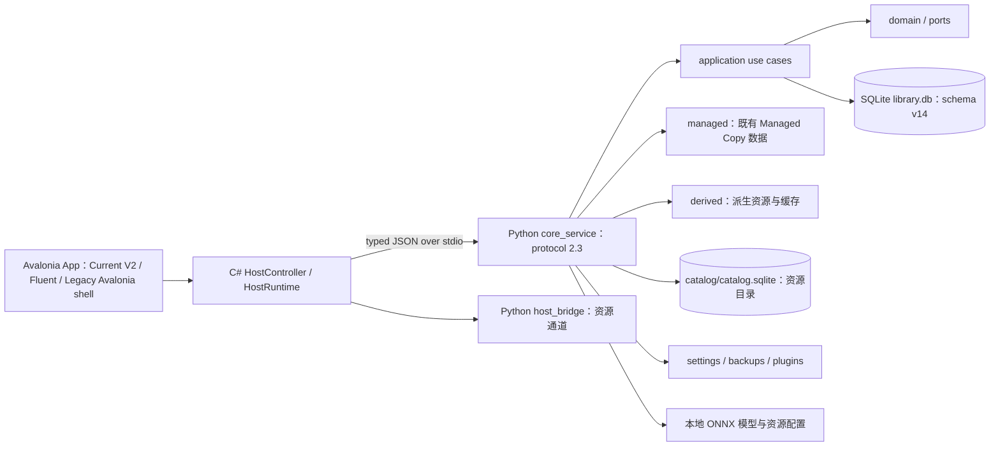

# AUDIT-00：项目现状与完整盘点

**结论：PASS（静态项目盘点完成）**
**产品基线：** `10e4ee013835605800d3830fb960ae8d3aa04167`
**本报告生成时审计 HEAD：** `6f5153e47ff6adfcedde49712636c75e21bd43ef`
**核查方式：** 只读源码、配置、文档与 Git 清单核对；本报告不声称完成构建、安装、真实 GUI 或运行时模型验证。

## 1. 范围与文件覆盖

原始 AUDIT-00 要求盘点有效源码、技术栈、启动入口、后端接口、数据库、文件布局、模型资源、测试代码、构建与发布配置，并交付项目结构图、模块索引和文件覆盖清单。本报告覆盖上述静态清单；专项安全、行为和运行时结论留给 AUDIT-01–14。

机器可读文件覆盖清单为 [`evidence/source-manifest-segment-b.json`](../evidence/source-manifest-segment-b.json)。它以产品基线 Git blob 的精确字节计算 SHA-256，记录 1,301 个纳入审计的源码、测试和配置文件。基线到报告 HEAD 之间，`src/`、`apps/desktop-avalonia/`、`tests/`、`tools/`、`packaging/`、`.github/`、根依赖清单及 `README.md` 的路径差异核对为空；因此本次按审计 HEAD 阅读到的这些产品文件与基线一致。执行命令和 EXIT 见 [`logs/audit-00-inventory-20261112.log`](../logs/audit-00-inventory-20261112.log)。

| 清单分类 | 文件数 | 覆盖说明 |
|---|---:|---|
| `target_source` | 633 | Python `src/` 268 个；Avalonia 应用源码 365 个 |
| `target_tests` | 571 | 根 `tests/` 325 个；Avalonia tests 246 个；这里是文件数，不是测试用例数 |
| `developer_tools` | 42 | `tools/` |
| `packaging` | 17 | 发布/打包源码与配置 |
| `ci_config` | 2 | `.github/workflows/` |
| `root_config_or_license` | 36 | 根配置、依赖、许可证及项目说明 |
| **合计** | **1,301** | 清单类别合计 |

清单元数据记录 `product_base=10e4ee013835605800d3830fb960ae8d3aa04167`、`generated_head=c310f01658f99ddc654d3439777b147fe6d3b7e5`，`hash_basis=SHA-256 of exact Git blob bytes at product_base`。这是一份有效产品源码/测试/配置覆盖清单，不是仓库全部 Git 路径或全部历史的清单；二进制模型、SQLite 数据库、媒体/漫画图像、通用 `test_assets`、历史产品壳、完整文档与仓外对象不由该清单证明。审计未读取私有图像内容、未复制素材，也未导出用户数据路径。

## 2. 当前架构与项目结构

当前架构哨兵以 AD-003 为准：Windows + C#/.NET + Avalonia + Python Core + SQLite + `ReferencedSource`。Core 是书库和流水线的数据写入者；Avalonia UI 经 C# Host/IPC 调用，不直接访问 SQLite、任意 OS 路径或模型。

| 模块 | 位置 | 职责/边界 |
|---|---|---|
| Avalonia App | `apps/desktop-avalonia/src/NewManga.App/` | `Program.Main` 启动 Avalonia classic desktop lifetime；组装产品页面和 shell |
| Host / ApplicationCore | `apps/desktop-avalonia/src/NewManga.Host/`、`NewManga.ApplicationCore/` | Host 生命周期、服务协调、启动自检、命令和应用流程 |
| CoreClient | `apps/desktop-avalonia/src/NewManga.CoreClient/` | `core_service`/`host_bridge` 子进程、wire 编解码、命令映射与错误投影 |
| Presentation / DesignSystem / Appearance / Theme | `apps/desktop-avalonia/src/NewManga.Presentation.Avalonia/`、`NewManga.DesignSystem/`、`NewManga.Appearance/`、`NewManga.Theme/`、`NewManga.ThemeEngine/` | 可切换前端、视觉组件、外观与主题资源 |
| Python 入口与装配 | `src/bootstrap/` | `core_service` 生产入口、Core 装配和 IPC 服务 |
| Python 应用与领域 | `src/application/`、`src/domain/`、`src/ports/` | 用例、领域实体/规则、端口定义 |
| Python 基础设施 | `src/infrastructure/` | SQLite 存储、模型/provider、文件系统、资源通道、网络、图像和导出实现 |
| Python UI 历史区 | `src/ui/` | 源码树保留的 UI 相关模块；清单纳入的文件本身不证明它们进入当前生产闭包 |
| Python tests | `tests/` | 325 个纳入清单的测试源码文件，测试分域目录见仓库 |
| Avalonia tests | `apps/desktop-avalonia/tests/` | 8 个测试 `.csproj`、246 个清单文件 |
| 工具与发布 | `tools/`、`packaging/`、`apps/desktop-avalonia/scripts/`、`.github/workflows/` | 治理/API 生成、打包、测试、安装器和 CI/release 配置 |

## 3. 启动链与后端接口

1. `apps/desktop-avalonia/src/NewManga.App/Program.cs` 解析参数，调用 `BuildAvaloniaApp().StartWithClassicDesktopLifetime(args)`。
2. `App.axaml.cs` 创建生产 `HostController`，按启动选择器构建 Current V2 或 Fluent shell；可选 Presentation host 与旧 `MainWindow` 路径也保留在 Avalonia 工程内。
3. `HostRuntime` 解析 sidecar bundle，启动 `core_service` 与 `host_bridge`，为其传入 data root、managed root、derived root 和 catalog 路径。
4. `src/bootstrap/core_service.py` 作为 Python 生产入口执行旧布局检查/升级，准备数据库与资源目录、装配生产 Core，再提供 stdio 服务。C# 的 Core protocol 定义为 2.3；资源通道由 `host_bridge` 单独承载。

应用侧冻结接口清单由 `doc/plan/FEA-C07_API_INVENTORY.md` 与生成器核对：`IHostController` 79 个方法及 4 个属性/事件，`IRunController` 6 个方法，`IReaderProgressSink` 1 个方法，方法合计 86；`python tools/generate_api_inventory.py --check` 在本次核查时 EXIT 0。该计数是 C# 应用接口成员数，不能直接当作 Python Core wire 命令数。Core 命令路由静态定义在 `src/bootstrap/core_service.py` 的 command groups 与 dispatch 分支；C# 映射在 `apps/desktop-avalonia/src/NewManga.CoreClient/Commands/HostCommandRegistry.cs`。仓库中的 `apps/desktop-avalonia/scripts/extract-command-surface.py` 自述目标仍是旧 `apps/desktop/src-tauri/src/main.rs`，不适用于当前命令面；旧 Tauri 的 66 命令统计未用作当前架构结论。

## 4. 数据库与文件布局

SQLite schema 当前版本为 v14，迁移按版本追加：

| 版本 | 迁移 |
|---:|---|
| 1 | `v1__storage_base` |
| 2 | `v2__library_region_persistence` |
| 3 | `v3__production_pipeline_persistence` |
| 4 | `v4__reading_export_storage` |
| 5 | `v5__detach_pipeline_history` |
| 6 | `v6__plugin_runtime` |
| 7 | `v7__source_storage` |
| 8 | `v8__source_sync` |
| 9 | `v9__media_artifacts_book_index` |
| 10 | `v10__reading_preferences_bookmarks` |
| 11 | `v11__font_assets` |
| 12 | `v12__chapters_custom_rank` |
| 13 | `v13__issue_markers` |
| 14 | `v14__prompt_templates` |

主要表域包括书/章/页/标签，媒体 artifact 与 revisions、regions 与 region revisions，pipeline runs/tasks/stages/step refs/candidates，source 与 sync/binding/lineage，插件状态/事件，阅读进度/偏好/书签、导出历史、字体、清理记录、备份/迁移元数据，以及 issue markers、prompt templates 和引用。实现位置为 `src/infrastructure/sqlite/schema.py`；本轮只读结构，没有打开或查询任何用户数据库。

Host 生产数据根由 `HostOptions.DataRoot` 提供（代码注释对应 `%APPDATA%\\com.newmanga.desktop`）；Core 默认入口还保留 `NEWMANGA_DATA_ROOT` 覆盖和 `%LOCALAPPDATA%\\New Manga` 回退。Host 传入的主要布局为：

| 路径 | 用途 |
|---|---|
| `<data-root>/library.db` | 书库 SQLite |
| `<data-root>/managed/` | 既有托管文件和 managed originals |
| `<data-root>/derived/` | 派生资源、预览与缓存 |
| `<data-root>/catalog/catalog.sqlite` | 资源目录数据库 |
| `<data-root>/settings/` | provider/network 配置 |
| `<data-root>/backups/` | 数据库备份 |
| `<data-root>/plugins/` | 插件状态/数据 |
| `<data-root>/host/` | Host 持久化的 source 操作与 secret 文件子目录 |

AD-003 对 AD-002 的限定取代是：新导入默认 `ReferencedSource`（引用原文件，不复制、不覆盖）；旧 `Managed Copy` 数据仍可读，不自动迁移或删除。该取代不改变 Avalonia/Host/Core/SQLite 分层边界。

## 5. 模型、资源与许可配置

源码内有 SHA-256 pin 和加载时校验逻辑；发布模型文件不在 Git 清单内，本次未核对仓外权重文件字节。

| 资源 | 静态配置 |
|---|---|
| 漫画检测 | `rtdetr-v2-fixed.onnx`；SHA-256 `c7fb5af1a8982416b56955e621c1b10397730807956998066e2fbc132c77bbc3`；ONNX Runtime 路径 |
| Manga OCR | `encoder_model.onnx` SHA-256 `15fa8155fe9bc1a7d25d9bb353debaa4def033d0174e907dbd2dd6d995def85f`；`decoder_model.onnx` SHA-256 `ef7765261e9d1cdc34d89356986c2bbc2a082897f753a89605ae80fdfa61f5e8`；`vocab.txt` SHA-256 `5cb5c5586d98a2f331d9f8828e4586479b0611bfba5d8c3b6dadffc84d6a36a3` |
| SFX 检测 | `yolo11s-seg.onnx`；revision `c22f0175ffe7b453fd660161831aa9fce2a736fc32d29e574650ba9731131c08`；SHA-256 `944e811410933ad6ff8d32446fcc9eef90fb463794e1874ce83035e83acd418d`；默认模型路径受 `NEWMANGA_SFX_WEIGHTS` 配置 |
| 打包运行时 | `packaging/m2ac5/core_sidecar.spec` 声明生产闭包以 ONNX Runtime 为检测/OCR 默认路径，排除 Qt 与 torch/transformers/docTR；`requirements.txt` 中仍列有可选 fallback/development 依赖 |

项目声明 GPL-3.0-or-later；若发布包引入 AGPL 组件（如模型发行变体所涉组件），需按仓库许可证说明处理。依赖与模型许可的逐项结论留给 AUDIT-07/AUDIT-11。

## 6. 测试、构建与发布配置

- Avalonia 解决方案：`apps/desktop-avalonia/NewManga.sln`；`Directory.Build.props` 固定 `net9.0`、Avalonia `11.3.22`、nullable 与 warnings-as-errors。源码/工具生成器共 10 个 `.csproj`，测试共 8 个 `.csproj`。
- 根 Python 测试按 `tests/` 分域；Avalonia 测试在 `apps/desktop-avalonia/tests/`。既有 pytest/.NET/smoke 运行结果及限制以 Task 卡和对应原始日志为准；本次清单补充没有重新运行这些套件。
- Avalonia 脚本包括 `build.ps1`、`test.ps1`、`publish.ps1`、`package.ps1`、`build-installer.ps1`、`install*.ps1`、`install-verify.ps1`、`smoke.ps1` 等。
- Python sidecar 打包入口为 `packaging/m2ac5/build_sidecar.ps1` + `core_sidecar.spec` + `requirements-build.txt`；NSIS 脚本位于 `packaging/nsis/`，校验/发布支持位于 `packaging/release/` 和 `packaging/release-gate/`；CI 定义位于 `.github/workflows/ci.yml` 与 `build-release.yml`。
- 此阶段没有执行 build、publish、installer、真实 UI 或升级/回退动作。AUDIT-12 的干净 Windows 安装实测仍需实际安装介质和隔离环境证据；AUDIT-09 的真实 UI 仍不能由静态结构替代。

## 7. 历史架构差异与待专项核对的静态观察

- AD-001 的 React/Tauri/Rust/WebView2 目标已由 AD-002 的 C#/.NET 9 + Avalonia、Python Core 和 SQLite 桌面边界取代；旧实现留存为历史证据，不代表当前发布路径。
- AD-003 后，新导入策略从 AD-002 历史文本中的 `Managed Copy` 默认变为 `ReferencedSource`；既有托管数据继续读取。
- `packaging/m2ac5/README.md` 开头仍称该打包链为“Tauri NSIS”，并保留 PySide6/torch-heavy 构建说明；同目录当前 `core_sidecar.spec` 明确写 Qt-free、torch-free，根 `README.md` 则描述 Avalonia + Core sidecar。这是文档/配置描述不一致，尚未在本 Task 中修正文档，待 AUDIT-02/AUDIT-12 复核定级。
- 根 `packaging/build.ps1` 仍引用 `packaging/new_manga.spec`；该 spec 在产品基线不存在，而当前 sidecar spec 位于 `packaging/m2ac5/core_sidecar.spec`。本轮只核对路径存在性，没有运行旧脚本；将其作为待 AUDIT-02/AUDIT-12 核实的打包入口观察。
- `apps/desktop-avalonia/scripts/extract-command-surface.py` 指向旧 Rust host 路径，不能用于当前 Avalonia/Core 命令面统计；不据此认定当前接口数量或缺陷。

以上为待专项复核的观察，不是已定级安全发现或产品缺陷结论。未修改产品源码、测试、契约、schema、依赖、发布配置或旧证据。

## 8. AUDIT-00 结论与剩余限制

AUDIT-00 要求的静态项目结构图、模块索引、有效产品源码/测试/配置覆盖清单、入口/接口、schema、存储、模型配置、测试/build/release 路径和历史架构差异已记录，故本项记为 **PASS（静态盘点）**。该结论不覆盖动态行为或外部二进制：当前模型文件字节、打包产物、安装升级、真实 GUI、性能与用户数据内容检查均未在本项执行；任何此类专项仍按各自 Task 结果记录。

**下一阶段：** AUDIT-01/AUDIT-02 架构与静态扫描，然后按 `AUDIT_PLAN.md` 映射既有 suite 证据并推进安全、数据库、契约与合成场景专项。全审 Release Gate 仍为 `BLOCKED`；AUDIT-01–14 尚未完成。
