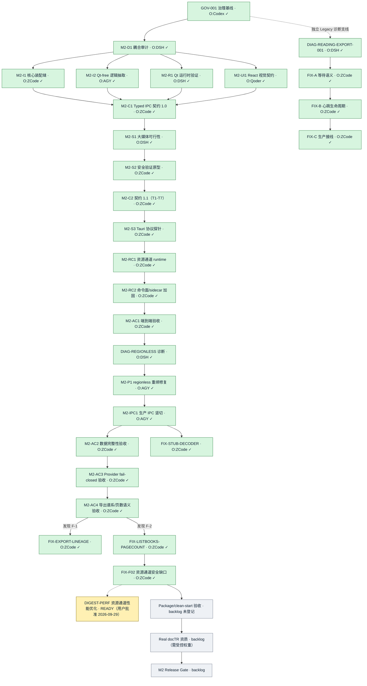

# Project Rebaseline Plan

Status: **ACTIVE DEVELOPMENT BASELINE — GOAL 2026-09-28/29 ACHIEVED (28 TASKS DONE AND INTEGRATED, NONE ACTIVE); NEXT RELEASE DECISION RESTS WITH USER**

Audit date: 2026-09-29 (Asia/Shanghai)

Initial rebaseline code audit: `master` @ `ce21ff9ea5738970bbda9a86079b673918c76048`

Legacy closure checkpoint (2026-09-26): T3.2.1 is `closed_with_limitations` / `SUPERSEDED_BY_M2` under the user-confirmed React + TypeScript + Tauri + Python Core target. The prior integration at `6519125` remains valid historical evidence: fixed input `08f9bd8` was not rebuilt; AC3 remains `PASS（本机模拟路线；非干净机覆盖）`; AC6/AC8/AC9 remain `PARTIAL`; clean Windows/no-Python, Windows 10, real docTR-weight success and true cold-start remain `NOT_RUN`. This is not a Legacy Release approval. Detailed AC/Finding disposition: [closure audit](../verification/T3.2.1/legacy-closure-audit-20260926.md); live execution state: [STATUS.md](STATUS.md).

This file is the sole source of truth for sequencing. `doc/STATUS.md` is the
only live execution checkpoint. `doc/tasks/`, `doc/handoffs/`, `doc/reviews/`
and `verification/` are historical evidence unless this file explicitly
releases a task.

## Architecture decision and future migration registration

[AD-001 Target Desktop Architecture](AD-001_TARGET_DESKTOP_ARCHITECTURE.md) records the user's accepted formal target: React + TypeScript presentation, Tauri/Rust desktop shell and IPC, headless Python Core business/persistence authority, and SQLite as persistent source of truth. M2 first wave M2-I1, M2-I2, M2-R1 and M2-UI1 is complete and integrated. The existing PySide6/QML application may remain operational during migration, but its PyInstaller Windows Release Gate is historical and no longer defines future formal product release acceptance.

**New-architecture-only directive（2026-09-28；用户裁决）**：后续 Task、问题诊断、修复与验收只在 React + TypeScript + Tauri + Python Core + SQLite 新架构上登记和执行。PySide6/QML 代码、测试、Task 与 verification 只保留为历史证据，不再释放 Legacy 实现、诊断或修复工作；旧架构问题若仍对应目标产品行为，必须改写为 M2 新架构需求，并在新架构路径复现、解决和验收。此前仅为 planning recommendation 的 `DIAG-LEGACY-QML-IMPORT-ENTRY-001` 已撤销，未曾释放。

### 2026-09-28 全量任务盘点与当前流程

Live Git=`main@f6f22b67`（2026-09-29 REBASELINE 审计基线，未 push）。已登记并闭环的 Task 共 28 个（GOV-001；M2 首波 D1/I1/I2/R1/UI1；契约与资源通道 C1/S1/S2/C2/S3/RC1/RC2；验收 AC1/AC2/AC3/AC4；DIAG-M2-REGIONLESS-LOCK-CHANGED-001、M2-P1、M2-IPC1；Legacy 诊断家族 DIAG-READING-EXPORT-001/FIX-A/FIX-B/FIX-C；FIX-STUB-DECODER、FIX-EXPORT-LINEAGE、FIX-LISTBOOKS-PAGECOUNT-UNKNOWN、FIX-F02-RESOURCE-CHANNEL-FLAKY），全部 `done` 且集成 main；最新集成=`aa2f99b8`（F02 资源通道安全缺口修复）。**GOAL（G1-G5）已于 2026-09-29 03:4x 达成（停止条件 3）**；随后用户批准释放 [M2-FIX-RESOURCE-CHANNEL-DIGEST-PERF](tasks/M2-FIX-RESOURCE-CHANNEL-DIGEST-PERF.md)（`ready`，2026-09-29，Owner=ZCode 待认领）。验收面终态：m2_acceptance 35 passed 0 xfailed 全绿、tests/core 77 passed、cargo 34 passed、vitest 31 tests；历届 Owner branch/worktree 全保留。未完成仅剩：本 `ready` Task、未登记 backlog 三行（Package/clean-start、Real docTR、M2 Release Gate）与散落 P3 遗留清单（见下表末列与 STATUS Goal completion checkpoint）；后续释放权在用户。

| 已完成 Task | Owner | 非作者 Reviewer / Integrator | Integration |
|---|---|---|---|
| GOV-001 | Codex | DeepSeek Harness / Codex | `969f7a5e` |
| M2-D1 | DeepSeek Harness | Codex / Codex | `100abfbb` |
| M2-I1 | ZCode | DeepSeek Harness / Codex | `cff1e0a8` |
| M2-I2 | Antigravity | Codex / Codex | `7e2da6b8` |
| M2-R1 | DeepSeek Harness | Codex / Codex | `5803bd7b` |
| M2-UI1 | Qoder | Antigravity / Codex | `5242f648` |
| M2-C1 | ZCode | Qoder + DeepSeek Harness / Codex | `c1765aa2` |
| M2-S1 | DeepSeek Harness | Codex / Codex | `4103493f` |
| M2-S2 | ZCode | Antigravity / Codex | `bf1d1230` |
| M2-C2 | ZCode | DeepSeek Harness / Codex | `d574ec1e` |
| M2-S3 | ZCode | DeepSeek Harness / Codex | `6799c73a` |
| M2-RC1 | ZCode | DeepSeek Harness / Codex | `3a246840` |
| M2-RC2 | ZCode | DeepSeek Harness / Codex | `88f972fe` |
| M2-AC1 | ZCode | DeepSeek Harness / Codex | `f162193b` |
| DIAG-M2-REGIONLESS-LOCK-CHANGED-001 | DeepSeek Harness（静态交付，执行由集成方代采） | Antigravity / Codex（代行） | `b5ac097f` |

| 未完成 / 下一阶段 | 状态 | 建议 Owner / Reviewer | 说明 |
|---|---|---|---|
| [M2-P1](tasks/M2-P1.md) Regionless Detection Fan-out and Guard Rebinding | **done**（integration=`a174fb9c`） | Antigravity / DeepSeek Harness（`approved_with_conditions`，P2 已处置） | fixed base=`33826641`、tip=`59acb340`；修复=诊断报告 §5.4 单函数 + R0–R5/N1–N7 全落测；[release evidence](../verification/M2-P1/release-33826641.md)、[集成记录](../verification/M2-P1/integration-record/integration.md)。 |
| [M2-IPC1](tasks/M2-IPC1.md) Production Core Lifecycle + Read-only Library Vertical Slice | **done**（integration=`04c1394a`） | Antigravity / DeepSeek Harness（r1 changes_requested → r2 approved_with_conditions，裁决已实施） | tip=`5556fc8e`；seam 冻结全落地（含方案 B 冻结面保持）；[release evidence](../verification/M2-IPC1/release-a54bb8c9.md)、[集成记录](../verification/M2-IPC1/integration-record/integration.md)。 |
| [M2-AC2](tasks/M2-AC2.md) Data Integrity Acceptance | **done**（integration=`9d3c1db5`） | ZCode / DeepSeek Harness（r1 changes_requested → r2 approved_with_conditions，C1-C3 已闭） | fixed base=`61f9db9b`、tip=`c3ee8dbe`（11 场景）；纯验收（产品代码零改动）：source hash、Managed Copy、人工修改、Lock、current/pinned Revision + 端到端恢复全 PASS；[release evidence](../verification/M2-AC2/release-61f9db9b.md)、[集成记录](../verification/M2-AC2/integration-c3ee8dbe/integration.md)。 |
| [M2-AC3](tasks/M2-AC3.md) Provider Fail-closed Acceptance | **done**（integration=`cac374855b6e6a4310f557ae362d34d0572cd649`；DSH r1 `approved_with_conditions`，C1-C5 已关闭） | ZCode / DeepSeek Harness | fixed base=`319c5e4b`、tip=`a63d3372`（8 场景）；纯验收（产品代码零改动）：Provider 未配置/网络失败/部分失败时命令计划与页面的 fail-closed 语义（不产出半成品、typed 错误可诊断、可恢复、源文件零风险）全 PASS；[release evidence](../verification/M2-AC3/release-319c5e4b.md)、[集成记录](../verification/M2-AC3/integration-a63d3372/integration.md)。 |
| [M2-FIX-STUB-DECODER](tasks/M2-FIX-STUB-DECODER.md) core_service stub decoder signature fix | proposed；未登记释放 | ZCode / DeepSeek Harness | M2-AC2 集成遗留：`_PassthroughImageDecoder` 传不存在参数 `format=` → 经 stub 的导入必崩；ImportPages 扩面前置。禁止未释放实施。 |
| [M2-AC4](tasks/M2-AC4.md) Reader Export Lineage + Library Page-count/Unknown Semantics Acceptance | **done**（integration=`fc99182147bccc89d9bd9124dd17d15b1d428e21`；DSH r1 `approved_with_conditions`，P1-1..P1-3 集成方修正、P2 裁决落字；F-1/F-2 缺陷证据 accepted） | ZCode / DeepSeek Harness | fixed base=`a5529181`、tip=`890f0c74`（11 场景 = 9 passed + 2 xfailed，回归 32 passed + 2 xfailed）；纯验收（产品代码零改动）：缺陷 F-1（export history 无 included_stale/missing ids）、F-2（page_count 无 unknown/已知度通道，定性收窄）以 xfail(strict)+探针固化，AC1/AC4 判 FAIL(部分)、AC2 PASS(a,c)/部分不满足(b)、AC3 PASS、AC5 PASS；[release evidence](../verification/M2-AC4/release-a5529181.md)、[集成记录](../verification/M2-AC4/integration-890f0c74/integration.md)。 |
| [M2-FIX-EXPORT-LINEAGE](tasks/M2-FIX-EXPORT-LINEAGE.md) Export history 补 included_stale/missing page ids（F-1 修复） | **done**（integration=`d71883ec9a6c6fccb14b62908c02790bb3beb99c`；DSH r1 `approved_with_conditions` → r2 `approved`，C1-C6 已关闭；F-1 关闭、xfail 移除，套件现 34 passed+1 xfailed 仅剩 F-2） | ZCode / DeepSeek Harness | fixed base=`8b0d9040`、delivery=`297c9655`（r2 amend 自 0ec1f052，最终 tip=`d395ef70`）；方案 A：`scope_snapshot_json` 加 included_stale/missing 两键（数据源=ExportResult 同源），`schema.py`/`reading_export.py` 零改动；legacy 三通道兼容场景新增；P3-7 并发评估采信未修（候选留 planning）；[release evidence](../verification/M2-FIX-EXPORT-LINEAGE/release-8b0d9040.md)、[集成记录](../verification/M2-FIX-EXPORT-LINEAGE/integration-d395ef70/integration.md)。 |
| [M2-FIX-LISTBOOKS-PAGECOUNT-UNKNOWN](tasks/M2-FIX-LISTBOOKS-PAGECOUNT-UNKNOWN.md) ListBooks page_count unknown/已知度通道（F-2 修复候选） | **done**（integration=`699610291f1536a1a1dbda62ba73f2587def1d91`；DSH r1 `approved_with_conditions` → r2 `approved_with_conditions`（C1=通过 C2=通过，C3/C4/C5 集成关闭，双轮报告已归档 doc/reviews/）；F-2 关闭、xfail 移除，m2_acceptance 全绿 **35 passed, 0 xfailed**） | ZCode / DeepSeek Harness | fixed base=`6199df48`、delivery=`852a92ae`（r2 amend 自 `f4f77808`→`c3f8bb3a`→最终 tip=`b6cb1af2`）；None 通道三侧（Python `int \| None`+handler `get(book_id)` SQL 零改动、Rust `Option<u32>`+serde 测试、TS `number \| null`+`LibraryPanel ?? "—"`）；known-0 与 null 三侧对称锁定（含 r2 TS 正向用例+`??`→`||` 变异红证）；契约 rev 1.2（§5 widening+§3.2 授权例外指针）；f02 默认线程三连 1 失败 2 绿+单线程对照绿 → 既有资源通道潜伏 flake 另立 flaky Task 建议（不计本 Task 回归）；[release evidence](../verification/M2-FIX-LISTBOOKS-PAGECOUNT-UNKNOWN/release-6199df48.md)、[集成记录](../verification/M2-FIX-LISTBOOKS-PAGECOUNT-UNKNOWN/integration-b6cb1af2/integration.md)。 |
| [M2-FIX-F02-RESOURCE-CHANNEL-FLAKY](tasks/M2-FIX-F02-RESOURCE-CHANNEL-FLAKY.md) Resource channel 等长重写拒检并发缺口（f02 flaky 诊断+修复） | **done**（integration=`aa2f99b8170de4205ccd0be23acb10c7fa367fc1`；DSH r1 `approved_with_conditions` 0×P0/P1，C1 final-tip 绑定复跑闭合、C2 选(b) 集成落字；f02 重新定性为真实产品安全缺口并修复） | ZCode / DeepSeek Harness | base=`2b81f91c`、delivery=`fd31a7ad`、最终 tip=`3cef4831`（claim=`6a404c19`）；诊断 3/3 捕获（dump 铁证 NTFS mtime 同 tick 碰撞 `mtime_delta_100ns=0` → `verified_mtime` 短路放行等长重写）；修复=移除 mtime 短路每请求 `stream_digest` 全量重验 + `CachedGrant` 状态字段清理 + `f02_equal_size_rewrite_stability_loop` 50 轮（集成红证：回退旧代码 loop FAILED=101 判别力实证）；性能 342µs→18424µs/request（1 MiB warm debug，~50x 冻结接受，release NOT_RUN）；集成复跑全绿（cargo 34 passed×3+loop+单线程+pytest 35/77，postmerge 同）；dead-code（`CachedGrant.grant`）显式接受并登记 follow-up；[DSH r1](reviews/M2-FIX-F02-RESOURCE-CHANNEL-FLAKY-fd31a7ad-dsh-r1.md)、[集成记录](../verification/M2-FIX-F02-RESOURCE-CHANNEL-FLAKY/integration-3cef4831/integration.md)。 |
| [M2-FIX-RESOURCE-CHANNEL-DIGEST-PERF](tasks/M2-FIX-RESOURCE-CHANNEL-DIGEST-PERF.md) Resource channel digest 重验成本优化（单趟 hash+capture / per-chunk digest）与 GrantCache 死结构收敛 | **ready；已释放（用户批准 2026-09-29，编排会话代行 Codex）** | ZCode / DeepSeek Harness | fixed base=`956e6c3a`；硬约束=不得弱化"等长重写必拒"、不得恢复 mtime 门控、per-chunk digest 须 Core 契约流程（已划范围：DTO 可选字段向后兼容）；两级允许路径（条件级仅 per-chunk）；AC5 三层验证义务（cargo+loop、m2_acceptance 全绿不回退、diff --check）；[release evidence](../verification/M2-FIX-RESOURCE-CHANNEL-DIGEST-PERF/release-956e6c3a.md)。 |
| Package / clean-start acceptance | backlog；未登记 | ZCode / DeepSeek Harness | clean install、无系统 Python、workflow/path/exit。 |
| Real docTR qualification | backlog；未登记 | DeepSeek Harness / Codex | 需要受控权重、环境和质量阈值。 |
| M2 Release Gate | backlog；未登记 | Codex / DeepSeek Harness | cold start、Windows matrix、console policy、packaged dependencies。 |



上图中灰色节点只是排序与建议分工，不构成释放。Legacy TASK-001～065 的详细分类仍在本文件后文保存：`VERIFIED_COMPLETE`、`PARTIAL`、`SUPERSEDED`、`DOC_ONLY` 均为历史迁移盘点，不再生成旧架构工作。

**M2 — Desktop Architecture Migration: FIRST_WAVE_RELEASED / BOUNDED_IMPLEMENTATION.** User authorization on 2026-09-25 releases only the four Tasks below from the verified local `master` base `6a68fdeb92d8a1c7903166a8076d6260bf8fa79a`. [M2-D1 Headless & Qt Coupling Audit](tasks/M2-D1.md) is `done` after Codex non-author [Review](reviews/M2-D1-0a27a54.md) `approved` and integration `100abfb`. Its [report](research/M2-D1_HEADLESS_QT_COUPLING_AUDIT.md) supplies the first-wave evidence. AD-001 remains the fixed React + TypeScript / Tauri / Python Core / SQLite target. Migration is incremental; the existing PySide6/QML application may remain operational during transition, but its PyInstaller Release Gate is retired as the future formal release gate.

| First-wave Task | Status / Owner / Reviewer | Write authority and boundary |
|---|---|---|
| [M2-I1 Core Assembly Seam](tasks/M2-I1.md) | `done` / ZCode / DeepSeek Harness; R3 Delivery `09ad43a`, Handoff `8dab0ab`, [R3 Review](reviews/M2-I1-09ad43a-deepseek.md) `approved`, integration `cff1e0a8658f57a2e9caf774a9de0961e8f65da3`; post-integration verification passed | `src/bootstrap/**` and its assigned tests; split Core from Legacy Qt assembly, injectable adapters. |
| [M2-I2 Qt-free Logic Extraction](tasks/M2-I2.md) | `done` / Antigravity / Codex; Delivery `e359da7`, Revised HEAD `0d6acc7`, [Codex Review](reviews/M2-I2-0d6acc7.md) `approved`, integration `7e2da6b8eb55e437d36fa3fa11cbf3e976a834c9` | Two named UI logic modules, frozen application destinations, named consumers/tests; no Domain Contract change. |
| [M2-R1 Qt Runtime Feasibility Spike](tasks/M2-R1.md) | `done` / DeepSeek Harness / Codex; Delivery `5e2800b`, Handoff `052f99c`, Review `79b1a77` `approved`, integration `5803bd7` | Research/verification only. M2D1-22 is measured with platform limits on Windows 11; QML/`QQuickWindow` and production entry remain `UNVERIFIED`/`NOT_RUN`. No implementation authorization. |
| [M2-UI1 React Feature Parity & Visual Contract](tasks/M2-UI1.md) | `done` / Qoder / Antigravity; Delivery `23a5ac0`, Handoff `784ce18`, [independent Review](reviews/M2-UI1-23a5ac0.md) `APPROVED` at `83a795b`, integration `5242f64` | Design, verification and Handoff only; no React/QML product implementation. Page-level blocked mapping remains an explicit user/contract decision. |

M2 首波四项任务已集成。M2-C1 固定 base=`7478f72fe6f9872cae29f4fa12888b5e1f2380f1`、Owner Delivery=`7de1cd27e22037d4b76b235c9f11399b0cea9463`、Handoff/reviewed_head=`b2377288680569dbee4e2299fd7dfae4de067c54`、Contract blob=`4b503a170ff8ff6e995e5e5d70e3a053f9cc62c3`。Qoder Review=`0d73983a5e1f37f104c76d8bd4c70c6f98fa36f5`、DSH r3 Review=`96666bf063c8a514b3f8a58f78453a397dd93f75` 均 `APPROVED`，同一 reviewed_head，Gate=`PASSED`；原始提交已并入共享历史，M2-C1=`done`。先前对象缺失系 SHA 字符转置误报，见 [Gate 核验](../verification/M2-C1/integration-gate-readiness-96666bf.md)。M2-S1 研究已释放，产品实现未释放。

**M2-S1 研究完成（2026-09-26）**：[M2-S1 Large-Media Resource Channel Feasibility Spike](tasks/M2-S1.md) 固定 base=`85a2aa7fd07a2dca843bf5cea3ec34070b63bdbc`，Owner=DeepSeek Harness；初审 `changes_requested`（`f709e39c`）后，修订 reviewed_head=`64c87d13faa3889c749096dedeacf5afbe8dda16` 由非作者 Codex [复审](reviews/M2-S1-64c87d1.md) `APPROVED`（`8984b4b3`）。Owner 原始提交经 Git bundle/fetch 保留 SHA，tip=`9f5eb1d51cb4283eb670085410ea9596d1f7b0d2` 并入 merge=`4103493fd63c0133f62a659390d0367d1c2a98ab`；集成后[核验](../verification/M2-S1/integration-4103493.md)通过，研究 Task=`done`。A/B 通道仅为条件性 `PROPOSAL`，S1-B1–B12 与 7 项用户阈值仍未解决；IPC runtime 与产品实现均未授权。历史[范围登记](../verification/M2-S1/scheduler-registration-0c2e202.md)与[释放证据](../verification/M2-S1/release-85a2aa7.md)分别保存。

**§7 产品阈值裁决与 M2-S2 释放（2026-09-26；用户授权代行治理）**：因 Codex 额度耗尽，用户指示 ZCode 会话代行 Codex 角色完成两项治理：① [M2-S1 报告 §7](tasks/../research/M2-S1_RESOURCE_CHANNEL_SPIKE.md) 的 7 项产品阈值已裁决于 [product-thresholds-ruling-67c3d56.md](../verification/M2-S1/product-thresholds-ruling-67c3d56.md)（T1 单资源 256 MiB 上限；T2 ≥32 活跃引用/≥16 订阅者；T3 首帧热缓存 200 ms/冷缓存 1 s 目标；T4 禁 Base64 物化 + 有界缓冲；T5 分层信任——WebView 永不接触 OS 路径、选映射 ID 保密；T6 300 s 滑动 TTL + revision 绑定立即撤销；T7 模型权重独立通道）。裁决可被用户逐项推翻，不修改 M2-S1 报告与任何 Contract。② [M2-S2](tasks/M2-S2.md) Resource Channel Security Verification Spike 登记并释放 `ready / SECURITY_VERIFICATION_RELEASED`：Owner=ZCode、Reviewer=Antigravity（非作者），base=`67c3d56e`，branch=`agent/zcode/M2-S2-resource-channel-security`，worktree=`G:/CODEX/New Manga.worktrees/M2-S2-zcode`，释放证据 [release-67c3d56.md](../verification/M2-S2/release-67c3d56.md)。M2-S2 验证 S1-B11（TOCTOU open-then-verify-from-handle）与 S1-B12（映射 ID 保密）；不实现产品通道，runtime 实现继续 NOT_RELEASED。

**M2-S2 完成与集成（2026-09-26）**：[M2-S2](tasks/M2-S2.md) `done`。Owner ZCode delivery=`d502aa5a`、Handoff head=`fbdf1bc2`（隔离原型 + 探针 24/24 PASS、复跑一致：TOCTOU 16 场景 + 映射 ID 8 场景）；Antigravity 非作者 [Review](reviews/M2-S2-fbdf1bc2.md)（`ea11d109`）`approved`（6/6 AC PASS、P0/P1=0、唯一 P2 R-001 GBK 控制台编码项 deferred 并附规避）；Codex 集成 merge=`bf1d12309bee19cccf665fb2d5bb5c9d4dee7e66`（parents `7671f0c1`+`ea11d109`；唯一 add/add 冲突 `doc/tasks/M2-S2.md` 按 M2-S1 先例取 Owner 版），[集成后核验](../verification/M2-S2/integration-bf1d1230.md)：32 路径全授权、禁改路径零改动、`diff --check` exit 0、9 链接 0 断链。原型层关闭 S1-B11/S1-B12 验证缺口；产品级保证保留 `UNVERIFIED/NOT_RUN`（§7 报告：11 NOT_RUN + 3 UNVERIFIED）；结果作为 Contract 修订（T1–T7 落约）与后续 runtime Task 的输入。

**M2-C2 契约修订释放（2026-09-26；用户批准首选方案）**：用户批准登记并释放 [M2-C2](tasks/M2-C2.md) Typed IPC Contract Revision（Resource Channel Thresholds and Security Conclusions）：把阈值裁决 T1–T7 与 M2-S2 的句柄校验/映射 ID 结论落入 [M2-C1 Contract](contracts/M2-C1_TYPED_IPC_CONTRACT.md) 原位修订版（`1.0`→`1.1`，§10 增补、§11 large-media 行部分解除、版本与修订记录），解除「裁决悬在治理文档、契约未更新」的漂移，作为大媒体 runtime Task 的需求基线。Owner=ZCode（按用户采纳的改派选项自 Codex 改派——Codex 额度耗尽且 M2-C1 原始 Owner 亦为 ZCode），Reviewer=DeepSeek Harness（非作者），Codex Integrator。base=`3f468e6e`，branch=`agent/zcode/M2-C2-typed-ipc-contract-revision`，worktree=`G:/CODEX/New Manga.worktrees/M2-C2-zcode`（已创建、干净），释放证据 [release-3f468e6e.md](../verification/M2-C2/release-3f468e6e.md)。修订不得放松既有 §10 保护语义、不得宣称已实现、不授权 runtime 实现。

**M2-C2 完成与集成（2026-09-26）**：[M2-C2](tasks/M2-C2.md) `done`。Owner ZCode delivery=`67f814ff`、Handoff/reviewed_head=`c18f273a`（Contract `1.0`→`1.1`，blob `4b503a17…`→`fc359138…`）；DeepSeek Harness 非作者 [Review](reviews/M2-C2-c18f273a.md) `approved`（0×P0/P1/P2，4×P3 advisory F-01..F-04 为标签/措辞精确性，deferred 至下次触碰 Contract 的 Task）。DSH headless 审查（沙箱内 git 不可用、报告以 untracked 交付）：集成方以 import 提交 `0bbe78f3` 原字节入库报告与派发记录（SHA-256 记录于集成核验），Owner 分支 tip 不动；三命令复核由集成方补跑（范围 7 授权路径、`diff --check` exit 0、blob `fc359138` 三点一致）。Codex 集成 merge=`d574ec1ec42bade5da98ec955d02284d1451f04a`（parents `0bbe78f3`+`c18f273a`；唯一 add/add 冲突 `doc/tasks/M2-C2.md` 按「master 为基 + Owner 回填」解决、blob 等价验证），[集成后核验](../verification/M2-C2/integration-d574ec1e.md)：15 路径全授权、禁改路径零改动、`diff --check` exit 0、8 文件 30 链接 0 断链、集成后 blob=`fc359138` 不变。Contract `1.1` 以设计要求口径承载 T1–T7 与安全语义（产品级保证按来源保留 UNVERIFIED）；runtime 实现继续 NOT_RELEASED。
**M2-S3 释放（2026-09-26）**：[M2-S3](tasks/M2-S3.md) Tauri Asset Protocol Feasibility Probe 已登记并释放 `ready / TAURI_ASSET_PROTOCOL_PROBE_RELEASED`，固定 base=`90c3e45962733799d43e3aefacf4fea99f662a2c`；Owner=DeepSeek Harness、Reviewer=ZCode（非作者），branch=`agent/deepseek/M2-S3-tauri-asset-protocol-probe`，worktree=`G:/CODEX/New Manga.worktrees/M2-S3-deepseek`，范围仅限隔离实验/报告/证据，不改产品代码或 Contract；释放证据 [release-90c3e459](../verification/M2-S3/release-90c3e459.md)。先解 S1-B1（真实 Tauri/WebView asset protocol 权限、缓存、生命周期）；S1-B6 待 runtime 通道存在后测量。大媒体 runtime 仍未释放，待 M2-S3 Review 与 Codex 集成裁决。

**M2-S3 改派 checkpoint（2026-09-26；按用户要求，后由完成记录 supersede）**：Owner 改为 ZCode，非作者 Reviewer 改为 DeepSeek Harness；固定 base=`90c3e45962733799d43e3aefacf4fea99f662a2c`、验收标准与 `ready` 状态不变。改派时的 Owner branch/worktree=`agent/zcode/M2-S3-tauri-asset-protocol-probe` / `G:/CODEX/New Manga.worktrees/M2-S3-zcode` 在固定 base 创建并保持干净。初始分配给 DeepSeek Harness 的 branch/worktree=`agent/deepseek/M2-S3-tauri-asset-protocol-probe` / `G:/CODEX/New Manga.worktrees/M2-S3-deepseek` 留存于同一 base，不再获本 Task 写授权；不清理或删除。改派证据：[reassignment-9b2d40c2](../verification/M2-S3/reassignment-9b2d40c2.md)。

**M2-S3 完成与集成（2026-09-26）**：[M2-S3](tasks/M2-S3.md) `done`，Owner=ZCode delivery tip=`bcef79e775bf4a5b4a4eceb4c3e63ac630aa6de9`；DeepSeek Harness 非作者 Review `approved`，固定于 `233d0901e1de817a8357be7047346de7d8c49f23`（0×P0/P1、5×P2、5×P3）。DSH shell 不可用；Codex 独立核对后续差异至 bcef，并在 Windows/WebView2 实际复跑。merge=`6799c73a75c16252602ac85f4454a5ac1b45b8d2`（parents `a006acb9` + `bcef79e7`；唯一 add/add 冲突为 Task，按 master 为基 + Owner 回填解决）；[集成核验](../verification/M2-S3/integration-bcef79e7/integration.md) 记录授权范围 27 路径、禁改路径零改动、三次 Codex 探针均 16/16 PASS、`diff --check` exit 0。S1-B1=`PASS` 仅限单宿主、Rust 模拟映射表、一次性 body、非打包探针；S1-B3/B5/B6/B8 与产品级安全/IPC 仍未验证，runtime 继续 `NOT_RELEASED`。M2-C2 的 4×P3 advisory 仍 deferred 至下一次实际触碰 Contract 的 Task。

**M2-RC1 大媒体 runtime 释放（2026-09-27；用户明确授权）**：[M2-RC1](tasks/M2-RC1.md) `ready / LARGE_MEDIA_RESOURCE_CHANNEL_RUNTIME_RELEASED`；Owner=ZCode，Reviewer=DeepSeek Harness（非作者），Integrator=Codex；release commit=`fb87414af906348666ffd7d001a276e86c4cd5bc`。固定实现 base=`2dca20cd971e3c2ae1a3ab8134ac0acdf98c45f1`，branch=`agent/zcode/M2-RC1-large-media-resource-channel-runtime`，worktree=`G:/CODEX/New Manga.worktrees/M2-RC1-zcode`。依赖 M2-C1/S1/S2/C2/S3 均 `done`；Contract 1.1 固定 blob=`fc35913801297ee1876ea395f9c5041a16226f20`。Task 以受限 `m2res` opaque-ID URL 为 WebView 入口，限定新 React/Tauri app 与 resource-channel Core 路径；共享 Contract、Legacy QML、Schema、根依赖和打包发布不在授权范围。S1-B3/B8 未关闭前不得宣称产品级安全或打包就绪；S1-B6 冷缓存目标须如实标记。释放证据：[release-2dca20cd](../verification/M2-RC1/release-2dca20cd.md)。Owner worktree 从固定 base 起步；释放提交只提供 Task 文件，不能混入 Owner 实现历史。
**M2-RC1 完成与集成（2026-09-27）**：[M2-RC1](tasks/M2-RC1.md) `done`，Codex merge=`3a24684007fd5a5e855f324077ad996841300f27`（parents `cb6e6d51` + `ce3c3771`）。DSH round-4 Review=`approve` @`2f6a31cd67e983e789c02cb4e33c194f0e012f23`；Codex 在 Owner tip `ce3c3771` 独立复跑 pytest 43、Cargo 12、Vitest 8、WebView2 E2E 10/10 ×2，均 exit 0。62 路径 reviewed delta 已核对；Contract 1.1 blob=`fc35913801297ee1876ea395f9c5041a16226f20` 未变。F-03/F-05 accepted deferrals were assigned to [M2-RC2](tasks/M2-RC2.md), now done at merge `88f972fe`. S1-B3/B5/B6/B8 仍属 `UNVERIFIED/NOT_RUN` 边界；本集成不作产品级安全或打包就绪声明。证据：[integration](../verification/M2-RC1/integration-2f6a31cd/integration.md)。

**M2-RC2 完成与集成（2026-09-27）**：[M2-RC2](tasks/M2-RC2.md) done；固定 Task base=22a2c2bf9a70d8c3b81edcdbe0e1ef146db556e5，FIX head=eac5cb3ed56b4531106cfa98ec6d4ea11ce8d51b，Owner docs head=dc8e5c95c31ccc0dd96fa2287b44aa962c70153d。DeepSeek Harness 对 FIX head 的独立 Review approved；R3-01 文案已在集成时修正。Codex merge=88f972fed921c7d7a010bef38a734de2601d9ca5（parents 6a68fdeb + dc8e5c95；未改写 Owner 历史），报告与两轮复核原始证据逐字节导入，SHA256 清单及集成复跑转录见 [集成核验](../verification/M2-RC2/integration-88f972fe/integration.md)。Codex 复跑 pytest 66、Cargo 20、Vitest 15、WebView2 E2E GATE 10/10 / probe 13/13 与 TTL 探针，全部 EXIT=0；Contract 1.1 blob=fc35913801297ee1876ea395f9c5041a16226f20 未变。S1-B3/B6/B8 保持 NOT_RUN、S1-B5 保持 UNVERIFIED；bundle.active=false；不作产品级安全、安装或打包就绪声明。集成时尚无 M2 successor；随后单独登记并释放 [M2-AC1](tasks/M2-AC1.md)，范围仅为下方 Backlog 首行。

**M2-AC1 完成与集成（2026-09-28）**：[M2-AC1 end-to-end acceptance on the M2 baseline](tasks/M2-AC1.md) `done`。Owner=ZCode，DeepSeek Harness 非作者 Review r4=`approved`（静态 Review）@`d102bf70`；Codex merge=`f162193b5255f06bcbbfc0d1820f38cd81f89d32`，parents=`1347a67c` + Owner tip=`51f70ed1`。固定实现 base=`7db0e7b6ef77b5d403e3d485dc1378d4c786bc7d`；Owner branch/worktree 保留于 `agent/zcode/M2-AC1-end-to-end-acceptance` / `G:/CODEX/New Manga.worktrees/M2-AC1-zcode`。Codex 在合并 head 独立复跑 Core 4、Cargo 26、Vitest 19、E2E 45/45 均通过；全仓 pytest=`1316 passed, 11 skipped, EXIT 0`（docTR 2、OpenSSL 6、NumPy 1、Torch 2，逐项见日志）。E2E 双样本、真实进程重启、Reader 与 PNG 像素摘要一致；全仓 Owner 先前披露的两项 Legacy QML 失败在 Codex 本次运行未复现，仍不视为已查根因。Codex 对 F-008 追认恰好 9 个 Tauri ACL 机制文件，production command surface 不扩张；无 M2 Contract、SQLite schema/migration、依赖锁、Legacy QML 或 packaging 改动。集成记录：[integration-51f70ed1](../verification/M2-AC1/integration-51f70ed1/integration.md)；释放记录：[release-7db0e7b6](../verification/M2-AC1/release-7db0e7b6.md)。其他 M2 Acceptance Backlog 行仍未登记。

**Separate Legacy reliability diagnostic (2026-09-27 released; 2026-09-28 integrated):** [DIAG-READING-EXPORT-001](tasks/DIAG-READING-EXPORT-001.md) is `done`. Owner=DeepSeek Harness delivered `8b36e98e` / tip `77c661b0` from fixed base=`83de13dfe0521125715c2e26da75b96a63103938` (branch=`agent/deepseek/DIAG-READING-EXPORT-001-reading-export-flaky-diagnosis`, worktree preserved). With Codex quota unavailable, the user directed a ZCode session to act as Codex proxy for the non-author Review and integration: proxy non-author [Review](reviews/DIAG-READING-EXPORT-001-77c661b0.md) `approved` @`77c661b0` (commit `c90b8b27`; 0×P0/P1; R-001 P2 §4.1-amplifier wording corrected at integration with U3 kept open; R-002 P3 accepted); integration merge=`e0a0e784498fc339a4d666dd931cc67cfb65bbdb` (parents `c90b8b27`+`77c661b0`; sole Task conflict resolved to the Owner-delivered version; Owner history unrewritten). Result: **15/15 matrix `NOT_REPRODUCED`** (run-01's 11 environment skips disclosed individually), both historical mechanisms reproduced by the two allowed read-only probes (terminal-signal queued-delivery race; reader-heartbeat writes closed SQLite). **NOT_REPRODUCED is not a fix.** Follow-ups [DIAG-READING-EXPORT-001-FIX-A](tasks/DIAG-READING-EXPORT-001-FIX-A.md) and [DIAG-READING-EXPORT-001-FIX-B](tasks/DIAG-READING-EXPORT-001-FIX-B.md) are `done` (FIX-A integration [a8b94df1](../verification/DIAG-READING-EXPORT-001-FIX-A/integration-a8b94df1/integration.md); FIX-B integration [9c9c9087](../verification/DIAG-READING-EXPORT-001-FIX-B/integration-9c9c9087/integration.md)); the former `proposed / NOT_RELEASED` wording was stale. Diagnostic integration verification: [integration-e0a0e784](../verification/DIAG-READING-EXPORT-001/integration-e0a0e784/integration.md). Release record: [release-83de13df](../verification/DIAG-READING-EXPORT-001/release-83de13df.md). This separate Legacy diagnostic is distinct from the M2 successor [M2-AC1](tasks/M2-AC1.md).

**Legacy closure:** [T3.2.1](tasks/T3.2.1.md) is terminal `closed_with_limitations`, disposition `CLOSED_WITH_LIMITATIONS / SUPERSEDED_BY_M2`. It retains all historical AC states: AC1/2/3/4/5/7/10 remain PASS within their documented scopes; AC6=`PARTIAL (11/12)`, AC8=`PARTIAL`, AC9=`PARTIAL`; clean-machine, Windows 10 x64, real-weight success and true cold-start items remain `NOT_RUN`. The old Release Gate is not a future release gate and its unfinished ACs do not block M2. REPAIR-15/16/17 remain `proposed / NOT_RELEASED` with `SUPERSEDED / DO_NOT_RELEASE`; no Legacy repair will be prepared or released.

### M2 Acceptance Backlog (planning rows and explicit releases)

These are requirements carried forward for M2 acceptance planning. Only a row linked to a separately released Task grants implementation scope; all unlinked rows remain unregistered. M2-C1 remains limited to its existing typed IPC contract.

| Future acceptance requirement | Classification | Placement |
|---|---|---|
| Deterministic successful Mock/Local pipeline, saved result, restart recovery, Reader verification and export verification | `MIGRATE_TO_M2_ACCEPTANCE` | Completed by [M2-AC1](tasks/M2-AC1.md), fixed base `7db0e7b6`; deterministic provider remains separate from real docTR claims and does not satisfy other rows. |
| Source hash integrity, Managed Copy, user edits, Lock and current/pinned Revision integrity | `CORE_REQUIREMENT` | Python Core/data safety acceptance and end-to-end recovery checks. |
| Missing Provider fails closed with durable, diagnosable status | `CORE_REQUIREMENT` | Python Core/Pipeline acceptance. |
| Reader export lineage and Library page-count/unknown semantics | `MIGRATE_TO_M2_ACCEPTANCE` | Reader/Export and Library parity acceptance. |
| Tauri + Python Core clean installation/start, no system Python dependency, migrated AC6/AC8 workflow/path/exit behavior | `MIGRATE_TO_M2_ACCEPTANCE` | Future target-package acceptance, scoped by a later authorized release task. |
| Real docTR-weight success qualification | `CORE_REQUIREMENT` | Deferred execution until controlled weights, environment and quality criteria are available. |
| Cold-start metrics, target Windows support matrix, GUI console policy and packaged dependency closure | `DEFERRED` | Decide and verify in a future M2 Release Gate/D08; do not inherit the Legacy results. |

### Released M2 diagnostic

This is an independent new-architecture diagnosis from the M2-AC1 Review, **not** a row in the M2 Acceptance Backlog and not a product-code authorization.

| Task | Scope and evidence | Owner / Reviewer |
|---|---|---|
| [DIAG-M2-REGIONLESS-LOCK-CHANGED-001](tasks/DIAG-M2-REGIONLESS-LOCK-CHANGED-001.md) | `done`（integration=`b5ac097f`）；fixed base=`5789b30b`、delivery=`7a03ac5f`。根因已定位并可复现：`_backfill_detected_regions` 只重绑 `region_id` 未重绑 `target_id` ⇒ OCR 守卫以 `None` 比对 Region current revision ⇒ `LOCK_CHANGED`。只诊断；修复须另立 Task（M2-P1 候选）。 | DeepSeek Harness（静态交付，执行由集成方代采）/ Antigravity（`approved`）；Integrator=Codex（代行）。 |

释放证据：[release-5789b30b](../verification/DIAG-M2-REGIONLESS-LOCK-CHANGED-001/release-5789b30b.md)。Task 已冻结 base、branch、worktree、allowed/forbidden paths、AC 与验证命令；产品代码仍未获授权。

The detailed AC and Qoder finding matrix is in the [Legacy Closure Audit](../verification/T3.2.1/legacy-closure-audit-20260926.md).

Historical REPAIR-13/14 completion facts follow for traceability; they do not reopen T3.2.1 or block M2. Child [REPAIR-13](tasks/T3.2.1-REPAIR-13.md) is `done`: fixed base=`8738c41`, product delivery=`aed0094`, final Handoff/evidence head=`13ae23f`, independent Review=`ccd26a4` (`APPROVE_WITH_CONDITIONS`, C1/C2 satisfied), Codex integration=`6fe7455`. Integration used only the 62-path fixed task delta; the full author branch was not merged because its ancestry includes unrelated REPAIR-9–12 candidate history. Post-integration focused suite: 162 passed, exit 0. C2 cleanup cleared all trailing whitespace; Codex recount found 13 pre-cleanup diagnostics vs 12 stated in the supplement, recorded in the integration report. At that historical checkpoint the Parent Full Gate was OPEN and AC3 was `BLOCKED`; this child completion did not change them. The former Sandbox attempts remain historical evidence; the parent clean-Windows/Sandbox Gate is unchanged. [REPAIR-14](tasks/T3.2.1-REPAIR-14.md) for F-13-3 is `done`: fixed base=`4ab6f58c06cb0691413e2630cb48a145c18c383a`, delivery=`43b24ee`, Handoff tip=`2f0d266`, DeepSeek Harness Review=`f616175e` (`approved`), Codex integration=`296131b`. R14-008 records the accepted fixture-seeding deviation and unrun GUI-native creation substep; R14-010 path counts are corrected in the integration record. Parent Gate remained OPEN / AC3 BLOCKED at that historical integration checkpoint; current closure and preserved AC statuses are recorded in the closure audit.

## Historical Legacy implemented-state audit — no scheduling authority

### Verified complete on the integrated product baseline

- SQLite v2 schema, migrations, region/revision persistence, connection
  ownership and managed-copy safety boundaries.
- Local image, PDF and picture-MOBI import paths, with typed failure behavior.
- Scheduler/executor, pause/stop/retry/recovery state, render/export adapters,
  Webtoon tiled reading and diagnostics wiring.
- Four top-level QML routes and the existing Bookshelf/Workbench/Reader shell.
- Backup/restore service and restore admission/latch tests; production backup
  UI/bootstrap exposure is not part of this verified list.
- T1.1.2 Region Canvas & Creator: rectangle/polygon creation, canonical page
  coordinate conversion, real SQLite persistence, deletion, Inspector sync and
  production `region_creator`/`region_deleter` wiring.
- T1.1.1 Production Text Detector: docTR local detector and production bootstrap
  injection are integrated at `f56f441`; focused detector tests, bootstrap to
  SQLite, real-material detection and source protection passed. Its full suite
  was `1077 collected = 1070 passed + 6 skipped + 1 known environment failure`,
  exit 1; see [integration evidence](../verification/T1.1.1/integration-f56f441.md).
- Earlier T1.1.2 integration verification: `1031 collected = 1025 passed + 6
  skipped`, exit 0; smoke test exit 0. The six skips were existing
  OpenSSL-unavailable TLS cases.

### Partial, blocked or missing

- **T1.2.1 verified complete:** Settings UI/ViewModel, provider/network
  persistence, fail-closed policy, production bootstrap credential injection,
  and authenticated proxy path are integrated and independently verified.
  See the [R5 review](../verification/T1.2.1/review-e5716ac.md) and
  [integration evidence](../verification/T1.2.1/integration-9a14310.md).
- **T2.1.1 gap:** the selected F · Graphite Atelier design is documented, but
  production QML still uses the pre-F hard-coded palette and has no shared
  token/theme layer.
- **T3.1.1 verified complete:** reading progress and export history now use the
  SQLite v4 adapters with non-destructive one-time legacy import; P2 follow-ups
  are recorded in the Task and integration evidence.
- **T3.2.1 Legacy closure:** `closed_with_limitations / SUPERSEDED_BY_M2`; unfinished Legacy ACs remain at their recorded statuses and no longer block M2. See [closure evidence](../verification/T3.2.1/legacy-closure-audit-20260926.md).
- Real provider quality and external endpoint behavior are not proven by the
  unit suite; adapters and fail-closed paths are not production quality claims.

## Historical Task audit

Classification is based on current source, current tests, fixed integration
commits and review evidence. It does not copy the old `status: done` field.
Historical files are not rewritten merely to change this classification.

| Classification | Tasks | Audit reason |
|---|---|---|
| `VERIFIED_COMPLETE` | TASK-005–015, TASK-029–032, TASK-034–046, TASK-049–065 | Integrated implementation or contract has current code and reproducible review/test evidence. TASK-013 is complete for its original progress/workbench scope; the canvas gap is a later slice. TASK-059 is a verified design deliverable, not production QML implementation. |
| `IMPLEMENTED_NOT_VERIFIED` | none | No current Task remains in this state; historical TASK-001–065 classifications are retained separately from the current roadmap. |
| `PARTIAL` | TASK-004, TASK-016–021, TASK-023, TASK-033 | The bounded slice exists, but its own evidence records a clean-machine gate, model/endpoint quality limitation, large-page limitation, deferred sub-slices, deferred MOBI history, or missing real-provider capability. |
| `BLOCKED` | none | No historical task is promoted to blocked when a bounded delivered slice exists; the current blockers are represented as gaps in the new roadmap. |
| `NOT_STARTED` | none | Former proposed tasks were replaced or retained in the new roadmap rather than left as an unowned queue. |
| `SUPERSEDED` | TASK-022, TASK-025–027, TASK-047, TASK-048 | Replaced by T1.2.1/T2.1.1/T2.2.1/T3.2.1 or by the later connection-ownership implementation. TASK-047 was explicitly rejected. |
| `DUPLICATE` | none | No additional independent delivery was found to be a pure duplicate. |
| `OBSOLETE` | none | Retired scope is recorded as superseded so its history remains traceable. |
| `DOC_ONLY` | TASK-001–003, TASK-024, TASK-028 | These are intentionally document/contract/design deliverables; their completion does not imply product implementation. |

The old task ledgers remain in place for traceability. T3.2.1 closure does not rewrite its historic Review, Handoff, integration or verification records.
historical metadata, not a second scheduling source of truth.

## Historical Legacy dependency graph — no scheduling authority

```text
T1.1.2 Region Canvas & Creator
  requires: TASK-008/TASK-049 region service and current Workbench VM seam
  writes:  QML workbench overlay, Workbench VM creator slot, interaction tests
  serial integration: src/bootstrap/app.py region_creator injection

T1.1.1 Production Text Detector
  requires: detector choice and provider contract decision
  writes: selected DetectionProvider adapter + bootstrap wiring + E2E test
  must not: use MangaOCR as a detector or silently fall back

T1.2.1 Settings UI & ViewModel
  requires: existing TASK-009/TASK-050 settings/credential services
  R4 writes: bounded registry/runtime/VM/bootstrap repair and focused tests
  gate: five R3 findings, new Handoff, non-author re-review, Codex integration

T2.1.1 Graphite Atelier QML
  requires: T1.1.2 and T1.2.1 contracts stable
  -> T2.2.1 Reader/Workbench polish

T3.1.1 SQLite progress/export history
  requires: TASK-057 backup/recovery slice; recommended after T2 stabilization
  -> T3.2.1 PyInstaller packaging and clean-machine Release Gate (historical downstream; closed with limitations / superseded by M2)
```

No downstream task is released before its prerequisite is integrated. Product
code, shared contracts, `src/bootstrap/app.py`, SQLite migrations and top-level
QML shell changes are serialized through Codex.

## Historical migration execution record — superseded by the 2026-09-28 flow above

| Order | Task | State | Owner / reviewer | Acceptance boundary |
|---:|---|---|---|---|
| 1 | **T1.1.2 Region Canvas & Creator** | **VERIFIED_COMPLETE** | Qoder implementation / Codex non-author review and integration; base `b985d9c`, integrated `5b91745` | Draw a rectangle/polygon on the original page; inspector updates; matching `regions` and `region_revisions` rows are created; no source-file write. |
| 2 | T1.1.1 Production Text Detector | **VERIFIED_COMPLETE**; integrated `f56f441` | ZCode implementation / Codex non-author review and integration | A page without regions creates a persisted candidate Region through a selected real detector; configured path no longer fails as `PROVIDER_NOT_CONFIGURED`. |
| 3 | [T1.2.1 Settings UI & ViewModel](tasks/T1.2.1.md) | **VERIFIED_COMPLETE**; integrated `9a14310`, evidence `e92c414` | ZCode implementation / Codex non-author review and integration | Provider, credential, endpoint and proxy settings survive restart, feed the pipeline and never enter logs/diagnostics; B-003 production credential path verified. |
| 4 | [T2.1.1 Apply Design F to QML](tasks/T2.1.1.md) | **VERIFIED_COMPLETE**; product code integrated at `5da1cf6` | Qoder / Codex non-author review and integration; base `7f34135` | Shared F tokens use `pragma Singleton` + `qmldir`; all four pages consume them; 158px bookshelf geometry, accepted/completed-state contrast, and a discriminating hard-code guard are verified without business-logic changes. Review/integration evidence: [`review-bc49ef9`](../verification/T2.1.1/review-bc49ef9.md), [`integration-5da1cf6`](../verification/T2.1.1/integration-5da1cf6.md). |
| 5 | [T2.2.1 Reader & Workbench Polish](tasks/T2.2.1.md) | **VERIFIED_COMPLETE**; integrated `fe9fca0` | ZCode functional implementation + Qoder QML/UI/UX / Codex non-author review and integration | Chapter picker, Workbench empty-state picker, dismissible command-error notification, and webtoon canvas consistency are accessible and tested. Evidence: [`review-0846573`](../verification/T2.2.1/review-0846573.md), [`integration-aad510b`](../verification/T2.2.1/integration-aad510b.md). |
| 6 | [T3.1.1 Unify Storage into SQLite](tasks/T3.1.1.md) | **VERIFIED_COMPLETE**; product integrated `0c70e44` | Antigravity implementation / DeepSeek Harness independent Review; Codex Lead / Architect / Integrator | JSON progress/export stores migrate once into transactional SQLite with rollback, non-destructive legacy import and no data loss. Evidence: [review-899bd3c](../verification/T3.1.1/review-899bd3c.md), [integration-899bd3c](../verification/T3.1.1/integration-899bd3c.md). |
| 7 | [T3.2.1 Windows Packaging & Release Gate](tasks/T3.2.1.md) | CLOSED_WITH_LIMITATIONS / SUPERSEDED_BY_M2; AC states preserved. | Codex governance closure; evidence `verification/T3.2.1/legacy-closure-audit-20260926.md`. | Legacy unfinished ACs are not M2 blockers; REPAIR-15/16/17 are superseded and not released. |
| 8 | [M2-C1 Typed IPC Contract](tasks/M2-C1.md) | `done`；Owner Delivery=`7de1cd27e22037d4b76b235c9f11399b0cea9463`，Handoff/reviewed_head=`b2377288680569dbee4e2299fd7dfae4de067c54`；Qoder 与 DSH r3 Review 均 `APPROVED`；Gate=`PASSED`；集成 merge=`c1765aa2`。 | ZCode Owner；Qoder=`0d73983a5e1f37f104c76d8bd4c70c6f98fa36f5`；DeepSeek Harness r3=`96666bf063c8a514b3f8a58f78453a397dd93f75`；Codex Integrator。 | Owner/Reviewer 原始提交保留；source-trace 断链由 Codex 在集成层补齐。全部旧现场保留；M2-S1 研究单独释放。 |
| 9 | [M2-S1 Large-Media Resource Channel Feasibility Spike](tasks/M2-S1.md) | `done`；base=`85a2aa7`，修订 reviewed_head=`64c87d1`，integration=`4103493`。 | DeepSeek Harness Owner / Codex 非作者 Reviewer；复审 `8984b4b3` `APPROVED`。 | 图片/tile 通道研究与原始实验已集成；A/B 仅为条件性建议，S1-B1–B12 与 7 项产品阈值留待单独 Gate；产品实现未释放。 |
| 10 | [M2-S2 Resource Channel Security Verification Spike](tasks/M2-S2.md) | `done`；base=`67c3d56e`，delivery=`d502aa5a`，reviewed_head=`fbdf1bc2`（Antigravity Review `ea11d109` `approved`），integration=`bf1d1230`。 | ZCode Owner / Antigravity 非作者 Reviewer；Codex Integrator。 | 隔离原型验证 S1-B11（open-then-verify-from-handle TOCTOU 负向探针 16/16）与 S1-B12（Core 侧映射 ID 保密 8/8）；产品级保证保留 UNVERIFIED/NOT_RUN；零产品代码改动；结果作为 Contract 修订与 runtime Task 输入；runtime 实现未释放。 |
| 11 | [M2-C2 Typed IPC Contract Revision](tasks/M2-C2.md) | `done`；base=`3f468e6e`，delivery=`67f814ff`，reviewed_head=`c18f273a`（DSH Review `approved`，报告经 `0bbe78f3` 原字节 import），integration=`d574ec1e`。 | ZCode Owner / DeepSeek Harness 非作者 Reviewer；Codex Integrator。 | Contract 原位修订 `1.0`→`1.1`（blob `4b503a17`→`fc359138`）：§10 落入 T1–T7 阈值与安全语义、§11 large-media 行部分解除；既有保护语义零放松；4×P3 advisory deferred；不授权 runtime 实现。 |
| 12 | [M2-RC1 Contract-Aligned Large-Media Resource Channel Runtime](tasks/M2-RC1.md) | `done`；base=`2dca20cd`，Owner delivery/reviewed head=`2f6a31cd`（DSH round-4 `approve`），Owner evidence tip=`ce3c3771`；integration merge=`3a246840`。 | ZCode Owner / DeepSeek Harness 非作者 Reviewer / Codex Integrator。 | 62 路径交付，四套命令级复跑全通过；Contract blob=`fc359138` 保持不变。F-03/F-05 转入 M2-RC2，现已 done at merge `88f972fe`；S1-B3/B5/B6/B8 的未验证边界与产品级安全/打包限制保持。集成记录 `verification/M2-RC1/integration-2f6a31cd/integration.md`。
| 13 | [M2-RC2 Resource Channel Command Surface and Sidecar Boundary Hardening](tasks/M2-RC2.md) | done；base=22a2c2bf，delivery=a8fb17ca，FIX/reviewed head=eac5cb3e，DSH Review=approved，docs=dc8e5c95，Codex integration=88f972fe。 | ZCode Owner / DeepSeek Harness 非作者 Reviewer / Codex Integrator。 | 命令面与 Core catalog 权威、sidecar 隔离完成；R3-01 证据措辞已修正。集成复跑 66/20/15/GATE 10/10/probe 13/13，全 EXIT=0；Contract blob fc359138 未变。S1-B3/B6/B8=NOT_RUN、S1-B5=UNVERIFIED；不作产品级安全/打包声明。记录：[integration](../verification/M2-RC2/integration-88f972fe/integration.md)。 |
| 14 | [M2-AC1 end-to-end acceptance on the M2 baseline](tasks/M2-AC1.md) | `done`；base=`7db0e7b6`，Owner tip=`51f70ed1`，DeepSeek Harness r4 `approved` @`d102bf70`（静态），Codex integration merge=`f162193b`。 | ZCode / DeepSeek Harness / Codex。 | Backlog 首行闭环完成；Codex 在 integration head 独立复跑 pytest 4、Cargo 26、Vitest 19、E2E 45/45，全仓 1316 passed/11 skipped，均 EXIT 0。F-008 限定追认 9 个 ACL 联动文件；无其他越界。记录：[integration-51f70ed1](../verification/M2-AC1/integration-51f70ed1/integration.md)。 |
| 15 | [DIAG-READING-EXPORT-001 Reading/export completion signal and connection-lifetime flaky diagnosis](tasks/DIAG-READING-EXPORT-001.md) | done；base=83de13df，Owner delivery=8b36e98e，Owner tip=77c661b0（DSH），Codex 代行非作者 Review=c90b8b27 approved @77c661b0，integration=e0a0e784。 | DeepSeek Harness Owner / Codex（ZCode 会话代行）非作者 Reviewer 与 Integrator。 | 15/15 固定矩阵 NOT_REPRODUCED（11 个环境 skip 逐项披露，不计通过）；两个历史机制由恰好 2 个只读探针定位并复现（终态信号排队投递竞态；读者心跳写已关闭 SQLite）。**NOT_REPRODUCED ≠ 已修复**；FIX-A/FIX-B 见第 16/17 行。记录：[integration](../verification/DIAG-READING-EXPORT-001/integration-e0a0e784/integration.md)。 |
| 16 | [DIAG-READING-EXPORT-001-FIX-A Export terminal-state wait/signal-delivery semantics](tasks/DIAG-READING-EXPORT-001-FIX-A.md) | done；base=32ef1dd6，R1 delivery=77a78b25、R2 delivery=db5ee918、Owner tip=6fe7bd86（ZCode，用户全夜指令授权释放），DSH 双轮 Review：R1 changes_requested（1P2+5P3 全处置）→ R2 approved @6fe7bd86；integration=a8b94df1。 | ZCode Owner（代行 Codex 释放/集成，待追认）/ DeepSeek Harness 非作者 Reviewer。 | 纯测试等待语义修复（产品零改动）：6 处终态信号消费者等待信号到达；判别探针旧谓词忙碌主线程 324/400 miss → 新谓词 0 miss + 故障注入 3/3 检出；集成 head 全仓 1316 passed/5 skipped EXIT=0（6 OpenSSL=shell PATH 口径）。DSH R2 的 5×P4 观察 deferred。记录：[integration](../verification/DIAG-READING-EXPORT-001-FIX-A/integration-a8b94df1/integration.md)。 |
| 17 | [DIAG-READING-EXPORT-001-FIX-B Reader heartbeat lifecycle](tasks/DIAG-READING-EXPORT-001-FIX-B.md) | done；base=a8b94df1，交付链 claim=6e37f05d → R1=3ce82240/528ba4d4 → R2=2a1078b6 → R3 docs=f93ea667（Owner tip，ZCode），DSH 三轮 Review：R1 changes_requested（2P2+4P3 全处置）→ R2 复核"代码与测试面通过"（5 条文档缺口）→ R3 approved @f93ea667；integration=9c9c9087。 | ZCode Owner（代行 Codex 释放/集成，待追认）/ DeepSeek Harness 非作者 Reviewer。 | `settleReadingTime` 的 `sqlite3.Error` 类型化处理（停心跳+`heartbeat_error` 属性+信号，不吞异常）+ 测试 teardown 6 处落点 + 真实 SQLite 回归测试（先红后绿）；泄漏探针真实 2 心跳周期 7/7 PASS `LEAK CLOSED`；集成 head 全仓 1317 passed/5 skipped EXIT=0。生产 QML/bootstrap 终结点接线为零（Task 禁止范围）→ 登记 proposed 候选 FIX-C（代行 Codex 裁决，待追认）。记录：[integration](../verification/DIAG-READING-EXPORT-001-FIX-B/integration-9c9c9087/integration.md)。 |
| 18 | [DIAG-READING-EXPORT-001-FIX-C Production reader heartbeat endpoint wiring](tasks/DIAG-READING-EXPORT-001-FIX-C.md) | done；base=0e34c5c3，交付链 claim=b1f4cedf → R1=de0bf175 → R2=e9f61f5b → R3=132aa5e1 → R4=46c7ff5a → R5=5d541bee → R6=0e0e699e（Owner tip，ZCode），DSH 六轮 Review：R1 approved（6 Minor）→ R2..R5 changes_requested 逐轮处置 → R6 approved @0e0e699e；integration=0f2e9e31。 | ZCode Owner（代行 Codex 释放/集成，待追认）/ DeepSeek Harness 非作者 Reviewer。 | 纯 Python bootstrap 接线（零 QML）：离开读者页 `closeReader`（幂等 + 离园时长不计入守卫 + re-arm 重启）与 `aboutToQuit` stderr 守卫；接线测试红→绿（600s 离园判别）；集成 head 全仓 1318 passed/5 skipped EXIT=0。F-1/AC1 文本裁决记录于 Task 集成记录。记录：[integration](../verification/DIAG-READING-EXPORT-001-FIX-C/integration-0f2e9e31/integration.md)。 |

The [formal T1.2.1 Task](tasks/T1.2.1.md), [R5 review](../verification/T1.2.1/review-e5716ac.md)
and [integration evidence](../verification/T1.2.1/integration-9a14310.md) record
the completed Task. T2.1.1 passed its release gate at base `7f34135`, received
non-author review, was integrated at `5da1cf6`, and is now
`VERIFIED_COMPLETE`; its fresh evidence is recorded in
`verification/T2.1.1/`.

The formal [T3.1.1 Task](tasks/T3.1.1.md), its independent
[Release Gate](../verification/T3.1.1/release-gate-e771179.md), DeepSeek Harness
Review, and Codex [integration evidence](../verification/T3.1.1/integration-899bd3c.md)
are complete. The product delivery is integrated at `0c70e44`; R-002 and the
remaining P2 follow-ups are explicitly deferred rather than hidden.

## Historical T3.2.1 Legacy Release Gate record (superseded 2026-09-26)

The formal [T3.2.1 Task](tasks/T3.2.1.md) and
[Release Gate](../verification/T3.2.1/release-gate-c2fcb1c.md) use the product
baseline `c2fcb1c`. The Gate decision is **PASS TO START** only. At the pre-closure checkpoint, the ZCode
continuation input, local host-simulation status, remaining evidence, and no-Sandbox
instruction were recorded in
[checkpoint](../verification/T3.2.1/clean-release-gate-20260926/checkpoint.md)
and [Handoff](handoffs/T3.2.1-zcode-continuation-20260926.md); the older Codex
closeout record remains historical.

Review status is slice-specific: REPAIR-8 (`3cdfdee` / `37d5488`) was approved
for documentation only; REPAIR-9 (`d2bf6a8` / `eeb095e`) remains
`changes_requested` after Review `85f8c59`; REPAIR-10 (`be5200e` / `d7edea5`)
was approved for packaging-test path independence only. REPAIR-11 Delivery
`9622395` / Handoff `941dbc8` received `changes_requested` from independent
Review `4f2f8a0`; the evidence findings were corrected by REPAIR-12 Delivery
`a2f6695` / Handoff `8738c41`, which received slice-only `approved` Review
`a656486`. The new review does not alter the historical REPAIR-11 decision or
approve the full product Gate. At that historical checkpoint AC3's required interactive workflow was
`NOT_RUN`; AC5=`NOT_RUN`, AC6/AC7=`PARTIAL / NOT_RUN`,
AC8/AC9=`NOT_RUN`, and R-014–R-016=`OPEN`. These values are not the later integrated checkpoint or the closure audit's final disposition. Codex's historical closeout records
O-12-2 and keeps the legacy REPAIR-11 Handoff outside the integration candidate.
At that pre-closure checkpoint, no REPAIR-7/9/10/11/12 or related branch was to
be merged to `master` before full Gate closure and final independent Review.

## Project control baseline — 2026-09-22

The detailed modified-V2 audit is [PROJECT-AUDIT-2026-09-22](../verification/PROJECT-AUDIT-2026-09-22.md).
It is evidence and a derived map, not a second planning source. The current
project overview, repository/code architecture map, Task ↔ Code ↔ Test
traceability, module maturity, parallel matrix and Dependency Blocking Chain
are maintained there; this Plan retains the authoritative phase, dependency
and release order. The live dashboard, `TaskStatus`/`ExecutionState`, current
branch/HEAD, dirty-file safety and next actions remain in [STATUS](STATUS.md).

Current successor gate (updated 2026-09-26):

```text
M2-D1 / M2-I1 / M2-I2 / M2-R1 / M2-UI1 = integrated; ancestry verified at base 7478f72fe6f9872cae29f4fa12888b5e1f2380f1
  -> T3.2.1 = closed_with_limitations / SUPERSEDED_BY_M2; unfinished Legacy ACs do not block M2
  -> M2-C1 = done; dual Review APPROVED at the same reviewed_head; Integration Gate PASSED; original commits integrated
  -> Case A = OWNER_ADOPTED_WITHOUT_SEMANTIC_CHANGE; Contract blob equals adopted source blob 4b503a170ff8ff6e995e5e5d70e3a053f9cc62c3
  -> DSH r3 Review commit 96666bf reports APPROVED and is present unchanged in shared history
  -> Codex corrected a transposed SHA in the former blocker check; exact object ancestry, Contract blob and authorized paths passed
  -> M2-S1 research done at merge 4103493; thresholds T1-T7 ruled and recorded through M2-S2 / M2-C2; remaining product verification stays scoped and open
  -> M2-S2 security verification done at merge bf1d1230; prototype conclusions only, product guarantees remain UNVERIFIED/NOT_RUN
  -> M2-C2 Contract 1.1 done at merge d574ec1e; blob fc359138; 4x P3 advisory deferred until next Contract touch
  -> M2-S3 probe done at merge 6799c73a; S1-B1 PASS within documented boundaries; product resource-channel runtime Task separately released as M2-RC1
  -> M2-RC1 done at merge 3a246840; round-4 DSH approve @2f6a31cd; all Codex command-level integration checks passed; Contract blob fc359138 unchanged; product security/packaging claims remain gated
  -> M2-RC2 done at merge 88f972fe; DSH FIX review approved; S1-B3/B6/B8=NOT_RUN, S1-B5=UNVERIFIED
  -> M2-AC1 done at Codex merge f162193b (2026-09-28): fixed base 7db0e7b6; bounded deterministic Mock/Local -> SQLite save -> process restart/recovery -> Reader -> PNG export acceptance
  -> DIAG-M2-REGIONLESS-LOCK-CHANGED-001 ready at fixed base 5789b30b; AWAITING_EXTERNAL_DISPATCH; Legacy QML candidate withdrawn by user directive
  -> Separate Legacy DIAG-READING-EXPORT-001 done at merge e0a0e784 (2026-09-28, proxy Codex review+integration): 15/15 matrix NOT_REPRODUCED, both mechanisms probe-reproduced
  -> DIAG FIX-A done at integration a8b94df1 (2026-09-28, overnight directive): DSH dual-round review r2 approved; test-wait semantics; FIX-B released serially
  -> DIAG FIX-B done at integration 9c9c9087 (2026-09-28, overnight directive): DSH three-round review r3 approved; typed heartbeat-error handling + teardowns; leak probe 7/7 LEAK CLOSED
  -> DIAG FIX-C done at integration 0f2e9e31 (2026-09-28, overnight directive): DSH six-round review r6 approved; production leave/quit wiring (pure Python); family fully closed
```

This is a dependency blocking chain, not a schedule critical path; no reliable
duration model exists. Research-only storage work and knowledge-map refreshes
may be conditional/safe parallel work when their write sets stay isolated.

Audit note: Roadmap ID `T1.1.2` is verified through historical `TASK-013`,
integration `5b91745` and its verification records, but has no dedicated
`doc/tasks/T1.1.2.md`. This is a traceability gap recorded for future document
maintenance; it does not reopen the integrated implementation.

## Directory and document governance

- Keep `src/`, `tests/`, `doc/01–09`, contracts, task/review/handoff evidence
  and verification logs.
- Keep historical tasks in place; archive them logically through the mapping in
  this file instead of moving or deleting them.
- Treat `verification/` as evidence, not generated cache. Do not delete logs
  during this rebaseline.
- `.pytest_cache/` is generated and ignored. The untracked-file inventory in
  the initial audit is historical; refresh `git status` before any edit and
  preserve other agents' material.
- `experiments/TASK-017/README.md` is another agent's uncommitted change;
  preserve it and keep it outside this audit commit.
- The 2026-09-20 worktree inventory is evidence only and must be refreshed
  before any future worktree deletion. No worktree deletion or prune is
  authorized here.

## Recovery checkpoint

```powershell
Set-Location 'G:\CODEX\New Manga'
git status --short --branch
git rev-parse HEAD
Get-Content doc\STATUS.md
git log -8 --oneline --decorate
```

Resume only after confirming the current branch, dirty files, `STATUS.md`,
this plan and the latest verification artifact. Do not infer progress from
chat history.
