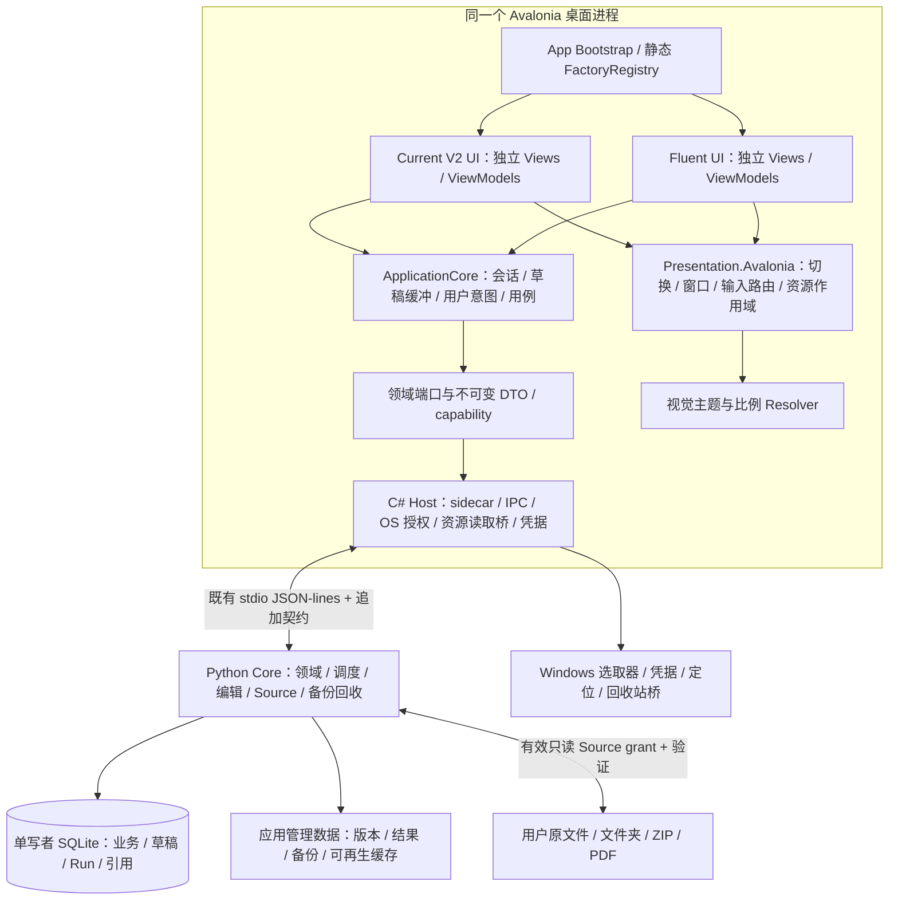
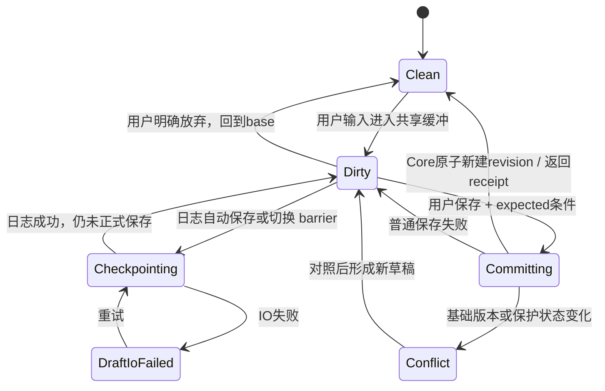
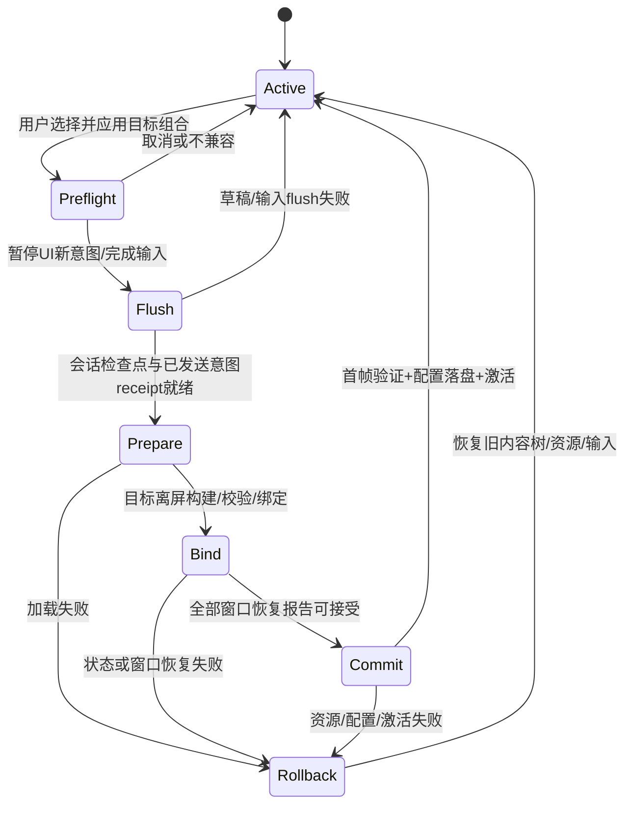
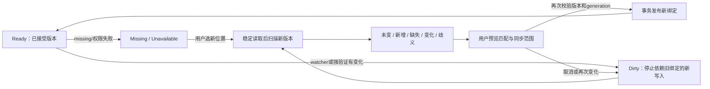
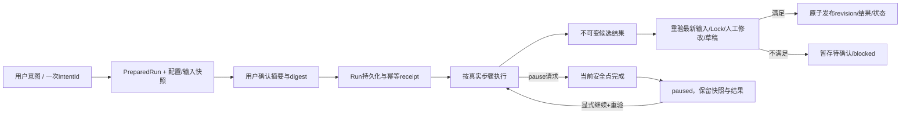
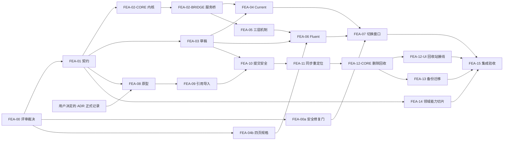

# New Manga 可切换前端架构方案

日期：2026-10-31。作者：Codex；本次方案设计由用户直接授权。

状态：**PROPOSAL / 待独立 Review 与 DSH 契约处置**。本文不是 ADR、冻结契约、Task 释放、实现验收或集成批准。文中的候选 Task 均未激活；不改变当前 `REALUSE-DATA-SAFETY-6` 的 `ready` 状态。

核查基线：`G:/CODEX/New Manga`，分支 `main`，HEAD `1180cdba79e4d610521dde13f0c8a458220f9d90`，Git common directory `.git`。开始时唯一未提交项为未跟踪的需求文档，予以保留。本文代码位置均指此 HEAD；行号用于定位符号，不是未来版本的固定契约。

需求来源：[Fluent 漫画用户需求与交互概念](FLUENT_MANGA_USER_CONCEPT_2026-10-30.md)，核查时 SHA-256 `508273c4599f9a0e1e33250f9b4d75660ee72fbd7d0c76f678b7aa7751979808`。已读取 [AGENTS](../../AGENTS.md)、[STATUS](../STATUS.md)、[REBASELINE_PLAN](../REBASELINE_PLAN.md)、[AD-002](../AD-002_TARGET_DESKTOP_ARCHITECTURE.md)、[V11R 冻结契约](../plan/V11R_AVALONIA_CONTRACT.md)、当前 Task 及 STATUS 指定的最新 Review。当前 Task 尚未开 worktree，`reviewer: null`，canonical evidence 为空，没有指定 rolling checkpoint；不据此追读历史 checkpoint。`V11R_PROGRAM` 所写全局 `verification/checkpoints/` 在本工作区不存在，作为指针问题交 DSH，不据此推断任务丢失。

全文使用三种证据标记：

- **[事实]**：代码静态核查或当前权威文件直接支持；不代表本次运行通过。
- **[建议]**：拟采用的架构、数据结构或行为，须经后续规格、契约与 Task 冻结后实施。
- **[假设 Hn]**：尚需原型、真机或服务验证的技术判断，集中见 §14。

## 1. 推荐决策与适用边界

**[建议] 采用 E 方案：同一个 Avalonia 桌面进程中，装配两套独立编写的界面模块，共用一个 C# ApplicationCore、一个 HostRuntime 和一套 Python Core/SQLite。界面方案、视觉主题、比例方案分别注册、分别保存，组合前校验兼容性。**

第一阶段的两个界面 ID 建议为 `builtin.current-v2`、`builtin.fluent`。前者对应当前默认 `AppShellV2`，后者独立实现四个一级页面：书架、工作台、阅读器、设置。当前 V2 的 Library/Studio/Console 与覆盖式 Reader/ThemeStudio 结构通过适配器保留，不强迫两套界面共用导航树。旧代码构建的 Avalonia `--shell=legacy` 只是已有诊断/发布回退入口，不自动成为第三个受支持界面；Tauri/React 与 PySide6/QML 不进入新方案。

Fluent 的布局、导航、组合组件、手势、快捷键上下文和 ViewModel 都独立编写。共享的是领域行为、业务状态、数据与经过核对的渲染原语；不复制一份 Core，也不把旧 ViewModel 改名后作为新 UI。以后新增布局/导航时，通常只新增 UI 模块、兼容声明和映射；新增领域能力时仍可能需要扩展后端。

**[用户决定，待权威记录]** 2026-10-31 用户回复“按你的建议”，确认新导入默认直接引用原文件、既有 Managed Copy 数据继续读取且不自动迁移或删除、外部原件默认不纳入备份；人工修改和处理结果仍由应用管理。DSH 须将该决定记录为架构 ADR 并协调现行 AD-002 和契约；本文不是正式 ADR，不假称权威文件已修订或契约已冻结。在正式记录及相关范围冻结前，FEA-08/09/11/12/13 Source 改造线仍 `BLOCKED`，现行 AD-002 与 Managed Copy 契约继续生效。`check.ps1 PASS` 仅检查机械条件，不证明架构一致。详见 §15.1。

| 方案 | 优点 | 主要代价 | 结论 |
|---|---|---|---|
| 现有 ThemePackage 内增加布局/XAML/导航 | 表面改动小 | 违反冻结主题边界，状态与任意代码加载混杂，不能支持完全不同交互 | 不选 |
| 同一个 ViewModel 加大量 `if (fluent)` | 初始复用多 | 每套 UI 被同一控制流牵制，分支组合膨胀，难独立验证 | 不选 |
| 独立 Avalonia UI 模块 + 共享应用内核 | 原生窗口与现有 Host 可延续；业务状态不随 UI 销毁；渐进迁移 | 需要提取会话/草稿/命令端口及样式隔离 | **推荐** |
| 每套前端单独进程，共享 Core 服务 | 故障隔离更强，可跨技术栈 | 需增加多客户端调度、IPC 服务化、并发编辑协调；超出首阶段 | 后续有明确需求再评估 |
| 外部任意 DLL/XAML 热加载 | 安装扩展灵活 | 同进程代码无安全隔离，trim/AOT/卸载/兼容复杂 | 首阶段不提供 |

首阶段 UI 模块随应用编译、随安装包更新；使用静态工厂表，不依赖反射扫描或动态程序集卸载。自定义视觉主题和比例只能携带受校验数据，不能携带代码。无新增生产依赖的前提下优先复用现有 Avalonia/SQLite/资源校验组件；新增组件、字体、模型或移植代码仍按仓库许可流程另审。

## 2. 已核实的实现与目标差异

**[事实]** Python `src/**` 是 AD-002 保留的生产 Core，不能因曾服务旧壳就整体归为历史实现。下表关注实际生产调用与缺口，不能把冻结文档中的枚举、接口或组件名单当作已接线能力。

| 编号 | 代码核实事实与定位 | 目标差异 / 处理建议 |
|---|---|---|
| F01 启动与外壳 | [App.axaml.cs:56](../../apps/desktop-avalonia/src/NewManga.App/App.axaml.cs#L56) 创建单个 `HostController`，按 options 选择 V2/legacy，并设置 `MainWindow`、`OnMainWindowClose`；[AppOptions.cs:71](../../apps/desktop-avalonia/src/NewManga.App/AppOptions.cs#L71) 默认 `v2` | 现有选择发生在启动；没有完整界面注册/运行期切换事务 |
| F02 工作区接口 | [ShellState.cs:1](../../apps/desktop-avalonia/src/NewManga.App/Shell/V2/ShellState.cs#L1)、[IWorkspaceView.cs](../../apps/desktop-avalonia/src/NewManga.App/Shell/V2/IWorkspaceView.cs) 暴露 `SpaceId`、`ShellSelection`、`Control` 和特定空间生命周期 | 可作为 Current UI 适配入口，不能直接冻结成所有 UI 的公共接口 |
| F03 Host 边界 | [IHostController.cs:116](../../apps/desktop-avalonia/src/NewManga.App/Services/IHostController.cs#L116)、[HostController.cs:76](../../apps/desktop-avalonia/src/NewManga.App/Services/HostController.cs#L76)、[HostRuntime.cs](../../apps/desktop-avalonia/src/NewManga.Host/HostRuntime.cs) 已桥接 CoreClient、导入、资源、Run 等 | 宽接口仍位于 App；抽窄领域端口，先用适配器包现有实现，不一次重写协议 |
| F04 主题 | [ThemeContracts.cs:8](../../apps/desktop-avalonia/src/NewManga.ThemeEngine/Models/ThemeContracts.cs#L8)、[ThemeService.cs:118](../../apps/desktop-avalonia/src/NewManga.ThemeEngine/Service/ThemeService.cs#L118) 有 registry、校验、预览、持久化与回退 | 可复用机制；完整界面不是 ThemePackage。需要呈现作用域与组合事务 |
| F05 布局/比例 | [ThemeModels.cs:332](../../apps/desktop-avalonia/src/NewManga.ThemeEngine/Models/ThemeModels.cs#L332) 的 `LayoutProfile` 混有导航、密度、阅读模式，注释明确仅实现 TopBand | 枚举不代表 Sidebar/Dock 已实现；将方案参数、几何比例、阅读业务偏好分离迁移 |
| F06 Run 投影 | [RunStatusMonitor.cs:14](../../apps/desktop-avalonia/src/NewManga.App/Shell/V2/RunStatusMonitor.cs#L14) 使用 DispatcherTimer；[StudioRunDataSource.cs:110](../../apps/desktop-avalonia/src/NewManga.App/ViewModels/V2/Studio/StudioRunDataSource.cs#L110) 是读取接口 | 本次搜索未发现契约 R-24 所称 `IRunProjectionPoller` 实体；不是“没有轮询”，应提取现有 monitor，统一订阅与调度，避免双源 |
| F07 Studio 接线 | [AppShellV2.axaml.cs:50](../../apps/desktop-avalonia/src/NewManga.App/Shell/V2/AppShellV2.axaml.cs#L50)、[StudioPageViewModel.cs:265](../../apps/desktop-avalonia/src/NewManga.App/ViewModels/V2/Studio/StudioPageViewModel.cs#L265) 默认 text/flag/run source 有 NOT_WIRED 路径；RegionType 与 revision restore 有实际 Host 调用 | 不能把 V2 完整文本编辑、Lock 写入或全部任务状态当作已有 UI 能力；按端口逐项接线 |
| F08 草稿与撤销 | [StudioInspectorViewModel.cs:282](../../apps/desktop-avalonia/src/NewManga.App/ViewModels/V2/Studio/StudioInspectorViewModel.cs#L282) 暂存 RegionType；[StudioPageViewModel.cs:1175](../../apps/desktop-avalonia/src/NewManga.App/ViewModels/V2/Studio/StudioPageViewModel.cs#L1175)、[同文件:1615](../../apps/desktop-avalonia/src/NewManga.App/ViewModels/V2/Studio/StudioPageViewModel.cs#L1615) 保存/离开确认。legacy 的 Undo 是恢复历史 revision；V2 没有 Undo/Ctrl+Z 接线 | 没有独立的完整文字/样式/几何草稿服务；需区分草稿撤销与已保存版本恢复 |
| F09 阅读状态 | [ReaderOverlayViewModel.cs:23](../../apps/desktop-avalonia/src/NewManga.App/ViewModels/V2/Library/ReaderOverlayViewModel.cs#L23) 持 pages、页序、布局、方向及进度；[IHostController.cs:104](../../apps/desktop-avalonia/src/NewManga.App/Services/IHostController.cs#L104) 有保存 sink | 阅读业务会话仍与 VM 混合；现有保存接口不等于所有刷新/恢复链已通过，当前 DATA-SAFETY-6 AC1 仍待实现 |
| F10 多窗口 | [app.manifest:6](../../apps/desktop-avalonia/src/NewManga.App/app.manifest#L6) 声明 PerMonitorV2；Program.cs 的同名方法仅定义未调用；[AppShellV2.axaml.cs:98](../../apps/desktop-avalonia/src/NewManga.App/Shell/V2/AppShellV2.axaml.cs#L98) 创建一个 Window；[MainWindow.axaml.cs:484](../../apps/desktop-avalonia/src/NewManga.App/Views/MainWindow.axaml.cs#L484) `OpenImmersiveReader` 创建 legacy 独立阅读窗口 | DPI awareness 不等于双屏面板管理；V2 未见窗口注册表/跨屏恢复服务 |
| F11 导入 | [图片导入 service.py:39](../../src/application/importing/images/service.py#L39)、[文档导入 service.py](../../src/application/importing/documents/service.py) 读取、解码并写 Managed Copy；[managed_storage.py:62](../../src/infrastructure/filesystem/managed_storage.py#L62) 提供受管文件发布 | 新导入应创建引用与索引，不永久复制输入；PDF 页面渲染与 ZIP 解码可以是可再生缓存，不能当作唯一原件 |
| F12 用户源 grant | [HostGrantCoordinator.cs:65](../../apps/desktop-avalonia/src/NewManga.Host/HostGrantCoordinator.cs#L65)、[HostIssuer.cs:103](../../apps/desktop-avalonia/src/NewManga.CoreClient/Issuer/HostIssuer.cs#L103)、[import_source_refs.py](../../src/infrastructure/resource_channel/import_source_refs.py) 提供签名、限时、只读、导入用途授权 | 是临时导入读取授权，不是持久化源文件引用、重定位或删除授权 |
| F13 资源通道 | [resource_channel/service.py:66](../../src/application/resource_channel/service.py#L66)、[handle_resolver.py:274](../../src/infrastructure/resource_channel/handle_resolver.py#L274) 校验 identity/size/digest、可信根；一般资源服务禁止直接 user-source | 不得把外部绝对路径塞入 derived-cache grant；新增源读取契约，复用 handle 校验而非放宽可信根 |
| F14 文件身份 | [library.py:304](../../src/infrastructure/sqlite/library.py#L304) 按章节查询 source hash；Page 存 managed original、hash、size | 内容去重不等于持续文件身份；缺少持久化 SourceVersion、容器成员 lineage、共享源与重定位工作流 |
| F15 回收站/清理 | [library.py:399](../../src/infrastructure/sqlite/library.py#L399)、[同文件:704](../../src/infrastructure/sqlite/library.py#L704)、[maintenance/trash.py](../../src/application/maintenance/trash.py) 已有软删、清理 preflight、受管引用检查 | 可复用保护检查；不能等同需求中的完整书籍/单项恢复、外部文件引用计数与 Windows 回收站事务 |
| F16 备份 | [nmbak.py:174](../../src/infrastructure/sqlite/nmbak.py#L174) 总是包含 DB、page managed originals、current/pinned artifact 文件；[同文件:270](../../src/infrastructure/sqlite/nmbak.py#L270) 恢复前备份，拒绝 active Run 后覆盖 DB/恢复文件 | 不是“默认不含外部原件”的新语义，也没有逐项冲突合并；需新格式与 staging restore，旧格式保留读取 |
| F17 Region 能力 | [editing/service.py:1232](../../src/application/editing/service.py#L1232)、[regions.py](../../src/infrastructure/sqlite/regions.py) 已有人工译文、锁、revision、pin/restore；[Region 冻结契约](../contracts/V11R_REGION_WRITE_CONTRACT.md) 已追加 C067–C077 | Core/Dispatcher 能力与 App 便捷接口/UI 接入要分开核对；不因 V2 NOT_WIRED 就重复实现 Core |
| F18 Run 持久化 | [pipeline/assembly.py:18](../../src/infrastructure/pipeline/assembly.py#L18) 生产注入 SQLite store/catalog/snapshot；[pipeline.py:387](../../src/infrastructure/sqlite/pipeline.py#L387) 持久化 run/幂等；[tasks/service.py:1094](../../src/application/tasks/service.py#L1094) 将中断 running 标记 INTERRUPTED | 已有 durable Run 与恢复基础；不能写成“任务只有内存状态”。需补外部源版本、请求预览同源、完整配置快照与草稿冲突保护 |
| F19 提交保护 | [pipeline.py:742](../../src/infrastructure/sqlite/pipeline.py#L742) 在 `BEGIN IMMEDIATE` 内重读 revision/Lock，与状态持久化共同提交 | 可扩展 CAS；当前不覆盖外部源版本、持久草稿版本与同步 generation |
| F20 写入边界缺陷 | [step_writes.py:195](../../src/infrastructure/providers/step_writes.py#L195) 的 Region writer 在 prepare 阶段写 revision 和 `regions.text_json`，current 指针之后再由 seam 更新 | **[事实] 既有 Core 数据安全缺陷**：prepare 独立事务提交 live 文本，之后 seam 拒绝/失败或崩溃不能回滚提前写入；静态代码路径成立，故障运行复现仍 NOT_RUN。须经 §15.5 的独立安全修复门后才能切换双 UI |
| F21 配置快照 | [pipeline.py:948](../../src/infrastructure/sqlite/pipeline.py#L948) 合并 defaults/overrides、递归冻结与敏感字段过滤；[models.py:20](../../src/domain/tasks/models.py#L20) 有深冻结 | **[事实]** 上下文内容不在任务快照、执行时读取 live 邻页；现有 payload 无提示词内容/字体摘要字段。扩展与测试见 §15.5 |
| F22 迁移 | [migrator.py:42](../../src/infrastructure/sqlite/migrator.py#L42)、[schema.py:599](../../src/infrastructure/sqlite/schema.py#L599)、[upgrade_legacy_layout.py](../../src/infrastructure/sqlite/upgrade_legacy_layout.py) 已有 Schema 和目录迁移 | 旧目录迁移不是 Managed Copy→外部引用转换；新转换需单独 journal、核对与回退 |

**权威文件差异交 DSH 处置**：STATUS 的历史“基线 `ba8de1148`”、当前 Task `base_commit: 896029a3f` 与本次实际 HEAD 不同，不将其擅改为当前事实；Task base 可以是合法冻结起点。总命令契约标题仍写 C067–C076 PENDING，而专项 Region 契约已到 C077/FROZEN；以后以实际 Registry/Dispatcher/Core 和 DSH 裁定协调，不将“66 条”当作当前全部能力上限。R-24 的接口名称与 F06 实体差异也需要登记。本文留存差异证据，未修改其他 Owner 的 Task、冻结契约或历史 Review。

## 3. 分层、依赖方向与运行实例

**[建议]** C# 的“共享应用内核”负责桌面应用用例编排和会话，不再实现一套 Python 领域规则。Python Core 仍是业务持久化、冲突判断与写入安全的最终权威。



箭头表示依赖/调用，不表示每次 UI 刷新都跨 IPC。UI 订阅 ApplicationCore 的只读投影；Core 返回业务事实和版本，不返回页面布局、导航宽度或控件名称。

| 层 | 负责 | 禁止承担 |
|---|---|---|
| 各套 UI | 页面/组件组合、局部 VM、命中测试、手势、焦点、可访问性、语义路由映射；将输入即时送入共享草稿 | DB/任意文件读取、模型调用、Run 真值、各自存一份人工译文、各自决定 Lock 绕过 |
| ApplicationCore（纯 .NET） | `ReaderSession`、`EditingSession`、选择、会话筛选、草稿缓冲/撤销、操作确认、意图幂等、统一 Run 订阅、跨界面状态移交 | 引用 Avalonia/Control/Dispatcher；直接写 SQLite；复制领域规则或把投影状态当作成功提交 |
| Presentation.Avalonia | WindowBroker、界面生命周期、快捷键上下文、主线程调度、Theme/Scale sink、材质降级、资源解码呈现 | 持有第二份业务状态；关闭 UI 时取消应用任务；自行删除原文件 |
| Host/CoreClient | 一次 sidecar 生命周期、传输/超时/断线、typed 错误适配、授权/凭据、受控本地文件操作；资源缓存与流桥 | 为每个界面启动后端；将 OS 路径直接公开为 UI 文件访问接口；自行修改 Core DB |
| Python Core | Book/ContentItem/Page/Region、读取源与一致性检查、编辑/版本/Lock、Run 快照与调度、结果提交、迁移/备份/回收站/GC | 接受“当前 View 表示可写”作为授权；包含 Fluent/Current 的布局分支 |

生命周期：进程一个 `ApplicationSession`、`HostRuntime`、`SourceAccessRegistry`、Run 监控服务；每个打开的内容会话一个 `SessionId`，每个区域草稿一个 `DraftId`；每个原生窗口一个 `WindowId`。同一编辑会话可以在主窗和浮窗被观察，写入通过同一编辑序列协调。首阶段同一时刻只激活一种界面方案，全进程统一切换；预览只读，不成为第二个业务客户端。

## 4. 模块结构、端口与兼容策略

### 4.1 建议目录与依赖

**[建议，以下项目尚不存在]** 不一次物理搬动所有代码；先建立端口和 adapter，再按职责迁移，保留可编译过渡层。

```text
apps/desktop-avalonia/src/
  NewManga.App/                         # 唯一 composition root、启动参数
  NewManga.Application.Contracts/       # 纯 .NET：IDs、DTO、领域端口、错误、能力
  NewManga.ApplicationCore/             # 纯 .NET：Sessions、Drafts、Intents、RunMonitor
  NewManga.Presentation.Contracts/      # 纯 .NET：scheme manifest、语义路由、比例 schema
  NewManga.Presentation.Avalonia/       # WindowBroker、SwitchCoordinator、输入、各层 sink
  NewManga.Frontends.Current/           # V2 adapter、其自有 Views/VM/Styles
  NewManga.Frontends.Fluent/            # 全新四页、组件、Views/VM/Styles
  NewManga.Appearance/                  # 三层选择/兼容/持久化协调，调用既有 ThemeEngine
  NewManga.Host/                        # 既有运行时；增加端口 adapter 和 OS Source bridge
  NewManga.CoreClient/                  # 既有传输/Registry/Dispatcher/DTO
  NewManga.ThemeEngine/                 # 保留校验/registry/preview/persistence，逐步解耦 sink
  NewManga.DesignSystem/                # 当前 UI 设计系统，先保持兼容

src/application/                       # Core 中逐步新增 sources / drafts / restore_merge 用例
src/domain/                            # SourceVersion / PageBinding / draft / result candidate
src/infrastructure/                    # SQLite、受控 Source 读取、备份格式 adapter
```

`ApplicationCore → Application.Contracts`，Host adapter 实现这些端口，由 App 注入。UI → ApplicationCore/Contracts；UI 不引用 Host 的具体实现。Presentation.Contracts 不包含 Avalonia；`IAvaloniaFrontendFactory` 等呈现接口放 Presentation.Avalonia。禁止 ApplicationCore 反向引用 Frontends，禁止两套 Frontends 相互引用。

现有 DesignSystem 的样式先限定在 Current 根/窗口作用域；Fluent 有自己的组件模板和局部资源，公共语义颜色/状态/可访问性规则可抽共享基础包。不要让 Fluent 为继承旧 3px 圆角或无模糊规则而扭曲设计，也不要全局放开 Current 规则。需要 DSH 对 V11R §2/§3/§6 的适用范围作正式修订。

### 4.2 关键接口草案

**[建议] 以下为签名草图，不是现有 API，不是可直接编译的实现。** `SessionId`、`DraftId`、`SourceVersionId` 等均为不透明强类型 ID；`AppResult<T>` 区分业务冲突、不可用和传输失败。DTO 不含 Avalonia 对象、密码明文或可直接打开的任意路径。

```csharp
// Application.Contracts：冻结用例语义，UI 不直接调用 generic SendCommand。
public interface IEditingPort
{
    Task<AppResult<PageDocument>> LoadPageAsync(PageId page, CancellationToken ct);
    Task<AppResult<DraftCheckpoint>> SaveDraftAsync(DraftPatch patch, CancellationToken ct);
    Task<AppResult<EditCommit>> CommitDraftAsync(DraftCommitRequest request, CancellationToken ct);
    Task<AppResult<CandidateReview>> ReviewCandidateAsync(CandidateId id, CancellationToken ct);
    Task<AppResult<EditCommit>> ApplyCandidateAsync(CandidateApplyRequest request, CancellationToken ct);
}
public sealed record EditPrecondition(
    SourceVersionId SourceVersion, PageBindingVersionId PageBinding,
    RevisionId BaseRevision, long ProtectionEpoch, long DraftSequence);

public interface IRunPort
{
    Task<AppResult<PreparedRun>> PrepareAsync(RunIntent intent, CancellationToken ct);
    Task<AppResult<RunAccepted>> StartPreparedAsync(
        PreparedRunId preparedId, string snapshotDigest, IntentId intentId, CancellationToken ct);
    Task<AppResult<RunControlReceipt>> ControlAsync(RunControlIntent intent, CancellationToken ct);
    IAsyncEnumerable<RunProjectionBatch> ObserveAsync(RunSubscription subscription, CancellationToken ct);
}
public interface ISourcePort
{
    Task<AppResult<ImportPlan>> PreviewImportAsync(SourceSelectionToken selection, CancellationToken ct);
    Task<AppResult<ImportReceipt>> CommitImportAsync(ImportPlanId plan, string digest, IntentId intent, CancellationToken ct);
    Task<AppResult<SourceDiff>> ScanAsync(SourceId source, CancellationToken ct);
    Task<AppResult<SourceSyncReceipt>> ConfirmSyncAsync(SourceSyncDecision decision, CancellationToken ct);
}

// ApplicationCore：同一会话被各套 UI 绑定，Observable/Dispatcher 在 adapter 中。
public interface IApplicationSession
{
    ApplicationSnapshot Read();
    IAsyncEnumerable<ApplicationChange> ObserveAsync(long afterSequence, CancellationToken ct);
    Task<AppResult<IntentReceipt>> DispatchAsync(ApplicationIntent intent, CancellationToken ct);
    Task<AppResult<SessionCheckpoint>> CheckpointAsync(SwitchBarrier barrier, CancellationToken ct);
}

// Presentation.Avalonia：此处才允许出现 Control/Window，工厂不能启动 Host。
public interface IAvaloniaFrontendFactory
{
    FrontendDescriptor Descriptor { get; }
    Task<PreparedFrontend> PrepareAsync(FrontendContext context, CancellationToken ct);
}
public interface IFrontendInstance : IAsyncDisposable
{
    IReadOnlyList<FrontendWindowContent> WindowContents { get; }
    Task<UiFlushResult> FlushInputAsync(CancellationToken ct); // IME、未失焦文本、进行中手势
    Task<FrontendUiMemento> CaptureUiAsync(CancellationToken ct);
    Task<RestoreReport> BindSessionAsync(SessionCheckpoint checkpoint, CancellationToken ct);
    void Activate();
    void SuspendInput();
}
```

这些接口中的快照版本与 `IntentId` 必须落到真正的服务约束，不接受“C# 检查一下再发无条件写”。旧 Region revision 写目前是 append-only、无客户端幂等键（冻结契约 §1.4）；旧 adapter **不得自动重试有不确定应答的写命令**。读回确认/提示用户是兼容策略；新增 `CommitDraft` 若需请求去重，必须单独冻结 operation receipt 和服务端幂等账本，不能改变旧命令语义。

### 4.3 端口适配及 IPC 演进

| 端口 | 第一阶段复用路径 | 必须新增/补接的部分 |
|---|---|---|
| Library/Reader | `IHostController` 的书籍/章节/页读取、进度 sink | 元信息/同名规则/内容类型与顺序/书签等按 §12 拆分；语义阅读锚点 |
| Editing | `RegionEditingService`、C067–C077 Dispatcher、现有 RegionType/restore 方法 | 便捷端口、全文/样式/几何草稿、commit receipt、candidate review、保护 epoch |
| Runs | 现有 `IRunController` → Core PipelineService/SQLite | Prepare/Start 同一快照、配置内容引用、Source/draft 提交条件；统一 RunMonitor |
| Media | 现有 grant/verified reader、tile/bitmap 呈现 | `PageBindingVersion + rendition` 资源句柄；独立 user-source 读取面与失效通知 |
| Appearance | ThemeRegistry/Validator/Preview/Persistence | scheme registry、比例 schema、三层原子选择与按 scheme 记忆 |
| Sources/Trash/Backup | 导入 grant、软删/preflight、nmbak 校验/备份基础 | 长期引用、sync/relink、外部回收站 journal、备份 v2/冲突合并 |

前期 `ExistingHostAdapter` 包装旧宽接口，允许未迁移 Current 代码继续工作；每迁移一个功能就消除其直连旧 Host/私有状态路径。禁止永久维持“旧 UI 写旧存储、新 UI 写新存储”。

错误统一为 `AppError { Code, Category, Retryability, ConflictDetails, CorrelationId }`；保留 Core typed code，传输断开与业务 conflict 分开。旧 `null/LastError` 适配必须在同一次调用中捕获错误，不让并发请求互相覆盖 LastError；必要时补 request-scoped envelope。错误不带漫画原文、密钥或内部路径；UI 需展示的文件名/路径通过专用展示 DTO 返回。

版本分四条：`ApplicationApi`、`PresentationApi`、Core command capabilities、持久化 schema。UI 声明最低 API/能力，启动握手核验；保留既有逐命令 minor 语义，不擅自全局 bump `2.3`。缺能力时返回明确 unavailable 并禁止对应写入，不能假成功；主题/比例 schema 的变化不能驱动 Core protocol 变化。运行期增量用序号，断线后重取完整投影并去重，不靠丢失事件猜状态。§4 的 `ObserveAsync` 先由一个可注入时钟的后台轮询器实现现有查询，未来有 push 再换 adapter。

`PreparedFrontend` 应返回按 `WindowRole + SessionId` 索引的内容集合及所拥有的 UI 订阅；`RestoreReport` 明列已恢复、已降级、未映射与阻止切换的状态。释放 UI instance 只释放自身控件/订阅，不释放注入的共享服务。用测试专用的第三个最小布局证明：只新增工厂/Views/映射与 manifest 即可使用现有领域能力，不修改 Python 命令、DB schema 或业务规则；它不是新增产品界面的授权。

## 5. 状态独立于 View/ViewModel

### 5.1 唯一权威与保存范围

**[建议]** 不将整个旧 ShellState JSON 化为业务真值。分为 Core 持久事实、ApplicationCore 活跃会话和 UI 可恢复表现；只读投影/缓存不能回写成事实。

| 状态 | 权威与持久化 | 切换 UI | 重启 |
|---|---|---|---|
| 书籍、内容项、页、区域、Lock、版本、问题、收藏、标签 | Core/SQLite | 保留相同 ID/Revision | 恢复 |
| Run、步骤、配置快照、意图 receipt | Core/SQLite | 不重新 Start，不中断处理 | running 恢复为 interrupted，用户决定继续/取消 |
| 正在输入的草稿、基础版本、局部撤销栈 | ApplicationCore 活跃缓冲；Core draft journal 持久检查点 | flush 并保持同一 DraftId/sequence | 恢复草稿，不自动提交为人工版本 |
| 阅读锚点、按书模式/方向/配对/原图结果选择 | Core 持久偏好 + ApplicationCore ReaderSession | 语义锚点映射，保留缩放/位置 | 按书设置和进度恢复 |
| 书架搜索/排序/筛选/多选/滚动锚点 | ApplicationCore 当前进程会话 | 保留；不因换布局清空 | 按需求重置：全部书籍、最近添加降序；视图样式单独持久化 |
| 当前路由/选择、内容页/工作台页/运行页 | ApplicationCore，作用域为会话 | 通过语义路由映射 | 只按用户启动页设置恢复，不默认恢复临时筛选 |
| 面板停靠/窗口大小/屏幕位置 | WindowBroker；每 scheme 的 layout memento | 映射/重新停靠 | 校验屏幕后恢复 |
| 焦点、光标、展开项、瞬时悬浮/动画 | UI memento；光标关联 DraftId | 能映射则恢复，不能则报告并保留业务会话 | 不要求重放瞬时动画 |
| 已提交三层选择、每套方案有效配置 | Appearance coordinator 原子设置文件 | 独立保存，兼容后生效 | last-known-good 启动 |

“共享选择”以 `SessionId + ObjectIds` 表示，不能全进程只设一个 `CurrentPage` 使两个窗口互相抢页。首阶段浮动编辑面板附属主工作台 SessionId；后续独立阅读窗可以有另一 SessionId，阅读进度按 book/content 的单一协调器提交。`PageId + normalized position + viewport anchor` 是跨布局定位基准，绝对 ScrollOffset 只对原 scheme 有效。

路由草案：`Library(book?, filter?)`、`ContentDetails(book, item?)`、`Studio(content, page?, region?, mode?)`、`Reader(book, content, page, offset)`、`Settings(section)`、`TaskDetails(runId)`。Current adapter 将 Console/ThemeStudio/ReaderOverlay 映射到这些语义意图，反向不能映射时显示同一内容的最近受支持入口并保留原 memento；不能丢掉编辑会话来“返回首页”。

### 5.2 草稿生命周期与恢复

每个草稿至少包含 `DraftId / SessionId / PageId / RegionId? / BaseRevisionId / PageBindingVersion / DraftSequence / patch / undo cursor / savedAt / status`。文字、样式、几何变更都是 patch；“未保存”指未提交人工 revision，和“恢复日志已落盘”是两回事。UI 必须分别展示保存失败/可恢复草稿，不能因 journal 成功就显示人工编辑已保存。



草稿输入立即进入共享缓冲，再以短间隔持久化（例如 300–500ms 防抖，具体为待验证参数）；切页/切换/退出使用强制 flush。Core 收到 draft edit-open/序号更新后登记活跃草稿，任何同区域新结果先成为 candidate。为消除“输入在内存、任务已提交”的窗口，开始编辑先获得 Core edit-session token，UI 仅在成功后进入可编辑态；断线可保留本地输入，但标明离线草稿，禁止无条件提交。活跃草稿 token 在崩溃后不能自动解除保护：journal 可恢复项应继续参与冲突检查，由用户恢复或放弃。

按 `(SessionId, RegionId)` 指定一个 draft owner；同一 Session 的主画布和浮动面板共享同一个 DraftId，均可编辑，通过单一串行 patch 队列及文本/几何/样式各自版本处理；不同 Session 默认只读或请求转移，文本冲突禁止自动合并。详见 §15.3。草稿撤销/重做操作共享 patch history，切换 UI 不清空；已保存 revision 的恢复另建新 revision，保留当前版本。译文候选“应用”先写入原区域的草稿，取消本次未保存修改可回到应用前内容；显式保存才落人工版本并按冻结语义设置 `manual_edited/translation_locked`。

窗口关闭、内容切换与退出提供保存/放弃/继续编辑；**界面方案切换默认保留草稿，无需迫使用户保存或放弃**。遇到无法 flush、IME 未能完成、手势未决或不兼容编辑能力时，保留当前 UI 并说明原因。进行中框选/拖拽在切换前完成或显式取消为未提交操作，不能把半个手势变成人工修改。

## 6. 界面、视觉主题、比例与组件兼容

### 6.1 注册与持久化

**[建议]** Theme Studio/主题中心展示三个独立选择区；切换完整界面必须明确显示其影响，不能伪装成仅换颜色。应用内通过 `FrontendRegistry` 的编译期白名单注册界面，通过既有 ThemeRegistry 注册视觉主题，通过 ScaleRegistry 注册比例方案。界面注册失败只使该选项不可用，不阻止 Current 启动。

界面 manifest 草案（数据描述，不含可执行路径）：

```json
{
  "schema": "newmanga.frontend/1",
  "id": "builtin.fluent",
  "version": "1.0.0",
  "applicationApi": {"major": 1, "minMinor": 0},
  "presentationApi": {"major": 1, "minMinor": 0},
  "requiredCapabilities": ["library.read", "reader.session", "draft.preserve"],
  "componentContracts": [
    {"id": "common.status", "major": 1, "minMinor": 0,
     "requiredKeys": ["queued", "running", "done", "failed", "blocked", "stale", "skipped", "not_started", "locked"],
     "optionalKeys": [], "fallback": "incompatible"},
    {"id": "fluent.controls", "major": 1, "minMinor": 0,
     "requiredKeys": ["button", "card", "navigation", "panel"],
     "optionalKeys": [], "fallback": "scheme-default-for-optional"}
  ],
  "visualTokenSchemas": ["nm.fluent.visual/1"],
  "scaleSchema": "nm.fluent.scale/1",
  "windowRoles": ["main", "studio.inspector"],
  "defaultVisualTheme": "builtin.fluent-dark",
  "defaultScaleProfile": "builtin.fluent-compact"
}
```

注册项必须另外列出 `providedRoutes`、`supportedCapabilities`、`optionalCapabilities`、最低窗口尺寸、备用纯色材质、默认快捷键上下文与默认比例值。`requiredCapabilities` 是 UI 正常启动的最低后端要求；当前活跃草稿/窗口所需能力还须在切换时动态核对。菜单是否展示某功能由 capability 和实际接线决定，不按 manifest 名称推断可用。

新设置文件草案 `presentation-settings.json`：

```json
{
  "schema": "newmanga.presentation-settings/1",
  "generation": 12,
  "activeFrontendId": "builtin.fluent",
  "perFrontend": {
    "builtin.current-v2": {"visualThemeId": "newmanga-default", "scaleProfileId": "current-default"},
    "builtin.fluent": {"visualThemeId": "builtin.fluent-dark", "scaleProfileId": "fluent-user-compact"}
  },
  "appearance": "system",
  "contrast": "standard",
  "reducedMotion": "system",
  "lastKnownGood": {"frontendId": "builtin.current-v2", "generation": 11}
}
```

文件由单一 coordinator 以临时文件、校验、同卷原子替换写入，失败保留原配置。UI/主题/比例设置由 App/Presentation 组合根通过 `--theme-home` 解析并注入，沿用 `--theme-home` 隔离能力；不得把 `--data-root` 误当所有子系统已隔离。业务设置/草稿仍经 Core 保存。旧 `theme-settings.json` 只由迁移 adapter 读取；迁移后不能存在两个写者互相覆盖。

三层存储关系：视觉主题不保存 active scheme，比例不保存业务阅读模式，scheme 不携带用户业务数据。每套 scheme 记忆其最后有效的 theme/scale；用户选择跨 scheme 使用视觉主题时，先解析兼容结果。旧文件原样备份，导出带 schema/版本/来源；不将未知字段强行降级覆盖。

### 6.2 三层兼容判定

| 层 | 可改变 | 不可改变 | 兼容依据 |
|---|---|---|---|
| 界面方案 | 导航、布局、面板组织、交互/组件实现 | 领域数据语义、Lock、安全策略、模型实现 | Application/Presentation API，能力，状态 schema，组件契约 |
| 视觉主题 | UI 配色、字体家族、材质、圆角、图标、动效 | 路由、页面组成、卡片数量规则、业务文字排版 | token schema、必需 token、组件契约、light/dark/high-contrast 支持 |
| 比例方案 | 控件高度、导航宽度、卡片/缩略图/面板尺寸、UI 字号/间距比例 | 漫画画布缩放、原图像素、漫画字体/字号、导航行为 | 所属 scheme、component slot ID、尺寸 schema/范围 |

比例键示例：`fluent.nav.railWidth`、`fluent.shelf.cardWidth`、`fluent.studio.inspectorWidth`、`fluent.control.height`、`common.ui.textScale`。以 DIP 表达，schema 为每键声明单位、默认、上下限、步长、最小可点击区与最小内容空间。只能调 schema 已公开的 slot；没有相同语义的 slot 不按名字猜映射。不直接对整个根节点做 `RenderTransform` 缩放，以免点击区域/布局/文字清晰度失真。

字体家族属于视觉主题；UI 字号基线与可访问字号比例属于比例/无障碍设置；漫画排版字体与字号属于 Core 样式资产，完全独立。有效尺寸按“方案基线 × 用户 UI 比例”计算，再由 Avalonia DPI 适配物理屏幕；不把系统 DPI 再乘一次。主导航、顶栏、卡片等局部比例有约束关系，组合导致小窗口溢出时先响应式重排/收纳次要操作，保留主操作和可访问性，不能无限缩小文字。

兼容结果四态：`Compatible`、`CompatibleWithFallbacks`、`Incompatible`、`Unavailable`。不兼容时保留目标 scheme 的上次有效设置或其默认值，显示哪些项目不能应用；不静默改写来源配置。若缺少必需 token/组件 schema，整套组合不应用。状态表达始终包含符号与文字；强调色不改状态语义。高对比、系统减少动态效果、材质不可用时纯色回退优先于用户装饰选项。

资源层建议：基础可访问性与语义 token → scheme 默认模板/视觉值 → 已选兼容主题 → 比例资源 → 高对比/减少动态效果强制覆盖。Current 与 Fluent 的控件模板/局部 selector 隔离；预览有独立根资源，不修改 `Application.Styles` 叠加不可撤销的临时样式。Avalonia 官方说明 ControlTheme 可整体替换，ThemeVariantScope 能限定外观作用域；这支持上述方向，但本仓库版本的多根/弹窗隔离仍需 H1 验证。[Control themes](https://docs.avaloniaui.net/docs/styling/control-themes)、[Theme variants](https://docs.avaloniaui.net/docs/styling/theme-variants)。

### 6.3 预览

界面卡片可以带静态图，但真正的预览在隔离的根/预览窗中，用只读 projection 或合成样本展示书架、工作台、阅读器和设置。预览端口拒绝所有 mutation、StartRun、真实导入/删除/保存；通过能力受限 adapter 强制执行，不能只隐藏按钮。预览不创建生产 Host、不移动真实浮窗、不获取编辑 token，也不复制用户数据文件。

视觉主题/比例编辑为一次 preview transaction：未应用修改保存在 Appearance draft，取消完整恢复；切换 scheme 的预览不改变 active scheme。已有 ThemeEngine preview 可复用会话语义，但当前 sink/应用资源绑定需隔离；不能直接假定旧 preview 已支持并排两套 scheme。主题编辑草稿也须纳入共享 session 或在离开前提示保留，不能因切 UI 丢失。

## 7. 切换事务、窗口与失败回退

### 7.1 切换步骤

**[建议]** 只由进程级 `FrontendSwitchCoordinator` 执行，互斥切换，并使用 `SwitchId/generation` 去重。视觉主题/比例的普通切换只更新资源/布局；完整 scheme 切换可以更换内容树，但保留主原生窗口、Host、Core 与 ApplicationSession。该区别必须在 V11R §4 的“不重建”规则中正式澄清。



1. **Preflight**：核验 registry/API/capability/theme/scale、目标能否承接当前 Draft/Reader/窗口；生成影响清单。已有删除确认、发送预览等未决意图默认先完成或取消，不能跨界面自动确认。
2. **Flush**：暂停各 UI 的新写入意图，停止编辑输入但不停止 Run。完成 IME/文本绑定、取消未提交的半个手势；草稿/阅读锚点写入共享 session 并等待 journal ACK。已发写请求等待 receipt 或明确进入“结果未知、待核对”状态；不能随 UI 取消传输后再次提交。
3. **Checkpoint**：记录 Session/Draft 序号、IntentId/receipt、阅读锚点、各窗口角色与可映射 UI memento。Core Run 可能继续推进，检查点不回滚其事实；后续 projection 用序号衔接。
4. **Prepare**：离屏构建目标 roots，仅注入既有共享 services 的受限上下文。`Loaded`/构造函数禁止自动 StartRun 或重复保存。旧 roots 与订阅仍保留以便回退，目标暂不接受输入。
5. **Bind**：绑定同一 SessionId/DraftId/RunId，拉取最新投影、恢复语义锚点，校验全部窗口。收到旧 generation 的异步导航/图像回调不得覆盖新视图；结果仍归属于原对象，不能因回调过期丢弃领域 candidate。
6. **Commit**：UI 线程统一切换各窗口内容与资源，将输入路由交给目标；首帧与必要控件检查成功，原子写 committed selection/last-known-good，再释放旧树/订阅。多个 HWND 的绘制不是物理原子操作，期间遮罩并禁止输入，保证用户不能在半切换状态操作。
7. **失败**：恢复旧内容、资源和输入，保留共享数据的最新状态。回退不恢复旧 DB、不回滚已完成 Run、不覆盖切换期间的新 revision。目标加载失败不改变用户最终选择；记录可诊断 issue。

持久化 `switch-journal` 仅记录 pending/committed、旧/新组合、session checkpoint ID 和失败原因；不包含文本/凭据。重启遇 pending 先加载上次 committed 组合，恢复草稿与 interrupted Run；不自动重放用户任务。重复失败的 scheme/version 本次启动被隔离，用户可显式重试。主窗口打不开时用随包最小恢复外壳提供诊断、草稿存在性和切回 Current，不自动修复/清库。

### 7.2 失败矩阵

| 故障 | 立即行为 | 可恢复结果 |
|---|---|---|
| 未知 scheme、API 不匹配、工厂异常 | 保持当前界面，标注不可用 | 重选、升级或诊断；不重建 Host |
| 主题损坏/比例越界 | 返回 issues，选择该 scheme 有效默认组合 | 原用户配置仍保留，不改变业务像素 |
| 草稿 journal 磁盘满、IME 未完成 | 中止切换，保留旧控件与缓冲 | 重试、显式保存或继续编辑 |
| Prepare/绑定失败 | 释放目标临时 UI，重新激活旧树 | 相同 Draft/Run/session，不补发操作 |
| 配置写失败或部分窗口替换失败 | 使用 journal 恢复所有旧 root/资源 | 设置保持上次 committed；展示原因 |
| Core/IPC 断线 | 会话转离线，已有草稿保留；禁止新领域写 | 重连后读回投影/receipt，不能把断线当任务失败并自动重跑 |
| 同进程原生崩溃/致命异常 | 不能保证进程内回退 | 下次 safe startup + draft journal + interrupted Run；不宣称进程隔离 |

### 7.3 多窗口、双屏与停靠

WindowBroker 统一持有 `WindowId / Role / SessionId / scheme / dockTarget / monitor hint / boundsDip / savedDpi / normalBounds / fullscreen`，真正的 Window 由它创建；UI 模块只提供内容。Fluent 首阶段支持主窗及 `studio.inspector`（编辑/待处理共享面板）浮窗，只能重新停靠右侧。任意 IDE 式 dock tree 不在本需求内。

切换前先 capture 全部窗口，不只 capture 主窗。目标支持同角色时复用同一原生窗口、替换内容和样式；不支持浮动但支持同一编辑能力时先将同 Session 面板停靠目标右侧，保留原窗口 memento，成功后隐藏浮窗。目标缺失活跃草稿所需编辑能力时阻止切换；不允许静默关闭编辑面板丢弃草稿。再次切回时可按该 scheme 的有效 memento 恢复。

屏幕标识只是 placement hint，不能作为业务 ID。恢复时枚举当前屏幕/work area，按 DIP 与当前 DPI 换算并限制可见标题栏和最小操作区；副屏缺失时回主屏右侧，窗口超出工作区时缩放/夹紧。切换过程中拔屏触发同一 placement 校正，不能新建另一份编辑 VM 草稿。主窗全屏前保存 normalBounds；切换 scheme 保持 Reader 的内容锚点及全屏意图，目标暂不支持时需先解释并安全退出全屏，不改变进度。

关闭浮窗默认重新停靠/隐藏；应用退出由进程级 ExitCoordinator 检查运行任务与未保存编辑，不能由任意 UI 的 `Window.Closed` Dispose Host。托盘若后续启用，亦由该 coordinator 决定应用生命周期。主/浮窗输入上下文统一注册，文本输入优先，失焦窗口不执行全局编辑快捷键。视觉主题/比例切换必须同时覆盖浮窗、弹出层和对话框，不重建这些窗口。H2 要以真实混合 DPI 双显示器验证，单窗口 headless 测试不能代替。

## 8. 直接引用原文件的数据与授权设计

### 8.1 身份模型

**[建议]** 保留 `PageId` 作为用户项目内的稳定页身份，不能由路径/页序/hash 直接派生。物理输入、输入的内容版本和项目的可编辑页必须是三种对象。

| 候选实体 | 核心字段 | 不变量 |
|---|---|---|
| `sources` | SourceId、kind(image/folder/archive/pdf)、status、currentVersion、bindingGeneration | 同一物理来源可被多个内容项引用，不持有译文/阅读进度 |
| `source_locations` | SourceId、opaque LocatorId、Host registry generation、展示 hint、最后可用时间 | 路径是位置线索；移动/换盘后不直接新建业务页 |
| `source_versions` | SourceVersionId、SourceId、size、mtime、volume/fileId facts、原始 bytes SHA-256；rendition observation 独立保存 decoder/version/scale/输出 digest | 不可变内容身份，mtime/size 是线索；decoder 升级不改变 source identity |
| `source_entries` | EntryId、SourceVersionId、相对成员/容器页 locator、稳定排序键、encoded/pixel digest、尺寸/方向 | PDF 页码和 ZIP 成员名只是 locator，不等于永久身份；重复条目可区分 |
| `page_bindings` | PageId、PageBindingVersionId、SourceId、EntryId、acceptedSourceVersion、status、previousBinding | 同一文件的不同项目有不同 PageId、区域、版本和进度；显式同步才更新绑定 |
| `source_sync_plans` | planId、基础 versions/generation、diff、映射、用户决定、digest | 确认与应用之间再变更则拒绝，不能按旧预览同步 |
| `source_operations` | operationId、步骤/receipt、状态、失败/重试原因 | 绑定/重定位/删除等跨 Host/Core 操作可恢复且可去重 |

旧页另有 `source_mode=managed`，由 ManagedSourceAdapter 读取；新页 `source_mode=referenced`。不要把 `managed_original_ref` 暗中改为外部绝对路径，也不要伪造 derived-cache ref。新增表/字段的最终名称、索引、外键、约束与迁移版本由 DSH 冻结。

Windows 身份可用同一机器上的 volume serial + file ID 比较打开句柄是否同一文件；这是本地文件身份信息，不是跨机器永久 ID。[FILE_ID_INFO](https://learn.microsoft.com/en-us/windows/win32/api/winbase/ns-winbase-file_id_info)。本方案同时记录内容 digest、访问授权与来源 lineage，不仅凭 file ID、路径或修改时间匹配。跨卷移动、复制、替换、压缩包重打包及不可靠文件系统进入重新验证；相同 bytes 的两个独立文件不自动合并其删除权限。

### 8.2 长期引用不是长期 grant

Host 新增私有 `SourceAccessRegistry`，只保存用户明确选取过的 LocatorId、规范化位置/授权根边界、identity facts 与授权 generation；它是 OS 访问许可元数据，**不是第二套 Book/Page 数据库**。Core 持久化 Source/PageBinding/内容版本，UI 仅拿 opaque ID 和展示信息。

一次导入/重定位采用 journal：Host 用户选取 → 暂存 Locator 授权 → Core 扫描与预览 → 用户确认 → Core 持久化绑定 → Host 确认 registry generation。任一步失败保留 operation receipt，未达双方确认的绑定不可读取；重试同 operationId 不重复导入。重启按 generation 核对，不能仅凭备份或 DB 中的路径 hint 自动获得新机器上的访问权。

每次 Host session 重新签发用途受限、短时有效的 `source-read` grant；Core 通过独立 SourceReadService 消费并验证实际打开句柄，授权失败标 unavailable/requires-authorization。导入 grant 保持其旧单次语义。读取接口限制 SourceId/version/entry/rendition、大小与解码预算；UI 不获得任意 `ReadFile(path)`。Host 管选取器、凭据、定位与 Windows 回收站；Core 管扫描/匹配、版本认定与写入判据。watcher 只触发 dirty hint，不能直接改变 Page 绑定。

新授权面必须独立定义 root containment、reparse/junction、撤销、重启与路径替换的行为；先复用已验证 handle reader，再扩展。默认不跟随越过授权根的符号链接/junction，拒绝“在 grant 中写路径即授权”的做法。Host registry 遗失/恢复到另一机器时，应用数据照常加载，源引用标待重新授权，用户预览匹配后重建访问。

### 8.3 读取、变化检测与页匹配

导入只建立引用、索引和必要元数据，不创建永久全尺寸输入副本。缩略图、PDF raster、ZIP 解码页、tile 允许做有上限的可再生缓存，cache key 至少含 SourceVersion/Entry/decoder version/参数。处理结果、人工版本和恢复所需文件不是缓存。未实现新 source 读取前，不能以消除双份为由删除现有 `derived/` 或 managed 文件。

变化检测组合：启动/访问前检查、操作前强验证、后台定期扫描、目录 watcher dirty hint。通知可能丢失或溢出，不能作为唯一真值；官方目录通知接口也有需重新枚举的情形。[ReadDirectoryChangesW](https://learn.microsoft.com/en-us/windows/win32/api/winbase/nf-winbase-readdirectorychangesw)。mtime/size 未变也不能证明内容未变；强验证由稳定读取 lease 和 digest 证明，不在每次 tile 请求重复 hash 整个容器。



匹配规则：精确未变的独立图片可用强 digest；文件夹按成员身份+digest；容器按成员内容 digest/规范解码像素 digest、尺寸、方向和唯一性对照。PDF/重编码容器先做页面级精确匹配，感知 hash/OCR 相似只提供候选，不能自动搬运人工内容。重复同图、重复成员名、同页多次出现必须保持独立 occurrence，不可仅用 hash 合并。未知、变化或一对多映射默认“需确认”，人工选定对应页面后才建立新 binding；旧绑定和修改继续可追溯。

文件夹新增/缺失/变化先列数量和明细，确认后同步。未变且唯一对应的页保留 PageId/人工版本/进度；新增页新建 PageId；缺失页保留 tombstone、问题与人工修改，不连带删除。变化页建立新的 binding generation，旧区域只留在旧内容 lineage；手动确认迁移的区域也须新建 revision 并记录映射来源，不能把旧像素坐标无条件套新图。

文件改名/移动后“找同一个文件”与“将某项目改为引用另一个文件”是两种操作。重定位预览共享引用，用户选仅当前或全部引用；仅当前分支必要的 binding，不更改其他项目的 accepted version。其他项目可以继续指向旧版本并显示需确认。容器内容已变时不只改路径就标健康。原文件已不在且无备份时，旧版本原图可能无法重现，保留元数据/人工修改并诚实显示缺失；不从新原图伪造旧版本。

### 8.4 任务输入的一致性与格式范围

读取每个 step 输入时取得 `SourceReadLease`，绑定期望 SourceVersion/Entry/PageBinding。稳定读取期间禁止与之冲突的写/替换（在支持的平台与卷上通过句柄共享模式验证），计算 digest 并从同一已验证流解码，杜绝 check 后按路径另开文件。远程/可移动盘/无法提供一致读取保证的情况先返回 unavailable/unstable，不承诺与本地 NTFS 相同能力（H4）。

网络翻译期间不长期锁住整本源文件：输入提取后释放读取 lease，结果应用前重新取得 lease、强校验相同版本，并持有到数据库提交边界；若来源已变化，结果只留 candidate。未确认变化的 binding 不允许重新渲染/应用。跨文件系统与 DB 没有天然分布式事务，安全性依赖稳定 lease + Core generation/CAS；无法证明一致时拒绝推进，不能用 DB 事务掩盖文件变化。

格式目标为图片/文件夹、ZIP/CBZ、PDF；支持矩阵必须按实际 decoder 验证。归档成员含相对路径、ordinal、重复名与编码；禁止路径穿越与解压炸弹，GIF 只取首帧，PDF 记录页码及渲染参数。加密文件密码只走短期安全引用，不进普通 task/log；取消保留已成功项目。导入预览冻结书名/内容类型/编号/顺序和源版本，确认前再次变化需更新预览。默认跳过已被引用源，显式“继续引用”创建独立项目记录。

目录扫描默认忽略隐藏/系统文件，递归范围严格限于授权根。PDF 按页码，图片/文件夹按相对路径与文件名自然数字排序；归档重复名保留原 occurrence 顺序，不确定时采用稳定路径/名称/ordinal 并允许预览手调。预览显示不支持/损坏/空内容/加密的逐项原因，重试与跳过不撤销其他成功项。新书名在 Core 以需求规定的去首尾空格和英文大小写规则检查，是否增加其他 Unicode 等价归一化不由 UI 自行决定。

## 9. Lock、版本、回收站与备份的数据安全

### 9.1 保护语义与可清理边界

**[事实、原冲突与用户决定]** `M2-C1 §5.11.2` 规定用户显式彻底删除时，事务内移除项目 Lock/current/pinned Revision；本方案原拟议“有保护时拒绝彻底删除”**与该现行冻结语义相反，需 DSH 裁定**。2026-10-31 用户选择更改此前拟议：软删与自动清理保留保护；主动彻底删除前逐项展示受影响的人工修改、Lock、current/pinned 等，由用户专门确认后方可同一事务删除；确认前不得静默解锁、取消 pin 或提前删除。DSH 须对照现行单条/批量契约裁定与冻结预检、确认、事务和失败语义；在正式处置前现行契约继续生效，不能宣称新增确认已实现或冻结。GC/自动清理、软删和显式永久删除是不同操作。新 `ProtectionPolicy` 为建议，详见 §15.4。

| 数据/动作 | 保护要求 |
|---|---|
| 原文件 | 引用导入、人工编辑、翻译、渲染、导出不修改或覆盖；仅用户显式选择的外部删除流程可触碰 |
| 人工译文与 Lock | 复用现有四轨文本与保护标记；自动结果不得覆盖人工/最终确认内容；解锁是独立明确操作 |
| current/pinned Revision | 对软删和自动清理：仍被当前对象、pin、草稿基础、候选、Run、备份/恢复操作引用时不可清理；显式彻底删除按本节用户决定及 DSH 后续契约裁定处理；旧版本恢复新建可追溯 revision |
| 活跃草稿 | 未保存文字/几何/样式及 undo history 可恢复；不能当作临时 cache/未引用文件删除 |
| 结果文件 | 先写不可变文件并校验，事务发布引用；失败保留可追踪 candidate/cleanup journal，不覆盖唯一可用结果 |
| 可再生缓存 | 只有可从可用 source/version 重建、无 lease、无业务恢复依赖才可删；源已缺失的唯一可用预览不能谎称随时可重建 |
| 备份 | 最近一次 verified 可用备份不能被轮转删尽；active restore/迁移引用的包和文件被 pin |

GC 使用从 live/trashed 对象、Lock/current/pinned、draft、Run/candidate、迁移/恢复 journal 出发的引用图。预览与执行间重新检查，不能用缓存引用计数直接 unlink。允许自动清理的是明确不受保护的对象；受保护项保留并说明原因，不自动解除 Lock/pin。显式彻底删除按上述用户决定由 DSH 裁定并冻结；预检或确认不充分时拒绝执行，而不是默认永久禁止删除全部受保护项目。

已知双 Lock 投影要特别处理：Region 列与 `text.translation_locked` 都可能参与保护，专项冻结契约 §6 已记录该差异。新 ProtectionPolicy 应采用有效保护并保持写入一致性，不能仅看其中一个；修复双表示的历史语义需要 DSH 裁决，不能在 UI adapter 中静默改成另一种含义。

用户明确要求的“锁定区域样式重渲染”应新增受限操作语义：用户确认范围、字段白名单（字体/字号/颜色/对齐/行距/方向/描边/背景），保留 OCR/译文/final/Lock/几何，新建样式与输出 revision；不能通过 `allow_lock_override=true` 顺带运行翻译/检测。样式溢出只提示，不自动改区域大小。应用前必须成功保存当前可恢复版本，否则该项暂停。现有 `rerender_page` 的命令存在不代表这套字段级保护已满足。

### 9.2 应用回收站与外部文件删除

应用删除默认仅软删业务对象，保留书籍基本信息、内容类型/顺序、阅读位置、问题、人工数据、结果及来源绑定。书籍与单项回收记录使用 `TrashEntryId + deleted scope + parent snapshot + original order anchors`；恢复单项且父书不存在时只恢复必要父信息和该项，其余仍留回收站。书名占用在恢复提交事务中检查，改名或取消；缺源仍允许恢复业务数据。

“同时删除原文件”是**独立、默认关闭**的操作：

1. Core 生成 `DeletePlan`，列出确切物理文件、所选项目、其他 live/trashed 引用、活跃 Run/draft/read lease、根目录边界及每项可执行性。文件夹不递归删除未引用内容；ZIP/PDF 只能作为整体文件回收，不能把删除部分页映射成删除容器。
2. 用户再次确认具体文件，Core 在提交时重核引用与版本；所有共享源默认保留，不能把“已删项目”自动视为不再保护的引用。计划过期则重做预览。
3. 应用对象软删提交，与外部 recycle job 建立同一 OperationId；原文件动作由 Host 的 WindowsRecycleBridge 执行，源文件/目录 identity 与授权边界在动作前重验。OS 动作与 DB 不能假装同事务，逐项 journal 记录 receipt。
4. 仅请求 Windows 回收站操作，逐项验证结果；不可回收、权限/占用/网络盘限制、路径被替换、结果未知时保留/停止并报告，不转为永久删除。平台 API 的参数与返回值必须用 H5 原型证明满足需求，不能只设置一个 flag 就声称无永久删除风险。Windows 文件操作 API 本身提供 undo 等控制标志，仍需验证具体卷与失败分支。[IFileOperation::SetOperationFlags](https://learn.microsoft.com/en-us/windows/win32/api/shobjidl_core/nf-shobjidl_core-ifileoperation-setoperationflags)。
5. 仅处理用户选取的导入文件夹及其内部因本次动作变空的子目录；先重验为空且无共享/无关内容，不越过导入根，不跟随 reparse。空目录不能回收则保留，不改调用永久 rmdir。任何不确定项保留。
6. 部分文件失败不撤销已成功的应用软删，也不丢失其元数据；展示成功/失败/保留原因与重试。崩溃恢复先核对 OS receipt/文件事实，不能盲目重发 destructive operation。撤销先恢复应用记录；Windows 原件若不能由可靠 receipt 恢复则引导用户从系统回收站恢复/重新定位，不能假显示原件已恢复。

回收站保留期限默认手动；自动清理只处理应用内部数据，从不清理原文件或 Windows 回收站。时间到期检查保护图。用户已选择受保护数据的显式销毁流程；逐项保护 preflight 和专门确认是新增要求，待 DSH 对照 `M2-C1 §5.11.2` 裁定并冻结，不得表述为现行已实现行为。应用内彻底删除不顺带删除原件；原文件仅经独立授权、共享引用检查及 Windows 回收站流程处理。

### 9.3 备份与恢复

新备份格式建议 `newmanga.backup/2`，旧 `.nmbak` 用版本 adapter 读取，不改写旧包和 manifest。默认包括：一致的业务 DB/设置、源引用与最后版本信息、人工/结果与受保护 revision 文件、draft journal、问题/阅读数据、Run 快照/candidate 和恢复所需索引；**默认不包含外部原文件、字体文件和服务密钥**。managed 旧 originals 属旧书可恢复的必要输入，在容量预览中单列，不能随着新默认无提示漏备。

原文件和字体为独立可选项，预览估算大小/位置/缺失项；备份期间源文件变化则该项失败或重新确认，不能打包混合版本并标 verified。首阶段密钥备份默认不提供/保持关闭，若要跨机器恢复凭据需另定加密与解锁方案；不能把 Windows 凭据 target 名当作已备份 secret。

一致性步骤：Core 建 backup session → 固定 DB 快照及其引用的不可变文件集合 → pin 文件集合 → 用 SQLite backup API 生成 DB → 复制对应文件并计算摘要 → 检查关系/manifest/完整性 → 原子发布包并标 verified → 释放 pins。SQLite online backup 可得到一致数据库副本，但不自动保证外部文件集合一致，后者必须由此协议补足。[SQLite Backup API](https://www.sqlite.org/backup.html)。目录迁移、缓存迁移同样区分 DB 与外部文件，不直接复制运行中的 `.db` 就切目录。

普通恢复采用导入到隔离 staging 库并生成 `RestorePlan`，逐项显示新增/更新/冲突和依赖：默认冲突 `Defer`，用户选择 KeepCurrent/UseBackup/Defer。选择 UseBackup 前把当前人工/结果保存为受保护可恢复 revision，确认成功才推进该项；不能靠全库覆盖实现逐项合并。目标有后续修改时按 plan 的 expected generation 拒绝该项并重新对照，其余独立已确认项可继续，跨项依赖不齐则同组 defer。

备份中的 Run 只恢复为历史/待确认的 interrupted 记录，不自动启动，也不能重复占用原 RunId/Intent receipt。源定位 hint 恢复后须重新核对授权/identity；包括原文件时选择恢复目录，同名不覆盖，显式新位置与新绑定。恢复到同一库匹配 `DatabaseId + ObjectId + lineage`，跨库按命名空间映射，不能仅靠书名或 hash 覆盖人工数据。

灾难恢复整库模式与普通合并模式分开：独占维护锁，停所有应用写者/Run/lease，先 verified pre-restore 包，再在新数据根验证并切换入口；失败继续旧根。旧包整库恢复亦先走隔离根，不直接把旧数据库覆盖到含新引用/草稿的活库。恢复 UI 必须在关闭自动备份时仍可访问。

更改应用数据位置用同样的独占维护协议、staging、校验与原子入口切换；缓存位置可选择迁移或重建，先释放/等待 lease，失败或取消继续旧位置，旧目录只经用户确认再清理。自动备份调度归共享应用服务，切 UI 不重复创建 timer；错过计划下次启动提示补做，轮转至少保留最近可用包。

## 10. 任务快照、暂停恢复与结果应用

### 10.1 预览与执行使用同一个对象

**[建议]** 复用现有 Run store、scheduler、snapshot 与 revision/Lock CAS，新增 `PreparedRun` 概念，避免 UI 显示一份配置、Core 执行时再读最新 defaults。

`PrepareRun(intent)` 在 Core 冻结目标范围、配置和输入版本，返回 `PreparedRunId + snapshotDigest + generation + expiresAt + displaySummary + redactedPayloadPreview`。用户确认后 `StartPreparedRun(id, digest, IntentId)` 只接受该对象；启动前目标/源/草稿/保护条件或用户编辑的配置变化，预览标 stale 并重新 Prepare/确认。用户确认前配置变更要使预览失效；确认后的全局设置变化不改变已接受任务。

快照最低字段：

| 组 | 记录内容 |
|---|---|
| 操作与范围 | command、有序 Page/Region ID、实际目标集合、跳过策略、内容阅读顺序版本 |
| 输入 | SourceVersion、Entry/PageBinding、Region/Artifact revision、crop/geometry、当前/邻页实际文字内容或不可变 blob 引用 |
| 服务 | provider/profile ID 与配置版本、实际模型/endpoint/请求参数、网络/重试策略；敏感认证头不入普通记录 |
| 内容配置 | 生效提示词来源/版本及展开内容、词表/禁翻表版本及实际匹配条目、上下文页范围/内容摘要与内容引用 |
| 渲染 | 样式版本/内容、字体资产 ID/文件摘要/变体、解码/排版版本与参数 |
| 安全与追踪 | credentialRef/credentialGeneration、安全发送内容摘要、用户确认摘要/时间、关联 Intent/原 Run、输出映射 schema |

不可变内容引用必须被任务 pin 到任务与恢复记录清理结束，不能仅保存可变配置 ID。凭据由 Host 安全存储按引用解析；密钥更新/失效需提示，不能悄悄换服务或模型。首阶段不承诺保留已替换的旧 secret；恢复时无法取得原授权则 blocked，由用户明确重新授权同一配置或建立新任务。

快照采用强类型字段白名单，不能把任意 settings/HTTP headers 字典整体落盘再靠关键词去密。canonical payload digest 覆盖实际 endpoint/model/body、内容 blob 摘要与影响行为的参数，认证材料及每次发送的非业务 trace header 单独处理；预览和发送从同一个已确认 payload 对象生成，不在发送函数重新展开可变提示词或邻页内容。

单区域翻译仅目标区域原文及启用的匹配词条/提示词；默认不发送邻页/其他区域/图片。本次原文临时修改存于 task draft，不偷改 Region。预览与发送共用 canonical request builder；密钥不显示。整页/整话模式各自的上下文、分段确认、容量与区域映射同样由该 builder 完成；关闭全文预览也保留范围/数据类型/锁定影响确认。响应缺项、重复 ID、跨范围内容或对应不明均留 candidate/error，不按返回数组位置盲目写页。

### 10.2 运行状态与暂停恢复



Start/Retry/Restart 的一次用户意图在 ApplicationCore 创建后保存 IntentId；同意图重试复用，进行中按钮禁用。UI 切换只重新订阅 RunId，不生成新的意图。旧 IRunController 的 Start/Restart/Retry 幂等约束继续保留，Pause/Resume/Stop 沿用其既有语义；不对全部控制命令强加未冻结参数。

“暂停中/取消中”表示控制请求已接受但未到安全点，不能提前展示为已暂停/已取消。RunMonitor 将现有 enum + pause/cancel requested + step facts 映射成展示状态，不擅自把 UI 状态词写入旧 Core enum。取消保留已完成结果；安全点与正在进行的远程请求能否中止按能力显示。进程退出后 running 变 interrupted；继续/失败重试默认复用原快照并重验保护。若要新配置，显示差异并创建关联新任务，不能把新 defaults 写回旧 run。

进度来自真实 projection：实际选中总页数固定；只有该页所需步骤完成且最终结果持久化成功才增加完成页数。失败/等待/整页跳过不算完成；仅区域锁跳过而其余成功显示“已完成（含跳过区域）”。整批请求展示真实范围，不伪造单页执行进度；不适用步骤明确 skipped/N/A。任务明细跨 UI/重启保留，用户主动清理仍检查其与 candidate/revision 的引用关系。

### 10.3 提交条件与并发人工修改

每个输出携带 `RunId / StepId / TargetIds / SourceVersion / PageBindingVersion / expected revision map / expected protection epoch / DraftSequence / snapshotDigest`。提交算法：

1. 结果先进入独立 staging/candidate；所有 provider handler 只准备不可变候选，**不能提前改 live `regions.text_json`、current 指针或对外成功状态**。F20 是已确认的既有数据安全缺陷，需先由 FEA-00a 修复并执行故障回归，不能只在最终 seam 加检查。
2. 取得并强验证输入源 lease；无法验证或已变化则将 affected target 标 blocked/candidate，其他独立目标可继续。
3. Core `BEGIN IMMEDIATE` 中重读 target 存活、PageBinding generation、revision、有效 Lock/manual/final flags、draft edit token/sequence。期望不匹配、存在活跃未保存草稿、保护新增或输出字段越权，均不更新 live 数据。Source lease 持有到此提交结束，source sync 与 apply 共用 generation 门禁。
4. 满足条件时，同事务更新 live 文本/样式/几何允许字段、revision/current 指针、artifact 引用、step/page 状态与 receipt。磁盘文件先原子发布、DB 再引用；失败的未引用候选留 journal，不覆盖已有文件。Run 状态不能先报 done 再异步写最终结果。
5. 冲突结果保留可对照 candidate，并显示来源配置、base/current/draft 差异。用户选择应用也要重新校验并先保留当前版本；有保护时不能只点击“应用”就顺带解锁。单区域 OCR/翻译对照后写入草稿，正式保存另行完成。

`ProtectionEpoch` 是建议新增的单调版本，涵盖 Lock/人工/final 语义变化；不能只比较一个可来回切的布尔值。不同字段若可安全合并需有明确白名单和测试；首阶段保守拒绝自动合并，避免“样式没冲突所以顺便覆盖文本”。允许的锁定样式更新是 §9.1 的独立显式用例，绝不是通用 bypass。

必须验证的交错：任务启动后用户保存译文、仅输入未保存草稿、加/解锁、恢复历史版本、源文件替换、删除/恢复页、重排页、切 UI、重启继续、结果到达后再编辑。每种场景都断言旧结果不能越过最新保护，冲突 candidate 可找回；不能只断言 API 返回 conflict 而不查 live 文字/版本/文件是否零提前变更。

## 11. 数据迁移、兼容与分层回退

### 11.1 迁移次序

**[建议]** 先解耦 C# 会话/端口，再做双 UI，Source 改造单独分支推进；首个双 UI 架构验证可暂用现有 Managed 数据。完整 Fluent 产品验收必须再通过直接引用和数据安全 Gate，不把架构 demo 当作全部需求已交付。

1. **基线盘点**：在隔离数据副本记录 DatabaseId/schema、book/content/page/region/Run/revision/pin 数量、当前指针与文件摘要、用户源与授权现状；建立 verified 备份。当前 DATA-SAFETY-6 的进度/derived/旧库/安装隔离事项先由 DSH 协调，避免与此方案互相覆盖。
2. **设置迁移**：只读旧 ThemeSettings；映射 current-v2 + 现有 theme/密度，拆出阅读模式到 Reader preference；旧 LayoutProfile 导航枚举只在确认实际支持时迁移。保留原文件与迁移 receipt，不制造不存在的 Sidebar 布局。
3. **状态迁移**：逐功能把 V2 当前编辑/选择/阅读状态迁入 ApplicationCore adapter；迁移完成的功能必须停用 VM 私有第二份真值。启动/loaded 的隐式写入移到用户意图服务。
4. **增量 Schema**：增加 source mode/version/binding、draft、candidate、prepared run/receipts 与 operation journal；旧 managed 引用保持原值和读取适配器。双读单写指同一 Core 按 source mode 读取，不能让两套后端各写一个库。
5. **旧书关联外部源（可选、显式）**：列出可匹配候选及差异，用户确认后新建 referenced binding。只有 digest/页映射可靠时才保留同一 PageId 关联；失败仍读 managed。PDF raster/ZIP 旧导入若没有原容器 lineage，不能凭书名/页数回推原件，保持 managed，等待手工重新关联。
6. **迁移后验证**：人工文本/Lock/current/pinned 不变，Run 仍可查，阅读锚点稳定，原源与旧 managed 文件字节不变，缺失输入有可见状态。只有用户决定已正式记入 ADR 且 DSH 冻结相关契约后，校验通过才允许新默认导入走引用。旧 managed 副本仅成为明确待处置资源，**不在本迁移中自动删除**。

用户已确认引用模式与旧书继续 managed；在 ADR 正式记录及契约处置前现行 Managed Copy 仍有效。若用户希望释放旧副本空间，应另行盘点备份、任务与引用，形成可预览的清理 Task，不能绑定到 UI 切换或 Schema 升级自动执行。

### 11.2 迁移 journal 与故障恢复

记录 `MigrationId / from-to schema / DatabaseId / source fingerprint / staging root / planned mappings / applied checkpoints / verified manifest / commit marker`。迁移获取独占维护锁，阻止其他 sidecar/旧程序写同一库；不要仅依赖 UI 按钮禁用。分批工作只写 staging 或新表，新旧指针切换有明确 commit marker；进程崩溃从已验证 checkpoint 继续，不重复创造对象。

Schema 不认识的新版本必须拒绝写入，不能让旧 sidecar“忽略几个列”继续运行。Core/Host capabilities 与格式版本在打开数据根时核验。正常升级保留旧资料与备份；不执行数据根合并、目录清理、GC/prune 或源文件迁移，除非独立授权范围明确包含。

| 回退层 | 操作 | 数据保证 / 限制 |
|---|---|---|
| 视觉/比例 | 取消 preview 或切该 scheme last-known-good | 不触碰业务数据库 |
| UI scheme | 切回 Current，保留共享 session/草稿/Run | 不降级 Core、不恢复旧 DB；旧 UI 缺少某能力时保留数据并禁止危险写 |
| Source 功能开关 | 禁止新引用导入/新 sync；保留双模式读取 | 已引用页不能自动变 Managed；只可保留引用、标缺失或经明确转换 |
| 同 Schema 二进制 | 用已验证兼容的旧 UI/Host 配新 Core | 必须通过能力与格式 Gate，不能任意混配 |
| Schema/格式不兼容 | 新根隔离恢复迁移前 verified backup；旧根原样保留 | 不覆盖迁移后的新编辑；这些编辑需另行导出/合并，没有无损自动降级承诺 |

`--shell=legacy` 现存入口只在该发布版本与目标数据 Schema 已验证兼容时用作诊断，不能视为新数据的万能回滚。旧 Tauri/Qt 不参与恢复方案。发布 feature flags 由 DSH 冻结，例如 `FrontendSwitchEnabled`、`ReferencedImportEnabled`、`SourceSyncEnabled`，这些是拟议配置，尚未新增 CLI 参数。

## 12. 分阶段候选 Task、依赖与验收

### 12.1 阶段与候选写域

**[建议] 下列 ID 只是本文内的候选标识，没有创建 Task 文件，没有进入 Plan/STATUS。** DSH 需先独立审阅本文、协调当前 DATA-SAFETY-6，再冻结各 Task 的实际 Owner/Reviewer/base/worktree/allowed_paths、AC 与证据。实现只能在该步骤之后进行。源码/证据/构建产物沿用仓库及 `New Manga.workspace` 规则，不能用真实用户数据做破坏性测试。

每个候选的 workspace-relative `write_scopes`、验证等级、`evidence_dir`、可观察 AC 和逐项中止/回退见 §15.6；需求到能力、Task、AC、证据的追溯见 §15.7。上述均为候选，不构成写权或任务释放。

| 阶段 / 候选 ID | 建议 Owner / 独审 | 依赖 | 候选写域与交付 | 可验证出口（均为 planned） |
|---|---|---|---|---|
| S0 `FEA-00` 方案 Review/处置 | DSH 协调；ZCode 独审，Codex 不审自己的方案 | 本文精确版本；用户 §13 仅余产品问题 | 独立 Review、架构变更记录、契约变更清单；不写生产源码 | 每条 blocking finding 有处置；直接引用与 V11R 差异正式裁决；未决项明确阻塞哪个能力 |
| S0 `FEA-01` 稳定端口冻结 | DSH/指定契约 Owner；未参与者独审 | FEA-00 | Application/Presentation API、能力/错误/Source/草稿/快照契约及兼容测试样例 | 旧命令签名/路由不变；每新增写有 expected/receipt/失败语义；UI 无路径/DB/模型入口 |
| S0 `FEA-00a` 数据安全修复门 | Codex；未参与实现的 ZCode 独审 | FEA-00；DSH 冻结范围后 | 现有 Core prepare/live 写入缺陷与故障回归；写域见 §15.6 | seam 失败/冲突/暂停/取消/崩溃时 text、指针、revision 行数零变化；生产 assembly 验证；NOT_RUN |
| S1 `FEA-02` 提取应用内核（CORE → BRIDGE 两个切片，见 §15.6） | Codex（待 DSH 分配）；未参与实现的 ZCode 独审 | FEA-01 | 新 Contracts/ApplicationCore、Host adapter、RunMonitor；只动批准的 App services/seams | 无 Avalonia 引用；两观察者共享一次 Run 查询；同 Intent 重试不重复 Start；端口错误不受 LastError 并发串扰 |
| S1 `FEA-03` 草稿与保护协调 | Codex；未参与实现的 ZCode 独审 | FEA-01、FEA-00a | Core draft journal/edit token/commit receipt、保护 epoch、应用草稿缓冲 | 磁盘满/断线/崩溃保留可恢复内容；输入与结果交错不覆盖；discard/save/undo 与历史恢复分别验证 |
| S1 `FEA-04` Current 适配 | ZCode；未参与实现的 Codex 独审 | FEA-02/03 | Frontends.Current、V2 state/route/VM adapter；保留旧入口 | 当前可用行为不退化；无 VM 私有第二份业务真值；关闭/重建内容不 Dispose Host，不隐式 Start |
| S1 `FEA-04b` Fluent 四页交互与视觉规格 | ZCode 起草；DSH 协调用户确认并冻结 | FEA-00 与有关用户取舍 | 书架/工作台/阅读器/设置规格、可访问性和版本化设计基线 | 四页设计经用户确认、独立评审与 DSH 冻结；NOT_RUN |
| S2 `FEA-05` 三层注册与资源隔离 | ZCode；未参与实现的 Codex 独审 | FEA-01/02，H1 | Appearance、scheme/theme/scale registry、设置迁移、preview sink；Current 默认外观保持可验证 | 三层独立保存；兼容矩阵/坏包/未知键/取消 preview 测试；主窗/弹窗/浮窗无样式串染 |
| S2 `FEA-06` Fluent 独立界面 | ZCode；未参与实现的 Codex 独审 | FEA-02/03/05、FEA-04b 四页设计经用户确认及 DSH 冻结；可用领域端口 | Frontends.Fluent 的独立 Views/VM/Styles/手势/可访问性；先接已有能力 | 四页和四页预览；与 Current 无 View/VM 引用；简体中文/小窗/高对比/纯色回退；缺能力明确不可用 |
| S2 `FEA-07` 运行期切换/窗口 | ZCode；未参与实现的独审 Agent | FEA-00a/04/05/06、H2/H3 | Presentation.Avalonia、WindowBroker、switch journal、safe startup | §12.3 跨 UI/双屏/故障矩阵全部运行；同 Draft/Run/Host、原生主窗身份保持；失败回当前 |
| S3 `FEA-08` Source/回收站原型 | Codex；未参与实现的 ZCode 独审 | FEA-00/01、用户 ADR 正式记录及相关范围冻结；H4/H5/H6 | 隔离 workspace 原型、来源文件能力矩阵/技术报告；不触真实库 | NTFS/可移动/网络盘的 identity、稳定读取、替换/改名、回收失败行为有实测；不满足项明确不支持/阻塞 |
| S3 `FEA-09` 引用源与导入 | Codex；未参与实现的 ZCode 独审 | FEA-08/01 | Core source schema/read/cache、Host SourceAccessRegistry/授权、导入 plan/receipt | 新导入不复制永久原件；源文件 hash/mtime 不变；共享源项目结果独立；临时 grant 不变为永久通行证 |
| S3 `FEA-10` 快照/候选/提交安全 | Codex；未参与实现的 ZCode 独审 | FEA-00a/03/09 | PreparedRun/request builder、candidate store、provider prepare/commit seam、Host port | §10 全部交错；preview 与发送摘要相同；配置变化不改已接受任务；live 数据零提前写；真正完成才计数 |
| S3 `FEA-11` 变化/重定位/同步 | Codex；未参与实现的 ZCode 独审 | FEA-09/10 | Source scan/diff/plan、单项/共享引用 relink、页映射与 tombstone | 缺失/替换/重复页/容器重排/目录增删都先预览；歧义不自动套人工修改；计划过期拒绝；其他项目不被误改 |
| S4 `FEA-12` 删除/回收站/GC（CORE → UI 两个切片，见 §15.6） | Codex；未参与实现的 ZCode 独审 | FEA-03/10/11、H5 | Trash scope/parent snapshot、引用图、Windows recycle journal、保护 preflight | 默认不触原件；共享/未知/不支持回收文件保留；部分失败/进程中断可恢复；清理不删 Lock/current/pinned/恢复链 |
| S4 `FEA-13` 备份/恢复/迁移 | Codex；未参与实现的 ZCode 独审 | FEA-09/10/12 | backup/2、legacy adapter、merge restore、数据根迁移 journal/兼容 Gate | 旧包可读；默认/可选输入矩阵明确；冲突默认 defer；UseBackup 前保全当前；崩溃继续旧根；无静默 Schema 降级 |
| S5 `FEA-14-*` 领域缺口切片 | 按下表；独审者不得参与对应实现 | 端口冻结及各安全前置 | 每组另冻结 Task；不是一个无限范围功能包 | 下表逐项有真实 Core→Host→UI→持久化证据；不能以灰按钮/样例替代能力 |
| S5 `FEA-15` 集成/发布候选验证 | DSH 集成；独立验证 Agent | FEA-07/11/12/13、全部已纳入产品范围的 FEA-14 子项；当前既有风险已处置 | 隔离干净构建/安装/双 UI 回归/升级与回退报告 | 独立 Review、精确 head、真实生产 adapter 测试、打包 smoke、数据守恒与回退均过；此后才另议发布/push |

S2 的出口是“在既有数据上证明双 UI 架构”，S5 才能认定此次用户需求范围可用。Source 线包括 FEA-08 原型均须等待用户 ADR 正式记录，再经 DSH 范围冻结后才能与 UI 线分支研究，但同一共享文件的写权由 DSH 分配，不因本表并列就取得并行写权。



图是候选依赖概览，表中的完整依赖/假设/安全 Gate 优先；不是替代 REBASELINE_PLAN 的第二个活动 DAG。

### 12.2 全需求的领域扩展切片

以下除 §2 已有事实外，**未逐项做运行验证**，不能当成全部缺失或已有。先建立 capability/需求追溯矩阵，复用真实已接线行为，只为缺口释放候选子任务。

| 候选子项 / 需求来源 | 建议职责/Owner | 具体建模与交付 | 验收边界 |
|---|---|---|---|
| `FEA-14-LIB`，概念 §2/§3 | Core：Codex；UI：ZCode，拆开写域 | ContentItem 对现有 Chapter 的兼容 DTO；kind=volume/episode/extra、可选编号、importSequence、customRank；书名规范化唯一约束、作者/标签/收藏/封面引用；数字排序与自定义顺序独立 | 卷/话/番外同级；数字歧义无编号；新增/改号不丢自定义顺序；番外局部拖动不改其他相对次序；重名/恢复冲突在事务提交重验 |
| `FEA-14-READ`，概念 §5 | ReaderSession/Core port + ZCode reader UI 分 Task | 按书模式/配对/方向/缩放/原图结果选择；按内容页锚点/书签、跨内容连续序列、总页进度、文本搜索能力 | 模式切换保留语义位置；缺失下一项不跳过；双页封面与偏移；最后页/读完/重置；搜索无文字有诚实空态；手势缩放后松开不翻页 |
| `FEA-14-EDIT`，概念 §6 | Region/问题/样式 Core：Codex；画布/Inspector：ZCode | 优先接既有 C067–C077；问题标记独立对象；草稿文字/几何/样式、受控样式重渲染、多选动作、Compare 编辑权限 | 原图/只读侧不写；框选/平移/选区优先级；保存失败保留草稿；锁定样式仅白名单；人工/四轨/final 语义不被 UI 隐式确认 |
| `FEA-14-AI`，概念 §6/§7 翻译/识别/词表 | provider/config Core：Codex；设置 UI：ZCode | 提示词不可变版本/受保护内置模板、替代引用删除、词表冲突、模型能力 registry；各 provider 的 request builder 与预览 fixture | 服务逐项核实协议/图像/模型/流式能力；单区域最小发送；上下文/整话分段需确认；不静默截断；返回 ID 对应与重试/凭据隔离 |
| `FEA-14-FONT`，概念 §6/§7 字体/样式 | 资产/渲染 Core：Codex；UI：ZCode | 独立漫画字体库、家族/变体/摘要/许可、样式资产版本/引用；导入复制字体到库与漫画原件不复制是不同策略 | 系统 UI 字体与漫画库分开；缺字体保留引用；临时替代不永久改样式；删除/替换前列影响；字体选择不改变运行任务快照 |
| `FEA-14-SET`，概念 §7 常规/快捷键/关于 | Host 能力 + ZCode UI 分 Task | 托盘/退出协调、启动页/语言、通知/更新能力、带上下文的快捷键冲突表、诊断预览 | zh-CN 优先；无真实语言资源不宣称四语完成；任务/草稿退出确认；文本输入优先；无密钥/漫画内容的诊断，不自动上传 |
| `FEA-14-EXPORT`，概念 §6 导出 | Core 导出：Codex；UI：ZCode | 复用已有导出能力，增加 scope/order/rendition/filename conflict plan 与 receipt | 当前/选中/整项范围可见；缺结果先由用户选；默认不覆盖；取消保留已成功文件；不改原件/进度/人工数据 |

此处提出的 ContentItem 是兼容领域抽象，不要求立即重命名所有 Chapter 表/API。必要字段可增量增加，外部旧 DTO 通过 adapter 继续工作；最终由 DSH 冻结，不能让不同 UI 私自把 `chapter_number` 解释成互不相容的业务对象。

### 12.3 关键可执行验收场景

以下场景在后续 Task 中实现为自动化/真机测试；本次 **NOT_RUN**。测试夹具用合成漫画、Unicode 路径、重复页、跨容器与故障注入，不使用真实漫画或真实 `%APPDATA%`。

| 场景 | 具体动作 | 必须断言 |
|---|---|---|
| A01 双 UI 稳态 | Current/Fluent 往返 100 次，含草稿、Reader 与运行 Run | 一个 Host/sidecar；相同 Session/Draft/Run/Intent；原生主窗标识不变；无多余 Start/保存请求，监听/资源句柄不持续增长 |
| A02 未失焦输入 | 中文 IME、未 blur 文本、光标/选择后切换；注入 draft flush IO 失败 | 内容/undo 不丢；未完成输入不误提交；失败保留旧 UI 与未保存状态 |
| A03 到达时序 | Run 处理中输入草稿/保存译文/加锁/恢复 revision，再让旧结果到达 | 新内容/保护不变，旧结果仅 candidate；检查 DB 文本/指针/文件，不能只看 error code |
| A04 预览一致 | Prepare 后改全局模型/提示词/词表/目标，分别在确认前后变更 | 确认前 stale 并重确认；确认后沿用快照；预览 canonical payload 摘要与实际发送一致；无 secret 明文 |
| A05 重试与断线 | Start 已接受但 ACK 丢失、切 UI、重连同 Intent 重试 | 同一 run/receipt；不双启动；未知 Region 写不自动重试，读回核对 |
| A06 暂停/崩溃 | 安全点 pause；进程中断后恢复；配置/源/Lock 在暂停期变化 | 未完成步骤可追溯；interrupted 不自动执行；旧配置不漂移，最新保护仍阻止覆盖 |
| A07 三层/无障碍 | 两 scheme × 兼容/不兼容 theme/scale；坏包、未知 ID、高对比/减少动效 | 不兼容项明确，目标有效设置保留；无硬套几何；原图与漫画文字像素不被 UI 主题改变 |
| A08 多窗口/双屏 | 主窗+Inspector 浮窗；100%/150%/200% DPI、换主屏、拔副屏、全屏切换 | 相同草稿/Session、可见且可操作；无窗口丢屏外；目标不支持浮动则安全停靠；快捷键不重复执行 |
| A09 Source 变化 | 改名/移动/替换/同 size-mtime 内容变化/断盘/权限撤销；同源两项目 | 能强验证或明确 unavailable；状态/结果不串项目；不把新内容静默认作旧页 |
| A10 容器/目录同步 | ZIP 重复名/重排、PDF 增删页、目录新增/缺失/重复内容；预览后再变更 | 自动映射只限精确唯一；歧义待确认；tombstone/人工/问题可找回；stale plan 零写 |
| A11 删除部分失败 | 默认软删；勾选原件；共享引用、被占用、不可回收卷、重试时路径被替换 | 默认源 hash 不变；不永久删除；共享/无关文件保留；应用记录可恢复；逐项结果诚实 |
| A12 恢复冲突 | backup/2 与旧 nmbak；当前有人改动；UseBackup 前模拟保全失败 | 默认 defer；不全库覆盖；保全失败只阻塞该依赖组；原/current/pinned 都可追溯 |
| A13 迁移故障 | 在 staging/DB/文件发布/commit marker 各边界注入退出/磁盘满 | 重跑幂等；旧根可用；不生成空 current/断链；源与旧 managed 字节不变 |
| A14 清理保护 | 回收站到期、cache 清理、backup 轮转并发 Run/draft/sync | Lock/current/pinned/恢复链不删；最近 verified backup 保留；不操作外部源/Windows 回收站 |
| A15 真实链路 | 干净构建与打包，在隔离根使用生产 Host→Core，分别从两 UI 导入/阅读/编辑/处理/备份 | 不以 NullHost/假投影替代；所有声明可用能力都有持久化/重启证据，skip/blocker 单独列出 |

计划验证命令（项目目录和测试名在实现后冻结，**不是本次执行结果**）：

```powershell
# 仓库根：现有构建、测试与治理入口
dotnet build apps/desktop-avalonia/NewManga.sln -warnaserror
dotnet test apps/desktop-avalonia/NewManga.sln --no-build
python -m pytest -q
pwsh -NoProfile -File tools/governance/check.ps1
```

新增测试项目由 Task 显式加入 solution；C# 的 pure session/compatibility 测试、Avalonia root/输入测试、Python source/CAS/restore 故障注入测试分别覆盖，再做真实 IPC 与打包验收。UI 真机测试必须同时隔离 `--data-root`、`--theme-home`、日志/模型/临时输出/凭据测试 target；安装脚本默认数据根问题必须先处置，不能直接复用默认安装命令。性能预算先测 baseline：建议热切换目标 p95 ≤1s、视觉换肤沿用 AD-002 ≤100ms 目标；这两个是候选预算，不是实测承诺。记录机器、数据规模、冷/热、最大 UI 冻结时长、内存峰值与句柄/订阅变化，由 DSH 冻结门槛后验收。

## 13. 剩余产品问题与 DSH 契约协调

### 13.1 需要用户决定的产品问题

E 方案、Avalonia 双界面、新 Fluent 独立代码、三层分离、保留草稿任务进度、默认引用原件及 §9.1 删除原则均已由用户确认；前两项未决事项的 ADR 正式记录和 DSH 契约处置仍未完成。以下其他问题阻塞各自相关能力，不阻塞本次文档修订。

| 问题 | 推荐默认 | 决策影响 |
|---|---|---|
| “现有界面”是否还要求长期支持旧 Avalonia legacy 外壳 | 以默认 V2 为受支持 Current；legacy 只诊断回退 | 若用户确实指 legacy，需新增第三 adapter/独立接入范围，不恢复旧 Tauri/Qt |
| 外部文件支持范围 | 先验证本地 NTFS；无法稳定读取/回收的卷显式受限 | 网络盘/云占位/可移动盘的在线能力不能按本地行为承诺 |
| 输入缺失时是否保证完全离线阅读/重建 | 默认仅引用与有限缓存，提示依赖原件；用户可选含原件备份 | 若要求始终离线可用，需另选“保留离线输入”存储策略及空间预算，不能暗中恢复全量复制 |
| 后续可安装界面代码包 | 首阶段只随应用更新内置界面；数据主题/比例可导入 | 未来要装代码包需另立信任/兼容/进程隔离方案 |
| 凭据备份与跨机恢复 | 首阶段密钥不备份，恢复时重新配置 | 若需要，先定义加密/口令/恢复失败与遗忘口令行为；不能默认明文 |
| Fluent 最小窗口/比例范围及导航精确宽度 | 保留紧凑/更窄方向，交可交互原型验证后冻结数值 | 概念中“再窄四分之一”缺少版本化数值基准，不能从任意当前窗口机械计算 |

### 13.2 需要 DSH 协调的变更清单

| 变更包 | 涉及权威/共享面 | 必须冻结的内容 |
|---|---|---|
| D01 架构补充决策 | AD-002、AGENTS 产品边界、当前程序约束 | 将用户已确认的 ReferencedSource 默认语义正式记入 ADR；DSH 准备备份、回收站、迁移、资源信任根、删除授权的反转清单及治理哨兵修改方案。ADR 正式记录及有关范围冻结前 Source 线 blocked；检查器 PASS 不证明语义一致 |
| D02 前端可替换契约 | V11R §1/§2/§3/§4/§6、共享 App 启动写域 | scheme 独立于 ThemePackage；允许更换内容树但保留主原生窗口；各 scheme 设计系统与资源 scope；独立比例 schema |
| D03 应用端口/错误/capability | IHostController/CoreClient/Registry/Dispatcher/命令清册 | 旧签名不变、增量 API、request-scoped error、握手、兼容 adapter、R-24 实体与轮询归属 |
| D04 草稿/保护/结果 | Region 契约、Editing/Pipeline/Provider/SQLite | edit token/journal、Draft/Protection 版本、candidate-only prepare、统一事务 live apply、锁定样式白名单、旧非幂等写兼容 |
| D05 Source/grant/资源 | 导入/资源控制面、Host issuer、SourceReadService、SQLite | 持久身份与授权分离、scope/version/lease、重定位/同步、容器页映射、缓存边界/资源上限 |
| D06 Run 快照 | IRunController/PreparedRun/配置/凭据/任务投影 | preview 同源、不可变内容 pin、控制 pending 状态、真实完成口径、retry/new run 区分、断线 receipt |
| D07 删除/备份/迁移 | `M2-C1 §5.11.2`（含 :752）、Trash/purge/GC、nmbak/migrator、Windows bridge | 用户已选显式彻底删除方向；DSH 先裁定保护清单和专门确认与现行契约的关系，单条/批量硬删、pending cleanup/重试及保护测试需重审；统一三路径、profile/catalog 归属、DatabaseId、backup/2、旧包、独占升级/格式 Gate |
| D08 现有任务协调 | STATUS/REBASELINE/V11R_PROGRAM/REALUSE-DATA-SAFETY-6 | 进度刷新/derived/旧库/安装隔离谁先做；旧基线/命令标题/rolling checkpoint 指针差异登记；不由本文擅改当前 Task |

DSH 应按实际冻结文件追加裁定/建立新版本，而非编辑历史 Review、日志、manifest、evidence pin 来使其符合目标图。任何生产 Schema/共享契约/依赖变更都先有明确 Task 范围。本文作者不能独立审核自己的方案或后续实现；代码核查子 Agent 的报告也不是本方案的独立 Review。

### 13.3 可直接转发的下一步建议

下一步是 **将修订版交 DSH 协调 r2 复审**；原 ZCode 席位在 r1 标记 reviewer_unavailable，正式批准仍需符合 AGENTS 的独立席位或用户裁决。复审不是释放实现。建议切片 `FEA-00`（候选 ID），启动前固定本文文件 SHA-256；恢复点为 `G:/CODEX/New Manga`、`main@1180cdba79e4d610521dde13f0c8a458220f9d90`。本文尚未提交，reviewed document 必须用 hash 钉住，不能只引用 HEAD；独立 Review 的 branch/worktree 待 DSH 创建。

允许范围建议仅为 DSH 指定的 Review 报告路径；禁止修改源码、当前 Task/STATUS/Plan、用户需求文档及任何冻结历史证据；不 push。交付须逐条对照十个架构问题、代码事实、Source/草稿/CAS/回退时序与需求覆盖，写明 BLOCKING/MUST_FIX/后续验证，不能把 planned 视为 PASS。DSH 处理 finding 后再决定是否将方案转为架构/契约变更与候选 Task。

可转发指令：

> 请在 `G:/CODEX/New Manga` 对 `doc/design/FLUENT_FRONTEND_ARCHITECTURE_PROPOSAL.md` 进行只读独立架构 Review。候选切片 `FEA-00`；源码基线与当前 head 为 `main@1180cdba79e4d610521dde13f0c8a458220f9d90`，开始前由 DSH 固定方案 SHA-256 并确认当前 head；如漂移，报告而不覆盖。Review branch/worktree 待 DSH 创建，报告路径/写权由 DSH 冻结。你未参与方案编写；请对照需求、AD-002、V11R 与真实生产调用，审查十项问题的可实现性，重点验证源引用身份/授权、草稿与新结果交错、任务快照、双屏切换、备份/删除和分层回退是否闭环。事实、建议、假设分开，给出定位与必要反例；仅写指定 Review，不改生产代码/Task/STATUS/Plan/冻结证据，不运行真实用户数据迁移，不 push。交付精确 reviewed document hash、源码 head、finding 和 NOT_RUN/blocked 说明，交 DSH adjudication；本 Review 不构成实现释放。

## 14. 待验证假设与本次自查

### 14.1 待验证假设

| 假设 | 未证明的部分 | 验证/失败后的处理 |
|---|---|---|
| H1 Avalonia 资源作用域能同时隔离 Current/Fluent/preview | 当前全局 DS selector、Popup/Window 资源链、ThemeEngine sink 能否无串染撤销 | 最小双根+弹窗原型、100 次切换检查；若失败先重构 selector/sink，不以全局叠加代替 |
| H2 稳定 Window + 内容替换可承接双屏 Inspector | 实际 Avalonia 11.3.22 的焦点/IME/native owner/DPI 恢复 | 双屏真机与拔屏测试；不可恢复角色先 redock/阻止切换，不丢会话 |
| H3 热切换性能/比例范围可接受 | 两棵内容树并存峰值、超长页/多缩略图首帧、输入冻结时间 | 在固定机器和规模测 p50/p95/峰值；必要时惰性构建/复用 bitmap cache，不减少数据安全 barrier |
| H4 稳定源 lease 在目标卷可证明一致读取 | NTFS/USB/SMB/云文件共享模式、外部替换、断连、内存映射写等边界 | 受控故障原型；不能证明则标受限/不可用。无需承诺所有文件系统，不能静默使用不稳定 bytes |
| H5 Windows recycle 可保证失败时不永久删除 | 各卷、目录、shell 配置、部分失败/崩溃后的 receipt | 非真实资料做负向原型；若无法保证，禁用该类型原件删除并保留“仅应用回收站”，交产品裁决 |
| H6 精确页面匹配覆盖目标格式 | PDF 重生成、ZIP 重编码/重复名、GIF/色彩/方向、密码格式 | Golden fixtures 验证；无法唯一精确匹配只给候选，用户确认，不放宽自动套人工修改规则 |
| H7 当前 Core 能力复用成本可控 | F20 修复后故障回归、Provider 快照完整性、旧 lock 双投影、未接线端口 | 用真实生产 assembly 和交错故障测试核查；发现差异由 DSH 设独立修复范围，不在 Fluent UI 中绕过 |

### 14.2 自查覆盖

| 用户要求 | 方案位置 | 自查结论 |
|---|---|---|
| 1 内核/Host/Core/UI 职责 | §3/§4 | 已区分桌面编排与领域权威；一个后端实例 |
| 2 接口/适配/复用 | §2/§4 | 有代码位置、兼容 adapter、typed 错误与版本策略；未把 UI NOT_WIRED 误报 Core 不存在 |
| 3 注册/选择/预览/切换/回退 | §6/§7 | 有 manifest、三层持久化、事务与故障矩阵 |
| 4 业务/草稿/任务独立 | §5/§10 | 权威/缓存分开；draft journal 不等于人工保存；Run 不随 UI 重启 |
| 5 多窗口/双屏 | §7.3/H2 | 已提出角色/Session/DPI/拔屏/redock 与能力不足时阻止切换；均待验证 |
| 6 界面/主题/比例/组件兼容 | §6 | token/component schema、分 scheme 比例、不兼容保留有效设置 |
| 7 直接引用替代 Managed Copy | §8/§11 | 身份/授权/共享/变化/删除/旧数据双模式与迁移明确 |
| 8 Lock/人工/版本/备份/回收站 | §9 | 已提出保护图、白名单重渲染、备份 v2/合并与旧包兼容；与现行永久删除契约冲突须裁决，功能未验收 |
| 9 配置快照/恢复/结果覆盖 | §10 | 拟议 Prepare 与发送同源、commit 重验保护；现有 F20 不满足零提前写，修复与回归 NOT_RUN |
| 10 分阶段迁移/验证/回退 | §11/§12 | 两条迁移线、候选写域/依赖、15 类验收与分层回退；不承诺无损 Schema 降级 |

本次自查是方案作者的静态检查，**不能替代独立 Review、原型验证、真实数据副本演练或发布验收**。原调查子 Agent 未审查方案；DSH r1 后续给出 changes_requested，其独立性限制见审查报告 §1.4，正式批准仍待有效席位。未运行构建、生产测试、应用迁移或 UI 真机验收；所有新功能与候选 AC 为 planned/NOT_RUN。

本次文档检查结果在完成静态校验后记于下方；不把仓库既有治理错误改写为通过。

### 14.3 首次交付的文档检查

以下记录首次交付时的检查结果；本次后续角色修订按当前参与名单调整候选分工，未释放实现 Task。后续工作区变更不回写为首次交付时的事实。

- 本地 Markdown 引用检查：55 个文件链接存在，代码行号均在文件范围内；代码 fence 成对，6 个 Mermaid 图已做文本结构核对。未运行 Mermaid 渲染器，不将文本检查写成渲染通过。
- `pwsh -NoProfile -File tools/governance/check.ps1`：exit 0，`PASS (2 warnings)`；检查范围为 13 个当前文档，无历史目录扫描。警告为 7 个非终态 Task 的存量提示、REBASELINE_PLAN 达预算 80%；没有批量关闭/更新它们。该结果只说明当前治理检查通过，不是批准本方案或其候选 Task。
- `git diff --name-only`：无 tracked 文件修改；工作区新增本方案，原未跟踪需求文档保留。保护文件与需求文档完成前后 SHA-256 比较，不改生产源码、STATUS、Plan、AGENTS、AD-002、V11R 冻结契约及 Region 冻结契约。
- 未创建/释放实现 Task，未执行迁移、清理、生产构建/测试、commit 或 push。后续独立 Review 应以本文最终 hash 与核查源码 HEAD 双重定位，首次交付时没有独立 Review verdict；DSH r1 后为 changes_requested，详见 §15。


## 15. DSH r1 修订与执行边界（2026-10-31）

**状态：修订提案，非裁决或释放。** 本节对前文有冲突之处优先；全部候选 Task `proposed`，验收及测试均 `NOT_RUN`。r1 为 [FEA-00-dsh-r1](../reviews/FEA-00-dsh-r1.md)，`changes_requested`；DSH Reviewer 池作出的问题清单可供修订，但其报告 §1.4 明确不构成 AGENTS 意义上的独立批准。修订前方案 hash 为 `bc309965cfb6cc2a1c8dd37a144e77ad4dca8664eddee6e7c2e87fe3da5ac85f`，源码 `main@1180cdba79e4d610521dde13f0c8a458220f9d90`。本文末不自嵌最终 hash，交付时外部计算。

### 15.1 两个阻塞裁决

- **F-01 用户 ADR**：2026-10-31 用户确认新导入默认 ReferencedSource、旧 Managed Copy 保留、外部原件默认不备份；这是已表达的用户决定，**尚待 DSH 正式记录 ADR 并协调权威文件**，不可称为 DSH 已冻结或假定 AD-002 已更改。AD-002 修订或新 AD-003 的记录方式交 DSH 协调，保留冻结历史证据。ADR 正式记录与相关范围冻结前 FEA-08/09/11/12/13 均 BLOCKED；不由本段激活 Task。ADR 须逐项处置备份完整性、应用/Windows 回收站、旧库与回滚、资源信任根、外部删除授权及治理哨兵；检查器 PASS 不证明架构语义一致。ReferencedSource 的产品方向已决定；前文 §8/§9/§11 的具体技术方案在 ADR 正式记录与契约冻结前仍属**待落实设计**。
- **F-02 删除政策与原方案冲突**：现行 `M2-C1 §5.11.2` 的单条/批量项目级永久删除在预检成功后事务移除目标项目 Lock/current/pinned 和关系，失败回滚；提交后文件清理失败按 pending/用户确认重试。原方案“protected 即拒绝永久删除”与该冻结语义相反。2026-10-31 用户选择软删及自动清理保留保护、主动彻底删除时逐项展示影响并专门确认后在事务内删除；原拒绝主张不再作为推荐。DSH 仍须正式裁定现行契约与新增 preflight/确认要求的关系并冻结 D07，覆盖单条/批量、共享引用、DB 原子性、cleanup_pending、重试和原文件独立授权。未完成前现行契约继续生效；用户决定不等于契约已修改或 Task 已释放。

### 15.2 V11R 条款级修订单与字段迁移（F-03/F-06/F-16）

以下为拟提交 DSH 的**替换/追加文本草案**，非对冻结契约的修改。例外必须逐项记录条款、适用 scheme、令牌、缘由、测试与审批；未登记则沿用现行规则。

| 条款 | 现行约束摘要 | 拟修订文本及适用域 | 验收/例外 |
|---|---|---|---|
| §1.1 | 新 UI 限 `Views/V2`、`ViewModels/V2`、`Shell/V2`，App→ThemeEngine→DS | Current 路径保持；增经批准的 `Frontends.Fluent`、Application/Presentation 项目与单向依赖图；UI 不直连 Core 存储 | build 与依赖图无环；新增项目路径须列 Task 写域 |
| §1.2 | 组合根后续仅 DSH；V2 写域按 ui-shell/ui-studio | 保留 DSH 组合根独占；其他写域逐 Task 明确由 DSH 指派，FEA-04 保持现有写权直至重新指派 | 对 `NewManga.sln`/App 三文件分别记录 DSH 提交；禁止并行写重叠域 |
| §2.2 | `Nm.*`、禁裸值、圆角≤3、禁阴影/渐变/模糊 | Current 维持原规则；Fluent 默认圆角≤3 DIP；超过该值或使用材质、阴影/模糊须先经 DSH 逐项登记例外，不豁免无障碍 | 未登记例外前 validator 拒绝圆角>3；例外仅限登记范围，材质失败纯色 |
| §2.3 | 状态色+符号+文字，符号由 `StatusGlyph` | 所有 scheme 继承状态语义及文字/符号；可提供经审查的 scheme adapter | 七态、未开始（`not_started`）、锁定、屏幕阅读器、高对比测试；自定义 glyph 须登记映射 |
| §2.4 | R-14 例外为唯一许可列表 | 附加按 scheme、token、范围登记的例外表；原例外不泛化 | 逐条设计/代码/测试证据；不满足拒绝合并 |
| §3 | UI 仅消费 DesignSystem 公开控件 | 保留跨界面语义基础与 Current 控件；Fluent 独立模板通过版本化组件/slot 合约对接 | 必选 key、版本、fallback 与 a11y 测试；非公开模板不成为共享 API |
| §4 | `ThemePackage` 仅外观；ThemeSettings/IThemeService/IThemePersistence 与不重建窗口冻结 | ThemePackage 仍禁止导航布局；界面注册独立；Appearance coordinator 是唯一设置写者，旧 `Settings` 为同源只读投影，`SetLayoutAsync` 经桥接映射或明确拒绝不支持项；旧 persistence 适配同一文档 | setter 不再写旧文件；主题/比例不重建窗口；scheme 允许替换内容树但主 HWND 保留；按正式版本化变更 |
| §6.1 | ShellState 是唯一 selection；AppShellV2 唯一窗口内容 | 应用会话按 SessionId 为跨 scheme 选择真值，Current ShellState 作桥；WindowBroker 独占 Window 创建及生命周期 | Current/Fluent 同 DraftId/RunId；未迁出编辑态禁止切换；各窗口角色恢复 |
| §6.3 | 全局 KeyMap 单一注册 | 进程级单一注册表按 scheme/窗口/输入焦点上下文路由；方案只申明 bindings | 冲突启动拒绝/提示；文本输入优先；窗口切换一次命令仅执行一次 |

R-01/R-11 的“单一设计系统”须由 DSH 明确为共享语义基础 + 各 scheme 经登记的模板作用域，不能让任何方案逃逸语义/a11y 规则。**R-03 仍生效：Fluent 是视觉名称，不引入 FluentAvalonia 或 SukiUI 依赖。**

唯一写者方案：由 Appearance coordinator 原子写 `presentation-settings.json`，`IThemePersistence` 成为该存储的适配面，ThemeEngine sink 和 Theme Studio 只调用 coordinator；`IThemeService.Settings` 从同一 generation 投影。旧 API 在过渡期桥接，未能无损表达时返回 typed unsupported，不能写第二文件。首次迁移在单实例锁下备份旧文件、写 staging、校验、原子发布 generation/receipt；失败仍读旧文件，重启幂等；切换点后旧文件只读，旧版本遇新 schema 拒绝写入。字段一一处置如下：

| 原字段 | 新唯一权威/迁移 | 用户可见与兼容 |
|---|---|---|
| `ThemeId` | perFrontend.visualThemeId；未知 ID 保存原值并回退默认 | 原主题不可用时说明，原文件不覆盖 |
| `Appearance` | presentation 全局 appearance | 保留 light/dark/system；旧 setter 桥接 |
| `Contrast` | presentation 全局 contrast | 保留；无兼容方案则系统高对比覆盖 |
| `ReducedMotion` | presentation.motion 全局 `on/off/system`；旧 bool true→off、false→on | 保留旧效果；首次明确展示跟随系统为新选项 |
| `FollowSystemAccent` | presentation 的 accent policy，记录旧值及能力 | 无持久化旧值时标未设置，不伪造系统值 |
| `Layout.Id` | legacy ID + 迁移 receipt，新的 scheme/scale 各自 ID | 无法识别时保留旧值并选默认，不覆盖原记录 |
| `Layout.Navigation` | TopBand→Current scheme；保留其他枚举为未实现原值 | Sidebar/Dock 不能据枚举声称可用，需提示 |
| `Layout.Shelf` | UI 按方案持久的 grid/list 偏好；不属于比例 | 不支持值保留并显示回退 |
| `Layout.Density` | 当前 scheme scale profile 的兼容映射 | 保留 compact/comfortable/spacious，逐项越界拒绝 |
| `Layout.Workbench` | scheme 会话/布局偏好；仅映射实际支持项 | 不把 split/stacked 当业务真值或凭枚举认定已实现 |
| `Layout.Reader` | Reader 全局默认及每书 Core 偏好；先标全局来源，按书显式写入后优先 | 迁移不为每本书伪造显式用户设置；保留原字段直到验证完成 |

动效为 `motion.mode=on/off/system` 加 page-transition/overlay/hover 三类强度，系统 reduced motion 覆盖所有类别。比例 slot 至少包含整体/UI 字体、主导航、顶栏、书卡、列表行高、缩略图栏、编辑面板、浮层；profile 含 ID、所属 scheme、schema、版本、值、默认值与更新时间，多套保存，单项/全部重置，非法值拒绝。FEA-05 验证迁移后旧文件字节不变、每个 setter 同源、分类动效、高对比、profiles 重启一致及取消回滚。

### 15.3 状态迁出与多窗口草稿（F-09/F-10/F-27/F-33）

现状：Core draft journal/edit token **尚不存在**。阅读持久化已有 `reading_progress` 的 book/chapter/mode、last_page_id、scroll_offset、progress_percent；目标 normalized anchor/viewport 及按书偏好为新增，须 FEA-14-READ 迁移测试。Current 的每项状态先建立真实行为基线，FEA-01 冻结字段与恢复契约，FEA-04 逐项迁出；未知或未迁移的有损编辑态导致 switch preflight fail-closed，保留原树及缓冲。

| 现有源/字段 | 目标权威 | 迁出/验收 |
|---|---|---|
| `StudioInspectorViewModel._pendingRegionType` | EditingSession/DraftId + Core journal | 未保存 region type 切换前 flush；失败留旧 UI；保存失败仍可编辑 |
| `StudioPageViewModel._pendingNavigation/_lastRerenderSummary/_runProjection` | 意图 receipt/会话 UI memento/共享 Run 投影 | 未决确认不自动执行，旧回调不得重放；页面切换无投影回退 |
| `StudioBatchViewModel._runId/_projection/_intentIdempotencyKey` | RunMonitor + session intent store | 切 UI 相同 run/key，丢 ACK 后重试不二次启动 |
| `ReaderOverlayViewModel` book/pages/index/mode/direction/scroll | ReaderSession + Core 进度/按书偏好 | 保留 page ID 与语义锚点；未能无损映射则报告并留旧状态 |
| `ConsoleViewModel` monitor/筛选/选择 | 一个共享 RunMonitor + 会话筛选 | 切 UI 保留筛选；单轮每 Run 最多一次 snapshot/projection 查询 |
| `ShellState` selection/space/filter/surface stack；ThemeStudio editor draft | 跨 scheme Session 选择、UI memento、Appearance draft | 可映射逐项验证，未映射编辑/预览阻止切换，不能静默丢弃 |

草稿以 `(SessionId, RegionId)` 唯一 owner、同一 `DraftId` 多窗口共享。所有 patch 使用单调 sequence 与各字段版本：几何、样式、文本分域串行排序；同域 expected version 失配返回 conflict，文本只提供人工对照，不自动合并。主画布几何与副屏样式同时编辑可合并至同一个 draft，但保留操作顺序；跨 Session 请求转移须先 flush/ACK，失败不转移。编辑开始先注册 Core token；UI 响应前保留内存缓冲，journal ACK 后才保证崩溃恢复。未 ACK 的内存内容不承诺进程崩溃可恢复；切换必须等待 ACK，失败中止。journal 不在 `cache/`。

### 15.4 Source、删除与备份的新增契约（F-11–F-15/F-29–F-34）

**均以用户 ADR 为前置。** 页面新增显式 `incomplete/complete` 与 source mode 完整性谓词：managed 页须验证 managed ref；referenced 页须验证完整 source binding/entry/version，不能把合法 NULL managed ref 判为崩溃半写。事务中状态从 incomplete→complete；故障时不可见但可恢复。迁移并回归 `existing_source_hashes`、`max_source_order`、`get_page`、`list_pages`、`handle_resolve_page_resource` 及 reader projection：合法 referenced 页可见且可解析；半写行不可见；旧 managed 页行为不变。

旧 `ImportPages` grant 是一次性、≤300 秒、直属目录、进程内 registry，不能当长期授权。新增持久化 Host `SourceAccessRegistry`，签发独立 `source-read` grant（source/授权根/用途/generation/过期/撤销），与旧 grant 不混用；递归授权根模型和 ZIP/CBZ decoder 现均需新增。Core 取 lease 前向 Host 请求，使用同一 session 新 grant；续租需重验身份与授权代，过期/撤销或 Host 失联即拒绝新读及 commit，已持有稳定句柄是否继续以冻结策略及 H4 验证为准；commit 前再次持有效 lease/强校验。`ManagedRootTrust` 扩为每授权根/每授权代的等价快照，parity 覆盖 grant 失效、撤销、重启和根替换。

原“旧清理路径只操作受管相对路径、不会触碰源文件”的结构性前提面临退役。新增外部路径权限仅收敛到 SourceAccessRegistry + WindowsRecycleBridge；其余旧清理/重试仍只接受 `ManagedRelativePath`，`remove_managed` 绝不接受绝对路径；类型分离、reparse 检查及 typed 拒绝必须有负测。旧的 cache cleanup 是前缀白名单且不查 DB；page `TrashService.purge_batch` 未统一保护；book 硬删是独立 preflight。新的 ProtectionPolicy 须逐条包住或替换三路径，不得声称已存在。

当前 Core 命令面有永久删除与回收站列表，**未发现书籍软删/恢复命令；V2 删除/恢复为 NOT_WIRED**。现有硬删命令面与 V2 可达性须分别验证，不能把 legacy `delete_book` 作为 V2 已可用的软删。FEA-12 需追加软删、恢复、TrashEntry、Host/V2 接线以及安全行为；F-02 决策未定前不得改变现行永久删除语义。

备份现状：`.nmbak` 包含 `library.db` 和 `managed/**`；`settings/*.json` 的 provider/network/bindings 未覆盖；`catalog/catalog.sqlite` 归属待 D07 冻结；旧 restore 先覆盖 DB，再恢复文件。自动包存在刷新/轮转逻辑，manual 包不自动删。backup/2 必须独占维护锁并 pin DB 引用文件集合，逐项记录 profiles、catalog、草稿、Run、人工版本及 source 授权元数据的包含/缺失；恢复先 staging 校验，再以可恢复的原子入口切换，失败保留旧根。`DatabaseId` 为**新增**：首次写 metadata 生成 UUID，旧库迁移 journal 第一笔原子记录并回填；回填前身份 unknown，不做跨库自动合并。

SourceVersion 拆为 content identity（原始容器 bytes digest；size/mtime 仅线索）与 rendition observation（decoder/version/scale/参数/输出 digest）；decoder 升级仅刷新 observation，不把未变化 source 标 Dirty。书名唯一是**新增应用级不变量**：Core 统一去首尾空格及英文大小写的规范化键、事务唯一约束；创建、重命名、导入新书、追加目标选择、从回收站恢复五条路径共享校验，现有重名先预览解决，不静默合并。

### 15.5 结果写入、快照与切换的硬验收

- **FEA-00a（候选，先于双 UI）**：修复 F20 的 `RegionStepWriter._persist` 在 seam 前提交 live `text_json`。candidate 存在独立 staging 表/文件；失败/取消清理不得触及 live。测试从真实生产 assembly 执行 prepare，注入 revision/Lock 冲突、`STALE_RUN_SNAPSHOT`、DB 失败、pause、cancel、prepare 后崩溃重启；在 seam 未成功时断言 `regions.text_json`、`current_revision_id`、`region_revisions` 行数三者与前态完全相同，candidate 可诊断，成功路径三者与 Run receipt 同事务一致。原实现未满足，此 AC 为 NOT_RUN。
- **FEA-10** 在 FEA-00a 基础上再次执行上述回归，并冻结唯一 canonical request builder；FEA-14-AI 仅拥有 provider 特化 adapter/能力矩阵。上下文页原文或不可变 blob 必须持久 pin 入快照；运行期修改邻页后 payload/model 与已确认内容一致，否则标 stale 阻止发送。现有 retry_failed_targets 创建新 run 并读取当下 defaults；**默认失败重试创建关联 Run 并复用 source snapshot**，若凭据或版本不可用则阻塞提示，不静默使用新默认值。用户主动选择新配置时展示差异并确认创建关联新任务。A05/A06 验证两分支、请求摘要和模型。
- `FrontendWindowContent` 为 `(WindowRole, SessionId, Control, memento)`，工厂返回 `IReadOnlyList<FrontendWindowContent>`；WindowBroker 唯一创建 Window。commit 判定为完整 layout pass + Loaded + 一次 Render 优先级回调 + 必要控件几何非零，所有窗口通过才提交；失败恢复 window 级材质、背景、MinWidth、Title、bounds、焦点、输入路由和旧资源。A01/A08 注入每个阶段失败、拔屏/混合 DPI，并验证发布 manifest 的 PerMonitorV2 真正生效。
- Run 轮询 owner 为 Presentation 中可注入时钟的单一调度器；删除 View 内重复 `DispatcherTimer` 并对 Run/Import/Export 各自明确 ownership，不合并不同领域的频率。A01 测量调用次数而非只数实例。现状 legacy `MainWindow.Closed` Dispose Host、V2 未见 Dispose；FEA-02 将 Host 生命周期交 ExitCoordinator，测试切换/关闭浮窗后 sidecar 仍在、正常退出后停止，无泄漏。

### 15.6 候选 Task 的写域、等级与逐项回退

下表路径均 **workspace-relative**，为 DSH 冻结前建议，不是实际写权；每个任务另列 `doc/tasks/<ID>.md`、handoff、review 及 `verification/<ID>/**`，其中 `evidence_dir=verification/<ID>/`，不得以证据目录隐含其他写权。`L1` 单元、`L2` 功能/IPC、`L3` 集成/UI、`L4` 发布；高风险另需独立 Review 和隔离故障注入。共享组合根 `apps/desktop-avalonia/NewManga.sln`、`apps/desktop-avalonia/src/NewManga.App/App.axaml`、`App.axaml.cs`、`NewManga.App.csproj` **仅 DSH 单点提交**；各 Owner 提供 patch/需求，未获重新指派不能改。FEA-04 沿用现行 ui-shell/ui-studio 范围，任何重指派须 DSH 先冻结。

| 候选 | write_scopes（不含共享组合根） | 等级 / 可观察出口 | 中止/回退 |
|---|---|---|---|
| FEA-00 | `doc/reviews/FEA-00-*.md`；方案修订仅本次用户授权 | L1；hash、finding 逐项、席位状态 | 不改契约或 Task；保留 r1 |
| FEA-00a | `src/infrastructure/providers/`、`src/infrastructure/sqlite/pipeline.py`、`tests/` 内明确测试 | L2 高风险；§15.5 三处零变化及重启 | 关闭新写入入口；旧库只读核验，保留备份与候选 |
| FEA-01 | `doc/plan/`、`doc/contracts/`、`apps/desktop-avalonia/src/NewManga.Application.Contracts/`、`tests/` | L1/L2；接口生成清单、组件 key/version/必选/fallback、需求→能力→Task→AC→证据矩阵 | 不启用新 API；旧签名与 wire 保持 |
| FEA-02-CORE | `apps/desktop-avalonia/src/NewManga.ApplicationCore/`、对应 `apps/desktop-avalonia/tests/` | L2；无 Avalonia 引用、唯一轮询及调用次数 | 保留 Current 原入口；不得双调度 |
| FEA-02-BRIDGE | `apps/desktop-avalonia/src/NewManga.App/Services/`、批准的 `apps/desktop-avalonia/src/NewManga.CoreClient/` 子文件及对应 tests；现任 core-bridge 写者或 DSH 先完成 §16.1 重新指派 | L2；Host 生命周期/退出断言、请求错误隔离 | 旧 bridge 继续服务；不写不兼容 schema |
| FEA-03 | `src/application/`、`src/domain/`、`src/infrastructure/sqlite/`、`apps/desktop-avalonia/src/NewManga.ApplicationCore/`、对应 tests | L2 高风险；draft ACK、单 owner、独立 patch undo 与 revision restore | 关新编辑入口；保留 journal，旧 Core 不得写新 schema |
| FEA-04 | `apps/desktop-avalonia/src/NewManga.App/Views/V2/`、`ViewModels/V2/`、`Shell/V2/` 中 DSH 划分的 ui-shell/ui-studio 子目录及对应 tests | L3；§15.3 每字段迁出、现有行为基线与 fail-closed | 未迁出则保留旧树并阻止切换 |
| FEA-04b | `doc/design/fluent-v1/`、批准的设计证据目录 | L1/L3；ZCode 设计书架/工作台/阅读器/设置四页、响应式、动效、键盘/a11y、可测尺寸与组件、用户确认，DSH 冻结 | 设计未冻结时 FEA-06 不开始；无生产写域 |
| FEA-05 | `apps/desktop-avalonia/src/NewManga.Appearance/`、`NewManga.ThemeEngine/`、对应 tests | L2/L3；§15.2 单写者/迁移/多套比例/分类动效 | 上次 verified 设置只读回退；不覆盖旧文件 |
| FEA-06 | `apps/desktop-avalonia/src/NewManga.Frontends.Fluent/`、对应 tests；依赖 FEA-04b | L3；四页对冻结规格与预览真机截图、键盘/IME | feature flag 关闭回 Current；共享数据不回滚 |
| FEA-07 | `apps/desktop-avalonia/src/NewManga.Presentation.Avalonia/`、对应 tests | L3；§15.5 commit 条件、双屏与完整 window rollback | switch journal 恢复上次 committed；禁用新 scheme |
| FEA-08 | `experiments/` 内 DSH 指定路径、`doc/design/` 对应报告；临时数据 `G:/CODEX/New Manga.workspace/tasks/FEA-08/` | L1/L2；五类输入（单图/文件夹/ZIP/CBZ/PDF）逐项现状/需新增、NTFS/SMB/回收负测 | 停止原型并保留合成证据；不碰真实库；ADR 正式记录与相关范围冻结前 BLOCKED |
| FEA-09 | `src/application/importing/`、`src/application/resource_channel/`、`src/infrastructure/resource_channel/`（含 `handle_resolver.py`）、`src/bootstrap/core_assembly.py`、`src/bootstrap/core_service.py`、`src/infrastructure/sqlite/`、`apps/desktop-avalonia/src/NewManga.Host/`、对应 tests | L2 高风险；完整性谓词五路径、格式/自然排序/重复名/密码不入日志/跳过/取消保留成功/进度 | 关闭引用导入；managed 双读保持；新 schema 禁旧写 |
| FEA-10 | `src/application/tasks/`、`src/infrastructure/pipeline/`、`src/infrastructure/providers/`、`src/infrastructure/sqlite/`、CoreClient/Host 经授权子路径、对应 tests | L2 高风险；§15.5、配置改后 retry/邻页改动 | 禁新 builder，未提交 candidate 留待处理，旧 schema 不盲写 |
| FEA-11 | `src/application/sources/`、`src/infrastructure/resource_channel/`、`src/infrastructure/sqlite/`、Host 授权子路径、对应 tests | L2 高风险；预览/代次 CAS/歧义需确认 | 保留旧 binding/源字节；禁止旧端写新 schema |
| FEA-12-CORE | `src/application/maintenance/`、`src/infrastructure/sqlite/`、`src/bootstrap/core_service.py`、`src/infrastructure/filesystem/managed_storage.py`、Host 回收桥、对应 tests；写者须先按 §16.1 冻结 | L2 高风险；软删/恢复命令、外部路径拒绝、期限及 F-02 裁定 | 暂停外部回收/清理；保留 journal；已回收项逐项报告 |
| FEA-12-UI | `apps/desktop-avalonia/src/NewManga.App/Views/V2/Library/`、`ViewModels/V2/Library/`、批准的 `App/Services/` 接口和对应 tests；依 CORE 契约，写者须先按 §16.1 冻结 | L3；软删/恢复、范围提示、期限与撤销真实接线 | 不开放未接线操作；保留 Core 数据 |
| FEA-13 | `src/infrastructure/sqlite/`、`src/bootstrap/`、Host 备份桥、对应 tests | L2 高风险；profiles/catalog、staging、自动备份调度/保留、DatabaseId | 不切换根；旧根和 verified 包保留；旧端不写新 schema |
| FEA-14-LIB/READ/EDIT/AI/FONT/SET/EXPORT | 各自 `src/application/<domain>/`、相应 Core/Host 子路径及 `apps/desktop-avalonia/src/NewManga.Frontends.Fluent/<Area>/`、对应 tests；共享目录再细分由 DSH 指派 | L2/L3；§12.2 与 §15.7 每项可观察 AC；SET 覆盖许可展示、工作台默认值、缓存迁移 | 各能力单独开关回旧入口；不得回滚其他已提交用户修改 |
| FEA-15 | DSH 指定 `verification/FEA-15/`、handoff/review；不授予源码写域 | L4；真实 IPC、隔离安装、升级与回退证据 | 不发布，不覆盖用户数据；保留失败证据 |

FEA-05 的旧 ThemeSettings writer 停写/唯一 coordinator 是其出口；FEA-06 依赖 FEA-04b；FEA-07 依赖 FEA-00a；FEA-08/09/11/12/13 均受用户 ADR 正式记录与相关范围冻结阻塞。FEA-10 中与 source 无关的安全修复由 FEA-00a 独立先行，不因 ADR 尚未正式记录而扩大实现授权。上述所有回退依 §11.2：旧二进制不认识新 schema 时必须拒绝写；恢复旧备份使用隔离新根，不覆盖迁移后新编辑。

### 15.7 需求追溯与可观察 AC

| 需求来源 | 能力 → 候选 Task | 可观察 AC → 未来证据 |
|---|---|---|
| 概念 §1/§7：三层、四页 | 注册/兼容/四页设计 → FEA-01/04b/05/06 | A07 + 四页冻结资产与真机截图 → 对应 `verification/<ID>/` |
| §2：搜索/收藏/标签/卷话番外排序 | Library → FEA-14-LIB | 组合过滤、数字/自定义顺序、重名恢复事务 → L2/L3 |
| §3：直接引用/导入 | ADR + source → FEA-08/09/11 | 五格式/授权、排序、重复名、密码保密、跳过/取消/进度、五读路径/半写负例 → L2 |
| §4：删除/备份/恢复 | 软删、引用保护、backup → FEA-12/13 | 默认软删、共享保留、部分失败、冲突默认 defer、期限/撤销及自动备份计划 → L2 故障证据 |
| §5：Reader | 语义 anchor/模式/跨章节 → FEA-14-READ | 双页/连续/书签/缺失页/按书偏好重启恢复 → L2/L3 |
| §6：工作台与多屏 | draft/编辑/多窗 → FEA-03/07/14-EDIT | 同 DraftId 多窗口几何+样式并发、IME、双屏拔插、Lock → L2/L3 |
| §6/§7：任务与发送 | PreparedRun/应用 → FEA-00a/10/14-AI | 快照与实际 payload 一致、邻页变更/retry、三处零变化 → L2 |
| §6/§7：样式与字体 | 独立字体库 → FEA-14-FONT | 字体缺失/替代/许可与已有版本保留 → L2/L3 |
| §6/§7：导出 | scope/rendition/conflict → FEA-14-EXPORT | 不覆盖源、取消保留已成功文件 → L2 |
| §7：设置/存储/许可 | FEA-05/12/13/14-SET | 动效三类、比例多套、工作台默认、缓存迁移、回收期限、自动备份、许可展示各自持久/失败回退 → L2/L3 |
| 各需求及安全端到端 | FEA-15 | isolated 生产 Host→Core、升级、回退和独立 Review → L4 |

### 15.8 F-01 至 F-43 处置台账

所有 findings **接受**；这里的接受仅表示接受修订要求，不代表缺陷已修复或测试已通过。每项理由为复核证据对应的失败风险，具体验收和边界分别见所列章节。没有拒绝项，因此没有以反证否决 Review。

| Finding | 处置 / 理由 | 落点 |
|---|---|---|
| F-01 | 接受：默认存储属用户 ADR，DSH 无权单独变更；检查器不能判语义 | §1/§13/§15.1 |
| F-02 | 接受：永久删除保护主张反转现行冻结语义 | §9.1/§9.2/§13/§15.1 |
| F-03 | 接受：遗漏冻结条款会造成越权和例外无审查标准 | §15.2 |
| F-04 | 接受：概念图不是四页冻结基线 | FEA-04b/§15.6 |
| F-05 | 接受：现行组合根归 DSH，不明确写域会冲突 | §15.6 |
| F-06 | 接受：ThemeService setter 与新设置会双写 | §15.2 唯一写者/字段矩阵 |
| F-07 | 接受：prepare 已在独立事务改 live，为事实缺陷 | F20/FEA-00a/§15.5 |
| F-08 | 接受：旧 retry 创建新 run 并读取新 defaults | §15.5 FEA-10 |
| F-09 | 接受：VM 私有 pending 不 flush 会丢输入 | §15.3 |
| F-10 | 接受：同 Session 浮窗必须可编辑 | §5.2/§15.3 |
| F-11 | 接受：旧完整页谓词要求 managed ref | §15.4/FEA-09 |
| F-12 | 接受：一次性 grant 不能承担长期引用 | §15.4 |
| F-13 | 接受：V2 软删/恢复未接线 | §15.4/FEA-12 |
| F-14 | 接受：旧备份漏 profiles/catalog、恢复非 staging | §15.4/FEA-13 |
| F-15 | 接受：外部源权限改变旧清理安全假设 | §15.4/FEA-12 |
| F-16 | 接受：旧 LayoutProfile 多层混存 | §15.2 字段矩阵 |
| F-17 | 接受：上下文 live 读取不能保证快照 | F21/§15.5 |
| F-18 | 接受：缺需求到证据链难验收 | FEA-01/§15.7 |
| F-19 | 接受：多窗口内容需明确角色集合 | §15.5 |
| F-20 | 接受：首帧须可观察的 commit 判定 | §15.5 FEA-07 |
| F-21 | 接受：回滚须含窗口级属性 | §15.5 |
| F-22 | 接受：手数 36 为旧时点口径，需生成接口清单 | FEA-01 §15.6 |
| F-23 | 接受：legacy revision restore 与 V2 draft undo 不同 | F08/FEA-03 |
| F-24 | 接受：manifest 声明与未调用方法不同 | F10/§15.5 |
| F-25 | 接受：代码引用须文件/行/符号核验 | §15.9；未核实项不作运行通过 |
| F-26 | 接受：多个 View timer 会重复请求 | §15.5 FEA-02 |
| F-27 | 接受：内存与 journal 的崩溃保证不同 | §15.3/FEA-03 |
| F-28 | 接受：legacy 过早 Dispose，V2 缺退出 Dispose | §15.5/FEA-02 |
| F-29 | 接受：decoder 改变不等于 source 内容变化 | §15.4 |
| F-30 | 接受：DatabaseId 当前不存在 | §15.4/FEA-13 |
| F-31 | 接受：递归授权及 ZIP/CBZ decoder 需新增 | §15.4/FEA-08 |
| F-32 | 接受：三条清理路径现状不同 | §15.4/FEA-12 |
| F-33 | 接受：draft journal 与 reader anchor 是新增 | §15.3 |
| F-34 | 接受：书名唯一约束当前不存在 | §15.4 |
| F-35 | 接受：组件契约需明确 key 与版本 | FEA-01/§15.2 |
| F-36 | 接受：旧 bool 不能表达三类动效 | §15.2/FEA-05 |
| F-37 | 接受：缺比例 slot 与多方案模型 | §15.2/FEA-05 |
| F-38 | 接受：导入 AC 未覆盖完整格式和取消 | FEA-09/§15.7 |
| F-39 | 接受：设置、期限、备份调度与许可缺归属 | §15.6/§15.7 |
| F-40 | 接受：两个 builder Owner 会形成第二真值 | §15.5 FEA-10 |
| F-41 | 接受：各任务需等级与 evidence_dir | §15.6 |
| F-42 | 接受：高风险任务需独立中止和回退 | §15.6/§11.2 |
| F-43 | 接受：设置目录由 App 解析而非 Host 现成服务 | §6.1 |

### 15.9 代码引用复核与限制

原 §2 的 F01–F22 为静态证据入口；F08/F10/F20/F21 已按 r1 更正，F01/F10 的定位已按 r2 精确到创建点。F01 对应 `App.OnFrameworkInitializationCompleted`，F02 `ShellSelection/IWorkspaceView`，F03 `IHostController/HostController`，F04 `IThemeService/ThemeService`，F05 `LayoutProfile`，F06 `RunStatusMonitor/IRunDataSource`，F07 `AppShellV2/StudioPageViewModel`，F08 `StudioInspectorViewModel/StudioPageViewModel`，F09 `ReaderOverlayViewModel/IReaderProgressSink`，F10 `app.manifest/AppShellV2/MainWindow`，F11 `ImportImagesUseCase/ImportDocumentsUseCase/ManagedCopyStore`，F12 `HostGrantCoordinator/HostIssuer/ImportSourceGrantRegistry`，F13 `ResourceChannelService/handle_resolver`，F14 `existing_source_hashes`，F15 `soft_delete_page/preflight_permanent_delete`，F16 `NmbakBackupService.create/restore`，F17 `RegionEditingService/SqliteRegionRepository`，F18 `build_production_pipeline/SqlitePipelineStore/recover_running_runs`，F19 `SqliteTargetCatalog.commit_step`，F20 `RegionStepWriter._persist`，F21 `SqliteSnapshotProvider.freeze`，F22 `MigrationRunner`。这些定位须在实现 Task 冻结前按当前 head 重新核验；行号存在性不证明调用链完整，文档修订未运行生产测试。


## 16. DSH r2 后的补充修订（待重新复核）

DSH 在只读会话 `session-5ba272c1-baad-4e37-bd4f-ccdef4e9af0d` 对方案 hash `a66dc75c32f99521c9b57bc13d97195814883b31d50ebfab48e221d61269c94f` 给出 `changes_requested`；由于用户限制只修改方案，r2 结果仅在会话中，未写 Review 文件。本节修订针对其具体意见；不是 DSH adjudication 或独立批准。当时 F-01 用户 ADR 与 F-02 DSH/用户政策裁决仍阻塞；2026-10-31 后续用户决定及尚待完成的正式处置见 §15.1，不通过文档修订关闭；FEA-04b 四页设计尚不存在，也未冻结。

### 16.1 共享写域与分派（F-05/F-13/F-15）

V11R §1.2 在正式修订前持续生效。`App/Services/IHostController.cs`、`HostController.cs`、`NullHostController.cs`、`Services/Run*.cs` 列给 `core-bridge`；Python `src/**`、`NewManga.Host/**` 列给 V11R-F0-1 Owner。原文将 `CoreClient/**` 同时列入两者，存在重叠，不能直接据此发放写权。**待 DSH 裁定的候选切分**：`CoreClient/Commands/HostCommandRegistry.cs`、`HostCommandDispatcher.cs`、`RegionTextProjection.cs` 及 Region wire 编解码由协议子任务单点负责；其余 CoreClient 传输与服务桥由 `core-bridge` 子任务负责。跨边界公共文件由 DSH 指定唯一写者和先后顺序。FEA-02/09/10/12 的 `write_scopes` 是**需求清单而非已授予权限**，DSH 释放前必须解决此重叠并冻结写者；未完成不得写这些文件。组合根四文件仍只由 DSH 提交。

- FEA-02 拆成 ApplicationCore 子任务与 `core-bridge` 服务桥子任务；后者需显式写 `apps/desktop-avalonia/src/NewManga.App/Services/` 的上述文件，由现有写者提交或 DSH 先重新指派；交付边界以文件为单位，不能并发写。
- FEA-09 为每根授权快照增加 `src/infrastructure/resource_channel/handle_resolver.py`、`src/bootstrap/core_assembly.py`、`src/bootstrap/core_service.py`；FEA-12 的旧清理入口约束增加 `src/infrastructure/filesystem/managed_storage.py`、`src/application/maintenance/` 与相关测试。DSH 对重叠文件指定单一写者及集成顺序；`remove_managed` 仍只接受受管相对路径。
- FEA-12 V2 接线拆为 `FEA-12-CORE`（Core/Host 命令及安全 preflight）和 `FEA-12-UI`（`apps/desktop-avalonia/src/NewManga.App/Views/V2/Library/`、`ViewModels/V2/Library/` 及批准的 App 服务接口），由 DSH 确认现有 ui-shell/core-bridge 写者或先正式重新指派。CORE 合约和测试先固定，再由 UI 消费；每个切片必须有不同的 Owner/Reviewer。两者仍依用户 ADR 和删除政策裁决，均未释放。

### 16.2 旧页完整性迁移（F-11）

在独占维护锁和可校验备份下，先以**旧谓词**记录每个旧页的 ID、旧可见性、source_hash、managed_original_ref、尺寸、排序及计数/manifest；旧可见页仅在原样通过旧完整性谓词及 managed 文件存在性校验后回填 `source_mode=managed, integrity=complete`，旧不可见半写行回填 `integrity=incomplete` 并保留待恢复清单，不删除或误标 complete。新列默认 `incomplete`，新导入必须同事务校验并显式置 complete；不能以 DEFAULT complete 将半写误当完整。文件缺失的旧可见行标记需要修复，并在迁移前暂停切换，不静默隐藏。

写 staging 新库并验证前后旧谓词可见页 ID、顺序、阅读器 projection、资源可解析性、人工版本和 Lock 一致；五读取路径与半写负例逐项比较。任何行不匹配、磁盘满或中断均不切换入口，旧库和备份保持可读；重启按 journal 恢复/重试。schema 未兼容的旧 sidecar 禁止写新库，回退通过隔离旧根进行，不能覆盖迁移后新编辑。只有 ADR 正式记录且相关契约和范围冻结后才能启用 referenced 页迁移。

### 16.3 可冻结的视觉/组件契约草案（F-03/F-35）

`nm.fluent.visual/1` 是版本化数据 schema 草案，Owner 建议为 DSH 指定的 design-platform，FEA-01 负责契约与 validator，FEA-05 负责实现；实际例外与数值由 FEA-04b 用户确认并经 DSH 正式登记。必选 `schema/id/version/appearance/tokens`；tokens 至少覆盖 `color.bg.{app,canvas,panel}`、`color.text.{primary,secondary,disabled}`、`color.accent.{base,on}`、七态 + 未开始（`not_started`）`color.status.*`、`font.family.ui`、`corner.{control,card}`、`material.kind`、`motion.{page,overlay,hover}`。颜色为 `#AARRGGBB`，圆角默认 0–3 DIP；超过 3 须先经 DSH 对特定 token、方案和范围逐项批准并登记例外，未经登记不得通过校验；动效为受限时长，材质枚举 `solid/acrylic`。类型错误、缺必选键、未知 major、越界和不符合 contrast 的组合拒绝。当前尚无 schema 实现，具体范围/对比度阈值依现行 a11y 和 FEA-04b 冻结，不能提前豁免。

§6.1 manifest 的 `componentContracts` 是对象数组，每项含 `{id, major, minMinor, requiredKeys, optionalKeys, fallback}`：`common.status/1` 必选七态、未开始（`not_started`）及 locked 的文字、glyph、无障碍名称，缺少则整套不兼容；`fluent.controls/1` 声明 button/card/navigation/panel 的语义 slot 与尺寸键，缺必选 slot 禁用组合，缺可选 slot 仅回退该 scheme 的默认模板并提示。major 不匹配拒绝，minor 必须不低于 minMinor；未知数据保留但不执行代码。`ThemeValidator` 扩展 adapter 在预览与应用前同样验证，测试损坏/缺失/未知版本/回退和两套资源隔离。

R-01/R-11 的替换文字草案：**一个共享语义设计基础为所有方案提供状态、无障碍和 token 映射；每个方案可有隔离模板与经登记视觉 token，不能复制或改写共享语义。** 这仍需 DSH 正式裁定和逐例登记，不等于现行 V11R 已修改。Fluent 不引入 FluentAvalonia/SukiUI。

### 16.4 导入和设置的逐项 AC（F-38/F-39）

- FEA-09：五类输入单图、文件夹、ZIP、CBZ、PDF 分别建立成功/不支持/损坏 fixture；按 PDF 页码和文件路径自然数字排序；重复归档名按 occurrence 保序；加密项目提供密码重试且日志/持久快照无密码；失败项明确原因并支持跳过；取消后已提交项目保留、未提交项目不出现；按当前项目显示可观测进度并汇总成功/失败/跳过。每项用隔离数据断言 Core→Host→UI 结果，source 原字节不变。
- FEA-05：各存两套 scheme 专属比例并重启核对；逐 slot 与全部重置只作用选中 profile；越界 typed 拒绝；页面/浮层/悬停三类动效分别切换且系统 reduced-motion 优先。
- FEA-14-SET（Host/Core 设置切片 Owner 由 DSH 指派；Fluent 设置 UI 为 ZCode，分别独审）：逐项测试工作台默认缩放/对照权限/面板设置保存并在新会话生效；缓存位置迁移取消、空间不足及重启恢复继续使用旧位置；关于页展示产品及第三方许可且可访问；诊断预览不含密钥/漫画内容。
- FEA-12-CORE/UI：手动与 7/30/90/自定义期限、预计日期、恢复/撤销、受保护项说明、到期自动清理不访问外部源均须隔离时钟与重启测试。永久删除保护仍以 F-02 正式裁决为准。
- FEA-13：每天/每周/自定义自动备份、关闭开关、错过计划的启动提示、保留数与最近 verified 包保护分别注入时钟与目标失败测试；关闭自动备份不关闭恢复入口。

### 16.5 r2 处置与下一步

r2 列出的具体文本缺口：F-05/F-13/F-15 写域见 §16.1；F-08 默认快照见 §15.5；F-11 旧页回填见 §16.2；F-03/F-35 契约草案见 §16.3；F-19 接口列表见 §4.2；F-25 三处定位已按代码修正；F-38/F-39 可执行 AC 见 §16.4。以上是作者自修，不是 Reviewer 确认。需要 DSH 对新文件 hash 重新技术复核；其是否构成合格独立批准仍按项目规则和可用席位确定。

### 16.6 r3 文本一致性处置

DSH r3（同一只读会话，审阅 hash `759f940f98ba3cf6939ace6f99aa57bced52387c9d4a7652d553491a70ea1720`）确认 F-08/F-11/F-19/F-25/F-38/F-39 的文本修订到位，要求同步 F-03/F-35 的 manifest 与圆角约束，以及 F-05/F-13/F-15 的写域表和 DAG。本次已同步 §6.1、§15.2、§15.6、§16.1/§16.3 与候选依赖图；CoreClient 现行双重写权明确为 DSH 必须先裁定的冲突，候选切分不是已获授权。上述仍需新 hash 的技术复核；F-01/F-02 此后用户决定及剩余正式处置见 §15.1，四页设计及正式独立审查保持待决。
