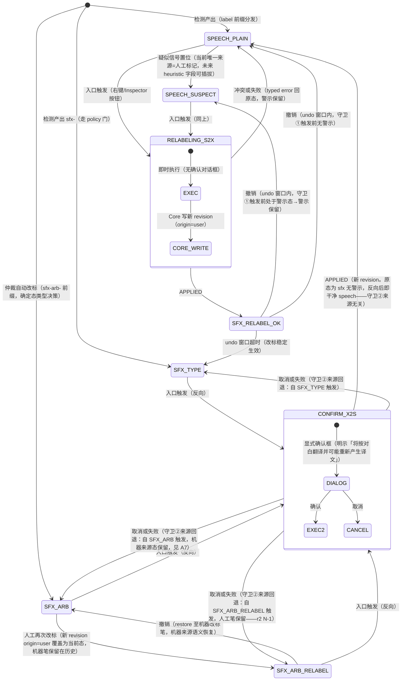

# M2-SFX-MISROUTE-UI-MITIGATION · SFX 误路由缓解 UI 设计契约

- task: [M2-SFX-MISROUTE-UI-MITIGATION](../../tasks/M2-SFX-MISROUTE-UI-MITIGATION.md)（owner ZCode，reviewer DeepSeek Harness 非作者，裁决①授权）
- 性质：**纯设计交付**（沿 M2-UI1 先例：Design + Handoff only，no product implementation）。本文不释放任何 React/Tauri/IPC/Core 实现；产品实现 blocked_on Workbench React 页面与 region/译文 IPC 通道 Task 存在并集成（另行释放）。
- 基线：base=`fb5d56c6`，claim=`8d844726`。本文所有 `src/**` 行号结论绑定 base commit。
- 状态标注约定：**FROZEN** = 语义冻结，未来实现 Task 直接当验收输入；**EVOLVING** = 随 Workbench React 实现演进的规格（见 §7.2 清单）；**OPEN** = 需 Core/契约 Task 裁决后才能冻结（本文只登记候选，不擅自 widening）。
- 依据链：[DOMAIN-EXT-DIAG §5 方案⑤](../../verification/M2-SFX-DETECT-DOMAIN-EXT-DIAG/diagnosis-and-options.md)（损害形态与本 Task 来源）· [M2-C1 rev 1.3](../../doc/contracts/M2-C1_TYPED_IPC_CONTRACT.md)（§5.3 settings 通道 = 与 region policy 相关的唯一已落地 IPC 面）· [M2-UI1 视觉契约](../M2-UI1_REACT_FEATURE_PARITY_VISUAL_CONTRACT.md)（token 体系/三重编码/Workbench 组件映射）· [UI_UX_GUI_DESIGN §7.2](../../doc/contracts/UI_UX_GUI_DESIGN.md)（状态徽标三重编码）· [05_UI_MAPPING §61](../../doc/05_UI_MAPPING.md)（Region 八态）· `src/application/translation/context/gate.py`（policy 门权威语义）· `src/infrastructure/providers/detection_sfx.py:202`（`sfx-arb-` 前缀契约）。

---

## 0. 结论速览

| 项 | 设计决定 |
|---|---|
| 警示载体 | **叠加层（overlay annotation），限 speech region**，不占用也不合并 Region 八态徽标/需校对虚线框：warn 色 2px 实线边框 + 左上角徽标 pill（三重编码：字形 `♪?` + warn 色 + 文本「疑似拟声词」） |
| 类型徽标 | 改标成功的 sfx region 左上角常驻 skip 色 pill「SFX · 保留原文」（skip 策略）/「SFX · 走拟声词翻译链」（translate 策略）；speech 无常驻徽标（默认态零噪声） |
| 改标入口 | Workbench 双入口：RegionOverlay 右键菜单 + RegionInspector 按钮组；speech→sfx 即时执行+撤销窗，sfx→speech 显式确认（不对称，见 §4.1 R3） |
| Reader 场景 | 阅读态零 region 交互；仅页级提示条「本页 N 处疑似拟声词」+「去工作台处理」跳转（诚实于 reader 投影无 region 面的契约现状） |
| 撤销 | 走 revision 恢复（origin=user 的新 revision + restore），不用反向改标模拟 |
| 最大契约缺口 | M2-C1 无 region 读取命令（`ListRegions`/`GetRegionDetail` 不存在）、无改标命令（Core `RegionEditingService` 无 `set_region_type`）、疑似信号字段不存在——三项均登记为未来契约修订候选（§5），本 Task 不 widening |

---

## 1. 损害语义与设计目标（为什么是这两个 UI 元素）

### 1.1 损害形态（证据：DOMAIN-EXT-DIAG，directional）

韩漫 BJ 域毛笔竖排拟声词处于 chiqui7 检测器的训练分布外：SFX 像素被 text 类高 conf 捡走（BJ13 紧贴 text conf 0.744/0.844），按对白进对话链 → OCR 乱译 → **错误译文静默贴上渲染成品页**（BJ13 speech region #1/#3 实证）。两个加重因素：

1. **BJ15 ref1 更深盲形态**：该参照框位置连 conf≥0.01 的任何候选都没有（ref2 仅 3 候选且最高 sfx 0.0000；两框处仅 panel 大框平凡覆盖）——警示若依赖 OCR 文本或紧贴检测候选，对此形态结构性失效（AC4 断言 A2 的依据）。
2. **仲裁对 BJ13 不可达**：重叠仲裁（`M2-REGION-OVERLAP-ARBITRATION` done @38e4e487）靠 sfx 候选与 primary 候选 near-duplicate（IoU≥0.90）触发改标；BJ13 的 sfx 通道零响应（pre-NMS 峰值 0.0855），**没有 sfx 候选可供仲裁**——检测侧自动闭合对该形态无效，用户侧手动改标是当前唯一兜底（方案⑤的立论）。

### 1.2 设计目标

把已实证的损害链「误路由 → 乱译 → 静默进渲染」变为 **可发现（警示）→ 可修正（改标）→ 语义立即正确（policy 门）→ 可追溯（revision + 机器/人工区分）**，且全程源文件/Revision 零风险。

### 1.3 改标语义表（FROZEN，权威 = `gate.py::decide_sfx_translation`）

| 操作 | region_type 前 | region_type 后 | 自动翻译链行为（gate 权威语义） | 渲染行为 | 用户语义 |
|---|---|---|---|---|---|
| 正向改标 | speech | sfx | policy=skip（默认）或 manual → `SKIP_POLICY(reason=sfx_skip)`：不翻译 | 保留原文（拟声词原样） | **消除乱译损害**（本 Task 主目标） |
| 正向改标 | speech | sfx | policy=translate → `TRANSLATE`：进 SFX 翻译链 | 走 SFX 链产出（BJ06 已实证闭环） | 拟声词也要译，但走拟声词链不走对白链 |
| 反向改标 | sfx | speech | 离开 SFX 门，进普通对话链 | 对白链渲染 | **用户明确要翻译它**（把疑似改回对白） |

- manual 与 skip 同判 SKIP（`decide_sfx_translation`：sfx+skip/manual→SKIP）；manual 保留 Detect/OCR 给人工、保持可编辑（`gate.py` docstring）。
- **关键边界**：改标只改变「此后」的翻译/渲染决策；**已渲染成品图上的错误译文不会因改标消失**——恢复原文需要 rerender（§4.4）。这是 AC2 生效反馈必须传达的第一语义。
- **口径注记（R-001）**：表中「policy=」一律指 **region 自身的 sfx_policy 快照值**（gate 消费 region 字段，不读全局设置）；speech region 的快照现状恒为 skip（core_assembly 强制），改标后快照是否重取全局配置归 EV-8/RC-2 裁决（§4.2）。

---

## 2. 领域语义事实源（实现工程师必读的六条）

以下全部为 base=`fb5d56c6` 的源码/契约事实，实现时不得凭直觉替代：

1. **RegionType 六值**：`speech/narration/sfx/title/note/other`（`src/domain/regions/entities.py`）。本设计的改标入口仅对 **speech↔sfx** 双向启用；其余四值的改标语义未定义，入口必须禁用并显示原因（AC4 断言 A12）。
2. **policy 是 region 上的快照字段，不是全局实时读**：region 创建时由 `_create_detected_region` 写入（仅 SFX 类型携带配置值，非 SFX 强制 SKIP——「the policy can never leak onto non-SFX regions」，`src/bootstrap/core_assembly.py` L1013-1049）。设置页 scope note 原文即此语义：「保存后重新打开应用生效；仅对此后新建检出的 region 生效（既有页面需重新检出）」。UI 显示 policy 生效态只能读 region 上的快照，**不得前端重算 gate**（AC4 断言 A9）。
3. **改标命令当前不存在**：`RegionEditingService` 无 `set_region_type`/relabel 方法（方法清单已核对，见 §5 D3）。未来实现需要新 Core 能力，走契约修订（§5）。
4. **所有 Region 写路径必须产生 revision**（TASK-049 AC② 单一写路径：`commit_region_revision`；revision 携带 `snapshot/origin/review_state/source_run_id/restored_from_revision_id`）。手动改标是用户写 → revision `origin=user`（`RegionOrigin`：machine/user/imported/restored）。撤销 = `restore_revision`（契约 §5 `RestoreRegionRevision` 已有命令名）。
5. **机器改标的可追溯契约**：仲裁自动改标把 primary 候选 label 置为 **`sfx-arb-` 前缀**（`detection_sfx.py:202` `ARBITRATED_LABEL_PREFIX`，deliberately 复用 `startswith("sfx-")` 分发，geometry/reading order/confidence 逐字保留——「the relabel is a type decision, not a re-detection」）。UI 区分依据 = label 前缀（机器）vs revision origin=user（人工）。
6. **视觉体系**：Graphite Atelier token（真值链 `ui-reference.html` → `tokens-cand-f.json` → 未来 `tokens.css`；本文**只引用不复制定义**）。三条不可谈判规则：三重编码（任何状态不得仅靠颜色承载，UI 契约 §7.2）；叠加语义不合并（既有三层 Process Status + Review State + Lock，本设计新增疑似警示层与类型/来源层（E2/E3），共五层独立语义，UI 不用单一徽标合并，05 §61 + M2-UI1 §3.3）；归一化坐标过界（RegionOverlay 尺寸只从投影取，M2-UI1 #19 两条硬规则）。

---

## 3. AC1 视觉契约

### 3.1 视觉元素命名与 token 引用（FROZEN 的 token 引用；新增元素几何 EVOLVING）

全部颜色/字号引用 Graphite Atelier token 名（双主题值见 `tokens-cand-f.json`，本文不复制色值；下文括号内 hex 仅为本文写作时点的对照参考，**非定义来源**——真值链冲突时以 token 真值链为准）。新增视觉元素共四个：

| 元素 | token 引用 | 几何（建议值） | 状态 |
|---|---|---|---|
| E1 疑似警示边框 | `st-warn`（对照参考：dark `#fbbf24` / light `#9a6700`） | 2px 实线（非虚线——虚线保留给「需校对」，见 §3.2 注） | 几何 FROZEN，色值随 token 真值链 |
| E2 疑似警示徽标 pill | 底 `warn-soft`、字 `st-warn-t`（亮色主题用 `-t` 变体保 4.5:1） | 高 20px、字号 `fs-sm`(12px)、圆角 `rad-sm`(8px)、内边距 3px 8px | EVOLVING-3（尺寸微调随实现视觉基线；20px/3px 8px 等字面量实现时登记为组件常量，沿 M2-UI1 D-2 先例，是否升令牌归实现 Task 裁决） |
| E3 sfx 类型徽标 pill | 底 `skip-soft`、字 `st-skip`；文案随 policy 快照分档（见 §3.2 表） | 同 E2 | EVOLVING-3（同 E2 登记义务；**组合无既有审计证据**，由 A13(a) 首次取证，见 §3.5） |
| E4 改标确认/反馈条 | 底 `bg-raised`、边 `border-strong`；破坏性反向改标确认框边 `st-fail` | 反馈条高 `ctl-h`(36px)，出现于画布底部居中，`shadow-sm` | EVOLVING-4（文案与时长） |

徽标字形：疑似警示 `♪?`；sfx 类型 `♪`；机器改标附加 `⧉`（见 §3.4）。字形是三重编码的「形」维度，实现不得省略。

### 3.2 Workbench 检测编辑态（主场景）

覆盖 M2-UI1 §2.2 映射的目标组件：`<RegionOverlay>`（SVG 层）+ `<RegionInspector>`。

**叠加规则**（FROZEN）：

- E1 警示边框叠加在既有 region 边框语义之上（普通 `st-run` 描边 / 选中 `accent`），**不替换**：警示存在时外圈绘制 E1，选中态仍以 `accent` 呈现（两层并存：选中内圈 accent 2px + 警示外圈 warn 2px，间距 2px）。
- 疑似警示仅对 `region_type=speech` 且 `suspect.sfx = true` 的 region 渲染（R-015 收窄：状态机只建模 SPEECH_* 态；narration/title/note/other 携带疑似信号的处置出口不在本设计范围，未来扩展须另行释放——见 §7.2 EV-1）。
- **类型徽标 E3** 与 **疑似警示 E2** 不同时出现在同一 region：改标完成后警示消失、E3 出现（状态机 §4.1 保证）。
- **同位共存优先级（FROZEN，R-008）**：region 左上角锚点仅承载本设计徽标，E2 > E3（二者不同时出现，由状态机保证）；Region 八态徽标（05 §61，若实现 Task 落地）与 regionToolbar 工具 pill 各自独立锚位（八态徽标右下角、工具 pill 在画布工具条内），不得与本设计徽标同位或合并渲染。层语义计数见 §2.6（三层既有 + 本设计两层 = 五层，禁止单徽标合并）。
- 注：`需校对=画布虚线框` 是 UI 契约既有目标语义（UI_UX_GUI_DESIGN §7.2「需校对用画布虚线框」；QML 未实现属 M2-UI1 C-10 未实现能力）。E1 用实线是为未来虚线框保留无冲突语义空间。

**E3 文案分档**（数据 = region.sfx_policy 快照，非全局设置实时值）：

| policy 快照 | 徽标文案 | 字形 |
|---|---|---|
| skip（含 manual 同判） | `SFX · 保留原文` | `♪` |
| translate | `SFX · 拟声词翻译链` | `♪` |

**ASCII 示意 —— Workbench ViewerPanel 检测编辑态**：

```
┌─ ViewerPanel ────────────────────────────────────────────────────┐
│  第 13 页 · 原图模式                                              │
│                                                                  │
│      ┌╌╌╌╌╌╌╌╌╌╌╌┐   ┌─────────────┐                            │
│      ╎ speech #2  ╎   │ ♪ SFX·保留原文│← E3：已改标 sfx（skip 快照）│
│      ╎ (对白)     ╎   │ (拟声词region)│   边框 st-run（普通态）     │
│      └╌╌╌╌╌╌╌╌╌╌╌┘   └─────────────┘                            │
│       无警示的普通 speech：                                       │
│       边框 st-run，无徽标                                         │
│                                                                  │
│   ┌╔═══════════════════╗┐                                        │
│   ║ ♪? 疑似拟声词       ║├← E2 徽标（warn-soft 底/st-warn-t 字）   │
│   ║                     ║║← E1 警示边框（st-warn 2px 实线，        │
│   ║   （毛笔大字被框成   ║║   叠加于 st-run 之外圈）                 │
│   ║     speech 的区域） ║║                                        │
│   └╚═══════════════════╝┘                                        │
│     ↑ 右键 → 上下文菜单                                           │
│                                                                  │
│   ┌──────────────────────────────────────────┐                   │
│   │ ✅ 已标记为拟声词（SFX·保留原文）  [撤销] [重渲染本页] │← E4 反馈条│
│   └──────────────────────────────────────────┘                   │
└──────────────────────────────────────────────────────────────────┘
```

**ASCII 示意 —— RegionInspector 改标入口（第二入口）**：

```
┌─ RegionInspector（宽 insp-w 288）────────────────┐
│ Region #3                                        │
│ ┌──────────────────────────────────────────────┐ │
│ │ 类型    对白 (speech)  ⚠ 疑似拟声词           │ │← 类型行：疑似信号
│ │ [ 标记为拟声词 (sfx) ]                        │ │  以 warn 色文本+字形
│ │                                              │ │  呈现（三重编码）
│ │ 说明：改标后按 SFX 策略处理；                  │ │
│ │ 当前该 region 策略快照：跳过翻译 (skip)。      │ │← policy 快照值
│ │ 原图与译文历史不受影响，可随时撤销。            │ │  （来自 Core，非前端推断）
│ └──────────────────────────────────────────────┘ │
│ OCR 文本  （空也可改标——BJ15 形态）               │
│ 译文      [.............]                        │
│ [保存] [放弃]   [OCR] [重翻译] [重渲染]           │
└──────────────────────────────────────────────────┘
```

右键菜单语义（与 M2-UI1 #19 的草稿右键闭合共存）：右键命中**已存在 region**（hover 高亮或选中态）→ 改标菜单；右键处于**草稿多边形逐点态** → 既有闭合语义不变。两态互斥，以草稿态激活为判。

### 3.3 Reader 阅读态（第二场景）

ReaderView 的目标形态（M2-UI1 §2.2 `<ReaderPage>`）无 region 数据通道（`GetReaderProjection` 不含 region 几何/类型面，M2-C1 §5 现状）。设计据此定为**页级提示条 + 跳转**，不在 Reader 做 region 级交互或改标（AC4 断言 A10）：

- 触发条件：当前阅读页存在「疑似信号未消除」的 speech region（数据来源依赖 §5 D8/RC-5 的 reader 摘要字段——OPEN；**非 D6**，D6 是 policy 生效态不是疑似信号；在字段落地前 Reader 提示条不渲染，**不虚构数据**）。
- 形态：translated 模式下页顶部窄条（高 `ctl-h`，底 `warn-soft`、字 `st-warn-t`、字形 `♪?`）：「本页 1 处疑似拟声词被按对白翻译 · [去工作台处理]」。
- 点击 → 导航 Workbench 并 `locatePipelinePage` 语义定位到该页（复用既有定位概念，M2-UI1 §1.4a `locatePipelinePage`）。

```
┌─ ReaderPage（translated 模式）────────────────────┐
│ ┌──────────────────────────────────────────────┐ │
│ │ ♪? 本页 1 处疑似拟声词被按对白翻译  [去工作台处理]│ │← 页级提示条
│ └──────────────────────────────────────────────┘ │   （EVOLVING-2）
│                                                  │
│              （译图内容，无 region 框/徽标）        │
└──────────────────────────────────────────────────┘
```

### 3.4 机器改标 vs 人工改标的视觉区分（FROZEN 原则，具体字形 EVOLVING-7）

- **人工改标**（revision origin=user）：E3 徽标按 §3.2 常规呈现。
- **机器改标**（label 前缀 `sfx-arb-`）：E3 徽标附加字形 `⧉` + title tooltip「由重叠仲裁自动改标（sfx-arb-），可追溯」。
- 机器改标**不得**被任何人工操作静默改写为「人工」来源；人工对机器改标 region 的再次改标产生新 revision（origin=user），历史两笔并存（AC4 断言 A6/A7）。

### 3.5 双主题与对比度（FROZEN 断言口径；E3 首次取证义务）

对比度断言按元素分两档（对应 AC4 断言 A13 的 (a)/(b) 两子句）：

- **E2/E3/E4 徽标/文字（≥4.5:1，徽标真实底口径）**：按 UI 契约 §7.2 徽标合成底口径（`*-soft` 以 alpha 叠 panel 合成后与文字令牌比较）。warn 族（E2）两主题已过既有 60 组合审计；**E3 的 `skip-soft` 底 × `st-skip` 字 × `♪` 字形 × 文本组合是本设计新增组合，无既有 24 对审计证据**——既有审计不覆盖不构成豁免，实现 Task 交付时按 A13(a) 口径**首次取证**并留证据。
- **E1 警示边框（≥3:1，非文字图形口径）**：2px 边框叠加对象是页图（内容任意、不可控），对页图内容不做对比度断言（不可测）；可测口径为与画布衬底 `bg-canvas` 的非文字图形对比 ≥3:1（WCAG 1.4.11 non-text contrast 口径）。警示**必须双载体呈现**（E1 边框 + E2 徽标 pill），不得仅边框——页图极端同色内容下警示仍经 E2 可达（E2 对比度唯一合成基=§3.5(a) 的 panel 口径，r2 N-3）。

---

## 4. AC2 交互契约

### 4.1 改标操作状态机（FROZEN 的状态与转换；文案/时长 EVOLVING）



状态与转换规约（编号供 AC4/Handoff 引用）：

- **R1 警示置位（限 speech）**：`SPEECH_PLAIN → SPEECH_SUSPECT` 由疑似信号字段驱动（§5 D2，`source: human|heuristic`——**仲裁不在来源枚举内**：上游仲裁 Task 只产生确定态改标、不新增疑似字段，机器改标以 `sfx-arb-` 前缀 + revision origin=machine 追溯，对应状态机 SFX_ARB 态而非疑似态）。当前检测器对 BJ 形态零响应 → **初始唯一置位来源是人工**（用户在 Inspector 点「疑似拟声词」或右键菜单项），heuristic 来源字段已预留。非 speech 类型的疑似处置不在状态机建模范围（§3.2 R-015 收窄）。警示置位本身不写 region revision（是 UI 辅助信号不是领域变更——若未来 Core 要求持久化疑似状态，走契约修订，OPEN-2）。
- **R2 正向改标即时执行**：speech→sfx 低风险（默认 skip 下只减害不增害：停止翻译）+ 可撤销 → 不设确认对话框，避免加重兜底路径的用户负担（方案⑤的立论是轻量止损）。执行后 E4 反馈条（§4.3）。
- **R3 反向改标显式确认**：sfx→speech 意味着该 region 将**重新进入对白翻译链**——若为误操作，恰恰重新引入本 Task 要消除的乱译损害。确认框必须明示后果（「该区域将按对白翻译，可能产生新的译文」），边框用 `st-fail` 强调破坏性。
- **R4 生效反馈**：反馈条文案 = 改标结果 + **该 region 的 policy 快照语义**（「已标记为拟声词（SFX·保留原文）」/「已标记为拟声词（走拟声词翻译链）」）+ 已渲染提示（§4.4）+ `[撤销]`。
- **R5 撤销 = revision 恢复，回触发态**：undo 调用 `RestoreRegionRevision` 语义恢复上一 revision；**不得**用「再改回 speech」模拟撤销（那会产生第二笔 revision 且丢失「改标曾被撤销」的可追溯性）。回退目标=**触发态**（守卫①：触发前处于 `SPEECH_SUSPECT` 则撤销后警示保留，回该态；触发前无警示则回 `SPEECH_PLAIN`；自 `SFX_ARB_RELABEL` 撤销则 restore 至机器改标笔回 `SFX_ARB`）——与 R6「失败即原态、警示保留」同一守卫语义。undo 窗口时长建议 10s（EVOLVING-4）。已重渲染后撤销 → 反馈条提示译文状态可能过期（不阻断）。
- **R6 失败即原态（含来源守卫②）**：Core 返回 typed 错误（Lock/Revision 冲突、region 不存在等）→ UI 回到**触发前状态**并呈现错误块（复用 SettingsPanel/LibraryPanel 的显式错误块模式：无自动重试），警示/徽标保持原样。反向改标的取消/失败按来源回退（守卫②）：自 `SFX_TYPE` 触发回 `SFX_TYPE`、自 `SFX_ARB`/`SFX_ARB_RELABEL` 触发回原态——**机器改标来源态不得因取消操作丢失**（A7）。不得乐观改标后静默回滚。

### 4.2 与设置页 sfx.policy 的联动语义（FROZEN，R-001 修订口径）

**表键 = 改标后该 region 自身的 policy 快照值**（region 是行为断言的唯一依据），**不是全局 `sfx.policy` 设置**。技术事实：`core_assembly.py` 对非 SFX region 强制写入 SKIP（「the policy can never leak onto non-SFX regions」），speech region 的快照恒为 skip——若 EV-8/RC-2 裁决为「改标沿用既有快照」，speech→sfx 改标后快照仍为 skip，下表 translate 行不会出现；只有裁决为「改标按当前配置重快照」时快照才可能取到全局的 translate。按全局设置值断言行为在 EV-8 沿用分支下对用户事实错误，故全局设置仅作不一致时的辅助解释（规则 2）。

| 改标后 region 的 policy 快照值 | 用户可见语义 | 联动提示规则 |
|---|---|---|
| skip（speech region 现状恒为此；含 manual 同判语义，见下行） | 该 region 停止翻译、渲染保留原文 | 改标反馈条：「已标记为拟声词——按当前策略保留原文，不再翻译」 |
| manual | 与 skip 同判 SKIP（gate 权威语义），保留 Detect/OCR 供人工处理 | 反馈条按「保留原文（手动处理模式）」表述；**不得**表述为「将自动翻译」 |
| translate | 该 region 进拟声词翻译链（不再走对白链） | **前置：仅当 RC-2/EV-8 裁决为「改标按当前配置重快照」时本行可达**。改标反馈条明示「将按拟声词翻译链重新翻译」，避免用户误以为改标=不翻译 |

三条硬规则：

1. **联动方向单向**：本 UI 只**读**全局 policy 用于「快照与全局不一致」的辅助解释文案，改标操作**不写**设置、设置变更**不**回溯改写既有 region（「仅新建 region 生效」scope note 原文纪律）；改标后 region 的实际行为永远由 region 自身快照决定（gate 消费 region 字段，不读全局设置）。
2. **显示优先级**：region 级 policy 快照（E3 文案、R4 反馈条）**永远**优先于全局设置展示——两者可能不一致（设置页改了但 region 是旧快照），不一致时以 region 快照为准并可在 Inspector 显示一行提示「全局当前为 translate，此 region 创建于变更前」（EVOLVING-5 文案）。
3. 设置页三值枚举/默认值/保存通道零改动（Task 禁止范围；AC4 断言 A11）。

### 4.3 误操作防护与「源文件零风险」的可视传达（FROZEN 原则）

用户在任何时刻都能从 UI 读出以下事实（缺一即为违反 AC4 A1/A5/A6）：

1. **源文件不可触碰**：改标确认框与 Inspector 说明固定文案「改标只修改标注，不改动原图文件」——对应契约 §10「Never overwrite or mutate original source files」。
2. **一切可撤销**：改标产生 revision 历史；Inspector 常驻「历史」入口（`ListRegionRevisions` 语义），undo 窗口外也能经历史恢复。
3. **警示不自动动作**：警示出现本身不触发任何管线（AC4 A3）；只有用户点改标才发生领域变更。
4. **改标 ≠ 抹除已贴译文**：反馈条在有已渲染产物时附 `[重渲染本页]`（§4.4），明示「原图完好，成品图需重跑渲染才恢复原文」。

### 4.4 已渲染损害的修复路径（FROZEN）

改标后若该页存在译图产物（损害已发生形态，BJ13 #1/#3 即此形态）：

- 反馈条附 `[重渲染本页]` → 走既有 `rerender_single` 命令语义（M2-C1 §5.1 命令枚举已有，scope `{kind:"region", region_id}` 或 `{kind:"page"}`）；sfx+skip 语义下 rerender 产出 = 原文保留图。
- 「翻译状态徽标」一致性：改标后该 region 的既有 machine_translation 不删除（四层文本模型 + revision 保护），但渲染门不再消费它；UI 在 Inspector 将其呈现为「历史译文（改标前）」而非活跃译文（EVOLVING-6 展示细节）。**不得**静默清空译文文本（破坏人工修改保护，§10）。

---

## 5. AC3 数据需求清单（逐项对照 M2-C1 rev 1.3 现状）

对照基准：M2-C1 §3.1（类型别名）、§5（命令目录）、§5.3（settings 通道）、§9（几何）、§10（数据保护）。**「缺失」项全部只登记为未来契约修订候选，本 Task 未对 `doc/contracts/**` 做任何修改。**

| # | 字段/能力 | 类型 | 来源与语义 | 契约现状 | 判定 |
|---|---|---|---|---|---|
| D1 | `region_id` | `RegionId`（opaque string） | 契约 §3.1 已定义别名 | §3.1 | **已承载** |
| D2 | `suspect.sfx` 疑似信号 | `{suspected: boolean, source: "human"\|"heuristic", since: Timestamp}`（**限 speech region**） | 警示数据源。当前检测器对 BJ 形态零响应（DOMAIN-EXT-DIAG L1/L3），初始唯一来源=human 置位；heuristic 为未来可插拔来源预留。**不含 arbitration**：上游仲裁 Task 明确「只产生确定态改标，不新增疑似字段」——机器改标是确定态类型决策，以 `sfx-arb-` 前缀 + revision origin=machine 追溯（§2.5），不经过疑似信号 | **不存在于任何命令/DTO** | **缺失（新字段）→ 契约修订候选 RC-1** |
| D3 | 改标命令 | `SetRegionType {region_id, region_type, expected_revision?}`（命名待裁决）；**响应含 `revision_no`** | Core 侧需 `RegionEditingService` 新方法（现无 set_region_type/relabel，§2.3）；写路径必须走 `commit_region_revision`（origin=user）。响应含 `revision_no`（沿 `SaveManualTranslation` → `{revision_no: RevisionNo}` result 先例，M2-C1 §5），undo 以该 revision_no 定位 restore 目标——**undo 来源注记：undo=restore 到改标前 revision，不是二次改标**（§4.1 R5） | §5 命令目录无此项；Core 应用层无方法 | **缺失（新命令+新 Core 能力）→ RC-2** |
| D4 | `region_type` 读取 | enum `speech\|narration\|sfx\|title\|note\|other` | 实体字段存在；读取需 region 查询投影 | §5 无 `ListRegions`/`GetRegionDetail` 类命令；`RegionSummary` 被引用（`CreateRegion` result）但**结构未定义** | **缺失（region 读取面）→ RC-3** |
| D5 | region 几何（读取方向） | 归一化 `NormalizedPoint`（§3.1 语义） | overlay 绘制 | §9 只覆盖写入方向换算与校验；读取投影未定义 | **缺失（读取面，归入 RC-3）** |
| D6 | `sfx_policy` 生效态 | `"skip"\|"translate"\|"manual"` | region 上创建时快照（§2.2）；E3 文案与 R4 反馈的唯一权威 | settings 面已承载（§5.3），region 级读取缺失（归入 RC-3） | **部分承载** |
| D7 | 改标历史（人工 vs 机器） | revision 列表项含 `origin`（RegionOrigin 四值 `machine/user/imported/restored`；本设计涉及 user=人工改标、machine=检测/仲裁产出）+ label 前缀（`sfx-` vs `sfx-arb-`） | §2.4/§2.5 可追溯语义 | `ListRegionRevisions` 命令名已列（§5 表）但 **RevisionSummary DTO 结构未定义**、是否携带 region_type/label 前缀未定义 | **部分承载（命令名有、DTO 无）→ RC-4** |
| D8 | Reader 页级疑似计数 | 派生聚合（页内 suspect 未消除的 speech region 计数） | §3.3 Reader 提示条 | `GetReaderProjection` 的**结果 DTO 结构未定义**（契约 §5 仅列命令名与 AS-IS 证据），无 region 摘要面 | **缺失 → RC-5**（也可由 RC-3 的读取面在前端聚合，归集成 Task 裁决） |
| D9 | `sfx.policy` 全局配置 | 三值 | §4.2 联动文案输入 | §5.3 `settings_get`/`settings_update_section` 已授权落地（rev 1.3） | **已承载** |
| D10 | 重渲染触发 | `rerender_single`（§5.1 枚举已有） | §4.4 已渲染损害修复 | §5.1 命令枚举已列；run 通道 runtime 未实现（PROPOSAL 层） | **已承载（设计层）** |

缺口登记原则（重申 Task 合同）：上表 RC-1…RC-5 是**候选清单**，任何 widening 须由未来授权 Task 在 M2-C1 Revision history 登记（沿 1.2/1.3 修订先例），本文不构成契约变更授权。

---

## 6. AC4 硬性断言清单（「违反即红」，供未来实现 Task 直接引用为验收）

断言编号 A1–A13。每条 = 断言 + 理由（证据锚点）。实现 Task 的验收 = 逐条 PASS 且不可豁免；与本文冲突的实现以断言为红线（EVOLVING 项不得触碰断言）。

| # | 断言 | 理由（证据锚点） |
|---|---|---|
| A1 | 改标操作（含撤销、重渲染触发）不得产生对用户源文件的任何写路径；写面仅限 Core 管的 Managed Copy/SQLite region 记录 | M2-C1 §10「Never overwrite or mutate original source files」；AGENTS.md 产品边界「保护用户源文件、人工修改、Lock、current/pinned Revision」 |
| A2 | 疑似警示的渲染与可标注性不得以 OCR 文本非空、或紧贴检测候选存在为前提——空 OCR/无候选的 region 必须同样可警示、可改标 | BJ15 ref1 深盲形态：参照框位置 0 候选（DOMAIN-EXT-DIAG §2.2；ref2 亦仅 3 候选且最高 sfx 0.0000）；警示依赖 OCR 即对最深盲区结构性失效，违背方案⑤兜底定位 |
| A3 | 疑似警示的出现/消失不得自动触发任何领域变更（不自动改类型、不删 region、不启动管线、不写 revision） | 方案⑤已知风险「启发式误标本身有误报面」（DOMAIN-EXT-DIAG §4⑤）；警示是提示层不是裁决层 |
| A4 | speech→sfx 改标生效后，该 region 不得再进入自动对白翻译链；sfx + skip/manual 组合下 UI 不得呈现「已（自动）翻译」态 | `decide_sfx_translation` 权威语义（gate.py:32-42，sfx+skip/manual→SKIP_POLICY）；UI 与 Core 语义不一致=新的损害形态 |
| A5 | sfx→speech 反向改标必须有显式确认步（明示将重新进入对白翻译链），不得一键直达 | 反向改标重新引入乱译损害风险（§4.1 R3）；确认是唯一防误操作闸门 |
| A6 | 改标必须产生新 Region revision（origin=user），不得原地改字段无历史；撤销必须走 revision 恢复，不得以反向改标模拟 | TASK-049 单一写路径 + revision 可追溯；反向改标模拟撤销会产生两笔语义revision 且丢失撤销事实 |
| A7 | 机器改标（`sfx-arb-` 前缀）与人工改标在 UI 必须可区分（§3.4）；UI 不得把机器改标呈现/记录为人工来源 | `ARBITRATED_LABEL_PREFIX` 契约（detection_sfx.py:202，仲裁 Task 冻结语义）；可追溯性是裁决③交付的一部分 |
| A8 | 警示与徽标不得仅靠颜色承载语义：字形+颜色+文本三者齐备（E1–E4 全场景） | UI 契约 §7.2 三重编码（「任何状态不得仅靠颜色承载」）；色弱/单色打印可用性 |
| A9 | UI 不得在前端**决定** region 是否翻译/如何渲染（不得自行实现 `decide_sfx_translation` 等价决策逻辑）；policy 生效态与生效动作由 Core 返回的 region 快照（及未来生效动作字段）权威给出，UI 只做展示映射——E3 文案分档是对 Core 快照值的查找表映射，不是决策逻辑 | M2-C1 §1「Python Core 是唯一业务权威」；§2「UI enablement 只用于体验，不代替校验」；R-006 修订：映射与决策分界明示，避免把「UI 显示 policy 标签」误读为违例 |
| A10 | Reader 阅读态不得承载任何 region 写操作（改标/撤销/疑似置位只存在于 Workbench）；Reader 仅只读提示+跳转 | Reader 投影无 region 通道（M2-C1 §5 现状）；阅读态误操作无 Inspector 保护上下文（§3.3/§4.1） |
| A11 | 本 UI 不得新增/变更 SfxPolicy 枚举值、默认值或设置页保存语义 | Task 禁止范围「SfxPolicy 语义变更（设置页已 done 的三值策略零改动）」；§5.3 写入校验以三值为闭集 |
| A12 | 改标入口仅对 speech↔sfx 双向启用；对其余 RegionType（narration/title/note/other）不得静默启用改标（禁用态须显示原因） | 其余类型的改标语义未定义（§2.1）；静默启用=未定义语义先落地 |
| A13 | 对比度双口径（R-004 拆分）：**(a)** E2/E3/E4 全部徽标/文字在暗、亮双主题按徽标合成底口径 ≥4.5:1（E3 为新增组合、无既有审计证据，实现 Task 首次取证——R-005）；**(b)** E1 警示边框与画布衬底 `bg-canvas` 满足非文字图形 ≥3:1 口径；对页图内容不设对比度断言（任意像素不可测），警示必须双载体（E1 边框+E2 徽标）呈现、不得仅边框 | UI 契约 §7.2/R3-001 审计纪律（亮色状态字曾 6/7 不达标的教训）；E1 叠加对象含任意页图像素（不可控），3:1 仅对受控衬底可测（WCAG 1.4.11 non-text contrast 口径）；双载体保证页图极端内容下警示仍可达 |

---

## 7. AC5 零产品代码声明与 EVOLVING 清单

### 7.1 零产品代码声明（FROZEN）

本 Task 交付 = 本设计文档 + Handoff + verification 自检记录。`apps/desktop/frontend/src/**`、`src/**`（Python）、`src-tauri/**`、`doc/contracts/**`、`doc/STATUS.md` 零 diff；未交付静态原型验证页（AC5 的可选项，Workbench React 页不存在时原型页无挂载点，做了也无法验证两场景数据流——诚实省略，若 Reviewer 认为需要可后续补）。

### 7.2 EVOLVING 清单（会随实现演进，不构成断言）

| # | 项 | 演进条件/归属 |
|---|---|---|
| EV-1 | 疑似信号的 heuristic 来源算法与置位阈值；非 speech 类型的疑似处置出口（R-015 收窄：状态机只建模 SPEECH_*，其余类型扩展须另行释放） | 未来算法 Task；字段枚举（D2）已预留 human/heuristic 两值，新增来源值=契约修订 |
| EV-2 | Reader 页级提示条的具体形态与触发数据（依赖 D8/RC-5 裁决：reader 摘要字段 vs 前端聚合） | region 读取契约修订后，随 Reader 实现 Task 定稿 |
| EV-3 | E2/E3 徽标 pill 的精确尺寸/内边距微调 | Workbench React 实现的视觉回归基线建立时冻结 |
| EV-4 | E4 反馈条文案措辞与 undo 窗口时长（建议 10s） | 实现 Task 定稿；语义（R4/R5）不随文案变 |
| EV-5 | 「region 快照与全局设置不一致」提示行的展示策略 | 实现 Task 定稿；显示优先级规则（§4.2 规则 2）不演进 |
| EV-6 | 「历史译文（改标前）」在 Inspector 的具体呈现 | 实现 Task 定稿；不得静默清空译文的底线（§4.4）不演进 |
| EV-7 | 机器改标字形（暂定 `⧉`）与 tooltip 文案 | 实现 Task 定稿；机器/人工可区分原则（A7）不演进 |
| EV-8 | 改标后 policy 快照语义（沿用创建时快照值 vs 按当前配置重快照——类比新建语义） | **OPEN**：归 RC-2 契约修订裁决；本文 UI 侧按「显示 Core 返回的实际生效值」设计，两种裁决都不破坏本契约 |

### 7.3 冻结面小结

随实现演进的是**视觉微调与文案**；**不可演进**的是 §6 的 13 条断言、§1.3 改标语义表、§2 六条领域事实、§4 的状态机拓扑（状态集合与转换守卫）与 §3 的「叠加不合并/虚线保留/三重编码」三条视觉规则。

---

## 8. 交付边界自证

- 本 Task 写集合：本文（`doc/design/M2-SFX-MISROUTE-UI-MITIGATION/design.md`，新增目录）、`doc/tasks/M2-SFX-MISROUTE-UI-MITIGATION.md`（claim + 交付记录回填）、`doc/handoffs/M2-SFX-MISROUTE-UI-MITIGATION-*.md`（新增）、`verification/M2-SFX-MISROUTE-UI-MITIGATION/**`（新增自检记录）。
- token 真值零复制：本文只引用 token 名与既有审计结论，未新增/修改任何 token 定义（`tokens-cand-f.json` 等零 diff）。
- 契约零 widening：RC-1…RC-5 候选登记不构成 M2-C1 变更。
- 自检证据：`verification/M2-SFX-MISROUTE-UI-MITIGATION/ac-self-check.md`（AC1–AC5 逐条自检表 + A1–A13 断言自查 + diff 面核对）。


> **2026-10-04 集成注记（EV-8 转 CLOSED）**：EV-8（改标后 policy 快照语义）已由 M2-REGION-RETYPE-CONTRACT 裁决：「按改标时全局配置重快照」（sfx 方向）/非 sfx 强制 skip（leak 不变量），落 M2-C1 rev 1.4 §5.4。本设计 §4.2 联动表 translate 行前置条件（「仅当 RC-2 裁决为改标重快照」）就此满足，UI 两侧兼容设计经集成核对零返工。本注记由集成方添加（Task 合同分工：设计稿不回改原文，集成注记追加于文尾）。


> **2026-10-06 实现状态注记（M2-SFX-MISROUTE-UI-IMPL-1，集成前 in_review）**：本设计的产品实现已交付——§4.1 状态机 UI 决策面=纯函数 `relabelMachine.ts`（planRetypeAction/canRetype/derivePhase，vitest 钉测）；§3.2 E1-E4 落 RegionOverlay SVG/ViewerPanel/RegionInspector；双入口+反向确认框落地。RC-1 裁定=不含（§4.1 R1 原文口径：suspect=纯 UI 内存态，置位不写 revision，初始唯一来源人工；持久化需求出现时按 OPEN-2 另行释放字段 Task）。偏差 9 条登记于 Task 交付回填节（核心三条：undo/rerender/revision-历史动作按钮=禁用态+原因——对应 Core 命令面 runtime 缺位，A6 红线禁止反向改标模拟撤销；SFX_ARB 态不可达=读取面无 label 前缀字段属 RC-4 域）。本文原文零回改（沿 EV-8 集成注记先例，注记追加于文尾）。
