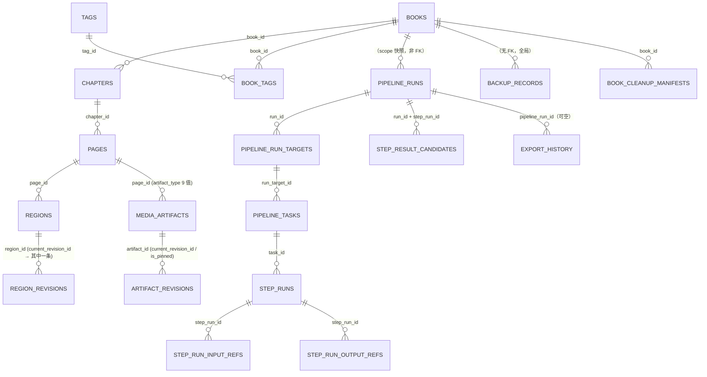

# 02 领域数据模型与状态机（代码事实版）

> **文档性质**：L1 只读事实盘点。以 `src/**` 的 domain/application/infrastructure 与 SQLite schema 为准；`doc/03_DATA_MODEL.md` 只作「目标口径」参照，与代码冲突时以代码为准。
>
> **一句话结论**：当前实现是「**一个 SQLite 库（library.db，schema v6）+ 两个受管目录（managed/ 派生缓存）+ 一个 .nmbak 备份包**」，Run 的完整状态既写列（可查询）也写 `run_json` 整体快照（可恢复），区域历史是**只追加的 immutable revision 链**，`current_revision_id` 不可被清空。

---

## 0. 数据根与存储边界

| 项 | 事实 | 证据 |
|---|---|---|
| 默认数据根 | `%LOCALAPPDATA%/New Manga`，可用 `--data-root` 或 `NEWMANGA_DATA_ROOT` 覆盖 | `src/bootstrap/core_assembly.py`（`default_data_root`）；`src/bootstrap/app.py:19-22` |
| 权威数据库 | `library.db`（SQLite），schema 版本 **6** | `infrastructure/sqlite/schema.py:24-32`, `597-605` |
| 受管根 | `managed/`（Managed Copy：原图 + 派生产物，存储相对路径） | `infrastructure/sqlite/schema.py:85`（`managed_path`）；`core_service.py:2994-3063`（受管根信任校验） |
| 派生只读根 | 预览发布目录（`previews/*`）；只读、可回收 | `infrastructure/resource_channel/render_preview.py`；`core_service.py:4580-4588`（`_ensure_preview_namespace`） |
| 可清理缓存 | 仅 `cache/` 前缀（webtoon 瓦片） | `application/maintenance/cleanup.py:41`（`CACHE_SAFE_PREFIXES`） |
| 回收站清单 | `managed/trash-manifest.json`（page 级 trash 批次 + 共享 `pending_cleanups` 台账） | `core_assembly.py:964-970`；`application/maintenance/trash.py:50-101` |
| 备份包 | `<backup_root>/<32-hex>.nmbak`（zip：manifest + library.db + sidecar + managed/**） | `infrastructure/sqlite/nmbak.py:3-11`, `50-57` |
| 插件 | 本地目录插件（manifest v1），状态/审计入库 | `infrastructure/plugins/manifest.py`；`schema.py:569-593` |
| 诊断 | `diagnostics/` 目录（bounded log + 报告） | `core_assembly.py:1301-1316` |

**边界规则**：SQLite 存业务行与 revision 元数据；图片字节只走文件系统，DB 只存 `managed_path`（存储相对路径）。前端**永不**拿到绝对路径（`resource_protocol.rs:10-32`）。用户源文件在受管根之外，永不被写。

---

## 1. 实体总览与关系

**关系事实**：
- **没有 Volume 实体**：卷/话/番外是章节的 `title`/`chapter_number`（`domain/books/entities.py:1-6`）。
- **没有独立 PageTask 实体**：`pipeline_tasks` 每行 = 一个 target（page 或 region），`page_id` 是列；页级聚合靠 `TaskProgressSnapshot` 现算（`domain/tasks/models.py:421-435`）。
- **Run 与 Page 之间在 v5 起不再有 FK**：删除书籍/页面后仍保留 Run/Task/Step 历史（`schema.py:458-478`，migration `v5__detach_pipeline_history`）。
- **`constraint_snapshot_ref` 只是悬挂字符串**：没有任何约束表（见 §12、`05_GAP_LIST.md`）。

---

## 2. Book（作品）

| 项 | 事实 | 证据 |
|---|---|---|
| 主键 | `book_id`（非空） | `schema.py:35-41` |
| 关键字段（domain） | `title`、`original_title`、`author`、`publisher`、`series_title`、`description`、`source_language`、`target_language`、`source_url`、`notes`、`default_chapter_type`、`default_reading_direction`、`is_favorite`、`is_archived`、`last_opened_at`、`created_at`、`updated_at`、`deleted_at` | `domain/books/entities.py:40-62` |
| DB 列 | v1: `book_id,title,created_at,updated_at,deleted_at`；v2 增补上述 10 个元信息列 + `is_favorite`/`is_archived`/`last_opened_at` | `schema.py:35-41`, `154-171` |
| 唯一约束 | 仅 `PRIMARY KEY(book_id)`；**title 不唯一** | `schema.py:36` |
| 状态 | `deleted_at IS NULL` = 活跃；非 NULL = 已软删除（回收站） | `domain/books/entities.py:100-102` |
| 允许的变更 | `apply_edit`（10 字段白名单）/`set_favorite`/`set_archived`/`mark_opened`/`soft_delete` | `domain/books/entities.py:69-102` |
| 不可逆 | **永久删除**：DB 行 + managed 文件 + 预览引用；`confirm_permanent_delete` 必须为 true | `core_service.py:1342-1407` |
| 业务规则 | 收藏/归档是**系统状态**，不是标签 | `domain/books/entities.py:42`（docstring） |

---

## 3. Chapter（章节）

| 项 | 事实 | 证据 |
|---|---|---|
| 主键 | `chapter_id` | `schema.py:43-51` |
| FK | `book_id → books(book_id)` | `schema.py:45` |
| 关键字段 | `title`、`chapter_number`（字符串，非 int）、`subtitle`、`import_order`（**导入时冻结**）、`sort_order`（用户排序）、`chapter_type`、`reading_direction`、`notes`、`deleted_at` | `domain/books/entities.py:105-125`；`schema.py:47` |
| 枚举 | `ChapterType` = `paged` \| `webtoon`；`ReadingDirection` = `rtl` \| `ltr` \| `vertical` | `domain/books/entities.py:19-31` |
| **方向不变式** | webtoon 章节**必须** `reading_direction=vertical`；paged 章节**不得** `vertical`（构造期 `ValueError`） | `domain/books/entities.py:134-139` |
| 允许的变更 | `apply_edit`（title/subtitle/chapter_number/notes）/`reorder(sort_order)`/`soft_delete` | `domain/books/entities.py:141-163` |
| 不可逆 | 软删除；永久删除随 Book（章节无独立永久删除命令） | `application/library/service.py:180-184` |

**推不出的事**：`default_chapter_type`/`default_reading_direction` 在 `Book` 上有默认值，但 `CreateChapter` 的线上字段只有 `book_id`/`title`/`chapter_number`（`core_service.py:239-242`）——即**线上创建的章节永远拿 domain 默认值 `paged`+`rtl`**，继承规则只在 entity 注释里（`domain/books/entities.py:107-110`），没有代码实现继承。

---

## 4. Page（页面）

| 项 | 事实 | 证据 |
|---|---|---|
| 主键 | `page_id` | `schema.py:54-62` |
| FK | `chapter_id → chapters(chapter_id)` | `schema.py:56` |
| 关键字段 | `source_filename`、`source_order`（**导入冻结**）、`sort_order`（用户排序）、`source_hash`、`source_size_bytes`、`width`、`height`、`managed_original_ref`、`page_locked`、`review_state`、`overall_status`、`deleted_at` | `schema.py:186-205`；`domain/pages/entities.py:9-34` |
| 不变量（domain 强制） | 必须有 `chapter_id`/`source_hash`/正 `width,height`/`managed_original_ref` | `domain/pages/entities.py:36-44` |
| DB 宽松度 | v2 加列全部 **NULL 容忍**（v1 结构占位页可存活而无伪造来源） | `schema.py:183-185` |
| `review_state` | `unreviewed` \| `needs_review` \| `confirmed`（可 NULL） | `schema.py:199-201` |
| `overall_status` | `not_started` \| `pending` \| `running` \| `completed` \| `stale` \| `failed` \| `skipped` \| `interrupted` \| `cancelled`（可 NULL） | `schema.py:202-205` |
| 唯一约束 | 无 `(chapter_id, source_hash)` 唯一约束；判重在应用层按 `source_hash`（`DuplicatePolicy.SKIP`） | `core_service.py:2103-2135`（`_image_import_result` 用 `existing_hashes`）；`application/importing/images/service.py:30-32` |
| 允许的变更 | `reorder(sort_order)`（**不动 `source_order`**）/`soft_delete` | `domain/pages/entities.py:46-53` |
| 不可逆 | 永久删除随 Book；页面级只有 trash（软删 + 批次 purge） | `application/maintenance/trash.py:119-166` |

---

## 5. Region（区域）与 RegionRevision

### 5.1 Region 当前态

| 项 | 事实 | 证据 |
|---|---|---|
| 主键 | `region_id` | `schema.py:224-248` |
| FK | `page_id → pages(page_id)`；复合延迟 FK `(current_revision_id, region_id) → region_revisions(region_revision_id, region_id)` | `schema.py:226`, `246-247` |
| 关键字段 | `region_type`、`reading_order`、`geometry_json`、`text_json`、`style_json`、`sfx_policy`、`region_locked`、`translation_locked`、`inpaint_locked`、`current_revision_id`、`deleted_at` | `schema.py:227-241` |
| 枚举 `RegionType` | `speech` \| `narration` \| `sfx` \| `title` \| `note` \| `other`（**六值闭集**；`ignore` 是处理动作/过滤态，不是 RegionType） | `domain/regions/entities.py:20-28`；`core_service.py:383-389`（线上门禁取 domain 枚举，防漂移） |
| 枚举 `SfxPolicy` | `skip`(默认) \| `translate` \| `manual` | `domain/regions/entities.py:48-53`；`schema.py:233-234` |
| 几何 | `BBox{x,y,width,height}` + 可选 `polygon`（≥3 点）；合并 = covering bbox + polygon 拼接 | `domain/regions/entities.py:61-114` |
| 四级文本 | `ocr_text` / `machine_translation` / `edited_translation` / `final_translation` + `final_source`(none\|edited\|machine) + `edited_confirmed` + `manual_edited` + `translation_locked` | `domain/regions/entities.py:122-190` |
| 样式 | `font_family`、`font_size`（可空）、`text_color`、`stroke_color`、`stroke_width`、`auto_font_size_enabled` | `domain/regions/entities.py:192-208` |
| **不可逆不变量** | `current_revision_id` 一旦非 NULL **不能被清回 NULL**（DB trigger 硬拒） | `schema.py:273-281`（`trg_regions_current_not_clearable`）；`schema.py:136-146`（artifact 同款） |
| 软删除 | `deleted_at`；软删区域对外视作不存在（重定类型 → `TARGET_NOT_FOUND`） | `domain/regions/entities.py:259-265`；`core_service.py:2029-2035`（C7 注释） |

### 5.2 RegionRevision（只追加历史）

| 项 | 事实 | 证据 |
|---|---|---|
| 主键 | `region_revision_id` | `schema.py:251-271` |
| 唯一约束 | `UNIQUE(region_id, revision_no)` + `UNIQUE(region_revision_id, region_id)` | `schema.py:265-266` |
| 关键字段 | `snapshot_json`（完整快照）、`origin`、`review_state`、`is_pinned`、`source_run_id`、`source_step_run_id`、`restored_from_revision_id` | `schema.py:255-263` |
| 枚举 `RegionOrigin` | `machine` \| `user` \| `imported` \| `restored` | `domain/regions/entities.py:31-37`；`schema.py:256-257` |
| 枚举 `ReviewState` | `unreviewed` \| `needs_review` \| `confirmed` | `domain/regions/entities.py:40-45`；`schema.py:258-259` |
| 快照覆盖范围 | region_type、reading_order、geometry、四级 text 全字段、style、sfx_policy、三把锁 | `domain/regions/entities.py:267-288` |
| 建版本时机（冻结规则） | OCR 保存、接受机器译、人工保存、最终确认、几何/样式保存、锁变更 | `application/editing/service.py:8-9`（D06 §87） |
| **回退语义** | 回退 = **新建一条 revision**（`origin=restored`，`restored_from_revision_id` 指向来源），**不重指历史** | `application/editing/service.py:4-7`；`schema.py:267-269`（复合 FK 保证来源同 region） |
| 不可逆 | revision 不可修改/不可删除（只追加）；`is_pinned` 只能改标志 | `application/editing/service.py:14-17` |

---

## 6. MediaArtifact / ArtifactRevision（产物与产物版本）

| 项 | 事实 | 证据 |
|---|---|---|
| `media_artifacts` 主键 | `artifact_id`；FK `book_id/chapter_id/page_id` | `schema.py:64-79` |
| `artifact_type` 闭集（9 值） | `original`、`thumbnail`、`detection_overlay`、`mask`、`clean`、`translated`、`render_preview`、`export`、`debug_ocr`、`debug_detection` | `schema.py:69-71` |
| current 指针 | `current_revision_id`（复合延迟 FK 指向同 artifact 的 revision）；不可清空（trigger） | `schema.py:72-77`, `136-146` |
| `artifact_revisions` 主键 | `artifact_revision_id`；`UNIQUE(artifact_id, revision_no)`；`UNIQUE(artifact_revision_id, artifact_id)` | `schema.py:81-105` |
| 完整性元数据 | `file_hash`、`mime_type`、`size_bytes`、`integrity_status`(unknown\|valid\|missing\|corrupted)、`last_verified_at` | `schema.py:86-93` |
| 溯源 | `provider_profile_id`、`model_name`、`options_json`、`source_artifact_revision_id`、`pipeline_run_id`、`step_run_id`、`provenance_json` | `schema.py:94-100` |
| pinned | `is_pinned` (0/1) | `schema.py:101` |
| 不可逆 | revision 只追加；`current_revision_id` 不可清空 | `schema.py:136-146` |

**关键语义**：`original` 产物的 revision 代表「这一页被引用时的原始字节」；`translated` 产物同时记录 `rendered_from_revision_id`（渲染基于哪一版源）与 `current_source_revision_id`（现在源是哪一版）——**两者不等即 stale**，这是导出 `EXPORT_STALE` 和阅读器 `rendered_from/current_source` 的来源（`core_service.py:2901-2903`, `2476-2478`）。

---

## 7. Tag / BookTag

| 项 | 事实 | 证据 |
|---|---|---|
| `tags` | `tag_id` PK、`name`（**无 UNIQUE**，重复检查由 `LibraryService` 负责，精确匹配不归一化） | `schema.py:208-215` |
| `book_tags` | PK `(book_id, tag_id)`；两个 FK | `schema.py:216-221` |
| 规则 | 自由标签，**永不编码 favorite/archive** | `domain/books/entities.py:166-167` |
| 实现状态 | domain + 表 + `LibraryService` 方法齐全，**无 Core 命令、无 UI** | `application/library/service.py:203-241`；`core_service.py` grep `tag` 仅注释 |

---

## 8. Run 三层模型（PipelineRun / PipelineRunTarget / PipelineTask / StepRun）

### 8.1 PipelineRun

| 项 | 事实 | 证据 |
|---|---|---|
| 主键 | `run_id` | `schema.py:290-311` |
| 冻结快照（创建时一次性） | `settings_snapshot_json`、`provider_binding_snapshot_json`、`constraint_snapshot_ref`、`context_policy_json`、`requested_targets_json` | `schema.py:294-298`；`domain/tasks/models.py:389-419` |
| 状态列 | `status`（**无 CHECK 约束**，靠 domain 枚举）+ `planned_step_units`/`terminal_step_units` | `schema.py:299-301` |
| 控制旗标 | `pause_requested`、`cancel_requested` | `schema.py:302-303` |
| 溯源 | `source_run_id`、`retry_reason`、`interruption_disposition`、`termination_reason`、`fatal_error` | `schema.py:304-308` |
| 整体快照 | `run_json`（**完整 domain Run 的 JSON**，恢复时以此为准）+ `updated_at` | `schema.py:309-310` |
| 幂等 | 由 store 的 idempotency 记录支撑（`accept_start_run` / `accept_restart` / `accept_retry_failed_targets`） | `application/tasks/service.py:321-366`, `992-1079`；`application/tasks/store.py`（`get_idempotency`） |

### 8.2 PipelineRunTarget

| 项 | 事实 | 证据 |
|---|---|---|
| 主键 | `run_target_id` | `schema.py:463-474` |
| 唯一约束 | `UNIQUE(pipeline_run_id, target_order)` + `UNIQUE(pipeline_run_id, target_id)` | `schema.py:472-473` |
| 关键字段 | `target_id`、`target_type`(page\|region)、`page_id`、`region_id`、`target_order`、`snapshot_json`（**TargetSnapshot 冻结**） | `schema.py:466-471` |
| 快照内容 | lock 四值、manual_edited、final_confirmed、current_revisions、stage_states、regions[]、metadata、deleted | `domain/tasks/models.py:216-279` |

### 8.3 PipelineTask

| 项 | 事实 | 证据 |
|---|---|---|
| 主键 | `task_id`；FK `run_target_id`、级联删除 | `schema.py:480-497` |
| 关键字段 | `target_id`/`target_type`/`page_id`/`region_id`/`status`/`units_json`/`step_run_ids_json`/`error_code`/`error_detail` | `schema.py:484-492` |
| `units_json` | 计划单元列表（每单元 = 一个 step 的决策） | `domain/tasks/models.py:293-311`（`PlanUnit`） |
| 无 PageTask | 页级进度不落表，由 `get_task_progress` 现算 | `application/tasks/service.py:1332-1383` |

### 8.4 StepRun

| 项 | 事实 | 证据 |
|---|---|---|
| 主键 | `step_run_id`；FK `task_id` 级联 | `schema.py:499-519` |
| 关键字段 | `step_type`、`unit_id`、`status`、`input_refs_json`、`lock_snapshot_json`、`retry_no`、`error_code`、`error_detail`、`output_json` | `schema.py:351-359` |
| 输入/输出引用规范化表 | `step_run_input_refs(step_run_id, input_order, ref_key, revision_id)`；`step_run_output_refs(step_run_id, output_order, ref_key, value_json)` | `schema.py:363-377` |

### 8.5 StepResultCandidate（冲突/未采纳结果）

| 项 | 事实 | 证据 |
|---|---|---|
| 主键 | `candidate_id` | `schema.py:379-394` |
| 关键字段 | `run_id`/`step_run_id`/`target_id`/`page_id`/`region_id`/`result_kind`/`base_revision_id`/`payload_json`/`reason`/`status`/`resolved_at` | `schema.py:380-392` |
| 语义 | 自动化写入遇到 revision/lock 冲突时**不覆盖**，把结果落成 candidate 供人工复核 | `application/editing/service.py:10-13`（D06 §89/§90）；`domain/tasks/models.py:371-385` |

### 8.6 PipelineStageState（阶段状态）

| 项 | 事实 | 证据 |
|---|---|---|
| 主键 | `(target_type, target_id, stage)` | `schema.py:396-403` |
| 语义 | 每目标每 step 的 StageState；决定 `skip_valid` | `domain/tasks/models.py:134-148`；`application/tasks/service.py:536-537` |

---

## 9. PipelineDefaults / 设置覆盖（SettingOverride）

| 项 | 事实 | 证据 |
|---|---|---|
| 表 | `pipeline_defaults`（**单行**，`defaults_id = 1`） | `schema.py:405-412` |
| 字段 | `settings_json`、`provider_bindings_json`、`constraint_snapshot_ref`、`context_policy_json` | `schema.py:407-410` |
| 应用服务 | `PipelineDefaultsService.read/save_settings_section/save_provider_binding/clear_provider_binding`（读改写非跨调用事务，单写线程） | `application/settings/pipeline_defaults.py:28-120` |
| 覆盖层级（概念模型，非表） | `task > chapter > book > global`；每层记录值来源 `source_label` | `application/settings/models.py:1-12`, `18-60`；`application/settings/resolution.py:22-109` |
| **事实**：`SettingOverride` **没有持久化表** | 覆盖由调用方传入 `overrides`（内存/请求级），不落库 | `application/settings/resolution.py:25-84`（入参）；`schema.py` 无 override 表 |
| 凭据隔离 | 设置面永不含明文密钥；绑定只「命名」profile | `application/settings/pipeline_defaults.py:12-14`；`05_GAP_LIST.md` |

---

## 10. ReadingProgress / ExportHistory

### 10.1 ReadingProgress

| 项 | 事实 | 证据 |
|---|---|---|
| 主键 | `progress_id` | `schema.py:420-434` |
| **唯一键** | `UNIQUE(book_id, chapter_id, mode)` | `schema.py:432` |
| `mode` | `original` \| `translated`（CHECK 硬约束） | `schema.py:424` |
| 字段 | `last_page_id`、`scroll_offset_x`、`scroll_offset_y`、`progress_percent`、`last_read_at`、`total_read_seconds` | `schema.py:425-430` |
| 语义约束 | webtoon：`scroll_offset_y ≤ page.height_px`；非 webtoon：`scroll_offset_y` 必须为 0；`progress_percent = offset/height*100`（webtoon）或按页序 | `application/reading/service.py:164-224`；`core_service.py:2509-2516` |

### 10.2 ExportHistory

| 项 | 事实 | 证据 |
|---|---|---|
| 主键 | `export_id` | `schema.py:439-455` |
| `status`（CHECK） | `completed` \| `skipped` \| `cancelled` \| `failed`（**只记终态**） | `schema.py:448` |
| 字段 | `book_id`、`chapter_id`、`pipeline_run_id`、`export_type`、`scope_snapshot_json`、`output_path`、`render_profile_snapshot_json`、`file_hash`、`created_at`、`completed_at`、`detail` | `schema.py:440-452` |
| 索引 | `created_at DESC`、`(book_id, chapter_id)` | `schema.py:454-455` |
| 导出格式枚举 | `single_image` \| `zip` \| `cbz` \| `pdf` \| `text`（线上 `png` 映射到 `single_image`） | `application/export/service.py:45-52`；`core_service.py:2944` |

---

## 11. BackupRecord / SchemaMigration / ApplicationMetadata

| 实体 | 事实 | 证据 |
|---|---|---|
| `backup_records` | `backup_id` PK；`backup_type` ∈ {automatic, manual, pre_migration, pre_restore}；`status` ∈ {pending, completed, failed}；`managed_path`、`app_version`、`schema_version`、`database_hash`、`size_bytes`、`created_at`、`completed_at`、`source_reason` | `schema.py:121-134` |
| `schema_migrations` | `schema_version` PK、`migration_name`、`applied_at`、`checksum` | `schema.py:108-113` |
| `application_metadata` | `metadata_key` PK、`value_json`、`updated_at` | `schema.py:115-119` |
| `book_cleanup_manifests` | `book_id` PK、`targets_json`、`created_at`（删除后仍需清理时的落点） | `schema.py:541-545` |

**备份包内部结构**（`.nmbak`）：`manifest.json`（`FORMAT_NAME="nm-backup"`、`FORMAT_VERSION=1`、世代信息、文件摘要）+ `library.db`（SQLite backup API 一致快照）+ `library.db.sidecar.json`（schema + sha256）+ `managed/**`（当前/pinned revision 引用的文件）——`nmbak.py:1-28`, `50-57`。

**恢复语义**：overwrite-only；**必须先有 `pre_restore` 包**（没有回滚点就拒绝）；活跃 Run 时 `BACKUP_RESTORE_BUSY`；先验包（`BACKUP_CORRUPT`）再动任何东西——`nmbak.py:19-23`, `209-269`。

---

## 12. 约束 / TM / 回收站 / 插件（有实体但缺表或缺命令）

| 概念 | 代码现状 | 证据 |
|---|---|---|
| `TranslationConstraint` | domain 实体完整（scope 三层、kind 两值、status 四值、origin 两值、`normalized_key`、`locked`、`current_revision_id`） | `domain/constraints/entities.py:32-120` |
| `ConstraintRevision` | 实体在；`UNIQUE(constraint_id, revision_no)` **由调用方保证**（无表） | `domain/constraints/entities.py:72-88` |
| 约束持久化 | **无表**：schema 里只有 `pipeline_defaults.constraint_snapshot_ref` 和 `pipeline_runs.constraint_snapshot_ref` 两个悬挂字段 | `schema.py:409`, `297` |
| TM | 应用服务完整（`TmScope`/`TmStatus`/相似度匹配/停用），**未装配进 Core** | `application/translation/knowledge/tm.py:22-294` |
| page 级 Trash | `TrashService` + JSON manifest（批次日、targets、`pending_purges`、共享 `pending_cleanups`），**无 Core 命令** | `application/maintenance/trash.py:50-334`；`core_assembly.py:964-970` |
| 插件状态 | `plugin_state`（`plugin_id` + `enabled` + `manifest_json` + `last_error`；`plugin_id='__global__'` 载全局开关，**默认禁用**） | `schema.py:563-576` |
| 插件审计 | `plugin_events`（append-only；`event_type` 六值：load_ok/load_rejected/enabled/disabled/hook_invoked/plugin_error） | `schema.py:578-593` |
| 诊断 | `DiagnosticsService` + bounded log 已装配，**无 Core 命令** | `application/maintenance/diagnostics.py:202-260`；`core_assembly.py:1301-1316` |

---

## 13. 枚举全集（代码实际）

| 枚举 | 值 | 位置 | 线上可见 |
|---|---|---|---|
| `ChapterType` | `paged`, `webtoon` | `domain/books/entities.py:19-23` | 间接（决定 layout） |
| `ReadingDirection` | `rtl`, `ltr`, `vertical` | `domain/books/entities.py:26-31` | 是（`layout`） |
| `RegionType` | `speech`, `narration`, `sfx`, `title`, `note`, `other` | `domain/regions/entities.py:20-28` | 是（`list_regions`/`set_region_type`） |
| `RegionOrigin` | `machine`, `user`, `imported`, `restored` | `domain/regions/entities.py:31-37` | 是（`list_regions` 行） |
| `ReviewState` | `unreviewed`, `needs_review`, `confirmed` | `domain/regions/entities.py:40-45` | 部分（区域读面只回 5 字段，不含 review_state） |
| `SfxPolicy` | `skip`, `translate`, `manual` | `domain/regions/entities.py:48-53` | 是 |
| `ScopeType` | `book`, `chapter`, `page_selection`, `page`, `region` | `domain/tasks/models.py:53-58` | 部分（wire 只解析 4 种，无 `book`） |
| `TargetType` | `page`, `region` | `domain/tasks/models.py:61-64` | 是 |
| `CommandType` | 18 值（见 §14.5） | `domain/tasks/models.py:66-87` | 是（`StartRun.command`） |
| `PipelineRunStatus` | `pending`, `running`, `paused`, `blocked`, `completed`, `completed_with_failures`, `failed`, `cancelled`, `interrupted` | `domain/tasks/models.py:90-100` | 是 |
| `PipelineTaskStatus` | `pending`, `running`, `completed`, `failed`, `blocked`, `skipped`, `cancelled`, `interrupted` | `domain/tasks/models.py:102-111` | 是（投影 `tasks[].status`） |
| `StepRunStatus` | `pending`, `running`, `completed`, `failed`, `cancelled`, `interrupted` | `domain/tasks/models.py:113-119` | 是（投影 `tasks[].steps[].status`） |
| `PlanDecision` | `run`, `skip_valid`, `skip_lock`, `skip_policy`, `blocked` | `domain/tasks/models.py:122-132` | 间接（变成 skipped/blocked + reason） |
| `StageState` | `not_started`, `pending`, `running`, `completed`, `stale`, `failed`, `skipped`, `interrupted`, `cancelled` | `domain/tasks/models.py:134-147` | 否 |
| `ExportFormat` | `single_image`, `zip`, `cbz`, `pdf`, `text` | `application/export/service.py:45-52` | 是（线上 `png`→`single_image`） |
| `OverwritePolicy` | `overwrite`, `skip`, `auto_rename` | `application/export/service.py:55-60` | 否（Core 固定 `OVERWRITE`） |
| `StalePolicy` | `abort`, `continue` | `application/export/service.py:63-67` | 是（线上 `abort`/`continue_existing`） |
| `ExportStatus` | `completed`, `skipped`, `cancelled`, `failed` | `application/export/service.py:70-74` | 是 |
| `ProxyPolicy` | `inherit`, `profile`, `direct` | `ports/providers/profiles.py:19-27` | 是 |
| 网络 mode | `direct`, `system`, `http`, `https`, `socks5` | `ports/network/profiles.py:22-26` | 是 |
| 能力（capability） | `detection`, `ocr`, `translation`, `inpaint`, `rendering` | `ports/providers/profiles.py:29-40` | 部分 |
| `ConstraintScope` | `global`, `book`, `chapter` | `domain/constraints/entities.py:32-37` | 否（无命令） |
| `ConstraintKind` | `terminology`, `do_not_translate` | `domain/constraints/entities.py:40-44` | 否 |
| `ConstraintStatus` | `active`, `pending`, `rejected`, `disabled` | `domain/constraints/entities.py:47-54` | 否 |
| `ConstraintOrigin` | `manual`, `auto` | `domain/constraints/entities.py:57-61` | 否 |
| `TmScope` / `TmStatus` | 见 `tm.py:22-35` | `application/translation/knowledge/tm.py:22-35` | 否 |
| 插件 hook | `before_detect`, `after_detect`, `before_ocr`, `after_ocr`, `before_export`, `after_export` | `infrastructure/plugins/manifest.py:42-49` | 是（插件面板显示 hook 列表） |
| 插件 permission | `files_read`, `files_write`, `network`, `model`（**只 `network` 受支持**） | `infrastructure/plugins/manifest.py:52-63` | 是（但只 network 会被接受） |
| 插件事件 | `load_ok`, `load_rejected`, `enabled`, `disabled`, `hook_invoked`, `plugin_error` | `schema.py:584-587` | 是（审计列表） |
| Provider 错误码 | 19 个（见 §14.6） | `ports/providers/errors.py:59-195` | 是（`error_code` 落 StepRun/投影） |
| 资源通道错误码 | `REF_MALFORMED`, `REF_UNKNOWN_ID`, `REF_REVOKED`, `REF_EXPIRED`, `REF_SCOPE_DENIED`, `REF_OUT_OF_SCOPE`, `REF_NOT_FOUND`, `REF_REPARSE_POINT`, `RESOURCE_TOO_LARGE`, `RESOURCE_LIMIT_EXCEEDED`, `FILE_IDENTITY_CHANGED`, `FILE_SIZE_CHANGED`, `CONTENT_DIGEST_MISMATCH`, `OPEN_FAILED_SHARING_VIOLATION`, `OPEN_FAILED`, `RESOURCE_NOT_CATALOGED` | `application/resource_channel/dto.py:77-94` | 是（HTTP 状态 + JSON `code`） |

---

## 14. 状态机

### 14.1 PipelineRun 状态机（完整转换表）

| 起点 | 事件 | 终点 | 条件 / 备注 | 证据 |
|---|---|---|---|---|
| — | `create_run` | `pending` | 目标快照冻结；若 `accept_start_run` 幂等命中则返回已有 Run | `service.py:218-279`, `321-366` |
| `pending` | `plan_run(initial)` | `pending` / `blocked` / `completed` | 由 `_set_planned_run_status`：任一 Task `blocked` → `blocked`；任一 `pending` → `pending`；否则 `completed`（全跳过） | `service.py:367-417`, `662-671` |
| `pending` | 调度器开始执行 | `running` | 无 Task 则先规划 | `service.py:862-868` |
| `running` | 收到 pause 并到安全点 | `paused` | Task 回 `pending` | `service.py:903-907`, `956-960`；`control_run` 需 `running` |
| `paused` | `continue` | `running` | `_resumed_runs` 标记，返回 `pending` 给调用方 | `service.py:1030-1036` |
| `pending`/`running`/`paused`/`blocked` | `stop` | 非 running 立刻 `cancelled`；running 在安全点 → `cancelled` | 已完成成果不回滚 | `service.py:1015-1028`, `962-968`, `1315-1317` |
| `running` | 进程被杀 / 异常退出 | `interrupted`（**下次启动时**） | `recover_running_runs` 把 `running` 全部改 `interrupted` | `service.py:1094-1110`；`core_assembly.py:1273-1277` |
| `interrupted` | `continue`（`interruption_disposition is None`） | `pending`→`running` | 重新规划（`mode="continue"`） | `service.py:1037-1044` |
| `interrupted` | `restart`（带幂等键） | 父保持 `interrupted` + `interruption_disposition="restarted"`，**新建子 Run** | 子 Run `source_run_id`/`retry_reason="restart_after_interruption"` | `service.py:1047-1079` |
| `interrupted` | `abandon` | `cancelled` + `termination_reason="abandoned_after_interruption"` | — | `service.py:1081-1090` |
| `blocked` | `resume_blocked` | `pending`/`running` | 重新规划（`mode="resume_blocked"`），读当前视图而非旧快照 | `service.py:981-985`, `381-386` |
| 执行结束 | `_aggregate_run` | `failed`（有 fatal）/ `cancelled`（cancel 旗标）/ `blocked`（有 Task blocked）/ `completed_with_failures`（有 Task failed）/ `running`（还有非终态）/ `completed` | 顺序即优先级 | `service.py:1311-1326` |
| 任意 | 步数超过 `max_step_runs`(1000) | `failed` + `fatal_error="RESOURCE_LIMIT_EXCEEDED"` | 资源保护 | `service.py:56-68`, `908-913` |
| `completed_with_failures` | `retry_failed_targets` | 新建子 Run（`retry_reason="retry_failed_targets"`，scope = 失败页集合） | 父 Run 不变 | `service.py:1112-1187` |

**非法转换**（一律 `INVALID_RUN_TRANSITION`，wire category=`conflict`）：非 `running` 的 pause、非上述四态的 stop、非 `paused`/`interrupted` 的 continue、非「未处置 interrupted」的 restart/abandon、非 `blocked` 的 resume、非 `completed_with_failures` 的 retry。

### 14.2 控制按钮矩阵（投影直接给出，UI 不应自行推断）

`_button_enablement` 的权威规则（`application/tasks/projection.py:408-430`）：

| Run 状态 | can_pause | can_stop | can_continue | can_restart | can_abandon | can_retry_failed |
|---|---|---|---|---|---|---|
| `running` | ✅ | ✅ | — | — | — | — |
| `pending` | — | ✅ | — | — | — | — |
| `paused` | — | ✅ | ✅ | — | — | — |
| `blocked` | — | ✅ | — | — | — | — |
| `interrupted`（未处置） | — | — | ✅ | ✅ | ✅ | — |
| `interrupted`（已处置） | — | — | — | — | — | — |
| `completed_with_failures`（有失败） | — | — | — | — | — | ✅ |
| 其它终态 | — | — | — | — | — | — |

### 14.3 PipelineTask 状态机

| 起点 | 事件 | 终点 | 证据 |
|---|---|---|---|
| — | 规划 | `pending`（有 RUN 决策）/ `blocked`（有 BLOCKED 无 RUN）/ `skipped`（全跳过） | `service.py:651-660` |
| `pending` | 开始执行 | `running` | `service.py`（step 尝试期间） |
| `running` | 任一 step 失败 | `failed` + `error_code` | `service.py:950-952`, `969-970` |
| `running` | 全部 step 完成 | `completed` | `service.py:971-975` |
| 任意非终态 | stop | `cancelled` | `service.py:962-968`, `1305-1309` |
| 任意非终态 | pause 安全点 | 回 `pending` | `service.py:956-957` |
| 进程中断 | 启动恢复 | `interrupted` | `service.py:1102-1104` |
| 计划期 | 前置步骤 decision=BLOCKED | `blocked` | `service.py:896-899` |

**终态集**：`TERMINAL_TASK_STATUSES = {completed, failed, skipped, cancelled}`（`domain/tasks/models.py:445-452`）。注意 **`blocked` 与 `interrupted` 不在终态集**，这是 `_aggregate_run` 能把 Run 判成 `blocked`/`running` 的原因。

### 14.4 StepRun 状态机

`pending → running → completed | failed | cancelled | interrupted`（`domain/tasks/models.py:113-119`）。终态集 = `{completed, failed, cancelled}`（`models.py:454-460`）。每次尝试 `retry_no` 从 0 递增（`service.py:915-923`）。

### 14.5 PipelineCommand 与步骤链（18 种命令）

| CommandType | 步骤链 | 证据 |
|---|---|---|
| `translate_all` / `translate_untranslated` / `translate_selected` / `translate_single` | `ocr→color→term_extract→translate→segment→mask_refine→inpaint→render` | `service.py:80-89`, `96-100` |
| `rerender_all` / `rerender_selected` / `rerender_single` / `rerender_region` | `render` | `service.py:91`, `101-103`, `114` |
| `reinpaint_all` / `reinpaint_selected` / `reinpaint_single` / `reinpaint_region` | `segment→mask_refine→inpaint` | `service.py:92`, `104-106`, `113` |
| `reocr_all` / `reocr_selected` / `reocr_single` / `ocr_region` | `ocr` | `service.py:93`, `107-110` |
| `retranslate_region` | `translate→render` | `service.py:94`, `111` |
| `retranslate_region_full` | 全量链 | `service.py:112` |

**额外的 `detect` 步骤**：当目标**没有 Region** 且链里含 `ocr` 时，规划器在链首插入 `detect`（`service.py:448-460`）。无检测器时 `detect` fail-closed 为 `PROVIDER_NOT_CONFIGURED`，而不是在 `ocr` 步骤报「requires a Region target」（`service.py:449-455` 注释）。区域级命令与 `rerender`/`reinpaint` 链**不**插 `detect`。

**强制步骤**（无视 `stage_completed`）：`rerender_*`→`{render}`；`reocr_*`/`ocr_region`→`{ocr}`；`retranslate_*`→`{translate,render}` 或全量；`reinpaint_*`→`{inpaint}`（`service.py:630-639`）。

### 14.6 Provider 错误码与可重试性（D06 §56）

| 类别 | 错误码 | 可重试 |
|---|---|---|
| 不可用（fail-closed） | `PROVIDER_NOT_CONFIGURED`、`PROVIDER_DEPENDENCY_MISSING`、`PROVIDER_DISABLED`、`PROVIDER_NOT_IMPLEMENTED` | 否 |
| 传输/临时 | `PROVIDER_UNAVAILABLE`、`PROVIDER_RATE_LIMITED`、`PROVIDER_TIMEOUT`、`PROVIDER_INVALID_OUTPUT` | **是** |
| 凭据/输入 | `PROVIDER_AUTH_FAILED`、`MISSING_CREDENTIAL`、`INVALID_INPUT`、`OUTPUT_MAPPING_MISMATCH`、`LOCK_CHANGED`、`NON_TARGET_WRITE` | 否 |
| 设备/模型 | `DEVICE_UNAVAILABLE`、`OUT_OF_MEMORY`、`MODEL_LOAD_FAILED`、`MODEL_INCOMPLETE` | 否 |
| 兜底 | `PROVIDER_FAILED`（基类） | 否 |

证据：`ports/providers/errors.py:59-231`；`is_retryable()` 对未列出的码**不重试**（`errors.py:234-245`）。

---

## 15. 关键语义（设计要求必须理解的部分）

### 15.1 Managed Copy：source 与 working copy

- **用户源文件永不被写**：导入只读源文件，字节拷入 `managed/`，Page 记录 `managed_original_ref`（必填）。`source_filename`/`source_size_bytes`/`source_hash` 保留原始事实供判重与溯源。
  - 证据：`domain/pages/entities.py:9-17`, `43-44`；`application/importing/images/service.py:1-9`。
- **原图产物是 immutable 的**：`resolve_page_resource` 的资源键是确定性的 `page-original-{page_id}`，首次把原图**逐字节**（不转码）发布到派生只读根，之后只做目录查找。
  - 证据：`core_service.py:2364-2428`（docstring）；`core_service.py:374`（`_ORIGINAL_SUFFIXES` 与导入面共享同一格式权威）。
- **写入校验走受管根信任**：导出/预览读取都经 `_checked_managed_path` / `_read_verified_managed` / `_verified_managed_sha256`，拒绝 junction 重定向与摘要不符。
  - 证据：`core_service.py:2980-3063`；`infrastructure/resource_channel/handle_resolver.py`（`ManagedRootTrust`）。

### 15.2 四把 Lock

| Lock | 作用域 | 存储 | 规划期效果 | 运行时效果 | 证据 |
|---|---|---|---|---|---|
| Page Lock | 整页 | `pages.page_locked` | `SKIP_LOCK:"page_or_region_locked"`（**所有 step**） | — | `schema.py:197-198`；`service.py:517-518` |
| Region Lock | 单区域 | `regions.region_locked` | 同上（与 Page Lock 同一分支） | — | `schema.py:235`；`service.py:517-518` |
| Translation Lock | 译文 | `regions.translation_locked` + `RegionText.translation_locked` | `translate` → `SKIP_LOCK:"translation_locked"`；`manual_edited`/`final_confirmed` → `SKIP_LOCK:"manual_translation_protected"` | `apply_machine_translation` 抛 `PermissionError` | `schema.py:236`；`service.py:527-531`；`domain/regions/entities.py:165-170` |
| Inpaint Lock | 修复 | `regions.inpaint_locked` | `segment`/`mask_refine`/`inpaint` → `SKIP_LOCK:"inpaint_locked"` | — | `schema.py:237`；`service.py:532-534` |

**覆盖豁免**：`run.settings_snapshot["allow_lock_override"]` 为真时，`translate` 与三个 inpaint 步骤的锁检查被跳过（`service.py:515`, `527`, `532`）。**Page/Region Lock 不受该豁免影响**（`service.py:517` 在其之前，无 `allow_override` 条件）。

**级联**：若某个前置 step 是 `SKIP_POLICY` 或 `SKIP_LOCK`，则 `segment`/`mask_refine`/`inpaint`/`render` 继承同一决策与原因（`service.py:542-548`）——即「SFX 跳过翻译」会连带跳过擦字与渲染，不会出现「字擦掉了但没有译文」的状态。

### 15.3 current revision vs pinned revision

- `current_revision_id`：**当前生效版本指针**，一旦建立**不可清空**（DB trigger）。回退时新建 revision 并把 current 指过去。
  - 证据：`schema.py:273-281`, `136-146`；`application/editing/service.py:4-7`。
- `is_pinned`：**保留标记**——「这条历史版本不许被清理/淘汰」。两处都有：`region_revisions.is_pinned`、`artifact_revisions.is_pinned`。
  - 证据：`schema.py:260`, `101`。
- 语义差别：current 决定「现在用哪版」，pinned 决定「哪版必须留着」。备份会打包「current/pinned revision 引用的文件」（`nmbak.py:9-10`, `319-387`），所以 **pinned 会实际影响备份体积与可恢复范围**。
- **写入命令状态**：region revision 的 pin 有应用层方法（`set_revision_pinned`，`application/editing/service.py:786-791`）但**无 wire**；artifact revision 的 pin **无任何写入路径**。

### 15.4 origin / review_state

- `origin` 记「这条 revision 谁产生的」：`machine`（流水线）/ `user`（人工操作）/ `imported`（导入）/ `restored`（回退）。
- `review_state` 记「校对到哪一步」：`unreviewed` → `needs_review` → `confirmed`。
- **写死规则**：重定类型（`set_region_type`）产生的 revision 恒为 `origin=user`、`review_state=unreviewed`（`core_service.py:65-66`）。
- 人工保存译文 → `manual_edited=true` + `translation_locked=true`，但**不自动 confirmed**（停在 `needs_review`）；只有显式 `confirm_edited_translation` 才把 `edited_confirmed=true`，人工译文才成为 `final`。
  - 证据：`domain/regions/entities.py:172-190`；`core_service.py:59-73`。

### 15.5 sfx_policy 与 region_type 的耦合

- 默认 `sfx_policy=skip`（domain 与 DB 双默认）——`domain/regions/entities.py:230`，`schema.py:233-234`。
- **只有 `region_type=sfx` 会被 SFX 策略门拦住**（`service.py:145-147`）；其它类型不受影响。
- **重定类型时的重快照规则（EV-8 裁定）**：改成 `sfx` → 从**当前全局** `sfx.policy` 取新值；改成任何非 `sfx` 类型 → 强制 `SKIP`。快照 delta 只有 `region_type` + `sfx_policy` 两项。
  - 证据：`core_service.py:59-73`（docstring）；`core_service.py:2000-2020`（实现）。
- **不再默认 `translate`**：`RegionSnapshot.sfx_policy` 的默认值曾被改成 `skip` 以与实体/schema 一致（`domain/tasks/models.py:184-186` 注释）。

### 15.6 乐观并发（expected_revision / INPUT_REVISION_CHANGED）

| 层 | 机制 | 证据 |
|---|---|---|
| 线上命令 | `set_region_type` / `restore_region_revision` 接受可选 `expected_revision`（正整数，JSON bool 不算整数） | `core_service.py:2017-2028`, `2110-2120` |
| 冲突语义 | 期望不符 → 状态 `INPUT_REVISION_CHANGED`，**零写入**（region 状态原样） | `core_service.py:2029-2040`；`application/editing/errors.py`（`GuardStatus`） |
| 内部 guard 值 | `GuardStatus` 的**小写枚举值**（如 `input_revision_changed`）永不上线；线上码是 SCREAMING_SNAKE | `core_service.py:344-352` |
| 自动化写入 | 提交接缝**在事务内**复查 current revision 与四把锁；不符则不覆盖，结果落 `StepResultCandidate` | `application/editing/service.py:10-13`；`schema.py:379-394` |
| 语义含义 | `expected_revision` 是「我读到的是第 N 版」的显式声明；UI 应在每次编辑前带上它，冲突时提示「别人/流水线已改，请刷新后再改」 | 同上 |

### 15.7 recover_running_runs（启动恢复）

- **时机**：Core 装配期，**在取得调度器租约之后**调用（注释明确：老调用方保留 eager-recovery 行为，但租约被别处持有则不抢）。
- **动作**：扫所有 Run，`status == running` 的 → `interrupted`；其中 `task.status == running` → `interrupted`；`step.status == running` → `interrupted`。**不做自动重跑**。
- **用户后果**：下次打开会看到「interrupted」任务，必须由用户选择 `continue` / `restart` / `abandon`（见 §14.1）。
- 证据：`core_assembly.py:1273-1277`；`application/tasks/service.py:1094-1110`；`core_service.py:1003-1063`（租约）。

### 15.8 幂等键语义

| 场景 | 要求 | 行为 | 证据 |
|---|---|---|---|
| `StartRun` | **必须**带 `idempotency_key` | 同键同请求 → 返回同一 Run（`created=false`）；同键不同指纹 → `IDEMPOTENCY_KEY_REUSED` | `core_service.py:3276-3283`；`service.py:299-320` |
| `ControlRun(restart)` | **必须**带 | 同上（指纹含 `operation=restart` + `source_run_id`） | `core_service.py:3309-3313`；`service.py:992-1006` |
| 其它 `ControlRun` action | **禁止**带 | 带了即 `INVALID_REQUEST`（"idempotency_key is only valid for restart"） | `core_service.py:3312-3313` |
| `ResumeBlockedRun` | **禁止**带 | 带了即 `INVALID_REQUEST` | `core_service.py:3324-3325` |
| `RetryFailedTargets` | **必须**带 | 同键同 Run → 返回同一子 Run | `core_service.py:3358-3365` |

### 15.9 跳过/阻塞原因（用户可见解释）

`PlanDecision` → reason 串（`service.py:503-558`）：`page_or_region_locked`、`translation_locked`、`manual_translation_protected`、`inpaint_locked`、`SFX_SKIP_REASON`（SFX 策略跳过）、`stage_completed`（该步骤已有效完成）、`MISSING_REQUIRED_INPUT`（前置产物缺）、`missing_clean_artifact`（渲染缺干净底图）、`PROVIDER_UNAVAILABLE`（Run 内该步骤的 provider 绑定被标不可用）。

**这是新 UI 里「为什么这页没被处理」的唯一权威来源**——`_task_projection_to_wire` 的 `blocked_reasons` + 每行 `error_code` 就是它（`core_service.py:3174-3242`）。

---

## 16. 不可逆 / 高风险操作清单

| 操作 | 不可逆程度 | 保护机制 | 证据 |
|---|---|---|---|
| 永久删除 Book（单/批） | **文件级不可逆** | `confirm_permanent_delete=true` 必填；先 preflight；清理失败返 `BOOK_DELETE_CLEANUP_PENDING`（可重试，不静默丢） | `core_service.py:1342-1407`, `1409-1532` |
| 备份恢复 | **覆盖式不可逆** | `confirm_restore=true`；**强制先做 `pre_restore` 包**；活跃 Run 时拒绝；先验包 | `core_service.py:1899-1909`；`nmbak.py:19-23`, `209-269` |
| 清理缓存 | 可逆（缓存可重建） | 只碰 `cache/` 前缀；失败落 pending 台账 | `cleanup.py:41`, `193-199` |
| 区域回退版本 | **历史不可改写** | 回退 = 新建 revision（不是重指） | `editing/service.py:4-7` |
| 覆盖译文 | **有锁保护** | 人工保存即 `translation_locked`；规划期与运行时双拦 | `domain/regions/entities.py:172-190`；`service.py:527-531` |
| Schema 迁移 | 半可逆（有 pre_migration 备份） | 每个迁移前创建 `pre_migration` 包；一个迁移一个事务 | `migrator.py:69-100` |
| 降低数据库 schema | **被拒绝** | `SchemaTooNewError`，不改库 | `migrator.py:76-80` |
| 删除备份 | 不可逆 | 无二次确认参数（`backup.delete` 只校验 `backup_id` 是字符串） | `core_service.py:1910-1921` |
| 插件全局启用 | 默认关闭的安全开关 | `plugin_state.plugin_id='__global__'` 默认 `enabled=0` | `schema.py:563-576` |
| `current_revision_id` 清空 | **数据库层禁止** | trigger `RAISE(ABORT)` | `schema.py:136-146`, `273-281` |

---

## 17. 用户数据兼容边界

### 17.1 为什么旧版本数据必须能读（证据链）

1. **迁移是顺序追加、单事务、带校验**：`v1` → `v6` 六个迁移（`schema.py:597-605`），每个迁移的 `checksum` 记入 `schema_migrations` 并在应用前**重新校验**（`migrator.py:102-140` 的 `_verify_checksum` / `_split_statements` / `_apply_one`）。
2. **加列全部向后兼容**：v2 对 `books`/`pages` 的加列都给了 `NOT NULL DEFAULT` 或可空 + CHECK（`schema.py:154-205`），注释明确「v1 rows keep defaults」「NULL-tolerant so v1 structural placeholder pages survive」。
3. **表重建型迁移保留了数据搬运**：v5 用 `INSERT ... SELECT` 把旧表数据搬进新表再改名，且为 `ON DELETE CASCADE` 重新定义（`schema.py:460-540`）。
4. **新表可空开始**：v6 插件表「start empty, so every existing database gains the schema without changing any current behaviour」（`schema.py:563-565`）。
5. **拒绝降级而不是损坏**：存档来自更新版本时，`SchemaTooNewError` 明确拒绝且不触库（`migrator.py:69-80`）。
6. **迁移前自动备份**：`pre_migration` 包在 DDL 之前创建（`migrator.py:86-93`），因此最坏情况可退回到迁移前状态。
7. **备份包格式自描述并带版本**：`FORMAT_NAME="nm-backup"` / `FORMAT_VERSION=1` / sidecar 记 `schema_version` + sha256（`nmbak.py:50-57`, `422-487`），恢复时按 manifest 校验而不是猜。

> **结论**：兼容性是**代码强制**的，不是文档愿望。新 UI 必须保证「不会让用户以为自己能删/能改某个其实会破坏兼容性的东西」——例如不能提供「清空 schema_migrations」「忽略备份版本」之类入口。

### 17.2 高风险区（不兼容就丢数据）

| 风险区 | 为什么高风险 | 新 UI 必须保留的操作入口 | 证据 |
|---|---|---|---|
| **Revision 的 current 指针** | 不可清空、回退不改写历史；任何「换掉这版」的 UI 语义必须走「新建 revision」 | 版本列表 + 回退（必须保留）；pin 语义（可选但不要伪造） | `schema.py:136-146`, `273-281` |
| **Lock 四态** | 用户靠锁保护劳动成果；UI 若不给锁入口，用户只能靠「不敢跑」来保护 | Page/Region/Translation/Inpaint 锁的可见性与切换能力（当前无 wire → B 类） | `schema.py:197-198`, `235-237`；`05_GAP_LIST.md` |
| **备份/恢复** | 覆盖式恢复且必须强制确认 | 创建/列表/恢复（需二次确认）/删除 四个入口 | `core_service.py:3983-4032` |
| **回收站** | 软删除 → 永久删除是单向的 | 回收站列表 + 永久删除（带确认） | `core_service.py:3734-3783`；`1342-1532` |
| **Managed Copy 路径** | `managed_original_ref` / `artifact_revisions.managed_path` 是文件系统契约；重命名/移动目录会让所有引用失效 | 不要提供「移动数据根」这类无迁移保证的操作 | `domain/pages/entities.py:43-44`；`core_service.py:2980-3063` |
| **`reading_progress` 唯一键** | `(book_id, chapter_id, mode)` 三元组；新增 mode 需要迁移 | 阅读器必须保留「原文/译文独立进度」 | `schema.py:420-433` |
| **`pipeline_runs.run_json`** | 恢复以整包 JSON 为准；只改列不改 JSON 会不一致 | 不要在 UI 直接编辑 Run 持久状态 | `schema.py:309`；`application/tasks/store.py` |
| **插件 `enabled` 默认 0** | 默认关闭是安全承诺 | 不要「默认开启插件」 | `schema.py:569-576` |
| **`trash-manifest.json` 的共享 `pending_cleanups`** | 缓存清理与 trash purge 共用同一台账键；清空会丢未完成清理 | 不要提供「清空 manifest」入口 | `cleanup.py:43`；`core_assembly.py:964-970` |
| **术语表/不译表** | 当前**无存储**。若新设计画了入口，等于承诺一个不存在的数据契约 | 只有在命令与存储落地后才能提供编辑入口 | `05_GAP_LIST.md` A-01 |

---

## 18. 高 DPI / 大图 / 分块与传输限制

### 18.1 硬限制（代码常量）

| 限制 | 值 | 含义 | 证据 |
|---|---|---|---|
| 单资源可服务上限 | **256 MiB** | 超过即 `RESOURCE_TOO_LARGE`，**无部分投递** | `application/resource_channel/dto.py:18`；`resource_protocol.rs:41` |
| 每次请求分块 | **16 MiB**（`?chunk=<n>`） | 常驻缓冲 ≤32 MiB | `resource_protocol.rs:40`；`resource_protocol.rs:23-26` |
| 活跃引用上限 | **32** | 超出 `RESOURCE_LIMIT_EXCEEDED`（typed throttle） | `dto.py:22`；`service.py:159-178` |
| 单资源订阅上限 | **16** | 同上 | `dto.py:26` |
| 默认滑动 TTL | **300s**（可缩短不可延长） | 过期 `REF_EXPIRED` | `dto.py:29`；`service.py:107-122` |
| 参考 ID 长度 | **43** 字符 base64url（32 随机字节） | 格式门在任何查表之前 | `resource_protocol.rs:42`；`resource_protocol.rs:5-6` |
| 检测（探针）单页上限 | **32 MiB** 文件 / `MAX_DETECT_PIXELS = 32MiB/3` 像素 | `core.detect` fail-closed | `core_service.py:397-412` |
| 检测像素内存比 | 可用物理内存的 **25%** | 内存保护 backstop | `core_service.py:414-435`, `438-500` |
| 插件 hook 输出上限 | **256 KiB**；超时 **10s** | 超限/超时 → 跳过 + 审计 | `infrastructure/plugins/service.py:55-64` |
| Step 数上限 | **1000** | 超过 → Run `failed`（`RESOURCE_LIMIT_EXCEEDED`） | `application/tasks/service.py:56-68`, `908-913` |
| 诊断错误日志 | **50** 条有界 | — | `application/maintenance/diagnostics.py:202-207` |

### 18.2 大图为什么不走普通 JSON/Base64

- **产品资源通道**：图片只通过 `http://m2res.localhost/m2id/<opaque-id>?chunk=<n>` 提供，按 16 MiB 分块；Core 从不把图片字节塞进命令响应。
  - 证据：`resource_protocol.rs:1-32`；`core_service.py:2364-2428`（只回目录键，不回字节）。
- **检测探针是唯一例外**：`core.detect` 接受 base64 PNG/JPEG（≤32 MiB）——但它明确是**验证/工具面**，产品 UI 的检测路径是 pipeline 的 `detect` step（`core_service.py:21-37`）。**新 UI 不应在正常路径使用 `core.detect`**（见 `05_GAP_LIST.md` C 类）。
- **每个请求都重新校验**：打开文件一次，从同一 handle 校验归属/身份（volume serial + file index）/大小/摘要，再在**同一次顺序读**中捕获请求的分块——避免 digest→serve 的 TOCTOU。
  - 证据：`resource_protocol.rs:12-26`。
- **`Cache-Control: no-store` 恒定**：撤销必须立即生效，不能被 WebView 缓存绕过（`resource_protocol.rs:28-30`）。

### 18.3 对呈现策略的硬影响（事实层，不是设计建议）

1. **长条 Webtoon 是「一个 Page」**，不是多页（`domain/pages/entities.py:11-12`）——所以「页数」与「视觉屏数」不是一回事。
2. **页面尺寸必须来自投影**：`list_regions` 回 `page_size{width,height}`（可 `null`），区域覆盖层的 letterbox 数学只允许用投影尺寸，不允许自己读图拿尺寸（`core_service.py:74-87` 的 docstring 明确 "size only from the projection"；`application/editing/region_canvas.py` 负责归一化反向映射）。
3. **缩略图通道不存在**：只有原图/译图资源通道，低清缩略图能力未接入（`PageListPanel.tsx:128`；`TaskProgressPanel.tsx:113`）。任何「网格缩略图」的设计在实现上等于「按原图加载」，必须考虑 256 MiB/16 MiB/32 引用上限。
4. **阅读进度按逻辑像素记录**：webtoon 的 `scroll_offset_y` 是**原图像素坐标**（不是屏幕像素），且必须 ≤ `page.height_px`（`core_service.py:90-91` 注释；`reading/service.py:193`）。高 DPI 缩放下这个值必须由「原图坐标」换算，不能用 DOM 像素直接写。
5. **同一时刻最多 32 个活跃资源引用**：多图并读（对比视图、缩略图墙）会撞这个上限。

---

## 19. 边界、已澄清项与 UNVERIFIED

| 项 | 状态 | 说明 |
|---|---|---|
| `Page.overall_status` / `Page.review_state` 的推进 | 事实：**没有推进代码** | 两列由仓储读写（`infrastructure/sqlite/library.py:99`, `295`, `349`, `387-394`），字段默认 `not_started` / `unreviewed`（`domain/pages/entities.py:30-31`），但 **`src/**` 内没有任何 `.overall_status =` / `.review_state =` 赋值**（grep = NONE）。即生产上这两列除默认值外不会变化。投影里的页状态由 Task 现算（`projection.py:327-345`），不读这两列。 |
| `SettingOverride` 的持久化 | 事实：无表 | 覆盖以请求参数传入（`resolution.py:25-84`），`schema.py` 无 override 表。 |
| `.nmbak` 与「运行中写库」的一致性 | UNVERIFIED | `nmbak.py:15` 声称用 SQLite backup API 做一致快照（`_write_database` 在 `nmbak.py:310-318`），但本次未验证在活跃写入下的行为。 |
| Legacy JSON 导入的具体契约 | UNVERIFIED | 仅见 `core_assembly.py:6-17` 的模块注释声明存在该步骤。 |
| 术语表/不译表在未来的表设计 | 不在本文件范围 | 当前无表、无命令、无 UI，属设计待定项（`05_GAP_LIST.md` A-01）。 |
