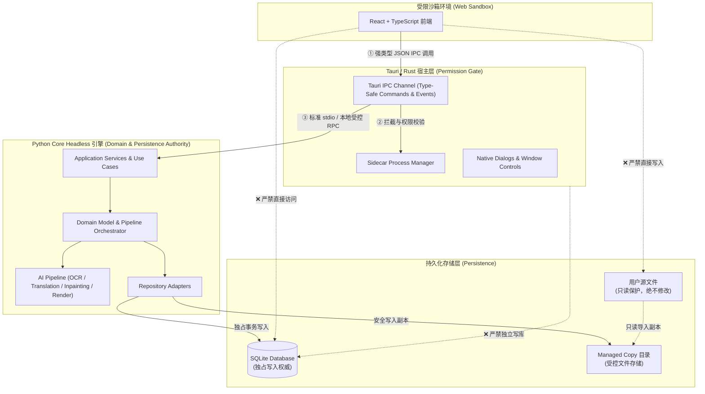

# ARCH-DOC-REBASELINE AC1 核验与映射证据报告

**任务项**：AC1（01–08 逐份覆盖核验 + 新技术架构/权限边界/UI 映射的正式来源）  
**执行角色**：Owner（Antigravity）  
**审查角色**：Reviewer（DeepSeek Harness）  
**基准 Commit**：`4ef92f3daa527adac752b8fc52d492176697a292`  
**当前状态**：PARTIAL（映射与边界规则已正式确立，组件实现与 IPC 测试由后续 Gate 消费）  
**消费 Gate**：P09（AC1–3）

---

## 1. 01–08 架构文档逐份覆盖核验

本核验旨在验证文档体系在 AD-001 目标架构（Windows + React + TypeScript + Tauri/Rust + Python Core + SQLite + Managed Copy）下的完整性与职责边界，坚决避免“仅验证文件存在”的空洞证明。

| 文档编号与标题 | 原始技术定位 | AD-001 目标架构映射定位 | 产品范围变更 | 覆盖核验状态 | 核验说明与正式来源 |
|---|---|---|---|---|---|
| **01 目标系统功能架构** (`doc/01_FUNCTIONAL_ARCHITECTURE.md`) | 产品功能总览、四一级页面、任务进度面板、Pipeline能力矩阵 | 纯业务与功能基准，不受底层 UI 技术栈切换影响；完整保留四一级页面与业务流 | 无变更（不新增、不删减） | COVERED | 确立软件一级入口（书架、工作台、阅读器、设置）与横切支撑体系 |
| **02 目标技术架构** (`doc/02_TECHNICAL_ARCHITECTURE_.md`) | 历史定义 PySide6 + QML + PyInstaller | 架构分类标记为 `LEGACY / HISTORICAL`；目标技术栈全面映射至 AD-001（React + Tauri + Python Core） | 无变更（仅技术栈与边界迁移） | COVERED | 旧架构作为历史对照；新技术栈权威依据确立为 [AD-001](doc/AD-001_TARGET_DESKTOP_ARCHITECTURE.md) |
| **03 数据模型与 ER 设计** (`doc/03_DATA_MODEL.md`) | 领域模型、SQLite 结构化数据、Managed Copy 文件存储 | 领域模型与实体关系完全保留；SQLite 作为持久化单一真实来源，受 Python Core 独占权威控制 | 无变更 | COVERED | 核心实体（Book/Chapter/Page/Region/Revision/Lock）在新架构中保持完全同构 |
| **04 用户操作流程** (`doc/04_USER_FLOW.md`) | 用户交互流、导航、批处理、锁定、Revision、Webtoon | 用户流程与业务规则（单页、批处理、断点继续、防静默覆盖）完全保留，前端交互由 React 实现 | 无变更 | COVERED | 用户操作时序与状态机与 UI 实现技术解耦，继续作为交互验收基准 |
| **05 UI 映射与界面结构** (`doc/05_UI_MAPPING.md`) | 历史定义 QML 组件树、Qt Property 绑定 | 架构分类标记为 `LEGACY / MIGRATION REFERENCE`；作为 React 组件结构迁移的信息架构参考 | 无变更 | COVERED | 原 QML 组件边界不再作为开发规范；新 React UI 映射以四级页面结构为蓝本，由 ZCode 独立设计 Task 冻结 |
| **06 翻译 Pipeline 执行协议** (`doc/06_TRANSLATION_PIPELINE.md`) | PipelineRun/Task/StepRun、调度、锁机制、断点恢复 | 作为 Python Core Headless 翻译引擎的后台协议；完全保留，不受前端 UI 替换影响 | 无变更 | COVERED | 执行协议（DAG、重试、Lock、Revision、Artifact）在 Python Core 中独立运行 |
| **07 非功能需求** (`doc/07_NON_FUNCTIONAL_REQUIREMENTS.md`) | 性能、容量、资源、Windows 兼容性、旧打包 | 架构分类标记为 `MIXED`；产品级性能/安全/容量阈值坚决不降低，旧 Qt 专属条目转化为 Tauri/Sidecar 对应条目 | 严格不降低任何阈值 | COVERED | 新技术栈性能指标（冷启动、内存占用、Tauri IPC 延迟）建立新规范，详见 AC5 |
| **08 验收标准与 Release Gate** (`doc/08_ACCEPTANCE_CRITERIA.md`) | 193 项验收条目、P0/P1/P2 级别定义、Release Gate | 架构分类标记为 `MIXED`；业务与数据安全 AC 全部保留，旧 QML/PyInstaller 条目作为历史记录，新栈验收重新归零 | 严格不放宽任何标准 | COVERED | 确立“历史 PASS 严禁继承至新架构”原则，全部重设为 NOT_RUN |

---

## 2. 新技术架构正式来源与分层边界

依据用户批准的唯一目标桌面架构 [AD-001](doc/AD-001_TARGET_DESKTOP_ARCHITECTURE.md)，新桌面端技术架构确立为：
**Windows + React + TypeScript + Tauri/Rust + Python Core + SQLite + Managed Copy**。

### 2.1 架构分层职责矩阵

| 架构层级 | 采用技术 | 核心职责与权威 | 严格排除（禁止范围） | 正式来源 |
|---|---|---|---|---|
| **Presentation (表示层)** | React + TypeScript + Tailwind CSS / UI 框架 | - 用户界面呈现、交互事件响应 - 书架、工作台、阅读器、设置四个一级页面渲染 - 气泡标注 Canvas/WebGL 交互呈现 - 前端状态投影与用户输入收集 | - 严禁直接访问底层 SQLite 数据库 - 严禁直接执行 OCR / 翻译 / Inpaint 等算法模型 - 严禁直接进行任意本地文件系统 I/O | [AD-001 §TARGET_INTENT](doc/AD-001_TARGET_DESKTOP_ARCHITECTURE.md#L17-L25) |
| **Desktop Shell (系统宿主与桥梁)** | Tauri / Rust | - 桌面主窗口生命周期管理 - Python Core 独立子进程（Sidecar）生命周期管控与健康检查 - 系统托盘、本地文件选择器等受控 OS 桥梁 - 强类型安全 IPC 消息传输通道与权限隔离边界 | - 严禁在 Rust 层编写领域业务逻辑 - 严禁 Rust 成为独立 SQLite 写入者（DB Writer） - 严禁直接绕过 Python Core 修改业务状态 | [AD-001 §TARGET_INTENT](doc/AD-001_TARGET_DESKTOP_ARCHITECTURE.md#L17-L25) |
| **Core Service (业务与领域核心)** | Python Core (Headless) | - 领域模型真值维护与业务不变量保障 - 翻译流水线（Pipeline Orchestrator）编排与任务调度 - SQLite 数据库单一写入权威（Single Writer Authority） - OCR、文本翻译、图片消字修复、排版渲染核心引擎 - 本地文件受控存储（Managed Copy）安全管理 - Revision 追溯与 Lock 机制强制实施 | - 严禁依赖任何 Qt/PySide6 GUI 事件循环或窗口组件 - 必须具备完全无头（Headless）独立运行与测试能力 | [AD-001 §TARGET_INTENT](doc/AD-001_TARGET_DESKTOP_ARCHITECTURE.md#L17-L25) [AD-001 §Migration constraints 5](doc/AD-001_TARGET_DESKTOP_ARCHITECTURE.md#L34) |
| **Persistence (持久化层)** | SQLite + Local Managed Storage | - SQLite：结构化业务元数据（书籍、章节、页面元数据、标注框、译文、Revision）的单一事实源 - Managed File Storage：原图、清理图、译图、Mask 等大型二进制资产的受控文件存储 | - React 与 Rust 不得直接连接 SQLite 写入 - 用户原始文件永不被原地修改或覆盖 | [AD-001 §TARGET_INTENT](doc/AD-001_TARGET_DESKTOP_ARCHITECTURE.md#L17-L25) `03_DATA_MODEL.md` |

---

## 3. 权限边界（Permission Boundary）与安全通信规范

### 3.1 权限边界核心规则
1. **沙箱隔离**：WebView2 内部运行的 React 前端无任何原生 Node.js 或 OS 文件系统直接读写权限，所有状态变更与业务请求必须通过 Tauri `invoke` 调用发送。
2. **单一 DB 写入权威**：整个系统中唯有 Python Core 拥有打开 SQLite 写入连接的权限。Tauri/Rust 仅作为进程管理宿主，不直接操作数据库连接。
3. **大二进制对象防污染边界（Large Binary Boundary）**：
   - 漫画高清原图、双层超分辨率切片、长条 Webtoon 拼图以及 AI 权重文件，**绝对禁止**转换为 Base64 字符串嵌入普通 JSON IPC 消息中传输。
   - 图像与二进制资产通信统一采用“路径指针 + 本地安全静态协议/流式端点”机制，由 Python Core 生成受控文件并返回安全协议 URI（例如 `asset://` 或受限本地端点），前端仅通过 URI 进行异步加载呈现。

---

## 4. UI 映射的正式来源与演化路径

1. **历史映射的归档与参考地位**：
   - `doc/05_UI_MAPPING.md` 中原有的 QML 组件树（如 `BookshelfView.qml`, `WorkbenchView.qml`, `ReaderView.qml`, `TaskProgressPanel.qml` 等）正式定性为 **LEGACY / MIGRATION REFERENCE**。
   - 它们记录了各业务功能（例如 Region 选择、批处理、气泡样式设置、进度折叠）的信息架构意图，但不再作为新系统的组件实现依据。
2. **新 UI 架构正式来源**：
   - 页面信息架构与产品交互逻辑正式来源为 `doc/01_FUNCTIONAL_ARCHITECTURE.md` 与 `doc/04_USER_FLOW.md`。
   - 新架构前端采用 React + TypeScript 构建，组件结构映射必须严格保持四个一级页面同级关系。
3. **设计审查独立释放声明**：
   - 依据项目角色分工，React UI/UX 视觉、交互与组件实现由 **ZCode** 主责。
   - 必须通过专门释放的 UI 设计与实现 Task（如 P09 等）进行冻结，**严禁以架构文档替代正式的 UI/UX 设计审查**。

---

## 5. 核验结论与 Gate 裁决

- **本项结论**：**PARTIAL**
  - **已达成**：01–08 完整性逐份覆盖核验已闭环；新技术架构正式来源（AD-001）、分层职责、权限边界规范与大二进制隔离协议已严密确立；旧 QML 映射已明确标记为迁移参考。
  - **未达成（PARTIAL 原因）**：Tauri IPC 接口 Schema 的代码级编译校验与 React 组件具体渲染验证属于后续实现任务范畴，不能在架构重基线阶段虚假标记为 PASS。
- **未决项与责任 Gate**：
  - 转移至下游消费任务 **P09（AC1–3）**：由 P09 完成 React 骨架与 Tauri IPC 契约实现，并提交运行时通信与权限隔离测试证据。
