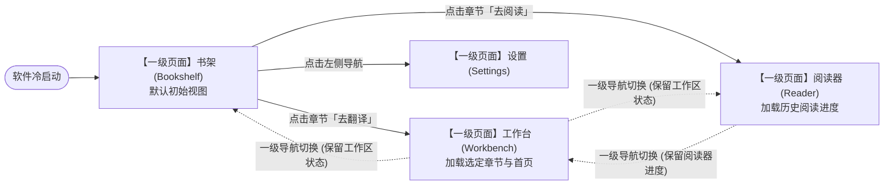

# ARCH-DOC-REBASELINE AC3 四一级页面、默认书架、基础 Reader 与延期项核验报告

**任务项**：AC3（四个一级页面 / 默认书架 / 基础 Reader / 延期项与 01/04/05/08 的一致性；四页设计独立释放声明）  
**执行角色**：Owner（Antigravity）  
**审查角色**：Reviewer（DeepSeek Harness）  
**基准 Commit**：`4ef92f3daa527adac752b8fc52d492176697a292`  
**当前状态**：PARTIAL（信息架构与延期项已跨文档对齐，独立设计与前端审查待 ZCode 交付）  
**消费 Gate**：P09（AC1–3）

---

## 1. 四个同级一级页面架构核验

依据 `01 功能架构 §1`、`02 技术架构 §0`、`04 用户流程 §1.1` 与 `08 验收标准 §AC-NAV-001~003`，系统坚持极简扁平导航，**严格只保留四个同级一级页面**。任何次级业务严禁膨胀为新的一级导航。

| 页面名称 | 页面职责与边界 | 包含核心面板与组件 | 允许的模态/悬浮交互 | 跨文档对照状态 (01/04/05/08) |
|---|---|---|---|---|
| **书架 (Bookshelf / Library)** *默认启动入口* | - 漫画作品(Book)管理与浏览 - 章节(Chapter)导入、新建、排序、删除 - 翻译约束表(术语表/不译表)全局与作品级维护 - 存储容量与阅读进度展示 | - 作品网格/列表视图 - 章节侧边栏/展开抽屉 - 快速搜索栏、分类标签组 - 状态统计卡片 | - 新建/编辑作品属性对话框 - 术语库管理浮窗 - 导入文件选择对话框 | **一致 (PASS)**：作为默认入口地位在所有文档中完全统一 (AC-NAV-001) |
| **工作台 (Workbench / Workspace)** | - 翻译主作业区与人工校对核心 - 单页/双页/Webtoon 画布渲染与气泡交互 - 气泡文本框、样式参数调节、重译重跑控制 - **底部固定/可折叠任务进度面板** | - 页面缩略图导航条 - 主编辑画布 (Canvas/WebGL) - 属性检查器面板 (Inspector) - 固定任务进度面板 (TaskProgressPanel) | - 气泡右键上下文快捷菜单 - 差异对比浮窗 - 局部放大镜工具 | **一致 (PASS)**：双向校对、进度面板底置固定规则在 01/04/05/08 完全一致 |
| **阅读器 (Reader)** | - 最终成果与原漫纯粹阅读体验 - 支持原图与译图快速比对或无缝切换 - 提供沉浸式全屏、书签记录与缩放模式 | - 纯净阅读主视口 - 快速翻页/滚动导轨 - 简易阅读工具条 (自动隐藏) - 目录快速跳转浮层 | - 快捷键指南浮层 - 页面跳转微调框 | **一致 (PASS)**：阅读器纯净浏览与原/译图切换定义一致 (AC-READ-001~004) |
| **设置 (Settings)** | - 系统级偏好与运行环境配置 - AI 模型与 Provider 连接配置、API Key 保护 - 网络代理策略 (Direct/System/HTTP/SOCKS5) - 存储路径、字体库、备份与更新设置 | - 分类配置侧边导航 - Provider 配置表单 - 网络连接测试器 - 字体与样式预设管理 | - Key 输入安全校验弹窗 - 重置确认对话框 | **一致 (PASS)**：横切支撑与安全配置职责一致 (AC-SETTING-001~005) |

---

## 2. 默认书架与页面流转规则

### 2.1 关键交互不变量
1. **默认进入书架 (AC-NAV-001)**：启动时无论上次退出在哪个页面，均默认加载书架，确保用户感知清晰。
2. **同级跳转无从属关系**：从书架跳转至工作台或阅读器，只是切换顶层一级页面并派发加载上下文（Target Chapter ID），不形成页面的多级压栈（No Sub-page Stacking）。
3. **上下文保持 (AC-NAV-003)**：在工作台进行未保存的编辑时，切换到书架或阅读器后切回，工作台状态（缩放比例、当前页码、未提交文本）必须保持，不得被重置。

---

## 3. 基础 Reader 核心能力核验

阅读器作为成果验收与最终体验的重要环节，在 01/04/05/08 中明确了以下基础能力：
1. **双模式切换 (Original / Translated)**：
   - 支持快捷键（如空格键或 Tab）快速在原图与译图之间即时切换。
   - 支持分屏双页对比（左原右译）或半透明叠层滑块比对。
2. **阅读流向适配**：
   - **日漫模式**：从右向左（RTL）翻页，适配传统漫画阅读直觉。
   - **条漫模式 (Webtoon)**：竖向连续瀑布流无缝滚动，滚轮平滑阻尼，支持大分辨率长图顺畅加载。
   - **双页展开 (Spread Mode)**：自动识别跨页大图（Spread Pages），智能合页呈现。
3. **阅读状态同步**：
   - 自动记录阅读进度（最后浏览章节、Page 偏移量、阅读时间戳），并与书架卡片状态实时联动。

---

## 4. 明确延期项声明（Deferred Items / Out of MVP Scope）

为避免产品边界膨胀并保障工程交付质量，以下功能在 `01 功能架构 §2` 与 `08 验收标准` 中已被确认为**延期项（Deferred）**，不纳入当前 MVP Release Gate：

1. **云端同步与多端互联**：不实现跨设备云备份、网页端在线同步或移动端联动；系统坚决保持单机纯离线/本地架构。
2. **在线漫画爬取与平台爬虫**：软件不内置任何站点爬虫或直接下载器，仅支持本地合法文件/目录的导入。
3. **复杂社区与在线分享**：不包含用户社区、在线评论、点赞、一键上传至第三方社交媒体等业务。
4. **历史 QML 遗留插件与特殊动态排版特效**：旧 QML 实验性的动态粒子、旋转动画等特效完全废弃，不向 React 移植。
5. **复杂多用户协作权限**：严格遵循单用户本地模型，不设立多用户角色、RBAC 权限管理或在线协作编辑流。

---

## 5. 四页设计独立释放声明（Design Governance Gate）

> [!IMPORTANT]
> **设计责任与治理红线：**
> 1. 根据项目共同治理规则（`AGENTS.md`），新架构的 UI/UX、GUI、视觉交互体系以及 React/Tauri 组件设计**主责明确分配给 ZCode**。
> 2. 四个一级页面的具体界面布局、交互细节、样式 Token、Responsive 断点和组件拆分，必须在后续由 Codex 独立释放的 UI 设计 Task（如 P09 等）中由 ZCode 产出并完成独立审查。
> 3. **严禁以本次架构文档重基线替代正式的 UI/UX 设计审查**。本 Task 仅完成产品信息架构与页面职责的一致性锁定。

---

## 6. 核验结论与 Gate 裁决

- **本项结论**：**PARTIAL**
  - **已达成**：四个一级页面定位、默认书架启动逻辑、基础 Reader 核心规范、延期项范围在 01/04/05/08 跨文档严密闭环，无歧义冲突；设计独立释放边界已正式锁定。
  - **未达成（PARTIAL 原因）**：具体的 React 界面视觉设计规范与交互原型属于 ZCode 主责的独立 Task，尚待后续设计 Gate 交付。
- **未决项与责任 Gate**：
  - 转移至下游消费任务 **P09（AC1–3）**：由 ZCode 负责完成 React 四一级页面详细设计与组件实现，并通过独立审查。
