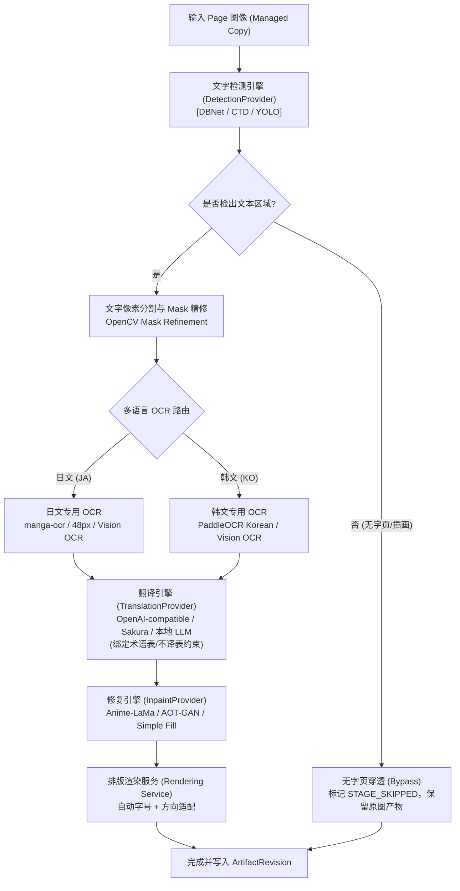

# ARCH-DOC-REBASELINE AC4 质量 AC、多语言流水线与证据责任规范报告

**任务项**：AC4（P18 的 JA/KO、无字页、质量 AC 对应新链，并明确真实样本/真值/阈值/version/device/model/endpoint 的证据责任）  
**执行角色**：Owner（Antigravity）  
**审查角色**：Reviewer（DeepSeek Harness）  
**基准 Commit**：`4ef92f3daa527adac752b8fc52d492176697a292`  
**当前状态**：NOT_RUN（新链质量要求与 7 维证据责任体系已建立，实测基准待 P18 消费执行）  
**消费 Gate**：P18（AC4）

---

## 1. P18 多语言与质量核心要求

任务 P18 负责漫画翻译系统的核心算法效果与识别质量，聚焦以下四类关键场景在新架构 Python Core Pipeline 中的表现：

1. **日文（JA）漫画处理链路**：
   - 竖排文字检测与从右至左排序识别；
   - 假名与复杂汉字混合、小型假名（振假名/Furigana）智能过滤或合并；
   - 漫画拟声词（SFX）与背景手写特效字检测、识别与翻译策略（默认跳过或人工标记）；
   - 传统日漫气泡上下文关联（从右至左、从上至下）。
2. **韩文（KO）条漫（Webtoon）处理链路**：
   - 韩国彩色条漫横排对白与大跨度气泡识别；
   - 超高分辨率长图切片（Tile Slicing）与跨缝隙文本框无损拼接合并；
   - 韩文专用识别模型接入（如 PaddleOCR Korean 专项或 OpenAI-compatible Vision OCR）；
   - 艺术字特效与多色彩渐变文字提取。
3. **无字页与纯插画页（Blank / Illustration-only Pages）**：
   - 全幅插图、跨页大图或无文本对话框的场景，文字检测算法必须具备极低虚警率（False Positive）；
   - 判定为无字页时，流水线直接穿透（Bypass），跳过后续 OCR、翻译与 Inpainting，严禁误抹除画面精美线条或生成脏斑，确保原画完整性。
4. **质量验收标准（Quality Acceptance Criteria）**：
   - OCR 字符准确率（Character Accuracy）与框召回率（Detection Recall）；
   - 翻译质量（上下文连贯性、术语一致性、无机翻胡言乱语）；
   - 排版文字溢出率（Text Overflow Rate <= 1%）与自动字号收缩算法稳定性。

---

## 2. 新流水线（Python Core Pipeline）映射

在新架构中，算法能力作为 Python Core 内部的独立 Provider 与 Use Cases 运行，完全脱离 Qt GUI 依赖（实现 Headless 运行）。

---

## 3. 证据责任体系规范（7 维全证据要素矩阵）

为杜绝“虚构测试通过”或“主观大概正常”，后续在执行 P18 质量验收时，**每一项验收证据必须完整包含以下 7 个维度的硬性元数据**：

| 证据要素 | 字段标识 | 规范要求与强制标准 | 缺漏后果 |
|---|---|---|---|
| **① 真实样本** | `test_fixture_id` / `source_hash` | 必须使用 `fixtures/` 下已登记且拥有合法来源的真实漫画图片；注明页码、分辨率、来源作品 | 无真实样本的测试一律无效 |
| **② 真值基准** | `ground_truth_ref` | 必须具备由专业人工核对的 Ground Truth 标注文件（包含包围框坐标、转录文本、标准译文） | 无法计算召回率与准确率 |
| **③ 客观阈值** | `thresholds` | 严格遵守 `07 NFR` 与 `08 AC` 规定的指标： - OCR 字符准确率：日文 >= 95%，韩文 >= 92% - 无字页虚警率：<= 2% - 排版文字溢出率：<= 1% | 不得擅自降低或调宽阈值 |
| **④ 软件版本** | `software_version` / `git_commit` | 明确记录运行测试时 Python Core 的固定 Git Commit Hash 及核心库版本（torch, onnxruntime, opencv 等） | 无法保证测试可复现性 |
| **⑤ 硬件环境** | `device_spec` | 完整记录运行设备：CPU 型号、RAM 内存大小、GPU 型号（CUDA 版本 / VRAM / DirectML 或纯 CPU 模式） | 性能与执行环境不匹配 |
| **⑥ 模型标识** | `model_name` / `model_weights_sha256` | 完整记录调用的模型完整名称、权重文件的 SHA-256 哈希值、量化精度（FP16/INT8/FP32） | 无法追溯模型漂移风险 |
| **⑦ 服务端点** | `endpoint_type` / `provider_id` | 明确标明是本地 Sidecar 独立进程运行，还是远程 API 端点（记录 URL 模式、协议版本，屏蔽 API Key） | 混淆本地离线与云端能力 |

---

## 4. 历史测试结果不继承原则（Historical Evidence Reset）

> [!CAUTION]
> **红线原则：**
> 1. 原 PySide6 时代遗留的任何 OCR 或翻译测试 PASS 记录，**绝对不得继承、迁移或套用**到新架构中。
> 2. 新架构采用了全新的 Headless 调度、异步线程模型和进程隔离机制，任何性能与质量指标必须在真实新栈流水线上重新执行测量。
> 3. 所有涉及 P18 的条目在本次重基线中**一律重置为 NOT_RUN**。

---

## 5. 核验结论与 Gate 裁决

- **本项结论**：**NOT_RUN**
  - **已达成**：多语言（JA/KO）与无字页处理链路在新流水线中的架构映射已明确；7 维全证据责任规范已严格冻结；确立了历史数据不继承原则。
  - **未达成（NOT_RUN 原因）**：新流水线尚未在真实环境下加载模型跑出实测基准数据，所有验收指标按规则保持 NOT_RUN。
- **未决项与责任 Gate**：
  - 转移至下游消费任务 **P18（AC4）**：由 P18 负责在 Python Core 流水线中接入测试 Fixtures，按照 7 维证据责任规范执行端到端质量验证并出具正式测试报告。
