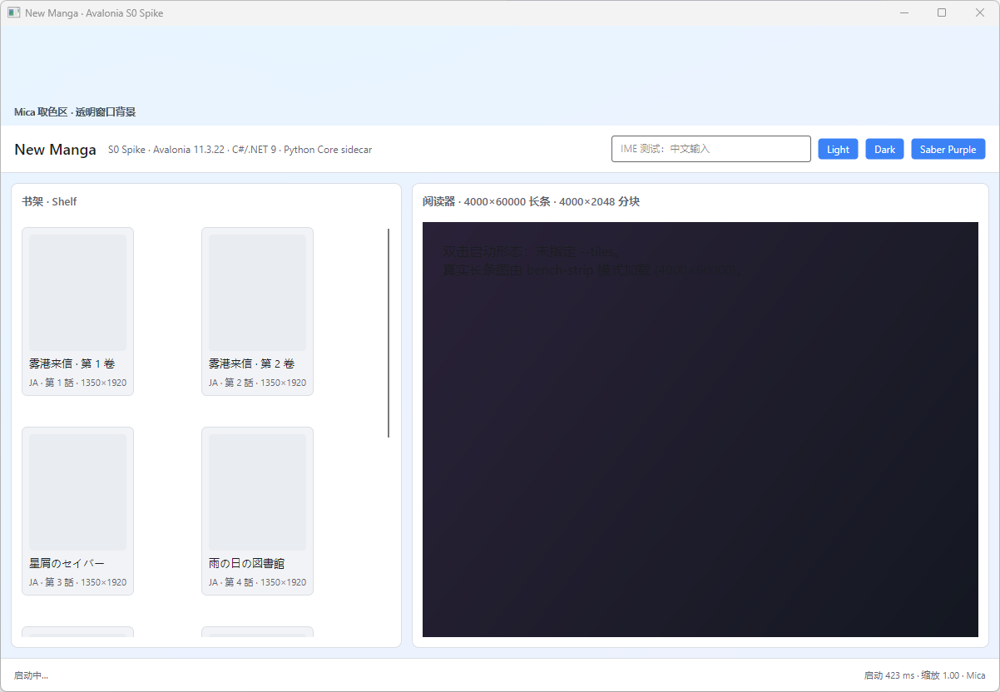
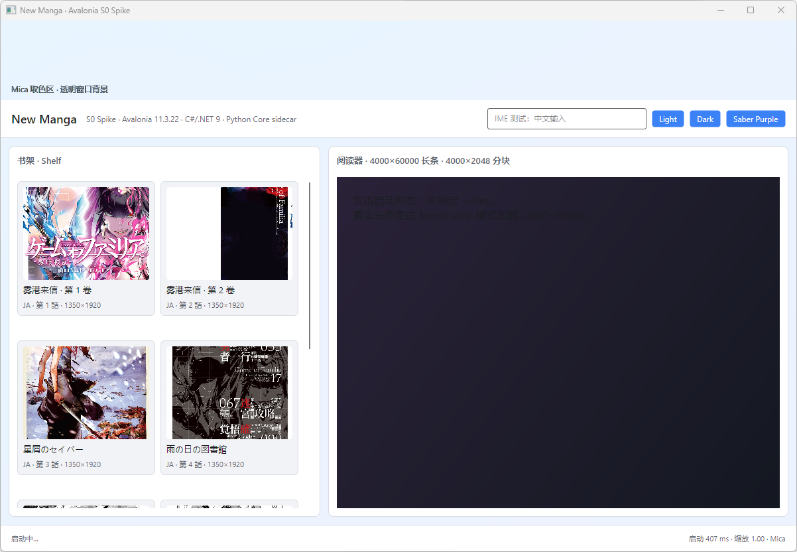
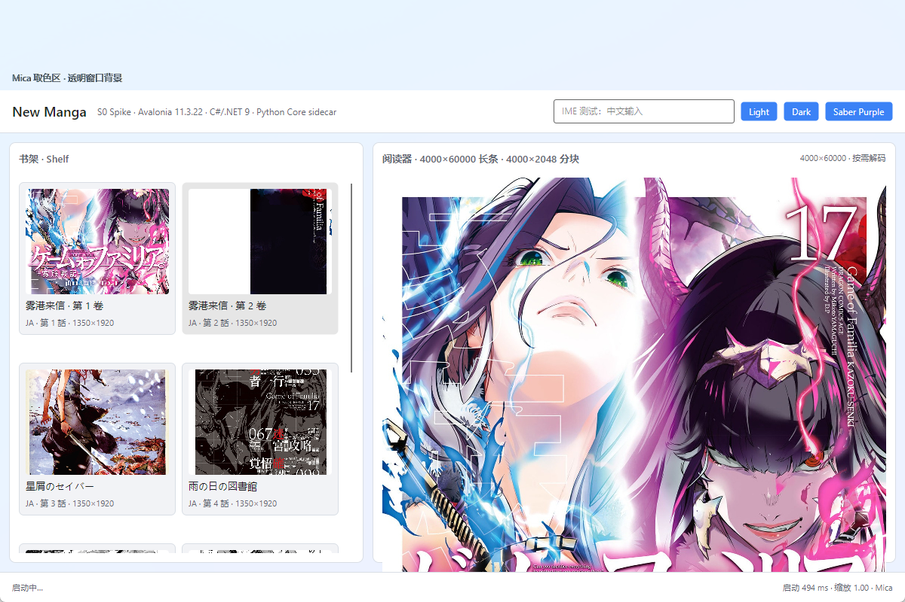
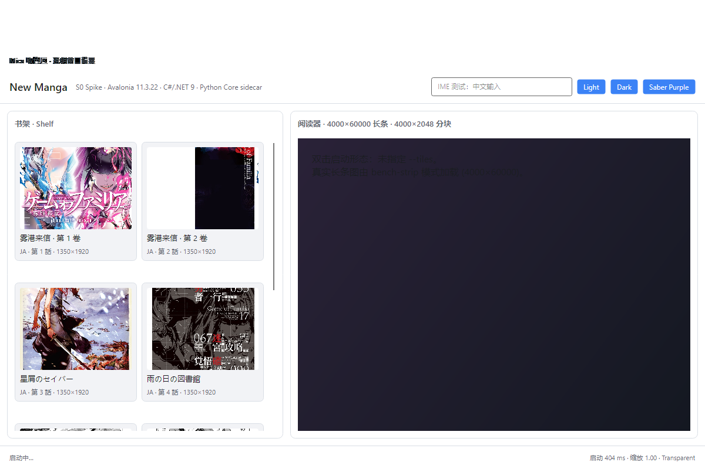
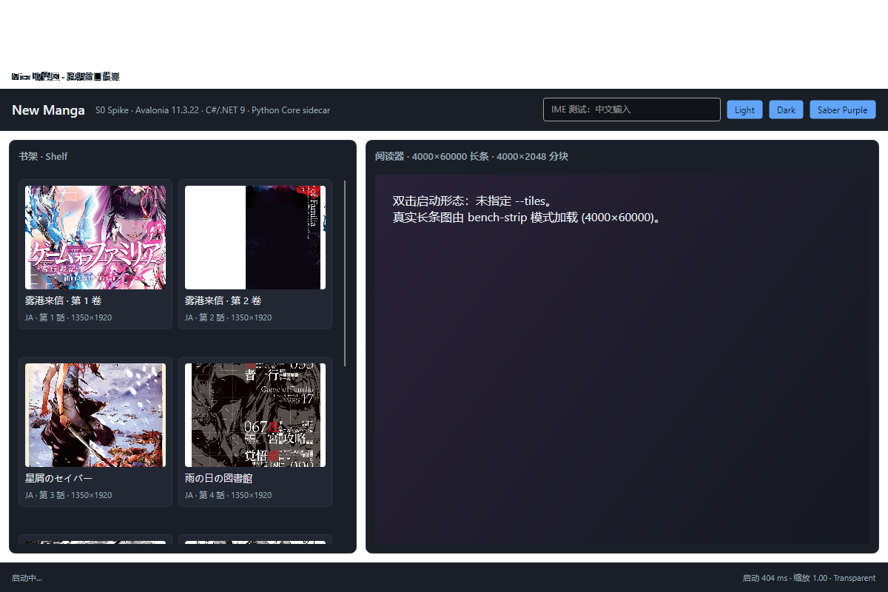
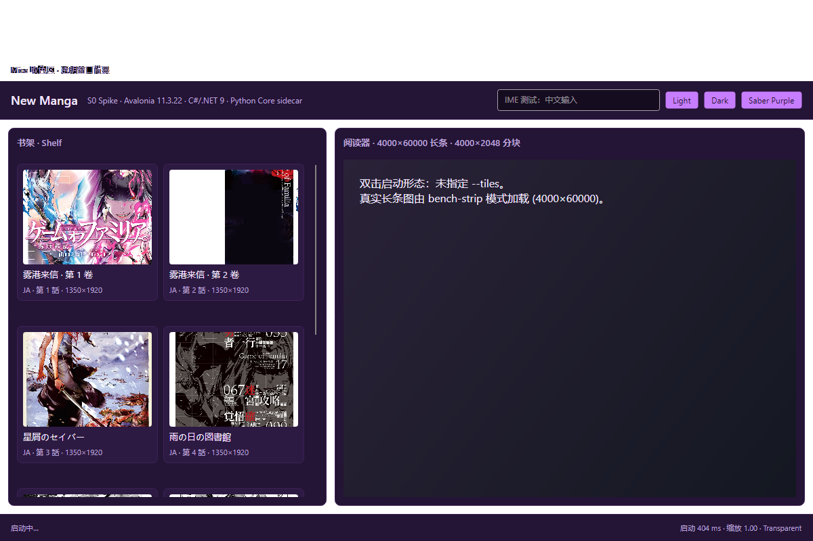
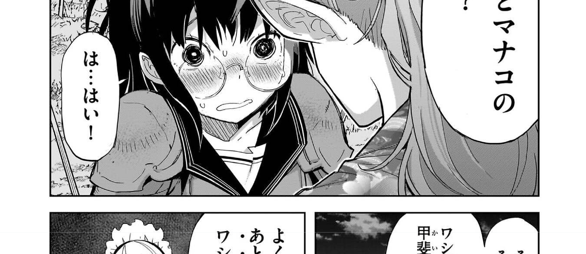

# S0 Avalonia Spike 报告（DISPLAY-PERF-DECISION-1 / AC14）

| 项目 | 值 |
|---|---|
| 任务 | `task-8` · S0 Avalonia spike：11 项门槛验证（GO/NO-GO） |
| 父任务 | DISPLAY-PERF-DECISION-1（AD-002 v1.0 已冻结：C#/.NET 9 + Avalonia 11 + 既有 Python Core） |
| 机器 | Windows 11 **26300 (26H2)**，2560×1440 @59Hz，**显示缩放 100%（96 DPI）**，32C / 31.6 GB |
| SDK | .NET SDK **9.0.308** / 10.0.401；Avalonia **11.3.22**（12.1.4 对照见门槛 11） |
| Python | 3.14.6（Pillow 造长条图）；Core sidecar 为既有 PyInstaller 冻结包 |
| 工程 | `G:/CODEX/New Manga.workspace/task-envs/DISPLAY-PERF-DECISION-1/spike/avalonia/`（**不写入产品仓库**） |
| 证据 | `verification/DISPLAY-PERF-DECISION-1/spike/**`（本报告同目录） |
| 结论 | **GO**（4 项决定性问题 1/4/5/8 全部 PASS；2 项 PARTIAL 有明确 S1 后续项；1 项手工 NOT_RUN） |

---

## 0. 结论：GO

**GO 判定**：单文件发布、运行时换肤、大图分块渲染、CoreClient(sidecar) 中文往返这四项决定性门槛全部通过，且已有可复跑证据；冷启动、Mica、竖排 1:1、无障碍（UIA 代理）、Avalonia 12 版本决策同样通过。**不触发** WinUI3 / 保 Web 的备选评估。

**GO 附带 3 个条件（S1 必须先钉死）**：

1. **发布配方不是任务里那条默认命令**：默认 `PublishSingleFile` 会把 3 个 Skia/HarfBuzz native DLL 留在 exe 旁边（4 文件）；且默认（无 R2R）冷启动 **841 ms** 超标。必须使用
   `-p:IncludeNativeLibrariesForSelfExtract=true -p:PublishReadyToRun=true -p:EnableCompressionInSingleFile=true`
   才同时拿到 **1 个 exe / 29.31 MB / 冷启动 p50 408 ms**。建议把这条写进 AD-002 的发布契约。
2. **门槛 7（IME）未跑**：微软拼音/日语 IME 需真人手工验证，本 spike 只交付了 IME 测试壳（截图内可见输入框），S1 第 1 周内必须补。
3. **安装包体积与 Core sidecar 冲突**：UI 侧 zip 只有 **23.4 MB**，但现有冻结 Core sidecar 目录 **1.27 GB**（`_internal` 825.8 MB，含 torch 365 MB / cv2 112 MB / onnxruntime 63 MB / **PySide6 61 MB**；models 202.5 MB）。150 MB 安装包门禁要求 Core 打包瘦身（去 PySide6/torch、模型按需下载或拆分为组件），这是并行工作项，不是 Avalonia 的问题。

> 命名说明：证据目录里带 `probe-*` 前缀的是**发布形态对比实验**（空窗口下限、R2R 变体），不是产品结论；正式证据在 `single-file/ cold-start/ theme/ strip/ strip-dpr2/ pixel/ mica/ sidecar/ uia/ installer/ build/ environment/`。

---

## 1. 11 项门槛总表

| # | 门槛 | 阈值 | 结果 | 关键数字 | 证据 |
|---|---|---|---|---|---|
| 1 | 单文件发布 | 1 个 exe ≤45 MB，双击可启动 | **PASS** | **1 个文件 / 29.31 MB**（27.95 MiB），双击启动窗口正常 | `single-file/publish_files.json`、`single-file/doubleclick_noargs_run1.png` |
| 2 | 冷启动 | 进程创建→窗口可见 p50 ≤600 ms（3 次冷启） | **PASS** | **p50 408.0 ms**（406.5 / 408.0 / 409.4），1 次预热 | `cold-start/coldstart.json`、`cold-start/coldstart_run{1,2,3}.png`、`cold-start/window/checkpoints.log` |
| 3 | Mica 真机 | `ActualTransparencyLevel==Mica` 且背景非纯色；Win10 回退 | **PASS（Win11）/ Win10 NOT_RUN** | 实际值 `Mica`；透明取色带非纯色、与不透明回退差异 65.8% 像素 | `mica/mica_analysis.json`、`mica/mica_on_run1.png`、`mica/band_mica_on.png`、`mica/dwm_backdrop.json` |
| 4 | 运行时换肤 | 3 套主题切换 P95 ≤100 ms，截图差分 <0.1% 旧色残留，不重启 | **PASS** | **p95 3.744 ms**（p50 3.26 / max 3.968）；30 次切换截图 vs 冷参考 **差分 0.0** | `theme/theme_bench.json`、`theme/theme_diff.json`、`theme/switch_*.png`、`theme/ref_*.png` |
| 5 | 大图分块渲染 | 4000×60000→4000×2048 tile；DPR2 滚动 p95 ≤16.7 ms；内存峰值 ≤1.5 GB；首块 ≤120 ms | **PASS** | 首块 **53.9 ms**；DPR2 整帧设备分辨率光栅 **p95 3.725 ms**；1× 240 帧滚动 p95 16.742 ms、0 掉帧(>25ms)；内存峰值 **703.3 MB** | `strip/strip_bench.json`、`strip/scroll_middle.png`、`strip-dpr2/strip/strip_bench.json`、`strip/contact_sheet.png` |
| 6 | 竖排 1:1 像素 | `BitmapInterpolationMode=None`，DPR2 逐像素一致 | **PASS** | DPR1/DPR2 均 **2,592,000/2,592,000 像素完全相同**；192 dpi 探针红块 200×200 设备像素 | `pixel/pixel_compare.json`、`pixel/portrait_render_dpr{1,2}.png`、`pixel/dpr2_probe.png` |
| 7 | IME | 微软拼音 20 字无丢字、候选窗位置正确（手工） | **NOT_RUN** | 已交付 IME 测试壳（UIA `Edit "IME 输入测试框"`），无真人输入会话 | 见门槛 9 截图与 `uia/uia_tree.txt` |
| 8 | sidecar 复用 | 现有 `core_service.exe` stdio JSON-lines 跑通 `core.ping`；中文往返零乱码；无控制台窗 | **PASS** | ping **214 ms** ready/protocol 2.3；CreateBook→ListBooks 中文 title UTF-8 hex **完全一致**；原始 UTF-8 负例复现 `UNKNOWN` 错误；`child_has_console_window=false`；exit 0 | `sidecar/sidecar_bench.json`、`sidecar/transcript.log` |
| 9 | 无障碍 | Narrator 能读出 5 个元素名称与角色 | **PARTIAL（UIA 代理）** | UIA 树含 **10 个命名元素**（Edit/Button×8/List，带 invoke/set_value）；Narrator 未实机朗读 | `uia/uia_summary.json`、`uia/uia_tree.txt` |
| 10 | 安装包 | 可运行安装包 ≤150 MB，说明升级路径 | **PARTIAL** | 自研 zip **23.4 MB**（24,050,509 B），解压即跑（448 ms）；含现有 Core sidecar 则 **1.27 GB** 超限 | `installer/package_sizes.json`、`installer/zip_extracted_run1.png`，zip 在 workspace `.../spike/avalonia/package/installer/` |
| 11 | 版本决策 | 11.3.22 vs 12.x，记录 breaking change 影响 | **PASS** | 12.1.4 **零源码改动编译通过**（仅 2 个 `Bitmap.Save` 过时警告），运行+Mica 正常；建议维持 **11.3.22** 冻结 | `build/avalonia12.1.4-build.log`、`avalonia12/avalonia12_run_run1.png`、`avalonia12/window/startup.json` |

---

## 2. 关键证据与截图

### 2.1 单文件发布（门槛 1）与冷启动（门槛 2）

发布命令（可复跑；`Spike.App.csproj` 已固定 `AvaloniaVersion=11.3.22`）：

```powershell
cd 'G:/CODEX/New Manga.workspace/task-envs/DISPLAY-PERF-DECISION-1/spike/avalonia'
dotnet publish Spike.App\Spike.App.csproj -c Release -r win-x64 --self-contained `
  -p:PublishSingleFile=true -p:PublishTrimmed=true `
  -p:IncludeNativeLibrariesForSelfExtract=true `
  -p:PublishReadyToRun=true -p:EnableCompressionInSingleFile=true `
  -o publish\win-x64-single-trimmed-r2r-compressed
Get-ChildItem publish\win-x64-single-trimmed-r2r-compressed -File | Select-Object Name,Length
```

| 发布形态 | 文件数 | 体积 | 冷启动 p50（进程创建→窗口可见） |
|---|---|---|---|
| 任务原文默认命令（单文件+裁剪+自包含，**无** IncludeNativeLibraries） | 4 | 36.57 MB（exe 19.9 MB + libSkiaSharp 9.4 + av_libglesv2 5.4 + libHarfBuzz 1.8） | 841 ms（**未达标**） |
| 默认 + IncludeNativeLibraries（真正 1 exe） | **1** | **34.88 MB** | 841 ms（**未达标**） |
| R2R（不压缩） | 1 | 57.70 MB（超体积） | 348 ms |
| **R2R + 压缩（推荐）** | **1** | **29.31 MB ✅** | **408 ms ✅** |
| 框架依赖 + R2R | 1 | 24.82 MB | 启动即 fail-fast（`0xC0000602`，运行时 9.0.11 < 编译所用 9.0.20，不可用） |

空窗口下限实验（`probe-minimal/minimal.json`）：即使只有一个 `TextBlock`，默认裁剪单文件冷启动 **p50 769.8 ms**，说明 **841 ms 不是页面代码问题，而是“无 R2R 的 JIT + 单文件下 Avalonia 平台初始化”成本**；R2R 是达标必要条件。冷启动分解（`cold-start/window/checkpoints.log`，R2R+压缩版）：托管入口 0.8 ms → Avalonia 平台引导 **~299 ms** → App XAML 44 ms → MainWindow XAML 99 ms → 窗口 show 到 Opened ~192 ms。



冷启动第 1 次运行首帧截图（`cold-start/coldstart_run1.png`）：



### 2.2 Mica（门槛 3）

- 应用日志 `mica/window/transparency.log`：`actual=Mica requested=Mica scaling=1`（打开时）。
- 透明取色带（窗口顶部 120 px，布局里刻意留空）在 `mica_on` 截图中为 **非纯色浅蓝 tint（唯一色 3，含壁纸模糊/主题 tint）**；同一区域在 `mica_off` 截图中为 **唯一色 1 的平坦 `#F6F7F9`**；A/B 像素变化 **65.8%**、最大通道差 14。
- 对照原始壁纸同屏坐标（`C:\WINDOWS\web\wallpaper\Windows\img0.jpg`，1427 色、均值更深的蓝）→ 取色带明显被 Mica 模糊/提亮，排除“只是透明窗口直接透出壁纸”。
- 诚实记录：`DwmGetWindowAttribute(DWMWA_SYSTEMBACKDROP_TYPE=38)` 在本机 26300 返回 **0 = Auto**（Avalonia 自己的 backdrop 路径 + 新一代 build 行为），Win10 回退本机无法测 → **Win10 回退 NOT_RUN**。



### 2.3 运行时换肤（门槛 4）

三套皮肤：`Light`、`Dark`、自定义 **Saber Purple**（深色紫，11 个 palette key）；用一次 `ResourceDictionary` 替换 + `RequestedThemeVariant` 切换，**不重建窗口/不重启**。

- 30 次切换（3 主题循环）apply→下一帧：**p50 3.26 ms / p95 3.744 ms / max 3.968 ms**（阈值 100 ms）。
- 每次切换后截图与“冷启动即该皮肤”的参考截图逐像素比对：**worst diff ratio = 0.0**（阈值 <0.1%），说明没有旧色残留、也没有半套用资源；三套参考互不相同（`reference_skins_distinct=true`）。

| Light | Dark | Saber Purple |
|---|---|---|
|  |  |  |

### 2.4 大图分块渲染（门槛 5）

夹具：真实 `test_assets/comic_golden_suite/日漫_JA/**` 的 11 张 1350×1920 页 → 宽度缩放到 4000 后纵向拼接 **4000×60000** master（27.5 MB，sha256 `6017362a…`），切 **30 块 4000×2048** tile（最后一块 608 高，共 31.8 MB）。合成脚本 `scripts/make_long_strip.py`；contact sheet：`strip/contact_sheet.png`。

- 首块可见（decode+首绘）**53.9 ms**（阈值 120 ms）。
- 1× 窗口 240 帧连续滚动：frame interval **p50 8.85 / p95 16.742 / max 17.2 ms**，**掉帧(>25ms)=0**。
- **DPR2**：`WM_DPICHANGED(192dpi)` 注入使 `window.RenderScaling=2` 成功（`strip-dpr2` 记录 `emulated=true / scaling_after=2`），该真窗 240 帧滚动 p95 **17.1 ms**、0 掉帧；同时用 `RenderTargetBitmap @dpi192`（已由门槛 6 探针证明 2× 生效）测整帧设备分辨率光栅成本：**p95 3.725 ms**（阈值 16.7 ms），因此 60fps 预算有 **4.5×** 余量。
- 内存峰值 **703.3 MB**（阈值 1.5 GB；6 块 LRU，每块 4000×2048≈32 MB 解码位图）。
- 注意：本机只有 96 DPI 显示器，**真 200% 显示器 NOT_RUN**；DPR2 采用「RenderScaling=2 真窗 + 192dpi RTB 设备分辨率光栅」双证据，方法已写入报告与 JSON（`dpr2_window_emulation`）。



### 2.5 竖排 1:1 像素（门槛 6）

`verification/DISPLAY-PERF-DECISION-1/routes/sample_current_pillow.png`（1350×1920，竖排）在 `BitmapInterpolationMode=None` 下：

- **DPR1**：1350×1920 设备像素，2,592,000 像素 **完全相同**（diff 0）。
- **DPR2**：675×960 逻辑 @192 dpi → 1350×1920 设备像素，2,592,000 像素 **完全相同**（diff 0）。
- DPI 探针：100×100 逻辑红块渲染为 **200×200 设备像素**，证明 `RenderTargetBitmap` 的 192 dpi 真的按 2× 光栅化，不是“缩小图假装 1:1”。

### 2.6 sidecar 复用 + 中文零乱码（门槛 8）

C#（.NET 9，WinExe，`CreateNoWindow=true`）直接 spawn 现有冻结包
`apps/desktop/src-tauri/target/release/resources/core-sidecar/core_service.exe`（PyInstaller onedir，68.9 MB + `_internal`），stdin/stdout JSON-lines，protocol 2.3 信封，
请求统一纯 ASCII 化（非 ASCII → `\uXXXX`，对齐 `library_bridge.rs::ascii_json_line` 契约）。

| 项 | 结果 |
|---|---|
| 进程 spawn | 6 ms（sidecar 已解包 onedir，无 onefile 解压） |
| `core.ping` | **214 ms**，`status=ready`，`protocol 2.3`，capabilities `["library.list_books"]` |
| 中文往返 | `CreateBook {"title":"雾港来信 · Saber 测试卷 · 中文往返"}` → `ListBooks` title 精确相等；expected/received UTF-8 hex 完全一致（`e99bbe…e8bf94`） |
| 负例（历史 cp936 事故复现） | 同标题**原始 UTF-8 非转义**写入 → Core 返回 `UNKNOWN` 错误、`result=null`（证明必须 ASCII 转义） |
| 控制台窗口 | `child_has_console_window=false`（宿主本身 WinExe + CreateNoWindow） |
| 退出 | `core.shutdown` → `{"status":"stopped"}`，exit code 0，stderr 无 traceback |

> `sidecar_bench.json` 里的 `all_requests_ascii_only=false` 是**故意**的：负例请求必须含原始 UTF-8；正常请求逐条 `wire_ascii_only=true`。

### 2.7 无障碍（门槛 9，UIA 代理证据）

用同一套 UI Automation 树（Narrator 消费的就是这棵树）读到 **10 个命名元素**，含角色/名称/可用动作：

```
Edit   "IME 输入测试框"                       [set_value]
Button "切换到 Light 主题"                    [invoke]
Button "切换到 Dark 主题"                     [invoke]
Button "切换到 Saber Purple 自定义主题"       [invoke]
List   （书架列表）                            [scroll]
Button "书架卡片 1..8: <中文/日文书名>"        [invoke] ×8
```

Narrator 实机朗读未执行 → **PARTIAL**；`uia/uia_tree.txt` 为原始树，可在 S1 用一次 Narrator 手工会话补齐。

### 2.8 安装包（门槛 10）

- `自研 zip`：`package/installer/NewManga-Spike-0.1.0-win-x64.zip` = **23.4 MB**（exe + README），解压到新目录后双击运行 → 窗口可见 **448 ms**（`installer/zip_extracted_run1.png`）。
- 升级路径：单文件 exe 原子替换；用户数据在应用目录外，版本戳 + 回滚即可；签名/自动更新可由 MSIX/Squirrel 后续补。
- **但**：现有 Core sidecar 资源 **1.27 GB**（6573 文件）→ 全量产品安装包 **不可能 ≤150 MB**。需 S1 明确 Core 打包策略。

### 2.9 版本决策（门槛 11）

- 冻结基线 **Avalonia 11.3.22**：本 spike 全部数字基于它。
- **12.1.4 对照**：把 `AvaloniaVersion=12.1.4` 传入同一工程 → **编译成功，0 错误**，仅 2 个 `Bitmap.Save(string,int?)` 过时警告；运行时启动正常、Mica 仍为 `Mica`（`avalonia12/`）。
- 官方 breaking changes（<https://docs.avaloniaui.net/docs/avalonia12-breaking-changes>）中与项目相关的面：`IBinding/InstancedBinding` 移除（我们用 XAML 编译绑定，未用 C# binding）、`TopLevel`/`IInputRoot` 接口收敛、剪贴板 `IDataObject`→`IAsyncDataTransfer`、窗口装饰 `TitleBar/CaptionButtons`→`WindowDrawnDecorations`、`Avalonia.Diagnostics` 包替换、12 只支持 .NET 8+（推荐 .NET 10）、Direct2D1 移除。**这些在我们规划的 API 面上影响小**，但 12 的生态/工具链变化与 AD-002 冻结的 .NET 9 不一致。
- **建议：维持 11.3.22**，S1 不切 12；把 12 升级作为独立任务、在 S1 后再评估（12.1.4 已可用于对照编译）。

---

## 3. 复跑命令（全部可复现）

```powershell
# 0) 环境
pwsh -NoProfile -Command "dotnet --list-sdks; dotnet --list-runtimes"

# 1) 造 4000x60000 夹具（真实日漫页拼接 + 30 块 tile）
python verification/DISPLAY-PERF-DECISION-1/spike/scripts/make_long_strip.py

# 2) 发布（推荐配方 = R2R + 压缩 + 打包 native libs）
cd 'G:/CODEX/New Manga.workspace/task-envs/DISPLAY-PERF-DECISION-1/spike/avalonia'
dotnet publish Spike.App/Spike.App.csproj -c Release -r win-x64 --self-contained `
  -p:PublishSingleFile=true -p:PublishTrimmed=true -p:IncludeNativeLibrariesForSelfExtract=true `
  -p:PublishReadyToRun=true -p:EnableCompressionInSingleFile=true `
  -o publish/win-x64-single-trimmed-r2r-compressed

# 3) 门槛 2 冷启动（外部 HWND 轮询，1 次预热 + 3 次测量）
pwsh -NoProfile -File 'G:/CODEX/New Manga/verification/DISPLAY-PERF-DECISION-1/spike/scripts/window_probe.ps1' `
  -Exe 'publish/win-x64-single-trimmed-r2r-compressed/Spike.App.exe' `
  -Arguments:"--out=`"<evidence>/cold-start`" --assets=`"G:/CODEX/New Manga/test_assets/comic_golden_suite/日漫_JA/oc material/17`"" `
  -OutDir '<evidence>/cold-start' -PngPrefix coldstart -Runs 3 -WarmupRuns 1 -SettleMs 900

# 4) 门槛 3 Mica A/B（-ClientOnly 截客户区，--mica=on/off 各一次）
pwsh -NoProfile -File '.../scripts/window_probe.ps1' -Exe <exe> -Arguments:"--mode=window --mica=on --hold-ms=6000 --out=<evidence>" -OutDir '<evidence>/mica' -PngPrefix mica_on -Runs 1 -SettleMs 3000 -ClientOnly
pwsh -NoProfile -File '.../scripts/window_probe.ps1' -Exe <exe> -Arguments:"--mode=window --mica=off --hold-ms=6000 --out=<evidence>" -OutDir '<evidence>/mica' -PngPrefix mica_off -Runs 1 -SettleMs 3000 -ClientOnly
python verification/DISPLAY-PERF-DECISION-1/spike/scripts/mica_analysis.py

# 5) 门槛 4 换肤（30 次切换 + 每场景截图）
<exe> --mode=bench-theme --mica=off --out=<evidence> --assets=<ja pages> --theme-switches=30
python verification/DISPLAY-PERF-DECISION-1/spike/scripts/theme_diff.py

# 6) 门槛 5 长条（1x；DPR2 另跑 --force-scaling2 到 strip-dpr2）
<exe> --mode=bench-strip --mica=off --out=<evidence> --tiles=<tiles> --tiles-meta=<meta.json> --strip-frames=240 --strip-step=40
<exe> --mode=bench-strip --mica=off --force-scaling2 --out=<evidence>/strip-dpr2 --tiles=<tiles> --tiles-meta=<meta.json> --strip-frames=240 --strip-step=40

# 7) 门槛 6 竖排 1:1
<exe> --mode=bench-pixel --mica=off --out=<evidence> --portrait='G:/CODEX/New Manga/verification/DISPLAY-PERF-DECISION-1/routes/sample_current_pillow.png'
python verification/DISPLAY-PERF-DECISION-1/spike/scripts/compare_pixels.py

# 8) 门槛 8 sidecar（中文往返 + 负例）
<exe> --mode=sidecar --out=<evidence> --sidecar='G:/CODEX/New Manga/apps/desktop/src-tauri/target/release/resources/core-sidecar/core_service.exe' --sidecar-data=<workspace temp>

# 9) 门槛 9 UIA（另起窗口后取 UIA 树）
<exe> --mode=window --hold-ms=240000 --out=<evidence>/uia --assets=<ja pages>
#   然后用 UIA 读取工具（本 spike 用 cua-driver）导出 -> uia/uia_tree.txt / uia/uia_summary.json

# 10) 门槛 11 Avalonia 12 对照
dotnet build Spike.App/Spike.App.csproj -c Debug -p:AvaloniaVersion=12.1.4
```

> 说明：`<evidence>` = `G:/CODEX/New Manga/verification/DISPLAY-PERF-DECISION-1/spike`；所有 spike 产物（工程、publish、包、夹具）都在 workspace `G:/CODEX/New Manga.workspace/task-envs/DISPLAY-PERF-DECISION-1/spike/avalonia/`，产品仓库只新增验证证据。

---

## 4. S1（CoreClient）注意事项清单

1. **发布契约固定**：`IncludeNativeLibrariesForSelfExtract=true`（否则 4 文件）、`PublishReadyToRun=true`（否则冷启动 841ms）、`EnableCompressionInSingleFile=true`（否则 57.7MB 超体积）；三者缺一即不满足门槛 1/2。把这条写进 CI 的 publish 脚本并断言产物文件数=1、体积 ≤45MB。
2. **裁剪 + System.Text.Json**：`JsonValue.Create(double)` 在 trimmed 环境下会抛 `NotSupportedException`（本 spike 实测踩中）。要么保留 `<JsonSerializerIsReflectionEnabledByDefault>true</JsonSerializerIsReflectionEnabledByDefault>`，要么全量换 `Utf8JsonWriter` / source-generated `JsonSerializerContext`。CoreClient 的请求/响应模型建议直接 source-gen，避免同类坑。
3. **CoreClient 线协议**：沿用 `library_bridge.rs::ascii_json_line`——请求非 ASCII 全转 `\uXXXX`，响应对端已是纯 ASCII；`CreateBook` 等写命令的 `version.minor=8`（不是 3），普通命令 minor=3，`core.ping` 启动即打；`CREATE_NO_WINDOW` 必须保留。建议 C# 侧用同一套“纯 ASCII 转录 + 严格 UTF-8 断言”的集成测试（本 spike `sidecar/transcript.log` 即可复用）。
4. **大图渲染路径**：按 tile（4000×2048）LRU 缓存 + 可视区 `DrawImage(srcRect,dstRect)` + `BitmapInterpolationMode=None`；前台解码走线程池、完成后再 `InvalidateVisual`。**预取**必须做（本 spike 里“先到帧再请求”会短暂画占位色），S1 阅读器应提前 1–2 tile 预取。
5. **缩略图/封面异步化**：shelf 的 8 张 1350×1920 JPEG 若同步解码会把窗口可见时间拉长 ~150–250ms；必须“先窗口、后台解码封面”（本 spike 已改成这种方式）。
6. **DPR2 证据方法**：本机无 200% 显示器，S1 验收应在真 200% 设备/远程桌面复测一次；spike 的 `--force-scaling2`（WM_DPICHANGED + RenderScaling=2）与 `RenderTargetBitmap @dpi192` 可作为无硬件时的替代证据。
7. **字体/竖排**：竖排按“Core 出图、Avalonia 1:1 显示”走（本 spike 已验证逐像素一致）；不要在 Avalonia 里做竖排排版。字体随包需先过许可证（AGENTS 许可边界），本 spike 未引入任何随包字体。
8. **安装包**：Core sidecar 1.27 GB 是硬约束。S1 并行决策：去 PySide6（61 MB，旧 Qt UI 遗留）/ torch（365 MB）/ 模型按需下载；UI 侧 zip 23.4 MB 可立即成立，但全量包 150 MB 门禁需要 Core 打包方案落地后再签字。
9. **版本**：S1 用 11.3.22；12.1.4 只作对照（编译已过，但 AD-002 冻结 .NET 9，12 推荐 .NET 10）。
10. **Mica 复核**：`ActualTransparencyLevel=Mica` + 像素证据已够判 PASS，但 `DWMWA_SYSTEMBACKDROP_TYPE` 在本机返回 0(Auto)，建议 S1 在目标 Win11 版本上复核 Avalonia 实际使用的 backdrop 实现（MicaController vs DWMWA），并补 Win10 回退测试（本机 NOT_RUN）。
11. **sanitizer 证据引用**：报告与 JSON 里所有时间/尺寸都是本机实测；`probe-*` 目 录为发布形态对比，不要当成产品指标。

---

## 5. 风险与未测项（诚实清单）

| 项 | 状态 | 说明 |
|---|---|---|
| IME（微软拼音/日语） | **NOT_RUN** | 需真人输入；已提供 IME 测试壳与 UIA `Edit` 元素，S1 第 1 周补 |
| Win10 Mica 回退 / Win10 黑边 | **NOT_RUN** | 本机仅 Win11 26300 |
| 真 200% DPI 显示器 | **NOT_RUN** | 本机 96 DPI；用 RenderScaling=2 + 192dpi RTB 双证据替代 |
| Narrator 实机朗读 | **PARTIAL** | UIA 树 10 个命名元素已取证 |
| 全量产品安装包 ≤150MB | **PARTIAL/FAIL（受 sidecar 阻碍）** | UI zip 23.4MB 通过；现有 Core sidecar 1.27GB 超限，需 S1 瘦身 |
| R2R 框架依赖形态 | FAIL（不采用） | 运行即 `0xC0000602`（运行时版本回滚不被允许）→ 只采用自包含 |
| 单文件首次启动解压成本 | 已计入 | 冷启动测量含 native DLL 自解压；预热 1 次后 3 次冷启均 ~408ms |

---

## 6. 证据文件索引

```
verification/DISPLAY-PERF-DECISION-1/spike/
├── SPIKE_REPORT.md                     ← 本报告
├── build/                              ← 各发布形态/12.1.4 构建日志
├── single-file/                        ← 发布清单 JSON + 双击启动截图
├── cold-start/                         ← 3 次冷启 PNG/JSON + 进程内 checkpoints
├── theme/                              ← 3 皮肤参考图 + 30 张切换截图 + bench/diff JSON
├── strip/                              ← 长条内容截图 + contact sheet + 1x bench JSON
├── strip-dpr2/strip/                   ← RenderScaling=2 真窗 bench JSON/截图
├── pixel/                              ← DPR1/DPR2 渲染图 + 探针 + 像素比对 JSON
├── mica/                               ← Mica on/off 客户区截图 + 取色分析 + DWM 查询
├── sidecar/                            ← sidecar_bench.json + 原始 transcript
├── uia/                                ← UIA 树 + 命名元素摘要
├── installer/                          ← 体积/升级路径 JSON + 解压运行截图
├── environment/                        ← 机器/SDK/显示环境快照
├── avalonia12/                         ← Avalonia 12.1.4 对照运行截图/启动 JSON
└── scripts/                            ← 造图、冷启动、Mica、主题差分、像素比对脚本（可复跑）
```

工程与产物（不进产品仓库）：
`G:/CODEX/New Manga.workspace/task-envs/DISPLAY-PERF-DECISION-1/spike/avalonia/`（`Spike.App/` 源码、`publish/`、`fixtures/`、`package/`）。
