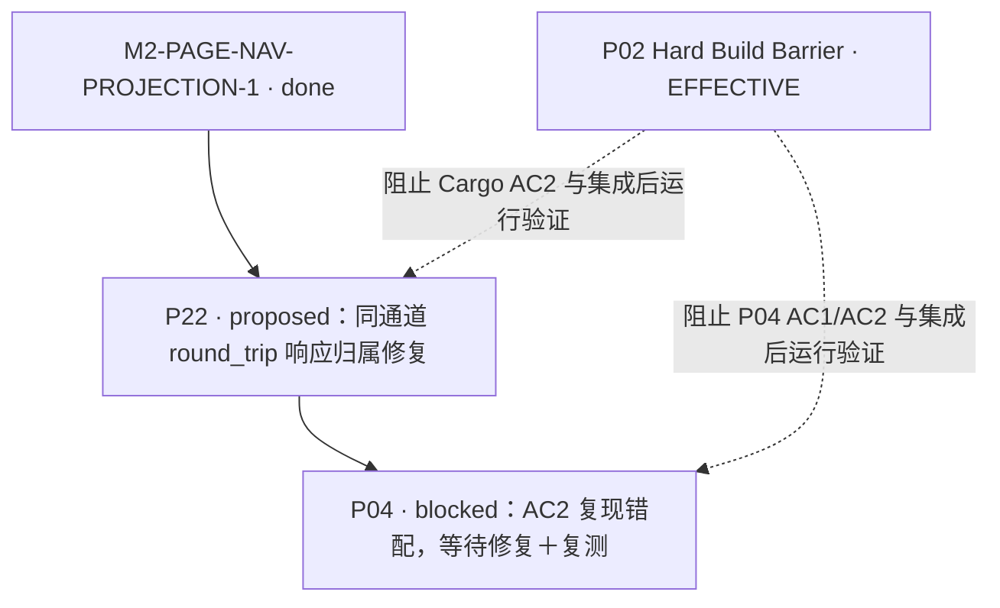

# P04/P22 依赖图增量

日期：2026-10-10（Asia/Shanghai）

`doc/REBASELINE_PLAN.md` 是规划事实源。本文件只记录本次节点增量；既有路线图文件含用户未提交修改，本次保持原样。

- P22 的 Task `depends_on` 只有已完成的 `M2-PAGE-NAV-PROJECTION-1`。P04 delivery HEAD 是代码输入基线，不要求 P04=`done`，因此无依赖环。
- P04 Owner 的 R2 文档返修仍占用同一个 Rust 文件写入窗口；P22 当前保持 `proposed`，待该 delivery 固定后填写 base/branch/worktree 并释放。
- Build Barrier 是运行门，不改变 Task DAG 边；解除前任何 Cargo/Tauri 结果都只能记 `BLOCKED / NOT_RUN`。
