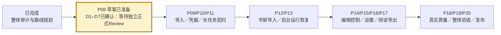

# P08 产品范围与验收草案

状态：USER_SCOPE_CONFIRMED / D1–D7已确认，等待非作者正式Review。本文是 P08 的审查材料，范围生效以 Plan 与正式 Task 为准，不修改任何冻结契约或既有产品裁决。

## 当前完成位置

已完成整体代码/任务审计和 P01–P21 路线规划。本轮完成用户D1–D7决策归档与范围准备；P08 尚未 done，后继产品实施未释放。现有新架构已登记任务105项收口；196节点历史台账是固定审计快照，不是最新 Task 文件数。不能用这两项数字计算产品完成率。

生产能力复核输入：`ab2f813c0ce311a6712002cafd852b9e7a258380`；与审计输入 e4242ecd 比较，src/apps/tests/packaging 无差量。复用[Core审计](../PROJECT-ROADMAP-20261008/core-audit.md)、[Desktop审计](../PROJECT-ROADMAP-20261008/desktop-audit.md)。旧报告的人员建议由当前协作协议覆盖；Qoder不参与。

## 用户确认的首发范围（2026-10-08）

D1–D7已全部收到，不再等待用户回答。产品取舍已确认；P08正式Review与集成尚未通过，后继实现仍未释放。D2按用户选项中列出的整组格式纳入，不只选择其中一个。

| 决策 | 用户确认结果 | 实现/验收落点 |
|---|---|---|
| D1 | 解冻基础Reader：分页/Webtoon阅读、独立阅读进度恢复、PNG/ZIP导出；跨页联动、页缩略图继续延期 | P16契约/Core→P17 UI；保留四个一级页面 |
| D2 | 图片/文件夹及PDF/MOBI输入；PNG/ZIP、CBZ/PDF/文本输出 | P09/P12逐输入格式；P16/P17逐输出格式Gate；未测不声明支持 |
| D3 | JA/KO分别真实测试；按现行RG1净化基线；Win10单独验证后再声明支持 | P18资格方案/实测；P20环境与安装包绑定；Win10不是首发硬门槛 |
| D4 | 整个漫画库备份恢复：数据库＋Managed Copy | P15依赖P13停写/排空/连接回收；纳入一致恢复所需Revision、artifact和元数据；失败回滚；DB-only不能替代 |
| D5 | 保持D08现行发布门槛：P0/P1全部通过、AC-SMOKE完整主流程全部通过 | P19/P20；未执行不标PASS，不用延期豁免P0/P1 |
| D6 | 保留模型下载；Plugin/Hook、字体上传、Sakura监控、Plugin Agent首发延期 | P15下载/进度/中断恢复/完整性Ready；现有Sakura翻译Provider不因监控延期而删除 |
| D7 | 设置、回收站、TM管理及其他维护满足D08现行P0/P1要求 | P10/P14/P15按AC落实；不再笼统延期完整TM或回收站；不自动纳入所有可选扩展 |

## 能力范围与真实缺口

以下must表示首发必须，deferred表示用户明确延期。源码缺口复用既有审计，选入范围不等于已经实现。逐项可观察验收见[AC覆盖索引](AC_COVERAGE.md)，全部产品结果仍为NOT_RUN。

| 能力 | 已确认范围 | 当前缺口/来源 | 后继实现与验收 |
|---|---|---|---|
| 四页与书目/章节/页管理 | must：D08全部P0/P1，包括标签、收藏/归档等要求 | App仅Console↔Workbench，生产Library主要只读；D04§3–10、D08 AC-NAV/LIB/CH/PAGE | P09冻结CreateBook/CreateChapter等写契约并接Core/Host；P12 ZCode导航/书架/导入UI；真实空库建书闭环 |
| 图片/文件夹/PDF/MOBI导入 | must：整组选定格式 | production decoder恒1×1；PDF/MOBI解析存在但生产闭包未验证；D04§8、AC-IMPORT/EXT | P09真实尺寸/受控来源/Managed Copy；P12选源与结果；损坏、加密、逃逸、重复、中断与Unicode；源hash零变化 |
| 长图与阅读 | must：分页RTL/LTR、Webtoon、进度恢复、原图/译图；跨页联动/页缩略图deferred | ReadingService/tile基础存在，正式ReaderProjection/SaveProgress和React Reader缺失；D04§9/33–36 | P16 Core/IPC→P17 UI；一长图一Page、坐标回映/预算/关闭重开；D07/D08容量性能要求保留 |
| 全章/选页翻译、重跑/控制/恢复 | must：D08 P0/P1全部命令行为 | PipelineService与九步handler可复用；正式StartRun/控制命令缺失，进度面板占位；D04§11–14/22/30–31/51 | P11生命周期契约→P13 runtime→P14 UI；持久接受、安全停步、失败重试、崩溃恢复；不得造第二调度器 |
| 人工译文/Region几何增删/四类Lock/current/pinned | must：完整现行保护与冲突语义 | 改标/修订恢复已接，其他写命令和UI仍需接线；D04§18/27–29/32 | P14分命令切片；P13/P19所有入口复核expected_revision、Lock/人工保护，无半提交，pin不清理 |
| 约束/术语/TM管理 | must：全部现行P0/P1管理与保护 | 后端基础存在，生产管理UI未全面可达；D04§20–22、AC-CONSTRAINT/TM | P10/P13/P14/P15按AC映射；机器未确认结果不写TM、不覆盖人工；管理能力不得笼统延期 |
| Provider/凭据/网络/设置 | must：全部现行P0/P1 | CredentialRef exchange缺失；普通settings DTO不能载secret；D04§38–42 | P10安全通道→P15 UI；替换/清除/持久/配置生效、网络失败可见、日志脱敏 |
| 模型下载与运行 | must：AC-MODEL-001/002 | 生产下载/进度/完整性Ready链需资格验证 | P15契约/Core/Host/UI；P18真实模型资格、P20包验证分别执行，不能互相替代 |
| SFX/OCR/翻译/修复/排版 | must：D08现行质量与性能要求 | SimpleFill/EdgeBleed真实，style analyzer空，learned registry implements=False；D04§17/19/23–26 | P13生产接线、P18 JA/KO分别资格；无字页/复杂背景/溢出逐项证据；不足即阻止声明，不默认训练新模型 |
| PNG/ZIP/CBZ/PDF/文本输出 | must：整组选定格式 | ExportService/lineage可复用，PDFComposer未注入，授权/StartExport/Cancel缺失；D04§37 | P16逐格式契约/Core→P17 UI；stale/missing策略、临时发布/取消清理、顺序/hash/lineage与源零写 |
| 回收站/诊断/其他维护 | must：D08 P0/P1 | Trash/diagnostics可复用，production维护命令未接；D04§43/44 | P15同batch恢复、managed-only删除、current/pinned保护；P19故障注入；不扩大全局删除范围 |
| 全库备份恢复 | must：DB＋Managed Copy及一致性所需库内资产 | 备份服务存在，但新worker/连接停写恢复未接；D04§38、AC-BACKUP | P15先契约→Core→UI；依赖P13停写/排空/关闭连接/reassemble/rollback；隔离恢复验证，秘密不得以普通配置明文备份 |
| Windows发布 | must：D08 P0/P1、AC-SMOKE与发布总Gate；Win10实测后声明 | 旧26/26仅原source/hash，第五入口/G7迁移缺口保留；D07/D08 | P03/P06/P19/P20；RG1净化基线与fresh source/installer五入口绑定；未知环境不外推 |
| Plugin/Hook、字体上传、Sakura监控、Plugin Agent | deferred：首发延期 | 对应AC-EXT-PLUGIN/FONT/SAKURA为P2；Plugin Agent独立扩展目标 | 保留目标与历史记录；不当PASS/N/A，不释放实现Task；现有翻译Provider行为仍按P0/P1验收 |
| 自动更新/签名/模型训练/Legacy移除 | 不新增默认实施授权；D08已有发布要求仍须逐条满足 | P21需独立移除授权 | 不得用本行豁免D08任一现行P0/P1或发布清单条目 |

## D08发布口径

D08源文件本轮不变。§53完整主流程全部PASS；§68–79总Gate逐项保留；§73 Backup/Restore PASS及P0/P1 100%，§76 READY条件与干净Windows smoke依现行RG1基线执行。首发延期仅涉及D6明确列出的扩展与D1跨页/缩略图，不降低任何P0/P1门槛。新增MOBI、CBZ、文本等格式不能因D08缺独立编号就漏验，另在下方新增格式验收表列出。

| 新增格式验收项 | 必须验证 | 实现/验收 |
|---|---|---|
| P08-FMT-MOBI | 受控来源、页序/尺寸/Managed Copy、损坏/不支持/加密安全拒绝、无半成品、源hash不变、生产安装包实际导入 | P09/P12；P19/P20 |
| P08-FMT-CBZ | 受控输出、页序/命名/压缩包可重开、lineage、取消/失败清理、源零写、安装包实际导出 | P16/P17；P19/P20 |
| P08-FMT-PDF | 真正PDF装配、页序/分页或长图策略、可重开、缺失/stale/取消/失败安全、源零写、安装包实际导出 | P16/P17；P19/P20 |
| P08-FMT-TEXT | 文本编码、章节/页/Region顺序、人工与当前修订选择、空页/缺失策略、受控输出/失败清理/源零写 | P16/P17；P19/P20 |

上述格式结果均NOT_RUN；编码、MOBI支持子集及加密策略、分页和缺失策略由P09/P16契约设计冻结，不额外扩大首发格式范围。

## 质量与验收口径草案

- 安全门槛不可降级：源文件hash零变化；无静默覆盖人工/Lock/pinned；版本冲突明确返回；失败无半提交；secret泄漏零容忍。逐入口和故障注入验证，不以总测试数量替代。
- 功能门槛：所选范围的正常/失败/重启链全部有production UI与Core可复核证据；acceptance-only、mock和静态React测试分别记录，不能代替真实生产链。
- 真实质量：复用已允许素材与许可，不重新获取Manga109；JA/KO分别锁样本、标注、provider/model/权重hash、设备/参数、逐页逐步骤结果。B3 export OK不能替代terminal状态一致性；K01先核验再定性。
- 数值质量门槛尚未冻结：检测/OCR真值、翻译相似度评测方式、无字页F4与复杂背景修复标准从既有报告逐项列出缺失，再在P18资格方案独立审查。不得编造统一“90%通过率”；BJ13 0.90是当前检测阈值，不能当整个产品质量分数。
- 性能沿D07/D08目标保留：暂停请求UI≤200ms（AC-PAUSE-001），已冻结Workbench刷新≤300ms按原Task测；首次模型加载与推理耗时不混入即时交互指标。容量/长图/内存/显示缩放从对应AC逐项测，缺环境记BLOCKED、未执行记NOT_RUN，延期必须有用户决定。
- 发布矩阵每行绑定OS版本/build、CPU/GPU、Python/模型、source/head、installer SHA、实际命令与EXIT。尊重RG1本机作为净化基线的裁决；旧26/26限旧hash，不推断当前完整产品或Win10。

## 后继工作包拆分（全部未释放）

每个子Task须独立填写base/head、branch/worktree、allowlist和非作者Reviewer。以下后缀仅是草案切片标识，尚无正式Task；父编号固定P09–P20。ZCode视觉设计复用M2-UI1，在新设计Task完成Review后落UI。

| 工作包 | 先后切片与依赖 | 建议Owner / 非作者Reviewer | 拟议允许路径与Gate |
|---|---|---|---|
| P09 | contract→Core/Host真实decoder与受控来源；依赖P08正式Review/集成 | Codex→Antigravity；DSH | contract自有修订；src/application/library、src/application/importing、src/bootstrap/core_service.py、core_assembly.py、apps/desktop/src-tauri/src/main.rs及经Task列明的bridge/contract边界；只选定格式与最小目标，源保护/损坏/中断Gate |
| P10 | credential/config契约→Core/Host；依赖P08 | Codex→Antigravity；DSH | 自有契约、settings/provider安全接线；凭据读写与脱敏Gate，不借普通settings DTO传secret |
| P11 | durable accepted/快照/控制/恢复契约；依赖P08 | Codex；DSH | 自有契约设计与verification；不写runtime，不造第二调度器 |
| P12 | 四页导航设计切片→书架与导入UI；依赖P09＋设计Review | ZCode；DSH | frontend/library与路由最小切片；真实Tauri空库链，保留已有Workbench/SFX能力 |
| P13 | Run接线→控制→恢复；依赖P09/P11 | ZCode；DSH | src/application/tasks既有复用、bootstrap/bridge冻结边界；工作线程/连接所有权、durable状态与故障恢复Gate |
| P14 | 编辑/Lock/Pin写契约→Core→Workbench UI；进度依赖P13 | Codex→Antigravity/ZCode→ZCode；DSH | editing和Task单独指定Rust/React文件；每条写命令逐项冲突/保护，不跨层无限授权 |
| P15 | 设置/模型管理UI；模型下载及全库备份恢复先契约→Core→UI，恢复必须P13停写排空 | Codex→Antigravity→ZCode；DSH | settings及已选择maintenance组件；错误/配置生效/诊断Gate；D08全部P0/P1及全库Backup/Restore PASS，不再等待范围选择 |
| P16 | 阅读/输出授权契约→Core；依赖P08正式Review/集成与P13 | Codex→ZCode；DSH | application/reading/export＋桥冻结范围；进度、lineage、取消、格式逐项Gate |
| P17 | Reader设计→Reader/导出UI；依赖P16＋设计Review | ZCode；DSH | frontend拟议reader/export目录；真实结果、重开进度/长图/受控输出，禁静态mock冒充 |
| P18 | 资格方案→JA/KO真实实验；依赖P10/P13与已确认质量口径 | DSH；Codex或ZCode非作者 | 自有experiments/verification；素材许可、hash、阈值/真值与逐步terminal一致性；生产修复须另Task |
| P19 | 所选范围production E2E；依赖P12/P14/P15/P17/P18 | DSH；Codex非作者 | 自有验证工具/证据；按选定范围验收，正常/失败/重启/人工保护逐项，按D08完整主流程验收，不以未测项冒充完成 |
| P20 | fresh Windows Gate；依赖P19/P03/P06 | ZCode；DSH；Codex集成 | 自有packaging/verification冻结范围；source/installer/五入口/环境矩阵，未知不外推 |

## 看图定位

## 下一步可转发指令

推荐DeepSeek Harness对P08固定交付提交进行非作者正式Review，具体恢复点、base/head、允许路径与完成Gate见[Review指令](DSH-REVIEW-PROMPT.md)。D1–D7全部已确认，不重复询问。只写P08自有Review报告，生产/契约/历史证据只读；审查D08覆盖、额外格式验收、全库恢复依赖、数据保护和质量口径；未知记NOT_VERIFIED/NOT_RUN，不能造批准。当前未派发/认领；P08通过正式Review和Codex集成检查后才done，P09以后仍需分别释放。
