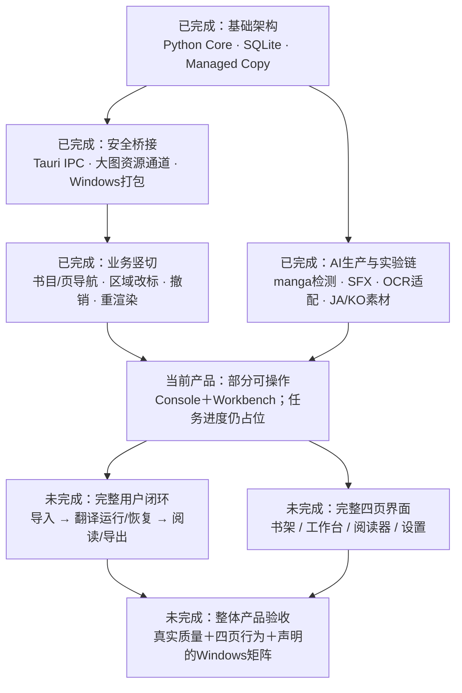
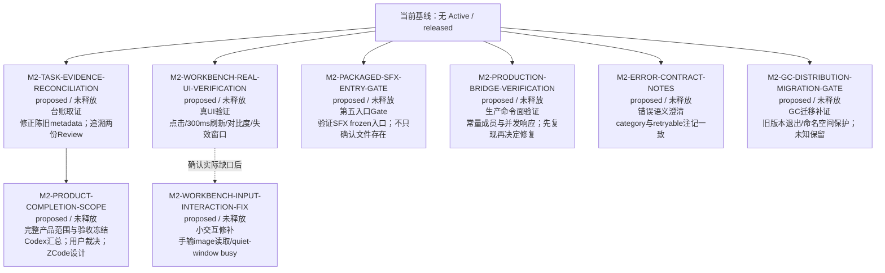
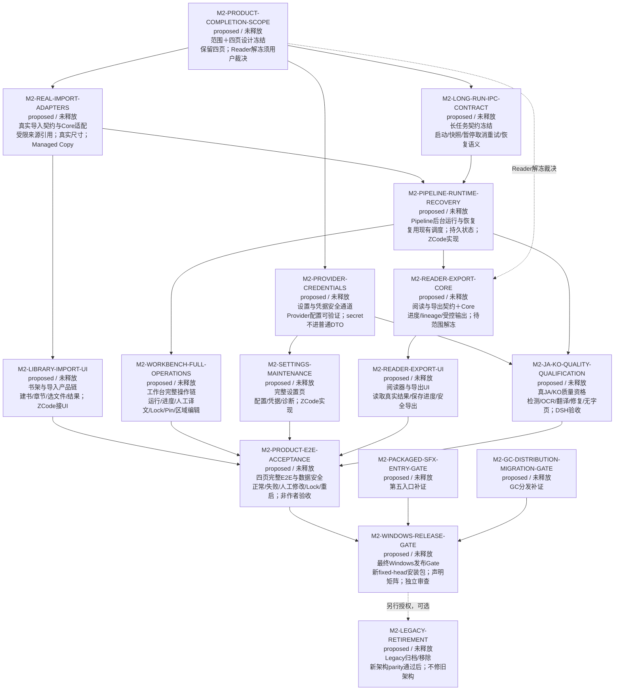
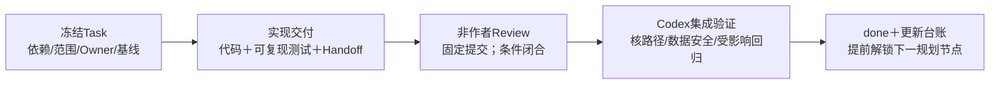

# New Manga 一眼路线图（2026-10-08）

人员更新：用户已移除Qoder，图中未来UI/UX责任由ZCode承担；非作者Review与正式Task释放Gate保持。

派生视图；排期事实以 [REBASELINE_PLAN](../../doc/REBASELINE_PLAN.md) 当前覆盖层为准。基线：`main@e4242ecd`。箭头表示启动依赖，不是工期；没有可靠估算，不编造百分比或日期。`M2-xxx` 是规划节点，全部未释放，尚未创建正式 Task 文件。

## 已做到哪里

“已完成”仅针对各 Task 冻结范围。AI实验有如实 FAIL 的结论；后端 API 可用、测试模式端到端成功，均不能代替正式界面链路。

## 当前范围内：先收口，再进入整产品主链

取证与验证候选任务 不存在必须全部串行的技术依赖。M2-TASK-EVIDENCE-RECONCILIATION已由本轮提供取证结论；推荐先准备M2-PRODUCT-COMPLETION-SCOPE完整产品范围，范围裁决前可做M2-WORKBENCH-REAL-UI-VERIFICATION/M2-PACKAGED-SFX-ENTRY-GATE，余项按风险插入。启动每个实现前仍须正式 Task、独立 Reviewer 和 allowed_paths。共享主线/契约/启动文件串行集成。M2-GC-DISTRIBUTION-MIGRATION-GATE 是已完成 GC-2 的分发补证，不重新实现 GC-2，也不声称长会话磁盘有界。

## 完整产品：现在就看清后续，而不是每次临时猜下一件

完整产品候选任务 是完整目标的条件规划，不解除当前 Reader/跨页联动/页缩略图“明确不做”的冻结。缩略图、跨页联动不作为默认任务。M2-REAL-IMPORT-ADAPTERS/M2-PROVIDER-CREDENTIALS/M2-LONG-RUN-IPC-CONTRACT 内部先契约后实现，正式释放时拆为独立 Task；M2-WORKBENCH-FULL-OPERATIONS新增编辑能力同样先Codex冻结命令、ZCode/Antigravity实现Core、再ZCode接UI；M2-READER-EXPORT-CORE先Core/IPC后M2-READER-EXPORT-UI UI。Pipeline 最小成功链可先用 deterministic provider，真实质量 Gate 依赖 M2-PROVIDER-CREDENTIALS 和可用受控模型/endpoint，不能将 mock PASS 当真质量 PASS。

长会话/磁盘总量、模型扩展与训练不是默认关键路径。BJ13 维持 0.90、手工改标＋skip；Manga109 永久取消。不重新打开已完成 TA3-B2/B3、GC-2、ICU 或 Runner Guard。

## 每一步怎么算完成

额度中断时：读 [RESUME](RESUME.md) → 核 Git/当前 STATUS → 复用报告 → 只重算变化的依赖子图。等待额度恢复无需重做全仓审计；外部 Agent 接管须按协作协议分配，Owner 不得审自己。
