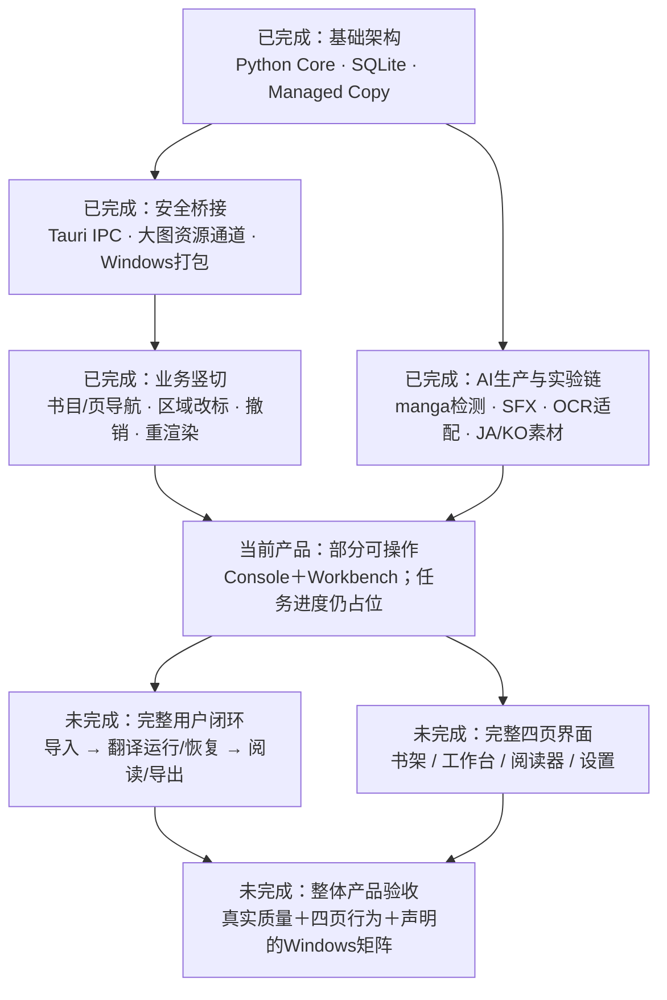
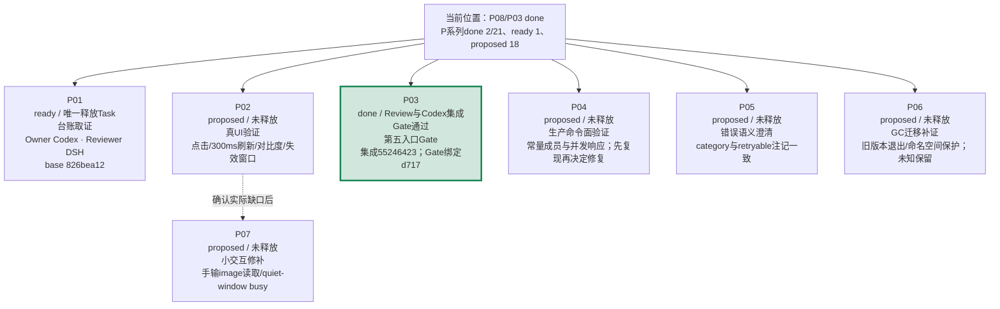
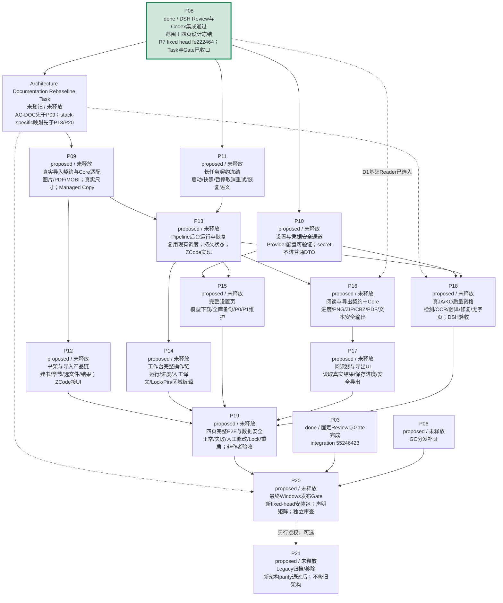
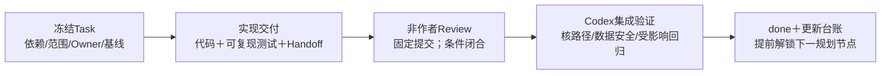

# New Manga 一眼路线图（2026-10-08）

最新工作点：P08/P03=done；唯一释放Task=P01 `ready`，Owner=Codex、Reviewer=DeepSeek Harness，base=`826bea12a132c5af2ac0cd1244d00e9170093c71`。继续指令见[P01 RESUME](../../verification/P01/RESUME.md)。P03验证绑定source `d717c049`与同一installer，集成无产品/runner/test/build差量。

**当前位置：P08/P03=done；P系列done 2/21、ready 1、proposed 18。唯一ready Task=P01；P03 integration=`552464238a69ad2cea63cff18abe98f412dbae87`，DSH R5/R6与Codex Integration Gate PASS。**

人员更新：用户已移除Qoder，图中未来UI/UX责任由ZCode承担；非作者Review与正式Task释放Gate保持。

派生视图；排期事实以 [REBASELINE_PLAN](../../doc/REBASELINE_PLAN.md) 当前覆盖层为准。原审计基线：`main@e4242ecd`；箭头表示启动依赖，不是工期；没有可靠估算，不编造百分比或日期。P03已完成；当前按Plan释放P01，其余候选仍按各自依赖与范围Gate排期。

## 已做到哪里

“已完成”仅针对各 Task 冻结范围。AI实验有如实 FAIL 的结论；后端 API 可用、测试模式端到端成功，均不能代替正式界面链路。

## 当前范围内：先收口，再进入整产品主链

P01已正式释放并冻结allowed_paths、Owner/Reviewer、base、branch和worktree；恢复与自动推进指令见P01 RESUME。P02仍需先冻结真实WebView harness Task；P06仍需实证旧runtime可用性。其余候选按Plan依赖释放。启动每个Task前仍需正式Task、不同Owner/Reviewer和allowed_paths。

## 完整产品：现在就看清后续，而不是每次临时猜下一件

P12/P14/P15/P17另需P08范围确认后分别释放的ZCode页面设计Task通过非作者Review；这些设计切片不额外增加P01–P21产品节点。

完整产品候选任务尚未释放。D1已解冻基础Reader；跨页联动/页缩略图继续延期。缩略图、跨页联动不作为默认任务。P09/P10/P11 内部先契约后实现，正式释放时拆为独立 Task；P14新增编辑能力同样先Codex冻结命令、ZCode/Antigravity实现Core、再ZCode接UI；P16先Core/IPC后P17 UI。Pipeline 最小成功链可先用 deterministic provider，真实质量 Gate 依赖 P10 和可用受控模型/endpoint，不能将 mock PASS 当真质量 PASS。

长会话/磁盘总量、模型扩展与训练不是默认关键路径。BJ13 维持 0.90、手工改标＋skip；Manga109 永久取消。不重新打开已完成 TA3-B2/B3、GC-2、ICU 或 Runner Guard。

## 每一步怎么算完成

额度中断时：读 [RESUME](RESUME.md) → 核 Git/当前 STATUS → 复用报告 → 只重算变化的依赖子图。等待额度恢复无需重做全仓审计；外部 Agent 接管须按协作协议分配，Owner 不得审自己。
