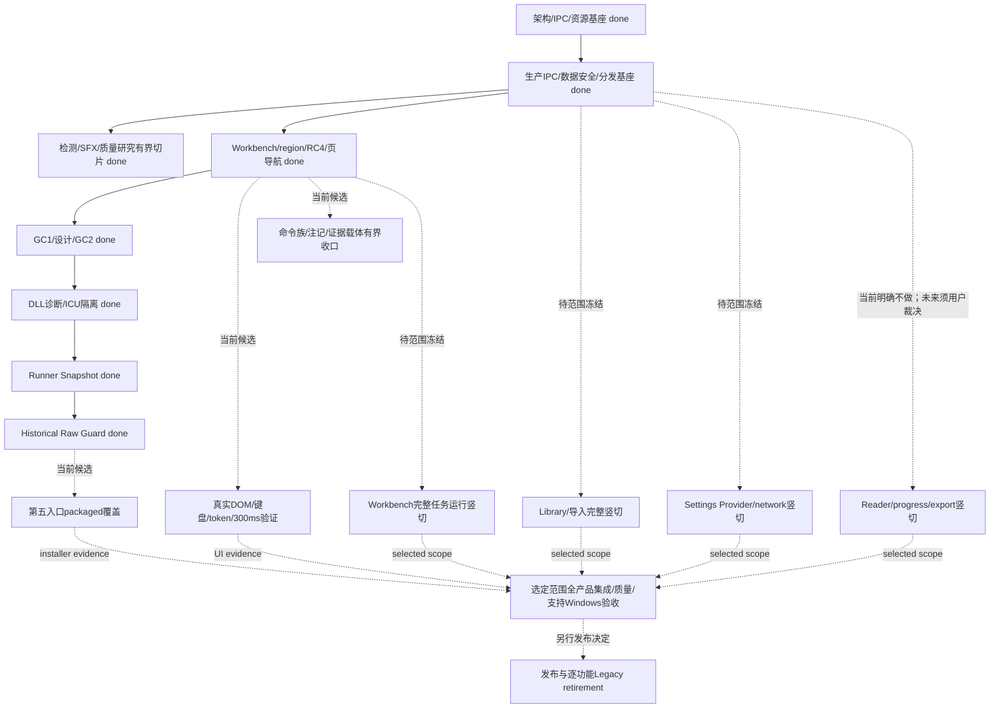

# 规划、任务台账与后继路线审计

审计基线：`main@e4242ecd419eb0eea098d2f63b40f709aa5caeea`，2026-10-08，仓库 `G:/CODEX/New Manga`，Git common directory=`G:/CODEX/New Manga/.git`。本报告是只读审计的派生证据；不修改 Plan、STATUS、Task、契约或生产代码，不释放任务，不派发外部 Agent。全量机器可读台账见 [task-inventory.csv](task-inventory.csv)。

## 1. 当前状态与计数口径

当前正式执行状态是 **无 Active、无 released Task**，来源为 [STATUS 首段](../../doc/STATUS.md) 与 [Plan 首段](../../doc/REBASELINE_PLAN.md)。最新完成为 `M2-RUNNER-HISTORICAL-RAW-OUTPUT-GUARD`，integration=`e7d1f7f8528a6186baec6f642ac8422572103527`。旧段落的 ready、blocked、in_review、AWAITING_EXTERNAL_DISPATCH 均是历史恢复点，不是当前队列。

| 计数集合 | 数量 | 含义 |
|---|---:|---|
| 当前 `doc/tasks/*.md` 含 ID 的 Task 文件 | 195 | 不含 README |
| 无专用文件的历史 `T1.1.2` 映射 | 1 | Plan 明确列为追溯缺口；不重新打开实现 |
| 全任务节点 | 196 | 195 文件 + 1 映射 |
| `M2-` 前缀正式 Task | 101 | 全部有既有完成记录；其中 2 个页头状态落后 |
| 新架构 / 治理集合 | 105 | 101 M2 + GOV-001 + 2 DIAG-M2 + DOC-FIX-LOCK-CHANGED-STALE-COMMENTS |
| Legacy 历史集合 | 91 | 含 TASK-001～065、旧 T 系列、旧 reading/export 诊断家族、T1.1.2 映射 |
| 当前进行中 / 已释放 | 0 / 0 | 与历史 Task 元数据分开统计 |

沿用 Plan 2026-10-07 历史分类覆盖层，并加入其后 6 个新架构正式 Task，得到下表。该分类不是本次重跑所有测试或重新作 196 次 Review。

| 有效状态 | 数量 | 对“完成”的解释 |
|---|---:|---|
| DONE_RECORDED | 114 | 105 新架构/治理 + 9 Legacy 历史完成记录 |
| LEGACY_VERIFIED_COMPLETE | 48 | 历史已核实切片；不是新架构页面对等验收 |
| LEGACY_DOC_ONLY | 5 | 文档/契约/设计交付 |
| LEGACY_PARTIAL | 9 | 原始范围的局限仍存在 |
| LEGACY_ARCHIVED_UNFINISHED | 13 | 旧 Release 修订未完成，已逻辑归档，不得释放 |
| CLOSED_WITH_LIMITATIONS | 1 | T3.2.1；不是 done 或 Release PASS |
| LEGACY_SUPERSEDED | 6 | 已取代或被用户否决，不再实施 |
| 合计 | 196 | 登记完成/历史完成/文档交付 167；其余 29 为局限或归档终态 |

**167/196 不能用作产品完成率。** 分母混合了实现、设计、实验、修复、验收与历史归档，完整新产品的未登记竖切也不在分母内。101 个 M2 Task 完成同样不表示 M2 Milestone 或四页产品完成。CSV 保留每个节点的原状态、有效状态、Owner、Reviewer、depends_on、base、集成记录来源和祖先核验。

## 2. 已完成的新架构正式树

101 个 M2 Task 的 `depends_on` 元数据共 160 条边；全 196 节点扫描无缺失依赖 ID。新架构/治理 105 个节点均定位到当前 HEAD 的祖先提交。祖先核验只证明提交进入当前 Git 历史，不证明该提交的 AC、质量和 Review 载体全部可信；旧 inventory 候选来源在 CSV 明示，不伪装为统一质量复验。

| 完成主线 | 正式 Task 及结果边界 |
|---|---|
| 架构 discovery → 契约 | GOV-001；M2-D1/I1/I2/R1/UI1；M2-C1/S1/S2/C2/S3。UI1 是设计及旧页面映射，不是 React 四页产品实现；研究原型有自己的 NOT_RUN 边界。 |
| 资源与生产 IPC | M2-RC1/RC2 → AC1 → DIAG-M2-REGIONLESS-LOCK-CHANGED-001 → P1 → IPC1；RC1/2 名称与设计 RC-1～RC-5 缺口编号属于不同命名域。 |
| 数据 / fail-closed / 导出验收 | M2-AC2/AC3/AC4；FIX-STUB-DECODER、FIX-EXPORT-LINEAGE、FIX-LISTBOOKS-PAGECOUNT-UNKNOWN、FIX-F02-RESOURCE-CHANNEL-FLAKY、FIX-RESOURCE-CHANNEL-DIGEST-PERF、FIX-DIGEST-SEEK-2GIB。AC4 的当轮 FAIL/xfail 由后继修复关闭，不能抹去原实验结论。 |
| 分发基座 | M2-AC5 → AC5-BUILD-FRESH-CHECKOUT → RG1；PROD-DETECT-2/3、PROD-SFX-PROBE-1 后续增补闭包与入口；最新 snapshot/ICU/guard 是增量加固，不是全产品最终发布。 |
| 素材与质量 | TA1/TA2A/TA2C/TA2B/TA2C-TOOLING-GAPS；TA3-A/B/B2/B2-KO-RERUN/B3-KO-FULLRUN；DOCTR-QUAL-PREFLIGHT/RUN/C4/C1；OCR-PADDLE3X-1、QUAL-DETERM-CALIB；完整清单依 CSV。TA3-B 旧 endpoint blocker 已被 B2/B3 后继完成取代。Manga109 永久取消。 |
| 检测 / SFX 生产与数据研究 | PROD-DETECT-1/2/3、MANGA-WEIGHTS-SOP、DETECT-WEBTOON-DIAG/TILING、IMPORT-ALLOC-LIMIT；SFX 检测、域扩展、素材、标注、合成、训练与 GPU/T4/T5 诸正式切片；REGION-OVERLAP-ARBITRATION、REGION-RETYPE-CONTRACT/CORE、SFX-CORRECTION-EXPORTER。完整清单依 CSV，研究任务完成不自动证明部署收益或全域质量。 |
| React 工作台已释放范围 | WORKBENCH-REACT-1 → SFX-MISROUTE-UI-IMPL-1 → RC4-DOMAIN-COMMANDS；PAGE-RESOURCE-RESOLVE-1 → PAGE-NAV-PROJECTION-1；RESOLVE-DEBOUNCE-1 → REGION-DEBOUNCE-1；CATEGORY-CLARIFY-1、TEST-CATALOG-DRIFT-CLEAR-1、UI-SHELL-ENV-1。它们完成有界工作台竖切，不包含完整 VM 24 方法对等或 Reader。 |
| 派生资产与最近收口 | DERIVED-GC-1 → DERIVED-GC-2-DESIGN → DERIVED-GC-2 → RUNNER-SNAPSHOT-DEBT；PACKAGED-AC1-DLL-DIAG → PACKAGED-AC1-ICU-ISOLATION-FIX 解阻 → RUNNER-SNAPSHOT-DEBT done → RUNNER-HISTORICAL-RAW-OUTPUT-GUARD done。GC-2 已完成，不再是下一实现候选。 |

### 最近 6 个新增正式 Task 的固定证据

| Task | Owner / 非作者 Reviewer | 硬依赖（Task 元数据） | 实际集成 | 当前结果 |
|---|---|---|---|---|
| M2-DERIVED-GC-2-DESIGN | Codex / DSH | GC-1、RC4-DOMAIN-COMMANDS | ad75fadc | done；设计交付，运行回收 NOT_RUN |
| M2-DERIVED-GC-2 | ZCode / Codex（用户改派） | GC-2-DESIGN、GC-1、RC4 | cea610ed | done；G7 分发迁移 Gate 保持阻断条款 |
| M2-RUNNER-SNAPSHOT-DEBT | Codex / DSH | GC-2 | 73588624 | done；恢复阶段另依赖 ICU 修复解阻，原历史 FAIL 不回填 |
| M2-PACKAGED-AC1-DLL-DIAG | DSH / Codex | GC-2 | 44317548 | done；只读新架构安装态诊断，不是生产修复 |
| M2-PACKAGED-AC1-ICU-ISOLATION-FIX | Antigravity / DSH | DLL-DIAG、GC-2 | 65ba3014 | done；fresh 构建/Gate 绑定 4499217d 和 installer SHA |
| M2-RUNNER-HISTORICAL-RAW-OUTPUT-GUARD | Antigravity / DSH | RUNNER-SNAPSHOT-DEBT | e7d1f7f8 | done；当前范围内 CLI/快照/历史 raw 守卫核验，完整新构建/Gate NOT_RUN |

最新 Runner Debt 记录的 Packaged 26/26 绑定指定 source / installer，而 Guard 的完成 Gate 没有重跑完整 Dev/Packaged/Sidecar/NSIS。最新三套件全量基线记录仍应由对应日志绑定，不以本次 Git/metadata 核验替代测试。

## 3. done 与质量 / 关闭终态的区别

| 记录 | 开发 Task 状态 | 技术结论 / 不得推导 |
|---|---|---|
| M2-DOCTR-QUAL-RUN | done | 正式质量 FAIL：Recall 0.4776 < 0.92；后续 C4/C1/PROD-DETECT 路线完成，不能把旧 run 改写 PASS。 |
| M2-TA3-B2 | done | 当轮 Gate FAIL，pipeline_failures=10；B3 8/8 export 成功关闭指定 KO 缺口，不等于 JA 自动 CER / 所有质量 Gate 全 PASS。 |
| M2-SFX-MISROUTE-UI-IMPL-1 | done | 原 AC1/AC4 有 PARTIAL；RC4 后继补域命令，零 DOM 环境的真实 UI 交互证明仍不能由后继静态测试自动补齐。 |
| M2-DERIVED-GC-2 | done | 只收已知 retired preview 的受保护静默窗口子集；未知来源、current/pinned、长会话/每次运行末 key 仍保留，不宣称磁盘完全有界。G7 未知旧 runtime 的分发迁移保证继续保留。 |
| T3.2.1 | closed_with_limitations | 历史 AC6/8/9 PARTIAL，clean Windows、Win10、真实 docTR-weight、true cold start NOT_RUN 按旧记录保留；不阻断 M2、不恢复旧 PyInstaller/QML 修复、不等于可发布。 |
| TASK-004/016～021/023/033 | LEGACY_PARTIAL | 局限作为迁移需求信息；不生成旧架构实施队列。 |
| TASK-022/025～027/047/048 与旧 REPAIR 未完成项 | 取代 / 归档 | 原 proposed/in_review/changes_requested 不授予 Active 权限。 |

## 4. 为什么已有全任务图仍看不清全项目路线

| 文档现象 | 实测位置 | 对规划的影响 |
|---|---|---|
| Plan 首部不断追加完成/blocked/release checkpoint，历史与当前混在一份长文 | Plan:3–174；旧“唯一Active”措辞仍可被搜索命中 | 最新首段能回答当前状态，但不能直接回答“还有哪些产品竖切”。 |
| 图覆盖已登记任务，完整产品未来节点缺位 | Plan:335–452；旧 TA3-B endpoint 文案仍存；Mermaid `T5A` 仍 class proposed，但 REGION-RETYPE-CONTRACT 已 done | 图是交付历史，不是完整产品的未来 DAG；候选着色与正文状态发生漂移。 |
| 短导航停止在早期迁移 | 12_ROADMAP:10,27–34 | 仍把已 done 的 DIAG/P1/IPC1/AC2 列为 ready/planning，且“其他 Acceptance Backlog 未登记”与后续完成事实不一致。无授权效力，但易误导阅读。 |
| 索引的旧架构段落措辞像当前总结 | 00_INDEX:20 附近旧 Architecture pointer | 已完成的 production IPC/packaging 仍被写成后续 Task；首段免责声明只能局部缓解。 |
| ADR 当前现实和未决项未被当前裁决覆盖 | AD-001:11–13,44–55 | 仍称 T3.2.1 Gate OPEN、REPAIR-13 released、React ownership 待裁决；现行 Plan/AGENTS 已取代这些执行结论。目标架构决定仍有效。 |
| 正式 Task 元数据与正文不一致 | ANNOTATE-R2:5/12；SYNTH-BG-AUTO:5/13/16；GC-2:19/126 | 自动看板只读页头会误报尚在 Review 或缺集成。GC-2 页头 `integration_commit:null`，实际 done@cea610ed。 |
| 完整 SHA 错误被宽松候选扫描掩盖 | PROD-DETECT-3:6/120 | 页头 `8fe5199c44b06e679a2f0e6ee47767032217eb47` 不存在；正文/Plan 短 hash `8fe5199c` 实际解析为 `8fe5199c6d05d144052141ad02ed054bbaa90645`，且为 HEAD 祖先。旧 inventory 取交付候选证明祖先，不能替代字段校正。 |
| 最新统计仍引用 2026-10-07 190 节点 | REBASELINE-20261007，Plan:151–157、tasks/README 末段 | 历史快照有效，但少最新 6 Task。没有固定“产品能力目标 → 当前实现 → 后继候选”台账。 |

因此问题不是没有记录，而是 **历史完成 DAG、当前执行 checkpoint、产品未来 DAG 没有分层呈现**。不需要新调度器或重复第二套权威文档；建议在正式授权治理切片中让 Plan 保留唯一未来顺序表，STATUS 只放当前 checkpoint，历史证据用链接，派生 inventory/图从它们重建。

## 5. 两层后继候选：先看清，不直接释放

### A. 当前已授权产品范围内的有界收口候选

这些都是候选，当前 **PLANNED_PLACEHOLDER / NOT_RELEASED**，没有新 Task ID 文件或工作区分配。§5.1 推荐不等于 ready。所有项先做 Reality Check；后继已覆盖的缺口直接销项，不追加代码。

| 候选 | 证据 / 依赖 | 推荐 Owner / Reviewer | 可先定义的最小 Gate |
|---|---|---|---|
| Packaged 第五入口断言（Runner r4 R-003） | RUNNER-SNAPSHOT-DEBT + GUARD done；r4 Review:112，SIDECAR_EXES 4 vs build fingerprint 5 | Antigravity / DSH | 固定 source/installer SHA；安装后 `sfx_detect_probe.exe` 存在与实际受控探针覆盖；4→5 单条件反证；fresh build/Gate 绑定自有输出目录；不得变更模型/命令契约。 |
| 真实 React DOM / 默认 300ms / token 验证 | RC4、PAGE-RESOLVE/NAV、RESOLVE/REGION-DEBOUNCE done；REBASELINE-20261007 候选 UI-DOM-TOKEN | Qoder / DSH | 真实点击/键盘/焦点、双入口改标确认、错误反馈、撤销/历史、默认 300ms 写后即时刷新判别、可测对比度；截图+环境+固定 head。不要以静态源检当交互 PASS。 |
| 生产命令族成员独立断言 | PAGE-NAV PR-11；先查当前 cargo/allowlist 是否已覆盖 | Antigravity / DSH | production-only 15 命令与 frozen acceptance/probe 面分离；最小变异红证。无真实剩余缺口即不建任务。 |
| category 注记与状态字形裁决准备 | CATEGORY PR-02/03/05、RC4-08；UI1 页级 blocked 未决 | Codex / DSH | 注记澄清与新错误语义分开；不偷改契约。需要产品字形裁决时形成选项再交用户。 |
| 手输 resource quiet-window / 逐键读取残留 | REGION-DEBOUNCE PR-03/05、P4；当前自动 resolve 的正常路径仍是主路径 | Qoder / DSH | 核实仍可触达且有影响；只补真实残留，可合并入 DOM 候选减少任务数量。 |
| 原 Review 载体和元数据校正 | ANNOTATE-R2、SYNTH-BG-AUTO；GC-2 null；PROD-DETECT-3 错完整 SHA | Codex 取证 / DSH 必要时复核 | 找原报告字节/commit；找不到保留 NOT_VERIFIED，不补造独立批准；只校正既有完成事实。 |

R-06 模块加载复杂度仍 deferred；仅在真实后续需求触碰多输出根/加载复用时考虑，不能为消除一个名字先造 registry/framework。Windows 10 真机、GC G7 分发迁移证据、JA 自动 GT 对齐、K19/F4 无字页语义、合法重译相似度限制属于独立验证/质量候选，需要先确认环境和范围，不借“全绿”豁免。

### B. 完整产品未来竖切：待范围裁决，不算现行 Task

**仓库当前没有正式 M3 或 M4 Task 树。** Plan、Roadmap、AD-001 均未登记 M3/M4；本审计不创造假 Milestone。可以先看清未来需求和 Gate，再由用户与 Codex 选择阶段、拆正式 Task。以下是 Proposal，不是已授权实现：

| 未来竖切包 | 可复用基座 | 预定义依赖 / 交付边界 | 主要责任 |
|---|---|---|---|
| Library 管理与导入 parity | IPC1 只读 Library；Core 既有导入/Managed Copy；UI1 bookshelf 映射 | 先冻结写命令与文件选择能力边界 → Core seam → Tauri explicit IPC → React 书/章管理、导入 → 真实 UI / 数据安全验收；不从只读 list_books 推导写面已交付 | Codex 契约；ZCode/Antigravity Core；Qoder UI |
| Workbench 完整命令与任务运行 parity | 当前页导航、资源、region 改标、RC4；Core 既有 scheduler/pipeline | 按 UI1 24 方法清单逐项判 existing/缺口 → 分批 translate/run/pause/stop/retry/Lock/人工修改/多选与进度；接口冻结前不做大页面重写 | Codex seam；ZCode/Antigravity Core；Qoder UI |
| Settings Provider/network parity | SETTINGS-IPC-CHANNEL、SFX-POLICY 既有通道；UI1 Provider/Network 映射 | settings 读写范围、密钥 flag-only、凭证/网络策略和错误面先冻结 → Core/Tauri → React 表单 → 重启持久化、脱敏、安全与真实交互验收 | Codex 契约；ZCode/Antigravity Core；Qoder UI |
| Reader / progress / export parity | Core 历史 reading/export/SQLite 能力，已有资源通道 | **当前明确不做，保持未释放**。未来须用户另行选择范围；GetReaderProjection DTO/进度/分页RTL-LTR/webtoon瓦片/导出谱系契约 → Core/Tauri → React Reader → 源文件、current/pinned、重启恢复和导出验收 | Codex 契约；Qoder UI；ZCode/Antigravity Core |
| 全产品集成 / 发布 / Legacy retirement | 已有本机 M2-RG1/AC5、五入口闭包与最新 ICU 证据 | 只在选定竖切和质量 Gate 完成后冻结 release matrix；原 source/installer hash、支持 Windows、全功能验收与数据迁移；Legacy 删除在逐功能 parity + 发布决定之后单独授权 | Codex Lead/Integrator；DSH 独立验证；实现依类型分配 |

Reader、跨页联动、页缩略图目前均为 **NOT_IN_RELEASED_SCOPE / 明确不做**；这里写依赖是让整体目标可审查，不是解除禁做。BJ13 补标/补画维持 DEFERRED_BY_USER，阈值 0.90 与手工改标+skip 保持；Manga109 永久取消。

### 提议的两层 DAG

实线只表示已完成树的压缩依赖；虚线是候选或条件路径。完整正式 depends_on 以 CSV 逐节点为准，图不新增正式依赖。



未来 Core/Tauri/React 的依赖序应按竖切保持“契约冻结 → Core/bridge → UI → 真实数据/交互验收 → 非作者 Review → 集成/回归”。Library、Settings、Workbench 在冻结 seam 且允许路径不重叠后可条件并行；`core_service.py`、Tauri allowlist、IPC shared types、契约、Schema 与依赖清单仍由 Codex 串行协调。不能给四页 UI 一个独立全改 Task 再追补契约。

## 6. 推荐下一步与可转发指令

父级 Codex 已在本轮工作区追加 P01～P21 的 PLAN_ONLY 整体路线覆盖层。推荐下一准备是 **P08 完整产品范围与验收冻结**，由 Codex 管契约、Qoder 以单独设计 Task 管四页设计，非作者 Reviewer=DSH；复用本次审计与 P01 取证结论，不再全仓重新审计。当前无 released 实现，因此不自动派发第五入口或完整产品竖切。Reader 等禁做边界只有新产品范围裁决后才可解冻；branch/worktree **待 Codex 创建**，不虚构路径。共享治理写权、正式 Task 与范围须由父级 Codex 按实际用户授权落入 STATUS 后再执行。

```text
在 G:/CODEX/New Manga 继续，以 verification/PROJECT-ROADMAP-20261008/ 下各只读审计报告为输入。恢复基线 main@e4242ecd419eb0eea098d2f63b40f709aa5caeea；开工重测 HEAD/branch/common-dir/status，保留 Qoder dirty 文件与现有 dispatch 本地产物。Task/branch/worktree 尚未分配，不自行开始生产实现。
准备P08完整产品范围与验收冻结，不再重做全库审计。以Plan本轮P01～P21 PLAN_ONLY覆盖层为规划输入，Codex管契约，Qoder另立有界四页设计Task，Reviewer=DeepSeek Harness（非作者）；只在已有用户授权的治理范围内准备，产品取舍形成可审查选项交用户。Plan为唯一规划事实源、STATUS为唯一运行状态；最新无Active/released。Task文件195+历史T1.1.2映射1=196；101个M2完成记录不等于四页产品完成、质量Gate PASS或M2 Milestone完成。
先核对报告中的当前收口候选：packaged第五入口R-003、真实DOM/token/默认300ms验证、生产命令族独立断言、category/字形澄清、Review载体与元数据。先查后继覆盖，已解决则销项。未来Library/Workbench任务运行/Settings/Reader及发布依赖只做候选定义，标待范围裁决；当前Reader、跨页联动、页缩略图明确不做，BJ13维持0.90+手工改标+skip，Manga109永久取消。不得发明M3/M4正式树或重开Legacy。
交付P08可审查范围/四页parity/质量阈值/数据保护/发布矩阵冻结稿，完善现有P01～P21 DAG中受影响的条件、Owner/非作者Reviewer、允许路径草案、共享契约风险与可运行Gate；正式release前才补真实base/head/branch/worktree。P01取证引用本报告，不要求先“找齐所有历史Review”才能设计；未找到原Review如实NOT_VERIFIED并处置。禁止改src/apps/tests/packaging/Schema/依赖、用户源文件、其他Agent未提交内容，禁止自动启动候选或清理worktree。
验证以git diff --check、所有新链接、Task依赖ID、当前统计与图节点一致性、生产路径零差量为准；日志记录环境/HEAD/命令/EXIT。不把本次静态审计称为产品测试PASS。草案固定提交后交非作者DSH，批准与条件闭合后由Codex集成；再按实际授权选择一个正式有界下一Task。
```

## 7. 本次验证边界

实际执行了 Git HEAD/branch/common-dir/status、Task 多段元数据/依赖扫描、当前任务计数与新架构集成祖先核验；读取 AGENTS、Plan、STATUS、00_INDEX、09_COLLABORATION、12_ROADMAP、AD-001、旧 REBASELINE 覆盖层、相关 Task/设计契约/Review。未运行产品测试、模型、endpoint、Sidecar/NSIS 或真实 DOM；不新增批准。工作区他人变更保留。CSV 对照旧 inventory 历史分类，状态冲突及集成字段错误在报告中公开，不改写原证据。

### 父级 P01～P21 覆盖层只读一致性检查

本轮新增覆盖层与本报告事实一致：无新 Active；GC-2、ICU、Runner Debt、Guard 是完成输入；没有正式 M3/M4；P01～P21 为不计入 196 的 placeholder；Reader 的 P16/P17 以 P08 新裁决为条件，且再次保留现行“明确不做”，没有自行解冻。完整产品主链明确到 P19/P20，避免继续只追零散 P3/P4 小债。

两个释放前细节：P08 对 P01 的依赖应解释为“取证完成并明确处置”，不是必须找回所有旧 Review 原载体；找不到仍可如实 NOT_VERIFIED，不无限阻塞范围设计。P19/P20 若称“完整四页”则 P08 必须真正选择 Reader 范围；若用户继续暂缓 Reader，应改名为“选定范围 E2E / 发布验收”，不能把未做页面记 N/A 来宣称四页完整。P16 依赖 P13 属目前建议序列，未来可按 Reader 只读已有结果的冻结范围重新评估并行，不应凭图固化为永远的技术硬依赖。
