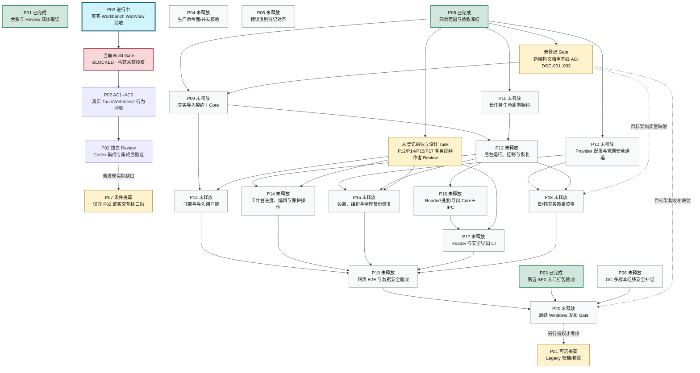

# New Manga 项目任务全景与续跑路线

更新时间：2026-10-09（Asia/Shanghai）  
模式：`PLAN_ONLY`（只读盘点与计划；没有释放产品实现）  
仓库：`G:/CODEX/New Manga` · branch=`main` · HEAD=`549a6544f0be1eec66c09ece393fd1a409f10bf3`

## 一眼看清当前状态

- **21 项产品路线任务**：P01、P03、P08=`done`（3）；P02=`in_progress / ACTIVE`（1）；P04–P07、P09–P21=`proposed / 未释放`（17）；`ready=0`。P01/P03/P08 是各自有限范围内的完成，不等于四页产品完成。
- **当前只继续 P02**：Stage A r8 已独立 Review 并集成（`89413f45a601966eb40d7af7abea65cbdfc754b3`），但只读 scratch-build 方案通过审查不代表 build 已获准。Build Gate=`BLOCKED`，build=`NOT_AUTHORIZED / NOT_RUN`，AC1–AC6 仍=`BLOCKED`。唯一下一步是只读核验 PyInstaller hook、递归导入、子进程和 Torch/Hugging Face 缓存写入闭包；不能证明 scratch-only 时继续阻断并提出进程级隔离方案。
- **产品实际形态**：目标架构为 Windows / React + TypeScript / Tauri / Python Core / SQLite / Managed Copy。已有可操作的 Workbench 切片和 Core 服务，但不是完整漫画应用：React 当前只有 Console↔Workbench 两个入口；Library/Settings 是 Console 子面板；`TaskProgressPanel` 明确是静态占位。真实导入、后台任务控制/恢复、完整四页、Reader、生产导出与全产品发布 Gate 尚未闭环。
- **历史任务计数不要当产品完成率**：既有历史盘点登记 195 个 Task 文件＋1 个映射节点，共 196；其中 167 个标为完成或文档交付，另 29 个属于局限、归档、受限关闭或被取代。这些是历史台账分类，不是 167/196 的产品完成百分比；详情见[历史任务台账](../PROJECT-ROADMAP-20261008/task-inventory.csv)与[代码/任务盘点报告](../PROJECT-ROADMAP-20261008/REPORT.md)。

## 21 项产品任务依赖图

箭头代表计划启动依赖，不代表工期。绿色为该 Task 已完成，蓝色为当前 Active；灰色为尚未释放的提案，黄色为有条件/可选节点。图中的架构文档 Gate 和页面设计 Gate 尚未各自登记为正式 Task，不能据图直接开工。

### 任务中文说明与启动顺序

| ID | 状态 | 任务内容 | 关键先决条件/建议责任 |
|---|---|---|---|
| P01 | done | 台账元数据、Review 载体与集成 Gate 取证；R2/SYNTH carrier 仍 `NOT_VERIFIED`，不改变 P01 的有限完成状态。 | Codex；Antigravity 非作者 Review |
| P02 | in progress | 真实 Workbench WebView 操作、300ms 静默期、写后刷新、键盘焦点与对比度验证。 | Antigravity Owner；DeepSeek Harness Review；Codex Gate。当前先做只读 build 隔离核验。 |
| P03 | done | 固定第五个 SFX 入口的 packaged 验收。 | Antigravity；Gate 证据绑定指定 source/installer；P20 仍要做最终发布矩阵。 |
| P04 | proposed | 验证生产命令族和同会话并发响应；先复现，不预设有 Bug。 | Antigravity；DeepSeek Harness Review。 |
| P05 | proposed | 对齐 `category` / `retryable` 契约注记和反向链接，不改变冻结语义。 | Codex；DeepSeek Harness Review。 |
| P06 | proposed | 补充 GC 旧 runtime 退出与多版本迁移安全证据。 | ZCode；DeepSeek Harness Review；是 P20 前置。 |
| P07 | proposed / 条件 | 只修 P02 真实 WebView 验收确认的手输图片读取或 quiet-window 交互缺口。 | P02 先证明缺口；未证明前不能启动。 |
| P08 | done | 冻结四页产品范围、数据保护与首发验收门槛；这是范围交付，不是 UI 实现。 | Codex；DeepSeek Harness Review。 |
| P09 | proposed | 真实图片/文件夹/PDF/MOBI 导入，受控来源、真实尺寸、Managed Copy 与失败处理。 | P08＋架构文档 Gate；Codex 定契约、Antigravity/ZCode 实现。 |
| P10 | proposed | Provider 配置、CredentialRef 和凭据安全通道；secret 不进入普通 DTO/日志。 | P08；Codex 契约、Antigravity Core/Host。 |
| P11 | proposed | 长任务接受、快照、暂停/取消/重试/恢复契约；复用现有 Pipeline，不造第二调度器。 | P08；Codex。 |
| P12 | proposed | 书架、建书/章节、选文件、导入结果和导航 UI。 | P09＋ZCode 页面设计 Task 的独立 Review。 |
| P13 | proposed | 后台 Pipeline 接线、持久接受、运行控制与崩溃恢复。 | P09＋P11；ZCode。 |
| P14 | proposed | Workbench 真实进度、人工译文、Lock/Pin 与区域完整编辑。 | P13＋独立工作台设计＋先冻结写命令。 |
| P15 | proposed | 完整设置/维护/模型下载与 DB＋Managed Copy 全库备份恢复。 | P10＋P13停写/排空＋独立设置设计；Codex契约、Antigravity Core、ZCode UI。 |
| P16 | proposed | Reader 投影/进度及逐格式导出 Core＋IPC。 | P13；PNG/ZIP/CBZ/PDF/文本各自有 Gate。 |
| P17 | proposed | 阅读器和安全导出 UI。 | P16＋独立 Reader 设计；缩略图与跨页联动继续延期。 |
| P18 | proposed | 分别完成日文/韩文真实质量资格；锁定真值、样本、阈值、模型与复现参数。 | P10＋P13＋架构文档映射；DeepSeek Harness 负责实验，不能以 mock/Legacy 结果代替。 |
| P19 | proposed | 四页完整正常/失败/重启恢复 E2E，逐项验证源文件、人工修改、Lock/current/pinned 保护。 | P12＋P14＋P15＋P17＋P18；独立验收。 |
| P20 | proposed | 固定 source/head/hash 的 Windows 安装包与声明矩阵发布 Gate。 | P19＋P03＋P06＋架构文档映射；Win10 未单测前不声明支持。 |
| P21 | proposed / 可选 | 新架构 parity 后的 Legacy 归档/移除。 | P20＋单独授权；不是首发完成前置。 |

建议阶段顺序：**先收口 P02 → 登记并完成架构文档重基线 → P09/P10/P11 契约 → P12/P13 接通输入与后台运行 → P14/P15/P16/P17 接通编辑、设置、阅读与输出 → P18 真实质量 → P19 完整验收 → P20 发布**。P04/P05 是独立小范围候选，P06 在 P20 前完成，P07 按 P02 实际缺口决定；它们都尚未释放。没有可靠工期或完成百分比，图中不估日期。

## P02 当前恢复步骤

现在的三层 Gate 必须分开看：**scratch-build 方案 Review 已通过 → 实际 Build Gate 仍 BLOCKED → 产品 AC1–AC6 尚未运行**。

1. 继续只读固定实际 PyInstaller 可达 hook 清单及文件 hash；核对 Torch `collect_submodules` 递归导入、isolated subprocess 继承的环境、Torch/Hugging Face 最终 cache/token 路径。
2. 结论必须能证明所有可写路径落在任务固定的 scratch allowlist。做不到就保持 `BLOCKED`，提出可执行的进程级文件写入隔离方案并经独立 Review。
3. 只有 Gate 有证据通过后，才重新评估 build 准入；随后按 P02 冻结 AC 在真实 Tauri/WebView2 上完成 AC1–AC6，再走固定 head 的非作者 Review、Codex 集成和集成后验证。当前报告不授权构建、runner、Vitest、GUI 或 WebView 操作。

P02 Owner=`Antigravity`，Reviewer=`DeepSeek Harness`，Integrator=`Codex`；scope r1–r4、行为基线 `241ff3b70b6fc0490ea238efd486cc707f849031` 已冻结，不重冻结。证据：[当前状态](../../doc/STATUS.md)、[P02 Task](../../doc/tasks/P02.md)、[Scratch Build Gate](../P02/codex-scratch-build-gate.md)、[最新 P02 checkpoint](../P02/codex-checkpoint-after-scratch-build-gate.md)、[P02 RESUME](../P02/RESUME.md)。

### 唯一推荐的下一步（延续现有 Task，不释放新 Task）

- **Task / 启动条件**：P02「真实 Workbench WebView 行为、300ms 刷新与对比度验证」已授权且仍 Active；依赖 P08 与两项 debounce Task 均已集成。现在只续做 Codex 的只读 Scratch Build Gate 闭包核验。
- **Agent**：Codex 负责只读核验和 Gate 判定；P02 产品 Owner 仍是 Antigravity，独立 Reviewer 为 DeepSeek Harness。不得由 Owner 自审自己的实现。
- **Recovery point**：root=`G:/CODEX/New Manga`，branch=`main`，本次审计 HEAD=`549a6544f0be1eec66c09ece393fd1a409f10bf3`；Task `base_commit=241ff3b70b6fc0490ea238efd486cc707f849031`；Owner branch=`agent/antigravity/P02-real-webview-harness`，worktree=`G:/CODEX/New Manga.worktrees/P02-real-webview-harness-antigravity`，集成 HEAD=`89413f45a601966eb40d7af7abea65cbdfc754b3`。恢复后这些值都必须 live 复核。
- **Scope / 交付**：只读记录可达 PyInstaller hook 文件/hash、递归 import/subprocess 环境、Torch/Hugging Face cache/token 最终路径；将逐项证据和结论写入当前 Task 已允许的 P02 Gate verification 路径。不得改产品代码、用户数据或 Owner allowlist；不得运行 build、runner、Vitest、GUI、WebView。
- **Verification / Gate**：只有每条可能写入的路径都能归入固定 scratch allowlist，且实际 hook 与环境输入有固定 hash，才可让 Codex复评 Build Gate；任一闭包未知则结论保持 `BLOCKED`。需要新增进程级隔离方案时，先由独立 Reviewer 审查，再重新评估 Gate；Build Gate 通过后才单独评估构建准入。产品 AC1–AC6须随后在真实 Tauri/WebView2完成并经固定 head 的非作者 Review、集成和集成后验证，之后 P02 才能 `done`。
- **可直接转发**：`在 G:/CODEX/New Manga 续做 P02 的 Codex-only 只读 Scratch Build Gate 核验。开始前先实测 Git Reality Check 并读取 doc/REBASELINE_PLAN.md、doc/STATUS.md、doc/tasks/P02.md、verification/P02/codex-checkpoint-after-scratch-build-gate.md。审计参考 root HEAD=549a6544f0be1eec66c09ece393fd1a409f10bf3，Task base=241ff3b70b6fc0490ea238efd486cc707f849031，Owner branch=agent/antigravity/P02-real-webview-harness，worktree=G:/CODEX/New Manga.worktrees/P02-real-webview-harness-antigravity，Owner集成head=89413f45a601966eb40d7af7abea65cbdfc754b3。仅只读核对实际 PyInstaller hooks/hash、Torch递归imports、isolated subprocess及全部cache/env写路径；只在Task允许的verification路径落证据。不得触碰既有dirty/untracked、修改产品代码或运行build/runner/Vitest/GUI/WebView。闭包全部证明限定在scratch后再复评Build Gate；否则保持BLOCKED并先提交进程级隔离方案供独立Review。` 

## 冲突、恢复与额度中断

- 本次开始前实测根工作区有 202 个既存 dirty/untracked 项（4 modified、198 untracked、0 staged），均保留；本报告另外新增 1 个未跟踪文件。不要 `reset`、`clean`、`stash` 或宽泛暂存。
- 上一个 Scratch Gate checkpoint 记录的 root HEAD=`7ce3c40c…`；当前 HEAD=`549a6544…`。两者间的已知提交 `8de6827d`、`803594e9`、`549a6544` 只改 Plan/Status/P02 Task/恢复证据，没有 `src/`、`apps/` 产品代码差量；恢复时仍须重新核 Git、Plan 和 STATUS，不直接复用旧 HEAD。
- 当前权威 [Plan](../../doc/REBASELINE_PLAN.md)、[STATUS](../../doc/STATUS.md)、[Index](../../doc/00_INDEX.md) 一致指向 P02 r8 + Scratch Gate BLOCKED。未提交的 [doc/12_ROADMAP.md](../../doc/12_ROADMAP.md)、[doc/tasks/README.md](../../doc/tasks/README.md) 与旧的 [2026-10-08 路线图](../PROJECT-ROADMAP-20261008/ROADMAP.md) 仍写 P02 r3/r4；它们有现场修改，未覆盖。P08 的 [SCOPE_DRAFT](../P08/SCOPE_DRAFT.md) 页头也保留旧审查状态；应以 P08 Task/当前 Plan 为准。这些导航材料后续需在保护原作者修改的前提下同步。
- 196 节点历史盘点、代码审计和候选路线已保存；额度恢复后无需重做全仓盘点。恢复第一步始终是 live Git Reality Check 和读取当前 Plan/STATUS/P02 checkpoint。

可在原对话或新对话粘贴：

> 继续 New Manga 项目。先读 `verification/PROJECT-ROADMAP-20261009/ROADMAP.md`、`doc/REBASELINE_PLAN.md`、`doc/STATUS.md` 和 `verification/P02/codex-checkpoint-after-scratch-build-gate.md`，重新核验 Git HEAD/branch/common-dir/dirty 状态；复用既有 196 节点台账与代码审计，不重做全仓盘点。先按 P02 checkpoint 只读核验 PyInstaller hook/import/subprocess/cache 写入闭包。保护所有既有 dirty/untracked，不覆盖、不 reset/clean/stash；Build Gate 未解除前不运行 build、runner、Vitest、GUI 或 WebView；不启动任何 proposed 未释放 Task。

## 来源与检查边界

本路线以 [REBASELINE_PLAN](../../doc/REBASELINE_PLAN.md) 为任务规划事实源、[STATUS](../../doc/STATUS.md) 为运行状态事实源；使用 P02/P08 正式 Task、verification、实际源码及 [2026-10-08 代码盘点报告](../PROJECT-ROADMAP-20261008/REPORT.md) 的既有完整 Core/Desktop 调用链审计。关键代码入口：[App.tsx](../../apps/desktop/frontend/src/App.tsx)、[WorkbenchPage.tsx](../../apps/desktop/frontend/src/workbench/WorkbenchPage.tsx)、[TaskProgressPanel.tsx](../../apps/desktop/frontend/src/workbench/TaskProgressPanel.tsx)、[Tauri main.rs](../../apps/desktop/src-tauri/src/main.rs)、[Python Core service](../../src/bootstrap/core_service.py)、[PipelineService](../../src/application/tasks/service.py)。模型 trace 确认独立规划顾问为 `gpt-6.1-sol / high`；主会话为 `gpt-6-luna / max`。截至 `2026-10-09T11:21:03Z`，本次本地 trace 共 4,026,274 processed tokens，估算 12.3817805 Standard credits；这是按模型费率估算，不代表 Plus 账户剩余额度或账单，且不含最终答复。没有读取 PySide6/QML Legacy，没有运行产品测试或构建，也没有逐项重做 196 个历史 Task 的 AC 验收。
