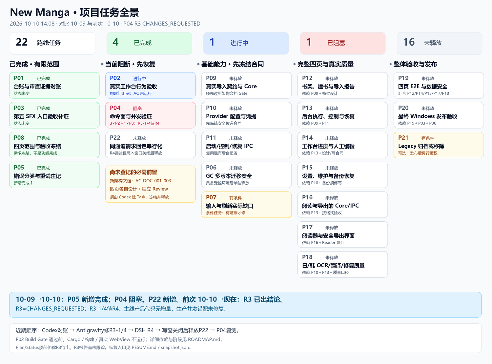
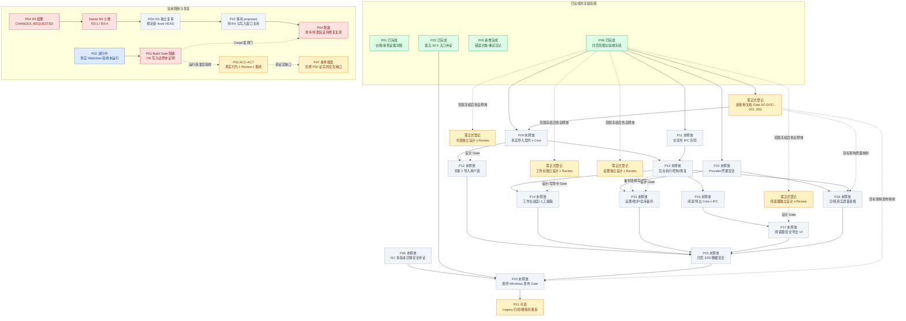

# New Manga：2026-10-10 项目全景与上次检查增量

模式：`PLAN_ONLY`。更新时间：2026-10-10 14:08（Asia/Shanghai）；含 P04 R3 结果、工作区漂移与接续顺序更新。

比较对象是 **2026-10-09 的实际盘点** `verification/PROJECT-ROADMAP-20261009/ROADMAP.md`，不是 10-08 历史台账。上次 HEAD=`549a6544f0be1eec66c09ece393fd1a409f10bf3`；本次主仓 `G:/CODEX/New Manga`、branch=`main`、HEAD=`cddff58469b56e181019a8ddfeade80684bc7eb9`。最新工作区 Plan/Status 与已提交 HEAD 有差异，分别说明。

## 一眼看清

可缩放矢量版本：[OVERVIEW.svg](OVERVIEW.svg)。

**22 项路线任务：done 4、in_progress 1、blocked 1、proposed 16、ready 0。** 已完成的是 P01/P03/P05/P08 各自的冻结范围；这不是产品功能完成率，不能按 4/22 估算工期或交付比例。

- **新增完成：P05。** 对齐错误分类/重试注记的文档任务，独立 Review 与集成关闭已完成。
- **P04 R3 已有最终结论：`CHANGES_REQUESTED`。** DeepSeek Harness 对 base=`9ea4e312…`、delivery=`ec44a489…` 的只读静态复审列出 3 项 P2、1 项 P3。P04 linked worktree 的 R2 报告已在 `5ea8304a` 归档；工作区 Task 记载 R3-1/R3-4 交 Owner 修订、R3-2/3 已处理。R3 报告本身仍是未跟踪文件，工作区 Task 所称“已归档”与 live Git 不符；Index、Plan、Status、P04 和 P22 的部分描述也仍停留在 R3 final pending/R2 返修阶段。P22 仍 `proposed`，生产并发修复未实施。
- **P02 仍在准备真实 WebView 验收。** 多轮文档、输入与预检证据已收口，但 Build Gate 仍 `BLOCKED`，AC1–AC7 仍 `BLOCKED / NOT_RUN`。
- **程序功能无本窗口增量。** `git diff --name-only 549a6544..cddff584 -- src apps tests packaging` 为空。当前全量四页、真实导入/运行/阅读/导出仍未闭环。
- **全局顺序已列出，但未释放任务不能实施。** 先收口当前运行门与缺陷；再完成契约和架构映射，接通导入及后台执行，完成四页/质量，最后整体验收与发布。

机器可读任务表见 [tasks.csv](tasks.csv)，Git/治理文件时点与保护状态见 [snapshot.json](snapshot.json)，续跑入口见 [RESUME.md](RESUME.md)。

**与 10-10 上一轮盘点相比：** main 仍为 `cddff584`、Task 计数未变、主线程序代码差量仍为 0；P04 的 R3 从“等待报告”推进为 `CHANGES_REQUESTED`。R3-2 的 R2 报告归档 commit 和 R3-3 的 blocked 状态记录已出现；R3-1/R3-4 仍待 Owner R4，P22 尚未释放。

## 与上次检查相比

| 项目 | 10-09 检查 | 10-10 当前事实 | 增量含义 |
|---|---|---|---|
| 路线节点 | 21 | 22 | 新增 P22，未增加一级页面 |
| 完成任务 | P01/P03/P08，共 3 | 加 P05，共 4 | **只有 P05 是本窗口新增 done** |
| P02 | Stage A r8 已集成；Build Gate 阻塞；AC1–AC6 未运行 | 预检/输入与 R5/D29 文档审查、集成收口；Gate 仍阻塞；AC1–AC7 未运行 | 中间交付推进，不是 Task 完成或真实界面验收通过 |
| P04 | proposed，未释放 | 已释放并交付诊断测试；R3 `CHANGES_REQUESTED`（3×P2、1×P3）；R3-2 报告已在 linked worktree commit `5ea8304a` 归档；R3-3 已记录 `blocked`；R3-1/4 待 Owner 修订与 DSH R4；P04 Task 仍 blocked | 生产并发风险尚未修复、集成或运行验证 |
| P05 | proposed | done | 契约注记对齐完成，生产语义不变 |
| P22 | 不存在 | proposed | 同通道 request/response 往返串行化修复；等 P04 当前同文件返修及 R4 复审后，冻结并释放 |
| 验证环境 | 方案依赖 Sandbox/隔离 Gate | 用户允许 P02/P04 本机 Windows 验证视为本项目 Sandbox 验收 | 免去 Feature/guest 前置要求，保留数据和写入边界保护 |
| 下一步 | 只读核验 hook/cache 写入闭包 | 该核验已结束，结论 `BLOCKED / NOT_VERIFIED`；AppContainer 只是待审设计候选 | **不再重复相同扫描**；先审查可证明的隔离机制与精确范围 |
| 程序实现 | 部分 Workbench/Core 能力 | 主线 src/apps/tests/packaging 差量为 0 | 文档/证据增加不等于四页或后台运行新增实现 |
| 执行状态 | P02 ACTIVE；P04 R3 pending | DSH R3 final=`CHANGES_REQUESTED`；P04 Task=`blocked`；R1/R2 报告在候选 branch `5ea8304a` 可追溯（R2 由该提交新增） | R3 报告可用但仍有 R4 返修工作；编排/状态文本有滞后 |

范围差异：主仓相对 10-09 基线的提交差量仍为 638 个路径（doc 10、verification 628），没有产品源/测试/打包路径；自上次 10-10 盘点以来，main HEAD 未变、main 程序差量为 0。P04 linked worktree 前移至 `5ea8304a`，从 `ec44a489` 只新增 R2 Review 归档文件，无 delivery 代码差量。R3 报告 SHA-256=`e15fce703e65c9ce1403ebe21254bb2b0c42a2348b1753cf4f9a5f810c13cd4d`，目前仍未跟踪、未进入该固定 HEAD。最后复核时根工作区为 8 个 tracked modified、233 个外部 untracked、0 staged；其他工作内容均保留。

## 哪些已经完成

| Task | 完成内容 | 完成证据/集成 | 不代表什么 |
|---|---|---|---|
| P01 | 台账元数据及 Review 载体取证 | integration `13e66ec5…`；`verification/P01/closeout-gate.md`；Plan P01 行 | R2/SYNTH 载体仍有 NOT_VERIFIED，不是产品验证 |
| P03 | 第五 SFX 入口的有限打包验收补证 | integration `55246423…`；`doc/tasks/P03.md` | 不替代最终新架构 Windows 安装包与四页验收 |
| P08 | 四页完整产品范围、验收与数据保护边界冻结 | integration `fe222464…`；`doc/tasks/P08.md`；`verification/P08/AC_COVERAGE.md` | 冻结需求不等于功能已实现 |
| **P05（新增）** | category/retryable 操作级现状注记及反向链接 | delivery `a2569f38…`；Antigravity APPROVED、0 finding；integration `bc2b690b…`；closeout `ceffb747…` | 不更改冻结错误语义，不新增生产能力 |

P05 的 [integration checkpoint](../P05/integration-checkpoint-bc2b690b.md) 是“集成后、状态关闭前”的历史截面，仍写 in_review；当前 done 取自 `doc/tasks/P05.md`、Plan 与 `ceffb747` closeout，不能按旧 checkpoint 回退状态。

### P02 已完成的子步骤

1. 上次已有的 Stage A r8 验证载体交付/审查/集成继续有效。
2. scratch 构建隔离方案、输入目录映射、hash/EOL/链接、主工作区保护与当前宿主预检证据已多轮修订。
3. R5 follow-up 固定 D16=`999e6adf…` 独立 APPROVED，并完成集成和 findings 处置。
4. D29=`f366124e…` docs-only closeout 独立 APPROVED，R1 F1/F2/F3 CLOSED；集成在主线，路线 validator 7/7 与 diff-check 证据通过。

**尚未完成的是 OS 写入隔离证明、获准构建、真实 WebView AC、最终独立 Review 和集成验收。** 输入完整性和文档 validator PASS 不覆盖这些项。证据：[D29 审查](../P02/codex-checkpoint-p02-d29-review-approved-20261010.md)、[D29 集成后的暂停记录](../P02/codex-checkpoint-orchestration-pause-20261010.md)、[当前 AppContainer 候选](../P02/appcontainer-isolation-candidate-r1.md)。

## 22 项任务完整表

“未释放”表示 proposed，只是规划；责任方是 Plan 的建议，不是已经派发。P06/P07/P09–P21 尚无正式 Pxx Task 文件，释放时需建 Task 并冻结范围。

| Task | 当前状态 | 简单中文解释 | 主要依赖/启动门 | 责任方 / 独立审查 |
|---|---|---|---|---|
| P01 | done | 台账与审查证据对账 | 已闭合 | Codex / Antigravity |
| P02 | in_progress | 验证真实工作台刷新、焦点及对比度 | Build Gate → AC1–AC7 → Review/集成 | Antigravity / DSH |
| P03 | done | 第五 SFX 入口打包验收补证 | 已闭合；最终发布另验 | Antigravity / DSH |
| P04 | blocked | 生产命令面及同通道并发验证 | P22 集成与复测；运行等待 P02 Gate | Antigravity / DSH |
| P05 | done（新增） | 错误类别与可重试注记对齐 | 已闭合 | Codex / Antigravity |
| P06 | 未释放 | 确认 GC 在多版本迁移时安全 | 受控旧 runtime、隔离根及 G7 证据 | ZCode / DSH |
| P07 | 条件提案 | 只修实际发现的输入/quiet-window 缺口 | P02 证明剩余缺口；无缺口不做 | ZCode / DSH |
| P08 | done | 冻结四页产品范围和验收 | 已闭合 | Codex / DSH |
| P09 | 未释放 | 真正导入图片、目录、PDF/MOBI | P08＋架构文档 Gate＋来源契约冻结 | Codex → Antigravity/ZCode / DSH |
| P10 | 未释放 | Provider 配置与安全凭据传递 | P08；secret exchange 契约冻结 | Codex → Antigravity / DSH |
| P11 | 未释放 | 启动、控制、事件与恢复的 IPC 合同 | P08；复用现有 PipelineService | Codex / DSH |
| P12 | 未释放 | 完整书架、建书章节与导入报告 | P09＋独立书架设计批准 | ZCode / DSH |
| P13 | 未释放 | 把后台执行、暂停取消重试与恢复接通 | P09＋P11 | ZCode / DSH |
| P14 | 未释放 | 工作台真实进度、人工编辑与保护 | P13＋工作台设计＋写命令冻结 | Codex/Core → ZCode UI / DSH |
| P15 | 未释放 | 设置、维护、模型与全库备份恢复 | P10＋设置设计；备份须 P13 停写/排空 | Codex → Antigravity Core → ZCode UI / DSH |
| P16 | 未释放 | 阅读进度与安全导出的 Core/IPC | P13＋P08；分别冻结各格式 Gate | Codex → ZCode / DSH |
| P17 | 未释放 | 阅读器与导出界面 | P16＋Reader 独立设计批准 | ZCode / DSH |
| P18 | 未释放 | 日/韩 OCR、翻译及修复真实质量资格 | P10＋P13＋架构质量映射＋真值/阈值 | DSH / Codex 或 ZCode |
| P19 | 未释放 | 四页完整流程与数据安全验收 | P12＋P14＋P15＋P17＋P18 | DSH / Codex |
| P20 | 未释放 | 新架构最终 Windows 安装包验收 | P19＋P03＋P06＋架构发布映射 | ZCode / DSH；Codex 集成 |
| P21 | 可选提案 | 发布后 Legacy 归档或移除 | P20＋独立移除授权 | Codex / DSH |
| P22 | 未释放（新增） | 锁住同一通道一次完整请求与回包 | PAGE-NAV 已 done；Owner R4 和 DSH R4 完成、`library_bridge.rs` 写入窗口关闭、范围冻结 | Antigravity / DSH；Codex 集成 |

## 全量任务依赖图

实线是 Plan/Task 中的依赖或解除阻塞关系；虚线是条件和运行/设计 Gate。P02 Build Gate 是运行门，**不是要求 P02 done 才能做 P22 静态实现**。本图不释放任务。DOC 和四页设计为尚未登记的正式前置节点。

## 推荐的整体排期

这些阶段是本次规划建议；正式依赖以上述 Plan 为准。没有可靠估算依据，不给虚构完成日期或“还剩几天”。

| 阶段 | 要达到的结果 | 顺序与可并行条件 |
|---|---|---|
| 0 恢复现场 | 对账 P04 R3 报告与权威状态 | 报告已出；Codex 核验固定范围，修正文档事实冲突并把报告放入可追溯的授权归档位置 |
| 1 当前安全门与缺陷 | Owner R4 → DSH R4 → P22 修复/集成 → P04 复测；P02 独立过运行门 | P22 等 R4 findings 关闭且共享文件写入窗口清晰后释放；实现可以先做，Cargo/AC 运行等 P02 Build Gate；P02 隔离候选设计审查可并行 |
| 2 架构与合同 | DOC Gate、P09/P10/P11；四页各自设计 | P10/P11 官方依赖已满足，仍需独立冻结/释放；共享接口/Schema 先串行冻结。设计与实现分开 |
| 3 接通产品链 | P12 书架导入、P13 执行恢复 | P09/P11 集成后，P12/P13 在写入范围分离时可并行 |
| 4 四页与质量 | P14/P15/P16/P17/P18 | Workbench/设置/Reader 分别按合同和设计 Gate 实施；DSH 质量资格与 UI 可以在受控输入就绪后并行 |
| 5 全体验收/发布 | P19 → P20；P06 迁移证据汇入发布 | P06 可在受控旧版本/隔离根就绪并单独释放后提前做；最后制作新的固定 hash 安装包验证 |
| 6 可选清理 | P21 | 发布通过且独立授权后执行，不是当前完整产品前提 |

P07 是条件修复：只在真实行为证明确有缺口时冻结最小 Task，不先“完善一切”。P18 使用实际 JA/KO 样本、模型/endpoint 与提前冻结的阈值，deterministic/mock 只证明接线，不证明质量。LaMa/AOT/BrushNet/FLUX 未有 production 实现，不因本路线默认投入。

## 深读代码后的实际能力与缺口

本次复用 10-08 深度 Core/Desktop 审计，并定向深读主线桥接和 P04 候选调用链；已确认比较区间没有主线程序变动，因此没有重复全仓审计或把旧架构结论外推。

| 能力 | 代码事实 | 后续归属 |
|---|---|---|
| 应用入口/四页 | `App.tsx` 当前 Console↔Workbench；Library/Settings 为子面板；完整独立四页尚未接通 | P12/P14/P15/P17 |
| 工作台进度 | `workbench/TaskProgressPanel.tsx` 明确静态骨架；现有刷新/导航/编辑切片有实现 | P02 验行为；P13/P14 接真实任务 |
| 导入 | Core Import API 存在；`src/bootstrap/core_service.py` production assembly 仍注入 1×1 passthrough decoder | P09 真实尺寸/受限来源/Managed Copy |
| 后台运行 | `src/application/tasks/service.py` PipelineService 已存在；生产 Tauri StartRun/控制/投影未接通 | P11/P13，复用现有语义 |
| 阅读/导出 | Core 能力和 AC1 测试路径不能视为 production Reader/export；PDF composer 尚待生产注入 | P16/P17，各格式分别验收 |
| 日/韩质量 | 历史研究结果并非目标架构全产品质量资格；learned inpaint 缺口尚存 | P18；先冻结真值/阈值 |
| 并发响应归属 | `library_bridge.rs:263–310` 的 stdin/stdout 分别加锁；`decode_response:83–115` 不校验 request_id；trait `:117` 允许共享并发 | P22 最小单通道 transaction lock；P04 复测 |

桥接风险的具体调用链：`main.rs` AppState 持 `Box<dyn LibraryChannel>` → 生产命令调用 channel → `round_trip` 写请求后释放 stdin 锁 → 另取 stdout 锁读 FIFO 响应。若后写者先拿到读锁，两方可能读取对方回包。P04 候选采用 `#[cfg(test)]` 同步 hook 控制交错，静态预期错配；**没有运行测试，不能报告 runtime FAIL**。

P04 候选对原始 base=`9ea4e312fa01470478946a557135791b5a044cb3` 的程序差量只在 `library_bridge.rs`、`main.rs`；属于 AC1 常量检查、AC2 测试与同步设施，**不包含生产修复**。implementation=`eedbda05…`，delivery=`ec44a489…`；不在当前 main 集成链内。P22 的 base/branch/worktree 均 null，尚无补丁。参考 [AC2 静态分析](../P04/ac2-static-mismatch.md)。

## 规划中需要协调的地方

1. **正式前置任务缺席。** AC-DOC-001..003 的 Architecture Documentation Rebaseline Gate 与四页独立设计 Gate 已列为必须，但没有正式 Task/base/allowlist。由 Codex 先登记这些节点，再释放下游；P08 done 不会消除这些 Gate。证据：`doc/tasks/P08.md:192`、`verification/P08/AC_COVERAGE.md:189–191`。
2. **P22 一处反向依赖笔误。** `doc/tasks/P22.md:24` 写“P04 不依赖 P22 完成状态”，与 P04 blocked_by/AC3、P22 AC4 矛盾。准确关系是 **P22 不依赖 P04 done；P04 解除阻塞依赖 P22 修复与复测**。
3. **R3 完成后治理状态尚未统一。** `doc/00_INDEX.md:5`、Plan `:3,5`、Status `:5` 和 root P04 `:84` 仍写 R3 `IN_PROGRESS / final report pending`；P04 Task frontmatter 已为 `blocked` 且报告可读。P04 body `:78` 与 P22 `:63`、依赖增量 `:16` 仍写 Owner R2 返修阶段；P22 `:24` 还有“P04 不依赖 P22 完成”的反向依赖笔误。linked worktree Task 把 R3 报告写成已归档，但 Git 显示它仍 untracked；R2 报告则确实已在 `5ea8304a` 提交。先按 live Git 与 final report 核对，再最小修订授权范围内的事实源和依赖说明。
4. **已有 blocker 应汇入最终发布检查表。** 当前 P19/P20 行未显式列 P02/P04/P22；建议正式释放验收任务时映射这些未闭合行为/缺陷证据。这是规划建议，不擅自新增官方依赖边。
5. **测量应跟随实现任务落实。** 容量/内存、benchmark、数据保护、完整 smoke 已在 P08 范围中；未来 Task 的 AC/allowlist 需具体接线，不能拖到 P19 才发现缺少测量入口。

本轮把问题保存为证据，未改写其他编排维护的 Plan/Status/Task，未覆盖其他作者未提交内容。

## 历史台账与当前路线不是同一种计数

- 10-08 历史 CSV：196 节点（195 Task 文件＋T1.1.2 Plan 映射）。167 为登记完成/文档交付，另 29 为历史受限/归档/部分/被取代；没有重新宣称历史研究质量 PASS。
- 当前 `doc/tasks/*.md`：203 文件，除 README 后 **202 个正式 Task 文件**；相对历史 CSV 文件集合增加 P01/P02/P03/P04/P05/P08/P22 七个正式文件。加同一历史映射，是 203 个有文件/映射的台账节点，不是产品完成率。
- 当前路线 P01–P22：22 个规划节点；其中 7 个有正式 Pxx Task，15 个仍仅在 Plan，未释放。不能把这 15 个占位节点重复当作正式交付文件。

## Plus 额度中断后的继续措施

已把路线、状态、比较基线、未决 Gate、精确候选 HEAD、受保护工作区列表和下一步存到版本化目录结构中。文件在本机已保存，本轮未提交；恢复先检查它们仍存在，再按需纳入独立治理提交。

1. 不依赖聊天记忆；读本目录 RESUME、snapshot 与最新 Plan/Status/Task。
2. 每完成交付/审查/集成切片，沿用 Task-local checkpoint，记录 fixed head、证据和下一准确动作；额度将尽时优先保存，不启动新的长步骤。
3. 活跃协作限定为独立必要切片，复用已完成调查；规划用 `gpt-6.1-sol high`，本次已实际核实；代码定位由 Luna Explorer 执行，避免重复全仓上下文。
4. 若 Codex 不可用，按项目故障转移 ZCode → Antigravity 读取相同文档接手；Owner/Reviewer 分离，Qoder 不再参与。若两个候选也不可用，保留 checkpoint 等恢复，不能把等待改成 done。
5. 恢复时先查询旧外部会话是否已有结果，避免中断后重复执行。模型用量估算不是 Plus 账户剩余额度。

**文件检查点保证有明确续跑入口；本报告没有创建额度恢复自动唤醒任务，也不保证无人发起时自动运行。** 继续时使用 RESUME 中的完整指令；若中途再次暂停，先核验执行状态及恢复授权。

## 推荐下一步

推荐先由 **Codex 对齐 Plan/Status/P04 Task 与已出 R3 报告，并核验报告归档事实**；随后由 **Antigravity 完成 R3-1/R3-4 最小返修 → DeepSeek Harness 对新 fixed HEAD 做 R4 → Codex 在写入窗口关闭后冻结/释放 P22**。P22 的 AC2 修复测试必须改为锁下的确定性正向“调用方拿到自己的回包”回归；不能照搬旧 R3 负向交错（Alpha 等 Beta、Beta 等锁）以免与 transaction lock 构成死锁，也不能保留 `static_expected_behavior: FAIL` 作为通过判据。完整恢复步骤见 [RESUME.md](RESUME.md)。

随后是 P02 隔离候选的独立设计 Review、精确新增 scope 合同及真实隔离证据；AppContainer profile/registry scope 尚未获准，不执行主机修改或构建。不要重复已结束的 hook/cache 扫描，也不要恢复旧 QML/PySide6 修复。

## 本轮证据与限制

- 只读 Git、治理/Task/契约/Review/checkpoint 和定向源码读取；未运行产品 Build、Cargo、Vitest、GUI、真实 WebView、sidecar 或 host inventory。本文 PASS 仅转述绑定固定范围的既有证据。
- 读盘期间他处治理文件变化并产生 P04 R3 报告；主线 HEAD 在本次两次 10-10 盘点间仍为 `cddff584`。本次只读验证 exact range=`9ea4e312..ec44a489`、delivery/tree 对应、24 paths、`git diff --check` EXIT 0；DSH 本身未运行 Git、编译或 AC。
- 主协调实际 `gpt-6.1-sol xhigh`，独立规划 `gpt-6.1-sol high`，定位 Explorer `gpt-6-luna medium`；未声称主会话切换为 high。
- 流程中的“完成”严格要求 AC、独立 Review、集成和集成后验证；静态错配推导、实现交付、APPROVED 与 done 分开。
