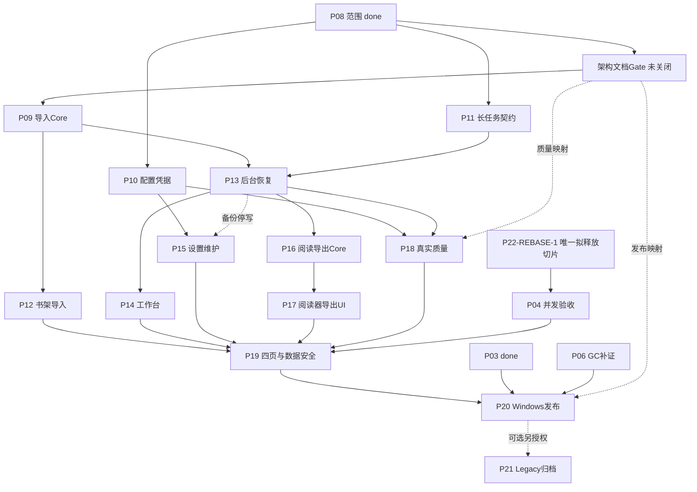

# 完整产品路线与Gate复核裁决

2026-10-15；用户授权范围=恢复当前Plan、复核P22/P04及架构Gate、释放一个下一实施切片。本报告为Plan明确引用的展开表，不独立释放其它候选。来源是前轮全项目报告及本轮固定源快照，不沿用旧提案的来源歧义。

## P22/P04结论

- main仍有stdin/stdout分段锁，无transaction_lock；P22候选代码来自92093792，交付链末端4a707db8仅Handoff修订。两者以及P04交付faea1a2c不是main祖先，原始命令/EXIT见git-verification.log。
- R10 DSH批准只覆盖Handoff文本，object_binding=NOT_VERIFIED；本轮Codex的Git/hash复算不能变成DSH已经执行。旧R10不用来批准本轮源码。P04原静态Review亦不等于其AC1/2运行通过。
- 新时点P02许可只作用于其冻结输入与Build/AC任务，不能自动扩展为P22运行许可。本轮独立冻结P22-REBASE-1，有界本地Cargo单测/自有Python sidecar许可经非作者审查后释放；旧Technical Gate不改写。
- P22-REBASE-1按当前main最小移植per-channel往返锁和确定性回归，禁止整枝合并旧P04测试/长期Handoff链。先完成本切片、非作者Review与Codex集成，再恢复P04本身的常量/并发验收。本Plan将P04作为P19安全验收硬依赖，避免产品发布遗漏已知桥接风险；这是本轮Codex冻结的依赖调整。

## 架构文档Gate结论：PARTIAL / NOT_CLOSED

| Gate | 已有事实 | 必须补齐 | 本轮结论 |
|---|---|---|---|
| P09 / AC-DOC-001 | 01–08存在，AD-001确定目标 | 02/05为Legacy；需新架构技术与UI映射，不以文件存在代替 | NOT_RUN |
| P09 / AC-DOC-002 | 新栈、权限边界已澄清 | Domain/Pipeline/版本/受控路径跨文档语义一致与逐项证据 | NOT_RUN |
| P09 / AC-DOC-003 | 四页/默认书架/基础Reader已确认 | 01/04/05/08一致映射与延期项对应；四页设计另行审查 | NOT_RUN |
| P18 | P08质量路由与真实素材意图保留 | 新架构AC映射、JA/KO样本/真值/阈值/version/model/device；历史质量不外推 | NOT_RUN |
| P20 | 已禁止继承旧Qt/PyInstaller PASS | Tauri/WebView2/Python sidecar、Windows/DPI/多屏/可选模型等价验收 | NOT_RUN |
| P16/17 格式 | P08已选PNG/ZIP/CBZ/PDF/文本 | 将P08-FMT转录长期需求追踪，保留源零写/取消/lineage | NOT_RUN |

因此P09保持proposed；另需冻结Architecture Documentation Rebaseline Task，不能将2026-10-13分类整理当Gate已关闭。不降低任何P0/P1，不修改产品取舍或共享Schema。P10/P11可按P08先冻结自身契约，但本轮仅释放P22-REBASE-1。

## 整产品范围与依赖展开

P01/P03/P05/P08原冻结范围done；P02新时点验收限定关闭。P06为GC分发迁移补证，P07仅实际剩余image/quiet-window交互。P09受控来源/真实解码/Managed Copy；P10配置与凭据；P11启动/快照/暂停取消重试恢复契约；P12书架导入；P13后台执行恢复；P14工作台人工修改/Lock/Pin；P15模型/维护/全库备份恢复（停写/排空子范围依赖P13）；P16阅读进度和五种导出Core/IPC；P17Reader与安全导出UI；P18真实JA/KO资格；P19四页正常/失败/重启/数据安全E2E并须P04闭合；P20新fixed-head Windows发布Gate；P21可选Legacy归档，另需独立授权。P12/P14/P15/P17各需ZCode分别设计与非作者Review。

Manga109永久取消，不恢复旧申请待办；BJ13维持0.90、手工改标+skip；基础Reader在内，跨页联动/页缩略图仍延期。旧Task仅历史证据，不重新释放QML。完整既有Task历史台账不复制进当前Plan。

## 验证、证据与资源边界

原始Git输出附argv/shell/Python/cwd/EXIT；源快照逐项hash与dirty身份见source-manifest.json；只读来源exe pins见environment-sources.json。受保护原文件全部保留，任何名为INTERRUPTED...的真实文件也是文件，不按名称推断成日志叙述；CON等不可读路径明确PRESERVE_UNKNOWN。旧提案的staged/untracked不触碰。独立审查对象能力不足时记录NOT_VERIFIED并保留确定性复核原始输出；不编造产品测试PASS。本轮没有产品源码修改与Cargo/GUI/模型运行。

下一Owner的可转发指令见doc/tasks/P22-REBASE-1.md：Antigravity在已分配worktree/branch按固定base和仅允许路径认领，先预检环境、读全调用链，再做当前基线最小修复、确定性实测与去锁mutation，提交固定commit/测试/Handoff，DSH独立Review，Codex集成。不得在旧worktree继续文案返修或自行合并main。具体启动HEAD由本轮审查通过后的release记录给出。
