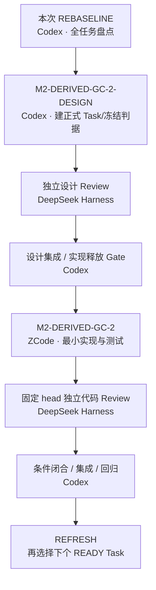

# REBASELINE 全面检查与下一步（2026-10-07）

审计输入：`G:/CODEX/New Manga`，`main@32f9b932d681ba1d551560477d7992cddf6fd7ec`。编排器：Codex。用户本次授权：全面检查、治理状态更新、全任务图与下一步分配；本轮不把规划候选自动当作已启动实现。

## 当前结论

- STATUS 当前执行队列：**无 Active、无 released，正在进行的已登记任务为 0**。旧 worktree 的存在与 dirty 文件均不证明 Agent 正在运行。
- 新架构当前有界交付已登记完成；最近一个是 M2-REGION-DEBOUNCE-1，merge `0cb15092`，收口 `32f9b932`。Owner=ZCode 代行 Codex Executor，Reviewer=DeepSeek Harness，Integrator=Codex 角色代行。
- **任务完成不等于产品所有能力、质量与发布矩阵全部通过**。Legacy 部分任务是 PARTIAL/SUPERSEDED，T3.2.1 为 closed_with_limitations；不能统计为技术全部完成。
- 覆盖所有任务的 [台账与分组流程图](TASK_GRAPH.md)；包含 189 个 Task 文件和 T1.1.2 Roadmap 映射节点。完整参数、工作区与 Git 证据见 [inventory.json](inventory.json)。表内 DONE_RECORDED 是既有完成记录，本次不冒充重新做过全任务独立 Review。

## 本次发现与处理

| 编号 | 证据 | 判定与处理 |
|---|---|---|
| RB-01 | M2-TA2B 文件前部 proposed/Manga109，后部 done/开放素材；merge fae0d8f6 为 main 祖先 | 多段 metadata 漂移；采用后部现行方案。Manga109 永久取消，不再作为 blocker；历史方案保留。 |
| RB-02 | M2-SFX-ANNOTATE-R2 页头 in_review，但 integration_commit=84f952b3；Plan done | STATE_CONFLICT（元数据）；按主线集成与 committed Plan 展示 DONE_RECORDED；历史 Review 条件处置已在 Task 记录，原独立报告当前树未定位，标 NOT_VERIFIED，不新造批准。 |
| RB-03 | M2-SFX-SYNTH-BG-AUTO 页头 in_review、重复 integration_commit 末值 null；正文真实冒烟已留证，merge 913ca3a9 在主线 | STATE_CONFLICT（元数据）；显示 DONE_RECORDED，消除“还须用户登录”的错误当前待办；smoke-run.log 是摘要型证据，非本次复跑。原独立 Review 报告当前树未定位。 |
| RB-04 | TA3-B 旧阶段二待 endpoint；B2、KO-RERUN、B3 后继 Task 均已登记完成 | 旧 blocker 被后继任务取代；B3 merge 0f872d1b，8/8 export OK。无需用户再次提供凭证来启动已完成阶段；不证明 JA 自动 CER、无字页语义或所有质量 Gate 已完成。 |
| RB-05 | Plan 同一 KO-RERUN 先出现“进行中”，后出现 done；STATUS Live 表夹有多行旧 Completed 与“两裁决待答” | 加当前审计覆盖层并修正过时导航/当前候选指针，历史 checkpoint 保留且不授予调度权限。BJ13/阈值裁决已确认，不再等待回答。 |
| RB-06 | Task-022/025/026/027 与 REPAIR 子项保留旧 proposed/ready/changes_requested | Legacy 归档或被替代，非可实施队列；保留原始状态、Owner 与替代依据，不能直接派发。 |
| RB-07 | render_preview.py:106–131 明确不清理有 catalog 行且文件存活的 preview | M2-DERIVED-GC-1 完成其第一刀范围；RC4-12 仅 PARTIAL mitigation，轮换增长主路径仍未完成。 |

## 真实未完成事项与建议 Agent

以下是**候选/缺口**，不是已经 ready 的 Task；ID 带“建议”者尚未创建，不计入已登记任务数。

| 优先级 | Task / 缺口 | 状态 | 推荐 Owner / Reviewer | 启动条件 |
|---|---|---|---|---|
| 1 | 建议 M2-DERIVED-GC-2-DESIGN：旧 preview 按引用回收设计 | PLANNED_PLACEHOLDER | Codex / DeepSeek Harness | 先确认 page/current/pinned Revision、资源目录与有效 grant 的引用归属，冻结删除判据，先设计后实现。 |
| 2 | 建议 M2-UI-DOM-TOKEN-VERIFY-1：真实交互与 token 取证 | PLANNED_PLACEHOLDER | Qoder / DeepSeek Harness | 只在 React/Tauri 路线；冻结测试/harness 范围，覆盖默认 300ms 写后刷新判别，不把结构论证当动态验证。 |
| 3 | 建议 M2-PRODUCTION-COMMAND-ASSERT-1：生产命令族常量成员独立加固 | PLANNED_PLACEHOLDER | Antigravity / DeepSeek Harness | PAGE-NAV PR-11；先查是否已被后继断言覆盖，仅补真实剩余缺口。 |
| 4 | 建议 M2-CATEGORY-NOTES-2：category 澄清包 | PLANNED_PLACEHOLDER | Codex / DeepSeek Harness | CATEGORY PR-02/03/05 与 RC4-08；不得以注记偷偷更改冻结错误语义。 |
| 5 | 建议 M2-RESOURCE-INPUT-FOLLOWUP-1：手输 image 逐键读 / quiet-window busy | PLANNED_PLACEHOLDER | Qoder / DeepSeek Harness | REGION-DEBOUNCE PR-03/05；范围限已证 P4 遗留，默认 300ms 刷新测试可并入候选 2。 |
| 补证 | ANNOTATE-R2、SYNTH-BG-AUTO 原 Review 载体追溯 | NOT_VERIFIED（报告定位） | Codex 取证 / DeepSeek Harness 必要时复核 | Git 历史/已登记证据中找原报告，找不到如实保留 UNKNOWN；不得复用作者身份“补一个独立批准”。 |
| 后续质量 | JA G1 自动对齐、K19/F4 无字页状态、合法重译相似度 known-limitation | 已登记限制，未释放 | ZCode / DeepSeek Harness | 引用 TA3-B quality-report / ko-fullrun-report；需单独定义范围与质量口径，不能重新打开已完成 B2/B3。 |
| 发布矩阵 | Windows 10 真机覆盖 | NOT_RUN | ZCode / DeepSeek Harness | 当前记录只证明指定 Windows 11 基座；没有对应环境不宣称 PASS。 |
| 暂缓 | BJ13 补标、BJ13/14/15 补画 | DEFERRED_BY_USER | NOT_ASSIGNED | 维持 0.90、手工改标 + skip；需新证据与新用户裁决。 |
| 排除 | Reader 面、跨页联动、页缩略图 | NOT_IN_RELEASED_SCOPE | NOT_ASSIGNED | 最新 STATUS 明确不做，不借本次盘点扩产品范围。 |

## 用户下一步怎么做

推荐先将下面**指令一交给 Codex**。这是契约设计与释放准备；用户无需给每个小步骤再次授权。Codex 核对 Live Git 后先把正式 Task 范围登记到 Plan/STATUS，确认独立 Reviewer、branch/worktree、base、allowed_paths，再开始。当前不声称已派发或 Agent 已认领。

### 指令一：Codex —— 设计引用安全的 preview 回收

```text
在 G:/CODEX/New Manga 继续。先读取 AGENTS.md、doc/REBASELINE_PLAN.md、doc/STATUS.md、doc/09_COLLABORATION.md，以及 verification/REBASELINE-20261007/REPORT.md。
建议 Task=M2-DERIVED-GC-2-DESIGN（尚未创建/释放），Owner=Codex，非作者 Reviewer=DeepSeek Harness，Integrator=Codex。固定审计输入 base/head=32f9b932d681ba1d551560477d7992cddf6fd7ec；当前 HEAD 必须 git rev-parse HEAD 实测，后续纯治理提交是已知差量，若发现生产变动须重新核对。任务 branch/worktree 待 Codex 创建并落 Task，不猜路径、不复用他人 dirty checkout。
依赖=M2-DERIVED-GC-1 done@44859014、M2-RC4-DOMAIN-COMMANDS done@0a7e0d5b；追踪 render_preview.py collect_orphans/publish、catalog_store、Core 发布与 Rust grant 轮换实际调用链。只设计“有行有文件的轮换旧 preview”引用安全回收：明确 current/pinned Revision、仍有效 grant、Managed Copy/源文件、崩溃恢复、目录逃逸保护。未知引用必须保留，禁止仅按年龄、数量或 TTL 猜测删除安全。
允许写：正式 Task、独立设计稿/契约草案、verification/M2-DERIVED-GC-2-DESIGN/**、Handoff；Codex 可维护 Plan/STATUS/索引。允许只读 src/apps/tests 相关调用链。禁止写生产 src/**、apps/**、Schema、依赖、用户数据；不部署、不删用户文件、不 reset/clean/stash 他人工作区。若设计需要共享契约/Schema 改动，先在 Task 冻结范围，产品取舍交用户。
交付：最小引用/生命周期设计、可删除/必须保留/未知三组矩阵、与现有实现的差量、后续实现允许路径和测试 Gate、Handoff；必须给出实际文件和固定提交。不要先造新抽象，有现成关联则复用。
验证：git status --short --branch；git rev-parse --path-format=absolute --git-common-dir；git rev-parse HEAD；git diff --check；确认设计 Task 范围 diff 对 src/apps/tests/依赖为零。设计报告按矩阵逐项写证据/UNKNOWN，不伪造产品测试 PASS。提交后交非作者 DSH 审查，批准后 Codex 集成。设计完成不等于回收已实现。
完成 Gate 后准备指令二；先填新 base、branch/worktree、allowed_paths，不直接启动未释放实现。
```

### 指令二：ZCode —— 实现最小引用回收（设计通过后才可发送）

```text
接收 Codex 正式释放的 M2-DERIVED-GC-2 实现 Task。工作路径、branch/worktree、base/head、允许文件必须采用该 Task 的实际值；当前均待设计 Gate 后由 Codex 创建，不自行猜值。Owner=ZCode，非作者 Reviewer=DeepSeek Harness，Integrator=Codex。
只落实已批准删除判据，复用现有 publisher/catalog/目录守卫；保护源文件、Managed Copy、人工修改、Lock、current/pinned Revision、有效 grant 与任务可恢复性。零额外依赖；如果需要变更共享契约/Schema 或扩大范围，记录后交 Codex 裁决。
交付固定 commit、必要测试、verification 原始日志（shell/解释器/HEAD/command/EXIT）、逐项 AC、Handoff。最少覆盖可回收旧 preview、仍被引用/未知引用不删、目录逃逸拒绝、失败可恢复及既有 orphan 自愈。
运行该 Task 冻结的定向测试与受影响回归；命令/环境沿用 Task 实测配置。产品测试结果不得套用本次审计历史数字。非作者 Review → 条件闭合 → Codex 集成 → 集成后验证后才能 done。
```

### 指令三：DeepSeek Harness —— 独立 Review（固定交付 head 后才可发送）

```text
审查 Codex 已释放的 M2-DERIVED-GC-2-DESIGN 或后续 M2-DERIVED-GC-2；采用正式 Task 的实际 repo/worktree、base_commit 与固定 reviewed_head（当前待交付，不能以 main 浮动值代替）。你不是作者；只写 Review 报告与验证证据，禁止改生产实现。
检查实际引用链、所有可删除判据、current/pinned/grant 保护、源文件/Managed Copy、目录逃逸、失败恢复与 AC 判别力。设计审查与实现审查分开判定；设计批准不能替代代码 Review。
记录 Architecture/Verification 覆盖、P0/P1、条件处置、未跑项。日志带命令、环境、HEAD、EXIT；缺环境明确 BLOCKED/NOT_RUN。提交原始 Review 报告到仓库对应路径；交 Codex 核对 reviewed_head 并做集成 Gate。
```



## 验证范围与恢复

本次实际执行 Git root/branch/HEAD/common-dir/status/worktree/log 核验、Task metadata/依赖扫描、提交对象与主线祖先核验、治理链接与图节点覆盖检查。全量记录由 audit.py 重建；工作区 dirty 仅列证据，不推断其作者或运行状态。

沿用既有日志的测试数字：pytest **1886 passed / 1 skipped / EXIT=0**，cargo **55 passed / 1 ignored / EXIT=0**，vitest **140 passed / EXIT=0**，build **EXIT=0**。日志绑定实现 `2cfa7e6f`，最终集成/收口记录 `0cb15092`/`32f9b932`；HEAD 后只有文档差量的结论需 Git 核验。**本次没有重新运行这些产品测试**，也未重新运行外部模型/endpoint 或下载素材。

本次审计可运行检查：`python verification/REBASELINE-20261007/audit.py --check` **EXIT=0**（多段 metadata、跨行依赖、190 唯一节点、数量、依赖覆盖、Mermaid 声明/边与报告链接）；`git diff --check` **EXIT=0**；`git diff 2cfa7e6f..32f9b932 --name-only -- src apps tests requirements.txt` **EXIT=0 / 输出为空**。原始记录见 [checks.log](checks.log)。

证据：`verification/M2-REGION-DEBOUNCE-1/raw/{full-pytest-1,cargo-test-1,vitest-run-1,frontend-build-1,post-merge-tree-binding-1}.log`、对应 Task/Review/Handoff。该历史基线不等于新 Task 的 PASS。

恢复命令（PowerShell）：

```powershell
Set-Location 'G:\CODEX\New Manga'
git status --short --branch
git rev-parse HEAD
git rev-parse --path-format=absolute --git-common-dir
Get-Content doc\STATUS.md
Get-Content doc\REBASELINE_PLAN.md -TotalCount 30
$env:PYTHONIOENCODING='utf-8'
python verification\REBASELINE-20261007\audit.py
```

审计产物为缓存；再次运行会重建 inventory 与图。先核对新 HEAD/dirty 与授权，不能凭本报告启动 Legacy、BJ13 扩展或未释放实现。
