# REBASELINE 全任务台账与流程图（2026-10-07）

审计基线：`main@32f9b932d681ba1d551560477d7992cddf6fd7ec`；编排器 Codex；189 个 Task 文件 + T1.1.2 Roadmap 映射节点。

本文件是派生证据；授权仍以 REBASELINE_PLAN 与 STATUS 为准。DONE_RECORDED 表示已登记完成，Git 核验只证明提交在主线历史中；本次未重新审核所有实现、复跑全部产品测试或创造新的独立批准。

节点只显示 ID、Owner、有效状态；详细标题、原状态、Reviewer、依赖、基线和提交在下面的台账与 inventory.json。箭头仅来自 Task depends_on；分组不代表新增依赖。

## 数量

| 有效状态 | 数量 |
|---|---:|
| DONE_RECORDED | 108 |
| LEGACY_VERIFIED_COMPLETE | 48 |
| LEGACY_ARCHIVED_UNFINISHED | 13 |
| CLOSED_WITH_LIMITATIONS | 1 |
| LEGACY_DOC_ONLY | 5 |
| LEGACY_PARTIAL | 9 |
| LEGACY_SUPERSEDED | 6 |

当前正在执行/已释放：0（STATUS）；历史 ready/in_review 不列入当前执行队列。

## 全任务依赖图

每张图最多约 20 个任务；跨图依赖显示为外部输入节点。Legacy 图只作历史追溯，不可执行。

### 诊断与修复

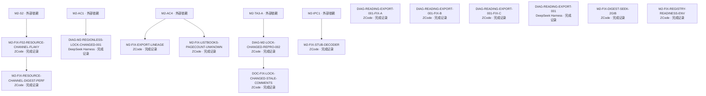

| Task / 标题 | 有效状态 / 原状态 | Owner / Reviewer | 依赖 / 主线祖先候选 | 备注 |
|---|---|---|---|---|
| [DIAG-M2-LOCK-CHANGED-REPRO-002](../../doc/tasks/DIAG-M2-LOCK-CHANGED-REPRO-002.md) M2-AC1 登记的 regionless LOCK_CHANGED 缺口——mock detect 两段式复现核实（M2-TA3-A L-1） | DONE_RECORDED / done | ZCode / DeepSeek Harness (non-author) | M2-TA3-A / `1faf6c1b` | — |
| [DIAG-M2-REGIONLESS-LOCK-CHANGED-001](../../doc/tasks/DIAG-M2-REGIONLESS-LOCK-CHANGED-001.md) M2 regionless planner LOCK_CHANGED diagnosis | DONE_RECORDED / done | DeepSeek Harness / Antigravity | M2-AC1 / `b5ac097f98d9c06e2548c69d7361d475c0f13388` | — |
| [DIAG-READING-EXPORT-001-FIX-A](../../doc/tasks/DIAG-READING-EXPORT-001-FIX-A.md) Export terminal-state wait/signal-delivery semantics fix (symptom A) | DONE_RECORDED / done | ZCode / DeepSeek Harness | 无 / `a8b94df1f1ee091a9cca894c421e9ffc3ad30614` | — |
| [DIAG-READING-EXPORT-001-FIX-B](../../doc/tasks/DIAG-READING-EXPORT-001-FIX-B.md) Reader heartbeat lifecycle fix (symptom B) | DONE_RECORDED / done | ZCode / DeepSeek Harness | 无 / `9c9c9087b8f2a6e51fa670ab99486d4a11edff49` | — |
| [DIAG-READING-EXPORT-001-FIX-C](../../doc/tasks/DIAG-READING-EXPORT-001-FIX-C.md) Production reader-page-leave and quit wiring for closeReader (heartbeat endpoint wiring) | DONE_RECORDED / done | ZCode / DeepSeek Harness | 无 / `0f2e9e31a666eddb4c9b8e17fb5401567c7e3924` | — |
| [DIAG-READING-EXPORT-001](../../doc/tasks/DIAG-READING-EXPORT-001.md) Reading/export completion signal and connection-lifetime flaky diagnosis | DONE_RECORDED / done | DeepSeek Harness / Codex | 无 / `e0a0e784498fc339a4d666dd931cc67cfb65bbdb` | — |
| [DOC-FIX-LOCK-CHANGED-STALE-COMMENTS](../../doc/tasks/DOC-FIX-LOCK-CHANGED-STALE-COMMENTS.md) 两处过时「known planner gap」注释的最小 docs 修正（DIAG-002 遗留候选落地） | DONE_RECORDED / done | ZCode / DeepSeek Harness (non-author) | DIAG-M2-LOCK-CHANGED-REPRO-002 / `1970512d` | — |
| [M2-FIX-DIGEST-SEEK-2GIB](../../doc/tasks/M2-FIX-DIGEST-SEEK-2GIB.md) Resource channel read_through 64 位 seek 修复（SetFilePointer i32 截断高位恒空，DIGEST-PERF P3-5） | DONE_RECORDED / done | ZCode / DeepSeek Harness（待派发，非作者静态） | 无 / `a0ffc4f342d50c7b7cf2fb7f682c1717120c1a86` | — |
| [M2-FIX-EXPORT-LINEAGE](../../doc/tasks/M2-FIX-EXPORT-LINEAGE.md) Export history 持久层补 included_stale/missing page ids（F-1 修复） | DONE_RECORDED / done | ZCode（子 agent 代行，用户授权 2026-09-28） / DeepSeek Harness | M2-AC4 / `d71883ec9a6c6fccb14b62908c02790bb3beb99c` | — |
| [M2-FIX-F02-RESOURCE-CHANNEL-FLAKY](../../doc/tasks/M2-FIX-F02-RESOURCE-CHANNEL-FLAKY.md) Resource channel 等长重写拒检并发缺口（f02 flaky 诊断+修复） | DONE_RECORDED / done | ZCode（子 agent 代行，用户授权 2026-09-28） / DeepSeek Harness | M2-S2 / `aa2f99b8170de4205ccd0be23acb10c7fa367fc1` | — |
| [M2-FIX-LISTBOOKS-PAGECOUNT-UNKNOWN](../../doc/tasks/M2-FIX-LISTBOOKS-PAGECOUNT-UNKNOWN.md) ListBooks page_count unknown/已知度通道（F-2 修复） | DONE_RECORDED / done | ZCode（子 agent 代行，用户授权 2026-09-28） / DeepSeek Harness | M2-AC4 / `699610291f1536a1a1dbda62ba73f2587def1d91` | — |
| [M2-FIX-REGISTRY-READINESS-ENV](../../doc/tasks/M2-FIX-REGISTRY-READINESS-ENV.md) test_registry_readiness 环境断言条件化（遗留 slice③；Goal T3，自治执行 2026-10-01） | DONE_RECORDED / done | ZCode / DeepSeek Harness（非作者） | 无 / `52b07438` | — |
| [M2-FIX-RESOURCE-CHANNEL-DIGEST-PERF](../../doc/tasks/M2-FIX-RESOURCE-CHANNEL-DIGEST-PERF.md) Resource channel digest 重验成本优化（单趟 hash+capture / per-chunk digest）与 GrantCache 死结构收敛 | DONE_RECORDED / done | ZCode / DeepSeek Harness | M2-FIX-F02-RESOURCE-CHANNEL-FLAKY / `bc2529f02dfbd3c378d5e9cd4c9f7ac2ecfe4f15` | — |
| [M2-FIX-STUB-DECODER](../../doc/tasks/M2-FIX-STUB-DECODER.md) core_service stub decoder signature fix（ImportPages 扩面前置） | DONE_RECORDED / done | ZCode（子agent代行,用户授权 2026-09-28） / DeepSeek Harness | M2-IPC1 / `121a281cbf65f62c57b177efc44fa4649b11c9ae` | — |

### M2 架构与 UI · 1

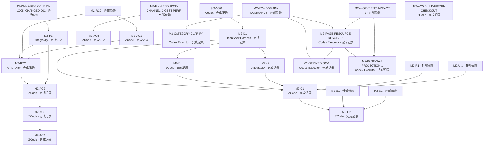

| Task / 标题 | 有效状态 / 原状态 | Owner / Reviewer | 依赖 / 主线祖先候选 | 备注 |
|---|---|---|---|---|
| [GOV-001](../../doc/tasks/GOV-001.md) Register accepted desktop architecture decision | DONE_RECORDED / done | Codex / DeepSeek Harness (independent non-author Review) | 无 / `969f7a5e535b6d98b163bab9fb6ac2f6e8512088` | — |
| [M2-AC1](../../doc/tasks/M2-AC1.md) M2-AC1 end-to-end acceptance on the M2 baseline | DONE_RECORDED / done | ZCode / DeepSeek Harness | M2-RC2 / `f162193b5255f06bcbbfc0d1820f38cd81f89d32` | — |
| [M2-AC2](../../doc/tasks/M2-AC2.md) Data Integrity Acceptance (source hash / Managed Copy / user edits / Lock / current & pinned Revision) | DONE_RECORDED / done | ZCode / DeepSeek Harness | M2-IPC1, M2-P1 / `9d3c1db5ffafd9ff2c7cd8aeb4f209c1e5c1df0c` | — |
| [M2-AC3](../../doc/tasks/M2-AC3.md) Provider Fail-closed Acceptance (unconfigured / network failure / partial failure) | DONE_RECORDED / done | ZCode / DeepSeek Harness | M2-AC2 / `cac374855b6e6a4310f557ae362d34d0572cd649` | — |
| [M2-AC4](../../doc/tasks/M2-AC4.md) Reader Export Lineage + Library Page-count/Unknown Semantics Acceptance | DONE_RECORDED / done | ZCode（子agent代行，用户授权 2026-09-28） / DeepSeek Harness | M2-AC3 / `fc99182147bccc89d9bd9124dd17d15b1d428e21` | — |
| [M2-AC5-BUILD-FRESH-CHECKOUT](../../doc/tasks/M2-AC5-BUILD-FRESH-CHECKOUT.md) fresh checkout 构建链根治：build.rs 可诊断 sidecar 缺失 + build_sidecar.ps1 增量短路（M2-AC5 候选） | DONE_RECORDED / done | ZCode / DeepSeek Harness（待派发，非作者静态） | 无 / `1a96f536d75d7525d51a3da453be1497ad978d78` | — |
| [M2-AC5](../../doc/tasks/M2-AC5.md) Windows packaging & clean-start acceptance (bundle / self-contained sidecar / no-system-Python workflow) | DONE_RECORDED / done | ZCode / DeepSeek Harness | M2-FIX-RESOURCE-CHANNEL-DIGEST-PERF / `9db08dc7548b70e8f4ee1d42e70e2e0c15838e63` | — |
| [M2-C1](../../doc/tasks/M2-C1.md) Typed IPC Contract — ZCode Owner Baseline | DONE_RECORDED / done | ZCode / DeepSeek Harness + Qoder (both independent, non-author) | M2-D1, M2-I1, M2-I2, M2-R1, M2-UI1 / `c1765aa2fb861c1512aa633ad10960ac90673310` | — |
| [M2-C2](../../doc/tasks/M2-C2.md) Typed IPC Contract Revision — Resource Channel Thresholds and Security Conclusions | DONE_RECORDED / done | ZCode / DeepSeek Harness | M2-C1, M2-S1, M2-S2 / `d574ec1ec42bade5da98ec955d02284d1451f04a` | — |
| [M2-CATEGORY-CLARIFY-1](../../doc/tasks/M2-CATEGORY-CLARIFY-1.md) MISSING_REQUIRED_INPUT envelope category 澄清为 unavailable（RC4-10 口径对齐 §8 值域） | DONE_RECORDED / done | Codex Executor（ZCode 代行） / DeepSeek Harness（非作者） | M2-RC4-DOMAIN-COMMANDS / `21865f7d` | — |
| [M2-D1](../../doc/tasks/M2-D1.md) Headless & Qt Coupling Audit | DONE_RECORDED / done | DeepSeek Harness / Codex (independent non-author Review and integration) | GOV-001 / `100abfbb51e2d59d0b0dccbb0cb6aa15ba9f6e02` | — |
| [M2-DERIVED-GC-1](../../doc/tasks/M2-DERIVED-GC-1.md) derived 只读根 orphan/死行清理第一刀（RC4-12 登记的预览 GC 缺口最小闭合） | DONE_RECORDED / done | Codex Executor（ZCode 代行） / DeepSeek Harness（非作者） | M2-RC4-DOMAIN-COMMANDS, M2-PAGE-RESOURCE-RESOLVE-1 / `44859014` | PARTIAL mitigation；有行有文件的轮换旧 preview 回收未实现 |
| [M2-I1](../../doc/tasks/M2-I1.md) Core Assembly Seam | DONE_RECORDED / done | ZCode / DeepSeek Harness | M2-D1 / `cff1e0a8658f57a2e9caf774a9de0961e8f65da3` | — |
| [M2-I2](../../doc/tasks/M2-I2.md) Qt-free Logic Extraction | DONE_RECORDED / done | Antigravity / Codex | M2-D1 / `7e2da6b8eb55e437d36fa3fa11cbf3e976a834c9` | — |
| [M2-IPC1](../../doc/tasks/M2-IPC1.md) Production Core Lifecycle + Read-only Library Vertical Slice | DONE_RECORDED / done | Antigravity / DeepSeek Harness | M2-P1, M2-RC2, M2-AC1 / `04c1394a7aee6c16e8b841f4fd2e4f3550198686` | — |
| [M2-P1](../../doc/tasks/M2-P1.md) Regionless Detection Fan-out and Guard Rebinding (fix for DIAG-M2-REGIONLESS-LOCK-CHANGED-001) | DONE_RECORDED / done | Antigravity / DeepSeek Harness | DIAG-M2-REGIONLESS-LOCK-CHANGED-001 / `a174fb9cb5ed221441527165e79d98db7b414a10` | — |
| [M2-PAGE-NAV-PROJECTION-1](../../doc/tasks/M2-PAGE-NAV-PROJECTION-1.md) 页导航投影命令 list_chapters/list_chapter_pages（Workbench 页列表三级下钻第一刀） | DONE_RECORDED / done | Codex Executor（ZCode 代行） / DeepSeek Harness（非作者） | M2-PAGE-RESOURCE-RESOLVE-1, M2-WORKBENCH-REACT-1 / `657af2e3` | — |
| [M2-PAGE-RESOURCE-RESOLVE-1](../../doc/tasks/M2-PAGE-RESOURCE-RESOLVE-1.md) 页→资源解析 wire 命令 resolve_page_resource（Workbench 页图自动加载第一刀） | DONE_RECORDED / done | Codex Executor（ZCode 代行） / DeepSeek Harness（非作者） | M2-RC4-DOMAIN-COMMANDS, M2-WORKBENCH-REACT-1 / `9e242b0c` | — |

### M2 架构与 UI · 2

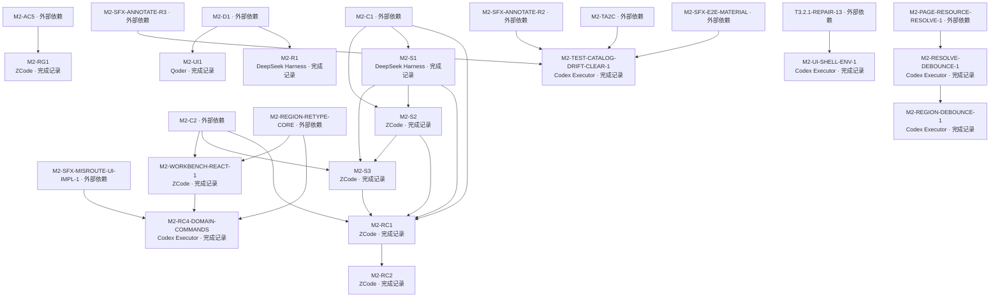

| Task / 标题 | 有效状态 / 原状态 | Owner / Reviewer | 依赖 / 主线祖先候选 | 备注 |
|---|---|---|---|---|
| [M2-R1](../../doc/tasks/M2-R1.md) Qt Runtime Feasibility Spike | DONE_RECORDED / done | DeepSeek Harness / Codex | M2-D1 / `5803bd7b9e80ba780e7a7f12078b00b9178e6f86` | — |
| [M2-RC1](../../doc/tasks/M2-RC1.md) Contract-Aligned Large-Media Resource Channel Runtime | DONE_RECORDED / done | ZCode / DeepSeek Harness | M2-C1, M2-S1, M2-S2, M2-C2, M2-S3 / `3a24684007fd5a5e855f324077ad996841300f27` | — |
| [M2-RC2](../../doc/tasks/M2-RC2.md) Resource Channel Command Surface and Sidecar Boundary Hardening | DONE_RECORDED / done | ZCode / DeepSeek Harness | M2-RC1 / `88f972fed921c7d7a010bef38a734de2601d9ca5` | — |
| [M2-RC4-DOMAIN-COMMANDS](../../doc/tasks/M2-RC4-DOMAIN-COMMANDS.md) 撤销、重渲染与修订历史 Core 域命令面端到端闭环 | DONE_RECORDED / done | Codex Executor / DeepSeek Harness | M2-WORKBENCH-REACT-1, M2-SFX-MISROUTE-UI-IMPL-1, M2-REGION-RETYPE-CORE / `0a7e0d5b` | — |
| [M2-REGION-DEBOUNCE-1](../../doc/tasks/M2-REGION-DEBOUNCE-1.md) Workbench region 读循环逐键 debounce（RESOLVE-DEBOUNCE r1 C-1 登记残留闭合） | DONE_RECORDED / done | Codex Executor（ZCode 代行） / DeepSeek Harness（非作者） | M2-RESOLVE-DEBOUNCE-1 / `0cb15092` | — |
| [M2-RESOLVE-DEBOUNCE-1](../../doc/tasks/M2-RESOLVE-DEBOUNCE-1.md) Workbench 页资源解析逐键 debounce（PAGE-RESOLVE r1 PR-10 deferred 闭合） | DONE_RECORDED / done | Codex Executor（ZCode 代行） / DeepSeek Harness（非作者） | M2-PAGE-RESOURCE-RESOLVE-1 / `65d500e6` | — |
| [M2-RG1](../../doc/tasks/M2-RG1.md) M2 Release Gate（Windows 本机口径）：cold start metrics / Windows matrix / console policy / packaged dependency closure | DONE_RECORDED / done | ZCode / DeepSeek Harness | M2-AC5 / `b796bed3cb3d79b2d4208b29f3e53c956a018dee` | — |
| [M2-S1](../../doc/tasks/M2-S1.md) Large-Media Resource Channel Feasibility Spike | DONE_RECORDED / done | DeepSeek Harness / Codex | M2-C1 / `4103493fd63c0133f62a659390d0367d1c2a98ab` | — |
| [M2-S2](../../doc/tasks/M2-S2.md) Resource Channel Security Verification Spike | DONE_RECORDED / done | ZCode / Antigravity | M2-S1, M2-C1 / `bf1d12309bee19cccf665fb2d5bb5c9d4dee7e66` | — |
| [M2-S3](../../doc/tasks/M2-S3.md) Tauri Asset Protocol Feasibility Probe | DONE_RECORDED / done | ZCode / DeepSeek Harness | M2-S1, M2-S2, M2-C2 / `6799c73a75c16252602ac85f4454a5ac1b45b8d2` | — |
| [M2-TEST-CATALOG-DRIFT-CLEAR-1](../../doc/tasks/M2-TEST-CATALOG-DRIFT-CLEAR-1.md) test_catalog 断言漂移清算（exact snapshot 反模式修复） | DONE_RECORDED / done | Codex Executor / Antigravity（非作者，快速独立 Review） | M2-SFX-E2E-MATERIAL, M2-TA2C, M2-SFX-ANNOTATE-R2, M2-SFX-ANNOTATE-R3 / `8412ccfd` | — |
| [M2-UI-SHELL-ENV-1](../../doc/tasks/M2-UI-SHELL-ENV-1.md) ui_shell QML 事件投递环境敏感失败定性+Quick 后端固定（test-debt） | DONE_RECORDED / done | Codex Executor / Antigravity（非作者，快速独立 Review） | T3.2.1-REPAIR-13 / `195995bb` | — |
| [M2-UI1](../../doc/tasks/M2-UI1.md) React Feature Parity & Visual Contract | DONE_RECORDED / done | Qoder / Codex | M2-D1 / `5242f64882d2189e177fff19a75ad16630693566` | — |
| [M2-WORKBENCH-REACT-1](../../doc/tasks/M2-WORKBENCH-REACT-1.md) Workbench React 页第一刀：React 页壳（页列/页图/region 只读画框/任务进度占位）+ region 通道 client（含 D5 几何读取面契约修订） | DONE_RECORDED / done | ZCode / DeepSeek Harness（非作者，技术主审）；Qoder（非作者 UI/UX 复审，派发通道可用时补审） | M2-REGION-RETYPE-CORE, M2-C2 / `fb730a00` | — |

### M2 Provider 与业务能力

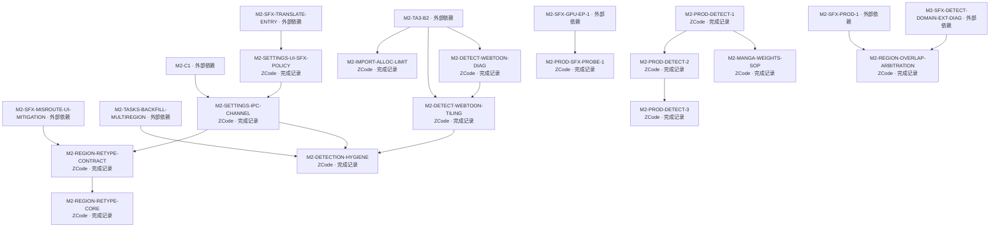

| Task / 标题 | 有效状态 / 原状态 | Owner / Reviewer | 依赖 / 主线祖先候选 | 备注 |
|---|---|---|---|---|
| [M2-DETECT-WEBTOON-DIAG](../../doc/tasks/M2-DETECT-WEBTOON-DIAG.md) webtoon 长条漫 ogkalu 0 候选适配器级诊断（建议 A 第一步：先可观测值再定修法） | DONE_RECORDED / done | ZCode / DeepSeek Harness（非作者） | M2-TA3-B2 / `e1d939fa` | — |
| [M2-DETECT-WEBTOON-TILING](../../doc/tasks/M2-DETECT-WEBTOON-TILING.md) webtoon 长条漫 ogkalu tiling 检测修复（建议 A 第二步：按 DIAG 冻结口径实施，解锁 ko 6 case） | DONE_RECORDED / done | ZCode / DeepSeek Harness（非作者） | M2-DETECT-WEBTOON-DIAG, M2-TA3-B2 / `e1c040bf` | — |
| [M2-DETECTION-HYGIENE](../../doc/tasks/M2-DETECTION-HYGIENE.md) 检测/调度面 hygiene 一揽子（TILING R1/R3 env-parse 加固 + BACKFILL N1 except 收窄 + SETTINGS-IPC R7/R8 文档口径） | DONE_RECORDED / done | ZCode / DeepSeek Harness（非作者） | M2-DETECT-WEBTOON-TILING, M2-TASKS-BACKFILL-MULTIREGION, M2-SETTINGS-IPC-CHANNEL / `45bae782` | — |
| [M2-IMPORT-ALLOC-LIMIT](../../doc/tasks/M2-IMPORT-ALLOC-LIMIT.md) 大图导入 QImageReader allocation limit 可配置化（建议 B：Qt 256MB 默认上限拒绝 webtoon 导入） | DONE_RECORDED / done | ZCode / DeepSeek Harness（非作者） | M2-TA3-B2 / `499a3da7` | — |
| [M2-MANGA-WEIGHTS-SOP](../../doc/tasks/M2-MANGA-WEIGHTS-SOP.md) manga 权重 fetch/verify 脚本与安装 SOP（M2-PROD-DETECT-1 遗留 slice②/DSH r1 R6；Goal T2，自治执行 2026-10-01） | DONE_RECORDED / done | ZCode / DeepSeek Harness（非作者） | M2-PROD-DETECT-1 / `853fc911` | — |
| [M2-PROD-DETECT-1](../../doc/tasks/M2-PROD-DETECT-1.md) 生产检测器集成第一刀：manga 域 RT-DETR-v2 provider + 装配 backend 选择（用户「继续」推进 2026-09-30） | DONE_RECORDED / done | ZCode / DeepSeek Harness（非作者） | 无 / `056617e4488513ae6336a27a3ba44f0c42dfca12` | — |
| [M2-PROD-DETECT-2](../../doc/tasks/M2-PROD-DETECT-2.md) 发布形态检测器运行时/权重分发：ML 栈进 sidecar 闭包 + manga 权重随包（M2-PROD-DETECT-1 遗留 slice①；用户「继续」推进 2026-09-30） | DONE_RECORDED / done | ZCode / DeepSeek Harness（非作者） | M2-PROD-DETECT-1 / `9e44fb214dddfe0ca3e89eee817b70da34651f59` | — |
| [M2-PROD-DETECT-3](../../doc/tasks/M2-PROD-DETECT-3.md) core.detect 命令面扩展 + frozen 进程内真实 detect 端到端验证（M2-PROD-DETECT-2 AC5 PARTIAL 闭合；Goal T1，自治执行 2026-10-01） | DONE_RECORDED / done | ZCode / DeepSeek Harness（非作者） | M2-PROD-DETECT-2 / `69a6e4e1` | — |
| [M2-PROD-SFX-PROBE-1](../../doc/tasks/M2-PROD-SFX-PROBE-1.md) packaged sfx-detect 探针：frozen 进程内 SFX 真实推理（DML）运行证据 | DONE_RECORDED / done | ZCode / DeepSeek Harness（非作者） | M2-SFX-GPU-EP-1 / `177b356a` | — |
| [M2-REGION-OVERLAP-ARBITRATION](../../doc/tasks/M2-REGION-OVERLAP-ARBITRATION.md) region 创建跨 provider 重叠仲裁（裁决③授权：sfx/speech 检出并存时改标/抑制语义，闭合误路由乱译损害的结构性缺口） | DONE_RECORDED / done | ZCode / DeepSeek Harness（非作者） | M2-SFX-DETECT-DOMAIN-EXT-DIAG, M2-SFX-PROD-1 / `38e4e487` | — |
| [M2-REGION-RETYPE-CONTRACT](../../doc/tasks/M2-REGION-RETYPE-CONTRACT.md) Region 改标契约冻结：SetRegionType 命令+读取面 DTO+Revision/并发语义+「忽略」定义（T5a；rev 1.3→1.4 草案） | DONE_RECORDED / done | ZCode / DeepSeek Harness（非作者） | M2-SFX-MISROUTE-UI-MITIGATION, M2-SETTINGS-IPC-CHANNEL / `b4b995ab` | — |
| [M2-REGION-RETYPE-CORE](../../doc/tasks/M2-REGION-RETYPE-CORE.md) Region 改标 Core 实现：SetRegionType 全链+11 断言落测+协议 minor bump+旁路同步（T5b；按 rev 1.4 冻结契约） | DONE_RECORDED / done | ZCode / DeepSeek Harness（非作者） | M2-REGION-RETYPE-CONTRACT / `d8019810` | — |
| [M2-SETTINGS-IPC-CHANNEL](../../doc/tasks/M2-SETTINGS-IPC-CHANNEL.md) settings IPC 通道（settings_get/settings_update_section）：M2-C1 契约 rev + Rust 命令 + 前端接通（用户裁决①，SFX-UI 解除前提） | DONE_RECORDED / done | ZCode / DeepSeek Harness（非作者） | M2-SETTINGS-UI-SFX-POLICY, M2-C1 / `fab3ca56` | — |
| [M2-SETTINGS-UI-SFX-POLICY](../../doc/tasks/M2-SETTINGS-UI-SFX-POLICY.md) React 设置页接入 sfx.policy 配置（SFX-ENTRY 后续；UI 协议说明：最小键接入，视觉审查可后补 Qoder） | DONE_RECORDED / done | ZCode / DeepSeek Harness（非作者） | M2-SFX-TRANSLATE-ENTRY / `efad4b71` | — |

### M2 素材与质量验收 · 1

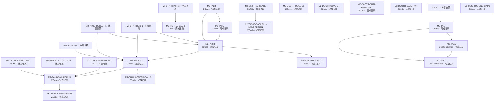

| Task / 标题 | 有效状态 / 原状态 | Owner / Reviewer | 依赖 / 主线祖先候选 | 备注 |
|---|---|---|---|---|
| [M2-DOCTR-QUAL-C1](../../doc/tasks/M2-DOCTR-QUAL-C1.md) GT 盲区抽检型校准审计（C4 结论真实达标确认；用户裁决释放 2026-09-30） | DONE_RECORDED / done | ZCode（工具/清单/预览/汇总）；**人工判定=用户本人（标注者）**——agent 不代做人工分类 / DeepSeek Harness（非作者静态） | 无 / `316abf16` | — |
| [M2-DOCTR-QUAL-C4](../../doc/tasks/M2-DOCTR-QUAL-C4.md) manga 域检测器评估（C1-C5 候选流程之 C4；用户裁决释放 2026-09-30） | DONE_RECORDED / done | ZCode / DeepSeek Harness（非作者静态） | 无 / `d5b1831d` | — |
| [M2-DOCTR-QUAL-PREFLIGHT](../../doc/tasks/M2-DOCTR-QUAL-PREFLIGHT.md) Real docTR qualification 前置：受控检测权重、隔离 GPU/CPU 实验环境与可复现检测评测基座 | DONE_RECORDED / done | ZCode / DeepSeek Harness（非作者；r1 `changes_requested`、r2 `approved_with_conditions`、r3 `changes_requested`、r4 `changes_requested`，报告在 doc/reviews/M2-DOCTR-QUAL-*） | 无 / `51229d4956d4a83c3892d551a34082ff760690ee` | — |
| [M2-DOCTR-QUAL-RUN](../../doc/tasks/M2-DOCTR-QUAL-RUN.md) Real docTR 正式 qualification run（用户口径裁决 2026-09-30：coverage 主判定 + 生产 pad 正式 + Precision 下界不作 Gate） | DONE_RECORDED / done | ZCode / DeepSeek Harness（待派发，非作者静态） | 无 / `e8c9c120a5bb3c71ab3f41c32b4985f7578aef61` | 任务完成；质量结论 FAIL，后续 C4/C1 与 PROD-DETECT 路线已完成 |
| [M2-KO-TILE-CALIB](../../doc/tasks/M2-KO-TILE-CALIB.md) KO 长条页推理口径校准实验（T3 前置）：tile 切块 vs 整页 letterbox 对照+口径建议固化 | DONE_RECORDED / done | ZCode / DeepSeek Harness（非作者） | M2-SFX-TRAIN-V2 / `f84b56b7` | — |
| [M2-OCR-PADDLE3X-1](../../doc/tasks/M2-OCR-PADDLE3X-1.md) 生产 ocr_local.py PaddleOCR 3.x 适配修复（bytes 静默忽略 + 3.x 输出形状 + 双 region 行为判定） | DONE_RECORDED / done | ZCode / DeepSeek Harness（非作者） | M2-TA3-B / `53326278` | — |
| [M2-QUAL-DETERM-CALIB](../../doc/tasks/M2-QUAL-DETERM-CALIB.md) F5 确定性 Gate 重定义落地：reading_order 对齐译文相似度口径校准（用户裁决采纳候选方案） | DONE_RECORDED / done | ZCode / DeepSeek Harness（非作者） | M2-TA3-B2 / `7a0286ef` | — |
| [M2-TA1](../../doc/tasks/M2-TA1.md) Unified Japanese/Korean comic test asset foundation | DONE_RECORDED / done | Codex / Codex (independent reviewer subagent) | M2-RG1 / `1ef8fe7e7e66044869f8c59646d28bfca7692bbe` | — |
| [M2-TA2A](../../doc/tasks/M2-TA2A.md) JA Public Assets Bootstrap | DONE_RECORDED / done | Codex Desktop / DeepSeek Harness | M2-TA1 / `ef13a77bedf8bb06ee222113da186c7bfff09714` | — |
| [M2-TA2B](../../doc/tasks/M2-TA2B.md) JA/KO 开放素材池（用户方案变更 2026-09-30）：ブラックジャックによろしく官方免费全卷 + Pepper&Carrot 补充；永久取消 Manga109 前置 | DONE_RECORDED / done | ZCode / DeepSeek Harness（非作者静态：r1 approved_with_conditions → r2 approved） | 无 / `fae0d8f6f4e2009595993c284f1c3f436c2f12f8` | 两套 metadata；采用后部开放素材方案，Manga109 永久取消 |
| [M2-TA2C-TOOLING-GAPS](../../doc/tasks/M2-TA2C-TOOLING-GAPS.md) comic_golden_suite 工具清算：source_url 主机白名单 + checksum_inventory 运行时消费与判别性断言（TA2C P3-6/P3-10） | DONE_RECORDED / done | ZCode / DeepSeek Harness（待派发，非作者静态） | 无 / `04165c76fab939e4a106f4a87f5045d674e8dac3` | — |
| [M2-TA2C](../../doc/tasks/M2-TA2C.md) No-HF JA/KO Asset Migration | DONE_RECORDED / done | Codex Desktop / DeepSeek Harness | M2-TA1, M2-TA2A / `a4cd513d0f7ca6a50e1ae018629b3042612be3bb` | — |
| [M2-TA3-A](../../doc/tasks/M2-TA3-A.md) 应用级 E2E Smoke（用户裁决 2026-09-30）：5 个真实 case（日漫+韩漫）detect→OCR→translate→inpaint→render/export 全链，不做质量 qualification | DONE_RECORDED / done | ZCode / DeepSeek Harness（待派发，非作者静态） | M2-TA2B / `5dc69d16` | — |
| [M2-TA3-B](../../doc/tasks/M2-TA3-B.md) TA3-B：20 案例端到端质量验收——阶段一（阈值定义+OCR 安装冒烟+case 选取）；阶段二（正式 run）BLOCKED_ON_USER 翻译 endpoint 二选一（用户「继续」推进 2026-10-01） | DONE_RECORDED / done | ZCode / DeepSeek Harness（非作者） | M2-TA3-A, M2-TA2B, M2-PROD-DETECT-1, M2-SFX-PROD-1 / `97450992` | 阶段一 done；阶段二旧 blocker 已由 B2/KO-RERUN/B3 后继任务取代 |
| [M2-TA3-B2-KO-RERUN](../../doc/tasks/M2-TA3-B2-KO-RERUN.md) TA3-B2 ko qualification 重跑（用户裁决③：TILING+ALLOC 解锁后关闭 F1/F2） | DONE_RECORDED / done | ZCode / DeepSeek Harness（非作者） | M2-TA3-B2, M2-DETECT-WEBTOON-TILING, M2-IMPORT-ALLOC-LIMIT, M2-TASKS-PRIMARY-SFX-GATE / `60a04ba3` | — |
| [M2-TA3-B2](../../doc/tasks/M2-TA3-B2.md) TA3-B 阶段二：20-case 正式质量 qualification run（翻译=DeepSeek remote，用户裁决 (a) 2026-10-01） | DONE_RECORDED / done | ZCode / DeepSeek Harness（非作者） | M2-TA3-B, M2-PROD-DETECT-1, M2-SFX-PROD-1, M2-SFX-SEM-1 / `614be825` | 任务完成；当轮 Gate FAIL；后继 B3 8/8 export OK，非全产品质量 PASS |
| [M2-TA3-B3-KO-FULLRUN](../../doc/tasks/M2-TA3-B3-KO-FULLRUN.md) ko 全量补跑（用户裁决④⑦⑧：7 case 全量+K02 干净重跑；F1/F2 关闭确认；相似度 known-limitation 落地） | DONE_RECORDED / done | ZCode / DeepSeek Harness（非作者） | M2-TA3-B2-KO-RERUN / `bb4b16bc` | — |
| [M2-TASKS-BACKFILL-MULTIREGION](../../doc/tasks/M2-TASKS-BACKFILL-MULTIREGION.md) executor backfill 多 region 页逐 region 跟进调度（SFX-ENTRY 相邻发现） | DONE_RECORDED / done | ZCode / DeepSeek Harness（非作者） | M2-SFX-TRANSLATE-ENTRY / `27701679` | — |

### M2 素材与质量验收 · 2

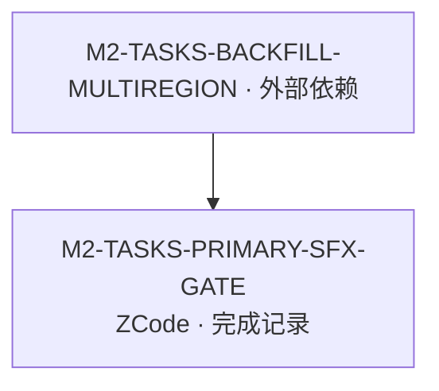

| Task / 标题 | 有效状态 / 原状态 | Owner / Reviewer | 依赖 / 主线祖先候选 | 备注 |
|---|---|---|---|---|
| [M2-TASKS-PRIMARY-SFX-GATE](../../doc/tasks/M2-TASKS-PRIMARY-SFX-GATE.md) primary region 重决策（BACKFILL R2 裁决落地：单 region SFX 页 primary 也经 SFX 门） | DONE_RECORDED / done | ZCode / DeepSeek Harness（非作者） | M2-TASKS-BACKFILL-MULTIREGION / `0820d3d5` | — |

### M2 SFX 研究与数据 · 1

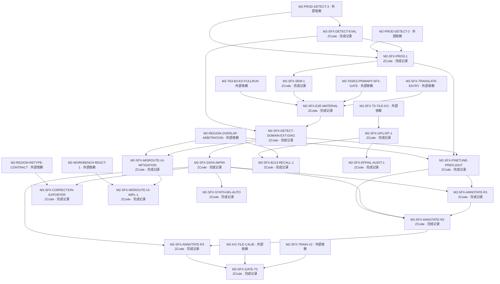

| Task / 标题 | 有效状态 / 原状态 | Owner / Reviewer | 依赖 / 主线祖先候选 | 备注 |
|---|---|---|---|---|
| [M2-SFX-ANNOTATE-R1](../../doc/tasks/M2-SFX-ANNOTATE-R1.md) SFX 标注轮 R1：AI 预标注+用户审核工作表+三集隔离产出（T1b 两阶段；阶段二含用户逐条审核） | DONE_RECORDED / done | ZCode / DeepSeek Harness（非作者） | M2-SFX-FINETUNE-PREFLIGHT, M2-SFX-DATA-INFRA / `6bfa1cde` | — |
| [M2-SFX-ANNOTATE-R2](../../doc/tasks/M2-SFX-ANNOTATE-R2.md) SFX 标注轮 R2（T1b-R2 扩标轮）：素材补齐（BJ+10 页/KO+5 页）+BJ 低置信扩审+回放补审+三集扩集重导出——闭合 A′ 输入条件缺口 | DONE_RECORDED / in_review | ZCode / DeepSeek Harness（非作者） | M2-SFX-ANNOTATE-R1, M2-SFX-DATA-INFRA, M2-SFX-FINETUNE-PREFLIGHT / `84f952b3` | STATE_CONFLICT：Task 页头落后于 Plan 与集成历史；Review 原报告在当前 tracked 树未定位；仅确认已有批准记录，不追加独立批准 |
| [M2-SFX-ANNOTATE-R3](../../doc/tasks/M2-SFX-ANNOTATE-R3.md) SFX 标注轮 R3（T1b-R3 扩标轮）：BJ 候选池 44 页选页入池+低置信扩审+正集扩容 | DONE_RECORDED / done | ZCode / DeepSeek Harness（非作者） | M2-SFX-ANNOTATE-R2, M2-SFX-DATA-INFRA / `5efa052e` | — |
| [M2-SFX-BJ13-RECALL-1](../../doc/tasks/M2-SFX-BJ13-RECALL-1.md) BJ13 召回恢复链：v2b 生产链 BJ13/14/15 sfx 召回实测（探针零 src）→召回恢复则仲裁阈值域重审切片，未恢复则剩余选项登记交裁决 | DONE_RECORDED / done | ZCode / DeepSeek Harness（非作者） | M2-REGION-OVERLAP-ARBITRATION, M2-SFX-GPU-EP-1 / `2a1a9f73` | — |
| [M2-SFX-CORRECTION-EXPORTER](../../doc/tasks/M2-SFX-CORRECTION-EXPORTER.md) 纠错样本导出器：revision 链扫描→训练样本资格判定→T1a schema 导出（T5c；命令式零生产写路径） | DONE_RECORDED / done | ZCode / DeepSeek Harness（非作者） | M2-SFX-DATA-INFRA, M2-REGION-RETYPE-CONTRACT / `66871d5d` | — |
| [M2-SFX-DATA-INFRA](../../doc/tasks/M2-SFX-DATA-INFRA.md) SFX 训练数据基础设施：provenance/哈希/去重/分组隔离/标注状态/可恢复 manifest+合成渲染 PoC（T1a；零 src；不等底座） | DONE_RECORDED / done | ZCode / DeepSeek Harness（非作者；r1 changes_requested→r2 changes_requested→r3 approved_with_conditions→r4 条件闭合） | M2-SFX-DETECT-DOMAIN-EXT-DIAG / `71a9a84e` | — |
| [M2-SFX-DETECT-DOMAIN-EXT-DIAG](../../doc/tasks/M2-SFX-DETECT-DOMAIN-EXT-DIAG.md) SFX 检测域扩展第一步：BJ 域缺口诊断与扩展方案评估（误路由损害形态=优先级输入；只评估不实施） | DONE_RECORDED / done | ZCode / DeepSeek Harness（非作者） | M2-SFX-E2E-MATERIAL, M2-SFX-DETECT-EVAL / `7dd5e5ff` | — |
| [M2-SFX-DETECT-EVAL](../../doc/tasks/M2-SFX-DETECT-EVAL.md) SFX 拟声词检测能力评估（用户产品裁决 2026-10-01 推进候选 2；评估先行纪律，生产零改动） | DONE_RECORDED / done | ZCode / DeepSeek Harness（非作者） | M2-PROD-DETECT-3 / `cf4e55ec` | — |
| [M2-SFX-E2E-MATERIAL](../../doc/tasks/M2-SFX-E2E-MATERIAL.md) SFX 端到端素材路线（用户裁决④全权授权）：ja BJ06 policy=translate 端到端验证 + SFX-rich 素材搜寻/下载/入池 | DONE_RECORDED / done | ZCode / DeepSeek Harness（非作者） | M2-SFX-TRANSLATE-ENTRY, M2-TASKS-PRIMARY-SFX-GATE, M2-SFX-SEM-1, M2-TA3-B3-KO-FULLRUN / `68b351ad` | — |
| [M2-SFX-EPFAIL-AUDIT-1](../../doc/tasks/M2-SFX-EPFAIL-AUDIT-1.md) SFX 推理 run-time EPFail 通道审计：ORT 包装层 run() 期内部静默重跑 CPU 的可观测性闭合 | DONE_RECORDED / done | ZCode / DeepSeek Harness（非作者） | M2-SFX-GPU-EP-1 / `9a29e742` | — |
| [M2-SFX-FINETUNE-PREFLIGHT](../../doc/tasks/M2-SFX-FINETUNE-PREFLIGHT.md) SFX fine-tune V1 技术预检：训练路线可行性实证+训练环境就绪+许可备案（T0；零 src） | DONE_RECORDED / done | ZCode / DeepSeek Harness（非作者） | M2-SFX-DETECT-DOMAIN-EXT-DIAG, M2-SFX-PROD-1, M2-REGION-OVERLAP-ARBITRATION / `dedb97b2` | — |
| [M2-SFX-GATE-T3](../../doc/tasks/M2-SFX-GATE-T3.md) SFX 正式评测门 T3：Gate 定义冻结（G1-G8）+双前置数据（R3-MISS 补画/KO 非派生 GT）+三方评测执行+判定与 T4 材料 | DONE_RECORDED / done | ZCode / DeepSeek Harness（非作者） | M2-SFX-TRAIN-V2, M2-KO-TILE-CALIB, M2-SFX-ANNOTATE-R3 / `27817412` | — |
| [M2-SFX-GPU-EP-1](../../doc/tasks/M2-SFX-GPU-EP-1.md) SFX 推理 EP 切换 GPU（DML）：onnxruntime-directml 依赖面+EP 配置化+数值一致性验证+打包闭包与 GATE 重跑 | DONE_RECORDED / done | ZCode / DeepSeek Harness（非作者） | M2-SFX-T5-TILE-KO / `931a6d03` | — |
| [M2-SFX-MISROUTE-UI-IMPL-1](../../doc/tasks/M2-SFX-MISROUTE-UI-IMPL-1.md) SFX 误路由缓解 UI 产品实现：E1-E4 视觉+不对称状态机+改标交互（设计契约 M2-SFX-MISROUTE-UI-MITIGATION 的实现切片） | DONE_RECORDED / done | ZCode / DeepSeek Harness（非作者，技术主审）；Qoder（非作者 UI/UX 复审，派发通道可用时补审） | M2-SFX-MISROUTE-UI-MITIGATION, M2-WORKBENCH-REACT-1 / `b355757c` | — |
| [M2-SFX-MISROUTE-UI-MITIGATION](../../doc/tasks/M2-SFX-MISROUTE-UI-MITIGATION.md) SFX 误路由缓解 UI 设计切片：region 手动改标 sfx + speech 疑似警示（裁决①授权；设计交付，产品实现 blocked_on Workbench React 页） | DONE_RECORDED / done | ZCode / DeepSeek Harness（非作者；集成核验=编排会话代行 Codex） | M2-SFX-DETECT-DOMAIN-EXT-DIAG, M2-REGION-OVERLAP-ARBITRATION / `4d77a778` | — |
| [M2-SFX-PROD-1](../../doc/tasks/M2-SFX-PROD-1.md) SFX 检测生产集成第一刀：chiqui7 独立 provider + region sfx 分派 + 权重随包（用户三裁决 2026-10-01：做/许可通过/路线 A） | DONE_RECORDED / done | ZCode / DeepSeek Harness（非作者） | M2-SFX-DETECT-EVAL, M2-PROD-DETECT-2, M2-PROD-DETECT-3 / `0a505bab` | — |
| [M2-SFX-SEM-1](../../doc/tasks/M2-SFX-SEM-1.md) SFX 翻译语义第一刀：拟声词文化对等转换（userselect 2026-10-01「SFX OCR/翻译语义」；协议 widening 先例落地） | DONE_RECORDED / done | ZCode / DeepSeek Harness（非作者） | M2-SFX-PROD-1 / `abf30a1a` | — |
| [M2-SFX-SYNTH-BG-AUTO](../../doc/tasks/M2-SFX-SYNTH-BG-AUTO.md) SFX 合成底图自动 provider：ChatGPT 网页版全自动生成（Playwright 持久登录态）+ 底图库缺口自动触发（零 src；数据外部树） | DONE_RECORDED / in_review（代码集成 done @merge；真实冒烟 manual 待用户登录后代跑） | ZCode / DeepSeek Harness（非作者） | M2-SFX-DATA-INFRA / `913ca3a9` | STATE_CONFLICT：Task 页头落后于 Plan 与集成历史；Review 原报告在当前 tracked 树未定位；仅确认已有批准记录，不追加独立批准 |

### M2 SFX 研究与数据 · 2

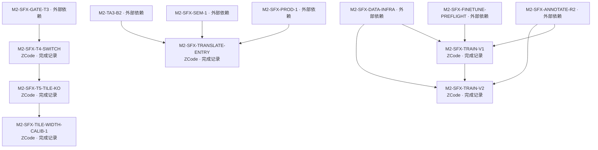

| Task / 标题 | 有效状态 / 原状态 | Owner / Reviewer | 依赖 / 主线祖先候选 | 备注 |
|---|---|---|---|---|
| [M2-SFX-T4-SWITCH](../../doc/tasks/M2-SFX-T4-SWITCH.md) SFX 生产切换 V2B（T4）：G7 翻译链深层补证（硬前置先行）+权重通道与 pin 替换+SHA 门反向验证+回退语义出证 | DONE_RECORDED / done | ZCode / DeepSeek Harness（非作者） | M2-SFX-GATE-T3 / `bd23eaa8` | — |
| [M2-SFX-T5-TILE-KO](../../doc/tasks/M2-SFX-T5-TILE-KO.md) SFX KO tile 化生产分支（T5-TILE）：tile_ov128 冻结口径落地+路由阈值+性能双档实测+KO 域验收 | DONE_RECORDED / done | ZCode / DeepSeek Harness（非作者） | M2-SFX-T4-SWITCH / `306f5040` | — |
| [M2-SFX-TILE-WIDTH-CALIB-1](../../doc/tasks/M2-SFX-TILE-WIDTH-CALIB-1.md) SFX tile 路由宽≠600/690 逐宽校准：多宽页 directional 评测与阈值维持/修订提案 | DONE_RECORDED / done | ZCode / DeepSeek Harness（非作者） | M2-SFX-T5-TILE-KO / `d298ecd0` | — |
| [M2-SFX-TRAIN-V1](../../doc/tasks/M2-SFX-TRAIN-V1.md) SFX 训练 V1（T2）：A′ 路线首训——challenge 划拨重切+yolo11s-seg 微调+导出冒烟+directional 评测 | DONE_RECORDED / done | ZCode / DeepSeek Harness（非作者） | M2-SFX-ANNOTATE-R2, M2-SFX-DATA-INFRA, M2-SFX-FINETUNE-PREFLIGHT / `35cb3db0` | — |
| [M2-SFX-TRAIN-V2](../../doc/tasks/M2-SFX-TRAIN-V2.md) SFX 训练 V2（T2-V2）：own-manga 冻结池接入（558 页/1738 框）+A/B 基座重训+同链路对照评测 | DONE_RECORDED / done | ZCode / DeepSeek Harness（非作者） | M2-SFX-TRAIN-V1, M2-SFX-ANNOTATE-R2, M2-SFX-DATA-INFRA / `784e585b` | — |
| [M2-SFX-TRANSLATE-ENTRY](../../doc/tasks/M2-SFX-TRANSLATE-ENTRY.md) SFX→translate 产品入口：sfx_policy 可配置化（用户裁决④：解除 SFX 翻译评测 n=0 的前置阻断） | DONE_RECORDED / done | ZCode / DeepSeek Harness（非作者） | M2-SFX-PROD-1, M2-SFX-SEM-1, M2-TA3-B2 / `a377a25a` | — |

### Legacy Roadmap / Repair · 1

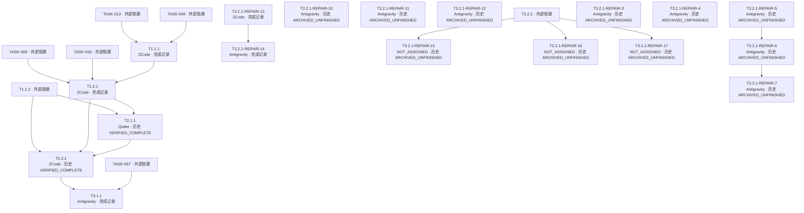

| Task / 标题 | 有效状态 / 原状态 | Owner / Reviewer | 依赖 / 主线祖先候选 | 备注 |
|---|---|---|---|---|
| [T1.1.1](../../doc/tasks/T1.1.1.md) Production Text Detector | DONE_RECORDED / done | ZCode / Codex | TASK-013, TASK-049 / `f56f441c1ce981ff83a3af98c5862917e35711f1` | — |
| [T1.2.1](../../doc/tasks/T1.2.1.md) Settings UI & ViewModel | DONE_RECORDED / done | ZCode / Codex | TASK-009, TASK-050, T1.1.1 / `9a14310` | — |
| [T2.1.1](../../doc/tasks/T2.1.1.md) Apply Design F to QML | LEGACY_VERIFIED_COMPLETE / verified_complete | Qoder / Codex | T1.1.2, T1.2.1 / `5da1cf64b85ad50198486bab33008a6804c3dfa7` | — |
| [T2.2.1](../../doc/tasks/T2.2.1.md) Reader & Workbench Polish | LEGACY_VERIFIED_COMPLETE / verified_complete | ZCode / Codex | T1.1.2, T1.2.1, T2.1.1 / `fe9fca0` | — |
| [T3.1.1](../../doc/tasks/T3.1.1.md) Unify Reading Progress and Export History into SQLite | DONE_RECORDED / done | Antigravity / DeepSeek Harness (approved @ 4e1eb3a) | T2.2.1, TASK-057 / `0c70e44` | — |
| [T3.2.1-REPAIR-10](../../doc/tasks/T3.2.1-REPAIR-10.md) Repair packaging-test path independence and evidence hygiene | LEGACY_ARCHIVED_UNFINISHED / ready | Antigravity / DeepSeek Harness (independent non-author Review) | 无 / `NOT_VERIFIED` | 父任务已 closed_with_limitations；原状态不授予实施权限；未从集成字段/记录定位有效主线祖先；不等同于未实现 |
| [T3.2.1-REPAIR-11](../../doc/tasks/T3.2.1-REPAIR-11.md) Resolve remaining REPAIR-9 review findings and F-003 wording | LEGACY_ARCHIVED_UNFINISHED / changes_requested | Antigravity / DeepSeek Harness (independent non-author Review) | 无 / `NOT_VERIFIED` | 父任务已 closed_with_limitations；原状态不授予实施权限；未从集成字段/记录定位有效主线祖先；不等同于未实现 |
| [T3.2.1-REPAIR-12](../../doc/tasks/T3.2.1-REPAIR-12.md) Correct REPAIR-11 evidence and pin the verification record | LEGACY_ARCHIVED_UNFINISHED / approved | Antigravity / DeepSeek Harness (independent non-author Review) | 无 / `NOT_VERIFIED` | 父任务已 closed_with_limitations；原状态不授予实施权限；未从集成字段/记录定位有效主线祖先；不等同于未实现 |
| [T3.2.1-REPAIR-13](../../doc/tasks/T3.2.1-REPAIR-13.md) Restore chapter image import and readable QML controls | DONE_RECORDED / done | ZCode / DeepSeek Harness (independent non-author Review) | 无 / `6fe7455d0927ae0b4328b77f117893d373797d92` | — |
| [T3.2.1-REPAIR-14](../../doc/tasks/T3.2.1-REPAIR-14.md) Restore persisted Bookshelf entries after application restart | DONE_RECORDED / done | Antigravity / DeepSeek Harness (independent non-author Review) | T3.2.1-REPAIR-13 / `296131b57a4c3660949ecbdfb6003c6201023dab` | — |
| [T3.2.1-REPAIR-15](../../doc/tasks/T3.2.1-REPAIR-15-reader-export-lineage.md) Reader 发起的导出丢失 book/chapter 血缘（export_history.book_id/chapter_id 恒为空） | LEGACY_ARCHIVED_UNFINISHED / proposed | NOT_ASSIGNED（建议 Qoder） / 非作者独立 Reviewer（由 Codex 指派；不得由本 slice 作者担任） | T3.2.1 / `NOT_VERIFIED` | 父任务已 closed_with_limitations；原状态不授予实施权限；未从集成字段/记录定位有效主线祖先；不等同于未实现 |
| [T3.2.1-REPAIR-16](../../doc/tasks/T3.2.1-REPAIR-16-bookshelf-page-count.md) 书架章节行把 page_count 未知哨兵 0 渲染成真实计数（显示「0 页」，与 DB/Reader 矛盾） | LEGACY_ARCHIVED_UNFINISHED / proposed | NOT_ASSIGNED（建议 Qoder） / 非作者独立 Reviewer（由 Codex 指派；不得由本 slice 作者担任） | T3.2.1 / `NOT_VERIFIED` | 父任务已 closed_with_limitations；原状态不授予实施权限；未从集成字段/记录定位有效主线祖先；不等同于未实现 |
| [T3.2.1-REPAIR-17](../../doc/tasks/T3.2.1-REPAIR-17-mock-local-pipeline-smoke.md) 无重型权重的确定性 Mock/Local Pipeline 发布包烟测 | LEGACY_ARCHIVED_UNFINISHED / proposed | NOT_ASSIGNED（建议 Antigravity） / DeepSeek Harness（独立非作者 Reviewer） | T3.2.1 / `NOT_VERIFIED` | 父任务已 closed_with_limitations；原状态不授予实施权限；未从集成字段/记录定位有效主线祖先；不等同于未实现 |
| [T3.2.1-REPAIR-3](../../doc/tasks/T3.2.1-REPAIR-3.md) Frozen-path test discrimination and AC7 evidence-scope alignment | LEGACY_ARCHIVED_UNFINISHED / ready | Antigravity / DeepSeek Harness (independent non-author Review) | 无 / `NOT_VERIFIED` | 父任务已 closed_with_limitations；原状态不授予实施权限；未从集成字段/记录定位有效主线祖先；不等同于未实现 |
| [T3.2.1-REPAIR-4](../../doc/tasks/T3.2.1-REPAIR-4.md) Close REPAIR-3 review findings and bind evidence | LEGACY_ARCHIVED_UNFINISHED / changes_requested | Antigravity / DeepSeek Harness (independent non-author Review) | 无 / `NOT_VERIFIED` | 父任务已 closed_with_limitations；原状态不授予实施权限；未从集成字段/记录定位有效主线祖先；不等同于未实现 |
| [T3.2.1-REPAIR-5](../../doc/tasks/T3.2.1-REPAIR-5.md) Fix T3.2.1 handoff link and validate references | LEGACY_ARCHIVED_UNFINISHED / changes_requested | Antigravity / DeepSeek Harness (independent non-author Review) | 无 / `NOT_VERIFIED` | 父任务已 closed_with_limitations；原状态不授予实施权限；未从集成字段/记录定位有效主线祖先；不等同于未实现 |
| [T3.2.1-REPAIR-6](../../doc/tasks/T3.2.1-REPAIR-6.md) Align REPAIR-5 delivery and reference-check counts | LEGACY_ARCHIVED_UNFINISHED / changes_requested | Antigravity / DeepSeek Harness (independent non-author Review) | T3.2.1-REPAIR-5 / `NOT_VERIFIED` | 父任务已 closed_with_limitations；原状态不授予实施权限；未从集成字段/记录定位有效主线祖先；不等同于未实现 |
| [T3.2.1-REPAIR-7](../../doc/tasks/T3.2.1-REPAIR-7.md) Reconcile canonical commit counts and evidence derivation | LEGACY_ARCHIVED_UNFINISHED / ready | Antigravity / DeepSeek Harness (independent non-author Review) | T3.2.1-REPAIR-6 / `NOT_VERIFIED` | 父任务已 closed_with_limitations；原状态不授予实施权限；未从集成字段/记录定位有效主线祖先；不等同于未实现 |

### Legacy Roadmap / Repair · 2

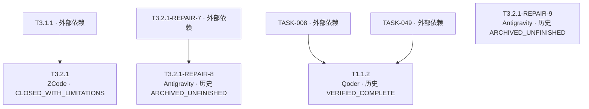

| Task / 标题 | 有效状态 / 原状态 | Owner / Reviewer | 依赖 / 主线祖先候选 | 备注 |
|---|---|---|---|---|
| [T3.2.1-REPAIR-8](../../doc/tasks/T3.2.1-REPAIR-8.md) Correct REPAIR-5/6 source attribution and F-002 disposition | LEGACY_ARCHIVED_UNFINISHED / approved | Antigravity / DeepSeek Harness (independent non-author Review) | T3.2.1-REPAIR-7 / `NOT_VERIFIED` | 父任务已 closed_with_limitations；原状态不授予实施权限；未从集成字段/记录定位有效主线祖先；不等同于未实现 |
| [T3.2.1-REPAIR-9](../../doc/tasks/T3.2.1-REPAIR-9.md) Fix packaged Qt/ICU dependency resolution blocking clean Windows startup | LEGACY_ARCHIVED_UNFINISHED / ready | Antigravity / DeepSeek Harness (independent non-author Review) | 无 / `NOT_VERIFIED` | 父任务已 closed_with_limitations；原状态不授予实施权限；未从集成字段/记录定位有效主线祖先；不等同于未实现 |
| [T3.2.1](../../doc/tasks/T3.2.1.md) Windows Packaging and Clean-Machine Release Gate | CLOSED_WITH_LIMITATIONS / closed_with_limitations | ZCode / Qoder (independent non-author Reviewer; executed the 2026-09-26 full review by Codex assignment, R-014. Earlier packaging-round reviews were by DeepSeek Harness) | T3.1.1 / `6519125406161924b0021e021e79fea07cf673fc` | — |
| [T1.1.2](../../doc/REBASELINE_PLAN.md) Region Canvas & Creator（Roadmap 映射） | LEGACY_VERIFIED_COMPLETE / NO_DEDICATED_TASK_FILE | Qoder / Codex（非作者；Plan Roadmap 映射） | TASK-008, TASK-049 / `5b91745` | Owner 取 TASK-013 Canvas 切片记录；无专用 Task 是已登记追溯缺口 |

### Legacy TASK 1

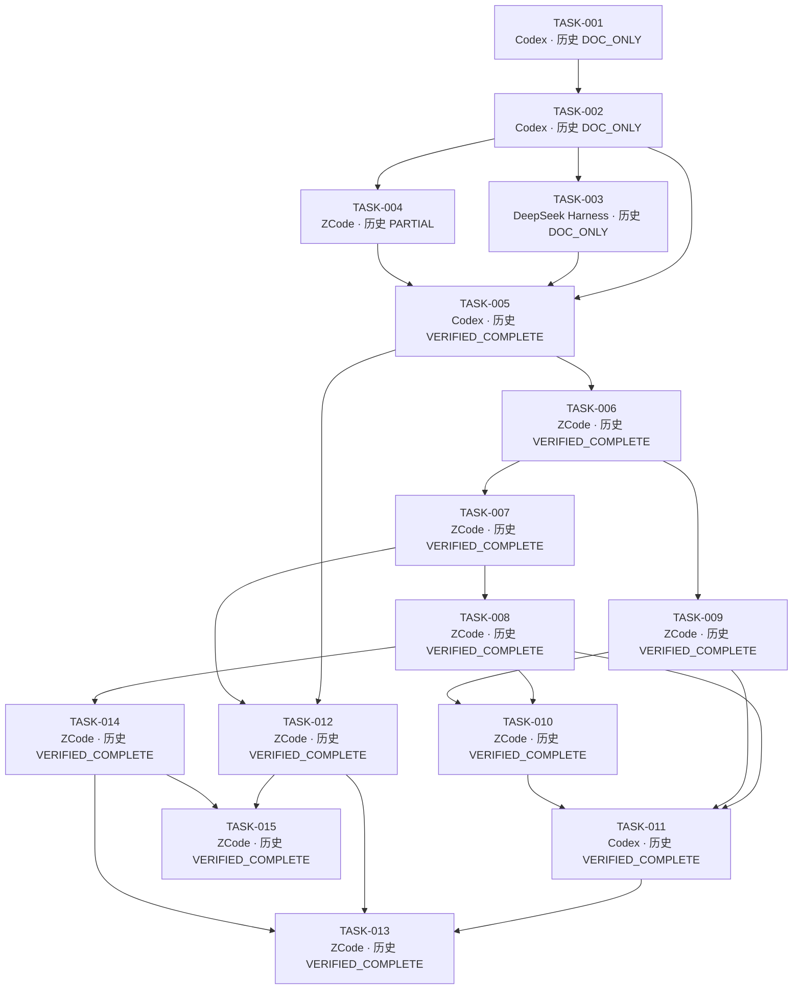

| Task / 标题 | 有效状态 / 原状态 | Owner / Reviewer | 依赖 / 主线祖先候选 | 备注 |
|---|---|---|---|---|
| [TASK-001](../../doc/tasks/TASK-001.md) 修订目标文档引用与已确定的一致性问题 | LEGACY_DOC_ONLY / done | Codex / DeepSeek Harness | 无 / `a1cb24c00a8d2644a89d59529b5de2f35288a600` | — |
| [TASK-002](../../doc/tasks/TASK-002.md) 冻结最小数据与执行契约 | LEGACY_DOC_ONLY / done | Codex / DeepSeek Harness | TASK-001 / `7927169e13ade1afb8f78d368465191508f8aabd` | — |
| [TASK-003](../../doc/tasks/TASK-003.md) 补齐验收规格与测试素材规范 | LEGACY_DOC_ONLY / done | DeepSeek Harness / Codex | TASK-002 / `db269e98aa6783151f86ed922691840f52930afc` | — |
| [TASK-004](../../doc/tasks/TASK-004.md) 验证 Windows 运行环境与打包路线 | LEGACY_PARTIAL / done | ZCode / DeepSeek Harness | TASK-002 / `a501372dd09086e93f86d41937c43cb41e41e563` | — |
| [TASK-005](../../doc/tasks/TASK-005.md) 建立最小工程入口与架构守卫 | LEGACY_VERIFIED_COMPLETE / done | Codex / DeepSeek Harness | TASK-002, TASK-003, TASK-004 / `6607f751c61663e589cf73b6a7bdebf65b9edc45` | — |
| [TASK-006](../../doc/tasks/TASK-006.md) 实现持久化与 Artifact 安全提交基础 | LEGACY_VERIFIED_COMPLETE / done | ZCode / DeepSeek Harness | TASK-005 / `32a73148b0685cf3a63e07cbf1bca25d8553b194` | — |
| [TASK-007](../../doc/tasks/TASK-007.md) 实现书架领域与本地图片导入 | LEGACY_VERIFIED_COMPLETE / done | ZCode / DeepSeek Harness | TASK-006 / `2b64b0f7e419d8179633bd86928a49195b09414e` | — |
| [TASK-008](../../doc/tasks/TASK-008.md) 实现 Region 编辑、Revision 与人工保护 | LEGACY_VERIFIED_COMPLETE / done | ZCode / DeepSeek Harness | TASK-007 / `06ba2e7322e5f565feda1808094e9edd282b3c0b` | — |
| [TASK-009](../../doc/tasks/TASK-009.md) 实现 Provider 配置、网络策略与凭据边界 | LEGACY_VERIFIED_COMPLETE / done | ZCode / DeepSeek Harness | TASK-006 / `6c732be8fda712737197343728058194070c8488` | — |
| [TASK-010](../../doc/tasks/TASK-010.md) 实现翻译约束、TM 与 Context | LEGACY_VERIFIED_COMPLETE / done | ZCode / DeepSeek Harness | TASK-008, TASK-009 / `a225790d5eaf9022724903925bb554307f5b2cc9` | — |
| [TASK-011](../../doc/tasks/TASK-011.md) 实现命令计划、任务调度与可恢复进度 | LEGACY_VERIFIED_COMPLETE / done | Codex / DeepSeek Harness | TASK-008, TASK-009, TASK-010 / `369e95f6ff854f2cdb5eca0abffe8c044e38bff1` | — |
| [TASK-012](../../doc/tasks/TASK-012.md) 实现四页导航与书架 UI | LEGACY_VERIFIED_COMPLETE / done | ZCode / DeepSeek Harness | TASK-005, TASK-007 / `78987c8fe5df5650bf7f674d6a9b79afbc48a5ab` | — |
| [TASK-013](../../doc/tasks/TASK-013.md) 实现工作台与任务进度交互 | LEGACY_VERIFIED_COMPLETE / done | ZCode / DeepSeek Harness | TASK-011, TASK-012, TASK-014 / `f0814a8` | — |
| [TASK-014](../../doc/tasks/TASK-014.md) 实现配色与文字排版渲染 | LEGACY_VERIFIED_COMPLETE / done | ZCode / DeepSeek Harness | TASK-008 / `a9432971ebf6450d7cc3afa23a245af917ffad2e` | — |
| [TASK-015](../../doc/tasks/TASK-015.md) 实现阅读器与五种成果导出 | LEGACY_VERIFIED_COMPLETE / done | ZCode / DeepSeek Harness | TASK-012, TASK-014 / `fa72cee` | — |

### Legacy TASK 2

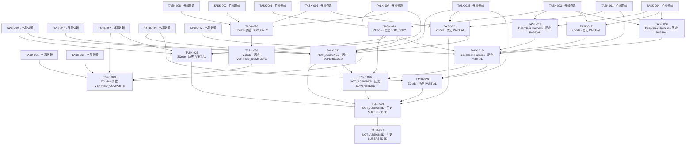

| Task / 标题 | 有效状态 / 原状态 | Owner / Reviewer | 依赖 / 主线祖先候选 | 备注 |
|---|---|---|---|---|
| [TASK-016](../../doc/tasks/TASK-016.md) OCR 与检测路线独立实验 | LEGACY_PARTIAL / done | DeepSeek Harness / Codex | TASK-003, TASK-004 / `9bf85f5` | — |
| [TASK-017](../../doc/tasks/TASK-017.md) Translation 与上下文输出协议实验 | LEGACY_PARTIAL / done | ZCode / DeepSeek Harness | TASK-003, TASK-004 / `d36f724` | — |
| [TASK-018](../../doc/tasks/TASK-018.md) Mask / Inpainting 路线独立实验 | LEGACY_PARTIAL / done | DeepSeek Harness / Codex | TASK-003, TASK-004 / `5a9f5c8` | — |
| [TASK-019](../../doc/tasks/TASK-019.md) 集成已验证的检测/OCR/翻译/修复 Provider | LEGACY_PARTIAL / done | DeepSeek Harness / Codex | TASK-011, TASK-014, TASK-016, TASK-017, TASK-018, TASK-024 / `9a5486a` | — |
| [TASK-020](../../doc/tasks/TASK-020.md) 实现 Webtoon 分块处理与阅读 | LEGACY_PARTIAL / done | ZCode / ZCode（窗口内子 agent，结论仅 approved_subagent） | TASK-013, TASK-015, TASK-019 / `b73820048d6251e8d0da42c67427ab1f7fd7ac49` | — |
| [TASK-021](../../doc/tasks/TASK-021.md) 完善备份恢复、回收站、清理与诊断 | LEGACY_PARTIAL / done | ZCode / Codex | TASK-006, TASK-011, TASK-015 / `5bc17f8cb0af682578166357a2c4ba8eedab644c` | — |
| [TASK-022](../../doc/tasks/TASK-022.md) 补齐工具窗口、设置与视觉交互验收 | LEGACY_SUPERSEDED / proposed | NOT_ASSIGNED（建议 Qoder） / null | TASK-009, TASK-010, TASK-013, TASK-015, TASK-021, TASK-024 / `NOT_VERIFIED` | 未从集成字段/记录定位有效主线祖先；不等同于未实现 |
| [TASK-023](../../doc/tasks/TASK-023.md) 实现 PDF/MOBI 导入路线 | LEGACY_PARTIAL / done | ZCode / ZCode（窗口内子 agent，结论仅 approved_subagent） | TASK-007, TASK-009, TASK-012, TASK-024 / `ba7d560f346bb1af8a6e71474e23904bc066cf81` | — |
| [TASK-024](../../doc/tasks/TASK-024.md) 明确扩展能力及验收覆盖边界（仅设计） | LEGACY_DOC_ONLY / done | ZCode / DeepSeek Harness | TASK-001, TASK-003 / `61c33e2` | — |
| [TASK-025](../../doc/tasks/TASK-025.md) 按批准契约实现 Plugin/Hooks 与可选扩展 | LEGACY_SUPERSEDED / proposed | NOT_ASSIGNED（建议 ZCode） / null | TASK-019, TASK-022, TASK-024 / `NOT_VERIFIED` | 未从集成字段/记录定位有效主线祖先；不等同于未实现 |
| [TASK-026](../../doc/tasks/TASK-026.md) 独立集成审查与质量/性能验收 | LEGACY_SUPERSEDED / proposed | NOT_ASSIGNED（建议 Qoder） / null | TASK-020, TASK-021, TASK-022, TASK-023, TASK-025 / `NOT_VERIFIED` | 未从集成字段/记录定位有效主线祖先；不等同于未实现 |
| [TASK-027](../../doc/tasks/TASK-027.md) 发布候选集成、打包与最终验收 | LEGACY_SUPERSEDED / proposed | NOT_ASSIGNED（建议 Codex） / null | TASK-026 / `NOT_VERIFIED` | 未从集成字段/记录定位有效主线祖先；不等同于未实现 |
| [TASK-028](../../doc/tasks/TASK-028.md) 冻结统一 SQLite 持久化设计 | LEGACY_DOC_ONLY / done | Codex / DeepSeek Harness | TASK-002, TASK-006, TASK-007, TASK-008 / `509de668ea9529e7b2a38abd2368df0ff02a64ae` | — |
| [TASK-029](../../doc/tasks/TASK-029.md) 实现统一 SQLite 持久化 | LEGACY_VERIFIED_COMPLETE / done | ZCode / DeepSeek Harness | TASK-028 / `0b0b85558e1211a6267f018a332a4cb7c307b67e` | — |
| [TASK-030](../../doc/tasks/TASK-030.md) Main.qml/bootstrap 最小生产装配 | LEGACY_VERIFIED_COMPLETE / done | ZCode / DeepSeek Harness | TASK-005, TASK-007, TASK-012, TASK-029, TASK-031 / `fef9dd3` | — |

### Legacy TASK 3

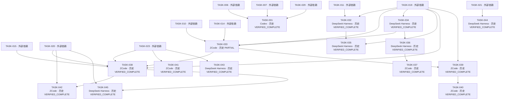

| Task / 标题 | 有效状态 / 原状态 | Owner / Reviewer | 依赖 / 主线祖先候选 | 备注 |
|---|---|---|---|---|
| [TASK-031](../../doc/tasks/TASK-031.md) 生产 ImageDecoder 与 Managed Copy 适配器 | LEGACY_VERIFIED_COMPLETE / done | Codex / DeepSeek Harness | TASK-006, TASK-007, TASK-029 / `e9d5185259ffa175b64d67d5ac00befadc6db643` | — |
| [TASK-032](../../doc/tasks/TASK-032.md) 修复 SFX Policy Gate 缺失 region_type 前置（F-1） | LEGACY_VERIFIED_COMPLETE / done | DeepSeek Harness / Codex | TASK-011, TASK-019 / `e3e055e` | — |
| [TASK-033](../../doc/tasks/TASK-033.md) 完整链收口：Color / Term Extract / Render handler 与渲染侧生产装配 | LEGACY_PARTIAL / done | ZCode / ZCode（窗口内子 agent，结论仅 approved_subagent） | TASK-010, TASK-014, TASK-019, TASK-034 / `4d0f93206fb35040bb23487da0435bb87f55fea9` | — |
| [TASK-034](../../doc/tasks/TASK-034.md) 测试与分层硬化（route policy 收敛 / 架构守卫 / flaky 诊断） | LEGACY_VERIFIED_COMPLETE / done | DeepSeek Harness / Codex | TASK-019 / `8ca4b232397b182fabdfd1aa3798ff23409d85d6` | — |
| [TASK-035](../../doc/tasks/TASK-035.md) 修复渲染层 SFX Policy Gate 缺失 region_type 前置（F-1 渲染面） | LEGACY_VERIFIED_COMPLETE / done | DeepSeek Harness / Codex | TASK-019, TASK-032 / `bd0d030f6179a27c5941766b5856f27f8ec35f50` | — |
| [TASK-036](../../doc/tasks/TASK-036.md) 设置输入校验与导出发布顺序硬化（承接 TASK-034 R-02 / R-05 / R-07） | LEGACY_VERIFIED_COMPLETE / done | DeepSeek Harness / Codex | TASK-034 / `27253240d0fb2a8df82b15f34546cd74dc9b717f` | — |
| [TASK-037](../../doc/tasks/TASK-037.md) 修复已定性 flaky（webtoon 滚动保存）与 TASK-036 R-01 诊断数值用法 | LEGACY_VERIFIED_COMPLETE / done | ZCode / ZCode（窗口内子 agent，结论仅 approved_subagent） | TASK-036 / `372c3bfa421cf12f5c6c1a3cbfdf9ffd8a5b0c8e` | — |
| [TASK-038](../../doc/tasks/TASK-038.md) 生产装配收口：reader/export ViewModel 注册 + tile_factory 注入 + 文档导入接线 | LEGACY_VERIFIED_COMPLETE / done | ZCode / ZCode（窗口内子 agent，结论仅 approved_subagent） | TASK-015, TASK-019, TASK-020, TASK-023, TASK-033 / `f835ac9bc2355ee2af6f018991d035da94626950` | — |
| [TASK-039](../../doc/tasks/TASK-039.md) 修复 planner `_clean_available` 继承缺陷（render-only 命令跨 run 误判 BLOCKED） | LEGACY_VERIFIED_COMPLETE / done | ZCode / ZCode（窗口内子 agent，结论仅 approved_subagent） | TASK-019, TASK-033 / `c8024fee684f035c983e9e416f6a5deec44c7fb6` | — |
| [TASK-040](../../doc/tasks/TASK-040.md) 接通 TASK-039 的 clean_probe 生产注入（含 F-12 口径修正） | LEGACY_VERIFIED_COMPLETE / done | ZCode / Codex | TASK-039 / `e1be885bb3a26f962a6b1ce01a8f220949c6ab03` | — |
| [TASK-041](../../doc/tasks/TASK-041.md) MOBI 导入路线（用户已批准 MOBI 解析依赖） | LEGACY_VERIFIED_COMPLETE / done | ZCode / Codex | TASK-023 / `7c4fae018c5690063beccd9b9b6d2de19e71ccde` | — |
| [TASK-042](../../doc/tasks/TASK-042.md) 超大 Webtoon 带状/流式解码（承接 TASK-020 遗留 BLOCKED） | LEGACY_VERIFIED_COMPLETE / done | ZCode / Codex | TASK-020, TASK-038 / `ce7b4f916a8155b2c4914eb4f9bfe5d8cf0f4462` | — |
| [TASK-043](../../doc/tasks/TASK-043.md) TASK-023 修订尾项（F-1 PDF 红蓝通道互换 P1 + F-3 失败余页 + F-9 依赖导入位置） | LEGACY_VERIFIED_COMPLETE / done | DeepSeek Harness / Codex | TASK-023 / `b29427a648d2079a533750307e64f4588fee8c15` | — |
| [TASK-044](../../doc/tasks/TASK-044.md) TASK-021 修订尾项（F-2 purge FK 完整性 P1 + F-6 生成资产删除范围 + F-7 manifest 原子性 + F-10 软删过滤） | LEGACY_VERIFIED_COMPLETE / done | DeepSeek Harness / Codex | TASK-021 / `5784018fb528ef7b2521134515ee7776222ffd1d` | — |
| [TASK-045](../../doc/tasks/TASK-045.md) TASK-020/038 修订尾项（F-4 tile 落盘几何 + F-5 翻页旧图 + F-8 Slot result + F-11 坐标口径 + F-13/F-14 注释口径） | LEGACY_VERIFIED_COMPLETE / done | DeepSeek Harness / Codex | TASK-020, TASK-038 / `e2a8f019eea34f47e01904ae6805eef863ddd349` | — |

### Legacy TASK 4

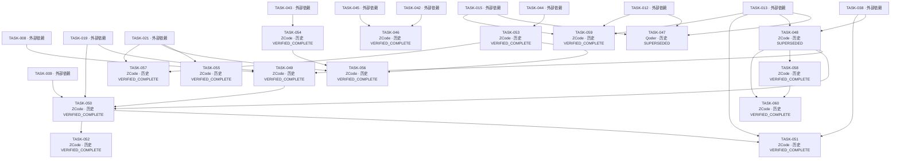

| Task / 标题 | 有效状态 / 原状态 | Owner / Reviewer | 依赖 / 主线祖先候选 | 备注 |
|---|---|---|---|---|
| [TASK-046](../../doc/tasks/TASK-046.md) 解码面 rewind 成本收敛（overlap 语义收口，落地 TASK-042 AC ⑩ 的实测结论） | LEGACY_VERIFIED_COMPLETE / done | ZCode / Qoder | TASK-042, TASK-045 / `2b40085731227e99d152a413fa6887d53fe99199` | — |
| [TASK-047](../../doc/tasks/TASK-047.md) UI/UX、GUI 与 QML 设计规范收敛（仅设计） | LEGACY_SUPERSEDED / rejected | Qoder / Codex | TASK-012, TASK-013, TASK-015 / `NOT_VERIFIED` | 未从集成字段/记录定位有效主线祖先；不等同于未实现 |
| [TASK-048](../../doc/tasks/TASK-048.md) 修复生产任务执行的跨线程 SQLite 连接（§11 P-1，P0）+ 生产路径端到端测试资产 | LEGACY_SUPERSEDED / done | ZCode / 窗口内独立子对话（approved_subagent；T1 后由 Codex/DSH/Qoder post-hoc） | TASK-013, TASK-038 / `be558caa094940bf8d454ea1effc866dcefc6f0a` | — |
| [TASK-049](../../doc/tasks/TASK-049.md) 生产区域输入面（§11 P-2：detect handler 注册 + detection→Region 路径；不接 QML） | LEGACY_VERIFIED_COMPLETE / done | ZCode / 窗口内独立子对话（approved_subagent；T1 后由 Codex/DSH/Qoder post-hoc） | TASK-008, TASK-019, TASK-048 / `e94d5af` | — |
| [TASK-050](../../doc/tasks/TASK-050.md) 生产 Pipeline 的设置与 provider 绑定注入（§11 P-3 非 UI 部分） | LEGACY_VERIFIED_COMPLETE / done | ZCode / 窗口内独立子对话（approved_subagent；T1 后由 Codex/DSH/Qoder post-hoc） | TASK-009, TASK-019, TASK-048, TASK-049 / `21b7301` | — |
| [TASK-051](../../doc/tasks/TASK-051.md) 工作台三档视图解析 translated/compare（§11 P-6） | LEGACY_VERIFIED_COMPLETE / done | ZCode / 窗口内独立子对话（approved_subagent；T1 后由 Codex/DSH/Qoder post-hoc） | TASK-013, TASK-038, TASK-050 / `65d1e13` | — |
| [TASK-052](../../doc/tasks/TASK-052.md) 命令失败可见化（§11 P-4：commandError 上屏，最小可见 + provisional） | LEGACY_VERIFIED_COMPLETE / done | ZCode / 窗口内独立子对话（approved_subagent；T1 后由 Codex/DSH/Qoder post-hoc） | TASK-050 / `a1c8171` | — |
| [TASK-053](../../doc/tasks/TASK-053.md) TASK-044 遗留收口（R-03 pipeline_runs 累积 / R-04 不可重试孤儿文件） | LEGACY_VERIFIED_COMPLETE / done | ZCode / 窗口内独立子对话（approved_subagent；T1 后由 Codex/DSH/Qoder post-hoc） | TASK-044 / `cd57ee4` | — |
| [TASK-054](../../doc/tasks/TASK-054.md) TASK-043 R-02：pending_after_cancel 跨层中性改名 | LEGACY_VERIFIED_COMPLETE / done | ZCode / 窗口内独立子对话（approved_subagent；T1 后由 Codex/DSH/Qoder post-hoc） | TASK-043 / `771dbf7` | — |
| [TASK-055](../../doc/tasks/TASK-055.md) TASK-021 冻结子集①：日志与诊断 | LEGACY_VERIFIED_COMPLETE / done | ZCode / 窗口内独立子对话（approved_subagent；T1 后由 Codex/DSH/Qoder post-hoc） | TASK-021 / `0493ea9` | — |
| [TASK-056](../../doc/tasks/TASK-056.md) TASK-021 冻结子集②：缓存·版本·模型清理 | LEGACY_VERIFIED_COMPLETE / done | ZCode / 窗口内独立子对话（approved_subagent；T1 后由 Codex/DSH/Qoder post-hoc） | TASK-021, TASK-053, TASK-054 / `11517ac` | — |
| [TASK-057](../../doc/tasks/TASK-057.md) TASK-021 冻结子集③：备份与恢复 | LEGACY_VERIFIED_COMPLETE / done | ZCode / Qoder（历史交付复审 + T1.3.1 Round 4 独立非作者 Reviewer，approved） | TASK-021, TASK-053 / `38d6eaaefe9d344d8534996f469f2ba868922845` | — |
| [TASK-058](../../doc/tasks/TASK-058.md) 应用退出时排空 workbench 运行线程（P-10 优雅退出） | LEGACY_VERIFIED_COMPLETE / done | ZCode / Qoder | TASK-048 / `414a8e1` | — |
| [TASK-059](../../doc/tasks/TASK-059.md) UI/UX 视觉方向与信息架构重做（仅设计；**授权重画配色与布局**） | LEGACY_VERIFIED_COMPLETE / done | ZCode / Codex | TASK-012, TASK-013, TASK-015 / `53ae2e4a58925f0bdf86ec60f7222f3e72b7d379` | — |
| [TASK-060](../../doc/tasks/TASK-060.md) SQLite 连接与事务归属收口（W1 后置复审推翻后的重开切片） | LEGACY_VERIFIED_COMPLETE / done | ZCode / Qoder | TASK-048, TASK-058 / `e7de64dd4f8057adde25b259cef987780d48ca74` | — |

### Legacy TASK 5

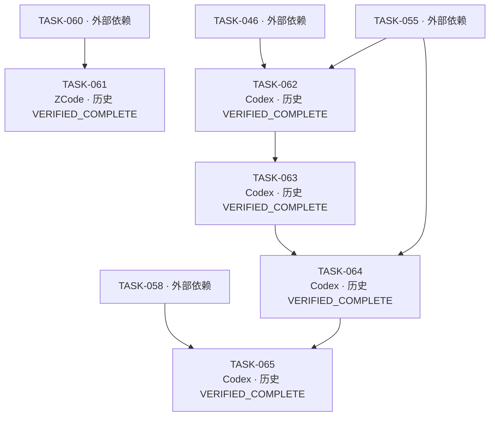

| Task / 标题 | 有效状态 / 原状态 | Owner / Reviewer | 依赖 / 主线祖先候选 | 备注 |
|---|---|---|---|---|
| [TASK-061](../../doc/tasks/TASK-061.md) 连接注册表驱逐与 remove_managed 解析一致性（R-002 / R-010 / R-011） | LEGACY_VERIFIED_COMPLETE / done | ZCode / Qoder（非作者） | TASK-060 / `0e2576463d1cd1c913061da95cb148ca2bc5589e` | — |
| [TASK-062](../../doc/tasks/TASK-062.md) 后置复审残留收口（Q-006 诊断脱敏 + TASK-046 R-001 多过滤器补证 + R-009） | LEGACY_VERIFIED_COMPLETE / done | Codex / Qoder（非作者） | TASK-046, TASK-055 / `ae50c8eeeb88101005fd50d054ab48a1232bd069` | — |
| [TASK-063](../../doc/tasks/TASK-063.md) 诊断脱敏边界与多过滤器测试补强（TASK-062 Review R-001/R-002/R-003/R-004/R-006） | LEGACY_VERIFIED_COMPLETE / done | Codex / Qoder（非作者） | TASK-062 / `94a0091` | — |
| [TASK-064](../../doc/tasks/TASK-064.md) diagnostics production wiring（TASK-055 装配接线后续） | LEGACY_VERIFIED_COMPLETE / done | Codex / DeepSeek Harness（非作者） | TASK-055, TASK-063 / `ec42feb2ce00b588c5f116f3fd850238998b9819` | — |
| [TASK-065](../../doc/tasks/TASK-065.md) TASK-058 复审尾项 docs+tests 小切片 | LEGACY_VERIFIED_COMPLETE / done | Codex / Qoder | TASK-058, TASK-064 / `784e30658e6769cae6b3802f36c060f6e4b3cc02` | — |

## 边界与未知

未找到专用 Task 文件的依赖 ID：无。不得推断其实现状态。

完整 branch/worktree/base/提交核验与每个 linked worktree 的 dirty 列表见 inventory.json。所有工作区均只读核验，未 reset、clean、stash、prune 或覆盖改动。
